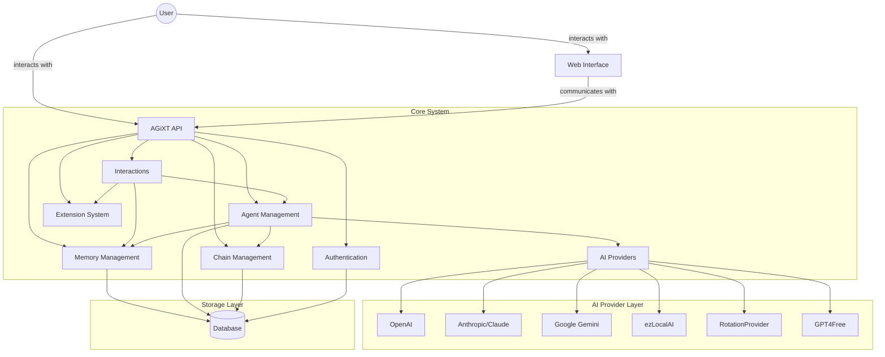
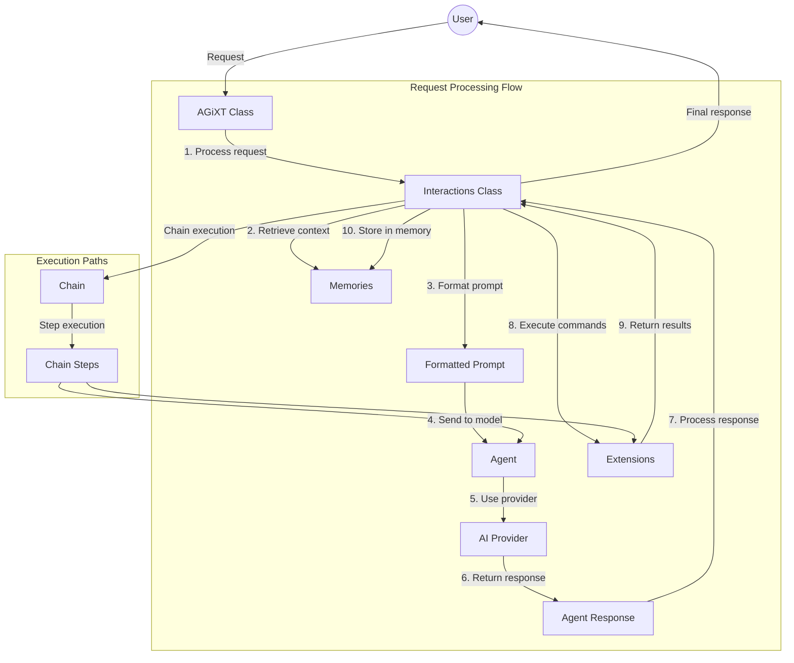
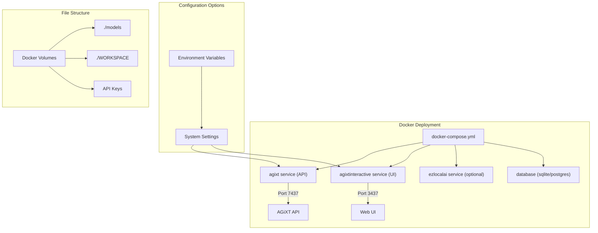

<!-- source: DeepWiki mcp.deepwiki.com · repo Josh-XT/AGiXT · page 1 Overview · fetched 2026-10-26 -->

# Overview

Relevant source files

The following files were used as context for generating this wiki page:

- [Dockerfile](Dockerfile)
- [agixt/Interactions.py](agixt/Interactions.py)
- [agixt/Memories.py](agixt/Memories.py)
- [agixt/Websearch.py](agixt/Websearch.py)
- [agixt/XT.py](agixt/XT.py)
- [agixt/app.py](agixt/app.py)
- [agixt/version](agixt/version)
- [docs/1-Getting started/0-Quick Start.md](docs/1-Getting started/0-Quick Start.md)
- [docs/1-Getting started/1-Environment Variables.md](docs/1-Getting started/1-Environment Variables.md)
- [docs/1-Getting started/4-Things to Consider.md](docs/1-Getting started/4-Things to Consider.md)
- [docs/1-Getting started/5-Preinstalled ISOs.md](docs/1-Getting started/5-Preinstalled ISOs.md)
- [docs/1-Getting started/Support.md](docs/1-Getting started/Support.md)
- [docs/README.md](docs/README.md)
- [requirements.txt](requirements.txt)

AGiXT is an AI automation platform designed to orchestrate efficient AI instruction management and task execution across multiple AI providers. It serves as a framework for creating, managing, and interacting with AI agents to automate complex workflows and tasks. The platform combines adaptive memory handling, smart features, and a versatile plugin system to maximize AI capabilities and enable sophisticated agent-based automation.

For information about specific components like the Agent System, see [Agent System](#2.1), Memory Management, see [Memory and Context Management](#2.2), or Chain execution, see [Chain System](#2.3).

## System Architecture

AGiXT follows a modular architecture with several key components that work together to provide a comprehensive AI automation framework.

Sources:
- [agixt/app.py:70-76]()
- [agixt/Interactions.py:31-96]()
- [docs/README.md:18-24]()
- [agixt/XT.py:37-106]()

## Core Classes and Components

The AGiXT system is built around several key classes that handle different aspects of the platform functionality:

1. **XT Class (`AGiXT`)**: The main entry point for interacting with the system programmatically, providing methods for inference, executing commands, running chains, and handling various types of input/output including text, audio, and images.

2. **Interactions Class**: Orchestrates interactions between users and agents, including formatting prompts, processing responses, executing commands and handling memory operations.

3. **Agent System**: Manages AI agents and their configurations, including settings for different providers, memory capabilities, and available commands.

4. **Memory System**: Manages storage and retrieval of contextual information for agents, implemented through the `Memories` class.

5. **Chain System**: Handles sequences of operations (chains) that can be executed as a workflow.

6. **Extension System**: Provides additional functionality through commands that agents can execute, such as file operations, web searches, and integrations with external services.

7. **Provider System**: Abstracts interactions with different AI models and services, allowing AGiXT to work with multiple AI providers.

8. **API and Endpoints**: Exposes the functionality of AGiXT through a RESTful API.

Sources:
- [agixt/XT.py:37-106]()
- [agixt/Interactions.py:31-96]()
- [agixt/Memories.py:434-462]()
- [agixt/app.py:70-87]()

## Request Flow

The following diagram illustrates how a user request flows through the AGiXT system:

Sources:
- [agixt/XT.py:184-284]()
- [agixt/Interactions.py:535-811]()

### Request Initialization

When a user interacts with AGiXT, the system initializes the necessary components:

1. The `AGiXT` class creates an instance of `Interactions` with the specified agent
2. The `Interactions` class initializes the agent, memories, and other required components
3. The user input is processed and formatted into a prompt

Sources:
- [agixt/XT.py:37-106]()
- [agixt/Interactions.py:31-96]()

### Memory and Context Handling

AGiXT uses a memory system to maintain context:

1. The system retrieves relevant memories based on the user input
2. These memories are injected into the prompt to provide context
3. After receiving a response, new information is stored in memory

Sources:
- [agixt/Interactions.py:90-441]()
- [agixt/Memories.py:434-462]()

### Command Execution

AGiXT can execute commands through the Extensions system:

1. Commands are extracted from agent responses
2. The Extensions system executes the appropriate commands
3. Command results are formatted and returned to the user

Sources:
- [agixt/XT.py:386-441]()
- [agixt/Interactions.py:811-812]()

### Chain Execution

The Chain system allows for executing sequences of predefined steps:

1. Chains are defined as a series of steps
2. Each step can be a prompt or a command
3. Steps are executed in sequence, with results from one step being available to subsequent steps

Sources:
- [agixt/XT.py:443-623]()

## Features and Capabilities

AGiXT provides a rich set of features for AI automation:

- **Context and Token Management**: Adaptive handling of long-term and short-term memory for optimized AI performance
- **Multi-Provider Compatibility**: Integration with various AI providers including OpenAI, EzLocalAI, Google, Anthropic, and others
- **Web Browsing & Command Execution**: Ability to browse the web and execute commands for interactive AI experiences
- **Chain Management**: Automation of complex workflows through sequences of linked commands
- **Multi-modal I/O**: Support for text, audio, and image processing
- **Extensions**: Extensible command set that can be customized and expanded
- **RESTful API**: Comprehensive API for integrating AGiXT with other applications

Sources:
- [docs/README.md:55-70]()
- [agixt/Websearch.py:50-83]()
- [agixt/XT.py:286-369]()

## Deployment and Configuration

AGiXT can be deployed using Docker:

1. The `start.py` script provides an easy way to set up and configure AGiXT
2. The system can be run with different configurations using command-line arguments or environment variables
3. Multiple services can be deployed, including the core API and optional components like ezLocalAI

Sources:
- [Dockerfile:1-9]()
- [docs/1-Getting started/0-Quick Start.md:24-37]()
- [docs/1-Getting started/1-Environment Variables.md:1-27]()

## Conclusion

AGiXT provides a comprehensive framework for AI automation, enabling the creation and management of sophisticated AI agents that can perform a wide range of tasks. With its modular architecture, support for multiple AI providers, and extensive feature set, AGiXT offers a powerful platform for developing AI-powered applications and workflows.

The system is designed to be extensible and configurable, allowing users to adapt it to their specific needs and use cases. Whether you're building a simple chatbot or a complex autonomous system, AGiXT provides the tools and infrastructure to make it happen.

Sources:
- [docs/README.md:22-24]()
- [agixt/app.py:70-76]()

---

