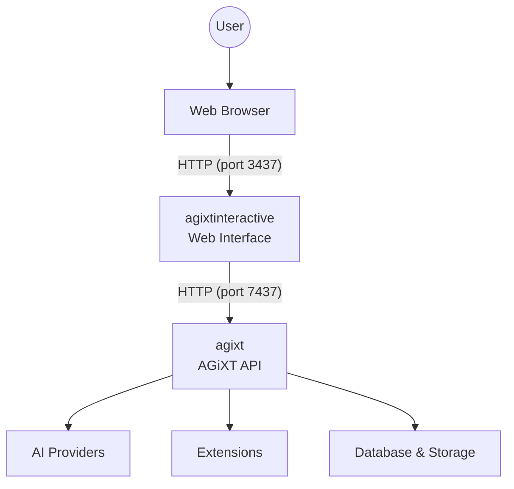
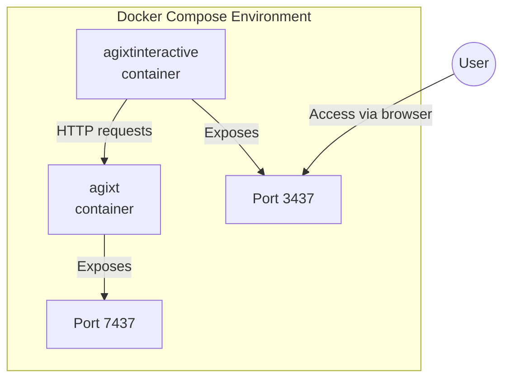
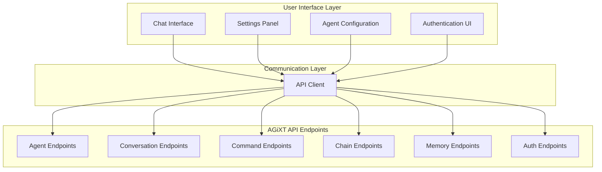

<!-- source: DeepWiki mcp.deepwiki.com · repo Josh-XT/AGiXT · page 11 Web Interface · fetched 2026-10-26 -->

# Web Interface

<details>
<summary>Relevant source files</summary>

The following files were used as context for generating this wiki page:

- [.gitignore](.gitignore)
- [docker-compose-dev.yml](docker-compose-dev.yml)
- [docker-compose.yml](docker-compose.yml)

</details>


The AGiXT Web Interface provides a user-friendly way to interact with the AGiXT AI orchestration platform. This document describes the web interface component, its deployment, configuration options, and how it interacts with the AGiXT API and other system components.

For information about the API that the web interface communicates with, see [API Reference](#7).

## Architecture Overview

The AGiXT web interface runs as a separate service from the core AGiXT API. This separation allows for independent scaling and development of the frontend and backend components.



Sources: [docker-compose.yml:83-114](), [docker-compose.yml:2-82]()

The web interface is implemented as a Docker container named `agixtinteractive` that communicates with the core `agixt` service. It provides a modern, reactive web application that translates user interactions into API calls to the AGiXT backend.

## Deployment Configuration

### Docker Setup

The web interface is deployed as part of the standard AGiXT Docker Compose configuration. It uses the `joshxt/agixt-interactive:main` image and exposes port 3437 by default.



Sources: [docker-compose.yml:83-114]()

### Volumes and Persistence

The web interface container mounts a volume for node_modules to ensure persistent storage of Node.js dependencies:

```
volumes:
  - ./node_modules:/app/node_modules
```

Sources: [docker-compose.yml:115-116]()

## Environment Variables

The web interface's behavior can be extensively customized through environment variables defined in the Docker Compose configuration.

### Connection Configuration

| Variable | Default | Description |
|----------|---------|-------------|
| `AGIXT_SERVER` | http://localhost:7437 | URL of the AGiXT API server |
| `APP_URI` | http://localhost:3437 | URL where the web interface is accessible |

Sources: [docker-compose.yml:91-94]()

### Application Branding

| Variable | Default | Description |
|----------|---------|-------------|
| `APP_NAME` | AGiXT | Name of the application displayed to users |
| `APP_DESCRIPTION` | AGiXT is an advanced artificial intelligence agent orchestration agent. | Description of the application |
| `AGIXT_FOOTER_MESSAGE` | AGiXT 2024 | Custom message displayed in the footer |

Sources: [docker-compose.yml:89-93]()

### Feature Toggles

| Variable | Default | Description |
|----------|---------|-------------|
| `AGIXT_FILE_UPLOAD_ENABLED` | true | Enable/disable file upload functionality |
| `AGIXT_VOICE_INPUT_ENABLED` | true | Enable/disable voice input |
| `AGIXT_RLHF` | true | Enable/disable reinforcement learning from human feedback |
| `INTERACTIVE_MODE` | chat | Set the default interaction mode |
| `AGIXT_CONVERSATION_MODE` | select | Controls how conversations are managed |
| `AGIXT_ALLOW_MESSAGE_EDITING` | true | Allow users to edit messages |
| `AGIXT_ALLOW_MESSAGE_DELETION` | true | Allow users to delete messages |
| `AGIXT_SHOW_OVERRIDE_SWITCHES` | tts,websearch,analyze-user-input | Controls which override switches are displayed |

Sources: [docker-compose.yml:96-103]()

### Authentication Configuration

| Variable | Default | Description |
|----------|---------|-------------|
| `ALLOW_EMAIL_SIGN_IN` | true | Enable email-based authentication |
| `DISCORD_CLIENT_ID` | - | OAuth client ID for Discord authentication |
| `GOOGLE_CLIENT_ID` | - | OAuth client ID for Google authentication |
| `GITHUB_CLIENT_ID` | - | OAuth client ID for GitHub authentication |
| `MICROSOFT_CLIENT_ID` | - | OAuth client ID for Microsoft authentication |
| `TESLA_CLIENT_ID` | - | OAuth client ID for Tesla authentication |
| `X_CLIENT_ID` | - | OAuth client ID for X/Twitter authentication |

Sources: [docker-compose.yml:104-110]()

## User Interaction Flow

The web interface orchestrates the interaction between users and the AGiXT system through a structured flow:

```mermaid
sequenceDiagram
    participant "User" as User
    participant "Web Interface<br>(agixtinteractive)" as WebUI
    participant "AGiXT API<br>(agixt)" as API
    participant "AI Provider" as Provider
    
    User->>WebUI: Authentication
    WebUI->>API: Validate credentials
    API-->>WebUI: Authentication result
    WebUI-->>User: Authentication status
    
    User->>WebUI: Send prompt/message
    WebUI->>API: Forward request
    API->>Provider: Process with AI provider
    Provider-->>API: Generate response
    API-->>WebUI: Return formatted response
    WebUI-->>User: Display response with UI enhancements
    
    User->>WebUI: Execute command/action
    WebUI->>API: Forward command request
    API->>API: Process with extensions
    API-->>WebUI: Return execution results
    WebUI-->>User: Display results
```

Sources: [docker-compose.yml:83-114](), [docker-compose.yml:2-82]()

## Key Features

### Authentication Methods

The web interface supports multiple authentication methods:

1. Email-based authentication (when `ALLOW_EMAIL_SIGN_IN` is enabled)
2. OAuth providers including:
   - Discord
   - Google
   - GitHub
   - Microsoft
   - Tesla
   - X/Twitter

Sources: [docker-compose.yml:104-110]()

### User Interface Capabilities

The web interface provides several features for interacting with AGiXT agents:

- **Chat Interface**: The primary mode of interaction with agents through text-based conversation
- **Voice Input**: When enabled, allows users to provide input via voice
- **File Upload**: When enabled, allows users to upload files to provide context or data to agents
- **Message Management**: Options to edit or delete messages in the conversation
- **Override Switches**: Toggles for enabling/disabling specific features during interaction (like text-to-speech, web search, etc.)
- **Agent Selection**: Ability to choose from available agents
- **Conversation Management**: Options to start new conversations or continue existing ones

Sources: [docker-compose.yml:96-103]()

## Customization

The web interface can be customized through environment variables without modifying code. Common customizations include:

1. **Branding**: Change the application name, description, and footer message
2. **Feature availability**: Enable or disable specific features like file uploads or voice input
3. **UI behavior**: Control whether users can edit or delete messages
4. **Authentication options**: Configure which authentication methods are available

These configurations can be set in the `.env` file or directly in the docker-compose.yml file.

Sources: [docker-compose.yml:89-110](), [.gitignore:5]()

## Integration with AGiXT Core

The web interface acts as a client to the AGiXT API, providing a user-friendly wrapper around the core functionality. It translates user interactions into API calls and formats responses for display.



Sources: [docker-compose.yml:91]()

## Running the Web Interface

By default, the web interface is accessible at `http://localhost:3437` after starting the AGiXT Docker Compose environment with:

```
docker-compose up -d
```

The port can be customized by setting the `AGIXT_INTERACTIVE_PORT` environment variable.

Sources: [docker-compose.yml:112-113]()

---

