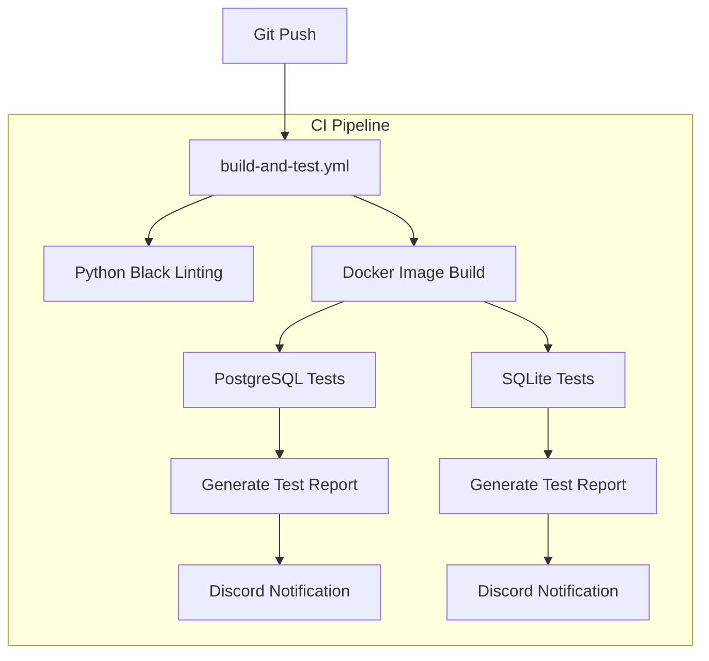
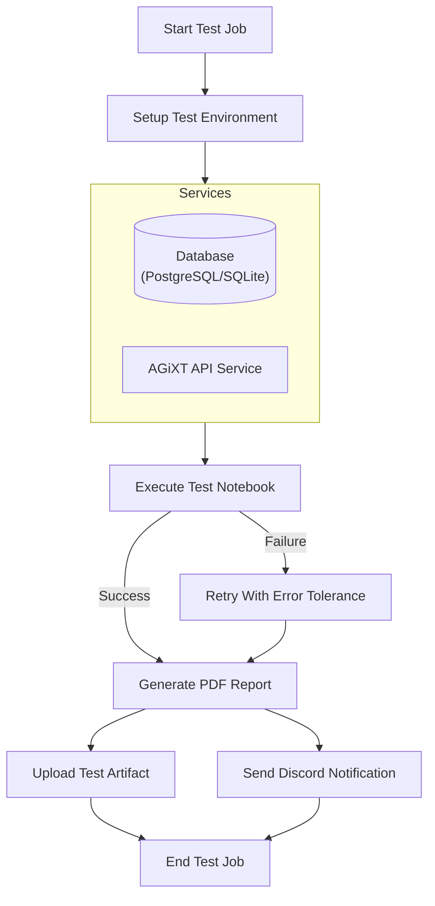
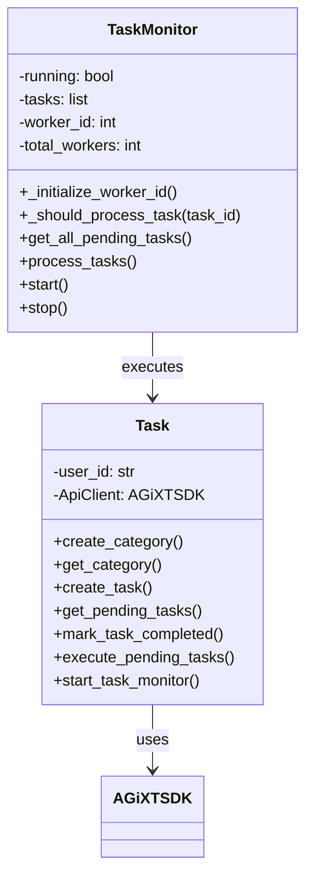
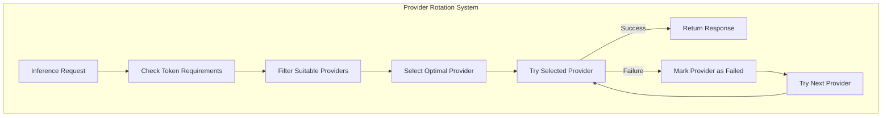
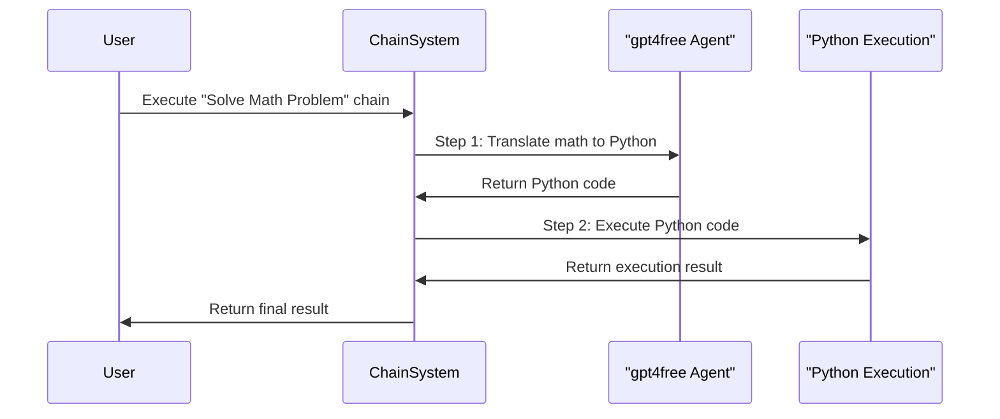

<!-- source: DeepWiki mcp.deepwiki.com · repo Josh-XT/AGiXT · page 12 Development and Testing · fetched 2026-10-26 -->

# Development and Testing

<details>
<summary>Relevant source files</summary>

The following files were used as context for generating this wiki page:

- [.github/workflows/build-and-test.yml](.github/workflows/build-and-test.yml)
- [.github/workflows/tests.yml](.github/workflows/tests.yml)
- [agixt/Task.py](agixt/Task.py)
- [agixt/TaskMonitor.py](agixt/TaskMonitor.py)
- [agixt/chains/Solve Math Problem.json](agixt/chains/Solve Math Problem.json)
- [agixt/providers/rotation.py](agixt/providers/rotation.py)
- [tests/endpoint-tests.ipynb](tests/endpoint-tests.ipynb)

</details>


This page explains how to set up a development environment for AGiXT and how to run tests to verify its functionality. It covers local development workflows and continuous integration practices used in the AGiXT project. For information about deployment in production, see [Deployment](#6).

## Development Environment Setup

AGiXT uses Docker for development to ensure consistent environments. To set up a development environment, you'll need to have Docker and Docker Compose installed.

### Prerequisites

- Docker
- Docker Compose
- Python 3.8 or higher
- Git

### Local Development Setup

1. Clone the AGiXT repository:
   ```bash
   git clone https://github.com/Josh-XT/AGiXT
   cd AGiXT
   ```

2. Start the development environment:
   ```bash
   docker-compose up -d
   ```

This will start the AGiXT API server on port 7437 and the web interface on port 3437.

Sources: [.github/workflows/build-and-test.yml](), [.github/workflows/tests.yml]()

## Running Tests

AGiXT uses Jupyter notebooks for testing API functionality. This approach provides both executable tests and documented examples of API usage.

### Running Tests Locally

1. Install the required Python dependencies:
   ```bash
   pip install jupyter nbconvert openai requests agixtsdk qrcode
   ```

2. Run the tests:
   ```bash
   python -m nbconvert --execute --to pdf tests/endpoint-tests.ipynb
   ```

This will execute the test notebook and generate a PDF report of the results.

### Test Structure

The main test notebook (`endpoint-tests.ipynb`) verifies functionality including:

- User registration and authentication
- Agent creation and configuration
- Extension command execution
- Conversation management
- Provider and model interactions

Sources: [tests/endpoint-tests.ipynb]()

## Continuous Integration Pipeline

AGiXT uses GitHub Actions for continuous integration. The pipeline ensures code quality and functionality across different database backends.

### CI Workflow Architecture



The CI pipeline performs:

1. **Linting**: Ensures code follows Python Black formatting conventions
2. **Building**: Creates Docker images of the application
3. **Testing**: Runs tests against PostgreSQL and SQLite databases
4. **Reporting**: Generates test reports and notifications

Sources: [.github/workflows/build-and-test.yml](), [.github/workflows/tests.yml]()

### Test Execution Workflow



Sources: [.github/workflows/tests.yml:39-164]()

## Task Monitoring System

AGiXT includes a task monitoring system that allows for scheduled execution of tasks. This system is useful for development and testing of long-running or scheduled operations.

### Task System Architecture



The task system features:

- **Worker Distribution**: Tasks are distributed across workers using consistent hashing
- **Scheduled Execution**: Tasks can be scheduled for execution at specific times
- **Database Integration**: Tasks are stored and retrieved from the database
- **Error Handling**: Failed tasks are logged and can be retried

Sources: [agixt/TaskMonitor.py](), [agixt/Task.py]()

## Writing New Tests

To add new tests to AGiXT, you can either extend the existing test notebook or create a new one.

### Best Practices for Tests

1. **Isolation**: Each test should be independent of others
2. **Documentation**: Include clear explanations of what is being tested
3. **Error Handling**: Include proper error handling to diagnose failures
4. **Resource Cleanup**: Clean up resources created during tests

### Example Test Case

A typical test case in the AGiXT test notebook follows this pattern:

1. Setup required resources (e.g., create an agent)
2. Execute the functionality being tested
3. Verify the results
4. Clean up resources

Here's an example from the test notebook structure:

```python
# Create a new Agent
agent_name = "test_agent"
add_agent_resp = agixt.add_agent(
    agent_name=agent_name,
    settings={
        "mode": "prompt",
        "prompt_category": "Default",
        "prompt_name": "Think About It",
        "persona": "",
    },
)

# Execute a command with the agent
command_execution = agixt.execute_command(
    agent_name=agent_name,
    command_name="Write to File",
    command_args={"filename": "test.txt", "text": "This is a test"},
    conversation_name="Command execution test",
)

# Verify the result
# (In actual tests, assertions would be added here)

# Clean up
# (Remove the agent, delete created files, etc.)
```

Sources: [tests/endpoint-tests.ipynb:378-404](), [tests/endpoint-tests.ipynb:433-452]()

## Testing the Provider System

AGiXT's provider system allows interacting with different AI backends. The rotation provider allows for intelligent fallback between providers.

### Provider Rotation Architecture



When testing the provider system:

1. Test each provider individually
2. Test fallback scenarios
3. Test token limit handling
4. Test error handling and recovery

Sources: [agixt/providers/rotation.py]()

## Chain Testing

AGiXT chains allow for executing sequences of steps. Testing chains requires verifying that each step executes correctly and that data flows properly between steps.

### Chain Execution Testing Example



This diagram shows the execution flow of the "Solve Math Problem" chain, which:
1. Translates a math problem to Python code
2. Executes the Python code to get the solution

Sources: [agixt/chains/Solve Math Problem.json]()

## Advanced Development Topics

### Embedding Provider Development

When developing new embedding providers or testing existing ones:

1. Implement the required interface methods
2. Configure the embedding dimensions correctly
3. Test with various text inputs
4. Verify that semantic searches yield relevant results

### Extension Development

To develop new extensions:

1. Create a Python module in the extensions directory
2. Implement the required command methods
3. Add command documentation
4. Write tests for the extension commands

## Troubleshooting

### Common Issues

| Issue | Possible Solution |
|-------|-------------------|
| Database connection errors | Check database credentials in environment variables |
| API authentication failures | Verify API key configuration |
| Provider errors | Check provider API keys and configuration |
| Test notebook failures | Check Python dependencies and environment setup |
| Docker container issues | Check Docker logs and container health |

### Debugging Tips

1. Enable debug logging by setting `LOG_LEVEL=DEBUG`
2. Check Docker container logs: `docker logs <container_id>`
3. Use the API directly to test specific endpoints
4. Examine database state for unexpected data

Sources: [.github/workflows/tests.yml:102-104]()

---

