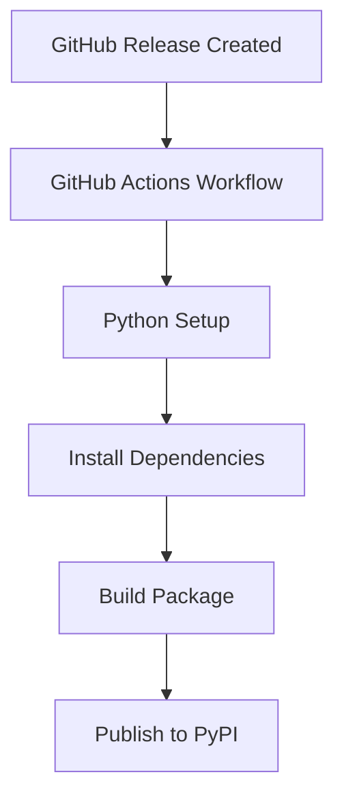
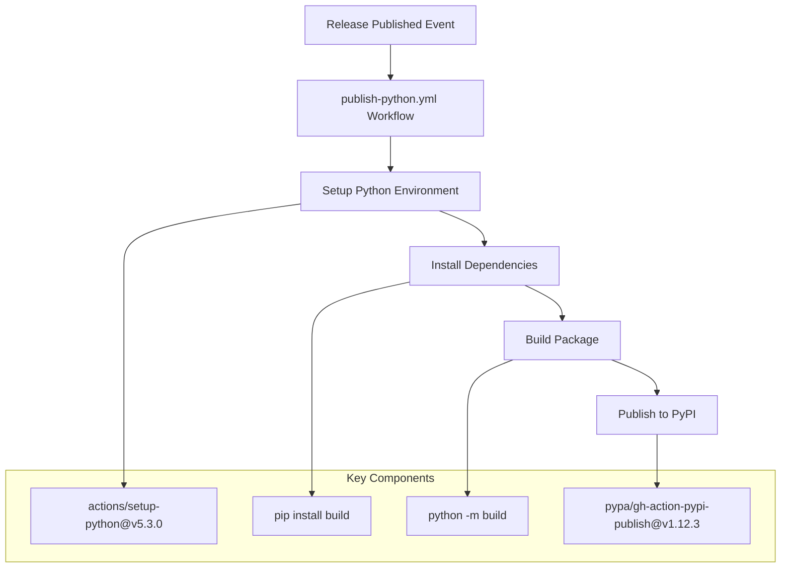
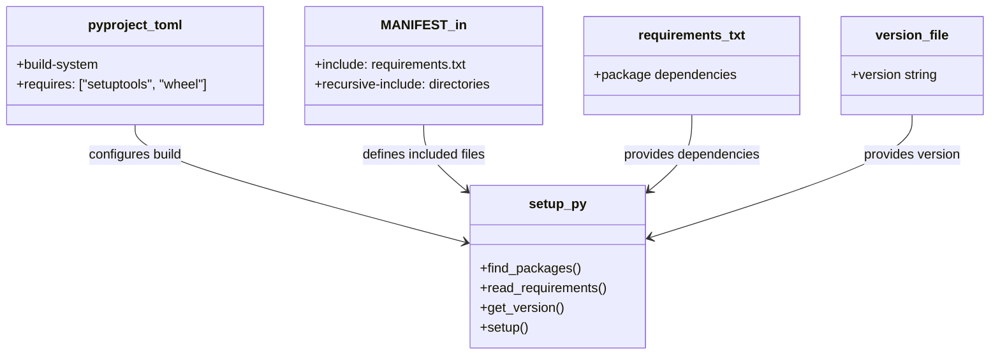
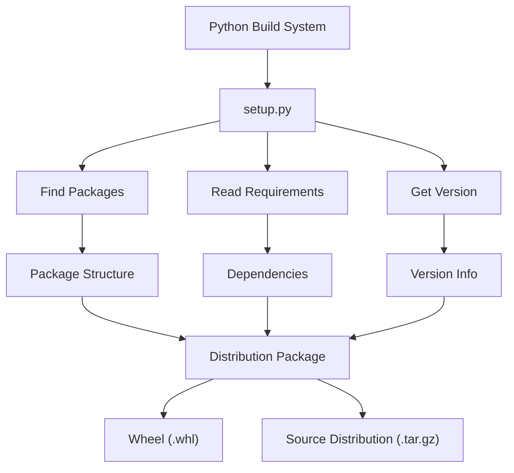
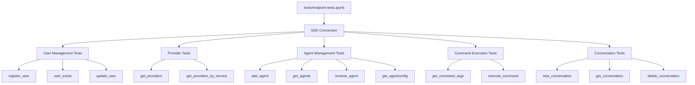
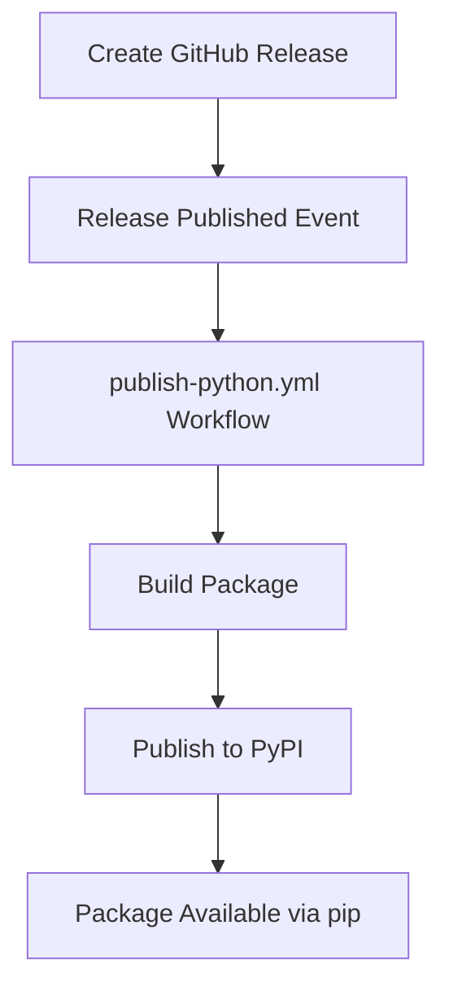
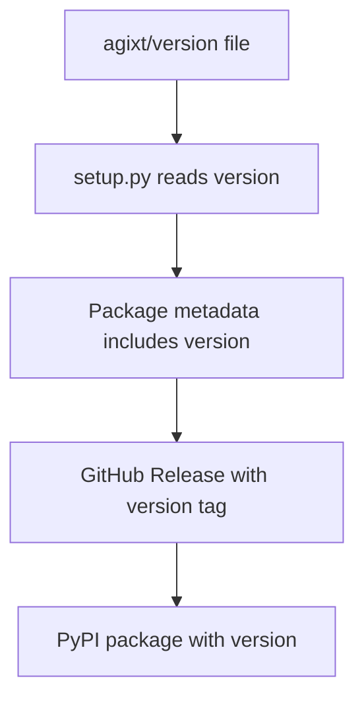
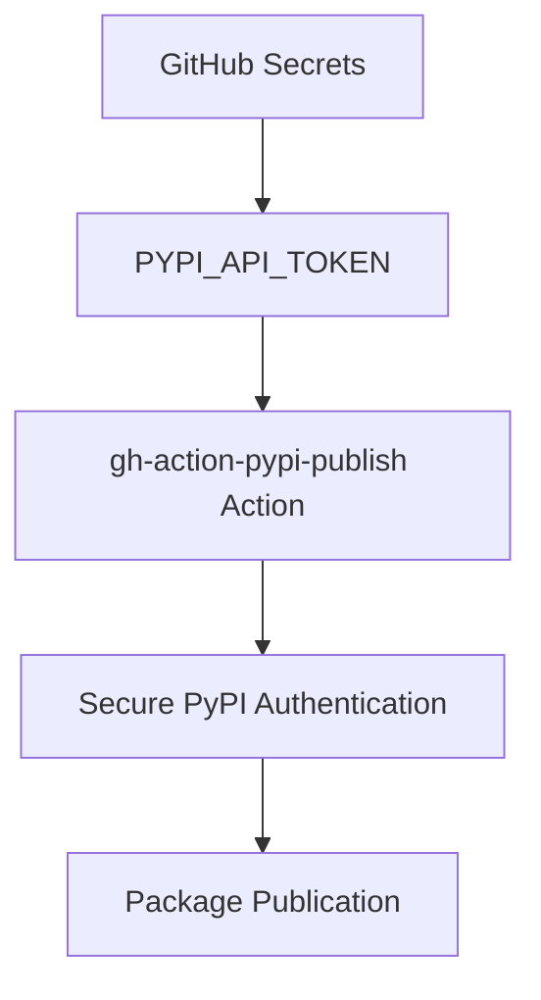

<!-- source: DeepWiki mcp.deepwiki.com · repo Josh-XT/AGiXT · page 12.1 CI/CD Pipeline · fetched 2026-10-26 -->

# CI/CD Pipeline

Relevant source files

The following files were used as context for generating this wiki page:

- [.github/workflows/publish-python.yml](.github/workflows/publish-python.yml)
- [MANIFEST.in](MANIFEST.in)
- [pyproject.toml](pyproject.toml)
- [setup.py](setup.py)
- [tests/endpoint-tests.ipynb](tests/endpoint-tests.ipynb)

This document details the Continuous Integration and Continuous Deployment (CI/CD) pipeline for the AGiXT project. It covers the automated build, test, and release processes used to maintain code quality and streamline the delivery of new features. For information about the general development environment, see [Development and Testing](#12).

## Pipeline Overview

AGiXT implements a GitHub Actions-based CI/CD pipeline that automates the process of building, packaging, and publishing the Python package. The pipeline is primarily triggered when new releases are published.

### CI/CD Workflow Diagram

Sources:
- [.github/workflows/publish-python.yml:9-38]()

## GitHub Actions Configuration

The AGiXT project uses GitHub Actions to automate the package publication process when new releases are created.

### PyPI Publication Workflow

The workflow defined in `.github/workflows/publish-python.yml` performs the following steps:

1. Triggers on the `release published` event
2. Sets up a Python environment using `actions/setup-python@v5.3.0`
3. Installs the build dependencies, specifically the `build` package
4. Builds the package using `python -m build`
5. Publishes the package to PyPI using `pypa/gh-action-pypi-publish`

Sources:
- [.github/workflows/publish-python.yml:9-38]()

## Package Building Process

The package building process relies on standard Python packaging tools and configuration files to create a distributable package.

### Build Configuration

The package build process is configured through several files:

- `pyproject.toml`: Specifies that `setuptools` and `wheel` are required for building
- `setup.py`: The main script for building the package, which:
  - Determines packages to include using `find_packages()`
  - Reads dependencies from `requirements.txt`
  - Retrieves the version from `agixt/version`
  - Configures package metadata
- `MANIFEST.in`: Controls which additional files are included in the package distribution

Sources:
- [pyproject.toml:1-2]()
- [setup.py:1-34]()
- [MANIFEST.in:1-6]()

### Build Flow

The build process:

1. The Python build system invokes `setup.py`
2. `setup.py` discovers packages with `find_packages()`
3. Requirements are read from `requirements.txt`
4. Version is retrieved from `agixt/version`
5. Distribution packages are created in both wheel and source distribution formats

Sources:
- [setup.py:1-34]()
- [.github/workflows/publish-python.yml:32-33]()

## Testing Infrastructure

While not explicitly integrated into the CI/CD pipeline based on the provided files, AGiXT includes comprehensive endpoint tests that verify the functionality of the API and SDK.

### Test Structure

The testing infrastructure includes:

- Connection and authentication tests
- Provider functionality tests
- Agent management tests
- Command execution tests
- Conversation handling tests

These tests use the AGiXT SDK to interact with the API endpoints and verify their functionality.

Sources:
- [tests/endpoint-tests.ipynb:1-842]()

## Release Process

The release process in AGiXT is triggered when a new release is published on GitHub.

### Release Flow

The release process follows these steps:

1. A maintainer creates a new release on GitHub
2. The creation triggers the `publish-python.yml` workflow
3. The workflow builds the package
4. The package is published to PyPI using the PYPI_API_TOKEN secret
5. The new version becomes available for installation via pip

Sources:
- [.github/workflows/publish-python.yml:11-14]()
- [.github/workflows/publish-python.yml:34-38]()

## Version Management

AGiXT uses a dedicated version file to manage version information across the project.

### Version Flow

The version management process:

1. The version is stored in a file at `agixt/version`
2. `setup.py` reads this version during the build process (lines 19-21)
3. The version is included in the package metadata
4. The version number is reflected in both the GitHub release tag and the PyPI package

Sources:
- [setup.py:19-21]()

## Security Considerations

The PyPI publication process uses secure credentials management through GitHub Secrets.

Security features include:

1. PyPI API token stored as a GitHub Secret
2. Token accessed securely during workflow execution
3. No exposure of sensitive credentials in workflow logs or code

Sources:
- [.github/workflows/publish-python.yml:34-38]()

## Current Limitations

Based on the provided files, the current CI/CD pipeline focuses primarily on the package publication process. It does not appear to include automated testing or code quality checks as part of the workflow. The endpoint tests in the Jupyter notebook are comprehensive but would need to be converted to automated test scripts to be integrated into a CI pipeline.