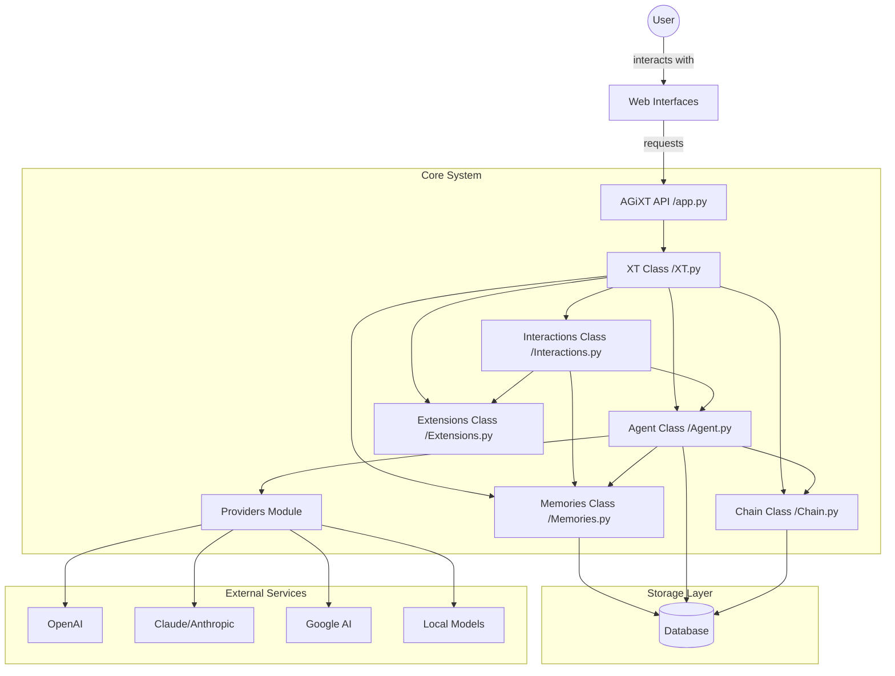
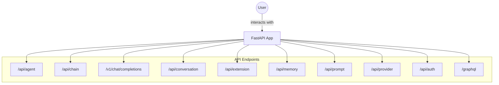
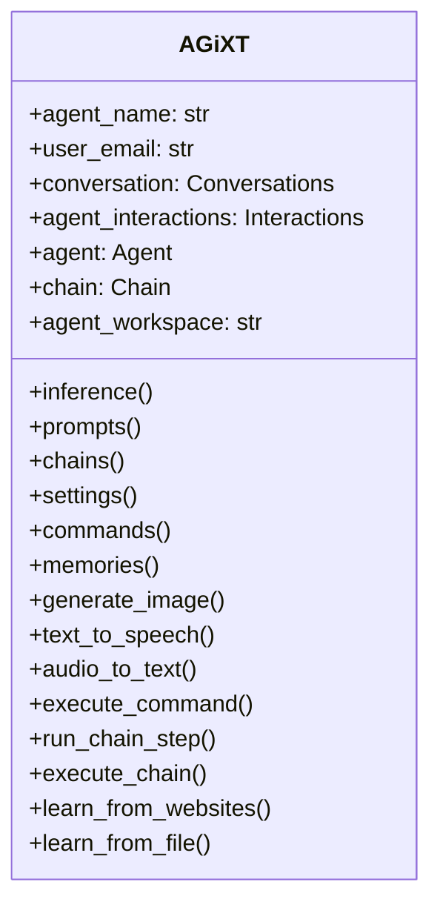
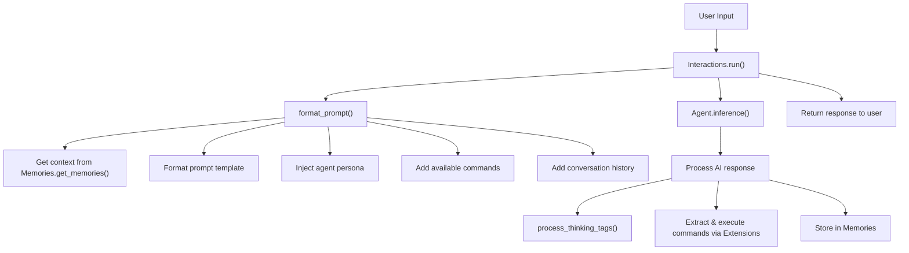
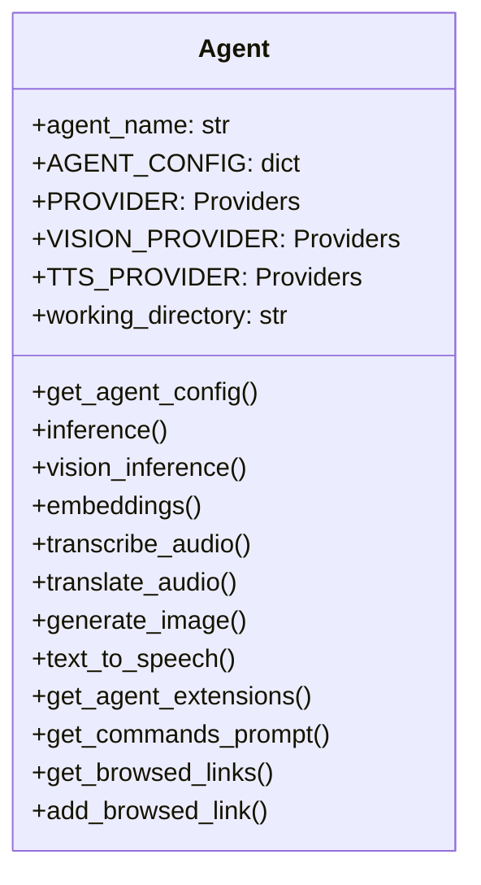
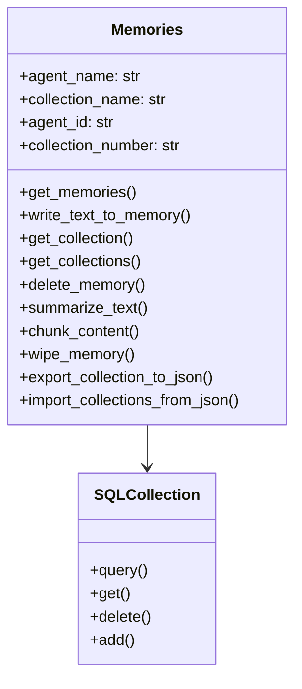
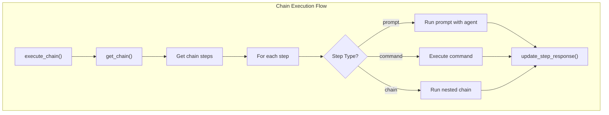
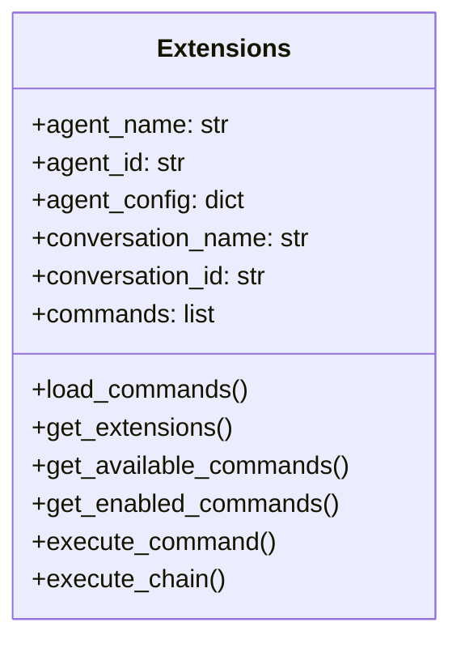
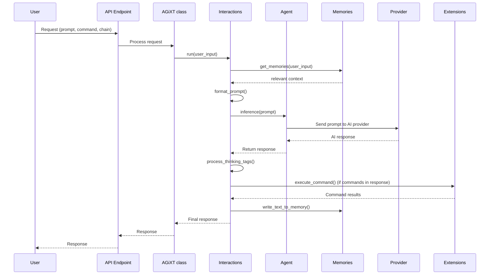
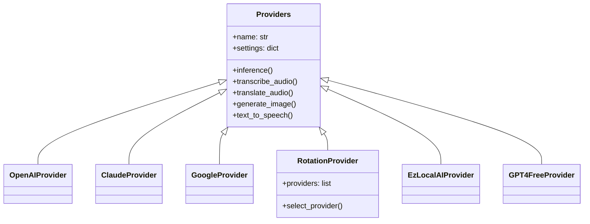

<!-- source: DeepWiki mcp.deepwiki.com · repo Josh-XT/AGiXT · page 2 Core Architecture · fetched 2026-10-26 -->

# Core Architecture

Relevant source files

The following files were used as context for generating this wiki page:

- [Dockerfile](Dockerfile)
- [agixt/Agent.py](agixt/Agent.py)
- [agixt/ApiClient.py](agixt/ApiClient.py)
- [agixt/Chain.py](agixt/Chain.py)
- [agixt/Conversations.py](agixt/Conversations.py)
- [agixt/Extensions.py](agixt/Extensions.py)
- [agixt/Interactions.py](agixt/Interactions.py)
- [agixt/Memories.py](agixt/Memories.py)
- [agixt/Models.py](agixt/Models.py)
- [agixt/SeedImports.py](agixt/SeedImports.py)
- [agixt/Websearch.py](agixt/Websearch.py)
- [agixt/XT.py](agixt/XT.py)
- [agixt/app.py](agixt/app.py)
- [agixt/endpoints/Agent.py](agixt/endpoints/Agent.py)
- [agixt/endpoints/Chain.py](agixt/endpoints/Chain.py)
- [agixt/endpoints/Completions.py](agixt/endpoints/Completions.py)
- [agixt/endpoints/Conversation.py](agixt/endpoints/Conversation.py)
- [agixt/endpoints/Extension.py](agixt/endpoints/Extension.py)
- [agixt/endpoints/GQL.py](agixt/endpoints/GQL.py)
- [agixt/endpoints/Memory.py](agixt/endpoints/Memory.py)
- [agixt/endpoints/Prompt.py](agixt/endpoints/Prompt.py)
- [agixt/endpoints/Provider.py](agixt/endpoints/Provider.py)
- [agixt/prompts/Default/Name Conversation.txt](agixt/prompts/Default/Name Conversation.txt)
- [agixt/version](agixt/version)
- [requirements.txt](requirements.txt)

This document outlines the high-level architecture of AGiXT, an AI automation platform that orchestrates AI agents. It explains the core components and how they interact to enable the functionality of the system. For specific details about the agent system, see [Agent System](#2.1); for memory management, see [Memory and Context Management](#2.2); for chain execution, see [Chain System](#2.3); and for conversation handling, see [Conversation Management](#2.4).

## System Overview

Sources: 
- [agixt/app.py:69-113](())
- [agixt/XT.py:37-106](())
- [agixt/Interactions.py:31-68](())
- [agixt/Agent.py:290-314](())
- [agixt/Memories.py:434-468](())
- [agixt/Chain.py:29-40](())
- [agixt/Extensions.py:30-70](())

## Core Components

AGiXT's architecture consists of several key components that work together to provide a flexible AI agent automation platform:

### 1. API Layer (`app.py`)

The API layer, built with FastAPI, provides the interface for client applications to interact with AGiXT. It handles HTTP requests, authentication, and routes them to the appropriate components.

Sources:
- [agixt/app.py:69-113](())
- [agixt/app.py:87-98](()) - Router inclusion
- [agixt/endpoints/Agent.py:48-50](())
- [agixt/endpoints/Chain.py:18-21](())
- [agixt/endpoints/Completions.py:26-29](())
- [agixt/endpoints/Conversation.py:32-34](())
- [agixt/endpoints/Extension.py:7-9](())
- [agixt/endpoints/Memory.py:34-36](())
- [agixt/endpoints/Prompt.py:14-16](())
- [agixt/endpoints/Provider.py:18-20](())
- [agixt/app.py:247-255](()) - GraphQL integration

### 2. XT Class (`XT.py`)

The `AGiXT` class in `XT.py` serves as the main orchestration layer for the system, providing high-level methods for client applications to interact with AGiXT. It initializes and coordinates the other core components.

Sources:
- [agixt/XT.py:37-106](()) - AGiXT class definition
- [agixt/XT.py:184-284](()) - inference method
- [agixt/XT.py:555-623](()) - execute_chain method
- [agixt/XT.py:393-441](()) - execute_command method

### 3. Interactions System (`Interactions.py`)

The `Interactions` class is the core of AGiXT's intelligence, handling prompt formatting, context retrieval, and response processing. It orchestrates the flow of information between users, agents, and extensions.

Sources:
- [agixt/Interactions.py:31-68](()) - Interactions class definition
- [agixt/Interactions.py:90-441](()) - format_prompt method
- [agixt/Interactions.py:443-533](()) - process_thinking_tags method
- [agixt/Interactions.py:535-811](()) - run method

### 4. Agent System (`Agent.py`)

The `Agent` class manages agent configurations and handles connections to various AI providers. It's responsible for:
- Loading and managing agent configurations
- Initializing provider connections
- Handling inference requests to AI models
- Managing agent-specific workspaces

Sources:
- [agixt/Agent.py:290-406](()) - Agent class definition
- [agixt/Agent.py:626-654](()) - inference method
- [agixt/Agent.py:487-594](()) - get_agent_config method

### 5. Memory System (`Memories.py`)

The `Memories` class handles the storage and retrieval of knowledge, using vector embeddings for semantic search:

Sources:
- [agixt/Memories.py:434-468](()) - Memories class definition
- [agixt/Memories.py:480-494](()) - wipe_memory method
- [agixt/Memories.py:623-676](()) - get_memories method
- [agixt/Memories.py:641-884](()) - write_text_to_memory method
- [agixt/Memories.py:269-372](()) - SQLCollection class definition

### 6. Chain System (`Chain.py`)

The `Chain` class enables the creation and execution of sequential workflows:

Sources:
- [agixt/Chain.py:29-40](()) - Chain class definition
- [agixt/Chain.py:34-108](()) - get_chain method
- [agixt/Chain.py:219-432](()) - add_chain_step method
- [agixt/XT.py:555-623](()) - execute_chain implementation

### 7. Extension System (`Extensions.py`)

The `Extensions` class provides a plugin architecture for extending agent capabilities through commands:

Sources:
- [agixt/Extensions.py:30-70](()) - Extensions class definition
- [agixt/Extensions.py:668-761](()) - load_commands method
- [agixt/Extensions.py:386-664](()) - execute_command method

## Data Flow Through the System

Let's examine how data flows through AGiXT when processing a user request:

Sources:
- [agixt/XT.py:184-284](()) - inference method flow
- [agixt/Interactions.py:535-811](()) - run method
- [agixt/Interactions.py:90-441](()) - format_prompt method

## Key Database Schema

AGiXT uses a database to store various types of information. The core database tables include:

| Table | Purpose | Related Files |
|-------|---------|--------------|
| `Agent` | Stores agent configurations | [agixt/Agent.py:91-148](()) |
| `AgentSetting` | Stores agent-specific settings | [agixt/Agent.py:132-137](()) |
| `Memory` | Stores agent memories | [agixt/Memories.py:390-406](()) |
| `Conversation` | Stores conversation metadata | [agixt/Conversations.py:72-96](()) |
| `Message` | Stores conversation messages | [agixt/Conversations.py:232-279](()) |
| `Chain` | Stores chain definitions | [agixt/Chain.py:216-217](()) |
| `ChainStep` | Stores steps within chains | [agixt/Chain.py:239-279](()) |
| `Command` | Stores available commands | [agixt/Extensions.py:668-700](()) |
| `User` | Stores user information | [agixt/Agent.py:106-114](()) |

Sources:
- [agixt/DB.py](()) (referenced by other files)
- [agixt/Agent.py:91-148](()) - Agent table usage
- [agixt/Memories.py:390-406](()) - Memory table usage
- [agixt/Conversations.py:72-96](()) - Conversation table usage

## Provider System

AGiXT connects to various AI providers through an abstraction layer:

Sources:
- [agixt/Agent.py:314-371](()) - Provider initialization
- [agixt/Agent.py:626-654](()) - Provider inference usage

## Request Processing Lifecycle

Let's look at the complete lifecycle of a request through AGiXT:

1. **Request Ingestion**:
   - User sends request to API endpoint
   - API routes request to appropriate handler
   - Authentication is verified through `verify_api_key()`

2. **Request Processing**:
   - Request is passed to an `AGiXT` instance (`XT` class)
   - `AGiXT` initializes necessary components and passes to `Interactions`

3. **Context Gathering**:
   - `Interactions.format_prompt()` retrieves relevant memories
   - Context is enriched with conversation history and persona information
   - Available commands are added to the prompt

4. **AI Inference**:
   - Enriched prompt is sent to `Agent.inference()`
   - Agent forwards the request to the appropriate AI provider
   - Provider returns the AI-generated response

5. **Response Processing**:
   - `Interactions.process_thinking_tags()` extracts thinking/reflection
   - Commands in the response are identified and executed via `Extensions`
   - Results are stored in memory

6. **Response Return**:
   - Final processed response is returned to the user
   - Conversation history is updated
   - Any generated files or artifacts are made available

Sources:
- [agixt/XT.py:184-284](()) - inference method
- [agixt/Interactions.py:535-811](()) - run method
- [agixt/Interactions.py:90-441](()) - format_prompt method
- [agixt/Interactions.py:443-533](()) - process_thinking_tags method
- [agixt/Agent.py:626-654](()) - inference method

## Conclusion

AGiXT's architecture is designed to be modular and extensible, allowing for easy integration of new AI providers, extensions, and workflows. The system's core components - Agent, Interactions, Memories, Chain, and Extensions - work together to provide a powerful platform for AI automation.

The architecture enables:
1. **Flexible Provider Integration**: Support for multiple AI providers
2. **Contextual Intelligence**: Semantic memory retrieval for relevant context
3. **Extensibility**: Command-based extension system
4. **Workflow Automation**: Chain-based workflow execution
5. **Multi-modal Support**: Integration with vision, speech, and text AI capabilities

For more specific information about individual components, refer to their respective wiki pages linked at the top of this document.

---

