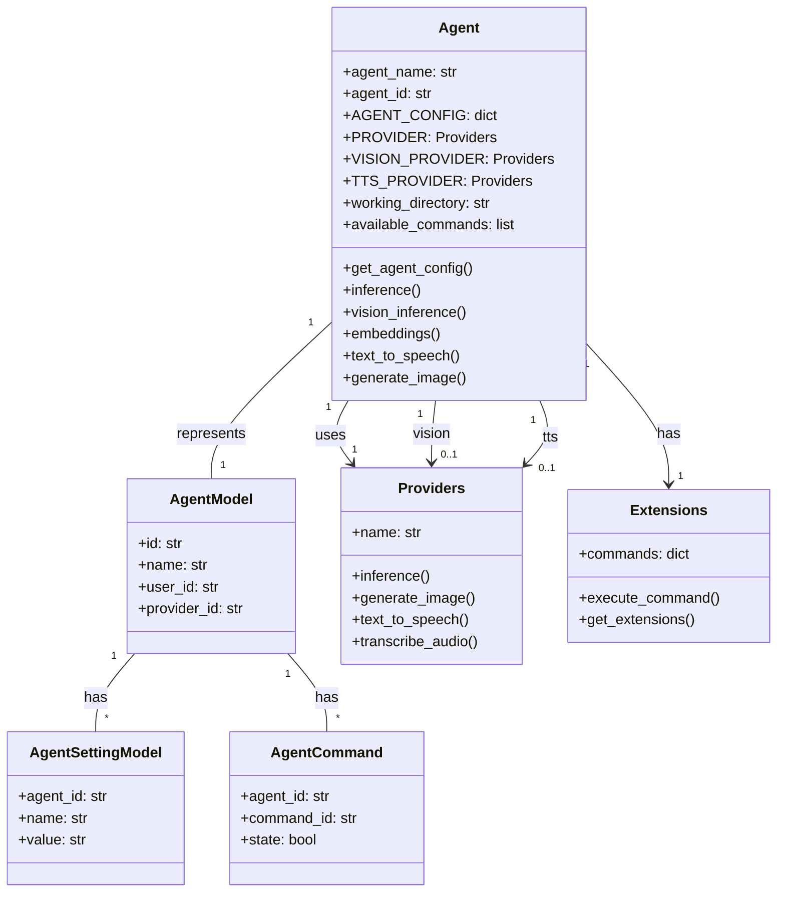
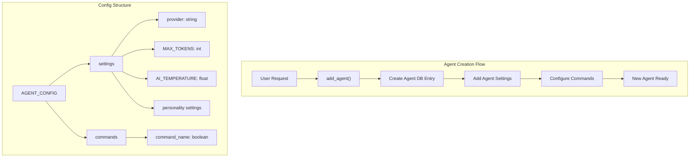
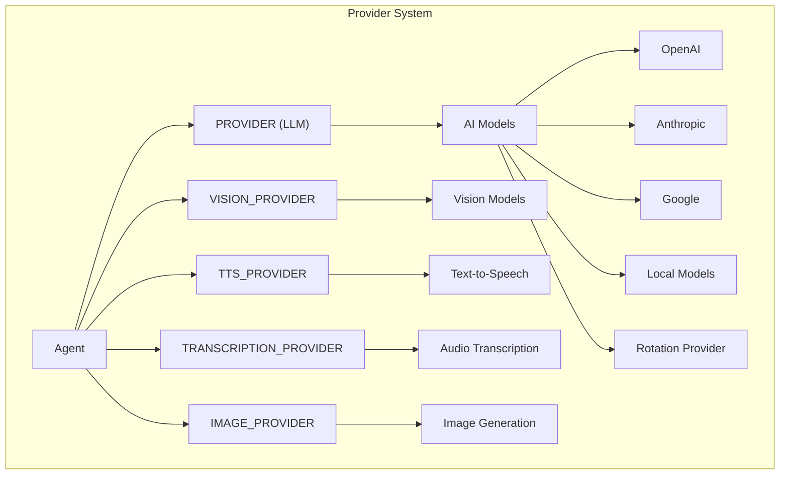
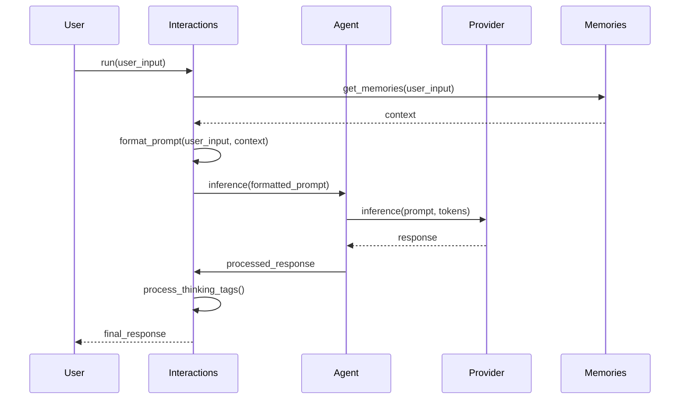
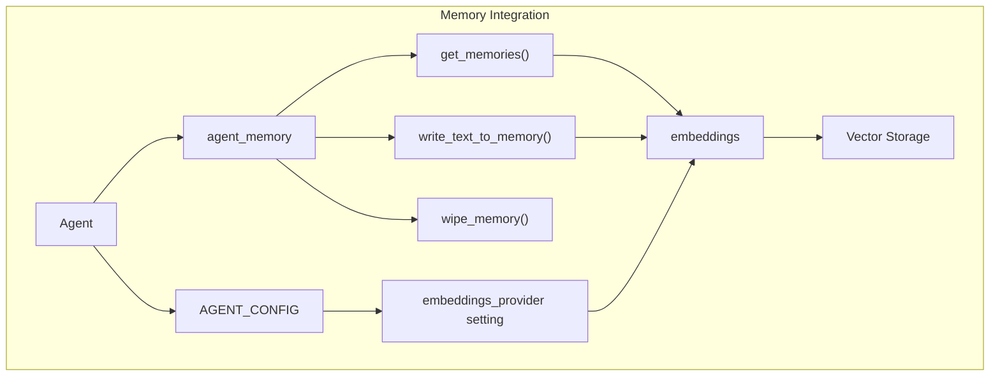
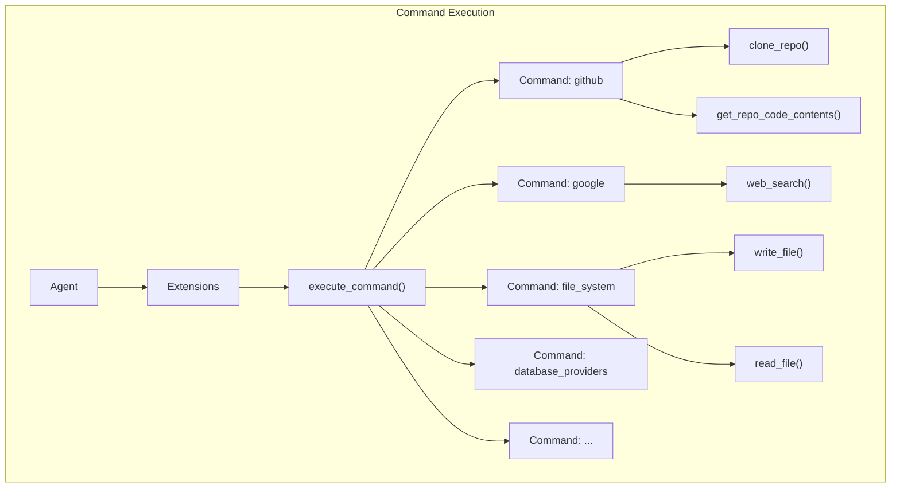
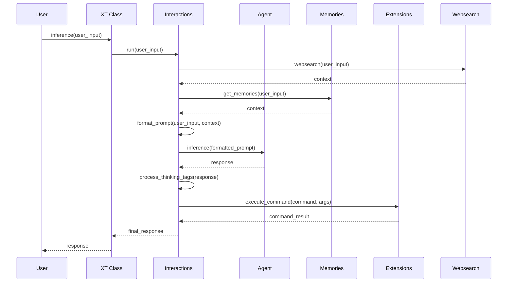
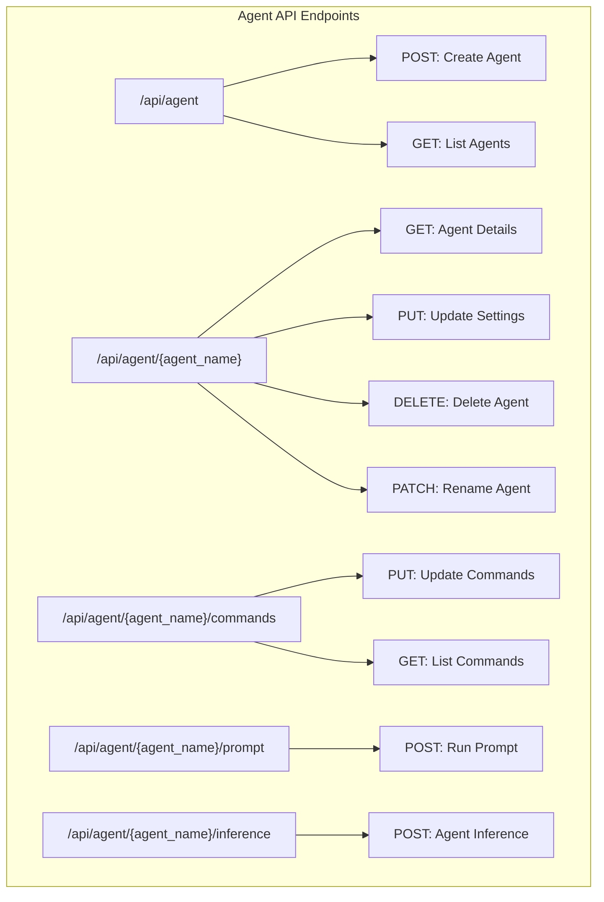
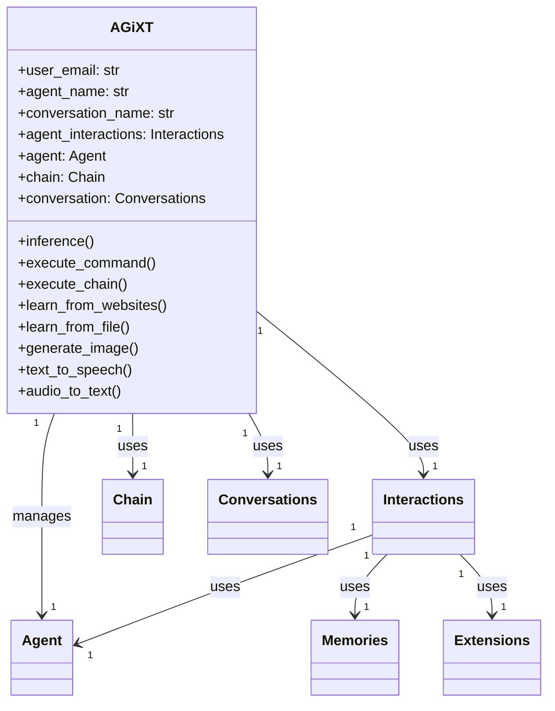
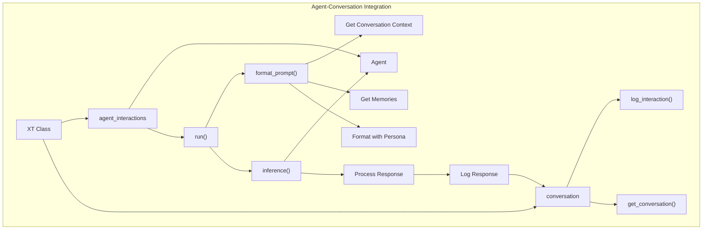

<!-- source: DeepWiki mcp.deepwiki.com · repo Josh-XT/AGiXT · page 2.1 Agent System · fetched 2026-10-26 -->

# Agent System

<details>
<summary>Relevant source files</summary>

The following files were used as context for generating this wiki page:

- [Dockerfile](Dockerfile)
- [agixt/Agent.py](agixt/Agent.py)
- [agixt/Chain.py](agixt/Chain.py)
- [agixt/Conversations.py](agixt/Conversations.py)
- [agixt/Extensions.py](agixt/Extensions.py)
- [agixt/Interactions.py](agixt/Interactions.py)
- [agixt/Memories.py](agixt/Memories.py)
- [agixt/Models.py](agixt/Models.py)
- [agixt/SeedImports.py](agixt/SeedImports.py)
- [agixt/Websearch.py](agixt/Websearch.py)
- [agixt/XT.py](agixt/XT.py)
- [agixt/app.py](agixt/app.py)
- [agixt/endpoints/Agent.py](agixt/endpoints/Agent.py)
- [agixt/endpoints/Chain.py](agixt/endpoints/Chain.py)
- [agixt/endpoints/Completions.py](agixt/endpoints/Completions.py)
- [agixt/endpoints/Conversation.py](agixt/endpoints/Conversation.py)
- [agixt/endpoints/Extension.py](agixt/endpoints/Extension.py)
- [agixt/endpoints/GQL.py](agixt/endpoints/GQL.py)
- [agixt/endpoints/Memory.py](agixt/endpoints/Memory.py)
- [agixt/endpoints/Prompt.py](agixt/endpoints/Prompt.py)
- [agixt/endpoints/Provider.py](agixt/endpoints/Provider.py)
- [agixt/prompts/Default/Name Conversation.txt](agixt/prompts/Default/Name Conversation.txt)
- [agixt/version](agixt/version)
- [requirements.txt](requirements.txt)

</details>


The Agent System is the core of AGiXT, responsible for defining, configuring, and managing AI agents. This document explains how agents are structured, how they interact with various AI providers, and how they integrate with other components of the AGiXT platform.

For information about memory management, see [Memory and Context Management](#2.2). For chain execution, see [Chain System](#2.3).

## Agent Architecture

The agent system provides a flexible abstraction layer that can work with multiple AI providers, manage agent-specific settings, and facilitate agent interactions with various platform capabilities.



Sources: [agixt/Agent.py:290-426](). [agixt/Agent.py:86-148]().

## Agent Creation and Configuration

Agents are created with a name, settings for the AI provider, and enabled commands. The agent configuration is stored in the database.



Sources: [agixt/Agent.py:86-148](). [agixt/Agent.py:486-625]().

The agent configuration (`AGENT_CONFIG`) contains settings and commands:

| Key | Description |
|-----|-------------|
| `settings` | Dictionary of provider settings like `provider`, `MAX_TOKENS`, `AI_TEMPERATURE`, etc. |
| `commands` | Dictionary of enabled/disabled commands with command names as keys and boolean values |

Sample agent configuration:

```json
{
    "settings": {
        "provider": "openai",
        "MAX_TOKENS": 8192,
        "AI_TEMPERATURE": 0.7,
        "persona": "You are a helpful assistant...",
        "vision_provider": "openai",
        "tts_provider": "google"
    },
    "commands": {
        "web_search": true,
        "write_file": true,
        "read_file": true
    }
}
```

Sources: [agixt/Agent.py:290-357](). [agixt/Agent.py:486-625]().

## Agent Provider System

Agents work with multiple AI providers through a provider abstraction layer. Each agent can use different providers for different services.



Sources: [agixt/Agent.py:313-406](). 

The `Agent` class initializes multiple provider instances based on the agent's configuration:

- `PROVIDER`: Main AI provider for text generation
- `VISION_PROVIDER`: Provider for image understanding
- `TTS_PROVIDER`: Provider for text-to-speech conversion
- `TRANSCRIPTION_PROVIDER`: Provider for audio transcription
- `TRANSLATION_PROVIDER`: Provider for translation
- `IMAGE_PROVIDER`: Provider for image generation

The `RotationProvider` allows fallback between multiple providers for reliability.

Sources: [agixt/Agent.py:313-406]().

## Agent Inference Process

The core function of an agent is performing inference (generating responses) based on prompts.



Sources: [agixt/Agent.py:627-653](). [agixt/Interactions.py:535-815]().

The inference process includes:

1. Gathering context from memories
2. Formatting the prompt with context and agent persona
3. Calling the AI provider for the response
4. Processing the response (including thinking tags)
5. Returning the final response to the user

The `inference` method is the core method that sends prompts to the AI provider and gets responses:

```python
async def inference(self, prompt: str, images: list = [], use_smartest: bool = False):
    if not prompt:
        return ""
    input_tokens = get_tokens(prompt)
    provider_name = self.AGENT_CONFIG["settings"]["provider"]
    try:
        if provider_name == "rotation" and use_smartest == True:
            answer = await self.PROVIDER.inference(
                prompt=prompt, tokens=input_tokens, images=images, use_smartest=True
            )
        else:
            answer = await self.PROVIDER.inference(
                prompt=prompt, tokens=input_tokens, images=images
            )
        output_tokens = get_tokens(answer)
        self.auth.increase_token_counts(
            input_tokens=input_tokens, output_tokens=output_tokens
        )
        answer = str(answer).replace("\_", "_")
        if answer.endswith("\n\n"):
            answer = answer[:-2]
    except Exception as e:
        logging.error(f"Error in inference: {str(e)}")
        answer = "<answer>Unable to process request.</answer>"
    return answer
```

Sources: [agixt/Agent.py:627-653](). [agixt/Interactions.py:535-815]().

## Agent Integration with Memory

Agents use the memory system to store and retrieve information, providing context for interactions.



Sources: [agixt/Interactions.py:85-139](). [agixt/Memories.py:434-469]().

During the inference process, the agent retrieves relevant memories based on the user input and includes them in the context for the prompt. This allows the agent to have a "memory" of past interactions and information.

The `format_prompt` method in the `Interactions` class is responsible for retrieving memories and including them in the prompt:

```python
async def format_prompt(
    self,
    user_input: str = "",
    top_results: int = 5,
    prompt="",
    conversation_name="",
    vision_response: str = "",
    **kwargs,
):
    # ...
    context = []
    if int(top_results) > 0:
        if user_input:
            min_relevance_score = 0.2
            if "min_relevance_score" in kwargs:
                try:
                    min_relevance_score = float(kwargs["min_relevance_score"])
                except:
                    min_relevance_score = 0.2
            context += await self.agent_memory.get_memories(
                user_input=user_input,
                limit=top_results,
                min_relevance_score=min_relevance_score,
            )
            # ... Get additional memories if needed
    # ...
```

Sources: [agixt/Interactions.py:90-440]().

## Agent Commands and Extensions

Agents can execute commands through the extension system, allowing them to interact with external systems and perform various actions.



Sources: [agixt/Extensions.py:30-70](). [agixt/XT.py:386-441]().

Agents can enable specific commands through their configuration. The `execute_command` method in `XT.py` executes commands with arguments:

```python
async def execute_command(
    self,
    command_name: str,
    command_args: dict,
    voice_response: bool = False,
    log_output: bool = False,
    log_activities: bool = False,
):
    if log_activities:
        self.conversation.log_interaction(
            role=self.agent_name,
            message=f"[ACTIVITY] Executing command `{command_name}` with args:\n```json\n{json.dumps(command_args, indent=2)}```",
        )
    try:
        response = await Extensions(
            agent_name=self.agent_name,
            agent_id=self.agent.agent_id,
            agent_config=self.agent.AGENT_CONFIG,
            conversation_name=self.conversation_name,
            conversation_id=self.conversation_id,
            ApiClient=self.ApiClient,
            api_key=self.api_key,
            user=self.user_email,
        ).execute_command(
            command_name=command_name,
            command_args=command_args,
        )
    except Exception as e:
        logging.error(f"Error executing command: {e}")
        response = f"Error executing command `{command_name}`."
    # ... Handle voice response and logging
    return response
```

Sources: [agixt/XT.py:386-441]().

## Agent Interactions System

The `Interactions` class manages interactions between users and agents, handling prompt formatting, response processing, and command execution.



Sources: [agixt/Interactions.py:31-532](). [agixt/XT.py:184-284]().

The `run` method in the `Interactions` class is the entry point for agent interactions:

```python
async def run(
    self,
    user_input: str = "",
    context_results: int = 100,
    shots: int = 1,
    disable_memory: bool = True,
    conversation_name: str = "",
    browse_links: bool = False,
    persist_context_in_history: bool = False,
    images: list = [],
    searching: bool = False,
    log_user_input: bool = True,
    log_output: bool = True,
    **kwargs,
):
    # ... Initialize settings and tasks
    
    # Web search if enabled
    if websearch and searching == False:
        # ... Web search tasks
    
    # Format prompt with context
    formatted_prompt, unformatted_prompt, tokens = await self.format_prompt(
        user_input=user_input,
        top_results=int(context_results),
        conversation_results=conversation_results,
        prompt=prompt,
        prompt_category=prompt_category,
        conversation_name=conversation_name,
        websearch=websearch,
        searching=searching,
        vision_response=vision_response,
        **kwargs,
    )
    
    # Log user input
    if log_user_input:
        c.log_interaction(
            role="USER",
            message=log_message,
        )
    
    # Call inference
    try:
        self.response = await self.agent.inference(
            prompt=formatted_prompt, use_smartest=use_smartest
        )
    except Exception as e:
        # ... Error handling
    
    # Process response
    self.response = self.response.replace(
        f"http://localhost:7437/outputs/{self.agent.agent_id}", self.outputs
    )
    
    # ... Process file references
    
    # Return response
    return self.response
```

Sources: [agixt/Interactions.py:535-815](). [agixt/XT.py:184-284]().

## Agent Management API

The Agent System exposes API endpoints for managing agents through the FastAPI framework.



Sources: [agixt/endpoints/Agent.py:48-770](). 

The API endpoints provide full CRUD operations for agents and their configurations:

| Endpoint | Method | Description |
|----------|--------|-------------|
| `/api/agent` | POST | Create a new agent |
| `/api/agent` | GET | List all agents |
| `/api/agent/{agent_name}` | GET | Get agent details |
| `/api/agent/{agent_name}` | PUT | Update agent settings |
| `/api/agent/{agent_name}` | DELETE | Delete an agent |
| `/api/agent/{agent_name}` | PATCH | Rename an agent |
| `/api/agent/{agent_name}/commands` | PUT | Update agent commands |
| `/api/agent/{agent_name}/commands` | GET | List agent commands |
| `/api/agent/{agent_name}/prompt` | POST | Run a prompt with the agent |
| `/api/agent/{agent_name}/inference` | POST | Run inference with the agent |

Sources: [agixt/endpoints/Agent.py:51-770]().

## High-Level Interface: XT Class

The `AGiXT` (XT) class provides a high-level interface for agent operations, integrating agents with conversations, chains, and extensions.



Sources: [agixt/XT.py:37-106](). [agixt/XT.py:184-284]().

The `inference` method in the `AGiXT` class is the main entry point for agent interactions:

```python
async def inference(
    self,
    user_input: str,
    prompt_category: str = "Default",
    prompt_name: str = "Custom Input",
    images: list = [],
    injected_memories: int = 100,
    conversation_results: int = 15,
    shots: int = 1,
    browse_links: bool = False,
    voice_response: bool = False,
    log_user_input: bool = True,
    log_output: bool = True,
    language: str = "en",
    **kwargs,
):
    # ... Process arguments
    
    # Call Interactions.run
    response = await self.agent_interactions.run(
        user_input=user_input,
        prompt_category=prompt_category,
        prompt_name=prompt_name,
        context_results=injected_memories,
        conversation_results=conversation_results,
        shots=shots,
        conversation_name=self.conversation_name,
        browse_links=browse_links,
        images=images,
        tts=voice_response,
        log_user_input=log_user_input,
        log_output=log_output,
        **kwargs,
    )
    
    # Handle language translation if needed
    if language == "en":
        return response
    # ... Translation handling
    
    return new_response
```

Sources: [agixt/XT.py:184-284]().

## Working Directory Structure

Each agent has its own workspace directory for storing files and outputs. The workspace is organized by agent ID and conversation ID.

```
WORKSPACE/
├── {agent_id}/                    # Agent workspace
│   ├── {conversation_id}/         # Conversation workspace
│   │   ├── file1.txt              # Files generated during conversation
│   │   ├── file2.py               # Code files
│   │   ├── images/                # Generated images
│   │   └── ...
│   ├── models/                    # Agent-specific models
│   └── ...
└── ...
```

The working directory is used for storing and accessing files during agent interactions, particularly for file-related commands and operations.

Sources: [agixt/Agent.py:401](). [agixt/XT.py:88-95]().

## Conversation Integration

Agents are deeply integrated with the conversation system, with each agent interaction tied to a conversation context.



Sources: [agixt/Interactions.py:90-440](). [agixt/Interactions.py:535-815](). [agixt/XT.py:184-284]().

The conversation context is used to provide history and context to the agent during interactions. The agent's responses are logged to the conversation, creating a continuous interaction history.

Sources: [agixt/Interactions.py:90-440](). [agixt/Conversations.py:62-372]().

## Summary

The Agent System in AGiXT provides a flexible and extensible framework for creating and managing AI agents. Key components include:

1. **Agent Creation and Configuration**: Agents are created with a name, settings, and enabled commands.
2. **Provider Abstraction**: Agents work with multiple AI providers through a provider abstraction layer.
3. **Inference Process**: Agents generate responses based on prompts with context from memories and conversation history.
4. **Memory Integration**: Agents use the memory system to store and retrieve information.
5. **Command Execution**: Agents can execute commands through the extension system.
6. **Interactions System**: The `Interactions` class manages interactions between users and agents.
7. **API Management**: The Agent System exposes API endpoints for managing agents.
8. **XT Interface**: The `AGiXT` class provides a high-level interface for agent operations.

This system allows for the creation of sophisticated AI agents that can interact with users, execute commands, learn from various sources, and maintain context across interactions.

---

