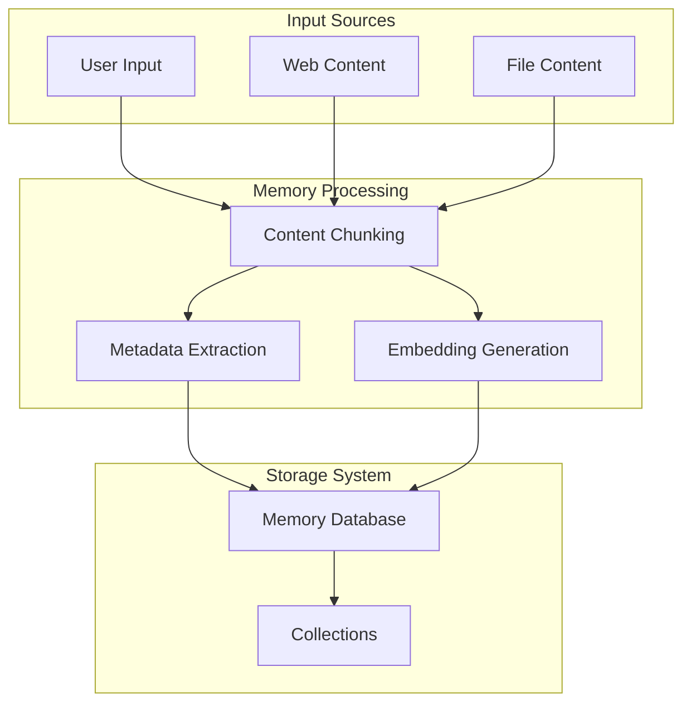
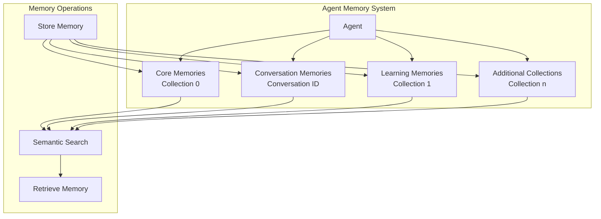
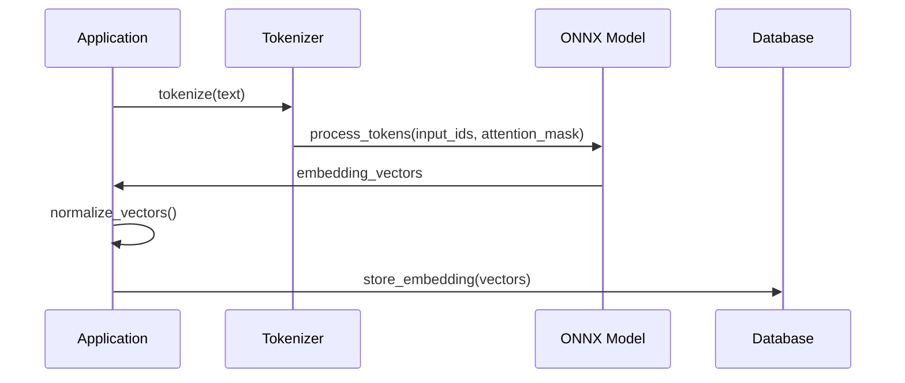
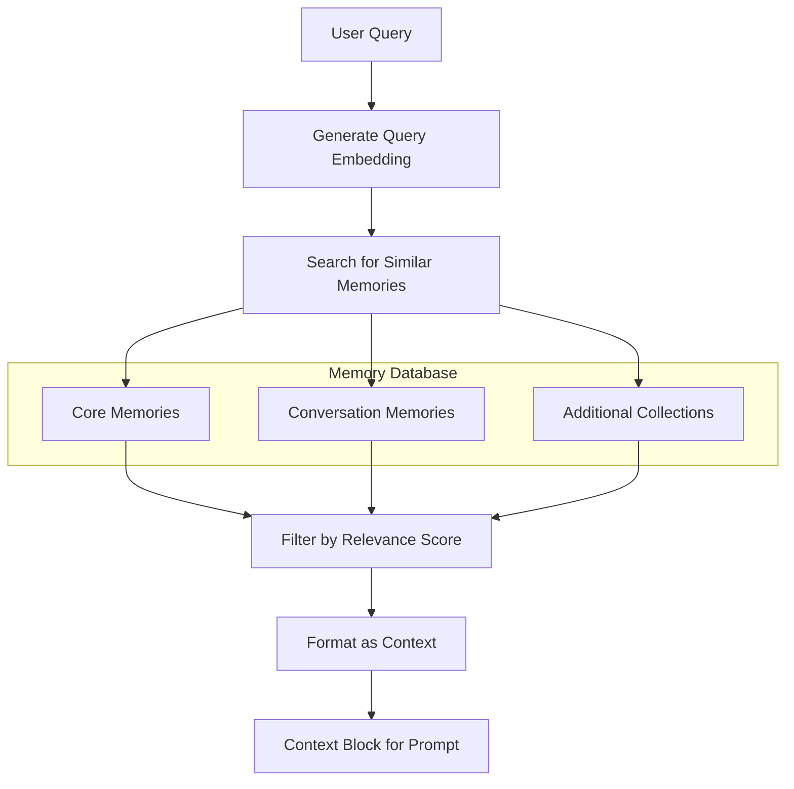
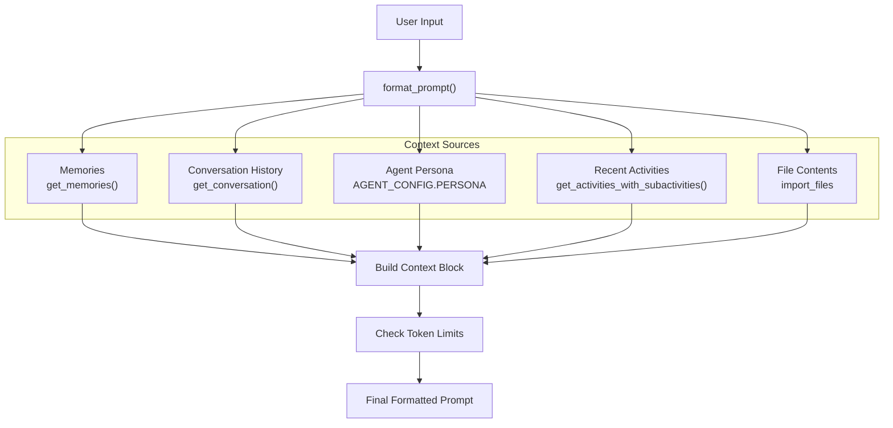
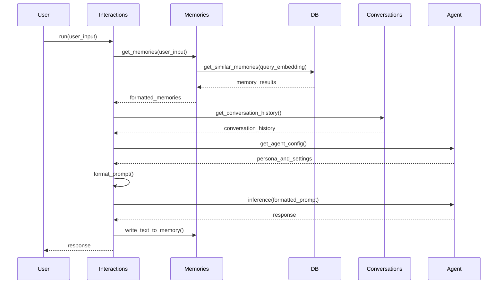

<!-- source: DeepWiki mcp.deepwiki.com · repo Josh-XT/AGiXT · page 2.2 Memory and Context Management · fetched 2026-10-26 -->

# Memory and Context Management

<details>
<summary>Relevant source files</summary>

The following files were used as context for generating this wiki page:

- [Dockerfile](Dockerfile)
- [agixt/DB.py](agixt/DB.py)
- [agixt/Globals.py](agixt/Globals.py)
- [agixt/Interactions.py](agixt/Interactions.py)
- [agixt/Memories.py](agixt/Memories.py)
- [agixt/Websearch.py](agixt/Websearch.py)
- [agixt/XT.py](agixt/XT.py)
- [agixt/app.py](agixt/app.py)
- [agixt/version](agixt/version)
- [requirements.txt](requirements.txt)
- [start.py](start.py)

</details>


This document explains how the AGiXT system stores and retrieves memories, manages context, and utilizes vector embeddings for semantic search. Memory management is the foundation of AGiXT's ability to maintain contextual awareness and provide relevant responses during agent interactions. For information about conversation tracking, see [Conversation Management](#2.4).

## Memory Architecture Overview



Sources: [agixt/Memories.py:434-468](), [agixt/DB.py:781-813]()

## Memory System Components

### Memory Storage Model

AGiXT uses a unified memory system with a database backend. The `Memory` model in the database stores the following key information:

| Field | Description |
|-------|-------------|
| `id` | Unique identifier for the memory |
| `agent_id` | Reference to the agent this memory belongs to |
| `conversation_id` | Optional reference to a conversation (null for core memories) |
| `embedding` | Vector representation of the text for semantic search |
| `text` | The actual content of the memory |
| `external_source` | Source of the memory (e.g., "user input", URL) |
| `description` | Brief description or keyword summary |
| `additional_metadata` | Any extra information about the memory |
| `timestamp` | When the memory was created |

Sources: [agixt/DB.py:781-807]()

### Collection Organization

Memories in AGiXT are organized into collections:



Sources: [agixt/Memories.py:434-552]()

Collections are identified by:

1. **Collection "0"** - Core agent memories (persistent knowledge)
2. **Conversation ID** - Memories specific to a particular conversation
3. **Collection "1"** - Often used for file learning (document storage)
4. **Additional collections** - Custom collections for specialized purposes

The collection system uses a normalized naming pattern to ensure consistent access across different database backends:

```
u{user_hash}_{agent_name}_{collection_id}
```

Sources: [agixt/Memories.py:182-247]()

## Vector Embeddings

### Embedding Generation

AGiXT converts text to vector embeddings using an ONNX model:



The embedding process:

1. Tokenizes input text using a specialized tokenizer
2. Processes tokens through an ONNX embedding model
3. Normalizes the resulting vectors for cosine similarity
4. Stores the embedding alongside the original text

Sources: [agixt/Memories.py:46-79](), [agixt/DB.py:727-778]()

### Memory Storage Process

When writing text to memory:

1. The text is chunked into manageable pieces if too large
2. Each chunk is embedded using the embedding model
3. The embedding and text are stored in the database
4. Metadata like source and timestamp are recorded

Sources: [agixt/Memories.py:641-722]()

## Context Retrieval and Management

### Semantic Search Process



Sources: [agixt/Memories.py:726-770](), [agixt/DB.py:831-863]()

When a user provides input, AGiXT:

1. Converts the input to an embedding vector
2. Computes similarity scores against stored memory embeddings
3. Retrieves memories above a minimum relevance threshold
4. Formats retrieved memories as context for the prompt

The semantic search implementation computes cosine similarity between the query embedding and stored embeddings to find the most relevant memories.

Sources: [agixt/Memories.py:111-123](), [agixt/DB.py:831-863]()

### Prompt Context Formation



Sources: [agixt/Interactions.py:90-441]()

The context formation process in the `format_prompt` method:

1. Retrieves relevant memories based on the user input
2. Gets recent conversation history
3. Includes agent persona information
4. Adds recent activities and tasks
5. Incorporates file contents if specified
6. Formats everything into a structured context block
7. Checks token limits to stay within model constraints

Sources: [agixt/Interactions.py:125-181](), [agixt/Interactions.py:266-333]()

## Context Priority and Token Management

AGiXT manages context with a priority system:

| Context Type | Priority | Description |
|--------------|----------|-------------|
| Memories | High | Retrieved based on semantic relevance |
| Conversation History | High | Recent interactions in the conversation |
| Activities | Medium | Recent agent actions and operations |
| Persona | Medium | Agent character and behavior guidelines |
| File Contents | Variable | Depends on relevance to query |

When token limits are approached, AGiXT:

1. Limits the number of memories retrieved
2. Reduces conversation history length
3. Summarizes or fragments file contents as needed

Sources: [agixt/Interactions.py:378-441](), [agixt/XT.py:156-182]()

## Memory and Context Integration Flow

The complete flow from user input to final prompt:



Sources: [agixt/Interactions.py:535-811](), [agixt/XT.py:184-284]()

## Common Memory Operations

### Learning from External Sources

AGiXT can expand an agent's knowledge by learning from:

1. **Web content** - Scraping and processing websites
2. **Files** - Reading documents, spreadsheets, code
3. **Structured data** - JSON, CSV, and other formats

When learning from web content:

1. Content is scraped from the URL
2. Text is extracted and optionally summarized
3. Content is chunked into appropriate sizes
4. Each chunk is embedded and stored in memory
5. Source URL is recorded as metadata

Sources: [agixt/XT.py:625-651](), [agixt/Websearch.py:170-336]()

### Memory Conversation Pipeline

When storing a response in memory:

1. The agent response is processed for relevant information
2. Thinking and reflection content is extracted
3. Information is stored with appropriate metadata
4. Content becomes available for future context retrieval

Sources: [agixt/Interactions.py:443-533]()

## Implementation Details

### Memory Class Initialization

The `Memories` class is instantiated with:

```python
Memories(
    agent_name: str = "AGiXT",
    agent_config=None,
    collection_number: str = "0",
    ApiClient=None,
    summarize_content: bool = False,
    user=DEFAULT_USER,
)
```

This allows the system to manage different memory collections for different agents and conversations.

Sources: [agixt/Memories.py:434-479]()

### Key Memory Methods

| Method | Purpose |
|--------|---------|
| `write_text_to_memory()` | Stores text in memory with proper embedding |
| `get_memories()` | Retrieves relevant memories based on semantic search |
| `get_memories_data()` | Gets raw memory data with similarity scores |
| `chunk_content()` | Splits content into appropriate sizes for storage |
| `wipe_memory()` | Clears memories from a specified collection |
| `export_collection_to_json()` | Exports memories to JSON format |

Sources: [agixt/Memories.py:480-770]()

### Context Formation Method

The `format_prompt` method in `Interactions` class is responsible for building context and formatting prompts:

```python
async def format_prompt(
    self,
    user_input: str = "",
    top_results: int = 5,
    prompt="",
    conversation_name="",
    vision_response: str = "",
    **kwargs,
)
```

This method assembles all context components and formats the final prompt for the language model.

Sources: [agixt/Interactions.py:90-441]()

## Working with the Memory System

### Retrieving Memories Through the SDK

```python
async def memories(
    self,
    user_input: str = "",
    limit_per_collection: int = 5,
    minimum_relevance_score: float = 0.3,
    additional_collection: str = "0",
)
```

This method allows retrieving memories relevant to a query for analysis or other operations.

Sources: [agixt/XT.py:157-182]()

### Writing to Memory

```python
await agent_memory.write_text_to_memory(
    user_input=user_input,
    text=content,
    external_source=source
)
```

This pattern is used throughout the codebase to store information in memory.

Sources: [agixt/Memories.py:641-722](), [agixt/Websearch.py:264-267]()

## Summary

AGiXT's Memory and Context Management system provides:

1. **Semantic storage and retrieval** - Storing text with vector embeddings for contextual search
2. **Collection-based organization** - Organizing memories by agent, conversation, and purpose
3. **Context-aware prompt formatting** - Building contextual prompts with relevant memories
4. **Token optimization** - Managing context size to work within model constraints
5. **External learning capabilities** - Learning from websites, files, and other sources

This system enables AGiXT agents to maintain contextual awareness across interactions and provide more relevant and informed responses based on their accumulated knowledge.

---

