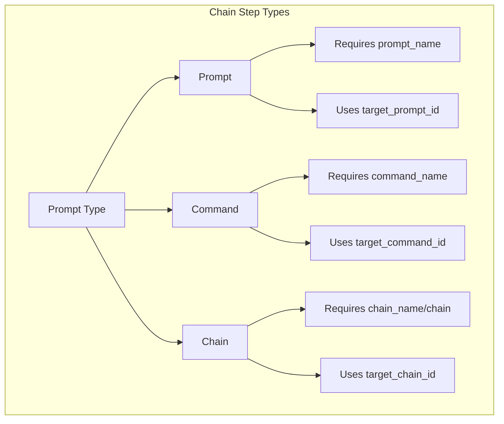
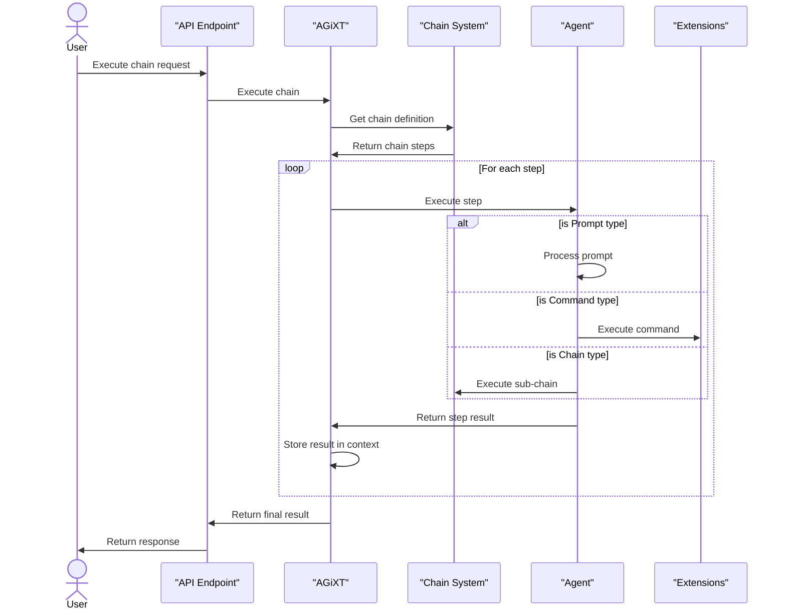
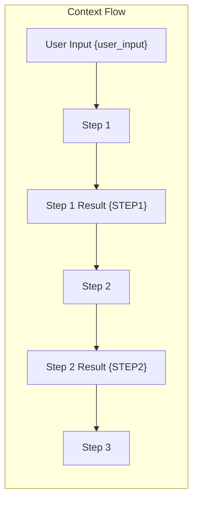
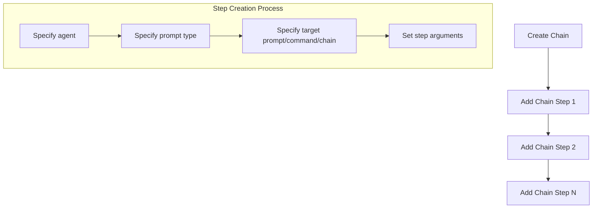
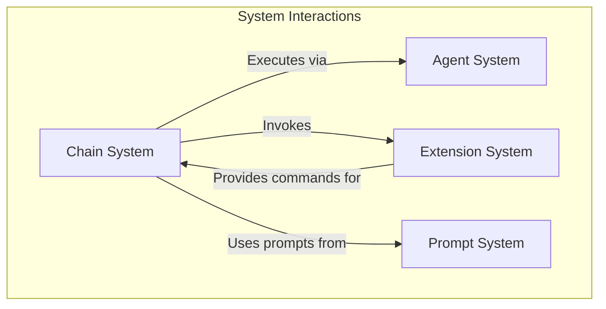
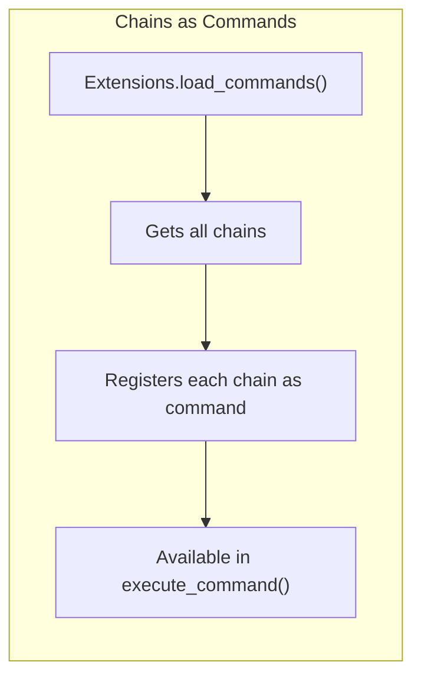
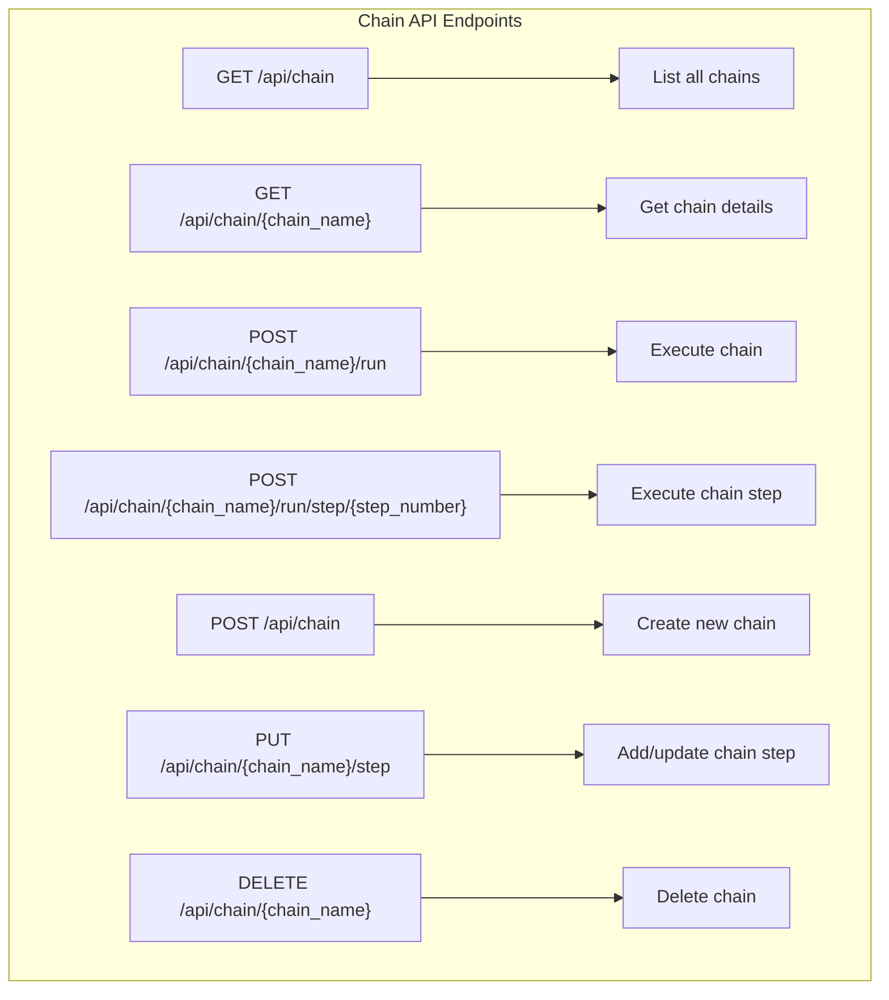

<!-- source: DeepWiki mcp.deepwiki.com · repo Josh-XT/AGiXT · page 2.3 Chain System · fetched 2026-10-26 -->

# Chain System

<details>
<summary>Relevant source files</summary>

The following files were used as context for generating this wiki page:

- [agixt/Agent.py](agixt/Agent.py)
- [agixt/Chain.py](agixt/Chain.py)
- [agixt/Conversations.py](agixt/Conversations.py)
- [agixt/Extensions.py](agixt/Extensions.py)
- [agixt/Models.py](agixt/Models.py)
- [agixt/SeedImports.py](agixt/SeedImports.py)
- [agixt/chains/Generate Smart Task Chain without Research.json](agixt/chains/Generate Smart Task Chain without Research.json)
- [agixt/chains/Generate Smart Task Chain.json](agixt/chains/Generate Smart Task Chain.json)
- [agixt/chains/Generate Task Chain without Research.json](agixt/chains/Generate Task Chain without Research.json)
- [agixt/chains/Generate Task Chain.json](agixt/chains/Generate Task Chain.json)
- [agixt/endpoints/Agent.py](agixt/endpoints/Agent.py)
- [agixt/endpoints/Chain.py](agixt/endpoints/Chain.py)
- [agixt/endpoints/Completions.py](agixt/endpoints/Completions.py)
- [agixt/endpoints/Conversation.py](agixt/endpoints/Conversation.py)
- [agixt/endpoints/Extension.py](agixt/endpoints/Extension.py)
- [agixt/endpoints/GQL.py](agixt/endpoints/GQL.py)
- [agixt/endpoints/Memory.py](agixt/endpoints/Memory.py)
- [agixt/endpoints/Prompt.py](agixt/endpoints/Prompt.py)
- [agixt/endpoints/Provider.py](agixt/endpoints/Provider.py)
- [agixt/prompts/Default/Name Conversation.txt](agixt/prompts/Default/Name Conversation.txt)

</details>


The Chain System in AGiXT provides a powerful mechanism for defining and executing sequences of steps to accomplish complex tasks. Chains allow users to create reusable workflows by combining prompts, commands, and even other chains into a structured sequence where the output of one step can be used as input to subsequent steps.

Unlike single-shot prompting, chains enable multi-step reasoning and execution with context sharing between steps, greatly enhancing the capabilities of AI agents. For information about creating custom extensions that can be used in chains, see [Creating Custom Extensions](#4.2).

## Chain Structure

At its core, a chain consists of a series of numbered steps, with each step defining:

1. The **agent** that will execute the step
2. The **prompt type** (Prompt, Command, or Chain)
3. The **target** (specific prompt, command, or chain to run)
4. Any **arguments** needed for execution

```mermaid
classDiagram
    class "Chain" {
        +id: string
        +name: string
        +description: string
        +user_id: string
        +steps: List~ChainStep~
    }
    
    class "ChainStep" {
        +id: string
        +chain_id: string
        +step_number: int
        +agent_id: string
        +prompt_type: string
        +prompt: string
        +target_chain_id: string
        +target_command_id: string
        +target_prompt_id: string
    }
    
    class "ChainStepArgument" {
        +id: string
        +chain_step_id: string
        +argument_id: string
        +value: string
    }
    
    class "Argument" {
        +id: string
        +command_id: string
        +name: string
    }
    
    Chain "1" --> "*" ChainStep: has
    ChainStep "1" --> "*" ChainStepArgument: has
    ChainStepArgument --> Argument: references
```

Sources: [agixt/Chain.py:28-108](), [agixt/Chain.py:195-195](), [agixt/DB.py:1-22]()

### Prompt Types

Chains support three primary types of steps, defined by the `prompt_type` field:

1. **Prompt**: Sends a text prompt to an agent for processing
2. **Command**: Executes a specific command provided by an extension
3. **Chain**: Executes another chain, enabling chain nesting and composition

Each type has specific requirements for the prompt content and target references.



Sources: [agixt/Chain.py:286-337](), [agixt/Chain.py:415-573]()

## Chain Storage and Representation

Chains are stored in the database with related tables to manage steps, arguments, and references to other entities. In-memory, chains are represented as nested dictionaries with standardized fields.

### Database Storage

Chains are stored across multiple related tables in the database:
- `ChainDB`: Stores chain metadata
- `ChainStep`: Stores individual steps
- `ChainStepArgument`: Stores arguments for steps
- References to `Agent`, `Command`, and `Prompt` tables

### Chain JSON Representation

When working with chains via the API, they are represented as JSON objects with the following structure:

```json
{
    "id": "chain-uuid",
    "chain_name": "Example Chain",
    "description": "This is an example chain",
    "steps": [
        {
            "step": 1,
            "agent_name": "gpt4free",
            "prompt_type": "Prompt",
            "prompt": {
                "prompt_name": "Example Prompt",
                "arg1": "value1",
                "arg2": "value2"
            }
        },
        {
            "step": 2,
            "agent_name": "gpt4free",
            "prompt_type": "Command",
            "prompt": {
                "command_name": "example_command",
                "param1": "value1"
            }
        }
    ]
}
```

Sources: [agixt/Chain.py:28-108](), [agixt/endpoints/Chain.py:37-60](), [agixt/endpoints/GQL.py:806-883]()

## Chain Execution Flow

When a chain is executed, AGiXT processes each step sequentially, passing context between steps and maintaining state throughout the execution.



Sources: [agixt/Chain.py:659-790](), [agixt/endpoints/Chain.py:62-145]()

### Context Handling Between Steps

A key feature of the chain system is the ability to pass context between steps using placeholder variables. The placeholders follow a specific format: `{STEP#}` where `#` is the step number.

For example:
- `{STEP1}` refers to the output of step 1
- `{user_input}` refers to the original input provided to the chain

This allows chains to use outputs from previous steps as inputs to subsequent steps, creating a pipeline of processing.



Sources: [agixt/Chain.py:659-790](), [agixt/Chain.py:791-887]()

## Creating and Modifying Chains

Chains can be created and modified through the API or programmatically through the Chain class.

### Creating a New Chain

To create a new chain:

1. Initialize a chain with a name and optional description
2. Add steps to the chain with specific prompt types, agents, and content
3. Configure step arguments as needed



Sources: [agixt/Chain.py:213-219](), [agixt/Chain.py:232-413](), [agixt/endpoints/Chain.py:254-335]()

### Adding Steps to a Chain

Steps can be added to an existing chain by specifying:

1. Chain name
2. Step number
3. Agent name
4. Prompt type (Prompt, Command, or Chain)
5. Prompt content with appropriate targets and arguments

The system will resolve references to prompts, commands, and other chains automatically.

Sources: [agixt/Chain.py:232-413](), [agixt/endpoints/Chain.py:289-335]()

### Updating and Reordering Steps

Existing steps can be updated by providing new configurations and arguments. Steps can also be reordered by changing their step numbers.

Sources: [agixt/Chain.py:415-755](), [agixt/endpoints/Chain.py:337-380]()

## Chain Integration with Extensions and Agents

The Chain System integrates deeply with both the Agent System and the Extension System in AGiXT.



### As Extension Commands

Chains are automatically registered as commands in the Extension System, allowing them to be invoked as commands by other chains or directly by agents.



Sources: [agixt/Extensions.py:282-297](), [agixt/Extensions.py:345-398]()

### Chain Execution via AGiXT and Agents

Chains are typically executed through the AGiXT class, which handles agent instantiation, context management, and step execution.

Sources: [agixt/endpoints/Chain.py:62-145](), [agixt/endpoints/Completions.py:58-64]()

## Example Chains

AGiXT includes several example chains that demonstrate common use cases, like task planning and chain generation.

### Task Generation Chains

The system includes chains for generating new task chains based on natural language descriptions:

1. **Generate Task Chain**: Creates a sequence of tasks with optional research
2. **Generate Smart Task Chain**: Creates a more advanced chain with reasoning capabilities
3. **Generate Task Chain without Research**: Creates tasks without external research

These meta-chains demonstrate the power of chains to create other chains, effectively bootstrapping new capabilities.

Sources: [agixt/chains/Generate Task Chain.json:1-58](), [agixt/chains/Generate Smart Task Chain.json:1-58](), [agixt/chains/Generate Task Chain without Research.json:1-58](), [agixt/chains/Generate Smart Task Chain without Research.json:1-58]()

## Chain API

AGiXT provides a comprehensive API for working with chains, including endpoints for:

- Getting all chains
- Getting chain details
- Running chains and chain steps
- Creating and updating chains
- Managing chain steps



Sources: [agixt/endpoints/Chain.py:22-335](), [agixt/endpoints/GQL.py:755-1015]()

## Conclusion

The Chain System is a core component of AGiXT that enables complex, multi-step workflows. By combining prompts, commands, and nested chains, users can create sophisticated AI-powered automation processes. Chains serve as both a programming paradigm and a way to encode reusable knowledge, making them a versatile tool for AI agent orchestration.

---

