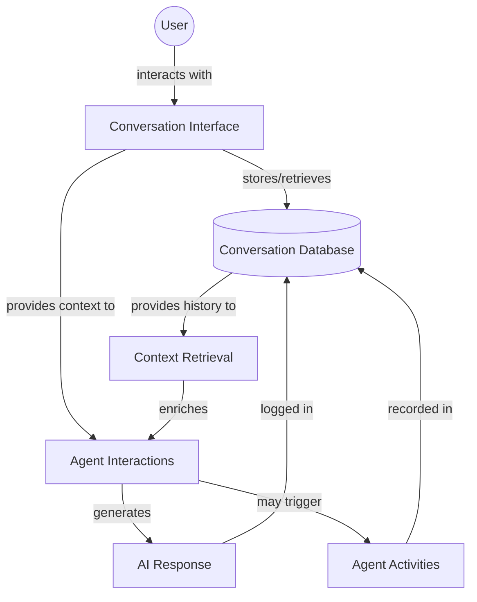
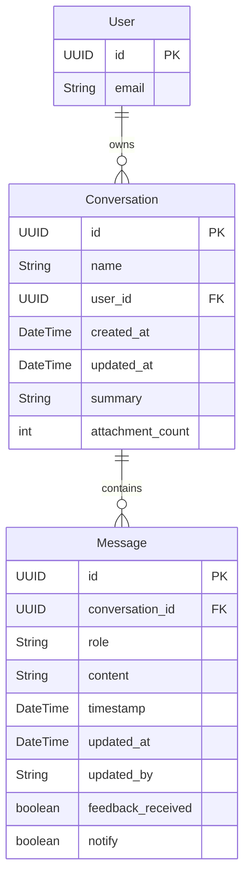
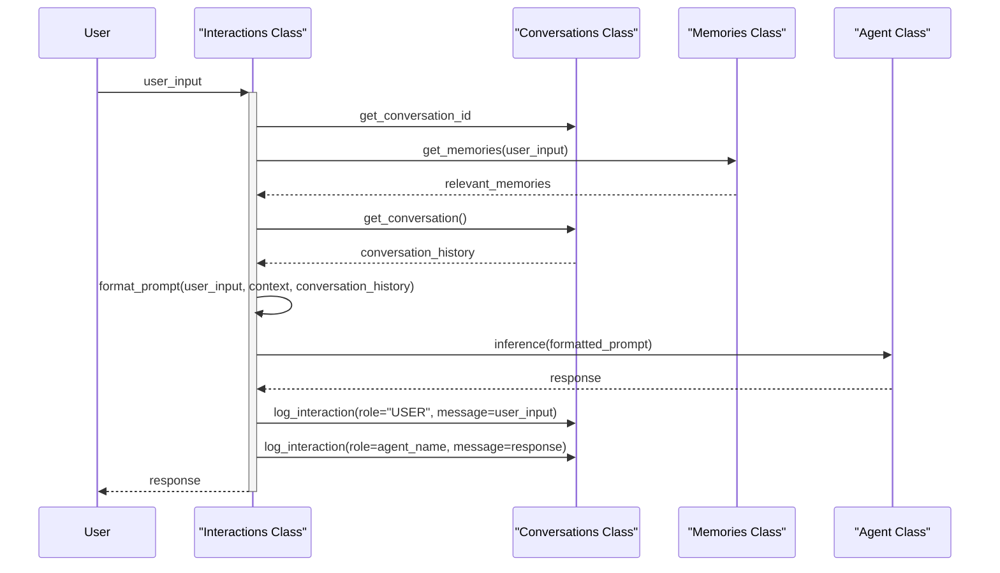
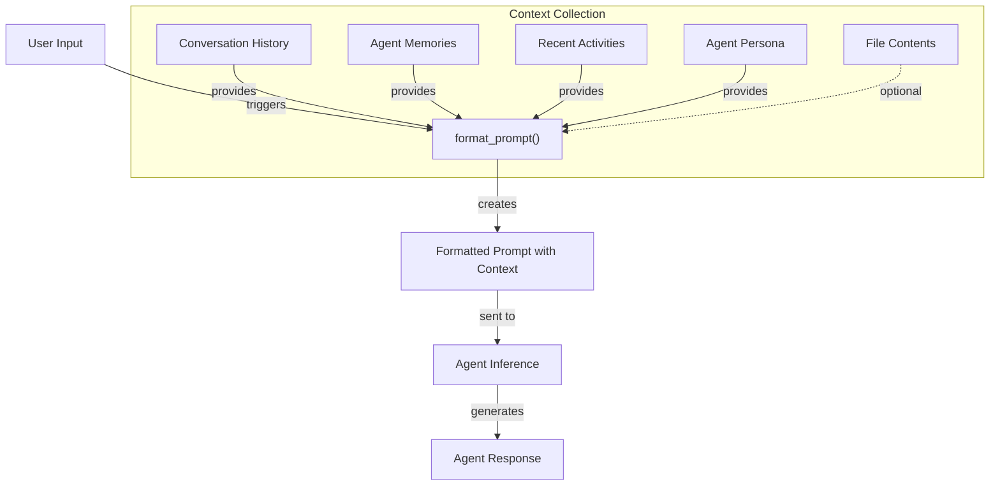
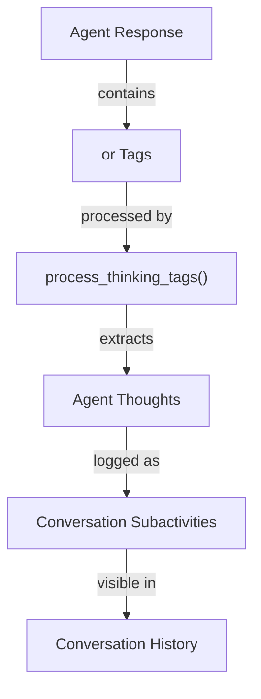
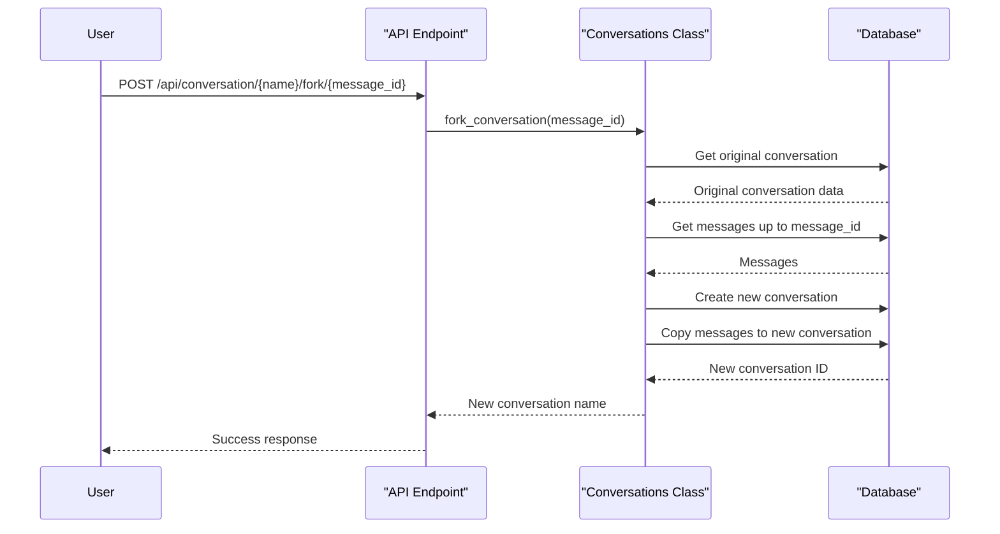
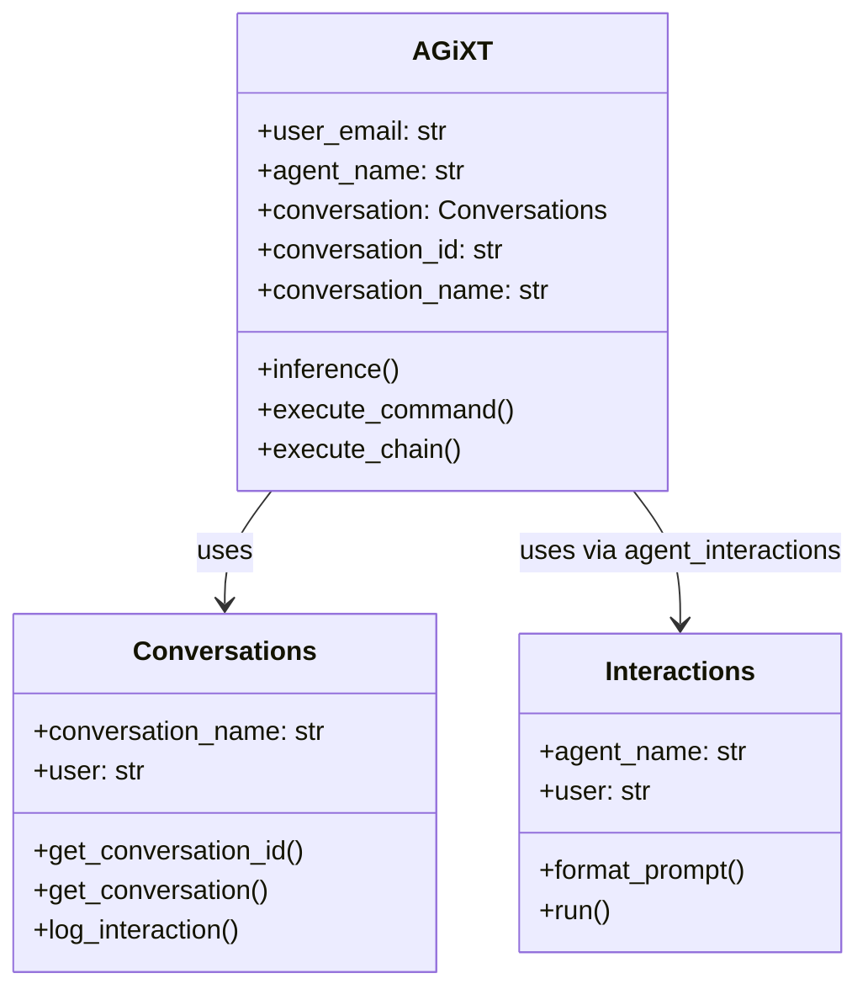
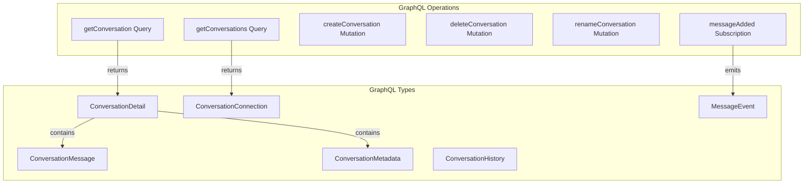
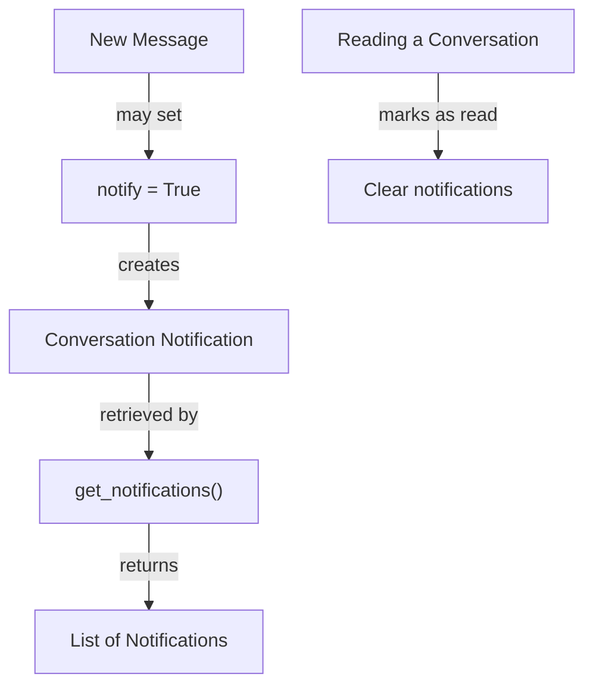

<!-- source: DeepWiki mcp.deepwiki.com · repo Josh-XT/AGiXT · page 2.4 Conversation Management · fetched 2026-10-26 -->

# Conversation Management

Relevant source files

The following files were used as context for generating this wiki page:

- [Dockerfile](Dockerfile)
- [agixt/Agent.py](agixt/Agent.py)
- [agixt/Chain.py](agixt/Chain.py)
- [agixt/Conversations.py](agixt/Conversations.py)
- [agixt/Extensions.py](agixt/Extensions.py)
- [agixt/Interactions.py](agixt/Interactions.py)
- [agixt/Memories.py](agixt/Memories.py)
- [agixt/Models.py](agixt/Models.py)
- [agixt/SeedImports.py](agixt/SeedImports.py)
- [agixt/Websearch.py](agixt/Websearch.py)
- [agixt/XT.py](agixt/XT.py)
- [agixt/app.py](agixt/app.py)
- [agixt/endpoints/Agent.py](agixt/endpoints/Agent.py)
- [agixt/endpoints/Chain.py](agixt/endpoints/Chain.py)
- [agixt/endpoints/Completions.py](agixt/endpoints/Completions.py)
- [agixt/endpoints/Conversation.py](agixt/endpoints/Conversation.py)
- [agixt/endpoints/Extension.py](agixt/endpoints/Extension.py)
- [agixt/endpoints/GQL.py](agixt/endpoints/GQL.py)
- [agixt/endpoints/Memory.py](agixt/endpoints/Memory.py)
- [agixt/endpoints/Prompt.py](agixt/endpoints/Prompt.py)
- [agixt/endpoints/Provider.py](agixt/endpoints/Provider.py)
- [agixt/prompts/Default/Name Conversation.txt](agixt/prompts/Default/Name Conversation.txt)
- [agixt/version](agixt/version)
- [requirements.txt](requirements.txt)

The AGiXT Conversation Management system provides a robust framework for storing, retrieving, and managing conversations between users and AI agents. This module handles conversation persistence, history tracking, message management, and integrates with the memory and agent systems to provide context-aware interactions. 

For information about Agent Memory systems specifically, see [Memory and Context Management](#2.2).

## Overview

The conversation management system serves as the backbone for agent-user interactions, providing:

1. Persistent storage of conversation history
2. Context retrieval for AI prompting
3. Message management (create, read, update, delete)
4. Activity and notification tracking
5. Conversation forking and organization
6. Integration with memory and context systems

Sources: [agixt/Conversations.py:1-100](). [agixt/Interactions.py:1-50](), [agixt/XT.py:1-60]()

## Data Model

The conversation management system is built around two primary data structures: Conversations and Messages.

### Database Schema

Sources: [agixt/Conversations.py:1-150](). [agixt/DB.py]()

## Core Components

### Conversations Class

The `Conversations` class is the central component of the conversation management system, handling all conversation-related operations.

Key methods include:

| Method | Description |
|--------|-------------|
| `get_conversation_id` | Gets a conversation ID from a name, creating one if needed |
| `get_conversation` | Retrieves conversation history with messages |
| `log_interaction` | Records a new message in the conversation |
| `get_conversations` | Lists all conversations for a user |
| `get_conversations_with_detail` | Gets detailed metadata about conversations |
| `fork_conversation` | Creates a fork of an existing conversation |
| `get_activities` | Retrieves activity logs from a conversation |
| `update_message` | Updates a message's content |
| `delete_message` | Deletes a message from the conversation |

Sources: [agixt/Conversations.py:62-371]()

### Integration with Interactions

The `Interactions` class bridges conversations with agent interactions:

Sources: [agixt/Interactions.py:31-108](), [agixt/Interactions.py:535-600]()

## Conversation Context Management

The conversation management system intelligently manages context to provide relevant information to the agent:

1. **Conversation History Retrieval**: Retrieves recent messages from the conversation history
2. **Memory Integration**: Pulls relevant memories based on the conversation context
3. **Activity Tracking**: Maintains a log of agent activities within the conversation
4. **Context Formatting**: Formats the context into a prompt suitable for the AI model

Sources: [agixt/Interactions.py:90-441]()

## Special Features

### Thinking and Reflection Tags

The system processes special tags in agent responses to capture thinking processes:

Sources: [agixt/Interactions.py:443-533]()

### Conversation Forking

Users can create forks of conversations to explore alternative directions:

Sources: [agixt/Conversations.py:282-371](), [agixt/endpoints/Conversation.py:325-346]()

## API Endpoints

The system exposes several API endpoints for conversation management:

| Endpoint | Method | Description |
|----------|--------|-------------|
| `/api/conversations` | GET | Get list of conversations |
| `/v1/conversations` | GET | Get detailed conversations list |
| `/v1/conversation/{conversation_id}` | GET | Get conversation history by ID |
| `/v1/conversation` | POST | Create a new conversation |
| `/api/conversation/history` | POST | Get conversation history |
| `/api/conversation/{name}/message` | POST | Log a new message |
| `/api/conversation/{name}` | PATCH | Rename a conversation |
| `/api/conversation/{name}` | DELETE | Delete a conversation |
| `/api/conversation/{name}/message/{id}` | PATCH | Update a message |
| `/api/conversation/{name}/fork/{id}` | POST | Fork a conversation |

Sources: [agixt/endpoints/Conversation.py:36-346]()

## Integration with XT Class

The `AGiXT` class (in `XT.py`) serves as an integration point for conversation management:

Sources: [agixt/XT.py:37-108]()

## GraphQL Interface

In addition to REST endpoints, the system provides GraphQL interfaces for conversation management:

Sources: [agixt/endpoints/GQL.py:78-370]()

## Notifications System

The conversation management system includes notifications to alert users about new messages:

Sources: [agixt/Conversations.py:196-224](), [agixt/endpoints/Conversation.py:402-423]()

## Conclusion

The Conversation Management system in AGiXT provides a comprehensive solution for managing agent-user interactions. It integrates with the memory system to provide context-aware responses, tracks activities and special tags, and offers features like conversation forking for enhanced user experience. The system's architecture allows for both REST and GraphQL interfaces, making it flexible for different integration needs.

---

