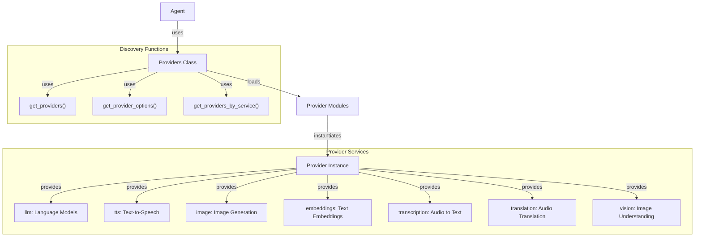
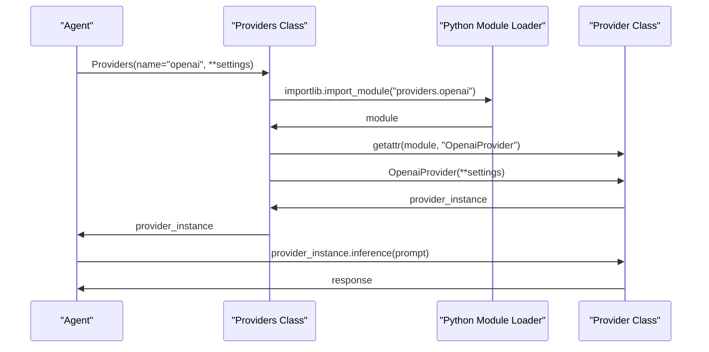
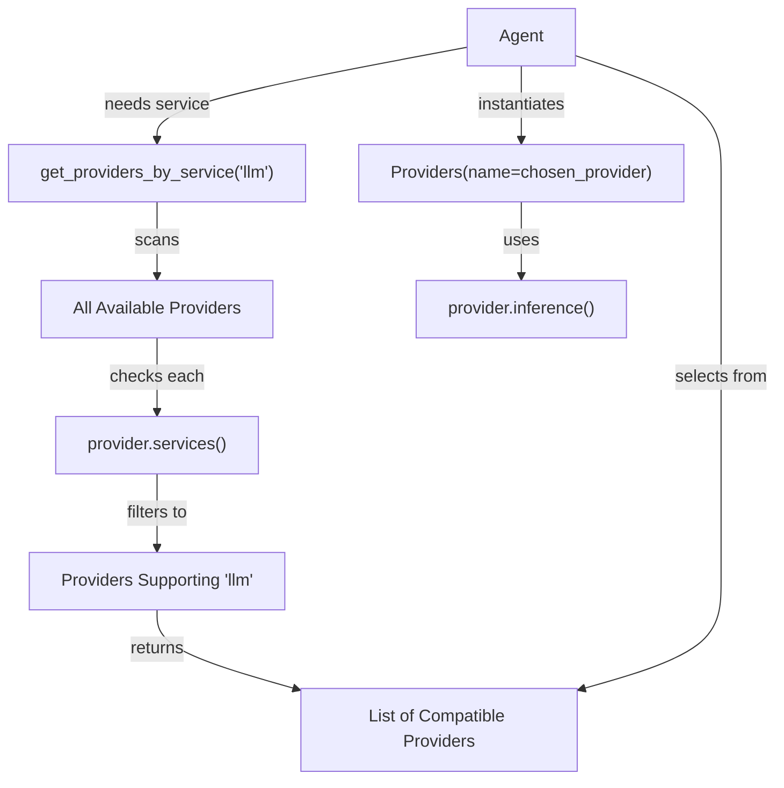

<!-- source: DeepWiki mcp.deepwiki.com · repo Josh-XT/AGiXT · page 3 Provider System · fetched 2026-10-26 -->

# Provider System

<details>
<summary>Relevant source files</summary>

The following files were used as context for generating this wiki page:

- [agixt/Providers.py](agixt/Providers.py)
- [agixt/providers/anthropic.py](agixt/providers/anthropic.py)
- [agixt/providers/azure.py](agixt/providers/azure.py)
- [agixt/providers/deepseek.py](agixt/providers/deepseek.py)
- [agixt/providers/default.py](agixt/providers/default.py)
- [agixt/providers/elevenlabs.py](agixt/providers/elevenlabs.py)
- [agixt/providers/ezlocalai.py](agixt/providers/ezlocalai.py)
- [agixt/providers/google.py](agixt/providers/google.py)
- [agixt/providers/huggingface.py](agixt/providers/huggingface.py)
- [agixt/providers/openai.py](agixt/providers/openai.py)
- [agixt/providers/xai.py](agixt/providers/xai.py)

</details>


The Provider System in AGiXT is a modular framework that abstracts interactions with different AI models and services. It enables AGiXT to communicate with various AI providers (like OpenAI, Google, Anthropic, etc.) through a unified interface, making it simple to switch between different providers or use multiple providers for different services.

For information about specific provider implementations, see [Built-in Providers](#3.1). For details on provider rotation and fallback mechanisms, see [Provider Rotation](#3.2).

## Architecture Overview

The Provider System follows a plugin-based architecture where each provider is implemented as a separate module in the `providers/` directory. The core `Providers.py` module handles provider discovery, instantiation, and interaction.



*Provider System Architecture Diagram*

Sources: [agixt/Providers.py:17-134]()

## Provider Discovery and Instantiation

The system dynamically discovers providers by scanning the `providers/` directory. When an agent requests a specific provider, the `Providers` class loads the appropriate module and instantiates the provider class.



*Provider Instantiation Process*

Sources: [agixt/Providers.py:137-155]()

### Provider Discovery

Providers are discovered at runtime through functions in the `Providers.py` module:

- `get_providers()`: Lists all available provider modules
- `get_provider_options(provider_name)`: Retrieves configurable options for a provider
- `get_providers_with_settings()`: Gets all providers with their configuration options
- `get_providers_with_details()`: Gets detailed information about providers including documentation and services
- `get_providers_by_service(service)`: Finds providers that support a specific service

The system also respects the `DISABLED_PROVIDERS` environment variable, which allows administrators to disable specific providers.

Sources: [agixt/Providers.py:14](), [agixt/Providers.py:17-134]()

## Provider Interface

All providers implement a common interface with methods for different AI services. Each provider declares which services it supports through the `services()` static method.

### Core Service Methods

| Method | Description | Service Type |
|--------|-------------|-------------|
| `inference(prompt, tokens, images)` | Generate text from a prompt (and optionally images) | llm, vision |
| `text_to_speech(text)` | Convert text to speech | tts |
| `generate_image(prompt)` | Generate an image from a prompt | image |
| `embeddings(input)` | Generate vector embeddings for input text | embeddings |
| `transcribe_audio(audio_path)` | Transcribe audio to text | transcription |
| `translate_audio(audio_path)` | Translate audio to another language | translation |

Sources: [agixt/providers/openai.py:62-70](), [agixt/providers/ezlocalai.py:67-76](), [agixt/providers/google.py:49-51]()

### Service Support Matrix

The table below shows which services are supported by the primary built-in providers:

| Provider | llm | tts | image | embeddings | transcription | translation | vision |
|----------|-----|-----|-------|------------|--------------|-------------|--------|
| OpenAI | ✓ | ✓ | ✓ | ✓ | ✓ | ✓ | ✓ |
| EzLocalAI | ✓ | ✓ | ✓ | ✓ | ✓ | ✓ | ✓ |
| Google | ✓ | ✓ | ❌ | ❌ | ❌ | ❌ | ✓ |
| Anthropic | ✓ | ❌ | ❌ | ❌ | ❌ | ❌ | ✓ |
| Default | ✓ | ✓ | ❌ | ✓ | ✓ | ✓ | ❌ |
| Azure | ✓ | ❌ | ❌ | ❌ | ❌ | ❌ | ✓ |
| Deepseek | ✓ | ❌ | ❌ | ❌ | ❌ | ❌ | ✓ |
| Huggingface | ✓ | ❌ | ✓ | ❌ | ❌ | ❌ | ❌ |
| Elevenlabs | ❌ | ✓ | ❌ | ❌ | ❌ | ❌ | ❌ |

Sources: [agixt/providers/openai.py:62-70](), [agixt/providers/ezlocalai.py:67-76](), [agixt/providers/google.py:49-51](), [agixt/providers/anthropic.py:47-49](), [agixt/providers/default.py:80-88](), [agixt/providers/azure.py:39-41](), [agixt/providers/deepseek.py:52-57](), [agixt/providers/huggingface.py:52-54](), [agixt/providers/elevenlabs.py:20-22]()

## Service Resolution

The system can dynamically find appropriate providers for a requested service. This allows AGiXT to select the right provider based on the service needed.



*Service Resolution Process*

Sources: [agixt/Providers.py:114-134]()

## Provider Implementation Structure

Each provider is implemented as a class in its own module. The naming convention follows a pattern where the filename is `{provider_name}.py` and the class name is `{provider_name.capitalize()}Provider`.

### Common Implementation Pattern

```python
class ExampleProvider:
    """
    Documentation about the provider and its capabilities.
    """
    
    friendly_name = "Example Provider"  # Human-readable name
    
    def __init__(self, API_KEY: str = "", MODEL: str = "default-model", **kwargs):
        # Provider-specific settings with defaults
        self.API_KEY = API_KEY
        self.AI_MODEL = MODEL
        self.MAX_TOKENS = 4096
        # ... other initialization
    
    @staticmethod
    def services():
        # Declare supported services
        return ["llm", "tts"]
    
    async def inference(self, prompt, tokens: int = 0, images: list = []):
        # Implement LLM text generation
        pass
    
    async def text_to_speech(self, text: str):
        # Implement text-to-speech conversion
        pass
    
    # Other service methods as needed
```

Sources: [agixt/providers/openai.py:19-210](), [agixt/providers/ezlocalai.py:20-229]()

### Error Handling and Retries

Most providers implement robust error handling with retry logic:

```python
try:
    response = client.generate_text(prompt)
    return response.text
except Exception as e:
    logging.info(f"API Error: {e}")
    self.failures += 1
    if self.failures > 3:
        raise Exception(f"API Error: Too many failures. {e}")
    time.sleep(self.WAIT_AFTER_FAILURE)
    return await self.inference(prompt, tokens)
```

Sources: [agixt/providers/openai.py:128-149](), [agixt/providers/ezlocalai.py:126-167](), [agixt/providers/anthropic.py:105-123]()

## Provider Configuration

Each provider has its own configuration options, which are extracted from the provider's `__init__` method signature. For example:

| Provider | Key Configuration Options |
|----------|---------------------------|
| OpenAI | `OPENAI_API_KEY`, `OPENAI_MODEL`, `OPENAI_TEMPERATURE` |
| EzLocalAI | `EZLOCALAI_API_URI`, `EZLOCALAI_AI_MODEL` |
| Google | `GOOGLE_API_KEY`, `GOOGLE_MODEL` |
| Anthropic | `ANTHROPIC_API_KEY`, `ANTHROPIC_MODEL` |

These options are discovered through introspection, allowing the system to dynamically generate configuration interfaces for each provider.

Sources: [agixt/Providers.py:26-48](), [agixt/providers/openai.py:26-40](), [agixt/providers/ezlocalai.py:27-38](), [agixt/providers/google.py:34-40](), [agixt/providers/anthropic.py:22-44]()

## Adding Custom Providers

To add a new provider to AGiXT:

1. Create a new Python file in the `providers/` directory (e.g., `newprovider.py`)
2. Implement a class named using the pattern `{provider_name.capitalize()}Provider` (e.g., `NewproviderProvider`)
3. Implement the required interface methods and `services()` static method
4. The provider will be automatically discovered and available for use

The dynamic discovery mechanism means no changes to the core code are needed to add new providers.

Sources: [agixt/Providers.py:17-23](), [agixt/Providers.py:137-155]()

## Conclusion

The Provider System in AGiXT enables flexible and extensible AI service integration. By abstracting provider-specific implementations behind a common interface, it allows the platform to leverage various AI services while maintaining a consistent API for agents. This modular approach also makes it straightforward to add support for new AI providers as they emerge.

For more detailed information about specific providers, see [Built-in Providers](#3.1). For information about the provider rotation system, see [Provider Rotation](#3.2).

---

