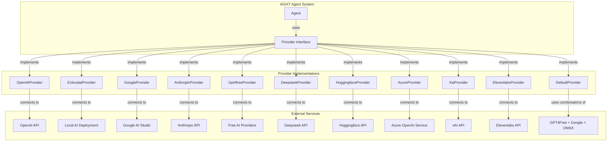
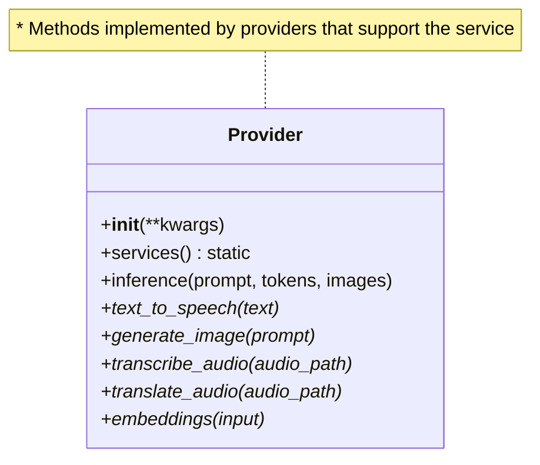
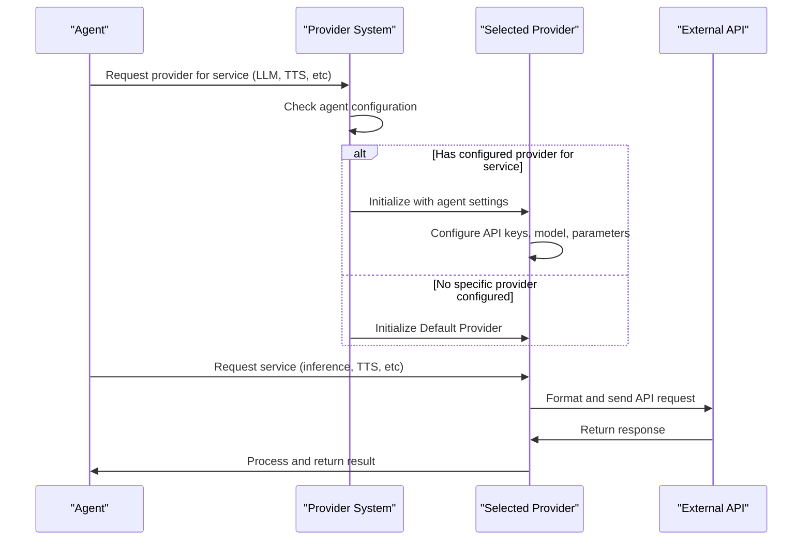

<!-- source: DeepWiki mcp.deepwiki.com · repo Josh-XT/AGiXT · page 3.1 Built-in Providers · fetched 2026-10-26 -->

# Built-in Providers

Relevant source files

The following files were used as context for generating this wiki page:

- [agixt/providers/anthropic.py](agixt/providers/anthropic.py)
- [agixt/providers/azure.py](agixt/providers/azure.py)
- [agixt/providers/deepseek.py](agixt/providers/deepseek.py)
- [agixt/providers/default.py](agixt/providers/default.py)
- [agixt/providers/elevenlabs.py](agixt/providers/elevenlabs.py)
- [agixt/providers/ezlocalai.py](agixt/providers/ezlocalai.py)
- [agixt/providers/google.py](agixt/providers/google.py)
- [agixt/providers/gpt4free.py](agixt/providers/gpt4free.py)
- [agixt/providers/huggingface.py](agixt/providers/huggingface.py)
- [agixt/providers/openai.py](agixt/providers/openai.py)
- [agixt/providers/xai.py](agixt/providers/xai.py)

AGiXT includes several built-in AI provider integrations that allow agents to leverage different language models and services. These providers abstract the complexities of working with various AI APIs, offering a unified interface for core capabilities like text generation, image understanding, and speech processing. This document details the available providers, their capabilities, and configuration options.

For information about provider rotation and failover mechanisms, see [Provider Rotation](#3.2).

## Provider Architecture

Sources: [agixt/providers/openai.py](), [agixt/providers/ezlocalai.py](), [agixt/providers/google.py](), [agixt/providers/anthropic.py](), [agixt/providers/gpt4free.py](), [agixt/providers/default.py]()

## Provider Interface

All providers in AGiXT implement a common interface with standardized methods. The primary interface methods are:

- `services()`: Static method returning a list of services the provider supports
- `inference()`: Main method for text generation from a prompt (all providers implement this)
- Service-specific methods: Only implemented by providers that support the given service

Sources: [agixt/providers/openai.py:62-70](), [agixt/providers/google.py:49-51](), [agixt/providers/default.py:80-88]()

## Supported Services

Built-in providers can support the following services:

1. **llm**: Large language model text generation
2. **vision**: Processing and understanding images
3. **tts**: Text-to-speech conversion
4. **image**: Image generation from text prompts
5. **transcription**: Converting speech audio to text
6. **translation**: Translating audio from one language to another
7. **embeddings**: Creating vector embeddings for text

## Service Compatibility Matrix

The following table shows which services are supported by each provider:

| Provider    | llm | vision | tts | image | transcription | translation | embeddings |
|-------------|-----|--------|-----|-------|---------------|-------------|------------|
| OpenAI      | ✓   | ✓      | ✓   | ✓     | ✓             | ✓           | ✓          |
| EzLocalAI   | ✓   | ✓      | ✓   | ✓     | ✓             | ✓           | ✓          |
| Google      | ✓   | ✓      | ✓   | ✗     | ✗             | ✗           | ✗          |
| Anthropic   | ✓   | ✓      | ✗   | ✗     | ✗             | ✗           | ✗          |
| GPT4Free    | ✓   | ✗      | ✗   | ✗     | ✗             | ✗           | ✗          |
| Deepseek    | ✓   | ✓      | ✗   | ✗     | ✗             | ✗           | ✗          |
| Huggingface | ✓   | ✗      | ✗   | ✓     | ✗             | ✗           | ✗          |
| Azure       | ✓   | ✓      | ✗   | ✗     | ✗             | ✗           | ✗          |
| xAI         | ✓   | ✓      | ✗   | ✗     | ✗             | ✗           | ✗          |
| Elevenlabs  | ✗   | ✗      | ✓   | ✗     | ✗             | ✗           | ✗          |
| Default     | ✓   | ✗      | ✓   | ✗     | ✓             | ✓           | ✓          |

Sources: [agixt/providers/openai.py:62-70](), [agixt/providers/ezlocalai.py:67-76](), [agixt/providers/google.py:49-51](), [agixt/providers/anthropic.py:47-49](), [agixt/providers/gpt4free.py:58-60](), [agixt/providers/default.py:80-88](), [agixt/providers/deepseek.py:52-57](), [agixt/providers/huggingface.py:52-54](), [agixt/providers/azure.py:39-41](), [agixt/providers/xai.py:51-56](), [agixt/providers/elevenlabs.py:20-22]()

## Individual Provider Details

### OpenAI Provider

The OpenAI provider integrates with OpenAI's API to access models like GPT-4o.

**Key Features:**
- Supports a full range of services including LLM, vision, TTS, image generation
- Handles API errors with retry mechanisms
- Configuration for wait times between requests
- Supports image inputs for vision models

**Configuration Options:**
- `OPENAI_API_KEY`: Your OpenAI API key
- `OPENAI_MODEL`: Model name (default: "gpt-4o")
- `OPENAI_API_URI`: API endpoint URI (default: "https://api.openai.com/v1")
- `OPENAI_MAX_TOKENS`: Maximum tokens (default: 128000)
- `OPENAI_TEMPERATURE`: Temperature setting (default: 0.7)
- `OPENAI_TOP_P`: Top-p setting (default: 0.7)
- `OPENAI_WAIT_BETWEEN_REQUESTS`: Seconds to wait between requests (default: 1)
- `OPENAI_WAIT_AFTER_FAILURE`: Seconds to wait after failure (default: 3)
- `OPENAI_VOICE`: Voice for TTS (default: "alloy")
- `OPENAI_TRANSCRIPTION_MODEL`: Model for transcription (default: "whisper-1")

Sources: [agixt/providers/openai.py:19-60](), [agixt/providers/openai.py:82-149]()

### EzLocalAI Provider

The EzLocalAI provider connects to locally deployed AI models through the ezLocalAI project.

**Key Features:**
- Similar interface to OpenAI but for locally hosted models
- Supports the same range of services as OpenAI
- Compatible with the OpenAI API format
- Handles errors with retry mechanisms

**Configuration Options:**
- `EZLOCALAI_API_KEY`: Your ezLocalAI API key
- `EZLOCALAI_API_URI`: API endpoint URI
- `EZLOCALAI_AI_MODEL`: Model name (default: "ezlocalai")
- `EZLOCALAI_MAX_TOKENS`: Maximum tokens (default: 8192)
- `EZLOCALAI_TEMPERATURE`: Temperature setting (default: 1.33)
- `EZLOCALAI_TOP_P`: Top-p setting (default: 0.95)
- `EZLOCALAI_VOICE`: Voice for TTS (default: "HAL9000")
- `EZLOCALAI_LANGUAGE`: Language for TTS (default: "en")
- `EZLOCALAI_TRANSCRIPTION_MODEL`: Model for transcription (default: "base")

Sources: [agixt/providers/ezlocalai.py:20-64](), [agixt/providers/ezlocalai.py:88-167]()

### Google Provider

The Google Provider integrates with Google AI Studio (Gemini models).

**Key Features:**
- Supports LLM, vision, and TTS capabilities
- Uses Google's Gemini models for text and vision
- Uses gTTS for text-to-speech

**Configuration Options:**
- `GOOGLE_API_KEY`: Your Google API key
- `GOOGLE_MODEL`: Model name (default: "gemini-2.0-flash-exp")
- `GOOGLE_MAX_TOKENS`: Maximum tokens (default: 1000000)
- `GOOGLE_TEMPERATURE`: Temperature setting (default: 0.7)

Sources: [agixt/providers/google.py:29-48](), [agixt/providers/google.py:53-90]()

### GPT4Free Provider

The GPT4Free provider offers access to various free AI services.

**Key Features:**
- Provides free access to various AI models
- Built-in fallback between multiple free providers
- Automatic rotation if a provider fails

**Configuration Options:**
- No specific API key required
- Uses predefined free providers: DeepInfra, FreeGpt, Liaobots

**Provider Rotation Flow:**

```mermaid
flowchart TD
    Start["Inference Request"] --> TryProvider["Try Current Provider"]
    TryProvider --> Success{"Success?"}
    Success -->|Yes| Return["Return Response"]
    Success -->|No| AddToFailures["Add to Failures List"]
    AddToFailures --> AvailableProviders{"Available Providers?"}
    AvailableProviders -->|Yes| SelectNewProvider["Select New Provider"]
    SelectNewProvider --> TryProvider
    AvailableProviders -->|No| IncrementCounter["Increment Failure Count"]
    IncrementCounter --> TooManyFailures{"Too Many Failures?"}
    TooManyFailures -->|Yes| ReturnError["Return Error"]
    TooManyFailures -->|No| ResetFailures["Reset Failures List"]
    ResetFailures --> TryProvider
```

Sources: [agixt/providers/gpt4free.py:12-57](), [agixt/providers/gpt4free.py:62-120]()

### Anthropic Provider

The Anthropic provider connects to Anthropic's Claude models.

**Key Features:**
- Supports LLM and vision capabilities
- Handles both Anthropic's direct API and Google Vertex AI integration
- Specialized vision handling for Claude models

**Configuration Options:**
- `ANTHROPIC_API_KEY`: Your Anthropic API key
- `ANTHROPIC_MODEL`: Model name (default: "claude-3-5-sonnet-20240620")
- `ANTHROPIC_MAX_TOKENS`: Maximum tokens (default: 200000)
- `ANTHROPIC_TEMPERATURE`: Temperature setting (default: 0.7)
- `ANTHROPIC_GOOGLE_VERTEX_REGION`: Google Vertex region if using Vertex
- `ANTHROPIC_GOOGLE_VERTEX_PROJECT_ID`: Google Vertex project ID if using Vertex
- `ANTHROPIC_WAIT_BETWEEN_REQUESTS`: Seconds to wait between requests (default: 1)

Sources: [agixt/providers/anthropic.py:17-46](), [agixt/providers/anthropic.py:51-123]()

### Deepseek Provider

The Deepseek provider connects to Deepseek's AI models using an OpenAI-compatible API.

**Key Features:**
- Supports LLM and vision capabilities
- Compatible with the OpenAI API format
- Handles errors with retry mechanisms

**Configuration Options:**
- `DEEPSEEK_API_KEY`: Your Deepseek API key
- `DEEPSEEK_MODEL`: Model name (default: "deepseek-chat")
- `DEEPSEEK_API_URI`: API endpoint URI (default: "https://api.deepseek.com/")
- `DEEPSEEK_MAX_TOKENS`: Maximum tokens (default: 64000)
- `DEEPSEEK_TEMPERATURE`: Temperature setting (default: 0.1)
- `DEEPSEEK_TOP_P`: Top-p setting (default: 0.95)
- `DEEPSEEK_WAIT_BETWEEN_REQUESTS`: Seconds to wait between requests (default: 0)
- `DEEPSEEK_WAIT_AFTER_FAILURE`: Seconds to wait after failure (default: 3)

Sources: [agixt/providers/deepseek.py:14-52](), [agixt/providers/deepseek.py:59-114]()

### Huggingface Provider

The Huggingface provider connects to models hosted on Huggingface.

**Key Features:**
- Supports LLM and image generation capabilities
- Rate limit handling with automatic retries
- Configurable image generation parameters

**Configuration Options:**
- `HUGGINGFACE_API_KEY`: Your Huggingface API key
- `HUGGINGFACE_MODEL`: Model name (default: "HuggingFaceH4/zephyr-7b-beta")
- `HUGGINGFACE_STABLE_DIFFUSION_MODEL`: Model for image generation
- `HUGGINGFACE_STOP_TOKEN`: Tokens to stop generation
- `HUGGINGFACE_MAX_TOKENS`: Maximum tokens (default: 1024)
- `HUGGINGFACE_TEMPERATURE`: Temperature setting (default: 0.7)
- `HUGGINGFACE_MAX_RETRIES`: Maximum retry attempts (default: 15)

Sources: [agixt/providers/huggingface.py:10-50](), [agixt/providers/huggingface.py:56-104]()

### Azure Provider

The Azure provider integrates with Azure OpenAI services.

**Key Features:**
- Supports LLM and vision capabilities
- Uses the Azure-specific OpenAI client
- Handles errors with retry mechanisms

**Configuration Options:**
- `AZURE_API_KEY`: Your Azure API key
- `AZURE_OPENAI_ENDPOINT`: Azure OpenAI endpoint
- `AZURE_DEPLOYMENT_NAME`: Deployment name (default: "gpt-4o")
- `AZURE_TEMPERATURE`: Temperature setting (default: 0.7)
- `AZURE_TOP_P`: Top-p setting (default: 0.7)
- `AZURE_MAX_TOKENS`: Maximum tokens (default: 120000)
- `AZURE_WAIT_BETWEEN_REQUESTS`: Seconds to wait between requests (default: 1)
- `AZURE_WAIT_AFTER_FAILURE`: Seconds to wait after failure (default: 3)

Sources: [agixt/providers/azure.py:6-38](), [agixt/providers/azure.py:43-105]()

### xAI Provider

The xAI provider connects to xAI's models like Grok using an OpenAI-compatible API.

**Key Features:**
- Supports LLM and vision capabilities
- Compatible with the OpenAI API format
- Handles errors with retry mechanisms

**Configuration Options:**
- `XAI_API_KEY`: Your xAI API key
- `XAI_MODEL`: Model name (default: "grok-beta")
- `XAI_API_URI`: API endpoint URI (default: "https://api.x.ai/v1/")
- `XAI_MAX_TOKENS`: Maximum tokens (default: 128000)
- `XAI_TEMPERATURE`: Temperature setting (default: 0.7)
- `XAI_TOP_P`: Top-p setting (default: 0.7)
- `XAI_WAIT_BETWEEN_REQUESTS`: Seconds to wait between requests (default: 1)
- `XAI_WAIT_AFTER_FAILURE`: Seconds to wait after failure (default: 3)

Sources: [agixt/providers/xai.py:14-50](), [agixt/providers/xai.py:58-113]()

### Elevenlabs Provider

The Elevenlabs provider offers text-to-speech capabilities using Elevenlabs.

**Key Features:**
- Specializes in high-quality text-to-speech
- Simple interface focused on TTS functionality

**Configuration Options:**
- `ELEVENLABS_API_KEY`: Your Elevenlabs API key
- `ELEVENLABS_VOICE`: Voice to use (default: "Josh")

Sources: [agixt/providers/elevenlabs.py:4-19](), [agixt/providers/elevenlabs.py:24-46]()

### Default Provider

The Default provider combines free or built-in services to provide a fallback option when no other provider is configured.

**Key Features:**
- Uses GPT4Free for LLM capabilities
- Uses Google for TTS
- Uses built-in Whisper model for transcription and translation
- Uses built-in ONNX for embeddings

**Configuration Options:**
- `DEFAULT_MODEL`: Model name (default: "mixtral-8x7b")
- `DEFAULT_MAX_TOKENS`: Maximum tokens (default: 16000)
- `TRANSCRIPTION_MODEL`: Model for transcription (default: "base")

Sources: [agixt/providers/default.py:56-78](), [agixt/providers/default.py:90-129]()

## Provider Selection and Initialization

The following diagram illustrates how AGiXT initializes and selects providers:

Sources: [agixt/providers/default.py:90-94](), [agixt/providers/gpt4free.py:62-78]()

## Implementation Patterns

Several common patterns are implemented across providers:

1. **Automatic dependency installation** - Many providers attempt to install required packages if not present
2. **API error handling** - Retry mechanisms and error logging
3. **Environment variable fallbacks** - Using global environment variables if not provided in configuration
4. **Service declaration** - Static `services()` method to advertise capabilities
5. **Consistent interface** - Common methods across providers

This consistent structure allows AGiXT to seamlessly switch between providers and provides reliable fallback mechanisms when a provider fails.

Sources: [agixt/providers/openai.py:9-16](), [agixt/providers/google.py:6-24](), [agixt/providers/openai.py:139-149]()

---

