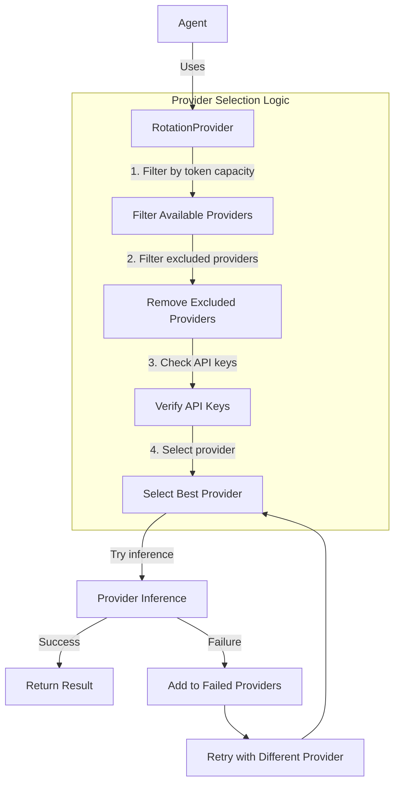
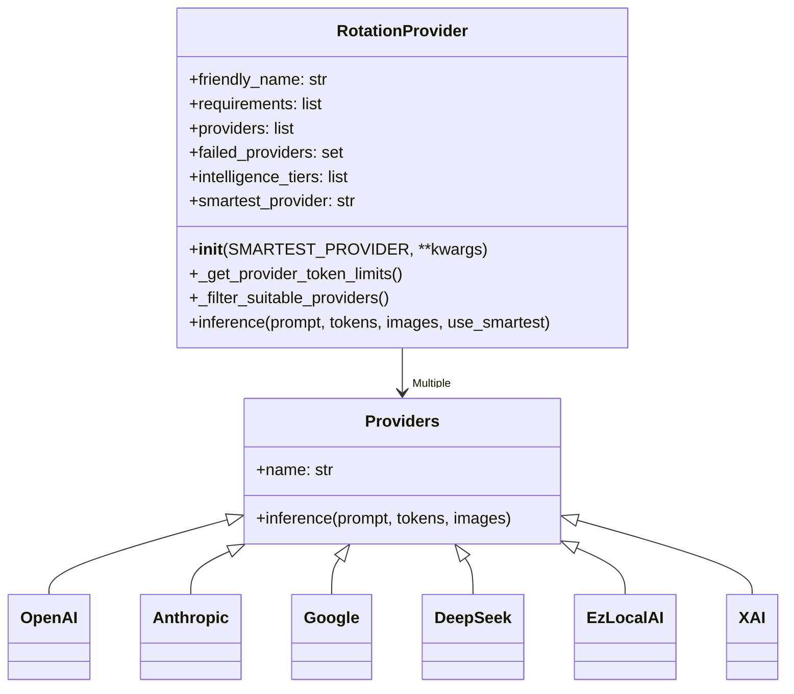
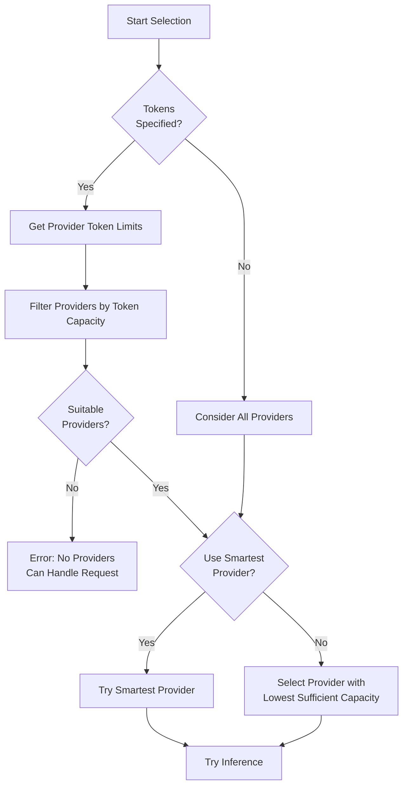
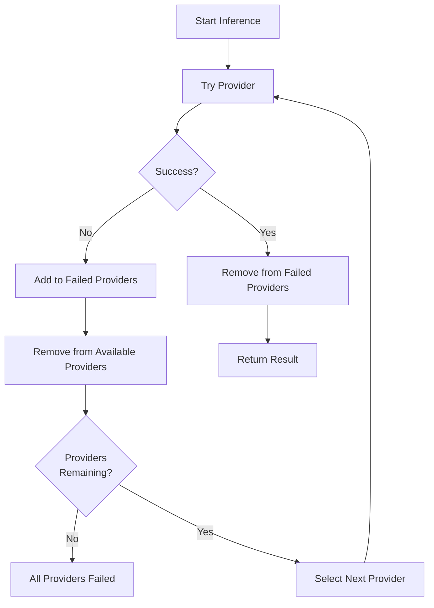

<!-- source: DeepWiki mcp.deepwiki.com · repo Josh-XT/AGiXT · page 3.2 Provider Rotation · fetched 2026-10-26 -->

# Provider Rotation

<details>
<summary>Relevant source files</summary>

The following files were used as context for generating this wiki page:

- [.github/workflows/build-and-test.yml](.github/workflows/build-and-test.yml)
- [.github/workflows/tests.yml](.github/workflows/tests.yml)
- [agixt/Task.py](agixt/Task.py)
- [agixt/TaskMonitor.py](agixt/TaskMonitor.py)
- [agixt/providers/gpt4free.py](agixt/providers/gpt4free.py)
- [agixt/providers/rotation.py](agixt/providers/rotation.py)

</details>


## Purpose and Scope

The Provider Rotation system is a core component of AGiXT that enables intelligent fallback and load balancing across multiple AI provider services. This system allows AGiXT to seamlessly switch between different AI providers based on availability, token limits, and failure states. Provider Rotation enhances reliability by ensuring that if one AI service fails or cannot handle a request, AGiXT automatically retries with an alternative provider.

For information about specific AI providers supported by AGiXT, see [Built-in Providers](#3.1).

## System Overview



Sources: [agixt/providers/rotation.py:8-123](), [agixt/providers/rotation.py:124-203]()

## Architecture and Components

The Provider Rotation system is built around the `RotationProvider` class, which abstracts the interaction with multiple AI service providers into a single interface.



Sources: [agixt/providers/rotation.py:8-47]()

The `RotationProvider` maintains several key data structures:
- `providers`: List of available AI providers
- `failed_providers`: Set tracking providers that have recently failed
- `intelligence_tiers`: Ordered list of providers by perceived intelligence/capability
- `smartest_provider`: The highest-ranked provider in intelligence_tiers

### Provider Selection Process

The provider selection process follows a sophisticated decision tree that prioritizes capability, availability, and reliability:

1. **Token Capacity Assessment**: Evaluates which providers can handle the required token count
2. **Provider Filtering**: Removes excluded providers from consideration
3. **API Key Verification**: Ensures providers have valid API keys configured
4. **Provider Selection**: Chooses the most appropriate provider based on:
   - Token requirements
   - Intelligence tiers
   - Previous failures

Sources: [agixt/providers/rotation.py:48-147]()

## Provider Selection Logic

### Token Limit Management

The system tracks token limits for each provider and selects providers that can handle the required token count for a given request:



Sources: [agixt/providers/rotation.py:32-64](), [agixt/providers/rotation.py:132-147]()

### Provider Exclusion

The system allows certain providers to be excluded from rotation:

```
excluded_providers = {"agixt", "rotation", "gpt4free", "default"}
```

Additional providers can be excluded via environment variables or agent settings:

```
ROTATION_EXCLUSIONS=provider1,provider2,provider3
```

Sources: [agixt/providers/rotation.py:88-103]()

## Fallback Mechanisms

A key feature of the Provider Rotation system is its ability to handle provider failures gracefully:

1. When a provider fails, it's added to the `failed_providers` set
2. The failed provider is removed from the list of available providers for the current request
3. The system automatically retries the request with a different provider
4. If all providers fail, the system will clear the failed providers list and try again
5. If a provider succeeds after previously failing, it's removed from the failed providers set

This approach ensures maximum reliability and automatic recovery from temporary service outages.



Sources: [agixt/providers/rotation.py:166-203]()

## Integration Examples

### Integration with GPT4Free Provider

The GPT4Free provider demonstrates how another provider can integrate with the RotationProvider:

```python
if (
    "DEEPSEEK_API_KEY" in agent_settings
    or "EZLOCALAI_API_KEY" in agent_settings
    or "AZURE_API_KEY" in agent_settings
    or "OPENAI_API_KEY" in agent_settings
    or "XAI_API_KEY" in agent_settings
    or "GOOGLE_API_KEY" in agent_settings
):
    from providers.rotation import RotationProvider
    
    return await RotationProvider(**self.agent_settings).inference(
        prompt=prompt, tokens=tokens, images=images
    )
```

This code shows how the GPT4Free provider delegates to the RotationProvider when other provider API keys are available, demonstrating the system's extensibility.

Sources: [agixt/providers/gpt4free.py:62-78]()

## Configuration

### Intelligence Tiers

Provider Rotation supports intelligence tiers through the `SMARTEST_PROVIDER` setting:

```
SMARTEST_PROVIDER=anthropic,google,openai
```

This configures a prioritized list of providers, with the first one considered the "smartest" and used preferentially when appropriate.

Sources: [agixt/providers/rotation.py:13-26]()

### Agent Settings

Provider rotation is configured through agent settings that include:

1. API keys for different providers (e.g., `OPENAI_API_KEY`, `GOOGLE_API_KEY`)
2. Token limits for each provider (e.g., `OPENAI_MAX_TOKENS`, `GOOGLE_MAX_TOKENS`)
3. Provider exclusions (`ROTATION_EXCLUSIONS`)
4. Intelligence tier configuration (`SMARTEST_PROVIDER`)

These settings can be configured per agent, allowing different agents to use different provider rotation strategies.

Sources: [agixt/providers/rotation.py:13-47](), [agixt/providers/rotation.py:88-123]()

## Usage Example

The Provider Rotation system is used transparently by the Agent system. When an agent needs to generate a response, it can use the RotationProvider:

```python
# Agent code (simplified)
provider_instance = Providers(
    name="rotation",
    **agent_settings,
)
result = await provider_instance.inference(
    prompt=prompt, tokens=tokens, images=images
)
```

This allows agents to benefit from provider rotation without needing to implement complex fallback logic themselves.

Sources: [agixt/providers/rotation.py:66-90]()

## Key Advantages

1. **Enhanced Reliability**: Automatic fallback ensures continuous operation even when individual providers fail
2. **Optimal Resource Utilization**: Selects providers with appropriate capacity for each request
3. **Cost Optimization**: Can prioritize cheaper providers for simpler tasks
4. **Quality Control**: Can use more capable providers for complex tasks
5. **Seamless Integration**: Transparently handles provider selection without client code modifications

The Provider Rotation system is a critical component that helps AGiXT maintain high availability and performance when working with multiple AI providers.

---

