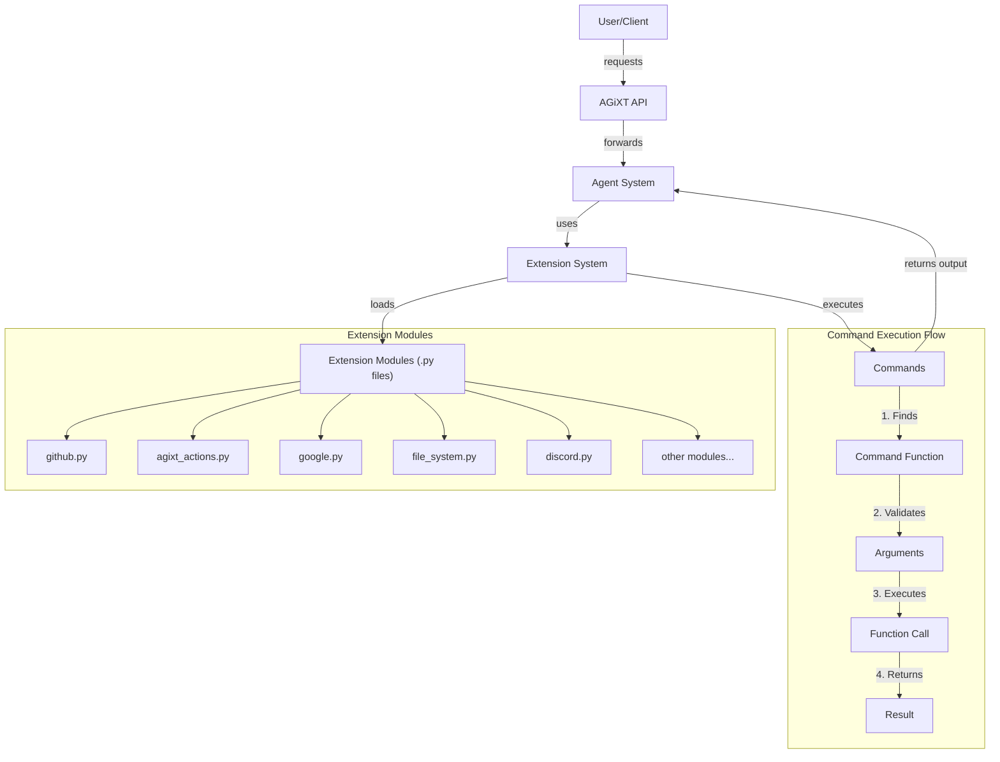
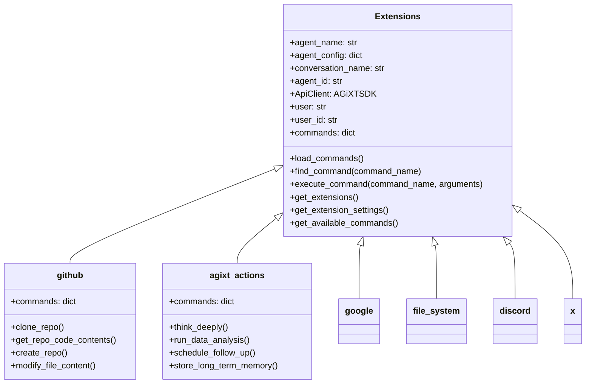
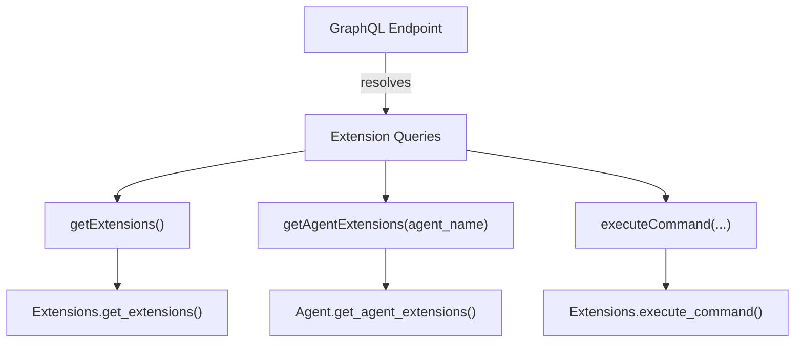
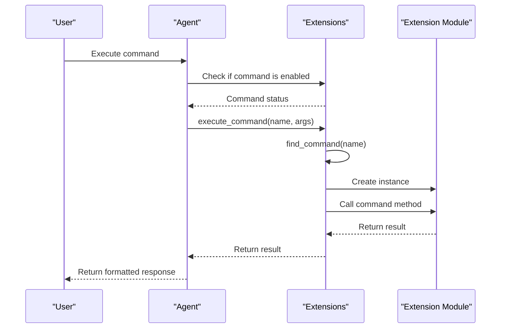

<!-- source: DeepWiki mcp.deepwiki.com · repo Josh-XT/AGiXT · page 4 Extension System · fetched 2026-10-26 -->

# Extension System

<details>
<summary>Relevant source files</summary>

The following files were used as context for generating this wiki page:

- [agixt/Agent.py](agixt/Agent.py)
- [agixt/Chain.py](agixt/Chain.py)
- [agixt/Conversations.py](agixt/Conversations.py)
- [agixt/Extensions.py](agixt/Extensions.py)
- [agixt/Models.py](agixt/Models.py)
- [agixt/SeedImports.py](agixt/SeedImports.py)
- [agixt/endpoints/Agent.py](agixt/endpoints/Agent.py)
- [agixt/endpoints/Chain.py](agixt/endpoints/Chain.py)
- [agixt/endpoints/Completions.py](agixt/endpoints/Completions.py)
- [agixt/endpoints/Conversation.py](agixt/endpoints/Conversation.py)
- [agixt/endpoints/Extension.py](agixt/endpoints/Extension.py)
- [agixt/endpoints/GQL.py](agixt/endpoints/GQL.py)
- [agixt/endpoints/Memory.py](agixt/endpoints/Memory.py)
- [agixt/endpoints/Prompt.py](agixt/endpoints/Prompt.py)
- [agixt/endpoints/Provider.py](agixt/endpoints/Provider.py)
- [agixt/endpoints/TeslaIntegration.py](agixt/endpoints/TeslaIntegration.py)
- [agixt/extensions/agixt_actions.py](agixt/extensions/agixt_actions.py)
- [agixt/extensions/discord.py](agixt/extensions/discord.py)
- [agixt/extensions/file_system.py](agixt/extensions/file_system.py)
- [agixt/extensions/github.py](agixt/extensions/github.py)
- [agixt/extensions/google.py](agixt/extensions/google.py)
- [agixt/extensions/google_search.py](agixt/extensions/google_search.py)
- [agixt/extensions/oura.py](agixt/extensions/oura.py)
- [agixt/extensions/x.py](agixt/extensions/x.py)
- [agixt/prompts/Default/Name Conversation.txt](agixt/prompts/Default/Name Conversation.txt)
- [agixt/prompts/Default/Think About It.txt](agixt/prompts/Default/Think About It.txt)

</details>


The Extension System is a core component of AGiXT that allows the platform to be extended with new functionality through a plugin mechanism. It enables agents to execute a wide variety of commands, from simple file operations to complex integrations with external services like GitHub, Google, Discord, and more.

This document explains how the Extension System works, the built-in extensions available, and how to create custom extensions to enhance AGiXT's capabilities.

For information about using extensions with agents, see [Agent System](#2.1). For information about how extensions interact with chains, see [Chain System](#2.3).

## Architecture Overview

The Extension System is designed with a modular architecture that makes it easy to add new capabilities to AGiXT agents.



Sources:
- [agixt/Extensions.py:30-490]()
- [agixt/extensions/github.py:99-140]()
- [agixt/extensions/agixt_actions.py:154-182]()

## Core Components

### Extensions Base Class

At the heart of the Extension System is the `Extensions` class, which serves as the base class for all extensions and provides the infrastructure for loading, finding, and executing commands.



Sources:
- [agixt/Extensions.py:30-67]()
- [agixt/Extensions.py:80-113]()

### Extension Discovery and Loading

When initialized, the `Extensions` class scans the `extensions` directory for Python files, imports each module, and checks if it defines a class that inherits from `Extensions`. If found, it loads the commands defined in that class.

```python
def load_commands(self):
    # ... (implementation details)
    command_files = glob.glob("extensions/*.py")
    for command_file in command_files:
        module_name = os.path.splitext(os.path.basename(command_file))[0]
        if module_name in DISABLED_EXTENSIONS:
            continue
        module = importlib.import_module(f"extensions.{module_name}")
        if issubclass(getattr(module, module_name), Extensions):
            # ... (register commands)
```

This dynamic loading mechanism makes it easy to add new extensions without modifying the core system.

Sources:
- [agixt/Extensions.py:253-298]()

### Command Execution Flow

When an agent needs to execute a command, it follows this process:

1. The agent checks if the command is enabled in its configuration
2. If enabled, the agent calls the `execute_command` method on its `Extensions` instance
3. The `Extensions` class finds the appropriate command function
4. The function is executed with the provided arguments
5. The result is returned to the agent

Sources:
- [agixt/Extensions.py:397-490]()
- [agixt/Agent.py:391-407]()

## Built-in Extensions

AGiXT comes with several built-in extensions that provide a wide range of functionality:

### Github Extension

Enables interaction with GitHub repositories, including cloning, creating, and modifying code.

```python
# Key commands in github extension:
self.commands = {
    "Clone Github Repository": self.clone_repo,
    "Get Github Repository Code Contents": self.get_repo_code_contents,
    "Create Github Repository": self.create_repo,
    "Modify File Content on Github": self.modify_file_content,
    # ... many more commands
}
```

Sources:
- [agixt/extensions/github.py:99-140]()

### AGiXT Actions Extension

Provides high-level actions that AGiXT agents can use to perform complex tasks.

```python
# Key commands in agixt_actions extension:
self.commands = {
    "Think Deeply": self.think_deeply,
    "Run Data Analysis": self.run_data_analysis,
    "Schedule Follow Up with User": self.schedule_follow_up,
    "Store information in my long term memory": self.store_long_term_memory,
    "Generate Extension from OpenAPI": self.generate_openapi_chain,
    # ... many more commands
}
```

Sources:
- [agixt/extensions/agixt_actions.py:154-182]()

### File System Extension

Enables agents to interact with the file system in their workspace.

```python
# Key commands in file_system extension:
self.commands = {
    "Write to File": self.write_to_file,
    "Read File": self.read_file,
    "Search Files": self.search_files,
    "Execute Python File": self.execute_python_file,
    # ... more commands
}
```

Sources:
- [agixt/extensions/file_system.py:10-37]()

### Other Built-in Extensions

AGiXT includes many other extensions for various integrations:

- **Google**: Integration with Google services (Gmail, Calendar, etc.)
- **Discord**: Integration with Discord for messaging and server management
- **X**: Integration with Twitter/X platform
- **Oura**: Integration with Oura Ring health data
- **Google Search**: Integration with Google Search API

Sources:
- [agixt/extensions/google.py:27-61]()
- [agixt/extensions/discord.py:15-24]()
- [agixt/extensions/x.py:9-23]()
- [agixt/extensions/oura.py:8-12]()
- [agixt/extensions/google_search.py:5-9]()

## Extension System API

AGiXT provides several API endpoints for interacting with the Extension System:

| Endpoint | Method | Description |
|----------|--------|-------------|
| `/api/extensions/settings` | GET | Get extension settings |
| `/api/extensions/{command_name}/args` | GET | Get arguments for a specific command |
| `/api/extensions` | GET | Get all available extensions |
| `/api/agent/{agent_name}/extensions` | GET | Get extensions for a specific agent |
| `/api/agent/{agent_name}/command` | POST | Execute a command for an agent |

Sources:
- [agixt/endpoints/Extension.py:11-93]()

In addition, GraphQL endpoints are available for interacting with extensions:



Sources:
- [agixt/endpoints/GQL.py:548-645]()

## Agent Integration with Extensions

Agents integrate with the Extension System through the `Extensions` class. Each agent has an instance of the `Extensions` class that it uses to access and execute commands.



When an agent is initialized, it creates an `Extensions` instance with its configuration:

```python
self.extensions = Extensions(
    agent_name=self.agent_name,
    agent_id=self.agent_id,
    agent_config=self.AGENT_CONFIG,
    ApiClient=ApiClient,
    api_key=ApiClient.headers.get("Authorization"),
    user=self.user,
)
self.available_commands = self.extensions.get_available_commands()
```

Sources:
- [agixt/Agent.py:391-407]()
- [agixt/Agent.py:730-791]()

## Creating Custom Extensions

You can extend AGiXT's functionality by creating custom extensions. Here's a basic template for creating a new extension:

```python
from Extensions import Extensions

class my_custom_extension(Extensions):
    """
    Documentation for your extension that explains its purpose
    """
    
    def __init__(self, **kwargs):
        # Initialize required properties
        self.some_property = kwargs.get("SOME_PROPERTY", "default_value")
        
        # Define the commands dictionary mapping friendly names to methods
        self.commands = {
            "My Custom Command": self.custom_command,
            "Another Command": self.another_command,
        }
    
    async def custom_command(self, arg1: str, arg2: int = 0):
        """
        Documentation for the command method.
        
        Args:
            arg1 (str): Description of arg1
            arg2 (int, optional): Description of arg2. Defaults to 0.
            
        Returns:
            str: Description of the return value
        """
        # Command implementation
        return f"Command executed with {arg1} and {arg2}"
```

To make your extension available to AGiXT:

1. Save your extension as a Python file in the `extensions` directory (e.g., `my_custom_extension.py`)
2. Restart AGiXT or reload the extensions
3. The extension will be automatically discovered and loaded

Sources:
- [agixt/extensions/github.py:99-166]()
- [agixt/extensions/agixt_actions.py:154-210]()

## Security Considerations

Extensions run with the same permissions as the AGiXT application, so they can potentially perform sensitive operations. The Extension System includes several security measures:

1. **Working Directory Restriction**: File operations are typically restricted to the agent's workspace
2. **Command Execution Control**: Agents can only execute commands that are explicitly enabled in their configuration
3. **Authentication**: API endpoints for extensions require authentication

For executing Python code, AGiXT uses a sandboxed execution environment to prevent unsafe code execution:

```python
def execute_python_code(code: str, agent_id: str = "", conversation_id: str = "") -> str:
    # ... implementation using Docker container for safe execution
```

Sources:
- [agixt/extensions/agixt_actions.py:31-103]()
- [agixt/extensions/file_system.py:38-65]()

## Conclusion

The Extension System is a powerful feature of AGiXT that allows for extending the platform's functionality through a plugin mechanism. By creating custom extensions, users can add new capabilities to AGiXT agents and integrate with external services, making AGiXT a versatile and adaptable AI automation platform.

Understanding the Extension System is crucial for developing with AGiXT, as it provides the foundation for integrating AGiXT with other tools and services, and for implementing custom functionality tailored to specific use cases.

---

