<!-- source: DeepWiki mcp.deepwiki.com · repo Josh-XT/AGiXT · page 4.1 Built-in Extensions · fetched 2026-10-26 -->

# Built-in Extensions

Relevant source files

The following files were used as context for generating this wiki page:

- [agixt/endpoints/TeslaIntegration.py](agixt/endpoints/TeslaIntegration.py)
- [agixt/extensions/agixt_actions.py](agixt/extensions/agixt_actions.py)
- [agixt/extensions/discord.py](agixt/extensions/discord.py)
- [agixt/extensions/file_system.py](agixt/extensions/file_system.py)
- [agixt/extensions/github.py](agixt/extensions/github.py)
- [agixt/extensions/google.py](agixt/extensions/google.py)
- [agixt/extensions/google_search.py](agixt/extensions/google_search.py)
- [agixt/extensions/mssql_database.py](agixt/extensions/mssql_database.py)
- [agixt/extensions/mysql_database.py](agixt/extensions/mysql_database.py)
- [agixt/extensions/oura.py](agixt/extensions/oura.py)
- [agixt/extensions/postgres_database.py](agixt/extensions/postgres_database.py)
- [agixt/extensions/x.py](agixt/extensions/x.py)
- [agixt/prompts/Default/PostgreSQLQuery.txt](agixt/prompts/Default/PostgreSQLQuery.txt)
- [agixt/prompts/Default/SQLQuery.txt](agixt/prompts/Default/SQLQuery.txt)
- [agixt/prompts/Default/Think About It.txt](agixt/prompts/Default/Think About It.txt)
- [agixt/prompts/Default/Validate PostgreSQL.txt](agixt/prompts/Default/Validate PostgreSQL.txt)
- [agixt/prompts/Default/Validate SQL.txt](agixt/prompts/Default/Validate SQL.txt)
- [agixt/prompts/Default/Voice Chat without Commands.txt](agixt/prompts/Default/Voice Chat without Commands.txt)
- [agixt/prompts/Default/Voice Chat.txt](agixt/prompts/Default/Voice Chat.txt)

This page documents the built-in extensions that come with AGiXT out of the box. Extensions enhance agent capabilities by providing access to external services and APIs, enabling interaction with various platforms like GitHub, Google services, databases, file systems, and social media. For information about creating your own extensions, see [Creating Custom Extensions](#4.2).

## Extension System Overview

In AGiXT, extensions are modular components that provide agents with additional functionality through commands. Each extension inherits from a base `Extensions` class and defines a set of commands that can be called by agents to perform various actions.

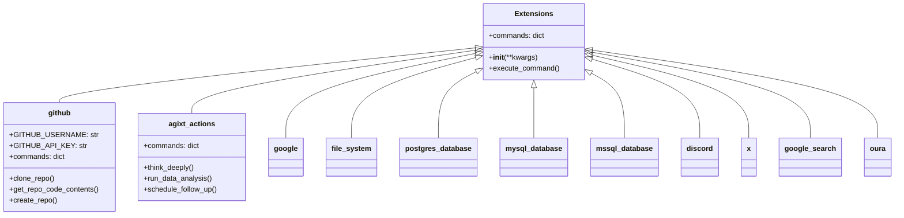

Sources: [agixt/extensions/github.py:99-169](), [agixt/extensions/agixt_actions.py:154-182]()

## Extension Integration Flow

The following diagram illustrates how extensions are integrated into the AGiXT system:

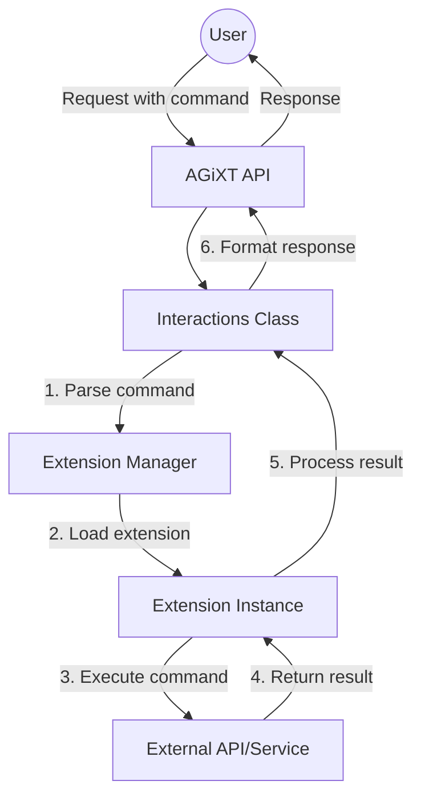

Sources: [agixt/extensions/github.py](), [agixt/extensions/agixt_actions.py]()

## GitHub Extension

The GitHub extension provides comprehensive integration with GitHub repositories, allowing agents to perform various GitHub operations.

### Key Features

- Repository operations (clone, create)
- Code management (get contents, modify files)
- Issue and PR management
- Advanced code modification and improvement

### Commands

| Command | Description |
|---------|-------------|
| Clone Github Repository | Clones a GitHub repository to the local workspace |
| Get Github Repository Code Contents | Retrieves the content of files from a repository |
| Create Github Repository | Creates a new GitHub repository |
| Create Github Repository Issue | Creates an issue in a repository |
| Get Github Repository Issues | Gets issues from a repository |
| Update Github Repository Issue | Updates an existing issue |
| Add Comment to Github Repository Issue | Adds a comment to an issue |
| Upload File to Github Repository | Uploads a file to a repository |
| Modify File Content on Github | Modifies a file in a repository |
| Fix GitHub Issue | Automatically attempts to fix an issue |
| Improve Github Repository Codebase | Analyzes and improves repository code |

### Implementation Details

The GitHub extension authenticates using a GitHub API key and username, and uses the PyGithub library to interact with the GitHub API.

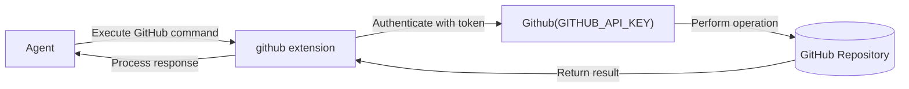

Sources: [agixt/extensions/github.py:99-169]()

## AGiXT Actions Extension

The AGiXT Actions extension provides core capabilities for agents, including deep thinking, data analysis, task scheduling, and more.

### Key Features

- Enhanced reasoning capabilities
- Data analysis functions
- Task scheduling and follow-ups
- Memory management
- Code execution

### Commands

| Command | Description |
|---------|-------------|
| Think Deeply | Execute deep analysis on a topic |
| Run Data Analysis | Analyze data and solve problems |
| Schedule Follow Up with User | Schedule a follow-up interaction |
| Update Scheduled Task | Modify an existing scheduled task |
| Store information in my long term memory | Store information for future recall |
| Generate Extension from OpenAPI | Generate a new extension from OpenAPI spec |
| Execute Python Code | Run Python code securely |
| Get Mindmap for task | Break down a task into steps |
| Research on arXiv | Search and analyze arXiv papers |
| Explain Chain | Generate Mermaid diagrams of execution chains |

### Implementation Details

This extension leverages the AGiXT's agent prompting system and can execute Python code in a secure Docker container.

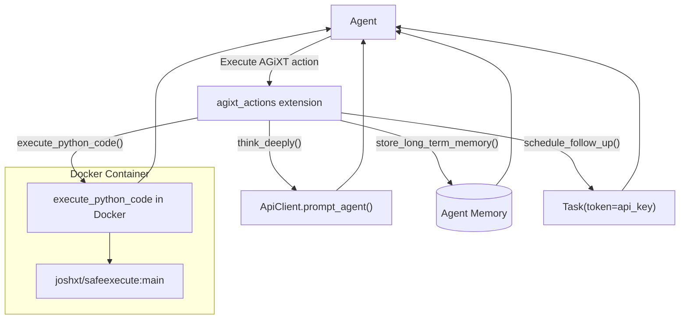

Sources: [agixt/extensions/agixt_actions.py:154-182](), [agixt/extensions/agixt_actions.py:31-104]()

## Google Extension

The Google extension provides access to Google services including Gmail, Calendar, and Keep notes.

### Key Features

- Email management
- Calendar operations
- Keep notes management

### Commands

| Command | Description |
|---------|-------------|
| Google - Get Emails | Retrieve emails from Gmail |
| Google - Send Email | Send an email via Gmail |
| Google - Move Email to Folder | Move an email to a specific folder |
| Google - Create Draft Email | Create a draft email |
| Google - Delete Email | Delete an email |
| Google - Search Emails | Search for emails based on criteria |
| Google - Reply to Email | Reply to an email |
| Google - Process Attachments | Download email attachments |
| Google - Get Calendar Items | Get calendar events |
| Google - Get Available Timeslots | Find available times for meetings |
| Google - Add Calendar Item | Add a new calendar event |
| Google - Remove Calendar Item | Delete a calendar event |
| Google - Get Keep Notes | Retrieve Google Keep notes |
| Google - Create Keep Note | Create a new note |
| Google - Delete Keep Note | Delete a Keep note |

### Implementation Details

This extension authenticates using OAuth2 and interacts with various Google APIs.

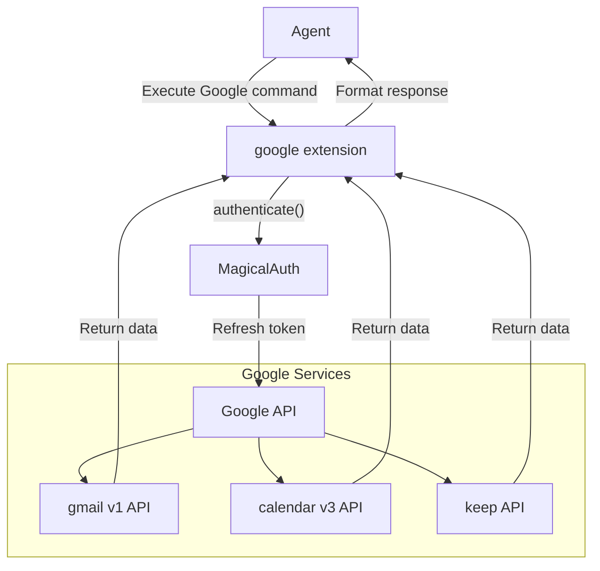

Sources: [agixt/extensions/google.py:27-62](), [agixt/extensions/google.py:74-116]()

## Database Extensions

AGiXT provides extensions for various database systems including PostgreSQL, MySQL, and MS SQL.

### Key Features

- SQL query execution
- Schema retrieval
- Natural language database interaction

### Commands

| Command | Description |
|---------|-------------|
| Custom SQL Query in [DB] Database | Execute a SQL query |
| Get Database Schema from [DB] Database | Retrieve the database schema |
| Chat with [DB] Database | Use natural language to query the database |

Where [DB] is one of PostgreSQL, MySQL, or MSSQL.

### Implementation Details

Each database extension connects to its respective database system using connection parameters and executes SQL queries.

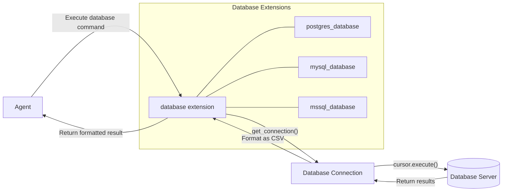

Sources: [agixt/extensions/postgres_database.py:18-46](), [agixt/extensions/mysql_database.py:7-31](), [agixt/extensions/mssql_database.py:17-46]()

## File System Extension

The File System extension allows agents to interact with the file system in a secure workspace.

### Key Features

- File reading and writing
- Directory operations
- Python code execution
- Shell command execution

### Commands

| Command | Description |
|---------|-------------|
| Write to File | Write content to a file |
| Read File | Read file content |
| Search Files | Find files in the workspace |
| Append to File | Add content to an existing file |
| Execute Python File | Run a Python script |
| Delete File | Delete a file |
| Execute Shell | Run a shell command |
| Indent String for Python Code | Format Python code with proper indentation |
| Generate Commands Dictionary | Generate a commands dictionary for new extensions |

### Implementation Details

This extension is restricted to a designated workspace directory for security.

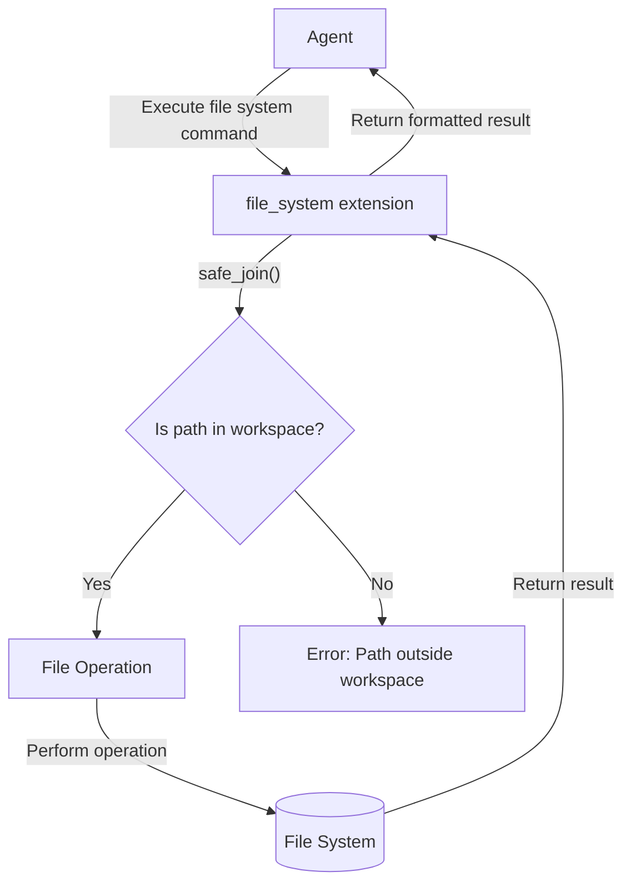

Sources: [agixt/extensions/file_system.py:10-37](), [agixt/extensions/file_system.py:97-115]()

## Social Media Extensions

AGiXT includes extensions for social media platforms including Discord and X (Twitter).

### Discord Extension

The Discord extension enables interaction with Discord servers and channels.

#### Commands

| Command | Description |
|---------|-------------|
| Discord - Send Message | Send a message to a Discord channel |
| Discord - Get Messages | Get messages from a channel |
| Discord - Delete Message | Delete a message |
| Discord - Create Invite | Create an invite link |
| Discord - Get Servers (Guilds) | List available servers |
| Discord - Get Server Information | Get details about a server |
| Discord - Get Channels in Server | List channels in a server |
| Discord - Edit Message | Edit an existing message |
| Discord - Pin Message | Pin a message in a channel |
| Discord - Kick Member | Remove a user from a server |
| Discord - Ban Member | Ban a user from a server |

#### Implementation

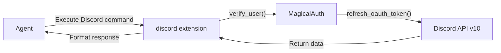

Sources: [agixt/extensions/discord.py:15-54](), [agixt/extensions/discord.py:63-102]()

### X (Twitter) Extension

The X extension provides integration with Twitter (X) platform.

#### Commands

| Command | Description |
|---------|-------------|
| X - Get Home Timeline | Get tweets from the home timeline |
| X - Get User Timeline | Get tweets from a specific user |
| X - Post Tweet | Post a new tweet |
| X - Reply to Tweet | Reply to an existing tweet |
| X - Like Tweet | Like a tweet |
| X - Retweet | Retweet a tweet |
| X - Search Tweets | Search for tweets by keyword |
| X - Get Tweet Details | Get details about a specific tweet |
| X - Follow User | Follow a Twitter user |
| X - Unfollow User | Unfollow a Twitter user |
| X - Send Direct Message | Send a direct message |

#### Implementation

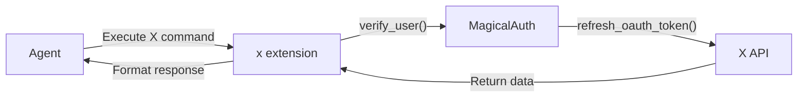

Sources: [agixt/extensions/x.py:9-54](), [agixt/extensions/x.py:62-81]()

## Other Extensions

### Google Search Extension

A simple extension for performing web searches.

#### Commands

| Command | Description |
|---------|-------------|
| Google Search | Search the web using Google |

#### Implementation

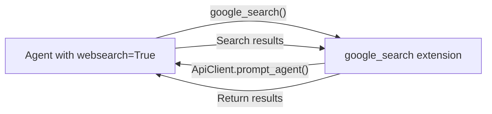

Sources: [agixt/extensions/google_search.py:5-26](), [agixt/extensions/google_search.py:27-43]()

### Oura Extension

An extension for fetching health and fitness data from the Oura ring.

#### Commands

| Command | Description |
|---------|-------------|
| Get Oura Ring Data | Fetch health data from Oura API |

#### Implementation

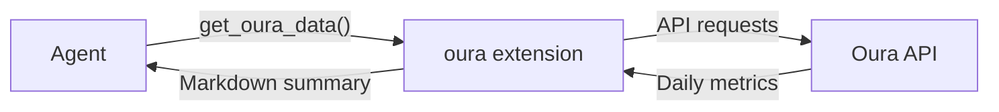

Sources: [agixt/extensions/oura.py:8-20](), [agixt/extensions/oura.py:21-229]()

## Extension Authentication

Many extensions require authentication to external services. AGiXT handles this through:

1. API keys passed during extension initialization
2. OAuth2 authentication via the MagicalAuth system
3. Credentials stored in environment variables

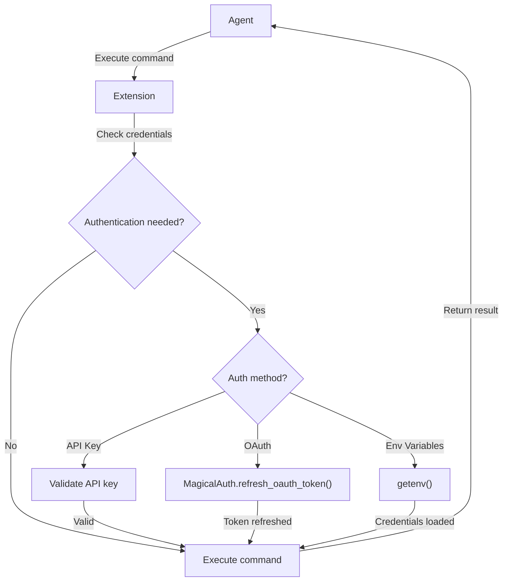

Sources: [agixt/extensions/github.py:104-148](), [agixt/extensions/google.py:74-116](), [agixt/extensions/discord.py:63-102]()

## Extension Loading and Execution Flow

When an agent needs to execute a command, the system:

1. Identifies the required extension
2. Initializes the extension with appropriate parameters
3. Executes the command
4. Returns the result

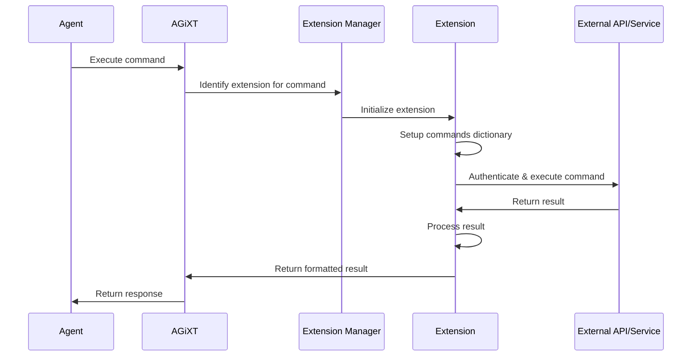

Sources: [agixt/extensions/github.py:99-169](), [agixt/extensions/agixt_actions.py:154-182]()

This wiki page documents the built-in extensions in AGiXT that provide agents with additional capabilities. For information on creating your own custom extensions, see [Creating Custom Extensions](#4.2).

---

