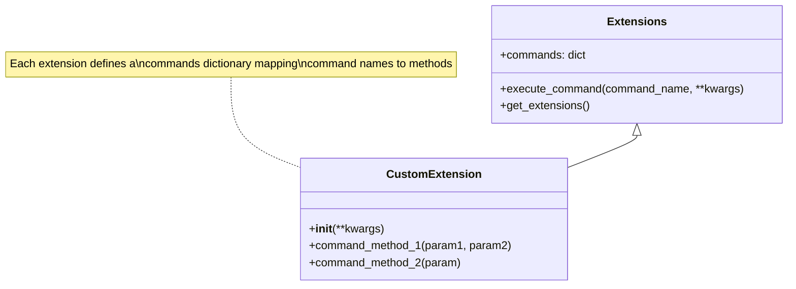
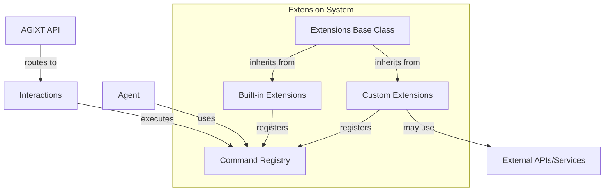
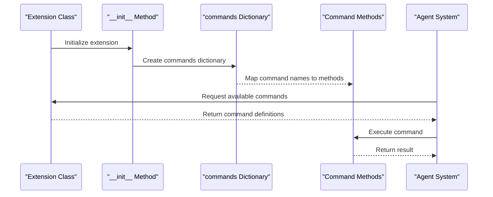
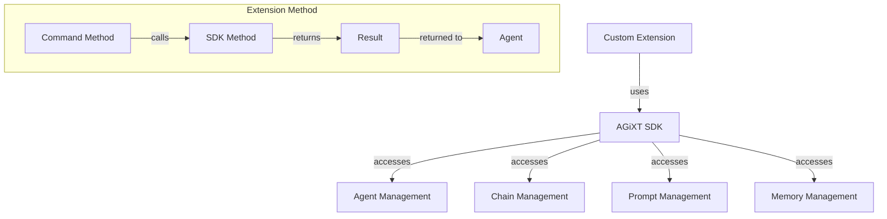

<!-- source: DeepWiki mcp.deepwiki.com · repo Josh-XT/AGiXT · page 4.2 Creating Custom Extensions · fetched 2026-10-26 -->

# Creating Custom Extensions

<details>
<summary>Relevant source files</summary>

The following files were used as context for generating this wiki page:

- [agixt/endpoints/TeslaIntegration.py](agixt/endpoints/TeslaIntegration.py)
- [agixt/extensions/agixt_actions.py](agixt/extensions/agixt_actions.py)
- [agixt/extensions/discord.py](agixt/extensions/discord.py)
- [agixt/extensions/file_system.py](agixt/extensions/file_system.py)
- [agixt/extensions/github.py](agixt/extensions/github.py)
- [agixt/extensions/google.py](agixt/extensions/google.py)
- [agixt/extensions/google_search.py](agixt/extensions/google_search.py)
- [agixt/extensions/openscad_modeling.py](agixt/extensions/openscad_modeling.py)
- [agixt/extensions/oura.py](agixt/extensions/oura.py)
- [agixt/extensions/solana_wallet.py](agixt/extensions/solana_wallet.py)
- [agixt/extensions/x.py](agixt/extensions/x.py)
- [agixt/prompts/Default/Think About It.txt](agixt/prompts/Default/Think About It.txt)
- [docker-requirements.txt](docker-requirements.txt)

</details>


This guide explains how to create custom extensions for AGiXT, allowing you to expand the platform's capabilities with new functionalities. Extensions provide a way to add commands that agents can execute, integrating with external services, performing specialized tasks, or providing access to additional tools and resources.

For information about built-in extensions and their capabilities, see [Built-in Extensions](#4.1).

## What are Extensions?

Extensions in AGiXT are modular components that add new commands or capabilities to the system. Each extension inherits from a base `Extensions` class and defines a set of commands that agents can execute.



Sources:
- [agixt/extensions/github.py:99-149](agixt/extensions/github.py:99-149)
- [agixt/extensions/agixt_actions.py:154-208](agixt/extensions/agixt_actions.py:154-208)
- [agixt/extensions/google.py:27-73](agixt/extensions/google.py:27-73)

## Extension Architecture

Extensions integrate with the AGiXT system as follows:



Sources:
- [agixt/extensions/github.py:99-149](agixt/extensions/github.py:99-149)
- [agixt/extensions/agixt_actions.py:154-208](agixt/extensions/agixt_actions.py:154-208)

## Basic Extension Structure

Every extension in AGiXT follows this basic structure:

1. Import the base `Extensions` class
2. Define a new class that inherits from `Extensions`
3. Implement an `__init__` method that sets up the `commands` dictionary
4. Implement methods for each command your extension provides

Here's a minimal example of an extension:

```python
from Extensions import Extensions

class my_extension(Extensions):
    """
    Documentation for your extension. This docstring will be used by AGiXT to provide
    information about your extension to users.
    """
    
    def __init__(self, **kwargs):
        # Extract any configuration parameters from kwargs
        self.some_parameter = kwargs.get("some_parameter", "default_value")
        
        # Define commands dictionary mapping command names to methods
        self.commands = {
            "My First Command": self.first_command,
            "My Second Command": self.second_command,
        }
    
    async def first_command(self, param1: str, param2: int = 0):
        """
        Documentation for your command. Explain what it does, its parameters, and what it returns.
        
        Args:
            param1 (str): Description of the first parameter
            param2 (int, optional): Description of the second parameter. Defaults to 0.
            
        Returns:
            str: Description of what the command returns
        """
        # Command implementation
        result = f"Executed first command with {param1} and {param2}"
        return result
    
    async def second_command(self):
        """
        Documentation for your second command.
        
        Returns:
            str: Description of what the command returns
        """
        # Command implementation
        return "Executed second command"
```

Sources:
- [agixt/extensions/github.py:99-149](agixt/extensions/github.py:99-149)
- [agixt/extensions/agixt_actions.py:154-208](agixt/extensions/agixt_actions.py:154-208)
- [agixt/extensions/file_system.py:10-38](agixt/extensions/file_system.py:10-38)

## Command Definition Process

The command registration process follows this sequence:



Sources:
- [agixt/extensions/github.py:99-149](agixt/extensions/github.py:99-149)
- [agixt/extensions/agixt_actions.py:154-208](agixt/extensions/agixt_actions.py:154-208)

## Handling Initialization Parameters

Extensions can receive various parameters through `**kwargs` in their `__init__` method. Common parameters include:

| Parameter | Description | Common Use |
|-----------|-------------|------------|
| `ApiClient` | AGiXT SDK client instance | Accessing other AGiXT functionalities |
| `agent_name` | Name of the agent using the extension | Personalizing responses or managing agent-specific data |
| `conversation_name` | Name of the current conversation | Managing conversation context |
| `conversation_directory` | Working directory for the conversation | File operations related to the conversation |
| `api_key` | API key for authentication | Authenticating with internal or external services |
| `conversation_id` | Unique ID of the conversation | Storing or retrieving conversation-specific data |
| Custom parameters | Extension-specific parameters | Configuration for the extension |

Example of handling parameters:

```python
def __init__(self, **kwargs):
    # Standard AGiXT parameters
    self.agent_name = kwargs.get("agent_name", "gpt4free")  # Default if not provided
    self.conversation_name = kwargs.get("conversation_name", "")
    
    # Working directory setup
    self.WORKING_DIRECTORY = kwargs.get(
        "conversation_directory", 
        os.path.join(os.getcwd(), "WORKSPACE")
    )
    os.makedirs(self.WORKING_DIRECTORY, exist_ok=True)
    
    # API access setup
    self.ApiClient = kwargs.get("ApiClient", None)
    self.api_key = kwargs.get("api_key", "")
    
    # Extension-specific parameters
    self.CUSTOM_PARAMETER = kwargs.get("CUSTOM_PARAMETER", "default_value")
    
    # Define commands
    self.commands = {
        "Command One": self.command_one,
        "Command Two": self.command_two,
    }
```

Sources:
- [agixt/extensions/agixt_actions.py:154-208](agixt/extensions/agixt_actions.py:154-208)
- [agixt/extensions/file_system.py:10-38](agixt/extensions/file_system.py:10-38)
- [agixt/extensions/openscad_modeling.py:9-26](agixt/extensions/openscad_modeling.py:9-26)

## Command Implementation Details

When implementing command methods in your extension, follow these guidelines:

1. **Use Async Methods**: Command methods should be defined with `async def`
2. **Type Annotations**: Use type hints for parameters and return values
3. **Documentation**: Include detailed docstrings for each command
4. **Error Handling**: Implement proper error handling and return meaningful error messages
5. **Return Values**: Return results that can be used by agents (typically strings)

Example command implementation:

```python
async def analyze_data(self, data: str, format: str = "summary"):
    """
    Analyze provided data and return insights.
    
    Args:
        data (str): The data to analyze
        format (str, optional): The format of the results. Options: "summary", "detailed". Defaults to "summary".
        
    Returns:
        str: Analysis results in the requested format
    """
    try:
        # Validate parameters
        if not data:
            return "Error: No data provided for analysis."
            
        valid_formats = ["summary", "detailed"]
        if format not in valid_formats:
            return f"Error: Invalid format '{format}'. Valid options are: {', '.join(valid_formats)}"
        
        # Implementation logic
        results = "Analysis results would go here"
        
        if format == "detailed":
            results += "\nWith additional detailed information"
            
        return results
    except Exception as e:
        return f"Error analyzing data: {str(e)}"
```

Sources:
- [agixt/extensions/file_system.py:116-132](agixt/extensions/file_system.py:116-132)
- [agixt/extensions/agixt_actions.py:211-262](agixt/extensions/agixt_actions.py:211-262)

## Using the AGiXT SDK in Extensions

Extensions can leverage the AGiXT SDK to interact with other components of the AGiXT system. This can be particularly useful for extensions that need to use agent prompts, chain execution, or memory management.



Example of using the SDK in an extension:

```python
async def think_deeply(self, query: str):
    """
    Execute a deep analysis and reasoning process on any given topic or question.
    
    Args:
        query (str): The topic, question, or problem to analyze deeply
        
    Returns:
        str: A comprehensive response with detailed analysis
    """
    return self.ApiClient.prompt_agent(
        agent_name=self.agent_name,
        prompt_name="Think About It",
        prompt_args={
            "user_input": query,
            "conversation_name": self.conversation_name,
            "disable_commands": True,  # Prevent command execution in the nested prompt
            "log_user_input": False,
            "log_output": False,
        },
    )
```

Sources:
- [agixt/extensions/agixt_actions.py:211-262](agixt/extensions/agixt_actions.py:211-262)
- [agixt/extensions/google_search.py:5-43](agixt/extensions/google_search.py:5-43)

## Working with External Services

Extensions often integrate with external services and APIs. Here's a pattern for handling external service connections:

1. Import necessary libraries
2. Check for required credentials in initialization
3. Set up API clients or connections
4. Implement robust error handling for API calls

Example pattern:

```python
import requests  # External library for API calls

class external_service_extension(Extensions):
    def __init__(self, API_KEY: str = "", **kwargs):
        self.API_KEY = API_KEY
        self.base_url = "https://api.example.com/v1"
        
        # Only enable commands if we have the necessary credentials
        if self.API_KEY:
            self.commands = {
                "Get Data": self.get_data,
                "Post Data": self.post_data,
            }
        else:
            self.commands = {}  # No commands available without API key
    
    async def get_data(self, resource_id: str):
        """
        Get data from the external service.
        
        Args:
            resource_id (str): ID of the resource to retrieve
            
        Returns:
            str: The retrieved data or error message
        """
        try:
            response = requests.get(
                f"{self.base_url}/resource/{resource_id}",
                headers={"Authorization": f"Bearer {self.API_KEY}"}
            )
            response.raise_for_status()  # Raise exception for HTTP errors
            return response.json()
        except requests.exceptions.RequestException as e:
            return f"Error retrieving data: {str(e)}"
```

Sources:
- [agixt/extensions/github.py:99-149](agixt/extensions/github.py:99-149)
- [agixt/extensions/google.py:27-73](agixt/extensions/google.py:27-73)
- [agixt/extensions/oura.py:8-73](agixt/extensions/oura.py:8-73)

## Handling Dependencies

AGiXT extension dependencies can be managed in two ways:

1. **Runtime dependency checking** - Try to import the dependency and install it if it fails
2. **Docker requirements** - Add your dependencies to the docker-requirements.txt file

Example of runtime dependency checking:

```python
try:
    import some_library
except ImportError:
    import sys
    import subprocess
    
    subprocess.check_call([sys.executable, "-m", "pip", "install", "some-library"])
    import some_library
```

Sources:
- [agixt/extensions/github.py:14-40](agixt/extensions/github.py:14-40)
- [docker-requirements.txt:1-7](docker-requirements.txt:1-7)

## Conditional Command Registration

Extensions can dynamically decide which commands to register based on available credentials or environment variables:

```python
def __init__(self, **kwargs):
    # Base configuration
    self.SOME_API_KEY = kwargs.get("SOME_API_KEY", "")
    
    # Define commands conditionally
    if self.SOME_API_KEY:
        self.commands = {
            "Full Featured Command": self.full_featured_command,
            "Another Command": self.another_command,
        }
    else:
        # Limited functionality without API key
        self.commands = {
            "Limited Command": self.limited_command,
        }
```

Sources:
- [agixt/extensions/google.py:32-73](agixt/extensions/google.py:32-73)
- [agixt/extensions/discord.py:23-61](agixt/extensions/discord.py:23-61)

## Testing Extensions

Here's a recommended approach for testing custom extensions:

1. Create a test script that initializes your extension
2. Test each command with various input combinations
3. Verify error handling by providing invalid inputs
4. Check integration with external services using test credentials
5. For extensions that use the AGiXT SDK, test integration with AGiXT components

## Installing Custom Extensions

To install a custom extension:

1. Place your extension Python file in the `agixt/extensions` directory
2. The extension will be automatically discovered and loaded by AGiXT
3. Extension commands will be available to agents based on their configuration

## Extension Best Practices

1. **Proper Documentation**: Include detailed docstrings for your extension class and all command methods
2. **Error Handling**: Implement robust error handling and return meaningful error messages
3. **Parameter Validation**: Validate input parameters and provide clear error messages for invalid inputs
4. **Asynchronous Programming**: Use async methods to prevent blocking the AGiXT system
5. **Modular Design**: Keep your extensions focused on a specific domain or functionality
6. **Class Names**: Use lowercase names for extension classes to match AGiXT's convention
7. **Resource Management**: Clean up resources properly (close connections, file handles, etc.)
8. **Security**: Handle credentials and sensitive data securely

## Example: Creating a Weather Extension

Let's walk through creating a complete custom extension for weather information:

```python
import aiohttp
from Extensions import Extensions
from typing import Optional

class weather_extension(Extensions):
    """
    The Weather extension provides access to weather information for AGiXT agents.
    It requires an API key from a weather service provider.
    """
    
    def __init__(self, WEATHER_API_KEY: str = "", **kwargs):
        self.API_KEY = WEATHER_API_KEY
        self.API_BASE_URL = "https://api.weatherservice.com/v1"
        
        # Register commands if API key is available
        if self.API_KEY:
            self.commands = {
                "Get Current Weather": self.get_current_weather,
                "Get Weather Forecast": self.get_weather_forecast,
                "Get Air Quality": self.get_air_quality,
            }
        else:
            self.commands = {}  # No commands without API key
    
    async def get_current_weather(self, location: str, units: str = "metric"):
        """
        Get current weather conditions for a location.
        
        Args:
            location (str): City name, postal code, or coordinates
            units (str, optional): Unit system: "metric" or "imperial". Defaults to "metric".
            
        Returns:
            str: Current weather information formatted as a string
        """
        try:
            # Validate parameters
            if not location:
                return "Error: Location is required"
            
            valid_units = ["metric", "imperial"]
            if units not in valid_units:
                return f"Error: Invalid units '{units}'. Valid options are: {', '.join(valid_units)}"
            
            # Make API request
            async with aiohttp.ClientSession() as session:
                params = {
                    "location": location,
                    "units": units,
                    "apikey": self.API_KEY
                }
                async with session.get(f"{self.API_BASE_URL}/current", params=params) as response:
                    if response.status != 200:
                        error_data = await response.json()
                        return f"Error: {error_data.get('message', 'Unknown error')}"
                    
                    data = await response.json()
                    
            # Format response
            result = (
                f"Current weather for {data['location']['name']}:\n"
                f"Temperature: {data['current']['temperature']}°{units=='metric' and 'C' or 'F'}\n"
                f"Conditions: {data['current']['condition']}\n"
                f"Humidity: {data['current']['humidity']}%\n"
                f"Wind: {data['current']['wind_speed']} {units=='metric' and 'km/h' or 'mph'}"
            )
            return result
            
        except Exception as e:
            return f"Error retrieving weather information: {str(e)}"
```

This example demonstrates the key components of a custom extension:
- Proper class definition inheriting from `Extensions`
- Conditional command registration based on credential availability
- Asynchronous command methods with proper error handling
- Detailed docstrings for the extension and its methods
- Input parameter validation
- External API integration

Sources:
- [agixt/extensions/google.py:27-115](agixt/extensions/google.py:27-115)
- [agixt/extensions/oura.py:8-229](agixt/extensions/oura.py:8-229)

## Conclusion

Creating custom extensions is a powerful way to expand AGiXT's capabilities. By following the patterns and best practices outlined in this guide, you can create extensions that seamlessly integrate with the AGiXT ecosystem and provide valuable functionalities to agents.

Remember that extensions are discovered and loaded automatically, so once your extension is placed in the correct directory, its commands will be available to agents based on their configuration. Make sure to provide comprehensive documentation and robust error handling to ensure a smooth user experience.

---

