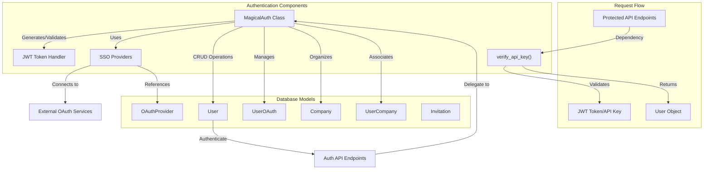
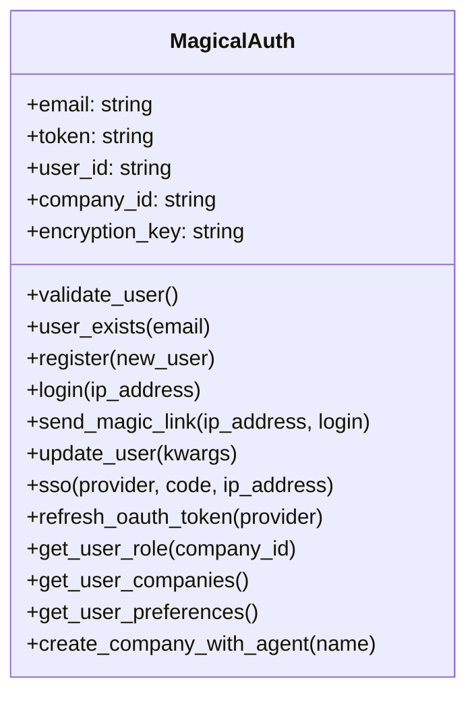
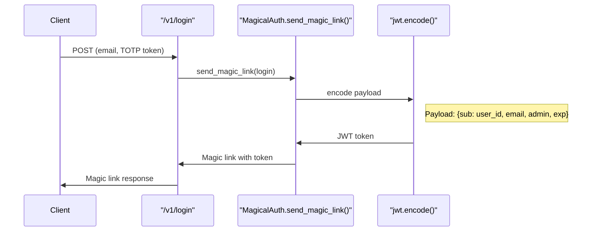
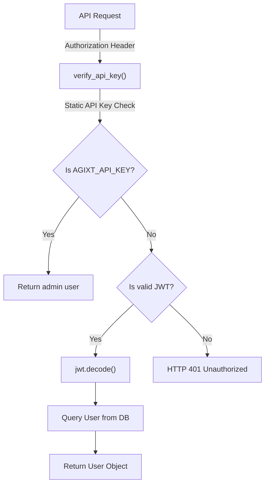
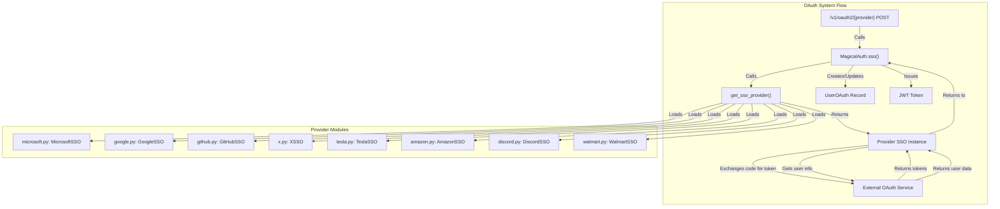
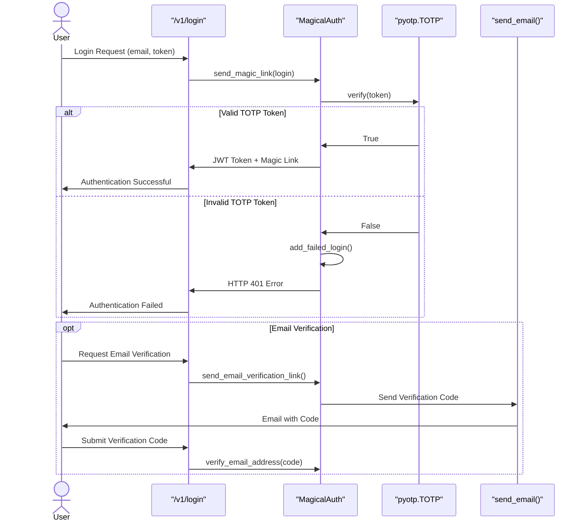
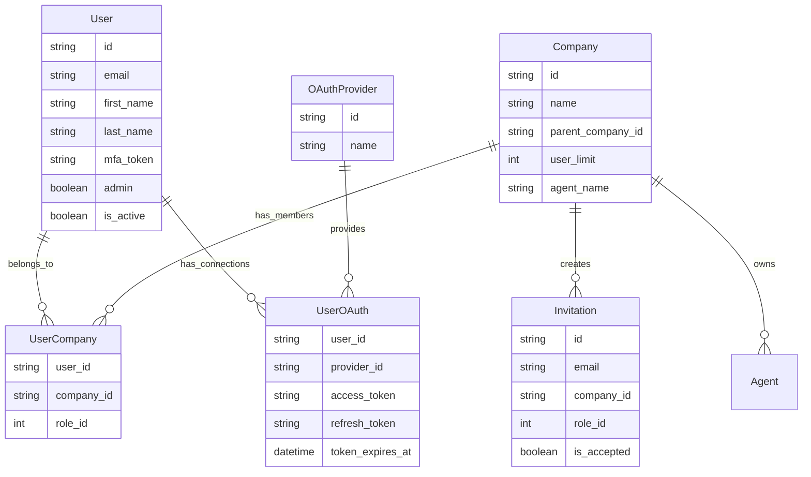
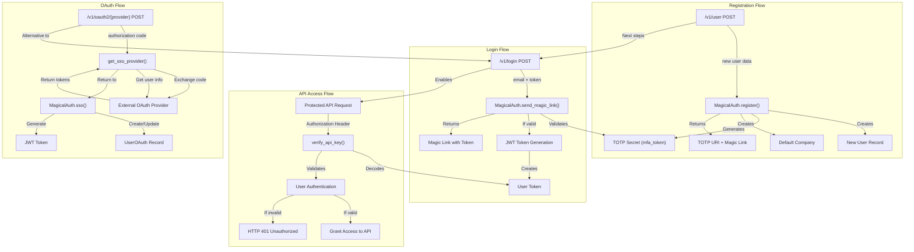
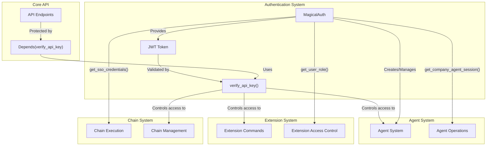

<!-- source: DeepWiki mcp.deepwiki.com · repo Josh-XT/AGiXT · page 5 Authentication System · fetched 2026-10-26 -->

# Authentication System

Relevant source files

The following files were used as context for generating this wiki page:

- [agixt/ApiClient.py](agixt/ApiClient.py)
- [agixt/MagicalAuth.py](agixt/MagicalAuth.py)
- [agixt/endpoints/Auth.py](agixt/endpoints/Auth.py)
- [agixt/sso/amazon.py](agixt/sso/amazon.py)
- [agixt/sso/discord.py](agixt/sso/discord.py)
- [agixt/sso/github.py](agixt/sso/github.py)
- [agixt/sso/google.py](agixt/sso/google.py)
- [agixt/sso/microsoft.py](agixt/sso/microsoft.py)
- [agixt/sso/tesla.py](agixt/sso/tesla.py)
- [agixt/sso/walmart.py](agixt/sso/walmart.py)
- [agixt/sso/x.py](agixt/sso/x.py)

The Authentication System in AGiXT provides identity management, authentication, and authorization mechanisms for users accessing the platform. It handles user registration, login flows, multi-factor authentication (MFA), OAuth integration with external identity providers, and permission management for API access.

## Overview of Authentication Architecture

The AGiXT authentication system consists of several core components that work together to provide secure access to the platform.

Sources:
- [agixt/MagicalAuth.py:372-437]()
- [agixt/MagicalAuth.py:237-266]()
- [agixt/ApiClient.py:22-70]()

## Core Authentication Components

### The MagicalAuth Class

The `MagicalAuth` class is the central component of the authentication system, handling user registration, login, token generation, and OAuth integration.

The class is initialized with a JWT token and provides methods for all authentication operations. It serves as a centralized authentication service for the entire application.

Sources:
- [agixt/MagicalAuth.py:372-437]()

### JWT Token Handling

AGiXT uses JSON Web Tokens (JWT) for session management and authentication. Tokens are created during login and validated on subsequent requests.

The token generation occurs in the `send_magic_link` method and uses the secret key defined in the `AGIXT_API_KEY` environment variable:

Sources:
- [agixt/MagicalAuth.py:508-587]()
- [agixt/endpoints/Auth.py:174-189]()

### API Key Verification

The `verify_api_key` function serves as a FastAPI dependency for protected endpoints, validating two types of authentication:

1. JWT tokens for user authentication
2. Static API key for system access

The function is used as a dependency in API routes to ensure that only authenticated users can access protected resources.

Sources:
- [agixt/MagicalAuth.py:237-266]()
- [agixt/ApiClient.py:22-70]()

## OAuth Integration

AGiXT provides a flexible Single Sign-On (SSO) system that supports multiple OAuth providers through a modular architecture.

Each OAuth provider follows a standardized pattern with:

1. A provider class (e.g., `GoogleSSO`, `MicrosoftSSO`) that manages tokens and retrieves user info
2. A `sso()` function that processes OAuth authorization codes
3. Predefined `SCOPES` and `AUTHORIZE` constants for the provider's requirements
4. A `PKCE_REQUIRED` flag indicating if the provider requires PKCE (Proof Key for Code Exchange)

Sources:
- [agixt/MagicalAuth.py:120-184]()
- [agixt/sso/google.py]()
- [agixt/sso/microsoft.py]()
- [agixt/sso/github.py]()
- [agixt/sso/x.py]()
- [agixt/sso/tesla.py]()
- [agixt/sso/amazon.py]()
- [agixt/sso/discord.py]()
- [agixt/sso/walmart.py]()
- [agixt/endpoints/Auth.py:345-385]()

## Multi-Factor Authentication (MFA)

AGiXT implements a comprehensive MFA system using TOTP (Time-based One-Time Passwords), email verification, and SMS verification.

During registration, each user is assigned a unique TOTP secret (`mfa_token`) that is used to generate one-time passwords with authenticator apps. The system allows for both push-based verification (email/SMS) and pull-based verification (TOTP apps).

Sources:
- [agixt/MagicalAuth.py:507-528]()
- [agixt/endpoints/Auth.py:241-322]()

## User and Company Management

The authentication system manages user organization through companies and roles:

Key features include:

1. **Company Structure**: Users belong to one or more companies with specific roles
2. **Role-Based Access**: Different roles (admin, member) determine permissions
3. **Invitation System**: Company admins can invite new members via email
4. **Agent Association**: Companies own agents with specific configurations

Sources:
- [agixt/MagicalAuth.py:1-11]()
- [agixt/MagicalAuth.py:734-813]()
- [agixt/MagicalAuth.py:967-1021]()

## Authentication API Endpoints

The authentication system exposes the following API endpoints:

| Endpoint | Method | Description | Function |
|----------|--------|-------------|----------|
| `/v1/user` | POST | Register a new user | `register()` |
| `/v1/login` | POST | Login with email and OTP | `send_magic_link()` |
| `/v1/user` | GET | Get user details | `get_user()` |
| `/v1/user` | PUT | Update user details | `update_user()` |
| `/v1/user` | DELETE | Delete user | `delete_user()` |
| `/v1/user/verify/mfa` | POST | Verify MFA code | `user_verify_mfa()` |
| `/v1/user/verify/sms` | POST | Verify SMS code | `user_verify_sms()` |
| `/v1/user/verify/email` | POST | Verify email | `user_verify_email()` |
| `/v1/oauth2/{provider}` | POST | OAuth login | `oauth_login()` |
| `/v1/oauth2/{provider}` | PUT | Update OAuth token | `update_oauth_token()` |
| `/v1/oauth2/{provider}` | DELETE | Delete OAuth connection | `delete_oauth_token()` |
| `/v1/oauth2` | GET | Get connected OAuth providers | `get_providers()` |
| `/v1/oauth` | GET | List available OAuth providers | `get_oauth()` |
| `/v1/companies` | GET | Get all companies | `get_companies()` |
| `/v1/companies` | POST | Create new company | `create_company()` |
| `/v1/companies/{id}` | PUT | Rename company | `rename_company()` |
| `/v1/companies/{id}` | DELETE | Delete company | `delete_company()` |
| `/v1/invitations` | GET | Get all invitations | `get_invitations()` |
| `/v1/invitations` | POST | Create invitation | `create_invitations()` |

These endpoints are defined in the `Auth.py` router and leverage the `MagicalAuth` class for implementing the core functionality.

Sources:
- [agixt/endpoints/Auth.py]()

## Authentication Flow Diagram

The following diagram illustrates the complete authentication flow from registration to API access:

Sources:
- [agixt/endpoints/Auth.py:41-63]()
- [agixt/endpoints/Auth.py:174-189]()
- [agixt/MagicalAuth.py:237-266]()
- [agixt/MagicalAuth.py:507-587]()
- [agixt/endpoints/Auth.py:345-385]()

## Integration with Other AGiXT Systems

The authentication system integrates with and provides access control for other AGiXT components:

The authentication system acts as a security layer across the entire AGiXT platform, ensuring that only authorized users can access specific functionality based on their permissions and company memberships.

Sources:
- [agixt/MagicalAuth.py:327-369]()
- [agixt/ApiClient.py:22-70]()
- [agixt/endpoints/Auth.py:534-572]()

## Environment Configuration

The authentication system relies on several environment variables:

| Variable | Description | Used In |
|----------|-------------|---------|
| `AGIXT_API_KEY` | Secret key for JWT encoding/decoding | `MagicalAuth.py`, `ApiClient.py` |
| `APP_URI` | Application URI for redirect flows | `MagicalAuth.py` |
| `AGIXT_URI` | AGiXT API URI | `MagicalAuth.py` |
| `USING_JWT` | Enable/disable JWT authentication | `ApiClient.py` |
| `DEFAULT_USER` | Default user for API key authentication | `ApiClient.py`, `MagicalAuth.py` |
| `SENDGRID_API_KEY` | SendGrid API key for email delivery | `MagicalAuth.py` |
| `SENDGRID_FROM_EMAIL` | SendGrid sender email | `MagicalAuth.py` |
| `MAILGUN_API_KEY` | Mailgun API key (alternative email provider) | `MagicalAuth.py` |
| `{PROVIDER}_CLIENT_ID` | OAuth client IDs for various providers | `sso/*.py` |
| `{PROVIDER}_CLIENT_SECRET` | OAuth client secrets for various providers | `sso/*.py` |

Sources:
- [agixt/MagicalAuth.py:44-63]()
- [agixt/ApiClient.py:8-13]()

## Security Considerations

The authentication system implements several security measures:

1. **Failed Login Tracking**: The system tracks failed login attempts and implements rate limiting to prevent brute force attacks.
2. **Token Expiration**: JWT tokens expire after a configurable period (default is 24 hours).
3. **Multi-factor Authentication**: Required for all users to verify their identity.
4. **Role-Based Access Control**: Different permission levels based on user role within a company.
5. **OAuth Token Refresh**: Automatic refresh of expired OAuth tokens to maintain service connectivity.

Sources:
- [agixt/MagicalAuth.py:483-506]()
- [agixt/MagicalAuth.py:631-710]()

---

