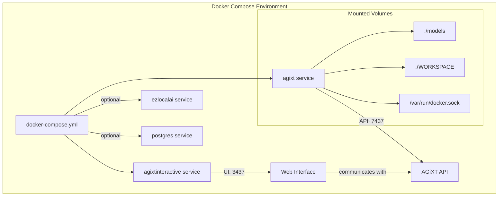
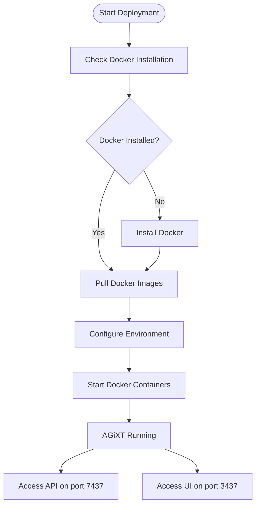
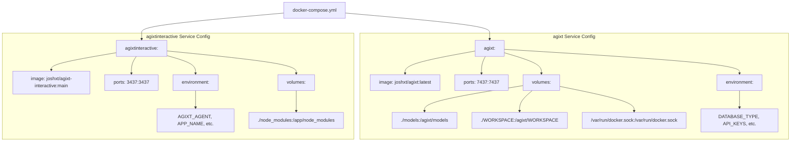
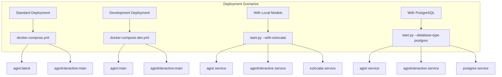

<!-- source: DeepWiki mcp.deepwiki.com · repo Josh-XT/AGiXT · page 6 Deployment · fetched 2026-10-26 -->

# Deployment

<details>
<summary>Relevant source files</summary>

The following files were used as context for generating this wiki page:

- [docker-compose-dev.yml](docker-compose-dev.yml)
- [docker-compose.yml](docker-compose.yml)
- [docs/1-Getting started/0-Quick Start.md](docs/1-Getting started/0-Quick Start.md)
- [docs/1-Getting started/1-Environment Variables.md](docs/1-Getting started/1-Environment Variables.md)
- [docs/1-Getting started/4-Things to Consider.md](docs/1-Getting started/4-Things to Consider.md)
- [docs/1-Getting started/5-Preinstalled ISOs.md](docs/1-Getting started/5-Preinstalled ISOs.md)
- [docs/1-Getting started/Support.md](docs/1-Getting started/Support.md)
- [docs/README.md](docs/README.md)

</details>


This document details the methods and configuration options for deploying the AGiXT platform. It covers Docker-based deployment architecture, environment variable configuration, and various deployment scenarios. For information about specific environment variables, see [Environment Configuration](#6.2).

## Deployment Architecture

AGiXT uses Docker Compose as its primary deployment method, with a modular architecture consisting of core services and optional components.

**Docker Compose Deployment Architecture**


Sources: [docker-compose.yml:1-83](), [docs/README.md:194-201]()

The deployment consists of these primary components:

- **agixt service**: Core API service that provides all the agent functionality
- **agixtinteractive service**: Web interface for interacting with AGiXT
- **ezlocalai service** (optional): Integration for running local AI models
- **postgres service** (optional): Database for storing AGiXT data (when not using SQLite)

## Deployment Methods

AGiXT provides a streamlined deployment process through the `start.py` script, which automates Docker setup and configuration.

**Deployment Process Flow**


Sources: [docs/README.md:95-138](), [docs/1-Getting started/0-Quick Start.md:25-37]()

### Quick Start Deployment

The simplest way to deploy AGiXT is using the included `start.py` script:

```bash
git clone https://github.com/Josh-XT/AGiXT
cd AGiXT
python start.py
```

This script:
1. Checks for Docker and Docker Compose installation
2. Installs Docker if not present (on Linux) or provides installation instructions (on Windows/macOS)
3. Sets up required environment variables
4. Pulls the latest Docker images
5. Launches the AGiXT services

Sources: [docs/README.md:98-102](), [docs/1-Getting started/0-Quick Start.md:25-37]()

### Deployment with ezLocalAI

To deploy AGiXT with local model support via ezLocalAI:

```bash
python start.py --with-ezlocalai true
```

This adds the ezLocalAI service to the deployment, allowing AGiXT to use local AI models.

Sources: [docs/README.md:117-121](), [docs/1-Getting started/0-Quick Start.md:46-50]()

## Environment Configuration

AGiXT's behavior is highly configurable via environment variables. These can be set directly in the environment or passed as command-line arguments to the `start.py` script.

**Environment Variables Categories**

```mermaid
graph TD
    ENV["Environment Variables"] --> API["API Configuration"]
    ENV --> DB["Database Configuration"]
    ENV --> AUTH["Authentication"]
    ENV --> UI["UI Configuration"]
    ENV --> EXTEND["Extensions & Providers"]
    ENV --> STORAGE["Storage Configuration"]
    ENV --> MODEL["Model Configuration"]
    
    API --> AGIXT_API_KEY["AGIXT_API_KEY"]
    API --> AGIXT_URI["AGIXT_URI"]
    API --> APP_URI["APP_URI"]
    
    DB --> DATABASE_TYPE["DATABASE_TYPE"]
    DB --> DATABASE_NAME["DATABASE_NAME"]
    
    AUTH --> AUTH_PROVIDER["AUTH_PROVIDER"]
    AUTH --> OAUTH["OAuth Providers"]
    OAUTH --> GITHUB_CLIENT_ID["GITHUB_CLIENT_ID"]
    OAUTH --> GOOGLE_CLIENT_ID["GOOGLE_CLIENT_ID"]
    
    UI --> AGIXT_AGENT["AGIXT_AGENT"]
    UI --> AGIXT_FOOTER_MESSAGE["AGIXT_FOOTER_MESSAGE"]
    UI --> INTERACTIVE_MODE["INTERACTIVE_MODE"]
    
    EXTEND --> DISABLED_EXTENSIONS["DISABLED_EXTENSIONS"]
    EXTEND --> DISABLED_PROVIDERS["DISABLED_PROVIDERS"]
    
    MODEL --> PROVIDER_MODELS["Provider-specific Models"]
    PROVIDER_MODELS --> OPENAI_MODEL["OPENAI_MODEL"]
    PROVIDER_MODELS --> GOOGLE_MODEL["GOOGLE_MODEL"]
```


Sources: [docker-compose.yml:3-75](), [docs/README.md:134-177](), [docs/1-Getting started/1-Environment Variables.md:1-29]()

The most commonly used environment variables include:

| Variable | Description | Default Value |
|----------|-------------|---------------|
| `AGIXT_API_KEY` | API key for AGiXT | Auto-generated if not provided |
| `AGIXT_URI` | URI for AGiXT API | http://agixt:7437 |
| `APP_URI` | URI for the web interface | http://localhost:3437 |
| `DATABASE_TYPE` | Database type | sqlite |
| `DATABASE_NAME` | Database name | models/agixt |
| `AGIXT_AGENT` | Default agent name | XT |
| `WORKING_DIRECTORY` | Working directory | /agixt/WORKSPACE |
| `DISABLED_EXTENSIONS` | Disabled extensions | (empty) |
| `DISABLED_PROVIDERS` | Disabled providers | (empty) |
| `UVICORN_WORKERS` | Number of API workers | 10 |

Environment variables can be set in multiple ways:

1. Through command-line arguments to `start.py`:
   ```bash
   python start.py --agixt-agent MyAgent --database-type postgres
   ```

2. Directly in a `.env` file in the project directory
3. In the host environment before running the script

Sources: [docs/README.md:134-177](), [docs/1-Getting started/1-Environment Variables.md:1-29]()

## Docker Configuration

AGiXT's Docker configuration is defined in the `docker-compose.yml` file, which specifies the services, ports, volumes, and environment variables.

**Docker Compose Service Configuration**


Sources: [docker-compose.yml:1-116](), [docker-compose-dev.yml:1-116]()

### Volume Mounts

The AGiXT Docker deployment uses several important volume mounts:

1. `./models:/agixt/models`: Persists model data, including the SQLite database if used
2. `./WORKSPACE:/agixt/WORKSPACE`: Contains agent workspaces and files
3. `/var/run/docker.sock:/var/run/docker.sock`: Allows AGiXT to interact with the Docker daemon

Sources: [docker-compose.yml:79-82]()

### Network Configuration

By default, the services expose these ports:

- AGiXT API: Port 7437
- AGiXT Interactive UI: Port 3437
- ezLocalAI (if enabled): Port 8091

These ports can be customized using environment variables:
- `AGIXT_PORT`: Changes the AGiXT API port (default: 7437)
- `AGIXT_INTERACTIVE_PORT`: Changes the interactive UI port (default: 3437)

Sources: [docker-compose.yml:77-78](), [docker-compose.yml:112-113]()

## Deployment Scenarios

AGiXT supports several deployment scenarios to accommodate different requirements.

**Deployment Scenarios**


Sources: [docker-compose.yml:1-116](), [docker-compose-dev.yml:1-116](), [docs/README.md:117-127]()

### Standard Deployment

The standard deployment uses the stable release images and is suitable for most users:

```bash
python start.py
```

Sources: [docs/README.md:113-115]()

### Development Deployment

For using the latest development branch:

```bash
python start.py --agixt-branch dev
```

This uses the development Docker images, which may include newer features but could be less stable.

Sources: [docs/README.md:123-127]()

### With Local Models (ezLocalAI)

To deploy with local model support:

```bash
python start.py --with-ezlocalai true
```

This adds the ezLocalAI service, which provides local model inference capabilities.

Additional ezLocalAI options include:
- `--default-model`: Sets the default LLM model
- `--vision-model`: Sets the vision model
- `--llm-max-tokens`: Sets maximum token limit
- `--gpu-layers`: Controls GPU layer utilization

Sources: [docs/README.md:117-121](), [docs/1-Getting started/1-Environment Variables.md:17-26]()

### With PostgreSQL Database

To use PostgreSQL instead of SQLite:

```bash
python start.py --database-type postgres
```

This changes the database backend to PostgreSQL. Additional setup may be required to configure the PostgreSQL connection.

Sources: [docker-compose.yml:6](), [docs/README.md:136]()

## Troubleshooting

Common issues during deployment and their solutions:

1. **Docker installation issues**:
   - On Linux: Run with `sudo` if needed
   - On Windows/macOS: Manual installation of Docker Desktop may be required

2. **Port conflicts**: If ports 7437 or 3437 are already in use, change them using environment variables:
   ```bash
   python start.py --agixt-port 7438 --agixt-interactive-port 3438
   ```

3. **Container startup failures**: Check Docker logs for error messages:
   ```bash
   docker logs agixt
   ```

4. **Authentication issues**: Ensure OAuth provider settings are correctly configured if using external authentication

Sources: [docs/README.md:202-210]()

## Security Considerations

When deploying AGiXT, consider these security aspects:

1. **API Key**: The `AGIXT_API_KEY` is automatically generated if not provided. Keep this key secure.

2. **Authentication Credentials**: OAuth client IDs and secrets should be kept confidential.

3. **File Uploads and Voice Input**: These features may introduce security risks if not properly managed. Consider disabling them in sensitive environments:
   ```bash
   python start.py --agixt-file-upload-enabled false --agixt-voice-input-enabled false
   ```

4. **Docker Socket**: The Docker socket mount gives AGiXT access to the Docker daemon. In production environments, consider restricting this access.

Sources: [docs/README.md:212-217]()

## Accessing the Deployed Services

After successful deployment, AGiXT services are available at:

- AGiXT API: http://localhost:7437 (with Swagger documentation at /docs)
- AGiXT Interactive UI: http://localhost:3437

Default credentials depend on your configuration. If you didn't specify an API key, one was automatically generated during deployment.

Sources: [docs/README.md:130-132]()

---

