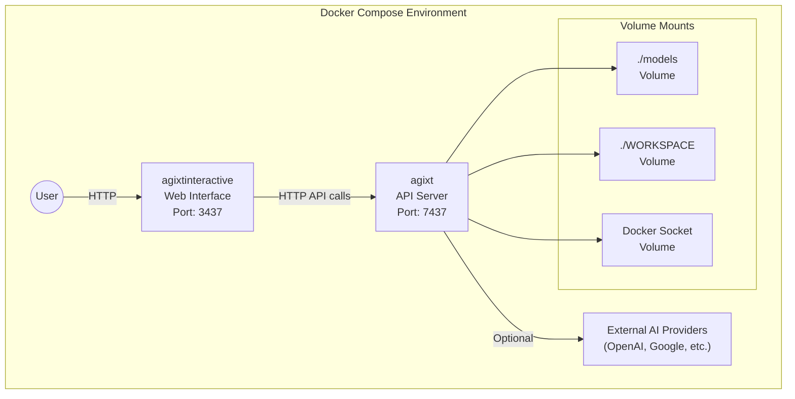
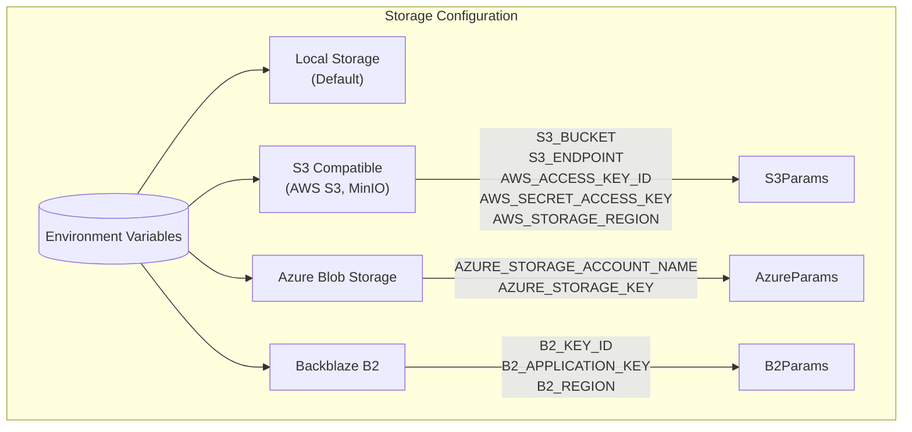
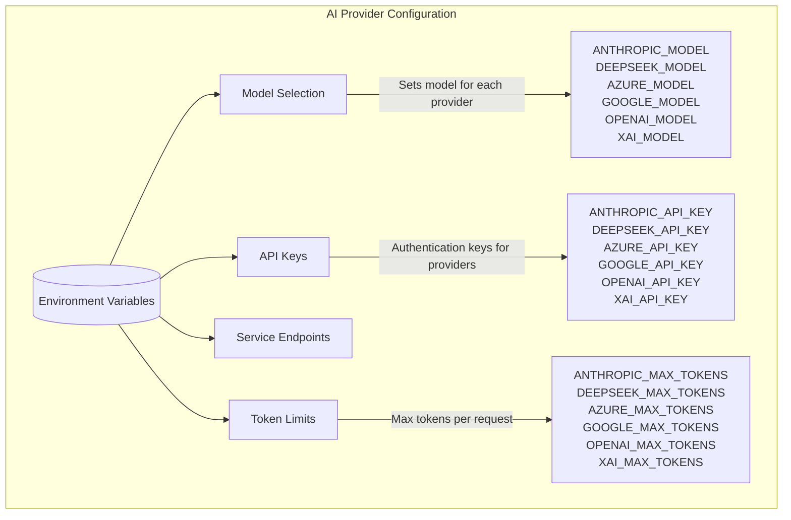
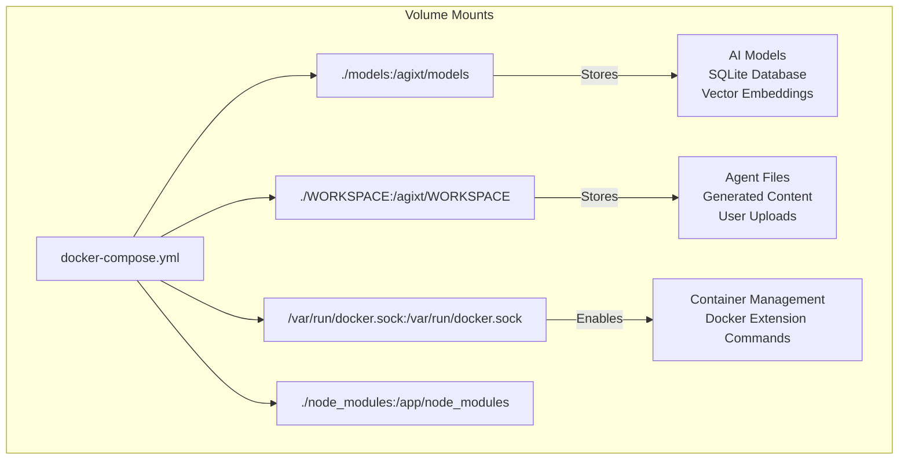

<!-- source: DeepWiki mcp.deepwiki.com · repo Josh-XT/AGiXT · page 6.1 Docker Configuration · fetched 2026-10-26 -->

# Docker Configuration

<details>
<summary>Relevant source files</summary>

The following files were used as context for generating this wiki page:

- [.dockerignore](.dockerignore)
- [docker-compose-dev.yml](docker-compose-dev.yml)
- [docker-compose.yml](docker-compose.yml)

</details>


This document provides a comprehensive guide to configuring and deploying AGiXT using Docker. It covers the Docker services, environment variables, volume mounts, and networking options required for setting up AGiXT in containerized environments. For general environment configuration outside of Docker, see [Environment Configuration](#6.2).

## Docker Deployment Architecture

AGiXT is designed to be deployed using Docker Compose, which orchestrates the necessary containers and their configurations.



Sources: [docker-compose.yml:2-82](), [docker-compose.yml:83-116]()

## Docker Services

AGiXT consists of two primary services defined in the Docker Compose configuration:

### agixt Service

The `agixt` service handles the core functionality, including AI interactions, agent management, extension execution, and memory management.

```mermaid
classDiagram
    class "agixt" {
        +image: joshxt/agixt:latest
        +port: 7437
        +volumes: models, WORKSPACE, docker.sock
    }
```

Configuration details:
- Image: `joshxt/agixt:latest`
- Default port: 7437
- Main functionality: API server, agent orchestration, provider management

Sources: [docker-compose.yml:2-82]()

### agixtinteractive Service

The `agixtinteractive` service provides the web interface for users to interact with AGiXT.

```mermaid
classDiagram
    class "agixtinteractive" {
        +image: joshxt/agixt-interactive:main
        +port: 3437
        +volumes: node_modules
    }
```

Configuration details:
- Image: `joshxt/agixt-interactive:main`
- Default port: 3437
- Main functionality: Web interface, user interactions

Sources: [docker-compose.yml:83-116]()

## Environment Variables

AGiXT's Docker configuration supports numerous environment variables to customize system behavior. Below are the main categories:

### Core Configuration Variables

| Variable | Default | Description |
|----------|---------|-------------|
| `DATABASE_TYPE` | sqlite | Database backend type |
| `DATABASE_NAME` | models/agixt | Database name/path |
| `UVICORN_WORKERS` | 10 | Number of API workers |
| `AGIXT_API_KEY` | None | API key for authentication |
| `AGIXT_URI` | http://agixt:7437 | URI of the AGiXT service |
| `APP_URI` | http://localhost:3437 | URI of the web interface |
| `WORKING_DIRECTORY` | /agixt/WORKSPACE | Working directory for agents |
| `LOG_LEVEL` | INFO | Logging verbosity |
| `SEED_DATA` | true | Whether to seed initial data |
| `TZ` | America/New_York | Timezone setting |

Sources: [docker-compose.yml:6-11](), [docker-compose.yml:14-16](), [docker-compose.yml:46](), [docker-compose.yml:76]()

### Feature Toggles

| Variable | Default | Description |
|----------|---------|-------------|
| `DISABLED_EXTENSIONS` | | Extensions to disable (comma-separated) |
| `DISABLED_PROVIDERS` | | Providers to disable (comma-separated) |
| `REGISTRATION_DISABLED` | false | Disable user registration |
| `GRAPHIQL` | true | Enable GraphiQL interface |

Sources: [docker-compose.yml:12-13](), [docker-compose.yml:15](), [docker-compose.yml:75]()

### Storage Configuration



| Variable | Default | Description |
|----------|---------|-------------|
| `STORAGE_BACKEND` | local | Storage backend (local, s3, azure, b2) |
| `STORAGE_CONTAINER` | agixt-workspace | Storage container name |
| `S3_BUCKET` | agixt-workspace | S3 bucket name |
| `S3_ENDPOINT` | http://minio:9000 | S3 endpoint URL |
| `AWS_ACCESS_KEY_ID` | minioadmin | S3 access key |
| `AWS_SECRET_ACCESS_KEY` | minioadmin | S3 secret key |
| `AWS_STORAGE_REGION` | us-east-1 | S3 region |
| `AZURE_STORAGE_ACCOUNT_NAME` | | Azure storage account |
| `AZURE_STORAGE_KEY` | | Azure storage key |
| `B2_KEY_ID` | | Backblaze B2 key ID |
| `B2_APPLICATION_KEY` | | Backblaze B2 application key |
| `B2_REGION` | us-west-002 | Backblaze B2 region |

Sources: [docker-compose.yml:34-45]()

### AI Provider Configuration



Key variables include:
- Model selection (e.g., `OPENAI_MODEL`, `ANTHROPIC_MODEL`)
- API keys (e.g., `OPENAI_API_KEY`, `GOOGLE_API_KEY`)
- Token limits (e.g., `OPENAI_MAX_TOKENS`)
- Service endpoints (e.g., `AZURE_OPENAI_ENDPOINT`, `EZLOCALAI_URI`)
- Provider rotation settings (`ROTATION_EXCLUSIONS`)

Sources: [docker-compose.yml:51-74]()

### Web Interface Configuration

| Variable | Default | Description |
|----------|---------|-------------|
| `AGIXT_AGENT` | XT | Default agent name |
| `AGIXT_FOOTER_MESSAGE` | AGiXT 2024 | Footer message in UI |
| `AGIXT_SERVER` | http://localhost:7437 | AGiXT API server URL |
| `APP_NAME` | AGiXT | Application name |
| `AGIXT_FILE_UPLOAD_ENABLED` | true | Enable file uploads |
| `AGIXT_VOICE_INPUT_ENABLED` | true | Enable voice input |
| `AGIXT_RLHF` | true | Enable feedback mechanisms |
| `AGIXT_CONVERSATION_MODE` | select | Conversation mode setting |
| `INTERACTIVE_MODE` | chat | Interface mode |

Sources: [docker-compose.yml:89-104]()

### OAuth Configuration

AGiXT supports multiple OAuth providers for authentication:

| Variable Prefix | OAuth Provider |
|-----------------|---------------|
| `AWS_CLIENT_` | AWS Cognito |
| `DISCORD_CLIENT_` | Discord |
| `GITHUB_CLIENT_` | GitHub |
| `GOOGLE_CLIENT_` | Google |
| `MICROSOFT_CLIENT_` | Microsoft |
| `TESLA_CLIENT_` | Tesla |
| `X_CLIENT_` | X (Twitter) |

Each provider requires `_ID` and `_SECRET` environment variables to be set.

Sources: [docker-compose.yml:18-33](), [docker-compose.yml:105-110]()

## Volume Mounts

AGiXT uses several volume mounts to persist data and provide necessary access:



| Volume Mount | Purpose |
|--------------|---------|
| `./models:/agixt/models` | Stores AI models, databases, and embeddings |
| `./WORKSPACE:/agixt/WORKSPACE` | Working directory for agents |
| `/var/run/docker.sock:/var/run/docker.sock` | Allows Docker interaction |
| `./node_modules:/app/node_modules` | UI node modules |

Sources: [docker-compose.yml:79-82](), [docker-compose.yml:115-116]()

## Port Configuration

AGiXT exposes two main ports:

| Service | Container Port | Host Port Variable | Default |
|---------|---------------|-------------------|---------|
| agixt | 7437 | AGIXT_PORT | 7437 |
| agixtinteractive | 3437 | AGIXT_INTERACTIVE_PORT | 3437 |

Sources: [docker-compose.yml:77-78](), [docker-compose.yml:112-113]()

## Development vs Production

AGiXT provides two Docker Compose configurations:

1. **docker-compose.yml**: Uses `joshxt/agixt:latest` (stable releases)
2. **docker-compose-dev.yml**: Uses `joshxt/agixt:main` (latest development builds)

The core configuration remains identical between both files, with only the image tag differing.

Sources: [docker-compose.yml:3](), [docker-compose-dev.yml:3]()

## Running AGiXT with Docker

To start AGiXT using Docker Compose:

```bash
# Production version
docker-compose up -d

# OR Development version
docker-compose -f docker-compose-dev.yml up -d
```

To stop AGiXT:

```bash
docker-compose down
```

After startup, services will be available at:
- AGiXT API: http://localhost:7437 (or custom AGIXT_PORT)
- AGiXT Web Interface: http://localhost:3437 (or custom AGIXT_INTERACTIVE_PORT)

## .dockerignore Configuration

The `.dockerignore` file excludes certain paths from the Docker build context:

```
data/
_book/
.git/
docker/
agixt/models/
streamlit/
examples/
models/
streamlit/
text-generation-webui/
```

This improves build performance and reduces image size.

Sources: [.dockerignore:1-10]()

---

