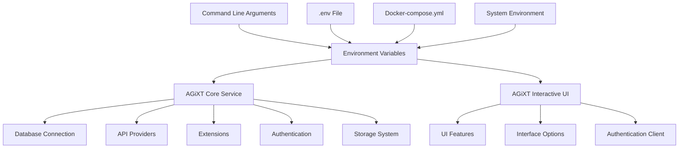
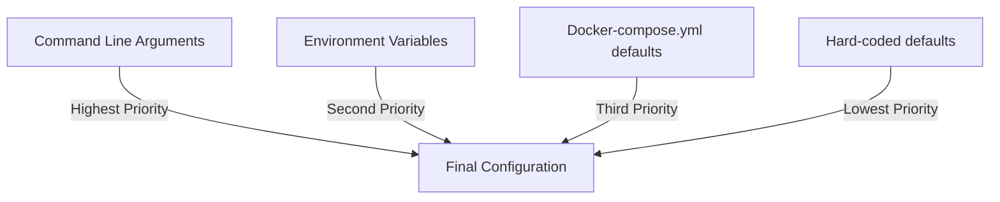

<!-- source: DeepWiki mcp.deepwiki.com · repo Josh-XT/AGiXT · page 6.2 Environment Configuration · fetched 2026-10-26 -->

# Environment Configuration

<details>
<summary>Relevant source files</summary>

The following files were used as context for generating this wiki page:

- [docker-compose-dev.yml](docker-compose-dev.yml)
- [docker-compose.yml](docker-compose.yml)
- [docs/1-Getting started/0-Quick Start.md](docs/1-Getting started/0-Quick Start.md)
- [docs/1-Getting started/1-Environment Variables.md](docs/1-Getting started/1-Environment Variables.md)
- [docs/1-Getting started/4-Things to Consider.md](docs/1-Getting started/4-Things to Consider.md)
- [docs/1-Getting started/5-Preinstalled ISOs.md](docs/1-Getting started/5-Preinstalled ISOs.md)
- [docs/1-Getting started/Support.md](docs/1-Getting started/Support.md)
- [docs/README.md](docs/README.md)

</details>


This page documents the environment variables and configuration options available in AGiXT. It provides a comprehensive reference for customizing the behavior of the AGiXT system through environment variables when deploying with Docker or using the start.py script. For Docker-specific deployment options, see [Docker Configuration](#6.1).

## Overview of Configuration System

AGiXT uses environment variables as the primary method for configuration. These environment variables can be set in several ways:

1. Through the `start.py` script using command-line arguments
2. Directly in the environment before starting services
3. In the docker-compose.yml file 
4. Through a .env file

The system's flexibility allows for configuring everything from API endpoints and authentication to feature toggles and provider settings.

### Configuration Flow



Sources: [docker-compose.yml:2-82](), [docs/README.md:110-177]()

## Core Configuration Categories

AGiXT's environment variables are organized into several logical categories based on the system component or functionality they control.

```mermaid
classDiagram
    class "Environment Configuration" {
        Core System Config
        API Provider Settings
        UI Configuration
        Authentication Options
        Storage Configuration
        Database Settings
        Agent Configuration
        Extension Controls
    }
    
    "Environment Configuration" --> "Core System Config"
    "Environment Configuration" --> "API Provider Settings"
    "Environment Configuration" --> "UI Configuration"
    "Environment Configuration" --> "Authentication Options"
    "Environment Configuration" --> "Storage Configuration"
    "Environment Configuration" --> "Database Settings"
    "Environment Configuration" --> "Agent Configuration"
    "Environment Configuration" --> "Extension Controls"
    
    class "Core System Config" {
        AGIXT_API_KEY
        AGIXT_URI
        WORKING_DIRECTORY
        UVICORN_WORKERS
        LOG_LEVEL
        TZ
        AGIXT_AUTO_UPDATE
    }
    
    class "API Provider Settings" {
        OPENAI_API_KEY
        ANTHROPIC_API_KEY
        GOOGLE_API_KEY
        AZURE_API_KEY
        EZLOCALAI_URI
        ROTATION_EXCLUSIONS
        DISABLED_PROVIDERS
    }
    
    class "UI Configuration" {
        APP_NAME
        APP_DESCRIPTION
        AGIXT_FOOTER_MESSAGE
        INTERACTIVE_MODE
        AGIXT_SHOW_SELECTION
        AGIXT_FILE_UPLOAD_ENABLED
        AGIXT_VOICE_INPUT_ENABLED
    }
    
    class "Authentication Options" {
        AUTH_PROVIDER
        ALLOW_EMAIL_SIGN_IN
        GITHUB_CLIENT_ID
        GOOGLE_CLIENT_ID
        MICROSOFT_CLIENT_ID
        DISCORD_CLIENT_ID
        AGIXT_REQUIRE_API_KEY
    }
```

Sources: [docker-compose.yml:5-76](), [docs/1-Getting started/1-Environment Variables.md:3-27]()

## Core System Configuration

These variables control the fundamental behavior of the AGiXT system.

| Variable | Description | Default Value |
|----------|-------------|---------------|
| `AGIXT_API_KEY` | API key for AGiXT authentication | Auto-generated if not provided |
| `AGIXT_URI` | URI for the AGiXT API | `http://agixt:7437` in Docker, `http://localhost:7437` for local |
| `WORKING_DIRECTORY` | Directory for agent workspaces | `/agixt/WORKSPACE` in Docker, `./WORKSPACE` for local |
| `UVICORN_WORKERS` | Number of Uvicorn workers for API service | `10` |
| `LOG_LEVEL` | Logging verbosity level | `INFO` |
| `LOG_FORMAT` | Format of log messages | `%(asctime)s \| %(levelname)s \| %(message)s` |
| `TZ` | Timezone setting | `America/New_York` |
| `AGIXT_AUTO_UPDATE` | Enable/disable automatic updates | `true` |
| `AGIXT_BRANCH` | Branch to use (`stable` or `dev`) | Not set (uses stable) |

Sources: [docker-compose.yml:6-14](), [docs/README.md:136-145]()

## Agent Configuration

These variables control the default agent and its capabilities.

| Variable | Description | Default Value |
|----------|-------------|---------------|
| `AGIXT_AGENT` | Default agent to use | `XT` |
| `AGENT_NAME` | Name for the agent (synced with AGIXT_AGENT) | Value from `AGIXT_AGENT` |
| `AGENT_PERSONA` | Persona description for the default agent | Not set |
| `TRAINING_URLS` | Comma-separated URLs for agent training | Not set |
| `ENABLED_COMMANDS` | Comma-separated list of enabled commands | Not set (all allowed) |
| `DISABLED_EXTENSIONS` | Comma-separated list of extensions to disable | Not set (all enabled) |
| `DISABLED_PROVIDERS` | Comma-separated list of providers to disable | Not set (all enabled) |
| `ROTATION_EXCLUSIONS` | Providers to exclude from rotation | Not set |
| `SEED_DATA` | Whether to create default agents on first startup | `true` |

Sources: [docker-compose.yml:47-51](), [docker-compose.yml:73-74](), [docs/README.md:155-160]()

## API Provider Configuration

AGiXT supports multiple AI providers. These variables configure API keys and model settings for each.

| Provider | API Key | Model Setting | Max Tokens |
|----------|---------|--------------|------------|
| OpenAI | `OPENAI_API_KEY` | `OPENAI_MODEL` | `OPENAI_MAX_TOKENS` |
| Anthropic | `ANTHROPIC_API_KEY` | `ANTHROPIC_MODEL` | `ANTHROPIC_MAX_TOKENS` |
| Google | `GOOGLE_API_KEY` | `GOOGLE_MODEL` | `GOOGLE_MAX_TOKENS` |
| Azure | `AZURE_API_KEY` | `AZURE_MODEL` | `AZURE_MAX_TOKENS` |
| EzLocalAI | `EZLOCALAI_API_KEY` | Set via separate vars | `EZLOCALAI_MAX_TOKENS` |
| DeepSeek | `DEEPSEEK_API_KEY` | `DEEPSEEK_MODEL` | `DEEPSEEK_MAX_TOKENS` |
| XAI | `XAI_API_KEY` | `XAI_MODEL` | `XAI_MAX_TOKENS` |

Additional provider-specific settings:
- `AZURE_OPENAI_ENDPOINT`: Azure OpenAI API endpoint URL
- `EZLOCALAI_URI`: URI for ezLocalAI service
- `EZLOCALAI_VOICE`: Voice setting for ezLocalAI TTS

Sources: [docker-compose.yml:52-72](), [docs/1-Getting started/1-Environment Variables.md:17-27]()

## UI Configuration

These variables control the AGiXT Interactive UI appearance and behavior.

| Variable | Description | Default Value |
|----------|-------------|---------------|
| `APP_NAME` | Name displayed in the UI | `AGiXT` |
| `APP_DESCRIPTION` | Description shown in the UI | `AGiXT is an advanced artificial intelligence agent orchestration agent.` |
| `APP_URI` | URI for the interactive UI | `http://localhost:3437` |
| `AGIXT_FOOTER_MESSAGE` | Message displayed in footer | `AGiXT 2024` |
| `AGIXT_FILE_UPLOAD_ENABLED` | Enable file uploads | `true` |
| `AGIXT_VOICE_INPUT_ENABLED` | Enable voice input | `true` |
| `AGIXT_RLHF` | Enable reinforcement learning feedback buttons | `true` |
| `AGIXT_ALLOW_MESSAGE_EDITING` | Allow editing of messages | `true` |
| `AGIXT_ALLOW_MESSAGE_DELETION` | Allow deletion of messages | `true` |
| `AGIXT_SHOW_OVERRIDE_SWITCHES` | Feature toggles to show | `tts,websearch,analyze-user-input` |
| `AGIXT_CONVERSATION_MODE` | Conversation mode | `select` |
| `INTERACTIVE_MODE` | UI mode | `chat` |
| `AGIXT_SHOW_SELECTION` | Which selectors to show | `conversation,agent` |
| `AGIXT_SHOW_AGENT_BAR` | Show agent selection bar | `true` |
| `AGIXT_SHOW_APP_BAR` | Show application bar | `true` |
| `THEME_NAME` | UI theme | `default` |

Sources: [docker-compose.yml:89-103](), [docs/README.md:146-154](), [docs/README.md:168-170]()

## Authentication Configuration

AGiXT supports multiple authentication providers through OAuth.

| Variable | Description | Default Value |
|----------|-------------|---------------|
| `AUTH_PROVIDER` | Authentication provider to use | `none` |
| `ALLOW_EMAIL_SIGN_IN` | Enable email sign-in | `true` |
| `REGISTRATION_DISABLED` | Disable new user registration | `false` |
| `AGIXT_REQUIRE_API_KEY` | Require API key for access | `false` |
| `GITHUB_CLIENT_ID` | GitHub OAuth client ID | Not set |
| `GITHUB_CLIENT_SECRET` | GitHub OAuth client secret | Not set |
| `GOOGLE_CLIENT_ID` | Google OAuth client ID | Not set |
| `GOOGLE_CLIENT_SECRET` | Google OAuth client secret | Not set |
| `MICROSOFT_CLIENT_ID` | Microsoft OAuth client ID | Not set |
| `MICROSOFT_CLIENT_SECRET` | Microsoft OAuth client secret | Not set |
| `DISCORD_CLIENT_ID` | Discord OAuth client ID | Not set |
| `DISCORD_CLIENT_SECRET` | Discord OAuth client secret | Not set |
| `TESLA_CLIENT_ID` | Tesla OAuth client ID | Not set |
| `TESLA_CLIENT_SECRET` | Tesla OAuth client secret | Not set |
| `X_CLIENT_ID` | X (Twitter) OAuth client ID | Not set |
| `X_CLIENT_SECRET` | X (Twitter) OAuth client secret | Not set |
| `AWS_CLIENT_ID` | AWS OAuth client ID | Not set |
| `AWS_CLIENT_SECRET` | AWS OAuth client secret | Not set |
| `AWS_REGION` | AWS region for OAuth | Not set |
| `AWS_USER_POOL_ID` | AWS user pool ID for OAuth | Not set |

Sources: [docker-compose.yml:15-33](), [docker-compose.yml:104-110](), [docs/README.md:155-160]()

## Storage Configuration

AGiXT supports multiple storage backends for workspace files.

| Variable | Description | Default Value |
|----------|-------------|---------------|
| `STORAGE_BACKEND` | Storage backend type | `local` |
| `STORAGE_CONTAINER` | Storage container name | `agixt-workspace` |
| `B2_KEY_ID` | Backblaze B2 key ID | Not set |
| `B2_APPLICATION_KEY` | Backblaze B2 application key | Not set |
| `B2_REGION` | Backblaze B2 region | `us-west-002` |
| `S3_BUCKET` | S3 bucket name | `agixt-workspace` |
| `S3_ENDPOINT` | S3 endpoint URL | `http://minio:9000` |
| `AWS_ACCESS_KEY_ID` | AWS access key ID for S3 | `minioadmin` |
| `AWS_SECRET_ACCESS_KEY` | AWS secret access key for S3 | `minioadmin` |
| `AWS_STORAGE_REGION` | AWS region for S3 | `us-east-1` |
| `AZURE_STORAGE_ACCOUNT_NAME` | Azure storage account name | Not set |
| `AZURE_STORAGE_KEY` | Azure storage key | Not set |

Sources: [docker-compose.yml:34-46]()

## Database Configuration

AGiXT supports SQLite and PostgreSQL databases.

| Variable | Description | Default Value |
|----------|-------------|---------------|
| `DATABASE_TYPE` | Database type | `sqlite` |
| `DATABASE_NAME` | Database name or path | `models/agixt` |

Sources: [docker-compose.yml:6-7](), [docs/README.md:171-172]()

## ezLocalAI Configuration

When running AGiXT with ezLocalAI, additional variables configure the local AI service.

| Variable | Description | Default Value |
|----------|-------------|---------------|
| `EZLOCALAI_URI` | ezLocalAI service URI | Auto-detected |
| `DEFAULT_MODEL` | Default language model | `QuantFactory/dolphin-2.9.2-qwen2-7b-GGUF` |
| `VISION_MODEL` | Vision model | `deepseek-ai/deepseek-vl-1.3b-chat` |
| `LLM_MAX_TOKENS` | Maximum tokens for language models | `32768` |
| `WHISPER_MODEL` | Whisper model for speech recognition | `base.en` |
| `GPU_LAYERS` | Number of GPU layers to use | `-1` (all) |

Sources: [docs/1-Getting started/1-Environment Variables.md:17-27](), [docs/README.md:179-187]()

## Environment Variable Precedence and Defaults

The system follows a hierarchy when determining which configuration value to use:



Sources: [docker-compose.yml:1-117](), [docs/README.md:110-177]()

## Configuration Methods

### Using start.py Command-Line Arguments

The start.py script accepts all environment variables as command-line arguments. For example:

```bash
python start.py --agixt-api-key "my-api-key" --database-type postgres --agixt-branch dev
```

This is the easiest way to configure AGiXT when running locally.

### Using Docker-Compose Environment Variables

When using Docker, you can set environment variables in the docker-compose.yml file, or by creating a .env file in the same directory.

Example .env file:
```
AGIXT_API_KEY=my-api-key
DATABASE_TYPE=postgres
OPENAI_API_KEY=sk-xxxxx
```

### Docker Volume Configuration

AGiXT mounts several volumes to persist data:

| Volume | Path | Purpose |
|--------|------|---------|
| Models | `./models:/agixt/models` | Store database and models |
| Workspace | `./WORKSPACE:/agixt/WORKSPACE` | Store agent files and uploads |
| Docker Socket | `/var/run/docker.sock:/var/run/docker.sock` | Allow container management |

Sources: [docker-compose.yml:77-82](), [docker-compose.yml:114-116]()

## Security Considerations

When configuring AGiXT, consider these security best practices:

1. **API Keys**: Keep the `AGIXT_API_KEY` secure and don't share it publicly
2. **OAuth Credentials**: Protect client IDs and secrets for authentication providers
3. **Database Access**: Use strong passwords for database access, especially with PostgreSQL
4. **File Upload Controls**: Consider disabling file uploads in public deployments
5. **Docker Socket**: The mounted Docker socket gives container access to the host Docker system

Sources: [docs/README.md:212-216]()

## Common Configuration Scenarios

### Basic Local Setup with OpenAI

```bash
python start.py --openai-api-key sk-xxxxx --agixt-agent MyAgent
```

### EzLocalAI Integration for Local Models

```bash
python start.py --with-ezlocalai true --llm-max-tokens 8192 --gpu-layers 30
```

### Production Setup with Authentication

```bash
python start.py --database-type postgres --agixt-require-api-key true --auth-provider magicalauth --github-client-id xxx --github-client-secret xxx
```

### Multiple Provider Setup

```bash
python start.py --openai-api-key sk-xxx --google-api-key key-xxx --anthropic-api-key sk-ant-xxx --rotation-exclusions "provider3,provider4"
```

Sources: [docs/README.md:123-127](), [docs/1-Getting started/0-Quick Start.md:46-56]()

---

