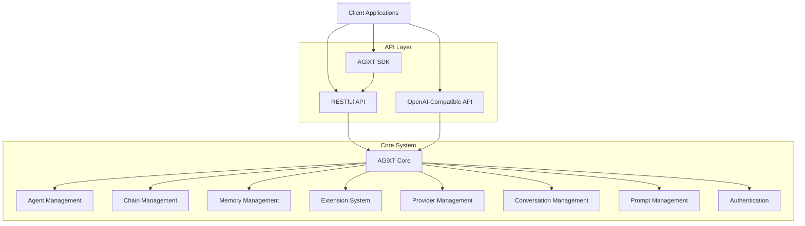
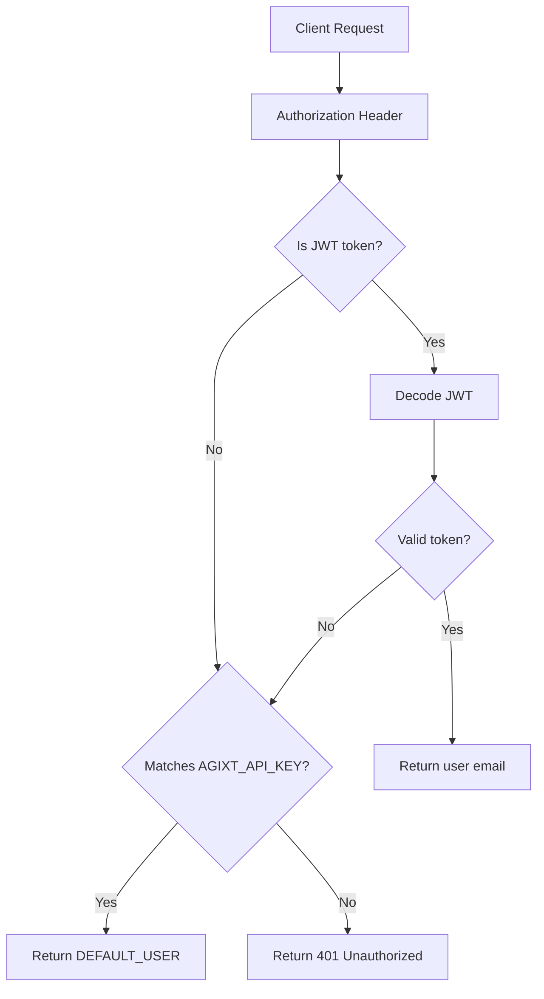
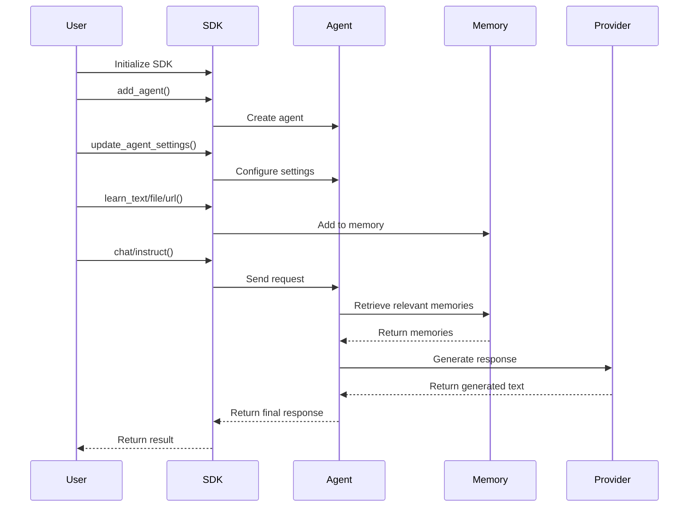

<!-- source: DeepWiki mcp.deepwiki.com · repo Josh-XT/AGiXT · page 7 API Reference · fetched 2026-10-26 -->

# API Reference

<details>
<summary>Relevant source files</summary>

The following files were used as context for generating this wiki page:

- [agixt/ApiClient.py](agixt/ApiClient.py)
- [tests/endpoint-tests.ipynb](tests/endpoint-tests.ipynb)

</details>


This document provides a comprehensive reference for the AGiXT API, which allows programmatic access to all AGiXT functionality. The API enables developers to create, configure, and interact with AI agents through both a Python SDK and RESTful endpoints. Additionally, AGiXT offers OpenAI-compatible endpoints for seamless integration with the OpenAI client libraries.

For SDK usage examples, see [SDK Usage](7.1).

## System Overview

AGiXT's API architecture is designed to provide flexible access to the platform's core functionality:



Sources: [agixt/ApiClient.py](), [tests/endpoint-tests.ipynb]()

## Authentication

AGiXT supports two authentication methods:

### API Key Authentication

To authenticate with an API key, include the key in the Authorization header:

```
Authorization: YOUR_API_KEY
```

### JWT Token Authentication

For JWT authentication, include the JWT token in the Authorization header:

```
Authorization: Bearer YOUR_JWT_TOKEN
```

The token is validated using the AGIXT_API_KEY as the secret with a leeway of 5 hours.



Sources: [agixt/ApiClient.py:22-70]()

## Core Concepts

Before diving into the API details, it's important to understand the key concepts in AGiXT:

| Concept | Description |
|---------|-------------|
| Agent | An AI assistant with specific settings, memories, and capabilities |
| Provider | An AI service (like OpenAI, Claude, etc.) that powers the agent's intelligence |
| Memory | Information stored for an agent to reference during interactions |
| Conversation | A sequence of messages between a user and an agent |
| Chain | A sequence of predefined steps for an agent to execute |
| Prompt | A template for generating agent inputs |
| Extension | Additional functionality that can be enabled for an agent |

## API Client

The API client is responsible for verifying API keys and creating SDK instances:

```python
def verify_api_key(authorization: str = Header(None)):
    # Validates API key or JWT token
    # Returns user email or DEFAULT_USER

def get_api_client(authorization: str = Header(None)):
    # Creates and returns an AGiXTSDK instance
    return AGiXTSDK(base_uri="http://localhost:7437", api_key=authorization)
```

Sources: [agixt/ApiClient.py:22-75]()

## SDK Methods

The AGiXT SDK provides a Python interface for interacting with the AGiXT API:

```mermaid
classDiagram
    class AGiXTSDK {
        +base_uri: str
        +api_key: str
        +headers: dict
        +verbose: bool
        
        +User Management
        register_user()
        user_exists()
        update_user()
        get_user()
        
        +Provider Management
        get_providers()
        get_providers_by_service()
        get_provider_settings()
        get_embed_providers()
        
        +Extension Management
        get_extension_settings()
        get_extensions()
        get_command_args()
        execute_command()
        
        +Agent Management
        add_agent()
        get_agents()
        rename_agent()
        delete_agent()
        get_agentconfig()
        update_agent_settings()
        get_commands()
        toggle_command()
        update_agent_commands()
        get_agent_extensions()
        
        +Conversation Management
        new_conversation()
        get_conversations()
        get_conversation()
        fork_conversation()
        new_conversation_message()
        delete_conversation_message()
        delete_conversation()
        
        +Memory Management
        learn_text()
        learn_file()
        learn_url()
        get_agent_memories()
        delete_agent_memory()
        wipe_agent_memories()
        
        +Agent Interaction
        chat()
        instruct()
        prompt_agent()
        
        +Chain Management
        get_chains()
        add_chain()
        rename_chain()
        get_chain()
        get_chain_args()
        add_step()
        update_step()
        move_step()
        delete_step()
        run_chain()
        delete_chain()
        
        +Prompt Management
        get_prompts()
        get_prompt()
        get_prompt_args()
        add_prompt()
        update_prompt()
        delete_prompt()
    }
```



Sources: [tests/endpoint-tests.ipynb]()

## Interaction Flow

The diagram below illustrates the typical flow when interacting with an agent through the API:



Sources: [tests/endpoint-tests.ipynb]()

## REST API Endpoints

AGiXT exposes RESTful endpoints for all functionality. The base URL is typically `http://localhost:7437`.

### User Endpoints
- POST `/api/users/register` - Register a new user
- GET `/api/users/exists` - Check if a user exists
- POST `/api/users/update` - Update user details
- GET `/api/users/get` - Get user details

### Agent Endpoints
- POST `/api/agents/add` - Add a new agent
- GET `/api/agents/get` - Get all agents
- POST `/api/agents/rename` - Rename an agent
- DELETE `/api/agents/delete` - Delete an agent
- GET `/api/agents/config` - Get agent configuration
- POST `/api/agents/settings` - Update agent settings
- GET `/api/agents/commands` - Get agent commands
- POST `/api/agents/toggle_command` - Toggle a command
- POST `/api/agents/update_commands` - Update agent commands

### Conversation Endpoints
- POST `/api/conversations/new` - Create a new conversation
- GET `/api/conversations/get` - Get all conversations or a specific conversation
- POST `/api/conversations/fork` - Fork a conversation
- POST `/api/conversations/message/new` - Add a message to a conversation
- DELETE `/api/conversations/message/delete` - Delete a message
- DELETE `/api/conversations/delete` - Delete a conversation

### Memory Endpoints
- POST `/api/memories/learn/text` - Learn from text
- POST `/api/memories/learn/file` - Learn from a file
- POST `/api/memories/learn/url` - Learn from a URL
- GET `/api/memories/get` - Get agent memories
- DELETE `/api/memories/delete` - Delete a memory
- DELETE `/api/memories/wipe` - Wipe all memories

### Chain Endpoints
- GET `/api/chains/get` - Get all chains or a specific chain
- POST `/api/chains/add` - Add a new chain
- POST `/api/chains/rename` - Rename a chain
- DELETE `/api/chains/delete` - Delete a chain
- GET `/api/chains/args` - Get chain arguments
- POST `/api/chains/steps/add` - Add a step to a chain
- POST `/api/chains/steps/update` - Update a chain step
- POST `/api/chains/steps/move` - Move a chain step
- DELETE `/api/chains/steps/delete` - Delete a chain step
- POST `/api/chains/run` - Run a chain

### Prompt Endpoints
- GET `/api/prompts/get` - Get all prompts or a specific prompt
- POST `/api/prompts/add` - Add a new prompt
- POST `/api/prompts/update` - Update a prompt
- DELETE `/api/prompts/delete` - Delete a prompt
- GET `/api/prompts/args` - Get prompt arguments

### Provider Endpoints
- GET `/api/providers/get` - Get all providers
- GET `/api/providers/service` - Get providers by service
- GET `/api/providers/settings` - Get provider settings
- GET `/api/providers/embed` - Get embedding providers

### Extension Endpoints
- GET `/api/extensions/settings` - Get extension settings
- GET `/api/extensions/get` - Get all extensions
- GET `/api/extensions/commands/args` - Get command arguments
- POST `/api/extensions/commands/execute` - Execute a command

Sources: [tests/endpoint-tests.ipynb]()

## OpenAI-Compatible Endpoints

AGiXT provides OpenAI-compatible endpoints that can be used with the OpenAI client libraries.

### Chat Completions
- POST `/v1/chat/completions` - Generate a chat completion response

Example request:
```json
{
  "model": "agent_name",
  "messages": [
    {"role": "user", "content": "Write a poem about AI"}
  ],
  "stream": false,
  "user": "conversation_name"
}
```

### Embeddings
- POST `/v1/embeddings` - Generate embeddings for the given text

Example request:
```json
{
  "input": "Text to embed",
  "model": "agent_name"
}
```

### Additional Features

The OpenAI-compatible endpoints support additional features not found in the standard OpenAI API:

#### File Uploads
You can include base64-encoded files in your requests:

```json
{
  "model": "agent_name",
  "messages": [
    {
      "role": "user",
      "content": [
        {
          "type": "text",
          "text": "Analyze this data"
        },
        {
          "type": "file_url",
          "file_url": {
            "url": "data:application/csv;base64,..."
          }
        }
      ]
    }
  ]
}
```

#### Web Search
You can enable web search for queries:

```json
{
  "model": "agent_name",
  "messages": [
    {
      "role": "user",
      "websearch": "true",
      "websearch_depth": "2",
      "content": "What are the latest developments in AI?"
    }
  ]
}
```

Sources: [tests/endpoint-tests.ipynb:1980-2147]()

## Error Handling

The API returns standard HTTP status codes and error messages:

| Status Code | Description |
|-------------|-------------|
| 400 | Bad Request - Invalid parameters |
| 401 | Unauthorized - Invalid API key or token |
| 404 | Not Found - Resource not found |
| 500 | Internal Server Error - Server-side error |

Error responses are returned in JSON format:

```json
{
  "detail": "Error message description"
}
```

Sources: [agixt/ApiClient.py:41-48](), [agixt/ApiClient.py:62-68]()

## Pagination

For methods that return potentially large lists, such as `get_conversation` and `get_agent_memories`, pagination is supported through the following parameters:

- `limit`: Maximum number of items to return (default varies by endpoint)
- `page`: Page number, starting from 1 (default is 1)

Example:
```python
# Get the first 10 messages from a conversation
conversation = agixt.get_conversation(
    agent_name="my_agent",
    conversation_name="my_conversation",
    limit=10,
    page=1
)

# Get the next 10 messages
more_messages = agixt.get_conversation(
    agent_name="my_agent",
    conversation_name="my_conversation",
    limit=10,
    page=2
)
```

Sources: [tests/endpoint-tests.ipynb:773-775]()

## Conclusion

The AGiXT API provides a comprehensive set of tools for creating, managing, and interacting with AI agents. Whether you're using the Python SDK, the RESTful API, or the OpenAI-compatible endpoints, you have full access to AGiXT's powerful features.

For detailed usage examples of the SDK, please refer to the [SDK Usage](7.1) page.

---

