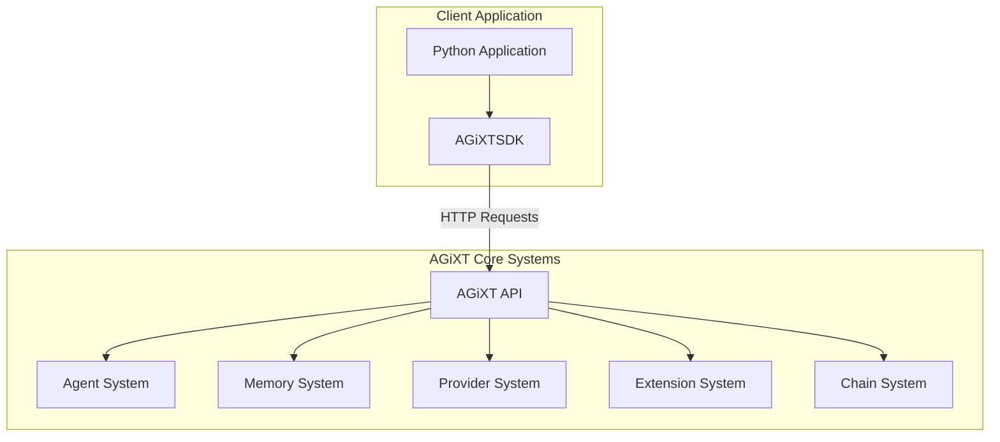
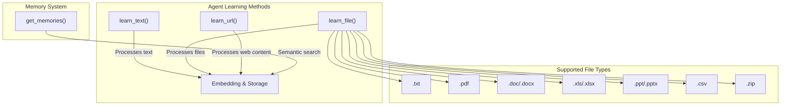
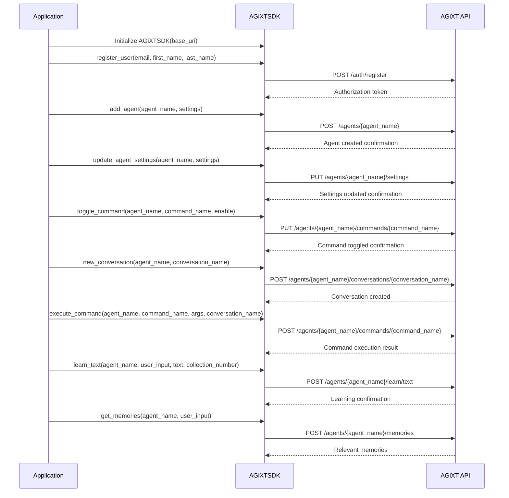

<!-- source: DeepWiki mcp.deepwiki.com · repo Josh-XT/AGiXT · page 7.1 SDK Usage · fetched 2026-10-26 -->

# SDK Usage

<details>
<summary>Relevant source files</summary>

The following files were used as context for generating this wiki page:

- [agixt/chains/Solve Math Problem.json](agixt/chains/Solve Math Problem.json)
- [tests/endpoint-tests.ipynb](tests/endpoint-tests.ipynb)

</details>


This document covers how to use the AGiXT Software Development Kit (SDK) to programmatically interact with AGiXT. The SDK provides methods for creating and managing agents, executing commands, handling conversations, and working with AGiXT's memory system. For information about the API endpoints themselves, see [API Reference](#7).

## Overview

The AGiXT SDK provides a Python interface to the AGiXT API, enabling developers to integrate AGiXT's capabilities into their applications. It handles authentication, request formatting, and response parsing, making it simple to work with AGiXT programmatically.



Sources: [tests/endpoint-tests.ipynb:17-64]()

## Installation and Setup

The AGiXT SDK can be installed via pip (not shown in the provided files). After installation, you can initialize the SDK by providing the base URI of your AGiXT instance:

```python
from agixtsdk import AGiXTSDK

# Initialize the SDK
agixt = AGiXTSDK(base_uri="http://localhost:7437", verbose=True)
```

### Authentication

The SDK handles authentication automatically. When you register a user, the SDK will store the authentication token for subsequent requests:

```python
# Register a user
otp_uri = agixt.register_user(
    email="user@example.com", 
    first_name="Test", 
    last_name="User"
)

# The SDK will now use the returned token for all future requests
```

Sources: [tests/endpoint-tests.ipynb:57-78]()

## Core Functionality

The SDK provides methods for interacting with all aspects of the AGiXT system, organized into logical groups:

```mermaid
classDiagram
    class AGiXTSDK {
        +base_uri: string
        +headers: dict
        +verbose: bool
        
        +User Management Methods
        +Provider Management Methods
        +Agent Management Methods
        +Conversation Management Methods
        +Extension Management Methods
        +Command Methods
        +Memory Methods
    }
    
    class "User Management" {
        +register_user()
        +user_exists()
        +update_user()
        +get_user()
    }
    
    class "Provider Management" {
        +get_providers()
        +get_providers_by_service()
        +get_provider_settings()
        +get_embed_providers()
    }
    
    class "Agent Management" {
        +add_agent()
        +get_agents()
        +rename_agent()
        +get_agentconfig()
        +update_agent_settings()
        +get_commands()
        +toggle_command()
        +update_agent_commands()
    }
    
    class "Conversation Management" {
        +new_conversation()
        +get_conversations()
        +get_conversation()
        +new_conversation_message()
        +fork_conversation()
        +delete_conversation_message()
        +delete_conversation()
    }
    
    class "Command Methods" {
        +get_command_args()
        +execute_command()
    }
    
    class "Memory Methods" {
        +learn_text()
        +learn_file()
        +learn_url()
        +get_memories()
    }
    
    AGiXTSDK --> "User Management"
    AGiXTSDK --> "Provider Management"
    AGiXTSDK --> "Agent Management"
    AGiXTSDK --> "Conversation Management"
    AGiXTSDK --> "Command Methods"
    AGiXTSDK --> "Memory Methods"
```

Sources: [tests/endpoint-tests.ipynb:17-78](), [tests/endpoint-tests.ipynb:116-173](), [tests/endpoint-tests.ipynb:186-339]()

## User Management

The SDK provides methods for user registration and profile management.

### Checking User Existence

```python
user_exists = agixt.user_exists(email="test@example.com")
```

### Updating User Details

```python
update_user = agixt.update_user(first_name="Super", last_name="Man")
```

### Getting User Details

```python
user_details = agixt.get_user()
# Returns user profile including email, name, timezone, and token usage statistics
```

Sources: [tests/endpoint-tests.ipynb:95-173]()

## Provider Management

### Getting Available Providers

```python
providers = agixt.get_providers()
# Returns a list of available AI providers
```

### Getting Providers by Service

Service options include `llm`, `tts`, `image`, `embeddings`, `transcription`, and `translation`.

```python
services = agixt.get_providers_by_service(service="tts")
# Returns providers capable of text-to-speech services
```

### Getting Provider Settings

```python
provider_name = "ezlocalai"
provider_settings = agixt.get_provider_settings(provider_name=provider_name)
# Returns the configuration settings for the specified provider
```

### Getting Embedding Providers

```python
embed_providers = agixt.get_embed_providers()
# Returns a list of available embedding providers
```

Sources: [tests/endpoint-tests.ipynb:185-290]()

## Extension Management

### Getting Extension Settings

```python
ext_settings_resp = agixt.get_extension_settings()
# Returns a dictionary of extension settings
```

### Getting Extensions and Commands

```python
ext = agixt.get_extensions()
# Returns a list of extensions and their commands
```

### Getting Command Arguments

```python
command_args = agixt.get_command_args(command_name="Write to File")
# Returns the required arguments for a specific command
```

Sources: [tests/endpoint-tests.ipynb:303-366]()

## Agent Management

### Creating an Agent

```python
agent_name = "test_agent"
add_agent_resp = agixt.add_agent(
    agent_name=agent_name,
    settings={
        "mode": "prompt",
        "prompt_category": "Default",
        "prompt_name": "Think About It",
        "persona": "",
    },
)
```

### Getting Agent Extensions

```python
agent_extensions = agixt.get_agent_extensions(agent_name=agent_name)
# Returns extensions available to the specified agent
```

### Getting Agents

```python
agents = agixt.get_agents()
# Returns a list of all agents with their status
```

### Renaming an Agent

```python
rename_agent_resp = agixt.rename_agent(agent_name="old_name", new_name="new_name")
```

### Getting Agent Configuration

```python
agent_config = agixt.get_agentconfig(agent_name=agent_name)
# Returns the agent's configuration, including settings and commands
```

### Updating Agent Settings

```python
agent_settings = agent_config["settings"]
agent_settings["AI_TEMPERATURE"] = 0.8
update_agent_settings_resp = agixt.update_agent_settings(
    agent_name=agent_name, settings=agent_settings
)
```

### Managing Agent Commands

```python
# Get available commands
commands = agixt.get_commands(agent_name=agent_name)

# Toggle a specific command
toggle_command_resp = agixt.toggle_command(
    agent_name=agent_name, command_name="Write to File", enable=True
)

# Update multiple commands at once
agent_commands = agent_config["commands"]
agent_commands["Write to File"] = False
update_agent_commands_resp = agixt.update_agent_commands(
    agent_name=agent_name, commands=agent_commands
)
```

Sources: [tests/endpoint-tests.ipynb:380-670]()

## Command Execution

### Executing a Command

```python
command_execution = agixt.execute_command(
    agent_name=agent_name,
    command_name="Write to File",
    command_args={"filename": "test files.txt", "text": "This is just a test!"},
    conversation_name="Command execution for testing",
)
```

Sources: [tests/endpoint-tests.ipynb:428-452]()

## Conversation Management

### Creating a New Conversation

```python
conversation = agixt.new_conversation(
    agent_name="agent_name", conversation_name="Conversation Name"
)
```

### Getting Conversations

```python
conversations = agixt.get_conversations(agent_name="agent_name")
# Returns a list of conversation names for the specified agent
```

### Adding Messages to a Conversation

```python
agixt.new_conversation_message(
    role="USER",
    conversation_name="Conversation Name",
    message="This is a test message from the user!",
)

agixt.new_conversation_message(
    role="agent_name",
    conversation_name="Conversation Name",
    message="This is a test message from the agent!",
)
```

### Getting Conversation Details

```python
conversation = agixt.get_conversation(
    agent_name="agent_name", 
    conversation_name="Conversation Name", 
    limit=100, 
    page=1
)
# Returns conversation messages with role, content, and timestamp
```

### Forking a Conversation

```python
forked_conversation = agixt.fork_conversation(
    conversation_name="Conversation Name", 
    message_id=conversation[1]["id"]
)
# Creates a new conversation branching from the specified message
```

### Deleting a Message

```python
delete_msg_resp = agixt.delete_conversation_message(
    agent_name="agent_name", 
    conversation_name="Conversation Name", 
    message="Message to delete"
)
```

### Deleting a Conversation

```python
agixt.delete_conversation(
    agent_name="agent_name", 
    conversation_name="Conversation Name"
)
```

Sources: [tests/endpoint-tests.ipynb:675-872]()

## Memory and Learning

The SDK provides methods for agents to learn from various sources and retrieve memories.



### Learning from Text

```python
text_learning = agixt.learn_text(
    agent_name="agent_name",
    user_input="What is AGiXT?",
    text="AGiXT is an open-source artificial intelligence automation platform.",
    collection_number="0",
)
```

### Learning from Files

```python
import base64

# Read file content and encode as base64
with open("file.txt", "rb") as f:
    file_content = base64.b64encode(f.read()).decode("utf-8")

# Have the agent learn from the file
file_learning = agixt.learn_file(
    agent_name="agent_name",
    file_name="file.txt",
    file_content=file_content,
    collection_number="0",
)
```

### Learning from URLs

```python
url_learning = agixt.learn_url(
    agent_name="agent_name",
    url="https://josh-xt.github.io/AGiXT",
    collection_number="0",
)
```

### Getting Agent Memories

```python
memories = agixt.get_memories(agent_name="agent_name", user_input="What is AGiXT?")
# Returns relevant memories based on the query
```

Sources: [tests/endpoint-tests.ipynb:883-1151]()

## Working with OpenAI-Compatible Endpoints

The SDK provides compatibility with OpenAI's Python client:

```python
import openai

# Configure the OpenAI client to use AGiXT
openai.base_url = "http://localhost:7437/v1/"
openai.api_key = agixt.headers["Authorization"]
openai.api_type = "openai"
```

Sources: [tests/endpoint-tests.ipynb:69-74]()

## Complete SDK Interaction Flow

The following diagram shows a typical workflow when using the AGiXT SDK:



Sources: [tests/endpoint-tests.ipynb:17-1151]()

## Example Use Cases

### Simple Agent Interaction

1. Initialize the SDK
2. Create an agent
3. Create a conversation
4. Execute commands or interact with the agent
5. Retrieve conversation history

### Knowledge Base Building

1. Initialize the SDK
2. Create an agent
3. Have the agent learn from text, files, or URLs
4. Query the agent's memories
5. Use the memories for context in conversations

### Automation

1. Initialize the SDK
2. Create an agent with specific capabilities
3. Execute a series of commands to accomplish a task
4. Store results in a conversation or file

The SDK provides a flexible, programmatic interface to AGiXT, allowing developers to integrate AI capabilities into their applications or build custom automation workflows.

---

