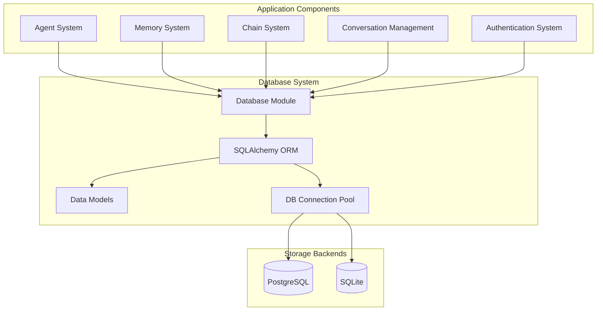
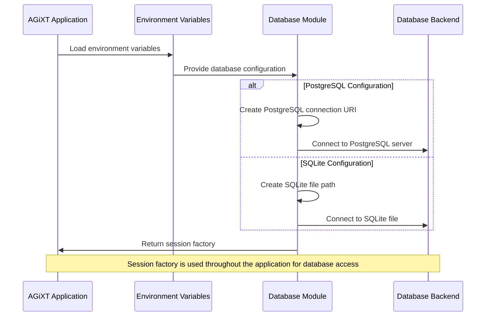
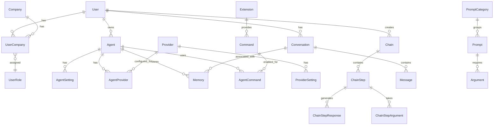
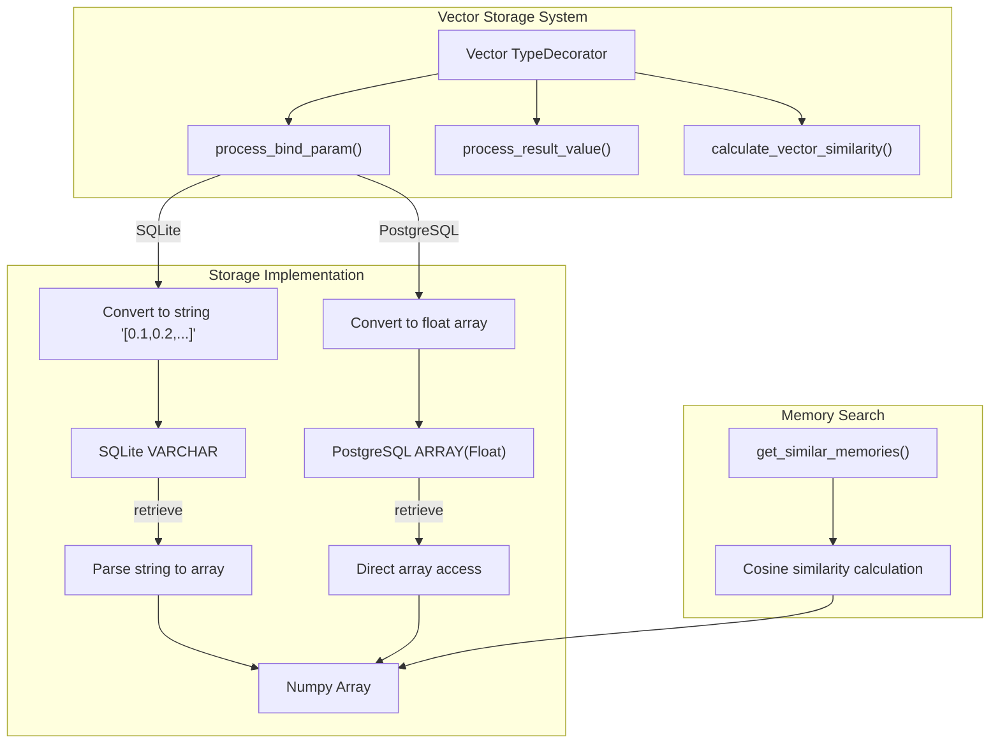
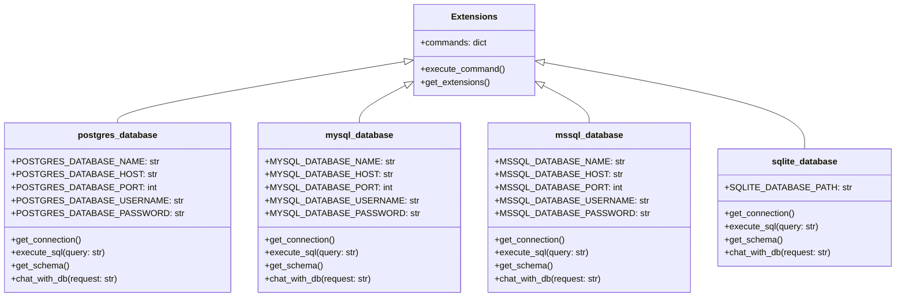
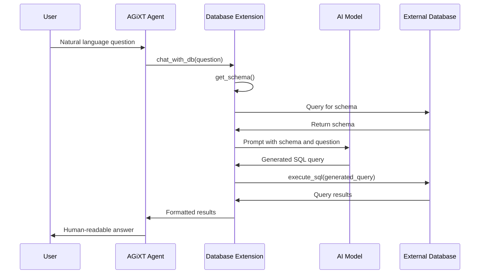
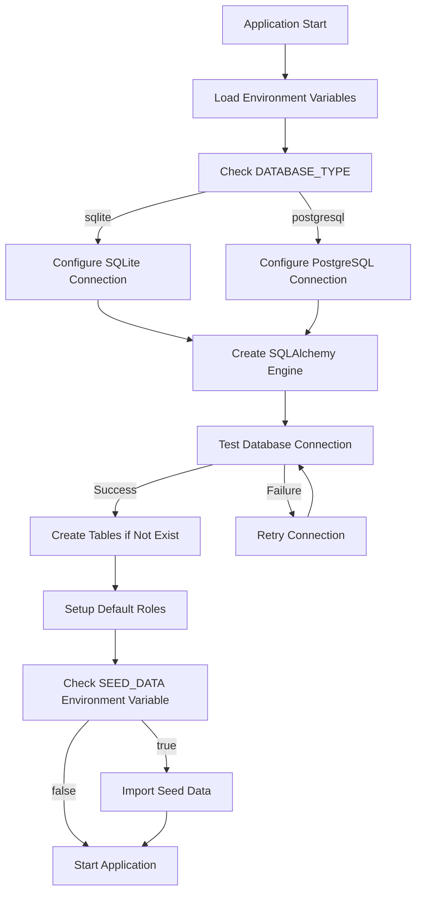

<!-- source: DeepWiki mcp.deepwiki.com · repo Josh-XT/AGiXT · page 8 Database System · fetched 2026-10-26 -->

# Database System

Relevant source files

The following files were used as context for generating this wiki page:

- [agixt/DB.py](agixt/DB.py)
- [agixt/Globals.py](agixt/Globals.py)
- [agixt/extensions/mssql_database.py](agixt/extensions/mssql_database.py)
- [agixt/extensions/mysql_database.py](agixt/extensions/mysql_database.py)
- [agixt/extensions/postgres_database.py](agixt/extensions/postgres_database.py)
- [agixt/prompts/Default/PostgreSQLQuery.txt](agixt/prompts/Default/PostgreSQLQuery.txt)
- [agixt/prompts/Default/SQLQuery.txt](agixt/prompts/Default/SQLQuery.txt)
- [agixt/prompts/Default/Validate PostgreSQL.txt](agixt/prompts/Default/Validate PostgreSQL.txt)
- [agixt/prompts/Default/Validate SQL.txt](agixt/prompts/Default/Validate SQL.txt)
- [start.py](start.py)

This page documents the database system used in AGiXT, focusing on the internal database architecture that powers the application. The database system is responsible for storing agent configurations, conversations, memories, and all other persistent data needed by the platform. For information about the database extension capabilities that allow agents to interact with external databases, see [Extension System](#4).

## Overview

AGiXT's database system provides flexible storage options through a unified API powered by SQLAlchemy. The system supports both PostgreSQL for production environments and SQLite for development or lightweight deployments. All database operations are abstracted through an ORM layer, which allows for consistent data access patterns regardless of the underlying database technology.

Sources: [agixt/DB.py:1-54](). [agixt/Globals.py:1-37]().

## Database Configuration

The database configuration is controlled through environment variables, which can be set directly or through a `.env` file processed at startup. AGiXT defaults to PostgreSQL but will fall back to SQLite if PostgreSQL configuration is not available.

### Environment Variables

| Variable | Description | Default |
|----------|-------------|---------|
| DATABASE_TYPE | Database backend type ("postgresql" or "sqlite") | "postgresql" |
| DATABASE_NAME | Database name | "postgres" |
| DATABASE_USER | Database username (PostgreSQL only) | "postgres" |
| DATABASE_PASSWORD | Database password (PostgreSQL only) | "postgres" |
| DATABASE_HOST | Database host (PostgreSQL only) | "localhost" |
| DATABASE_PORT | Database port (PostgreSQL only) | "5432" |
| DATABASE_SSL | SSL mode for PostgreSQL connection | "disable" |

### Connection Setup

When AGiXT starts, it creates a database connection pool and establishes the connection to the configured database. For PostgreSQL, it creates a connection string including credentials and SSL settings. For SQLite, it creates a file-based database in the specified location.

Sources: [agixt/DB.py:31-59](). [agixt/Globals.py:25-31](). [start.py:169-209]().

## Data Model

AGiXT's data model is comprehensive and covers all aspects of the system. The following diagram shows the core entities and their relationships:

Sources: [agixt/DB.py:65-725]().

### Key Entities

The database schema includes the following key entities:

#### User System
- **User**: Stores user information including authentication details
- **UserRole**: Defines user roles and permissions
- **UserCompany**: Associates users with companies and roles
- **Company**: Represents organizations with specific configurations

#### Agent System
- **Agent**: Represents AI agents with specific configurations
- **AgentSetting**: Stores agent-specific settings
- **AgentProvider**: Links agents to AI providers
- **AgentCommand**: Associates available commands with agents

#### Provider System
- **Provider**: Represents AI service providers (OpenAI, Claude, etc.)
- **ProviderSetting**: Stores provider-specific settings

#### Chain System
- **Chain**: Represents sequences of operations
- **ChainStep**: Individual steps within a chain
- **ChainStepArgument**: Arguments for chain steps
- **ChainStepResponse**: Stores responses from chain step executions

#### Conversation System
- **Conversation**: Represents conversations between users and agents
- **Message**: Individual messages within conversations

#### Extension System
- **Extension**: Represents available extensions
- **Command**: Commands provided by extensions
- **Argument**: Arguments for commands

#### Other Entities
- **Memory**: Stores agent memories with embeddings
- **Prompt**: Predefined prompts for agents
- **PromptCategory**: Categories for organizing prompts
- **TaskCategory** and **TaskItem**: Manage tasks and to-do items

Sources: [agixt/DB.py:66-702]().

## Vector Storage System

AGiXT implements a vector storage system for semantic search of agent memories. The system handles both PostgreSQL (native array support) and SQLite (string-based storage) backends through a custom SQLAlchemy type decorator.

### Vector Type Implementation

The `Vector` type decorator handles the conversion between application-level numpy arrays and database-specific storage formats:

1. For PostgreSQL, vectors are stored as native array types
2. For SQLite, vectors are serialized to string format

Sources: [agixt/DB.py:727-766](). [agixt/DB.py:831-866]().

### Memory Storage and Retrieval

The `Memory` table stores text along with vector embeddings. The system includes:

1. A `process_embedding_for_storage` function that prepares embeddings for storage
2. A `calculate_vector_similarity` function that computes cosine similarity between vectors
3. A `get_similar_memories` function that retrieves memories similar to a query

This allows AGiXT to perform semantic searches across agent memories, finding information based on meaning rather than exact text matching.

Sources: [agixt/DB.py:767-806](). [agixt/DB.py:831-905]().

## Database Extensions

AGiXT includes several database extensions that allow agents to interact with external databases. These extensions implement a consistent interface while supporting different database backends.

Each database extension provides the following capabilities:

1. **Connection Management**: Establishing connections to external databases
2. **SQL Query Execution**: Running custom SQL queries against external databases
3. **Schema Discovery**: Retrieving and formatting database schema information
4. **Natural Language Queries**: Converting natural language to SQL via AI prompting

Sources: [agixt/extensions/postgres_database.py:1-262](). [agixt/extensions/mysql_database.py:1-182](). [agixt/extensions/mssql_database.py:1-262]().

### Natural Language to SQL Processing

One of the most powerful features is the ability to translate natural language questions into appropriate SQL queries. The process works as follows:

The extension formats information about the database schema and the user's question into a prompt that instructs the AI model to generate an appropriate SQL query. This query is then executed against the external database, and the results are returned to the agent.

Sources: [agixt/extensions/postgres_database.py:206-256](). [agixt/extensions/mysql_database.py:132-181](). [agixt/extensions/mssql_database.py:212-261](). [agixt/prompts/Default/SQLQuery.txt:1-18]().

## Database System Initialization

When AGiXT starts, the database system goes through an initialization process to ensure the database is ready for use.

The initialization process includes:

1. Loading database configuration from environment variables
2. Creating the appropriate connection URI based on the database type
3. Creating a SQLAlchemy engine and connection pool
4. Testing the connection and retrying if necessary
5. Creating all tables defined in the data model
6. Setting up default user roles
7. Optionally importing seed data

Sources: [agixt/DB.py:923-951](). [start.py:169-209]().

## Conclusion

The AGiXT database system provides a robust foundation for the application's data storage needs. It offers flexibility in the choice of database backends while maintaining a consistent API through SQLAlchemy's ORM layer. The system includes specialized handling for vector storage to support semantic search capabilities and integrates with the extension system to enable interaction with external databases.

For developers extending AGiXT, understanding the database system is crucial for implementing features that require persistent storage or retrieval of data. The system's design allows for easy access to data while abstracting away the complexities of the underlying database technology.

---

