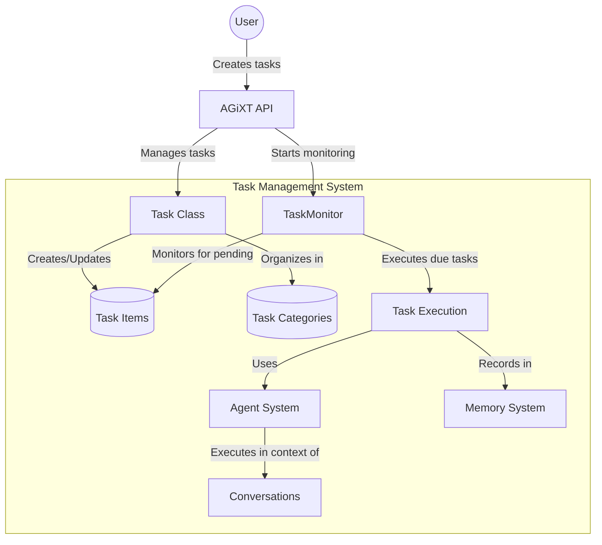
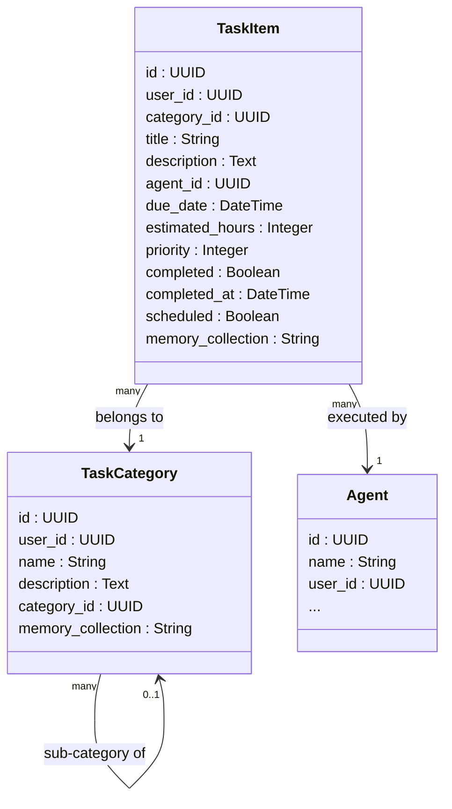
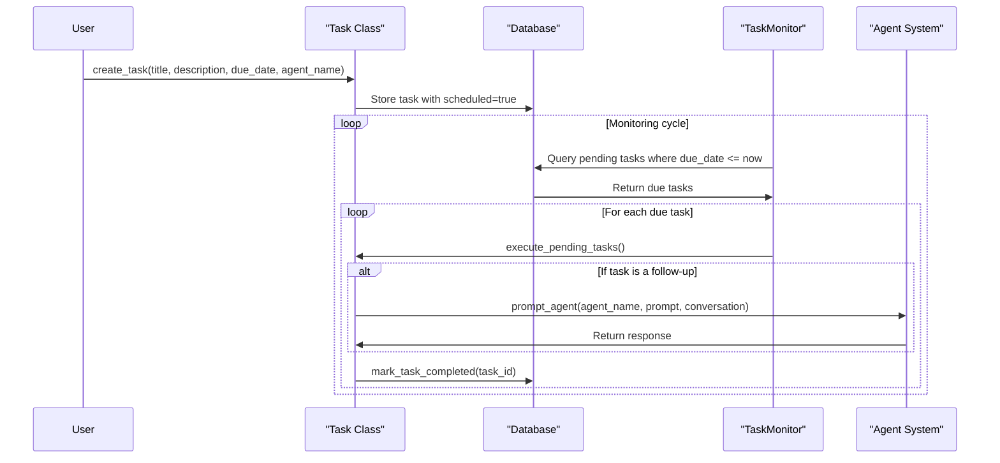
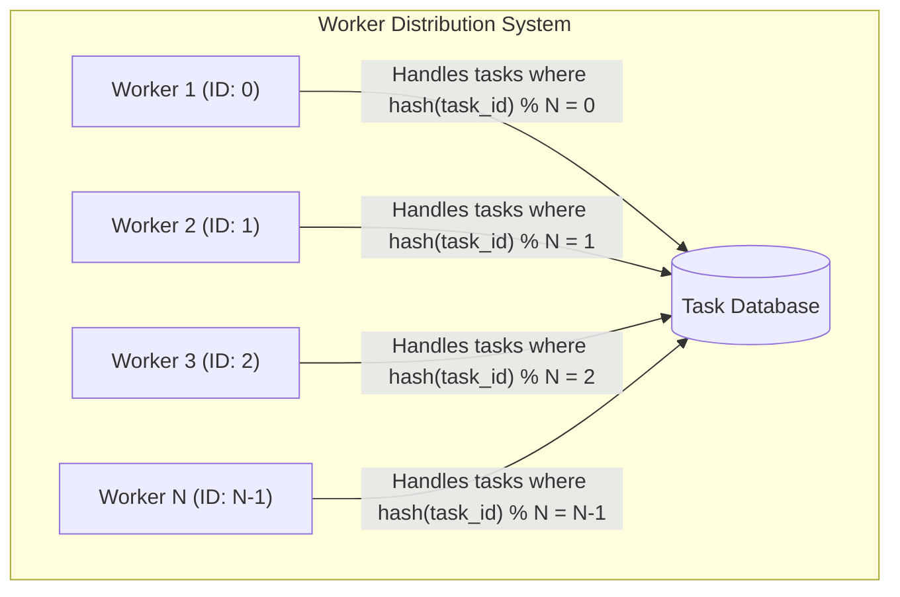

<!-- source: DeepWiki mcp.deepwiki.com · repo Josh-XT/AGiXT · page 9 Task Management · fetched 2026-10-26 -->

# Task Management

Relevant source files

The following files were used as context for generating this wiki page:

- [.github/workflows/build-and-test.yml](.github/workflows/build-and-test.yml)
- [.github/workflows/tests.yml](.github/workflows/tests.yml)
- [agixt/Task.py](agixt/Task.py)
- [agixt/TaskMonitor.py](agixt/TaskMonitor.py)
- [agixt/chains/Generate Smart Task Chain without Research.json](agixt/chains/Generate Smart Task Chain without Research.json)
- [agixt/chains/Generate Smart Task Chain.json](agixt/chains/Generate Smart Task Chain.json)
- [agixt/chains/Generate Task Chain without Research.json](agixt/chains/Generate Task Chain without Research.json)
- [agixt/chains/Generate Task Chain.json](agixt/chains/Generate Task Chain.json)
- [agixt/providers/rotation.py](agixt/providers/rotation.py)

The AGiXT Task Management system provides mechanisms for scheduling, organizing, and executing automated tasks. This system allows agents to perform actions at specified times, enabling features like follow-ups, scheduled operations, and periodic maintenance tasks. The task management functionality integrates with agents, conversations, and the memory management system to provide context-aware task execution.

## System Architecture

The task management system consists of two primary components: the `Task` class, which handles task CRUD operations and execution, and the `TaskMonitor` class, which provides a background service that continuously checks for and processes pending tasks.

Sources: [agixt/Task.py:13-263](), [agixt/TaskMonitor.py:42-179]()

## Task Data Model

The task management system uses two primary data entities:

1. **TaskItem** - Represents an individual task with execution details
2. **TaskCategory** - Provides organization and grouping of related tasks

Tasks can be organized hierarchically through categories and subcategories. Each task has properties for scheduling (`due_date`, `scheduled`), prioritization (`priority`), tracking (`completed`, `completed_at`), and execution context (`agent_id`, `memory_collection`).

Sources: [agixt/Task.py:13-263]()

## Task Creation and Management

The `Task` class provides methods for creating, retrieving, updating, and deleting tasks and categories.

### Task CRUD Operations

| Operation | Method | Description |
|-----------|--------|-------------|
| Create task | `create_task()` | Creates a new task with specified parameters |
| Create category | `create_category()` | Creates a new task category |
| Update task | `update_task()` | Updates task properties including completion status |
| Delete task | `delete_task()` | Removes a task from the system |
| Get pending tasks | `get_pending_tasks()` | Retrieves tasks due for execution |
| Get tasks by category | `get_tasks_by_category()` | Retrieves all tasks in a specific category |

Key task attributes include:

- **Title and Description**: Define the task's purpose
- **Category**: Organizational grouping for related tasks 
- **Agent**: Specified agent responsible for executing the task
- **Due Date**: When the task should be executed
- **Priority**: Importance level (integer value)
- **Memory Collection**: Associated conversation or memory context

Sources: [agixt/Task.py:19-252]()

## Task Scheduling and Execution

Tasks can be scheduled by setting a `due_date` and the `scheduled` flag. The system monitors for pending tasks that are due and executes them using the specified agent.

When a task is executed, especially follow-up tasks, the system will:

1. Retrieve the task context including the memory collection (conversation)
2. Impersonate the user who created the task (using JWT authentication)
3. Execute the task using the specified agent
4. Mark the task as completed upon successful execution

Sources: [agixt/Task.py:103-135](), [agixt/Task.py:131-186](), [agixt/TaskMonitor.py:100-157]()

## Distributed Task Monitoring

The `TaskMonitor` class implements a distributed worker system that allows multiple application instances to cooperatively process tasks without duplication. This is particularly important in multi-worker deployments.

Key features of the distributed task monitoring:

1. **Worker Identification**: Each worker process generates a unique worker ID
2. **Task Assignment**: Tasks are assigned to workers using consistent hashing
3. **Staggered Processing**: Workers start with staggered delays to prevent processing conflicts
4. **Fault Tolerance**: Failed task processing is tracked and can be retried

The system uses SHA-256 hashing of task IDs to determine which worker should process each task, ensuring that even with multiple server instances, each task is processed exactly once.

Sources: [agixt/TaskMonitor.py:42-71](), [agixt/TaskMonitor.py:72-99]()

## Follow-up Tasks

A specialized use case of the task management system is for agent follow-ups. Agents can schedule follow-up interactions with users by creating tasks in the "Follow-ups" category.

When a follow-up task is executed:

1. The system retrieves the original conversation context
2. Provides the agent with context about the follow-up purpose
3. Uses the "Think About It" prompt to generate a contextually relevant response
4. Records the interaction in the conversation history

This enables scenarios where an agent can promise to "get back to the user" about a specific topic at a later time.

Sources: [agixt/Task.py:131-179]()

## Task Chain Generation

The system includes several chain templates for generating task chains:

| Chain Template | Smart | Research | Purpose |
|----------------|-------|----------|---------|
| Generate Task Chain | No | Yes | Creates a standard task chain with research capability |
| Generate Smart Task Chain | Yes | Yes | Creates an advanced task chain with research |
| Generate Task Chain without Research | No | No | Creates a standard task chain without research |
| Generate Smart Task Chain without Research | Yes | No | Creates an advanced task chain without research |

These chains help break down complex objectives into discrete task steps, using expert determination, prompt generation, and task breakdown.

Sources: [agixt/chains/Generate Task Chain.json:1-58](), [agixt/chains/Generate Smart Task Chain.json:1-58](), [agixt/chains/Generate Task Chain without Research.json:1-58](), [agixt/chains/Generate Smart Task Chain without Research.json:1-58]()

## Integration with CI/CD

The task management system is tested as part of the AGiXT CI/CD pipeline. The GitHub Actions workflow tests the task functionality with both PostgreSQL and SQLite database backends, ensuring compatibility across different storage engines.

Sources: [.github/workflows/tests.yml:1-164](), [.github/workflows/build-and-test.yml:1-57]()

---

