# Page: Overview

# Overview

<details>
<summary>Relevant source files</summary>

The following files were used as context for generating this wiki page:

- [Dockerfile](Dockerfile)
- [agixt/Interactions.py](agixt/Interactions.py)
- [agixt/Memories.py](agixt/Memories.py)
- [agixt/Websearch.py](agixt/Websearch.py)
- [agixt/XT.py](agixt/XT.py)
- [agixt/app.py](agixt/app.py)
- [agixt/version](agixt/version)
- [docs/1-Getting started/0-Quick Start.md](docs/1-Getting started/0-Quick Start.md)
- [docs/1-Getting started/1-Environment Variables.md](docs/1-Getting started/1-Environment Variables.md)
- [docs/1-Getting started/4-Things to Consider.md](docs/1-Getting started/4-Things to Consider.md)
- [docs/1-Getting started/5-Preinstalled ISOs.md](docs/1-Getting started/5-Preinstalled ISOs.md)
- [docs/1-Getting started/Support.md](docs/1-Getting started/Support.md)
- [docs/README.md](docs/README.md)
- [requirements.txt](requirements.txt)

</details>


AGiXT is an AI automation platform designed to orchestrate efficient AI instruction management and task execution across multiple AI providers. It serves as a framework for creating, managing, and interacting with AI agents to automate complex workflows and tasks. The platform combines adaptive memory handling, smart features, and a versatile plugin system to maximize AI capabilities and enable sophisticated agent-based automation.

For information about specific components like the Agent System, see [Agent System](#2.1), Memory Management, see [Memory and Context Management](#2.2), or Chain execution, see [Chain System](#2.3).

## System Architecture

AGiXT follows a modular architecture with several key components that work together to provide a comprehensive AI automation framework.

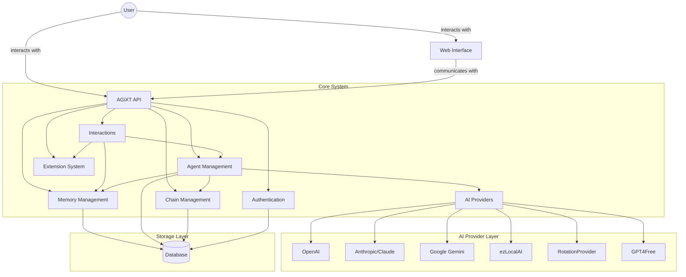

Sources:
- [agixt/app.py:70-76]()
- [agixt/Interactions.py:31-96]()
- [docs/README.md:18-24]()
- [agixt/XT.py:37-106]()

## Core Classes and Components

The AGiXT system is built around several key classes that handle different aspects of the platform functionality:

1. **XT Class (`AGiXT`)**: The main entry point for interacting with the system programmatically, providing methods for inference, executing commands, running chains, and handling various types of input/output including text, audio, and images.

2. **Interactions Class**: Orchestrates interactions between users and agents, including formatting prompts, processing responses, executing commands and handling memory operations.

3. **Agent System**: Manages AI agents and their configurations, including settings for different providers, memory capabilities, and available commands.

4. **Memory System**: Manages storage and retrieval of contextual information for agents, implemented through the `Memories` class.

5. **Chain System**: Handles sequences of operations (chains) that can be executed as a workflow.

6. **Extension System**: Provides additional functionality through commands that agents can execute, such as file operations, web searches, and integrations with external services.

7. **Provider System**: Abstracts interactions with different AI models and services, allowing AGiXT to work with multiple AI providers.

8. **API and Endpoints**: Exposes the functionality of AGiXT through a RESTful API.

Sources:
- [agixt/XT.py:37-106]()
- [agixt/Interactions.py:31-96]()
- [agixt/Memories.py:434-462]()
- [agixt/app.py:70-87]()

## Request Flow

The following diagram illustrates how a user request flows through the AGiXT system:

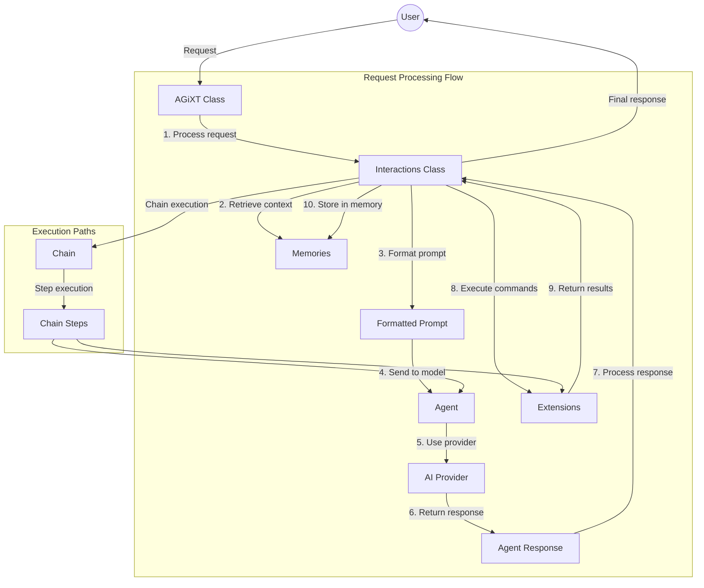

Sources:
- [agixt/XT.py:184-284]()
- [agixt/Interactions.py:535-811]()

### Request Initialization

When a user interacts with AGiXT, the system initializes the necessary components:

1. The `AGiXT` class creates an instance of `Interactions` with the specified agent
2. The `Interactions` class initializes the agent, memories, and other required components
3. The user input is processed and formatted into a prompt

Sources:
- [agixt/XT.py:37-106]()
- [agixt/Interactions.py:31-96]()

### Memory and Context Handling

AGiXT uses a memory system to maintain context:

1. The system retrieves relevant memories based on the user input
2. These memories are injected into the prompt to provide context
3. After receiving a response, new information is stored in memory

Sources:
- [agixt/Interactions.py:90-441]()
- [agixt/Memories.py:434-462]()

### Command Execution

AGiXT can execute commands through the Extensions system:

1. Commands are extracted from agent responses
2. The Extensions system executes the appropriate commands
3. Command results are formatted and returned to the user

Sources:
- [agixt/XT.py:386-441]()
- [agixt/Interactions.py:811-812]()

### Chain Execution

The Chain system allows for executing sequences of predefined steps:

1. Chains are defined as a series of steps
2. Each step can be a prompt or a command
3. Steps are executed in sequence, with results from one step being available to subsequent steps

Sources:
- [agixt/XT.py:443-623]()

## Features and Capabilities

AGiXT provides a rich set of features for AI automation:

- **Context and Token Management**: Adaptive handling of long-term and short-term memory for optimized AI performance
- **Multi-Provider Compatibility**: Integration with various AI providers including OpenAI, EzLocalAI, Google, Anthropic, and others
- **Web Browsing & Command Execution**: Ability to browse the web and execute commands for interactive AI experiences
- **Chain Management**: Automation of complex workflows through sequences of linked commands
- **Multi-modal I/O**: Support for text, audio, and image processing
- **Extensions**: Extensible command set that can be customized and expanded
- **RESTful API**: Comprehensive API for integrating AGiXT with other applications

Sources:
- [docs/README.md:55-70]()
- [agixt/Websearch.py:50-83]()
- [agixt/XT.py:286-369]()

## Deployment and Configuration

AGiXT can be deployed using Docker:

1. The `start.py` script provides an easy way to set up and configure AGiXT
2. The system can be run with different configurations using command-line arguments or environment variables
3. Multiple services can be deployed, including the core API and optional components like ezLocalAI

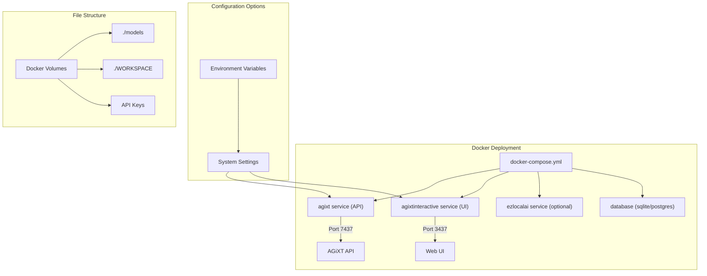

Sources:
- [Dockerfile:1-9]()
- [docs/1-Getting started/0-Quick Start.md:24-37]()
- [docs/1-Getting started/1-Environment Variables.md:1-27]()

## Conclusion

AGiXT provides a comprehensive framework for AI automation, enabling the creation and management of sophisticated AI agents that can perform a wide range of tasks. With its modular architecture, support for multiple AI providers, and extensive feature set, AGiXT offers a powerful platform for developing AI-powered applications and workflows.

The system is designed to be extensible and configurable, allowing users to adapt it to their specific needs and use cases. Whether you're building a simple chatbot or a complex autonomous system, AGiXT provides the tools and infrastructure to make it happen.

Sources:
- [docs/README.md:22-24]()
- [agixt/app.py:70-76]()

---

# Page: Core Architecture

# Core Architecture

<details>
<summary>Relevant source files</summary>

The following files were used as context for generating this wiki page:

- [Dockerfile](Dockerfile)
- [agixt/Agent.py](agixt/Agent.py)
- [agixt/ApiClient.py](agixt/ApiClient.py)
- [agixt/Chain.py](agixt/Chain.py)
- [agixt/Conversations.py](agixt/Conversations.py)
- [agixt/Extensions.py](agixt/Extensions.py)
- [agixt/Interactions.py](agixt/Interactions.py)
- [agixt/Memories.py](agixt/Memories.py)
- [agixt/Models.py](agixt/Models.py)
- [agixt/SeedImports.py](agixt/SeedImports.py)
- [agixt/Websearch.py](agixt/Websearch.py)
- [agixt/XT.py](agixt/XT.py)
- [agixt/app.py](agixt/app.py)
- [agixt/endpoints/Agent.py](agixt/endpoints/Agent.py)
- [agixt/endpoints/Chain.py](agixt/endpoints/Chain.py)
- [agixt/endpoints/Completions.py](agixt/endpoints/Completions.py)
- [agixt/endpoints/Conversation.py](agixt/endpoints/Conversation.py)
- [agixt/endpoints/Extension.py](agixt/endpoints/Extension.py)
- [agixt/endpoints/GQL.py](agixt/endpoints/GQL.py)
- [agixt/endpoints/Memory.py](agixt/endpoints/Memory.py)
- [agixt/endpoints/Prompt.py](agixt/endpoints/Prompt.py)
- [agixt/endpoints/Provider.py](agixt/endpoints/Provider.py)
- [agixt/prompts/Default/Name Conversation.txt](agixt/prompts/Default/Name Conversation.txt)
- [agixt/version](agixt/version)
- [requirements.txt](requirements.txt)

</details>


This document outlines the high-level architecture of AGiXT, an AI automation platform that orchestrates AI agents. It explains the core components and how they interact to enable the functionality of the system. For specific details about the agent system, see [Agent System](#2.1); for memory management, see [Memory and Context Management](#2.2); for chain execution, see [Chain System](#2.3); and for conversation handling, see [Conversation Management](#2.4).

## System Overview

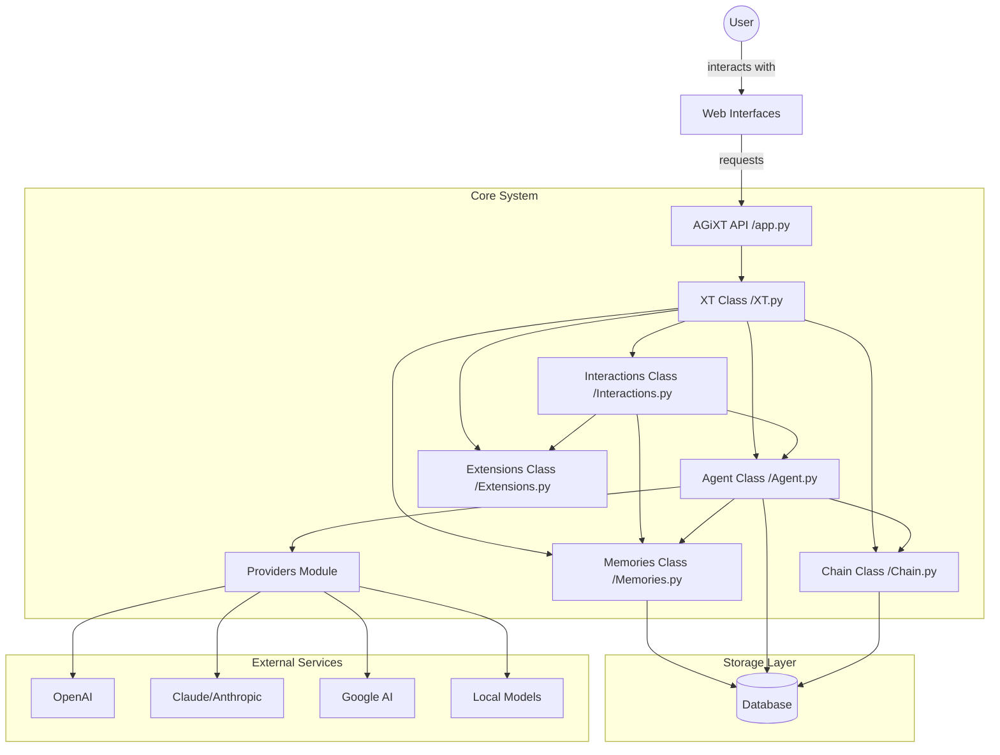

Sources: 
- [agixt/app.py:69-113](())
- [agixt/XT.py:37-106](())
- [agixt/Interactions.py:31-68](())
- [agixt/Agent.py:290-314](())
- [agixt/Memories.py:434-468](())
- [agixt/Chain.py:29-40](())
- [agixt/Extensions.py:30-70](())

## Core Components

AGiXT's architecture consists of several key components that work together to provide a flexible AI agent automation platform:

### 1. API Layer (`app.py`)

The API layer, built with FastAPI, provides the interface for client applications to interact with AGiXT. It handles HTTP requests, authentication, and routes them to the appropriate components.

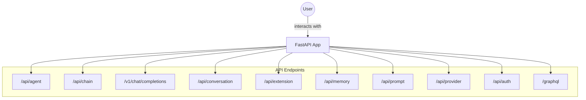

Sources:
- [agixt/app.py:69-113](())
- [agixt/app.py:87-98](()) - Router inclusion
- [agixt/endpoints/Agent.py:48-50](())
- [agixt/endpoints/Chain.py:18-21](())
- [agixt/endpoints/Completions.py:26-29](())
- [agixt/endpoints/Conversation.py:32-34](())
- [agixt/endpoints/Extension.py:7-9](())
- [agixt/endpoints/Memory.py:34-36](())
- [agixt/endpoints/Prompt.py:14-16](())
- [agixt/endpoints/Provider.py:18-20](())
- [agixt/app.py:247-255](()) - GraphQL integration

### 2. XT Class (`XT.py`)

The `AGiXT` class in `XT.py` serves as the main orchestration layer for the system, providing high-level methods for client applications to interact with AGiXT. It initializes and coordinates the other core components.

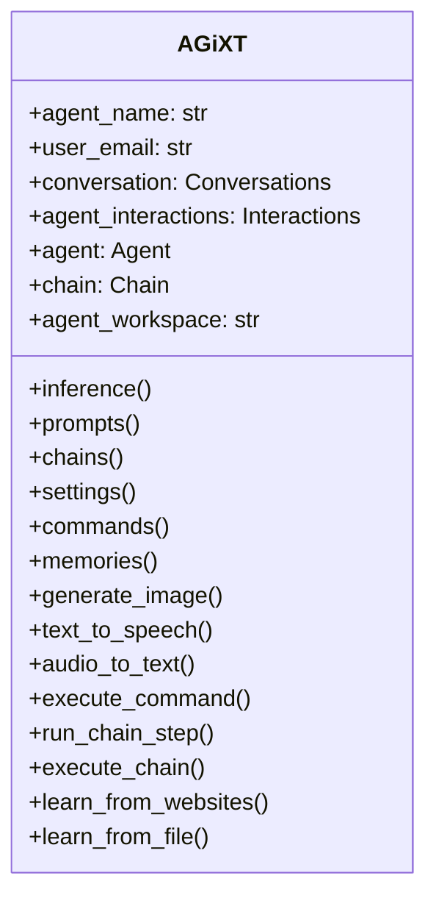

Sources:
- [agixt/XT.py:37-106](()) - AGiXT class definition
- [agixt/XT.py:184-284](()) - inference method
- [agixt/XT.py:555-623](()) - execute_chain method
- [agixt/XT.py:393-441](()) - execute_command method

### 3. Interactions System (`Interactions.py`)

The `Interactions` class is the core of AGiXT's intelligence, handling prompt formatting, context retrieval, and response processing. It orchestrates the flow of information between users, agents, and extensions.

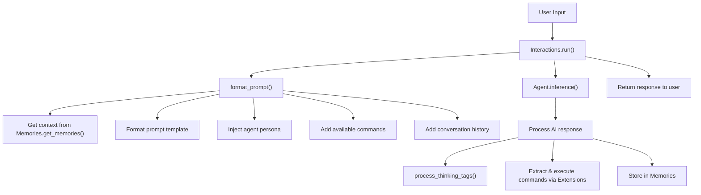

Sources:
- [agixt/Interactions.py:31-68](()) - Interactions class definition
- [agixt/Interactions.py:90-441](()) - format_prompt method
- [agixt/Interactions.py:443-533](()) - process_thinking_tags method
- [agixt/Interactions.py:535-811](()) - run method

### 4. Agent System (`Agent.py`)

The `Agent` class manages agent configurations and handles connections to various AI providers. It's responsible for:
- Loading and managing agent configurations
- Initializing provider connections
- Handling inference requests to AI models
- Managing agent-specific workspaces

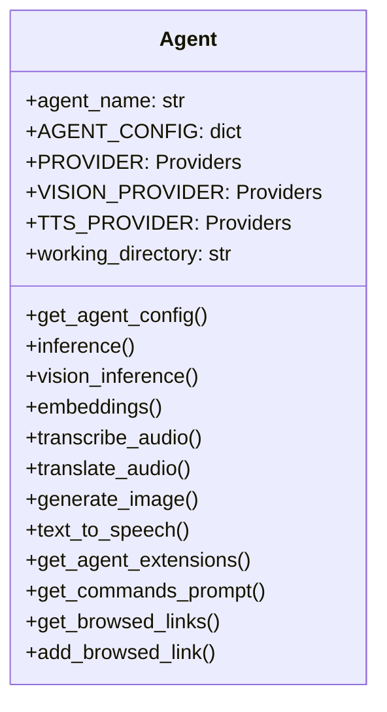

Sources:
- [agixt/Agent.py:290-406](()) - Agent class definition
- [agixt/Agent.py:626-654](()) - inference method
- [agixt/Agent.py:487-594](()) - get_agent_config method

### 5. Memory System (`Memories.py`)

The `Memories` class handles the storage and retrieval of knowledge, using vector embeddings for semantic search:

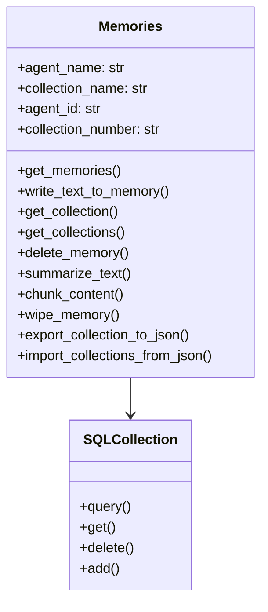

Sources:
- [agixt/Memories.py:434-468](()) - Memories class definition
- [agixt/Memories.py:480-494](()) - wipe_memory method
- [agixt/Memories.py:623-676](()) - get_memories method
- [agixt/Memories.py:641-884](()) - write_text_to_memory method
- [agixt/Memories.py:269-372](()) - SQLCollection class definition

### 6. Chain System (`Chain.py`)

The `Chain` class enables the creation and execution of sequential workflows:

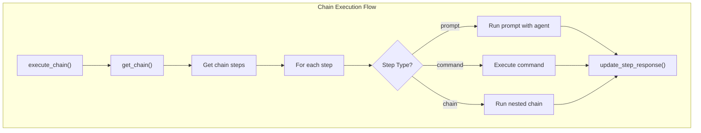

Sources:
- [agixt/Chain.py:29-40](()) - Chain class definition
- [agixt/Chain.py:34-108](()) - get_chain method
- [agixt/Chain.py:219-432](()) - add_chain_step method
- [agixt/XT.py:555-623](()) - execute_chain implementation

### 7. Extension System (`Extensions.py`)

The `Extensions` class provides a plugin architecture for extending agent capabilities through commands:

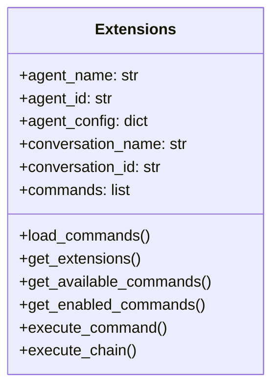

Sources:
- [agixt/Extensions.py:30-70](()) - Extensions class definition
- [agixt/Extensions.py:668-761](()) - load_commands method
- [agixt/Extensions.py:386-664](()) - execute_command method

## Data Flow Through the System

Let's examine how data flows through AGiXT when processing a user request:

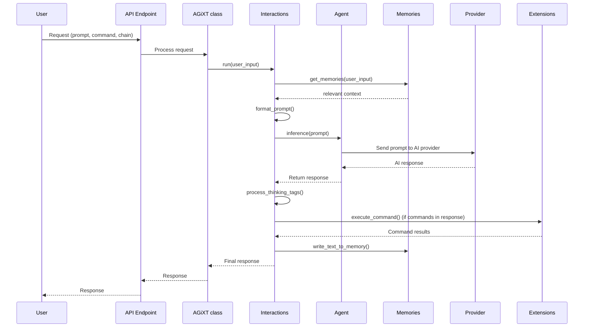

Sources:
- [agixt/XT.py:184-284](()) - inference method flow
- [agixt/Interactions.py:535-811](()) - run method
- [agixt/Interactions.py:90-441](()) - format_prompt method

## Key Database Schema

AGiXT uses a database to store various types of information. The core database tables include:

| Table | Purpose | Related Files |
|-------|---------|--------------|
| `Agent` | Stores agent configurations | [agixt/Agent.py:91-148](()) |
| `AgentSetting` | Stores agent-specific settings | [agixt/Agent.py:132-137](()) |
| `Memory` | Stores agent memories | [agixt/Memories.py:390-406](()) |
| `Conversation` | Stores conversation metadata | [agixt/Conversations.py:72-96](()) |
| `Message` | Stores conversation messages | [agixt/Conversations.py:232-279](()) |
| `Chain` | Stores chain definitions | [agixt/Chain.py:216-217](()) |
| `ChainStep` | Stores steps within chains | [agixt/Chain.py:239-279](()) |
| `Command` | Stores available commands | [agixt/Extensions.py:668-700](()) |
| `User` | Stores user information | [agixt/Agent.py:106-114](()) |

Sources:
- [agixt/DB.py](()) (referenced by other files)
- [agixt/Agent.py:91-148](()) - Agent table usage
- [agixt/Memories.py:390-406](()) - Memory table usage
- [agixt/Conversations.py:72-96](()) - Conversation table usage

## Provider System

AGiXT connects to various AI providers through an abstraction layer:

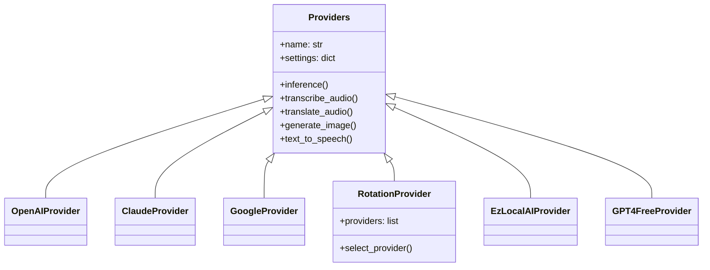

Sources:
- [agixt/Agent.py:314-371](()) - Provider initialization
- [agixt/Agent.py:626-654](()) - Provider inference usage

## Request Processing Lifecycle

Let's look at the complete lifecycle of a request through AGiXT:

1. **Request Ingestion**:
   - User sends request to API endpoint
   - API routes request to appropriate handler
   - Authentication is verified through `verify_api_key()`

2. **Request Processing**:
   - Request is passed to an `AGiXT` instance (`XT` class)
   - `AGiXT` initializes necessary components and passes to `Interactions`

3. **Context Gathering**:
   - `Interactions.format_prompt()` retrieves relevant memories
   - Context is enriched with conversation history and persona information
   - Available commands are added to the prompt

4. **AI Inference**:
   - Enriched prompt is sent to `Agent.inference()`
   - Agent forwards the request to the appropriate AI provider
   - Provider returns the AI-generated response

5. **Response Processing**:
   - `Interactions.process_thinking_tags()` extracts thinking/reflection
   - Commands in the response are identified and executed via `Extensions`
   - Results are stored in memory

6. **Response Return**:
   - Final processed response is returned to the user
   - Conversation history is updated
   - Any generated files or artifacts are made available

Sources:
- [agixt/XT.py:184-284](()) - inference method
- [agixt/Interactions.py:535-811](()) - run method
- [agixt/Interactions.py:90-441](()) - format_prompt method
- [agixt/Interactions.py:443-533](()) - process_thinking_tags method
- [agixt/Agent.py:626-654](()) - inference method

## Conclusion

AGiXT's architecture is designed to be modular and extensible, allowing for easy integration of new AI providers, extensions, and workflows. The system's core components - Agent, Interactions, Memories, Chain, and Extensions - work together to provide a powerful platform for AI automation.

The architecture enables:
1. **Flexible Provider Integration**: Support for multiple AI providers
2. **Contextual Intelligence**: Semantic memory retrieval for relevant context
3. **Extensibility**: Command-based extension system
4. **Workflow Automation**: Chain-based workflow execution
5. **Multi-modal Support**: Integration with vision, speech, and text AI capabilities

For more specific information about individual components, refer to their respective wiki pages linked at the top of this document.

---

# Page: Agent System

# Agent System

<details>
<summary>Relevant source files</summary>

The following files were used as context for generating this wiki page:

- [Dockerfile](Dockerfile)
- [agixt/Agent.py](agixt/Agent.py)
- [agixt/Chain.py](agixt/Chain.py)
- [agixt/Conversations.py](agixt/Conversations.py)
- [agixt/Extensions.py](agixt/Extensions.py)
- [agixt/Interactions.py](agixt/Interactions.py)
- [agixt/Memories.py](agixt/Memories.py)
- [agixt/Models.py](agixt/Models.py)
- [agixt/SeedImports.py](agixt/SeedImports.py)
- [agixt/Websearch.py](agixt/Websearch.py)
- [agixt/XT.py](agixt/XT.py)
- [agixt/app.py](agixt/app.py)
- [agixt/endpoints/Agent.py](agixt/endpoints/Agent.py)
- [agixt/endpoints/Chain.py](agixt/endpoints/Chain.py)
- [agixt/endpoints/Completions.py](agixt/endpoints/Completions.py)
- [agixt/endpoints/Conversation.py](agixt/endpoints/Conversation.py)
- [agixt/endpoints/Extension.py](agixt/endpoints/Extension.py)
- [agixt/endpoints/GQL.py](agixt/endpoints/GQL.py)
- [agixt/endpoints/Memory.py](agixt/endpoints/Memory.py)
- [agixt/endpoints/Prompt.py](agixt/endpoints/Prompt.py)
- [agixt/endpoints/Provider.py](agixt/endpoints/Provider.py)
- [agixt/prompts/Default/Name Conversation.txt](agixt/prompts/Default/Name Conversation.txt)
- [agixt/version](agixt/version)
- [requirements.txt](requirements.txt)

</details>


The Agent System is the core of AGiXT, responsible for defining, configuring, and managing AI agents. This document explains how agents are structured, how they interact with various AI providers, and how they integrate with other components of the AGiXT platform.

For information about memory management, see [Memory and Context Management](#2.2). For chain execution, see [Chain System](#2.3).

## Agent Architecture

The agent system provides a flexible abstraction layer that can work with multiple AI providers, manage agent-specific settings, and facilitate agent interactions with various platform capabilities.

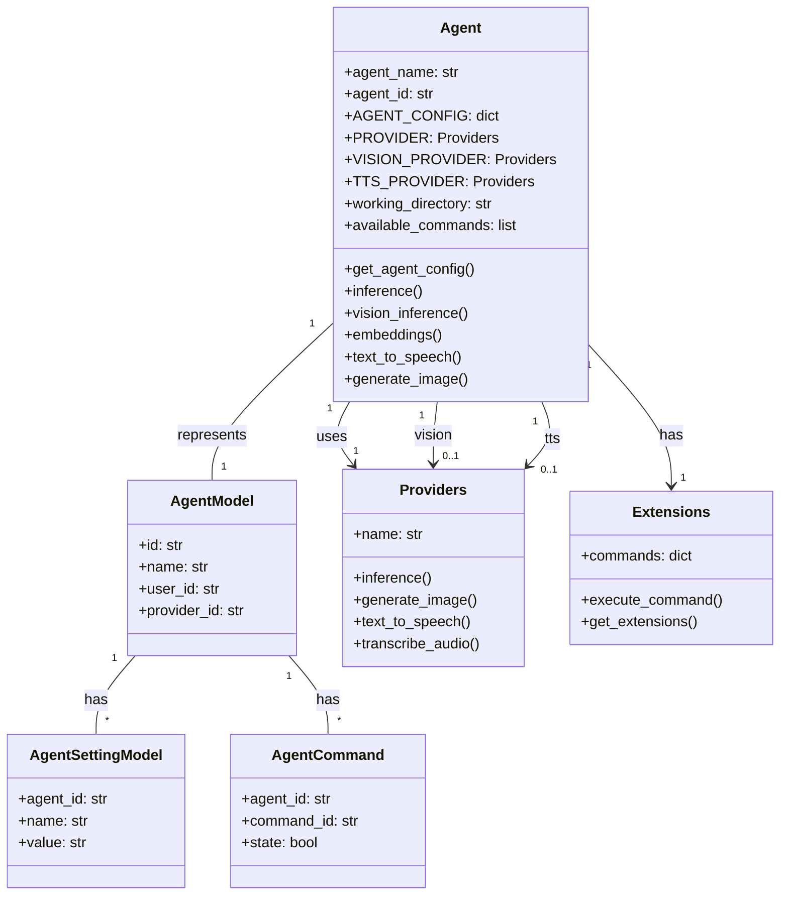

Sources: [agixt/Agent.py:290-426](). [agixt/Agent.py:86-148]().

## Agent Creation and Configuration

Agents are created with a name, settings for the AI provider, and enabled commands. The agent configuration is stored in the database.

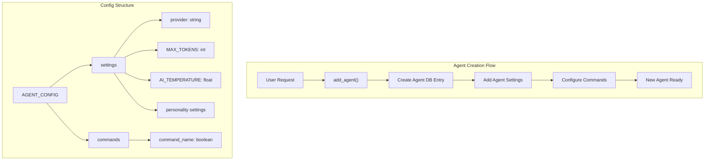

Sources: [agixt/Agent.py:86-148](). [agixt/Agent.py:486-625]().

The agent configuration (`AGENT_CONFIG`) contains settings and commands:

| Key | Description |
|-----|-------------|
| `settings` | Dictionary of provider settings like `provider`, `MAX_TOKENS`, `AI_TEMPERATURE`, etc. |
| `commands` | Dictionary of enabled/disabled commands with command names as keys and boolean values |

Sample agent configuration:

```json
{
    "settings": {
        "provider": "openai",
        "MAX_TOKENS": 8192,
        "AI_TEMPERATURE": 0.7,
        "persona": "You are a helpful assistant...",
        "vision_provider": "openai",
        "tts_provider": "google"
    },
    "commands": {
        "web_search": true,
        "write_file": true,
        "read_file": true
    }
}
```

Sources: [agixt/Agent.py:290-357](). [agixt/Agent.py:486-625]().

## Agent Provider System

Agents work with multiple AI providers through a provider abstraction layer. Each agent can use different providers for different services.

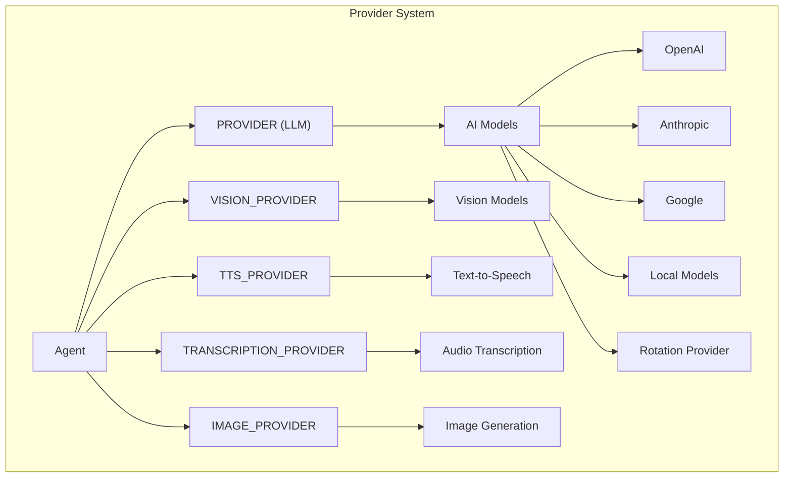

Sources: [agixt/Agent.py:313-406](). 

The `Agent` class initializes multiple provider instances based on the agent's configuration:

- `PROVIDER`: Main AI provider for text generation
- `VISION_PROVIDER`: Provider for image understanding
- `TTS_PROVIDER`: Provider for text-to-speech conversion
- `TRANSCRIPTION_PROVIDER`: Provider for audio transcription
- `TRANSLATION_PROVIDER`: Provider for translation
- `IMAGE_PROVIDER`: Provider for image generation

The `RotationProvider` allows fallback between multiple providers for reliability.

Sources: [agixt/Agent.py:313-406]().

## Agent Inference Process

The core function of an agent is performing inference (generating responses) based on prompts.

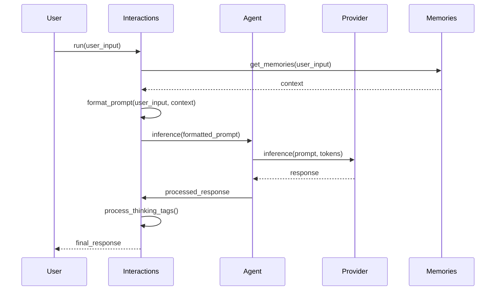

Sources: [agixt/Agent.py:627-653](). [agixt/Interactions.py:535-815]().

The inference process includes:

1. Gathering context from memories
2. Formatting the prompt with context and agent persona
3. Calling the AI provider for the response
4. Processing the response (including thinking tags)
5. Returning the final response to the user

The `inference` method is the core method that sends prompts to the AI provider and gets responses:

```python
async def inference(self, prompt: str, images: list = [], use_smartest: bool = False):
    if not prompt:
        return ""
    input_tokens = get_tokens(prompt)
    provider_name = self.AGENT_CONFIG["settings"]["provider"]
    try:
        if provider_name == "rotation" and use_smartest == True:
            answer = await self.PROVIDER.inference(
                prompt=prompt, tokens=input_tokens, images=images, use_smartest=True
            )
        else:
            answer = await self.PROVIDER.inference(
                prompt=prompt, tokens=input_tokens, images=images
            )
        output_tokens = get_tokens(answer)
        self.auth.increase_token_counts(
            input_tokens=input_tokens, output_tokens=output_tokens
        )
        answer = str(answer).replace("\_", "_")
        if answer.endswith("\n\n"):
            answer = answer[:-2]
    except Exception as e:
        logging.error(f"Error in inference: {str(e)}")
        answer = "<answer>Unable to process request.</answer>"
    return answer
```

Sources: [agixt/Agent.py:627-653](). [agixt/Interactions.py:535-815]().

## Agent Integration with Memory

Agents use the memory system to store and retrieve information, providing context for interactions.

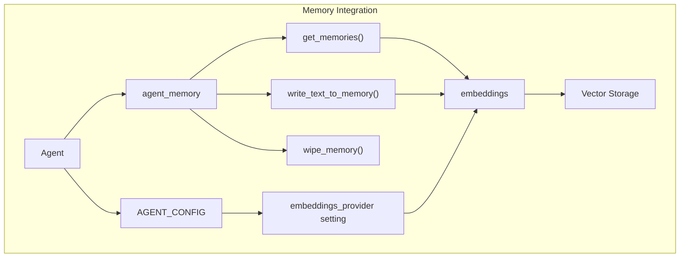

Sources: [agixt/Interactions.py:85-139](). [agixt/Memories.py:434-469]().

During the inference process, the agent retrieves relevant memories based on the user input and includes them in the context for the prompt. This allows the agent to have a "memory" of past interactions and information.

The `format_prompt` method in the `Interactions` class is responsible for retrieving memories and including them in the prompt:

```python
async def format_prompt(
    self,
    user_input: str = "",
    top_results: int = 5,
    prompt="",
    conversation_name="",
    vision_response: str = "",
    **kwargs,
):
    # ...
    context = []
    if int(top_results) > 0:
        if user_input:
            min_relevance_score = 0.2
            if "min_relevance_score" in kwargs:
                try:
                    min_relevance_score = float(kwargs["min_relevance_score"])
                except:
                    min_relevance_score = 0.2
            context += await self.agent_memory.get_memories(
                user_input=user_input,
                limit=top_results,
                min_relevance_score=min_relevance_score,
            )
            # ... Get additional memories if needed
    # ...
```

Sources: [agixt/Interactions.py:90-440]().

## Agent Commands and Extensions

Agents can execute commands through the extension system, allowing them to interact with external systems and perform various actions.

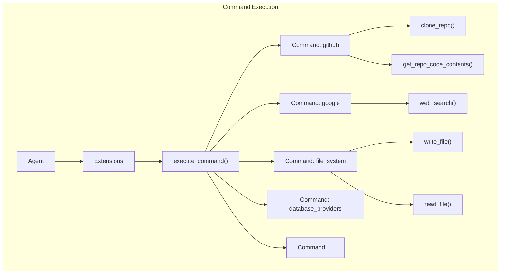

Sources: [agixt/Extensions.py:30-70](). [agixt/XT.py:386-441]().

Agents can enable specific commands through their configuration. The `execute_command` method in `XT.py` executes commands with arguments:

```python
async def execute_command(
    self,
    command_name: str,
    command_args: dict,
    voice_response: bool = False,
    log_output: bool = False,
    log_activities: bool = False,
):
    if log_activities:
        self.conversation.log_interaction(
            role=self.agent_name,
            message=f"[ACTIVITY] Executing command `{command_name}` with args:\n```json\n{json.dumps(command_args, indent=2)}```",
        )
    try:
        response = await Extensions(
            agent_name=self.agent_name,
            agent_id=self.agent.agent_id,
            agent_config=self.agent.AGENT_CONFIG,
            conversation_name=self.conversation_name,
            conversation_id=self.conversation_id,
            ApiClient=self.ApiClient,
            api_key=self.api_key,
            user=self.user_email,
        ).execute_command(
            command_name=command_name,
            command_args=command_args,
        )
    except Exception as e:
        logging.error(f"Error executing command: {e}")
        response = f"Error executing command `{command_name}`."
    # ... Handle voice response and logging
    return response
```

Sources: [agixt/XT.py:386-441]().

## Agent Interactions System

The `Interactions` class manages interactions between users and agents, handling prompt formatting, response processing, and command execution.

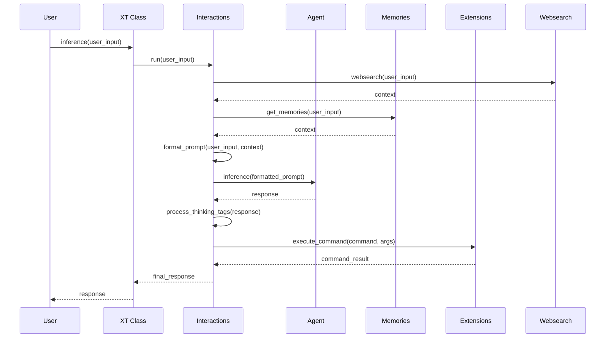

Sources: [agixt/Interactions.py:31-532](). [agixt/XT.py:184-284]().

The `run` method in the `Interactions` class is the entry point for agent interactions:

```python
async def run(
    self,
    user_input: str = "",
    context_results: int = 100,
    shots: int = 1,
    disable_memory: bool = True,
    conversation_name: str = "",
    browse_links: bool = False,
    persist_context_in_history: bool = False,
    images: list = [],
    searching: bool = False,
    log_user_input: bool = True,
    log_output: bool = True,
    **kwargs,
):
    # ... Initialize settings and tasks
    
    # Web search if enabled
    if websearch and searching == False:
        # ... Web search tasks
    
    # Format prompt with context
    formatted_prompt, unformatted_prompt, tokens = await self.format_prompt(
        user_input=user_input,
        top_results=int(context_results),
        conversation_results=conversation_results,
        prompt=prompt,
        prompt_category=prompt_category,
        conversation_name=conversation_name,
        websearch=websearch,
        searching=searching,
        vision_response=vision_response,
        **kwargs,
    )
    
    # Log user input
    if log_user_input:
        c.log_interaction(
            role="USER",
            message=log_message,
        )
    
    # Call inference
    try:
        self.response = await self.agent.inference(
            prompt=formatted_prompt, use_smartest=use_smartest
        )
    except Exception as e:
        # ... Error handling
    
    # Process response
    self.response = self.response.replace(
        f"http://localhost:7437/outputs/{self.agent.agent_id}", self.outputs
    )
    
    # ... Process file references
    
    # Return response
    return self.response
```

Sources: [agixt/Interactions.py:535-815](). [agixt/XT.py:184-284]().

## Agent Management API

The Agent System exposes API endpoints for managing agents through the FastAPI framework.

```mermaid
flowchart TD
    subgraph "Agent API Endpoints"
        A["/api/agent"] --> B["POST: Create Agent"]
        A --> C["GET: List Agents"]
        
        D["/api/agent/{agent_name}"] --> E["GET: Agent Details"]
        D --> F["PUT: Update Settings"]
        D --> G["DELETE: Delete Agent"]
        D --> H["PATCH: Rename Agent"]
        
        I["/api/agent/{agent_name}/commands"] --> J["PUT: Update Commands"]
        I --> K["GET: List Commands"]
        
        L["/api/agent/{agent_name}/prompt"] --> M["POST: Run Prompt"]
        
        N["/api/agent/{agent_name}/inference"] --> O["POST: Agent Inference"]
    end
```

Sources: [agixt/endpoints/Agent.py:48-770](). 

The API endpoints provide full CRUD operations for agents and their configurations:

| Endpoint | Method | Description |
|----------|--------|-------------|
| `/api/agent` | POST | Create a new agent |
| `/api/agent` | GET | List all agents |
| `/api/agent/{agent_name}` | GET | Get agent details |
| `/api/agent/{agent_name}` | PUT | Update agent settings |
| `/api/agent/{agent_name}` | DELETE | Delete an agent |
| `/api/agent/{agent_name}` | PATCH | Rename an agent |
| `/api/agent/{agent_name}/commands` | PUT | Update agent commands |
| `/api/agent/{agent_name}/commands` | GET | List agent commands |
| `/api/agent/{agent_name}/prompt` | POST | Run a prompt with the agent |
| `/api/agent/{agent_name}/inference` | POST | Run inference with the agent |

Sources: [agixt/endpoints/Agent.py:51-770]().

## High-Level Interface: XT Class

The `AGiXT` (XT) class provides a high-level interface for agent operations, integrating agents with conversations, chains, and extensions.

```mermaid
classDiagram
    class AGiXT {
        +user_email: str
        +agent_name: str
        +conversation_name: str
        +agent_interactions: Interactions
        +agent: Agent
        +chain: Chain
        +conversation: Conversations
        +inference()
        +execute_command()
        +execute_chain()
        +learn_from_websites()
        +learn_from_file()
        +generate_image()
        +text_to_speech()
        +audio_to_text()
    }

    AGiXT "1" --> "1" Interactions: uses
    AGiXT "1" --> "1" Agent: manages
    AGiXT "1" --> "1" Chain: uses
    AGiXT "1" --> "1" Conversations: uses
    Interactions "1" --> "1" Agent: uses
    Interactions "1" --> "1" Memories: uses
    Interactions "1" --> "1" Extensions: uses
```

Sources: [agixt/XT.py:37-106](). [agixt/XT.py:184-284]().

The `inference` method in the `AGiXT` class is the main entry point for agent interactions:

```python
async def inference(
    self,
    user_input: str,
    prompt_category: str = "Default",
    prompt_name: str = "Custom Input",
    images: list = [],
    injected_memories: int = 100,
    conversation_results: int = 15,
    shots: int = 1,
    browse_links: bool = False,
    voice_response: bool = False,
    log_user_input: bool = True,
    log_output: bool = True,
    language: str = "en",
    **kwargs,
):
    # ... Process arguments
    
    # Call Interactions.run
    response = await self.agent_interactions.run(
        user_input=user_input,
        prompt_category=prompt_category,
        prompt_name=prompt_name,
        context_results=injected_memories,
        conversation_results=conversation_results,
        shots=shots,
        conversation_name=self.conversation_name,
        browse_links=browse_links,
        images=images,
        tts=voice_response,
        log_user_input=log_user_input,
        log_output=log_output,
        **kwargs,
    )
    
    # Handle language translation if needed
    if language == "en":
        return response
    # ... Translation handling
    
    return new_response
```

Sources: [agixt/XT.py:184-284]().

## Working Directory Structure

Each agent has its own workspace directory for storing files and outputs. The workspace is organized by agent ID and conversation ID.

```
WORKSPACE/
├── {agent_id}/                    # Agent workspace
│   ├── {conversation_id}/         # Conversation workspace
│   │   ├── file1.txt              # Files generated during conversation
│   │   ├── file2.py               # Code files
│   │   ├── images/                # Generated images
│   │   └── ...
│   ├── models/                    # Agent-specific models
│   └── ...
└── ...
```

The working directory is used for storing and accessing files during agent interactions, particularly for file-related commands and operations.

Sources: [agixt/Agent.py:401](). [agixt/XT.py:88-95]().

## Conversation Integration

Agents are deeply integrated with the conversation system, with each agent interaction tied to a conversation context.

```mermaid
flowchart TD
    subgraph "Agent-Conversation Integration"
        A["XT Class"] --> B["agent_interactions"]
        A --> C["conversation"]
        
        B --> D["Agent"]
        B --> E["run()"]
        
        E --> F["format_prompt()"]
        F --> G["Get Conversation Context"]
        F --> H["Get Memories"]
        F --> I["Format with Persona"]
        
        C --> J["log_interaction()"]
        C --> K["get_conversation()"]
        
        E --> L["inference()"]
        L --> D
        
        L --> M["Process Response"]
        M --> N["Log Response"]
        N --> C
    end
```

Sources: [agixt/Interactions.py:90-440](). [agixt/Interactions.py:535-815](). [agixt/XT.py:184-284]().

The conversation context is used to provide history and context to the agent during interactions. The agent's responses are logged to the conversation, creating a continuous interaction history.

Sources: [agixt/Interactions.py:90-440](). [agixt/Conversations.py:62-372]().

## Summary

The Agent System in AGiXT provides a flexible and extensible framework for creating and managing AI agents. Key components include:

1. **Agent Creation and Configuration**: Agents are created with a name, settings, and enabled commands.
2. **Provider Abstraction**: Agents work with multiple AI providers through a provider abstraction layer.
3. **Inference Process**: Agents generate responses based on prompts with context from memories and conversation history.
4. **Memory Integration**: Agents use the memory system to store and retrieve information.
5. **Command Execution**: Agents can execute commands through the extension system.
6. **Interactions System**: The `Interactions` class manages interactions between users and agents.
7. **API Management**: The Agent System exposes API endpoints for managing agents.
8. **XT Interface**: The `AGiXT` class provides a high-level interface for agent operations.

This system allows for the creation of sophisticated AI agents that can interact with users, execute commands, learn from various sources, and maintain context across interactions.

---

# Page: Memory and Context Management

# Memory and Context Management

<details>
<summary>Relevant source files</summary>

The following files were used as context for generating this wiki page:

- [Dockerfile](Dockerfile)
- [agixt/DB.py](agixt/DB.py)
- [agixt/Globals.py](agixt/Globals.py)
- [agixt/Interactions.py](agixt/Interactions.py)
- [agixt/Memories.py](agixt/Memories.py)
- [agixt/Websearch.py](agixt/Websearch.py)
- [agixt/XT.py](agixt/XT.py)
- [agixt/app.py](agixt/app.py)
- [agixt/version](agixt/version)
- [requirements.txt](requirements.txt)
- [start.py](start.py)

</details>


This document explains how the AGiXT system stores and retrieves memories, manages context, and utilizes vector embeddings for semantic search. Memory management is the foundation of AGiXT's ability to maintain contextual awareness and provide relevant responses during agent interactions. For information about conversation tracking, see [Conversation Management](#2.4).

## Memory Architecture Overview

```mermaid
flowchart TD
    subgraph "Input Sources"
        UI["User Input"]
        WEB["Web Content"]
        FILE["File Content"]
    end

    subgraph "Memory Processing"
        EMBED["Embedding Generation"]
        CHUNK["Content Chunking"]
        META["Metadata Extraction"]
    end

    subgraph "Storage System"
        MEM_DB["Memory Database"]
        COLL["Collections"]
    end

    UI --> CHUNK
    WEB --> CHUNK
    FILE --> CHUNK

    CHUNK --> EMBED
    CHUNK --> META
    META --> MEM_DB
    EMBED --> MEM_DB
    MEM_DB --> COLL
```

Sources: [agixt/Memories.py:434-468](), [agixt/DB.py:781-813]()

## Memory System Components

### Memory Storage Model

AGiXT uses a unified memory system with a database backend. The `Memory` model in the database stores the following key information:

| Field | Description |
|-------|-------------|
| `id` | Unique identifier for the memory |
| `agent_id` | Reference to the agent this memory belongs to |
| `conversation_id` | Optional reference to a conversation (null for core memories) |
| `embedding` | Vector representation of the text for semantic search |
| `text` | The actual content of the memory |
| `external_source` | Source of the memory (e.g., "user input", URL) |
| `description` | Brief description or keyword summary |
| `additional_metadata` | Any extra information about the memory |
| `timestamp` | When the memory was created |

Sources: [agixt/DB.py:781-807]()

### Collection Organization

Memories in AGiXT are organized into collections:

```mermaid
graph TD
    subgraph "Agent Memory System"
        AGENT["Agent"]
        AGENT --> CORE["Core Memories<br>Collection 0"]
        AGENT --> CONV["Conversation Memories<br>Conversation ID"]
        AGENT --> LEARN["Learning Memories<br>Collection 1"]
        AGENT --> ADDL["Additional Collections<br>Collection n"]
    end
    
    subgraph "Memory Operations"
        STORE["Store Memory"]
        RETRIEVE["Retrieve Memory"]
        SEARCH["Semantic Search"]
    end
    
    CORE --> SEARCH
    CONV --> SEARCH
    LEARN --> SEARCH
    ADDL --> SEARCH
    
    SEARCH --> RETRIEVE
    STORE --> CORE
    STORE --> CONV
    STORE --> LEARN
    STORE --> ADDL
```

Sources: [agixt/Memories.py:434-552]()

Collections are identified by:

1. **Collection "0"** - Core agent memories (persistent knowledge)
2. **Conversation ID** - Memories specific to a particular conversation
3. **Collection "1"** - Often used for file learning (document storage)
4. **Additional collections** - Custom collections for specialized purposes

The collection system uses a normalized naming pattern to ensure consistent access across different database backends:

```
u{user_hash}_{agent_name}_{collection_id}
```

Sources: [agixt/Memories.py:182-247]()

## Vector Embeddings

### Embedding Generation

AGiXT converts text to vector embeddings using an ONNX model:

```mermaid
sequenceDiagram
    participant APP as Application
    participant TOK as Tokenizer
    participant MODEL as ONNX Model
    participant DB as Database

    APP->>TOK: tokenize(text)
    TOK->>MODEL: process_tokens(input_ids, attention_mask)
    MODEL->>APP: embedding_vectors
    APP->>APP: normalize_vectors()
    APP->>DB: store_embedding(vectors)
```

The embedding process:

1. Tokenizes input text using a specialized tokenizer
2. Processes tokens through an ONNX embedding model
3. Normalizes the resulting vectors for cosine similarity
4. Stores the embedding alongside the original text

Sources: [agixt/Memories.py:46-79](), [agixt/DB.py:727-778]()

### Memory Storage Process

When writing text to memory:

1. The text is chunked into manageable pieces if too large
2. Each chunk is embedded using the embedding model
3. The embedding and text are stored in the database
4. Metadata like source and timestamp are recorded

Sources: [agixt/Memories.py:641-722]()

## Context Retrieval and Management

### Semantic Search Process

```mermaid
flowchart TD
    QUERY["User Query"] --> EMBED["Generate Query Embedding"]
    EMBED --> SEARCH["Search for Similar Memories"]
    
    subgraph "Memory Database"
        MEM_CORE["Core Memories"]
        MEM_CONV["Conversation Memories"]
        MEM_ADD["Additional Collections"]
    end
    
    SEARCH --> MEM_CORE
    SEARCH --> MEM_CONV
    SEARCH --> MEM_ADD
    
    MEM_CORE --> FILTER["Filter by Relevance Score"]
    MEM_CONV --> FILTER
    MEM_ADD --> FILTER
    
    FILTER --> FMT["Format as Context"]
    FMT --> CONTEXT["Context Block for Prompt"]
```

Sources: [agixt/Memories.py:726-770](), [agixt/DB.py:831-863]()

When a user provides input, AGiXT:

1. Converts the input to an embedding vector
2. Computes similarity scores against stored memory embeddings
3. Retrieves memories above a minimum relevance threshold
4. Formats retrieved memories as context for the prompt

The semantic search implementation computes cosine similarity between the query embedding and stored embeddings to find the most relevant memories.

Sources: [agixt/Memories.py:111-123](), [agixt/DB.py:831-863]()

### Prompt Context Formation

```mermaid
flowchart TD
    USER["User Input"] --> FORMAT["format_prompt()"]
    
    subgraph "Context Sources"
        MEM["Memories<br>get_memories()"]
        CONV["Conversation History<br>get_conversation()"]
        PERS["Agent Persona<br>AGENT_CONFIG.PERSONA"]
        ACT["Recent Activities<br>get_activities_with_subactivities()"]
        FILES["File Contents<br>import_files"]
    end
    
    FORMAT --> MEM
    FORMAT --> CONV
    FORMAT --> PERS
    FORMAT --> ACT
    FORMAT --> FILES
    
    MEM --> BUILD["Build Context Block"]
    CONV --> BUILD
    PERS --> BUILD
    ACT --> BUILD
    FILES --> BUILD
    
    BUILD --> TOKENS["Check Token Limits"]
    TOKENS --> FINAL["Final Formatted Prompt"]
```

Sources: [agixt/Interactions.py:90-441]()

The context formation process in the `format_prompt` method:

1. Retrieves relevant memories based on the user input
2. Gets recent conversation history
3. Includes agent persona information
4. Adds recent activities and tasks
5. Incorporates file contents if specified
6. Formats everything into a structured context block
7. Checks token limits to stay within model constraints

Sources: [agixt/Interactions.py:125-181](), [agixt/Interactions.py:266-333]()

## Context Priority and Token Management

AGiXT manages context with a priority system:

| Context Type | Priority | Description |
|--------------|----------|-------------|
| Memories | High | Retrieved based on semantic relevance |
| Conversation History | High | Recent interactions in the conversation |
| Activities | Medium | Recent agent actions and operations |
| Persona | Medium | Agent character and behavior guidelines |
| File Contents | Variable | Depends on relevance to query |

When token limits are approached, AGiXT:

1. Limits the number of memories retrieved
2. Reduces conversation history length
3. Summarizes or fragments file contents as needed

Sources: [agixt/Interactions.py:378-441](), [agixt/XT.py:156-182]()

## Memory and Context Integration Flow

The complete flow from user input to final prompt:

```mermaid
sequenceDiagram
    User->>Interactions: run(user_input)
    Interactions->>Memories: get_memories(user_input)
    Memories->>DB: get_similar_memories(query_embedding)
    DB-->>Memories: memory_results
    Memories-->>Interactions: formatted_memories
    
    Interactions->>Conversations: get_conversation_history()
    Conversations-->>Interactions: conversation_history
    
    Interactions->>Agent: get_agent_config()
    Agent-->>Interactions: persona_and_settings
    
    Interactions->>Interactions: format_prompt()
    
    Interactions->>Agent: inference(formatted_prompt)
    Agent-->>Interactions: response
    
    Interactions->>Memories: write_text_to_memory()
    Interactions-->>User: response
```

Sources: [agixt/Interactions.py:535-811](), [agixt/XT.py:184-284]()

## Common Memory Operations

### Learning from External Sources

AGiXT can expand an agent's knowledge by learning from:

1. **Web content** - Scraping and processing websites
2. **Files** - Reading documents, spreadsheets, code
3. **Structured data** - JSON, CSV, and other formats

When learning from web content:

1. Content is scraped from the URL
2. Text is extracted and optionally summarized
3. Content is chunked into appropriate sizes
4. Each chunk is embedded and stored in memory
5. Source URL is recorded as metadata

Sources: [agixt/XT.py:625-651](), [agixt/Websearch.py:170-336]()

### Memory Conversation Pipeline

When storing a response in memory:

1. The agent response is processed for relevant information
2. Thinking and reflection content is extracted
3. Information is stored with appropriate metadata
4. Content becomes available for future context retrieval

Sources: [agixt/Interactions.py:443-533]()

## Implementation Details

### Memory Class Initialization

The `Memories` class is instantiated with:

```python
Memories(
    agent_name: str = "AGiXT",
    agent_config=None,
    collection_number: str = "0",
    ApiClient=None,
    summarize_content: bool = False,
    user=DEFAULT_USER,
)
```

This allows the system to manage different memory collections for different agents and conversations.

Sources: [agixt/Memories.py:434-479]()

### Key Memory Methods

| Method | Purpose |
|--------|---------|
| `write_text_to_memory()` | Stores text in memory with proper embedding |
| `get_memories()` | Retrieves relevant memories based on semantic search |
| `get_memories_data()` | Gets raw memory data with similarity scores |
| `chunk_content()` | Splits content into appropriate sizes for storage |
| `wipe_memory()` | Clears memories from a specified collection |
| `export_collection_to_json()` | Exports memories to JSON format |

Sources: [agixt/Memories.py:480-770]()

### Context Formation Method

The `format_prompt` method in `Interactions` class is responsible for building context and formatting prompts:

```python
async def format_prompt(
    self,
    user_input: str = "",
    top_results: int = 5,
    prompt="",
    conversation_name="",
    vision_response: str = "",
    **kwargs,
)
```

This method assembles all context components and formats the final prompt for the language model.

Sources: [agixt/Interactions.py:90-441]()

## Working with the Memory System

### Retrieving Memories Through the SDK

```python
async def memories(
    self,
    user_input: str = "",
    limit_per_collection: int = 5,
    minimum_relevance_score: float = 0.3,
    additional_collection: str = "0",
)
```

This method allows retrieving memories relevant to a query for analysis or other operations.

Sources: [agixt/XT.py:157-182]()

### Writing to Memory

```python
await agent_memory.write_text_to_memory(
    user_input=user_input,
    text=content,
    external_source=source
)
```

This pattern is used throughout the codebase to store information in memory.

Sources: [agixt/Memories.py:641-722](), [agixt/Websearch.py:264-267]()

## Summary

AGiXT's Memory and Context Management system provides:

1. **Semantic storage and retrieval** - Storing text with vector embeddings for contextual search
2. **Collection-based organization** - Organizing memories by agent, conversation, and purpose
3. **Context-aware prompt formatting** - Building contextual prompts with relevant memories
4. **Token optimization** - Managing context size to work within model constraints
5. **External learning capabilities** - Learning from websites, files, and other sources

This system enables AGiXT agents to maintain contextual awareness across interactions and provide more relevant and informed responses based on their accumulated knowledge.

---

# Page: Chain System

# Chain System

<details>
<summary>Relevant source files</summary>

The following files were used as context for generating this wiki page:

- [agixt/Agent.py](agixt/Agent.py)
- [agixt/Chain.py](agixt/Chain.py)
- [agixt/Conversations.py](agixt/Conversations.py)
- [agixt/Extensions.py](agixt/Extensions.py)
- [agixt/Models.py](agixt/Models.py)
- [agixt/SeedImports.py](agixt/SeedImports.py)
- [agixt/chains/Generate Smart Task Chain without Research.json](agixt/chains/Generate Smart Task Chain without Research.json)
- [agixt/chains/Generate Smart Task Chain.json](agixt/chains/Generate Smart Task Chain.json)
- [agixt/chains/Generate Task Chain without Research.json](agixt/chains/Generate Task Chain without Research.json)
- [agixt/chains/Generate Task Chain.json](agixt/chains/Generate Task Chain.json)
- [agixt/endpoints/Agent.py](agixt/endpoints/Agent.py)
- [agixt/endpoints/Chain.py](agixt/endpoints/Chain.py)
- [agixt/endpoints/Completions.py](agixt/endpoints/Completions.py)
- [agixt/endpoints/Conversation.py](agixt/endpoints/Conversation.py)
- [agixt/endpoints/Extension.py](agixt/endpoints/Extension.py)
- [agixt/endpoints/GQL.py](agixt/endpoints/GQL.py)
- [agixt/endpoints/Memory.py](agixt/endpoints/Memory.py)
- [agixt/endpoints/Prompt.py](agixt/endpoints/Prompt.py)
- [agixt/endpoints/Provider.py](agixt/endpoints/Provider.py)
- [agixt/prompts/Default/Name Conversation.txt](agixt/prompts/Default/Name Conversation.txt)

</details>


The Chain System in AGiXT provides a powerful mechanism for defining and executing sequences of steps to accomplish complex tasks. Chains allow users to create reusable workflows by combining prompts, commands, and even other chains into a structured sequence where the output of one step can be used as input to subsequent steps.

Unlike single-shot prompting, chains enable multi-step reasoning and execution with context sharing between steps, greatly enhancing the capabilities of AI agents. For information about creating custom extensions that can be used in chains, see [Creating Custom Extensions](#4.2).

## Chain Structure

At its core, a chain consists of a series of numbered steps, with each step defining:

1. The **agent** that will execute the step
2. The **prompt type** (Prompt, Command, or Chain)
3. The **target** (specific prompt, command, or chain to run)
4. Any **arguments** needed for execution

```mermaid
classDiagram
    class "Chain" {
        +id: string
        +name: string
        +description: string
        +user_id: string
        +steps: List~ChainStep~
    }
    
    class "ChainStep" {
        +id: string
        +chain_id: string
        +step_number: int
        +agent_id: string
        +prompt_type: string
        +prompt: string
        +target_chain_id: string
        +target_command_id: string
        +target_prompt_id: string
    }
    
    class "ChainStepArgument" {
        +id: string
        +chain_step_id: string
        +argument_id: string
        +value: string
    }
    
    class "Argument" {
        +id: string
        +command_id: string
        +name: string
    }
    
    Chain "1" --> "*" ChainStep: has
    ChainStep "1" --> "*" ChainStepArgument: has
    ChainStepArgument --> Argument: references
```

Sources: [agixt/Chain.py:28-108](), [agixt/Chain.py:195-195](), [agixt/DB.py:1-22]()

### Prompt Types

Chains support three primary types of steps, defined by the `prompt_type` field:

1. **Prompt**: Sends a text prompt to an agent for processing
2. **Command**: Executes a specific command provided by an extension
3. **Chain**: Executes another chain, enabling chain nesting and composition

Each type has specific requirements for the prompt content and target references.

```mermaid
graph TD
    subgraph "Chain Step Types"
        A["Prompt Type"] --> B["Prompt"]
        A --> C["Command"]
        A --> D["Chain"]
        
        B --> B1["Requires prompt_name"]
        B --> B2["Uses target_prompt_id"]
        
        C --> C1["Requires command_name"]
        C --> C2["Uses target_command_id"]
        
        D --> D1["Requires chain_name/chain"]
        D --> D2["Uses target_chain_id"]
    end
```

Sources: [agixt/Chain.py:286-337](), [agixt/Chain.py:415-573]()

## Chain Storage and Representation

Chains are stored in the database with related tables to manage steps, arguments, and references to other entities. In-memory, chains are represented as nested dictionaries with standardized fields.

### Database Storage

Chains are stored across multiple related tables in the database:
- `ChainDB`: Stores chain metadata
- `ChainStep`: Stores individual steps
- `ChainStepArgument`: Stores arguments for steps
- References to `Agent`, `Command`, and `Prompt` tables

### Chain JSON Representation

When working with chains via the API, they are represented as JSON objects with the following structure:

```json
{
    "id": "chain-uuid",
    "chain_name": "Example Chain",
    "description": "This is an example chain",
    "steps": [
        {
            "step": 1,
            "agent_name": "gpt4free",
            "prompt_type": "Prompt",
            "prompt": {
                "prompt_name": "Example Prompt",
                "arg1": "value1",
                "arg2": "value2"
            }
        },
        {
            "step": 2,
            "agent_name": "gpt4free",
            "prompt_type": "Command",
            "prompt": {
                "command_name": "example_command",
                "param1": "value1"
            }
        }
    ]
}
```

Sources: [agixt/Chain.py:28-108](), [agixt/endpoints/Chain.py:37-60](), [agixt/endpoints/GQL.py:806-883]()

## Chain Execution Flow

When a chain is executed, AGiXT processes each step sequentially, passing context between steps and maintaining state throughout the execution.

```mermaid
sequenceDiagram
    actor User
    participant API as "API Endpoint"
    participant AGiXT as "AGiXT"
    participant Chain as "Chain System"
    participant Agent as "Agent"
    participant Extension as "Extensions"
    
    User->>API: Execute chain request
    API->>AGiXT: Execute chain
    AGiXT->>Chain: Get chain definition
    Chain->>AGiXT: Return chain steps
    
    loop For each step
        AGiXT->>Agent: Execute step
        
        alt is Prompt type
            Agent->>Agent: Process prompt
        else is Command type
            Agent->>Extension: Execute command
        else is Chain type
            Agent->>Chain: Execute sub-chain
        end
        
        Agent->>AGiXT: Return step result
        AGiXT->>AGiXT: Store result in context
    end
    
    AGiXT->>API: Return final result
    API->>User: Return response
```

Sources: [agixt/Chain.py:659-790](), [agixt/endpoints/Chain.py:62-145]()

### Context Handling Between Steps

A key feature of the chain system is the ability to pass context between steps using placeholder variables. The placeholders follow a specific format: `{STEP#}` where `#` is the step number.

For example:
- `{STEP1}` refers to the output of step 1
- `{user_input}` refers to the original input provided to the chain

This allows chains to use outputs from previous steps as inputs to subsequent steps, creating a pipeline of processing.

```mermaid
graph LR
    subgraph "Context Flow"
        U["User Input {user_input}"] --> S1["Step 1"]
        S1 --> SR1["Step 1 Result {STEP1}"]
        SR1 --> S2["Step 2"]
        S2 --> SR2["Step 2 Result {STEP2}"]
        SR2 --> S3["Step 3"]
    end
```

Sources: [agixt/Chain.py:659-790](), [agixt/Chain.py:791-887]()

## Creating and Modifying Chains

Chains can be created and modified through the API or programmatically through the Chain class.

### Creating a New Chain

To create a new chain:

1. Initialize a chain with a name and optional description
2. Add steps to the chain with specific prompt types, agents, and content
3. Configure step arguments as needed

```mermaid
flowchart TD
    A["Create Chain"] --> B["Add Chain Step 1"]
    B --> C["Add Chain Step 2"]
    C --> D["Add Chain Step N"]
    
    subgraph "Step Creation Process"
        E["Specify agent"] --> F["Specify prompt type"]
        F --> G["Specify target prompt/command/chain"]
        G --> H["Set step arguments"]
    end
```

Sources: [agixt/Chain.py:213-219](), [agixt/Chain.py:232-413](), [agixt/endpoints/Chain.py:254-335]()

### Adding Steps to a Chain

Steps can be added to an existing chain by specifying:

1. Chain name
2. Step number
3. Agent name
4. Prompt type (Prompt, Command, or Chain)
5. Prompt content with appropriate targets and arguments

The system will resolve references to prompts, commands, and other chains automatically.

Sources: [agixt/Chain.py:232-413](), [agixt/endpoints/Chain.py:289-335]()

### Updating and Reordering Steps

Existing steps can be updated by providing new configurations and arguments. Steps can also be reordered by changing their step numbers.

Sources: [agixt/Chain.py:415-755](), [agixt/endpoints/Chain.py:337-380]()

## Chain Integration with Extensions and Agents

The Chain System integrates deeply with both the Agent System and the Extension System in AGiXT.

```mermaid
graph TD
    subgraph "System Interactions"
        CS["Chain System"] -- "Executes via" --> AS["Agent System"]
        CS -- "Invokes" --> ES["Extension System"]
        ES -- "Provides commands for" --> CS
        CS -- "Uses prompts from" --> PS["Prompt System"]
    end
```

### As Extension Commands

Chains are automatically registered as commands in the Extension System, allowing them to be invoked as commands by other chains or directly by agents.

```mermaid
flowchart LR
    subgraph "Chains as Commands"
        A["Extensions.load_commands()"] --> B["Gets all chains"]
        B --> C["Registers each chain as command"]
        C --> D["Available in execute_command()"]
    end
```

Sources: [agixt/Extensions.py:282-297](), [agixt/Extensions.py:345-398]()

### Chain Execution via AGiXT and Agents

Chains are typically executed through the AGiXT class, which handles agent instantiation, context management, and step execution.

Sources: [agixt/endpoints/Chain.py:62-145](), [agixt/endpoints/Completions.py:58-64]()

## Example Chains

AGiXT includes several example chains that demonstrate common use cases, like task planning and chain generation.

### Task Generation Chains

The system includes chains for generating new task chains based on natural language descriptions:

1. **Generate Task Chain**: Creates a sequence of tasks with optional research
2. **Generate Smart Task Chain**: Creates a more advanced chain with reasoning capabilities
3. **Generate Task Chain without Research**: Creates tasks without external research

These meta-chains demonstrate the power of chains to create other chains, effectively bootstrapping new capabilities.

Sources: [agixt/chains/Generate Task Chain.json:1-58](), [agixt/chains/Generate Smart Task Chain.json:1-58](), [agixt/chains/Generate Task Chain without Research.json:1-58](), [agixt/chains/Generate Smart Task Chain without Research.json:1-58]()

## Chain API

AGiXT provides a comprehensive API for working with chains, including endpoints for:

- Getting all chains
- Getting chain details
- Running chains and chain steps
- Creating and updating chains
- Managing chain steps

```mermaid
graph TD
    subgraph "Chain API Endpoints"
        A["GET /api/chain"] --> B["List all chains"]
        C["GET /api/chain/{chain_name}"] --> D["Get chain details"]
        E["POST /api/chain/{chain_name}/run"] --> F["Execute chain"]
        G["POST /api/chain/{chain_name}/run/step/{step_number}"] --> H["Execute chain step"]
        I["POST /api/chain"] --> J["Create new chain"]
        K["PUT /api/chain/{chain_name}/step"] --> L["Add/update chain step"]
        M["DELETE /api/chain/{chain_name}"] --> N["Delete chain"]
    end
```

Sources: [agixt/endpoints/Chain.py:22-335](), [agixt/endpoints/GQL.py:755-1015]()

## Conclusion

The Chain System is a core component of AGiXT that enables complex, multi-step workflows. By combining prompts, commands, and nested chains, users can create sophisticated AI-powered automation processes. Chains serve as both a programming paradigm and a way to encode reusable knowledge, making them a versatile tool for AI agent orchestration.

---

# Page: Conversation Management

# Conversation Management

<details>
<summary>Relevant source files</summary>

The following files were used as context for generating this wiki page:

- [Dockerfile](Dockerfile)
- [agixt/Agent.py](agixt/Agent.py)
- [agixt/Chain.py](agixt/Chain.py)
- [agixt/Conversations.py](agixt/Conversations.py)
- [agixt/Extensions.py](agixt/Extensions.py)
- [agixt/Interactions.py](agixt/Interactions.py)
- [agixt/Memories.py](agixt/Memories.py)
- [agixt/Models.py](agixt/Models.py)
- [agixt/SeedImports.py](agixt/SeedImports.py)
- [agixt/Websearch.py](agixt/Websearch.py)
- [agixt/XT.py](agixt/XT.py)
- [agixt/app.py](agixt/app.py)
- [agixt/endpoints/Agent.py](agixt/endpoints/Agent.py)
- [agixt/endpoints/Chain.py](agixt/endpoints/Chain.py)
- [agixt/endpoints/Completions.py](agixt/endpoints/Completions.py)
- [agixt/endpoints/Conversation.py](agixt/endpoints/Conversation.py)
- [agixt/endpoints/Extension.py](agixt/endpoints/Extension.py)
- [agixt/endpoints/GQL.py](agixt/endpoints/GQL.py)
- [agixt/endpoints/Memory.py](agixt/endpoints/Memory.py)
- [agixt/endpoints/Prompt.py](agixt/endpoints/Prompt.py)
- [agixt/endpoints/Provider.py](agixt/endpoints/Provider.py)
- [agixt/prompts/Default/Name Conversation.txt](agixt/prompts/Default/Name Conversation.txt)
- [agixt/version](agixt/version)
- [requirements.txt](requirements.txt)

</details>


The AGiXT Conversation Management system provides a robust framework for storing, retrieving, and managing conversations between users and AI agents. This module handles conversation persistence, history tracking, message management, and integrates with the memory and agent systems to provide context-aware interactions. 

For information about Agent Memory systems specifically, see [Memory and Context Management](#2.2).

## Overview

The conversation management system serves as the backbone for agent-user interactions, providing:

1. Persistent storage of conversation history
2. Context retrieval for AI prompting
3. Message management (create, read, update, delete)
4. Activity and notification tracking
5. Conversation forking and organization
6. Integration with memory and context systems

```mermaid
graph TD
    User(("User")) -->|"interacts with"| Conversation["Conversation Interface"]
    Conversation -->|"stores/retrieves"| ConversationDB[("Conversation Database")]
    Conversation -->|"provides context to"| AgentInteraction["Agent Interactions"]
    AgentInteraction -->|"generates"| Response["AI Response"]
    Response -->|"logged in"| ConversationDB
    ConversationDB -->|"provides history to"| ContextRetrieval["Context Retrieval"]
    ContextRetrieval -->|"enriches"| AgentInteraction
    AgentInteraction -->|"may trigger"| Activities["Agent Activities"]
    Activities -->|"recorded in"| ConversationDB
```

Sources: [agixt/Conversations.py:1-100](). [agixt/Interactions.py:1-50](), [agixt/XT.py:1-60]()

## Data Model

The conversation management system is built around two primary data structures: Conversations and Messages.

### Database Schema

```mermaid
erDiagram
    Conversation {
        UUID id PK
        String name
        UUID user_id FK
        DateTime created_at
        DateTime updated_at
        String summary
        int attachment_count
    }
    
    Message {
        UUID id PK
        UUID conversation_id FK
        String role
        String content
        DateTime timestamp
        DateTime updated_at
        String updated_by
        boolean feedback_received
        boolean notify
    }
    
    User {
        UUID id PK
        String email
    }
    
    Conversation ||--o{ Message : contains
    User ||--o{ Conversation : owns
```

Sources: [agixt/Conversations.py:1-150](). [agixt/DB.py]()

## Core Components

### Conversations Class

The `Conversations` class is the central component of the conversation management system, handling all conversation-related operations.

Key methods include:

| Method | Description |
|--------|-------------|
| `get_conversation_id` | Gets a conversation ID from a name, creating one if needed |
| `get_conversation` | Retrieves conversation history with messages |
| `log_interaction` | Records a new message in the conversation |
| `get_conversations` | Lists all conversations for a user |
| `get_conversations_with_detail` | Gets detailed metadata about conversations |
| `fork_conversation` | Creates a fork of an existing conversation |
| `get_activities` | Retrieves activity logs from a conversation |
| `update_message` | Updates a message's content |
| `delete_message` | Deletes a message from the conversation |

Sources: [agixt/Conversations.py:62-371]()

### Integration with Interactions

The `Interactions` class bridges conversations with agent interactions:

```mermaid
sequenceDiagram
    participant User
    participant Interactions as "Interactions Class"
    participant Conv as "Conversations Class"
    participant Memory as "Memories Class"
    participant Agent as "Agent Class"
    
    User->>+Interactions: user_input
    Interactions->>Conv: get_conversation_id
    Interactions->>Memory: get_memories(user_input)
    Memory-->>Interactions: relevant_memories
    Interactions->>Conv: get_conversation()
    Conv-->>Interactions: conversation_history
    
    Interactions->>Interactions: format_prompt(user_input, context, conversation_history)
    Interactions->>Agent: inference(formatted_prompt)
    Agent-->>Interactions: response
    
    Interactions->>Conv: log_interaction(role="USER", message=user_input)
    Interactions->>Conv: log_interaction(role=agent_name, message=response)
    
    Interactions-->>-User: response
```

Sources: [agixt/Interactions.py:31-108](), [agixt/Interactions.py:535-600]()

## Conversation Context Management

The conversation management system intelligently manages context to provide relevant information to the agent:

1. **Conversation History Retrieval**: Retrieves recent messages from the conversation history
2. **Memory Integration**: Pulls relevant memories based on the conversation context
3. **Activity Tracking**: Maintains a log of agent activities within the conversation
4. **Context Formatting**: Formats the context into a prompt suitable for the AI model

```mermaid
graph TD
    UserInput["User Input"] -->|"triggers"| FormatPrompt["format_prompt()"]
    
    subgraph "Context Collection"
        ConversationHistory["Conversation History"] -->|"provides"| FormatPrompt
        Memories["Agent Memories"] -->|"provides"| FormatPrompt
        Activities["Recent Activities"] -->|"provides"| FormatPrompt
        Persona["Agent Persona"] -->|"provides"| FormatPrompt
        FileContents["File Contents"] -.->|"optional"| FormatPrompt
    end
    
    FormatPrompt -->|"creates"| FormattedPrompt["Formatted Prompt with Context"]
    FormattedPrompt -->|"sent to"| AgentInference["Agent Inference"]
    AgentInference -->|"generates"| Response["Agent Response"]
```

Sources: [agixt/Interactions.py:90-441]()

## Special Features

### Thinking and Reflection Tags

The system processes special tags in agent responses to capture thinking processes:

```mermaid
flowchart TD
    AgentResponse["Agent Response"] -->|"contains"| Tags["<thinking> or <reflection> Tags"]
    Tags -->|"processed by"| ProcessThinking["process_thinking_tags()"]
    ProcessThinking -->|"extracts"| Thoughts["Agent Thoughts"]
    Thoughts -->|"logged as"| Subactivities["Conversation Subactivities"]
    Subactivities -->|"visible in"| ConversationHistory["Conversation History"]
```

Sources: [agixt/Interactions.py:443-533]()

### Conversation Forking

Users can create forks of conversations to explore alternative directions:

```mermaid
sequenceDiagram
    participant User
    participant API as "API Endpoint"
    participant Conv as "Conversations Class"
    participant DB as "Database"
    
    User->>API: POST /api/conversation/{name}/fork/{message_id}
    API->>Conv: fork_conversation(message_id)
    Conv->>DB: Get original conversation
    DB-->>Conv: Original conversation data
    Conv->>DB: Get messages up to message_id
    DB-->>Conv: Messages
    Conv->>DB: Create new conversation
    Conv->>DB: Copy messages to new conversation
    DB-->>Conv: New conversation ID
    Conv-->>API: New conversation name
    API-->>User: Success response
```

Sources: [agixt/Conversations.py:282-371](), [agixt/endpoints/Conversation.py:325-346]()

## API Endpoints

The system exposes several API endpoints for conversation management:

| Endpoint | Method | Description |
|----------|--------|-------------|
| `/api/conversations` | GET | Get list of conversations |
| `/v1/conversations` | GET | Get detailed conversations list |
| `/v1/conversation/{conversation_id}` | GET | Get conversation history by ID |
| `/v1/conversation` | POST | Create a new conversation |
| `/api/conversation/history` | POST | Get conversation history |
| `/api/conversation/{name}/message` | POST | Log a new message |
| `/api/conversation/{name}` | PATCH | Rename a conversation |
| `/api/conversation/{name}` | DELETE | Delete a conversation |
| `/api/conversation/{name}/message/{id}` | PATCH | Update a message |
| `/api/conversation/{name}/fork/{id}` | POST | Fork a conversation |

Sources: [agixt/endpoints/Conversation.py:36-346]()

## Integration with XT Class

The `AGiXT` class (in `XT.py`) serves as an integration point for conversation management:

```mermaid
classDiagram
    class AGiXT {
        +user_email: str
        +agent_name: str
        +conversation: Conversations
        +conversation_id: str
        +conversation_name: str
        +inference()
        +execute_command()
        +execute_chain()
    }
    
    class Conversations {
        +conversation_name: str
        +user: str
        +get_conversation_id()
        +get_conversation()
        +log_interaction()
    }
    
    class Interactions {
        +agent_name: str
        +user: str
        +format_prompt()
        +run()
    }
    
    AGiXT --> Conversations : uses
    AGiXT --> Interactions : uses via agent_interactions
```

Sources: [agixt/XT.py:37-108]()

## GraphQL Interface

In addition to REST endpoints, the system provides GraphQL interfaces for conversation management:

```mermaid
graph TD
    subgraph "GraphQL Types"
        ConversationMessage["ConversationMessage"]
        ConversationMetadata["ConversationMetadata"]
        ConversationHistory["ConversationHistory"]
        ConversationDetail["ConversationDetail"]
        ConversationConnection["ConversationConnection"]
        MessageEvent["MessageEvent"]
    end
    
    subgraph "GraphQL Operations"
        GetConversations["getConversations Query"]
        GetConversation["getConversation Query"]
        CreateConversation["createConversation Mutation"]
        DeleteConversation["deleteConversation Mutation"]
        RenameConversation["renameConversation Mutation"]
        MessageSubscription["messageAdded Subscription"]
    end
    
    GetConversations -->|"returns"| ConversationConnection
    GetConversation -->|"returns"| ConversationDetail
    ConversationDetail -->|"contains"| ConversationMetadata
    ConversationDetail -->|"contains"| ConversationMessage
    MessageSubscription -->|"emits"| MessageEvent
```

Sources: [agixt/endpoints/GQL.py:78-370]()

## Notifications System

The conversation management system includes notifications to alert users about new messages:

```mermaid
flowchart TD
    Message["New Message"] -->|"may set"| NotifyFlag["notify = True"]
    NotifyFlag -->|"creates"| Notification["Conversation Notification"]
    Notification -->|"retrieved by"| GetNotifications["get_notifications()"]
    GetNotifications -->|"returns"| NotificationList["List of Notifications"]
    ReadNotification["Reading a Conversation"] -->|"marks as read"| ClearNotifications["Clear notifications"]
```

Sources: [agixt/Conversations.py:196-224](), [agixt/endpoints/Conversation.py:402-423]()

## Conclusion

The Conversation Management system in AGiXT provides a comprehensive solution for managing agent-user interactions. It integrates with the memory system to provide context-aware responses, tracks activities and special tags, and offers features like conversation forking for enhanced user experience. The system's architecture allows for both REST and GraphQL interfaces, making it flexible for different integration needs.

---

# Page: Provider System

# Provider System

<details>
<summary>Relevant source files</summary>

The following files were used as context for generating this wiki page:

- [agixt/Providers.py](agixt/Providers.py)
- [agixt/providers/anthropic.py](agixt/providers/anthropic.py)
- [agixt/providers/azure.py](agixt/providers/azure.py)
- [agixt/providers/deepseek.py](agixt/providers/deepseek.py)
- [agixt/providers/default.py](agixt/providers/default.py)
- [agixt/providers/elevenlabs.py](agixt/providers/elevenlabs.py)
- [agixt/providers/ezlocalai.py](agixt/providers/ezlocalai.py)
- [agixt/providers/google.py](agixt/providers/google.py)
- [agixt/providers/huggingface.py](agixt/providers/huggingface.py)
- [agixt/providers/openai.py](agixt/providers/openai.py)
- [agixt/providers/xai.py](agixt/providers/xai.py)

</details>


The Provider System in AGiXT is a modular framework that abstracts interactions with different AI models and services. It enables AGiXT to communicate with various AI providers (like OpenAI, Google, Anthropic, etc.) through a unified interface, making it simple to switch between different providers or use multiple providers for different services.

For information about specific provider implementations, see [Built-in Providers](#3.1). For details on provider rotation and fallback mechanisms, see [Provider Rotation](#3.2).

## Architecture Overview

The Provider System follows a plugin-based architecture where each provider is implemented as a separate module in the `providers/` directory. The core `Providers.py` module handles provider discovery, instantiation, and interaction.

```mermaid
graph TD
    Agent["Agent"] -->|"uses"| Providers["Providers Class"]
    Providers -->|"loads"| ProviderModule["Provider Modules"]
    ProviderModule -->|"instantiates"| ProviderInstance["Provider Instance"]
    
    subgraph "Provider Services"
        ProviderInstance -->|"provides"| LLM["llm: Language Models"]
        ProviderInstance -->|"provides"| TTS["tts: Text-to-Speech"]
        ProviderInstance -->|"provides"| Image["image: Image Generation"]
        ProviderInstance -->|"provides"| Embeddings["embeddings: Text Embeddings"]
        ProviderInstance -->|"provides"| Transcription["transcription: Audio to Text"]
        ProviderInstance -->|"provides"| Translation["translation: Audio Translation"]
        ProviderInstance -->|"provides"| Vision["vision: Image Understanding"]
    end
    
    subgraph "Discovery Functions"
        Providers -->|"uses"| GetProviders["get_providers()"]
        Providers -->|"uses"| GetOptions["get_provider_options()"]
        Providers -->|"uses"| GetByService["get_providers_by_service()"]
    end
```

*Provider System Architecture Diagram*

Sources: [agixt/Providers.py:17-134]()

## Provider Discovery and Instantiation

The system dynamically discovers providers by scanning the `providers/` directory. When an agent requests a specific provider, the `Providers` class loads the appropriate module and instantiates the provider class.

```mermaid
sequenceDiagram
    participant Agent as "Agent"
    participant Providers as "Providers Class"
    participant ImportLib as "Python Module Loader"
    participant ProviderClass as "Provider Class"
    
    Agent->>Providers: Providers(name="openai", **settings)
    Providers->>ImportLib: importlib.import_module("providers.openai")
    ImportLib->>Providers: module
    Providers->>ProviderClass: getattr(module, "OpenaiProvider")
    Providers->>ProviderClass: OpenaiProvider(**settings)
    ProviderClass->>Providers: provider_instance
    Providers->>Agent: provider_instance
    Agent->>ProviderClass: provider_instance.inference(prompt)
    ProviderClass->>Agent: response
```

*Provider Instantiation Process*

Sources: [agixt/Providers.py:137-155]()

### Provider Discovery

Providers are discovered at runtime through functions in the `Providers.py` module:

- `get_providers()`: Lists all available provider modules
- `get_provider_options(provider_name)`: Retrieves configurable options for a provider
- `get_providers_with_settings()`: Gets all providers with their configuration options
- `get_providers_with_details()`: Gets detailed information about providers including documentation and services
- `get_providers_by_service(service)`: Finds providers that support a specific service

The system also respects the `DISABLED_PROVIDERS` environment variable, which allows administrators to disable specific providers.

Sources: [agixt/Providers.py:14](), [agixt/Providers.py:17-134]()

## Provider Interface

All providers implement a common interface with methods for different AI services. Each provider declares which services it supports through the `services()` static method.

### Core Service Methods

| Method | Description | Service Type |
|--------|-------------|-------------|
| `inference(prompt, tokens, images)` | Generate text from a prompt (and optionally images) | llm, vision |
| `text_to_speech(text)` | Convert text to speech | tts |
| `generate_image(prompt)` | Generate an image from a prompt | image |
| `embeddings(input)` | Generate vector embeddings for input text | embeddings |
| `transcribe_audio(audio_path)` | Transcribe audio to text | transcription |
| `translate_audio(audio_path)` | Translate audio to another language | translation |

Sources: [agixt/providers/openai.py:62-70](), [agixt/providers/ezlocalai.py:67-76](), [agixt/providers/google.py:49-51]()

### Service Support Matrix

The table below shows which services are supported by the primary built-in providers:

| Provider | llm | tts | image | embeddings | transcription | translation | vision |
|----------|-----|-----|-------|------------|--------------|-------------|--------|
| OpenAI | ✓ | ✓ | ✓ | ✓ | ✓ | ✓ | ✓ |
| EzLocalAI | ✓ | ✓ | ✓ | ✓ | ✓ | ✓ | ✓ |
| Google | ✓ | ✓ | ❌ | ❌ | ❌ | ❌ | ✓ |
| Anthropic | ✓ | ❌ | ❌ | ❌ | ❌ | ❌ | ✓ |
| Default | ✓ | ✓ | ❌ | ✓ | ✓ | ✓ | ❌ |
| Azure | ✓ | ❌ | ❌ | ❌ | ❌ | ❌ | ✓ |
| Deepseek | ✓ | ❌ | ❌ | ❌ | ❌ | ❌ | ✓ |
| Huggingface | ✓ | ❌ | ✓ | ❌ | ❌ | ❌ | ❌ |
| Elevenlabs | ❌ | ✓ | ❌ | ❌ | ❌ | ❌ | ❌ |

Sources: [agixt/providers/openai.py:62-70](), [agixt/providers/ezlocalai.py:67-76](), [agixt/providers/google.py:49-51](), [agixt/providers/anthropic.py:47-49](), [agixt/providers/default.py:80-88](), [agixt/providers/azure.py:39-41](), [agixt/providers/deepseek.py:52-57](), [agixt/providers/huggingface.py:52-54](), [agixt/providers/elevenlabs.py:20-22]()

## Service Resolution

The system can dynamically find appropriate providers for a requested service. This allows AGiXT to select the right provider based on the service needed.

```mermaid
graph TD
    Agent["Agent"] -->|"needs service"| GetProvidersByService["get_providers_by_service('llm')"]
    GetProvidersByService -->|"scans"| AllProviders["All Available Providers"]
    AllProviders -->|"checks each"| ServiceCheck["provider.services()"]
    ServiceCheck -->|"filters to"| SupportedProviders["Providers Supporting 'llm'"]
    SupportedProviders -->|"returns"| ProviderList["List of Compatible Providers"]
    Agent -->|"selects from"| ProviderList
    Agent -->|"instantiates"| SelectedProvider["Providers(name=chosen_provider)"]
    SelectedProvider -->|"uses"| ServiceMethod["provider.inference()"]
```

*Service Resolution Process*

Sources: [agixt/Providers.py:114-134]()

## Provider Implementation Structure

Each provider is implemented as a class in its own module. The naming convention follows a pattern where the filename is `{provider_name}.py` and the class name is `{provider_name.capitalize()}Provider`.

### Common Implementation Pattern

```python
class ExampleProvider:
    """
    Documentation about the provider and its capabilities.
    """
    
    friendly_name = "Example Provider"  # Human-readable name
    
    def __init__(self, API_KEY: str = "", MODEL: str = "default-model", **kwargs):
        # Provider-specific settings with defaults
        self.API_KEY = API_KEY
        self.AI_MODEL = MODEL
        self.MAX_TOKENS = 4096
        # ... other initialization
    
    @staticmethod
    def services():
        # Declare supported services
        return ["llm", "tts"]
    
    async def inference(self, prompt, tokens: int = 0, images: list = []):
        # Implement LLM text generation
        pass
    
    async def text_to_speech(self, text: str):
        # Implement text-to-speech conversion
        pass
    
    # Other service methods as needed
```

Sources: [agixt/providers/openai.py:19-210](), [agixt/providers/ezlocalai.py:20-229]()

### Error Handling and Retries

Most providers implement robust error handling with retry logic:

```python
try:
    response = client.generate_text(prompt)
    return response.text
except Exception as e:
    logging.info(f"API Error: {e}")
    self.failures += 1
    if self.failures > 3:
        raise Exception(f"API Error: Too many failures. {e}")
    time.sleep(self.WAIT_AFTER_FAILURE)
    return await self.inference(prompt, tokens)
```

Sources: [agixt/providers/openai.py:128-149](), [agixt/providers/ezlocalai.py:126-167](), [agixt/providers/anthropic.py:105-123]()

## Provider Configuration

Each provider has its own configuration options, which are extracted from the provider's `__init__` method signature. For example:

| Provider | Key Configuration Options |
|----------|---------------------------|
| OpenAI | `OPENAI_API_KEY`, `OPENAI_MODEL`, `OPENAI_TEMPERATURE` |
| EzLocalAI | `EZLOCALAI_API_URI`, `EZLOCALAI_AI_MODEL` |
| Google | `GOOGLE_API_KEY`, `GOOGLE_MODEL` |
| Anthropic | `ANTHROPIC_API_KEY`, `ANTHROPIC_MODEL` |

These options are discovered through introspection, allowing the system to dynamically generate configuration interfaces for each provider.

Sources: [agixt/Providers.py:26-48](), [agixt/providers/openai.py:26-40](), [agixt/providers/ezlocalai.py:27-38](), [agixt/providers/google.py:34-40](), [agixt/providers/anthropic.py:22-44]()

## Adding Custom Providers

To add a new provider to AGiXT:

1. Create a new Python file in the `providers/` directory (e.g., `newprovider.py`)
2. Implement a class named using the pattern `{provider_name.capitalize()}Provider` (e.g., `NewproviderProvider`)
3. Implement the required interface methods and `services()` static method
4. The provider will be automatically discovered and available for use

The dynamic discovery mechanism means no changes to the core code are needed to add new providers.

Sources: [agixt/Providers.py:17-23](), [agixt/Providers.py:137-155]()

## Conclusion

The Provider System in AGiXT enables flexible and extensible AI service integration. By abstracting provider-specific implementations behind a common interface, it allows the platform to leverage various AI services while maintaining a consistent API for agents. This modular approach also makes it straightforward to add support for new AI providers as they emerge.

For more detailed information about specific providers, see [Built-in Providers](#3.1). For information about the provider rotation system, see [Provider Rotation](#3.2).

---

# Page: Built-in Providers

# Built-in Providers

<details>
<summary>Relevant source files</summary>

The following files were used as context for generating this wiki page:

- [agixt/providers/anthropic.py](agixt/providers/anthropic.py)
- [agixt/providers/azure.py](agixt/providers/azure.py)
- [agixt/providers/deepseek.py](agixt/providers/deepseek.py)
- [agixt/providers/default.py](agixt/providers/default.py)
- [agixt/providers/elevenlabs.py](agixt/providers/elevenlabs.py)
- [agixt/providers/ezlocalai.py](agixt/providers/ezlocalai.py)
- [agixt/providers/google.py](agixt/providers/google.py)
- [agixt/providers/gpt4free.py](agixt/providers/gpt4free.py)
- [agixt/providers/huggingface.py](agixt/providers/huggingface.py)
- [agixt/providers/openai.py](agixt/providers/openai.py)
- [agixt/providers/xai.py](agixt/providers/xai.py)

</details>


AGiXT includes several built-in AI provider integrations that allow agents to leverage different language models and services. These providers abstract the complexities of working with various AI APIs, offering a unified interface for core capabilities like text generation, image understanding, and speech processing. This document details the available providers, their capabilities, and configuration options.

For information about provider rotation and failover mechanisms, see [Provider Rotation](#3.2).

## Provider Architecture

```mermaid
graph TD
    subgraph "AGiXT Agent System"
        Agent["Agent"] -->|uses| ProviderInterface["Provider Interface"]
    end
    
    subgraph "Provider Implementations"
        ProviderInterface -->|implements| OpenAI["OpenAIProvider"]
        ProviderInterface -->|implements| EzLocalAI["EzlocalaiProvider"]
        ProviderInterface -->|implements| Google["GoogleProvider"]
        ProviderInterface -->|implements| Anthropic["AnthropicProvider"]
        ProviderInterface -->|implements| GPT4Free["Gpt4freeProvider"]
        ProviderInterface -->|implements| Deepseek["DeepseekProvider"]
        ProviderInterface -->|implements| Huggingface["HuggingfaceProvider"]
        ProviderInterface -->|implements| Azure["AzureProvider"]
        ProviderInterface -->|implements| XAI["XaiProvider"]
        ProviderInterface -->|implements| Elevenlabs["ElevenlabsProvider"]
        ProviderInterface -->|implements| Default["DefaultProvider"]
    end
    
    subgraph "External Services"
        OpenAI -->|connects to| OpenAI_API["OpenAI API"]
        EzLocalAI -->|connects to| EzLocalAI_API["Local AI Deployment"]
        Google -->|connects to| Google_API["Google AI Studio"]
        Anthropic -->|connects to| Anthropic_API["Anthropic API"]
        GPT4Free -->|connects to| FreeProviders["Free AI Providers"]
        Deepseek -->|connects to| Deepseek_API["Deepseek API"]
        Huggingface -->|connects to| Huggingface_API["Huggingface API"]
        Azure -->|connects to| Azure_API["Azure OpenAI Service"]
        XAI -->|connects to| XAI_API["xAI API"]
        Elevenlabs -->|connects to| Elevenlabs_API["Elevenlabs API"]
        Default -->|uses combinations of| CombinedServices["GPT4Free + Google + ONNX"]
    end
```

Sources: [agixt/providers/openai.py](), [agixt/providers/ezlocalai.py](), [agixt/providers/google.py](), [agixt/providers/anthropic.py](), [agixt/providers/gpt4free.py](), [agixt/providers/default.py]()

## Provider Interface

All providers in AGiXT implement a common interface with standardized methods. The primary interface methods are:

```mermaid
classDiagram
    class Provider {
        +__init__(**kwargs)
        +services() static
        +inference(prompt, tokens, images)
        +text_to_speech(text)*
        +generate_image(prompt)*
        +transcribe_audio(audio_path)*
        +translate_audio(audio_path)*
        +embeddings(input)*
    }
    
    note for Provider "* Methods implemented by providers that support the service"
```

- `services()`: Static method returning a list of services the provider supports
- `inference()`: Main method for text generation from a prompt (all providers implement this)
- Service-specific methods: Only implemented by providers that support the given service

Sources: [agixt/providers/openai.py:62-70](), [agixt/providers/google.py:49-51](), [agixt/providers/default.py:80-88]()

## Supported Services

Built-in providers can support the following services:

1. **llm**: Large language model text generation
2. **vision**: Processing and understanding images
3. **tts**: Text-to-speech conversion
4. **image**: Image generation from text prompts
5. **transcription**: Converting speech audio to text
6. **translation**: Translating audio from one language to another
7. **embeddings**: Creating vector embeddings for text

## Service Compatibility Matrix

The following table shows which services are supported by each provider:

| Provider    | llm | vision | tts | image | transcription | translation | embeddings |
|-------------|-----|--------|-----|-------|---------------|-------------|------------|
| OpenAI      | ✓   | ✓      | ✓   | ✓     | ✓             | ✓           | ✓          |
| EzLocalAI   | ✓   | ✓      | ✓   | ✓     | ✓             | ✓           | ✓          |
| Google      | ✓   | ✓      | ✓   | ✗     | ✗             | ✗           | ✗          |
| Anthropic   | ✓   | ✓      | ✗   | ✗     | ✗             | ✗           | ✗          |
| GPT4Free    | ✓   | ✗      | ✗   | ✗     | ✗             | ✗           | ✗          |
| Deepseek    | ✓   | ✓      | ✗   | ✗     | ✗             | ✗           | ✗          |
| Huggingface | ✓   | ✗      | ✗   | ✓     | ✗             | ✗           | ✗          |
| Azure       | ✓   | ✓      | ✗   | ✗     | ✗             | ✗           | ✗          |
| xAI         | ✓   | ✓      | ✗   | ✗     | ✗             | ✗           | ✗          |
| Elevenlabs  | ✗   | ✗      | ✓   | ✗     | ✗             | ✗           | ✗          |
| Default     | ✓   | ✗      | ✓   | ✗     | ✓             | ✓           | ✓          |

Sources: [agixt/providers/openai.py:62-70](), [agixt/providers/ezlocalai.py:67-76](), [agixt/providers/google.py:49-51](), [agixt/providers/anthropic.py:47-49](), [agixt/providers/gpt4free.py:58-60](), [agixt/providers/default.py:80-88](), [agixt/providers/deepseek.py:52-57](), [agixt/providers/huggingface.py:52-54](), [agixt/providers/azure.py:39-41](), [agixt/providers/xai.py:51-56](), [agixt/providers/elevenlabs.py:20-22]()

## Individual Provider Details

### OpenAI Provider

The OpenAI provider integrates with OpenAI's API to access models like GPT-4o.

**Key Features:**
- Supports a full range of services including LLM, vision, TTS, image generation
- Handles API errors with retry mechanisms
- Configuration for wait times between requests
- Supports image inputs for vision models

**Configuration Options:**
- `OPENAI_API_KEY`: Your OpenAI API key
- `OPENAI_MODEL`: Model name (default: "gpt-4o")
- `OPENAI_API_URI`: API endpoint URI (default: "https://api.openai.com/v1")
- `OPENAI_MAX_TOKENS`: Maximum tokens (default: 128000)
- `OPENAI_TEMPERATURE`: Temperature setting (default: 0.7)
- `OPENAI_TOP_P`: Top-p setting (default: 0.7)
- `OPENAI_WAIT_BETWEEN_REQUESTS`: Seconds to wait between requests (default: 1)
- `OPENAI_WAIT_AFTER_FAILURE`: Seconds to wait after failure (default: 3)
- `OPENAI_VOICE`: Voice for TTS (default: "alloy")
- `OPENAI_TRANSCRIPTION_MODEL`: Model for transcription (default: "whisper-1")

Sources: [agixt/providers/openai.py:19-60](), [agixt/providers/openai.py:82-149]()

### EzLocalAI Provider

The EzLocalAI provider connects to locally deployed AI models through the ezLocalAI project.

**Key Features:**
- Similar interface to OpenAI but for locally hosted models
- Supports the same range of services as OpenAI
- Compatible with the OpenAI API format
- Handles errors with retry mechanisms

**Configuration Options:**
- `EZLOCALAI_API_KEY`: Your ezLocalAI API key
- `EZLOCALAI_API_URI`: API endpoint URI
- `EZLOCALAI_AI_MODEL`: Model name (default: "ezlocalai")
- `EZLOCALAI_MAX_TOKENS`: Maximum tokens (default: 8192)
- `EZLOCALAI_TEMPERATURE`: Temperature setting (default: 1.33)
- `EZLOCALAI_TOP_P`: Top-p setting (default: 0.95)
- `EZLOCALAI_VOICE`: Voice for TTS (default: "HAL9000")
- `EZLOCALAI_LANGUAGE`: Language for TTS (default: "en")
- `EZLOCALAI_TRANSCRIPTION_MODEL`: Model for transcription (default: "base")

Sources: [agixt/providers/ezlocalai.py:20-64](), [agixt/providers/ezlocalai.py:88-167]()

### Google Provider

The Google Provider integrates with Google AI Studio (Gemini models).

**Key Features:**
- Supports LLM, vision, and TTS capabilities
- Uses Google's Gemini models for text and vision
- Uses gTTS for text-to-speech

**Configuration Options:**
- `GOOGLE_API_KEY`: Your Google API key
- `GOOGLE_MODEL`: Model name (default: "gemini-2.0-flash-exp")
- `GOOGLE_MAX_TOKENS`: Maximum tokens (default: 1000000)
- `GOOGLE_TEMPERATURE`: Temperature setting (default: 0.7)

Sources: [agixt/providers/google.py:29-48](), [agixt/providers/google.py:53-90]()

### GPT4Free Provider

The GPT4Free provider offers access to various free AI services.

**Key Features:**
- Provides free access to various AI models
- Built-in fallback between multiple free providers
- Automatic rotation if a provider fails

**Configuration Options:**
- No specific API key required
- Uses predefined free providers: DeepInfra, FreeGpt, Liaobots

**Provider Rotation Flow:**

```mermaid
flowchart TD
    Start["Inference Request"] --> TryProvider["Try Current Provider"]
    TryProvider --> Success{"Success?"}
    Success -->|Yes| Return["Return Response"]
    Success -->|No| AddToFailures["Add to Failures List"]
    AddToFailures --> AvailableProviders{"Available Providers?"}
    AvailableProviders -->|Yes| SelectNewProvider["Select New Provider"]
    SelectNewProvider --> TryProvider
    AvailableProviders -->|No| IncrementCounter["Increment Failure Count"]
    IncrementCounter --> TooManyFailures{"Too Many Failures?"}
    TooManyFailures -->|Yes| ReturnError["Return Error"]
    TooManyFailures -->|No| ResetFailures["Reset Failures List"]
    ResetFailures --> TryProvider
```

Sources: [agixt/providers/gpt4free.py:12-57](), [agixt/providers/gpt4free.py:62-120]()

### Anthropic Provider

The Anthropic provider connects to Anthropic's Claude models.

**Key Features:**
- Supports LLM and vision capabilities
- Handles both Anthropic's direct API and Google Vertex AI integration
- Specialized vision handling for Claude models

**Configuration Options:**
- `ANTHROPIC_API_KEY`: Your Anthropic API key
- `ANTHROPIC_MODEL`: Model name (default: "claude-3-5-sonnet-20240620")
- `ANTHROPIC_MAX_TOKENS`: Maximum tokens (default: 200000)
- `ANTHROPIC_TEMPERATURE`: Temperature setting (default: 0.7)
- `ANTHROPIC_GOOGLE_VERTEX_REGION`: Google Vertex region if using Vertex
- `ANTHROPIC_GOOGLE_VERTEX_PROJECT_ID`: Google Vertex project ID if using Vertex
- `ANTHROPIC_WAIT_BETWEEN_REQUESTS`: Seconds to wait between requests (default: 1)

Sources: [agixt/providers/anthropic.py:17-46](), [agixt/providers/anthropic.py:51-123]()

### Deepseek Provider

The Deepseek provider connects to Deepseek's AI models using an OpenAI-compatible API.

**Key Features:**
- Supports LLM and vision capabilities
- Compatible with the OpenAI API format
- Handles errors with retry mechanisms

**Configuration Options:**
- `DEEPSEEK_API_KEY`: Your Deepseek API key
- `DEEPSEEK_MODEL`: Model name (default: "deepseek-chat")
- `DEEPSEEK_API_URI`: API endpoint URI (default: "https://api.deepseek.com/")
- `DEEPSEEK_MAX_TOKENS`: Maximum tokens (default: 64000)
- `DEEPSEEK_TEMPERATURE`: Temperature setting (default: 0.1)
- `DEEPSEEK_TOP_P`: Top-p setting (default: 0.95)
- `DEEPSEEK_WAIT_BETWEEN_REQUESTS`: Seconds to wait between requests (default: 0)
- `DEEPSEEK_WAIT_AFTER_FAILURE`: Seconds to wait after failure (default: 3)

Sources: [agixt/providers/deepseek.py:14-52](), [agixt/providers/deepseek.py:59-114]()

### Huggingface Provider

The Huggingface provider connects to models hosted on Huggingface.

**Key Features:**
- Supports LLM and image generation capabilities
- Rate limit handling with automatic retries
- Configurable image generation parameters

**Configuration Options:**
- `HUGGINGFACE_API_KEY`: Your Huggingface API key
- `HUGGINGFACE_MODEL`: Model name (default: "HuggingFaceH4/zephyr-7b-beta")
- `HUGGINGFACE_STABLE_DIFFUSION_MODEL`: Model for image generation
- `HUGGINGFACE_STOP_TOKEN`: Tokens to stop generation
- `HUGGINGFACE_MAX_TOKENS`: Maximum tokens (default: 1024)
- `HUGGINGFACE_TEMPERATURE`: Temperature setting (default: 0.7)
- `HUGGINGFACE_MAX_RETRIES`: Maximum retry attempts (default: 15)

Sources: [agixt/providers/huggingface.py:10-50](), [agixt/providers/huggingface.py:56-104]()

### Azure Provider

The Azure provider integrates with Azure OpenAI services.

**Key Features:**
- Supports LLM and vision capabilities
- Uses the Azure-specific OpenAI client
- Handles errors with retry mechanisms

**Configuration Options:**
- `AZURE_API_KEY`: Your Azure API key
- `AZURE_OPENAI_ENDPOINT`: Azure OpenAI endpoint
- `AZURE_DEPLOYMENT_NAME`: Deployment name (default: "gpt-4o")
- `AZURE_TEMPERATURE`: Temperature setting (default: 0.7)
- `AZURE_TOP_P`: Top-p setting (default: 0.7)
- `AZURE_MAX_TOKENS`: Maximum tokens (default: 120000)
- `AZURE_WAIT_BETWEEN_REQUESTS`: Seconds to wait between requests (default: 1)
- `AZURE_WAIT_AFTER_FAILURE`: Seconds to wait after failure (default: 3)

Sources: [agixt/providers/azure.py:6-38](), [agixt/providers/azure.py:43-105]()

### xAI Provider

The xAI provider connects to xAI's models like Grok using an OpenAI-compatible API.

**Key Features:**
- Supports LLM and vision capabilities
- Compatible with the OpenAI API format
- Handles errors with retry mechanisms

**Configuration Options:**
- `XAI_API_KEY`: Your xAI API key
- `XAI_MODEL`: Model name (default: "grok-beta")
- `XAI_API_URI`: API endpoint URI (default: "https://api.x.ai/v1/")
- `XAI_MAX_TOKENS`: Maximum tokens (default: 128000)
- `XAI_TEMPERATURE`: Temperature setting (default: 0.7)
- `XAI_TOP_P`: Top-p setting (default: 0.7)
- `XAI_WAIT_BETWEEN_REQUESTS`: Seconds to wait between requests (default: 1)
- `XAI_WAIT_AFTER_FAILURE`: Seconds to wait after failure (default: 3)

Sources: [agixt/providers/xai.py:14-50](), [agixt/providers/xai.py:58-113]()

### Elevenlabs Provider

The Elevenlabs provider offers text-to-speech capabilities using Elevenlabs.

**Key Features:**
- Specializes in high-quality text-to-speech
- Simple interface focused on TTS functionality

**Configuration Options:**
- `ELEVENLABS_API_KEY`: Your Elevenlabs API key
- `ELEVENLABS_VOICE`: Voice to use (default: "Josh")

Sources: [agixt/providers/elevenlabs.py:4-19](), [agixt/providers/elevenlabs.py:24-46]()

### Default Provider

The Default provider combines free or built-in services to provide a fallback option when no other provider is configured.

**Key Features:**
- Uses GPT4Free for LLM capabilities
- Uses Google for TTS
- Uses built-in Whisper model for transcription and translation
- Uses built-in ONNX for embeddings

**Configuration Options:**
- `DEFAULT_MODEL`: Model name (default: "mixtral-8x7b")
- `DEFAULT_MAX_TOKENS`: Maximum tokens (default: 16000)
- `TRANSCRIPTION_MODEL`: Model for transcription (default: "base")

Sources: [agixt/providers/default.py:56-78](), [agixt/providers/default.py:90-129]()

## Provider Selection and Initialization

The following diagram illustrates how AGiXT initializes and selects providers:

```mermaid
sequenceDiagram
    participant Agent as "Agent"
    participant Provider as "Provider System"
    participant SelectedProvider as "Selected Provider"
    participant ExternalAPI as "External API"
    
    Agent->>Provider: Request provider for service (LLM, TTS, etc)
    Provider->>Provider: Check agent configuration
    alt Has configured provider for service
        Provider->>SelectedProvider: Initialize with agent settings
        SelectedProvider->>SelectedProvider: Configure API keys, model, parameters
    else No specific provider configured
        Provider->>SelectedProvider: Initialize Default Provider
    end
    
    Agent->>SelectedProvider: Request service (inference, TTS, etc)
    SelectedProvider->>ExternalAPI: Format and send API request
    ExternalAPI->>SelectedProvider: Return response
    SelectedProvider->>Agent: Process and return result
```

Sources: [agixt/providers/default.py:90-94](), [agixt/providers/gpt4free.py:62-78]()

## Implementation Patterns

Several common patterns are implemented across providers:

1. **Automatic dependency installation** - Many providers attempt to install required packages if not present
2. **API error handling** - Retry mechanisms and error logging
3. **Environment variable fallbacks** - Using global environment variables if not provided in configuration
4. **Service declaration** - Static `services()` method to advertise capabilities
5. **Consistent interface** - Common methods across providers

This consistent structure allows AGiXT to seamlessly switch between providers and provides reliable fallback mechanisms when a provider fails.

Sources: [agixt/providers/openai.py:9-16](), [agixt/providers/google.py:6-24](), [agixt/providers/openai.py:139-149]()

---

# Page: Provider Rotation

# Provider Rotation

<details>
<summary>Relevant source files</summary>

The following files were used as context for generating this wiki page:

- [.github/workflows/build-and-test.yml](.github/workflows/build-and-test.yml)
- [.github/workflows/tests.yml](.github/workflows/tests.yml)
- [agixt/Task.py](agixt/Task.py)
- [agixt/TaskMonitor.py](agixt/TaskMonitor.py)
- [agixt/providers/gpt4free.py](agixt/providers/gpt4free.py)
- [agixt/providers/rotation.py](agixt/providers/rotation.py)

</details>


## Purpose and Scope

The Provider Rotation system is a core component of AGiXT that enables intelligent fallback and load balancing across multiple AI provider services. This system allows AGiXT to seamlessly switch between different AI providers based on availability, token limits, and failure states. Provider Rotation enhances reliability by ensuring that if one AI service fails or cannot handle a request, AGiXT automatically retries with an alternative provider.

For information about specific AI providers supported by AGiXT, see [Built-in Providers](#3.1).

## System Overview

```mermaid
flowchart TD
    Agent["Agent"] -->|"Uses"| RotationProvider["RotationProvider"]
    subgraph "Provider Selection Logic"
        RotationProvider -->|"1. Filter by token capacity"| FilterProviders["Filter Available Providers"]
        FilterProviders -->|"2. Filter excluded providers"| ExcludeProviders["Remove Excluded Providers"]
        ExcludeProviders -->|"3. Check API keys"| CheckAPIKeys["Verify API Keys"]
        CheckAPIKeys -->|"4. Select provider"| SelectProvider["Select Best Provider"]
    end
    SelectProvider -->|"Try inference"| ProviderInference["Provider Inference"]
    ProviderInference -->|"Success"| ReturnResult["Return Result"]
    ProviderInference -->|"Failure"| AddToFailed["Add to Failed Providers"]
    AddToFailed --> RetryWithDifferent["Retry with Different Provider"]
    RetryWithDifferent --> SelectProvider
```

Sources: [agixt/providers/rotation.py:8-123](), [agixt/providers/rotation.py:124-203]()

## Architecture and Components

The Provider Rotation system is built around the `RotationProvider` class, which abstracts the interaction with multiple AI service providers into a single interface.

```mermaid
classDiagram
    class RotationProvider {
        +friendly_name: str
        +requirements: list
        +providers: list
        +failed_providers: set
        +intelligence_tiers: list
        +smartest_provider: str
        +__init__(SMARTEST_PROVIDER, **kwargs)
        +_get_provider_token_limits()
        +_filter_suitable_providers()
        +inference(prompt, tokens, images, use_smartest)
    }
    
    RotationProvider --> "Multiple" Providers
    Providers <|-- OpenAI
    Providers <|-- Anthropic
    Providers <|-- Google
    Providers <|-- DeepSeek
    Providers <|-- EzLocalAI
    Providers <|-- XAI
    
    class Providers {
        +name: str
        +inference(prompt, tokens, images)
    }
```

Sources: [agixt/providers/rotation.py:8-47]()

The `RotationProvider` maintains several key data structures:
- `providers`: List of available AI providers
- `failed_providers`: Set tracking providers that have recently failed
- `intelligence_tiers`: Ordered list of providers by perceived intelligence/capability
- `smartest_provider`: The highest-ranked provider in intelligence_tiers

### Provider Selection Process

The provider selection process follows a sophisticated decision tree that prioritizes capability, availability, and reliability:

1. **Token Capacity Assessment**: Evaluates which providers can handle the required token count
2. **Provider Filtering**: Removes excluded providers from consideration
3. **API Key Verification**: Ensures providers have valid API keys configured
4. **Provider Selection**: Chooses the most appropriate provider based on:
   - Token requirements
   - Intelligence tiers
   - Previous failures

Sources: [agixt/providers/rotation.py:48-147]()

## Provider Selection Logic

### Token Limit Management

The system tracks token limits for each provider and selects providers that can handle the required token count for a given request:

```mermaid
flowchart TD
    Start["Start Selection"] --> TokensSpecified{"Tokens\nSpecified?"}
    
    TokensSpecified -->|"Yes"| GetTokenLimits["Get Provider Token Limits"]
    TokensSpecified -->|"No"| AllProviders["Consider All Providers"]
    
    GetTokenLimits --> FilterByTokens["Filter Providers by Token Capacity"]
    FilterByTokens --> HasSuitable{"Suitable\nProviders?"}
    
    HasSuitable -->|"No"| ErrorNoProviders["Error: No Providers\nCan Handle Request"]
    HasSuitable -->|"Yes"| SelectSmartestCheck{"Use Smartest\nProvider?"}
    
    AllProviders --> SelectSmartestCheck
    
    SelectSmartestCheck -->|"Yes"| TrySmartestProvider["Try Smartest Provider"]
    SelectSmartestCheck -->|"No"| SelectLowestCapacity["Select Provider with\nLowest Sufficient Capacity"]
    
    TrySmartestProvider --> TryInference["Try Inference"]
    SelectLowestCapacity --> TryInference
```

Sources: [agixt/providers/rotation.py:32-64](), [agixt/providers/rotation.py:132-147]()

### Provider Exclusion

The system allows certain providers to be excluded from rotation:

```
excluded_providers = {"agixt", "rotation", "gpt4free", "default"}
```

Additional providers can be excluded via environment variables or agent settings:

```
ROTATION_EXCLUSIONS=provider1,provider2,provider3
```

Sources: [agixt/providers/rotation.py:88-103]()

## Fallback Mechanisms

A key feature of the Provider Rotation system is its ability to handle provider failures gracefully:

1. When a provider fails, it's added to the `failed_providers` set
2. The failed provider is removed from the list of available providers for the current request
3. The system automatically retries the request with a different provider
4. If all providers fail, the system will clear the failed providers list and try again
5. If a provider succeeds after previously failing, it's removed from the failed providers set

This approach ensures maximum reliability and automatic recovery from temporary service outages.

```mermaid
flowchart TD
    Start["Start Inference"] --> TryProvider["Try Provider"]
    TryProvider --> Success{"Success?"}
    
    Success -->|"Yes"| RemoveFromFailed["Remove from Failed Providers"]
    Success -->|"No"| AddToFailed["Add to Failed Providers"]
    
    AddToFailed --> RemoveFromAvailable["Remove from Available Providers"]
    RemoveFromAvailable --> ProvidersLeft{"Providers\nRemaining?"}
    
    ProvidersLeft -->|"No"| AllFailed["All Providers Failed"]
    ProvidersLeft -->|"Yes"| SelectNext["Select Next Provider"]
    
    SelectNext --> TryProvider
    RemoveFromFailed --> ReturnResult["Return Result"]
```

Sources: [agixt/providers/rotation.py:166-203]()

## Integration Examples

### Integration with GPT4Free Provider

The GPT4Free provider demonstrates how another provider can integrate with the RotationProvider:

```python
if (
    "DEEPSEEK_API_KEY" in agent_settings
    or "EZLOCALAI_API_KEY" in agent_settings
    or "AZURE_API_KEY" in agent_settings
    or "OPENAI_API_KEY" in agent_settings
    or "XAI_API_KEY" in agent_settings
    or "GOOGLE_API_KEY" in agent_settings
):
    from providers.rotation import RotationProvider
    
    return await RotationProvider(**self.agent_settings).inference(
        prompt=prompt, tokens=tokens, images=images
    )
```

This code shows how the GPT4Free provider delegates to the RotationProvider when other provider API keys are available, demonstrating the system's extensibility.

Sources: [agixt/providers/gpt4free.py:62-78]()

## Configuration

### Intelligence Tiers

Provider Rotation supports intelligence tiers through the `SMARTEST_PROVIDER` setting:

```
SMARTEST_PROVIDER=anthropic,google,openai
```

This configures a prioritized list of providers, with the first one considered the "smartest" and used preferentially when appropriate.

Sources: [agixt/providers/rotation.py:13-26]()

### Agent Settings

Provider rotation is configured through agent settings that include:

1. API keys for different providers (e.g., `OPENAI_API_KEY`, `GOOGLE_API_KEY`)
2. Token limits for each provider (e.g., `OPENAI_MAX_TOKENS`, `GOOGLE_MAX_TOKENS`)
3. Provider exclusions (`ROTATION_EXCLUSIONS`)
4. Intelligence tier configuration (`SMARTEST_PROVIDER`)

These settings can be configured per agent, allowing different agents to use different provider rotation strategies.

Sources: [agixt/providers/rotation.py:13-47](), [agixt/providers/rotation.py:88-123]()

## Usage Example

The Provider Rotation system is used transparently by the Agent system. When an agent needs to generate a response, it can use the RotationProvider:

```python
# Agent code (simplified)
provider_instance = Providers(
    name="rotation",
    **agent_settings,
)
result = await provider_instance.inference(
    prompt=prompt, tokens=tokens, images=images
)
```

This allows agents to benefit from provider rotation without needing to implement complex fallback logic themselves.

Sources: [agixt/providers/rotation.py:66-90]()

## Key Advantages

1. **Enhanced Reliability**: Automatic fallback ensures continuous operation even when individual providers fail
2. **Optimal Resource Utilization**: Selects providers with appropriate capacity for each request
3. **Cost Optimization**: Can prioritize cheaper providers for simpler tasks
4. **Quality Control**: Can use more capable providers for complex tasks
5. **Seamless Integration**: Transparently handles provider selection without client code modifications

The Provider Rotation system is a critical component that helps AGiXT maintain high availability and performance when working with multiple AI providers.

---

# Page: Extension System

# Extension System

<details>
<summary>Relevant source files</summary>

The following files were used as context for generating this wiki page:

- [agixt/Agent.py](agixt/Agent.py)
- [agixt/Chain.py](agixt/Chain.py)
- [agixt/Conversations.py](agixt/Conversations.py)
- [agixt/Extensions.py](agixt/Extensions.py)
- [agixt/Models.py](agixt/Models.py)
- [agixt/SeedImports.py](agixt/SeedImports.py)
- [agixt/endpoints/Agent.py](agixt/endpoints/Agent.py)
- [agixt/endpoints/Chain.py](agixt/endpoints/Chain.py)
- [agixt/endpoints/Completions.py](agixt/endpoints/Completions.py)
- [agixt/endpoints/Conversation.py](agixt/endpoints/Conversation.py)
- [agixt/endpoints/Extension.py](agixt/endpoints/Extension.py)
- [agixt/endpoints/GQL.py](agixt/endpoints/GQL.py)
- [agixt/endpoints/Memory.py](agixt/endpoints/Memory.py)
- [agixt/endpoints/Prompt.py](agixt/endpoints/Prompt.py)
- [agixt/endpoints/Provider.py](agixt/endpoints/Provider.py)
- [agixt/endpoints/TeslaIntegration.py](agixt/endpoints/TeslaIntegration.py)
- [agixt/extensions/agixt_actions.py](agixt/extensions/agixt_actions.py)
- [agixt/extensions/discord.py](agixt/extensions/discord.py)
- [agixt/extensions/file_system.py](agixt/extensions/file_system.py)
- [agixt/extensions/github.py](agixt/extensions/github.py)
- [agixt/extensions/google.py](agixt/extensions/google.py)
- [agixt/extensions/google_search.py](agixt/extensions/google_search.py)
- [agixt/extensions/oura.py](agixt/extensions/oura.py)
- [agixt/extensions/x.py](agixt/extensions/x.py)
- [agixt/prompts/Default/Name Conversation.txt](agixt/prompts/Default/Name Conversation.txt)
- [agixt/prompts/Default/Think About It.txt](agixt/prompts/Default/Think About It.txt)

</details>


The Extension System is a core component of AGiXT that allows the platform to be extended with new functionality through a plugin mechanism. It enables agents to execute a wide variety of commands, from simple file operations to complex integrations with external services like GitHub, Google, Discord, and more.

This document explains how the Extension System works, the built-in extensions available, and how to create custom extensions to enhance AGiXT's capabilities.

For information about using extensions with agents, see [Agent System](#2.1). For information about how extensions interact with chains, see [Chain System](#2.3).

## Architecture Overview

The Extension System is designed with a modular architecture that makes it easy to add new capabilities to AGiXT agents.

```mermaid
graph TD
    User["User/Client"] --> |"requests"| API["AGiXT API"]
    API --> |"forwards"| Agent["Agent System"]
    Agent --> |"uses"| Ext["Extension System"]
    Ext --> |"loads"| Mods["Extension Modules (.py files)"]
    Ext --> |"executes"| Commands["Commands"]
    Commands --> |"returns output"| Agent
    
    subgraph "Extension Modules"
        Mods --> github["github.py"]
        Mods --> agixt_actions["agixt_actions.py"]
        Mods --> google["google.py"]
        Mods --> file_system["file_system.py"]
        Mods --> discord["discord.py"]
        Mods --> others["other modules..."]
    end
    
    subgraph "Command Execution Flow"
        Commands --> |"1. Finds"| Command["Command Function"]
        Command --> |"2. Validates"| Args["Arguments"]
        Args --> |"3. Executes"| Function["Function Call"]
        Function --> |"4. Returns"| Result["Result"]
    end
```

Sources:
- [agixt/Extensions.py:30-490]()
- [agixt/extensions/github.py:99-140]()
- [agixt/extensions/agixt_actions.py:154-182]()

## Core Components

### Extensions Base Class

At the heart of the Extension System is the `Extensions` class, which serves as the base class for all extensions and provides the infrastructure for loading, finding, and executing commands.

```mermaid
classDiagram
    class Extensions {
        +agent_name: str
        +agent_config: dict
        +conversation_name: str
        +agent_id: str
        +ApiClient: AGiXTSDK
        +user: str
        +user_id: str
        +commands: dict
        +load_commands()
        +find_command(command_name)
        +execute_command(command_name, arguments)
        +get_extensions()
        +get_extension_settings()
        +get_available_commands()
    }
    
    Extensions <|-- github
    Extensions <|-- agixt_actions
    Extensions <|-- google
    Extensions <|-- file_system
    Extensions <|-- discord
    Extensions <|-- x
    
    class github {
        +commands: dict
        +clone_repo()
        +get_repo_code_contents()
        +create_repo()
        +modify_file_content()
    }
    
    class agixt_actions {
        +commands: dict
        +think_deeply()
        +run_data_analysis()
        +schedule_follow_up()
        +store_long_term_memory()
    }
```

Sources:
- [agixt/Extensions.py:30-67]()
- [agixt/Extensions.py:80-113]()

### Extension Discovery and Loading

When initialized, the `Extensions` class scans the `extensions` directory for Python files, imports each module, and checks if it defines a class that inherits from `Extensions`. If found, it loads the commands defined in that class.

```python
def load_commands(self):
    # ... (implementation details)
    command_files = glob.glob("extensions/*.py")
    for command_file in command_files:
        module_name = os.path.splitext(os.path.basename(command_file))[0]
        if module_name in DISABLED_EXTENSIONS:
            continue
        module = importlib.import_module(f"extensions.{module_name}")
        if issubclass(getattr(module, module_name), Extensions):
            # ... (register commands)
```

This dynamic loading mechanism makes it easy to add new extensions without modifying the core system.

Sources:
- [agixt/Extensions.py:253-298]()

### Command Execution Flow

When an agent needs to execute a command, it follows this process:

1. The agent checks if the command is enabled in its configuration
2. If enabled, the agent calls the `execute_command` method on its `Extensions` instance
3. The `Extensions` class finds the appropriate command function
4. The function is executed with the provided arguments
5. The result is returned to the agent

Sources:
- [agixt/Extensions.py:397-490]()
- [agixt/Agent.py:391-407]()

## Built-in Extensions

AGiXT comes with several built-in extensions that provide a wide range of functionality:

### Github Extension

Enables interaction with GitHub repositories, including cloning, creating, and modifying code.

```python
# Key commands in github extension:
self.commands = {
    "Clone Github Repository": self.clone_repo,
    "Get Github Repository Code Contents": self.get_repo_code_contents,
    "Create Github Repository": self.create_repo,
    "Modify File Content on Github": self.modify_file_content,
    # ... many more commands
}
```

Sources:
- [agixt/extensions/github.py:99-140]()

### AGiXT Actions Extension

Provides high-level actions that AGiXT agents can use to perform complex tasks.

```python
# Key commands in agixt_actions extension:
self.commands = {
    "Think Deeply": self.think_deeply,
    "Run Data Analysis": self.run_data_analysis,
    "Schedule Follow Up with User": self.schedule_follow_up,
    "Store information in my long term memory": self.store_long_term_memory,
    "Generate Extension from OpenAPI": self.generate_openapi_chain,
    # ... many more commands
}
```

Sources:
- [agixt/extensions/agixt_actions.py:154-182]()

### File System Extension

Enables agents to interact with the file system in their workspace.

```python
# Key commands in file_system extension:
self.commands = {
    "Write to File": self.write_to_file,
    "Read File": self.read_file,
    "Search Files": self.search_files,
    "Execute Python File": self.execute_python_file,
    # ... more commands
}
```

Sources:
- [agixt/extensions/file_system.py:10-37]()

### Other Built-in Extensions

AGiXT includes many other extensions for various integrations:

- **Google**: Integration with Google services (Gmail, Calendar, etc.)
- **Discord**: Integration with Discord for messaging and server management
- **X**: Integration with Twitter/X platform
- **Oura**: Integration with Oura Ring health data
- **Google Search**: Integration with Google Search API

Sources:
- [agixt/extensions/google.py:27-61]()
- [agixt/extensions/discord.py:15-24]()
- [agixt/extensions/x.py:9-23]()
- [agixt/extensions/oura.py:8-12]()
- [agixt/extensions/google_search.py:5-9]()

## Extension System API

AGiXT provides several API endpoints for interacting with the Extension System:

| Endpoint | Method | Description |
|----------|--------|-------------|
| `/api/extensions/settings` | GET | Get extension settings |
| `/api/extensions/{command_name}/args` | GET | Get arguments for a specific command |
| `/api/extensions` | GET | Get all available extensions |
| `/api/agent/{agent_name}/extensions` | GET | Get extensions for a specific agent |
| `/api/agent/{agent_name}/command` | POST | Execute a command for an agent |

Sources:
- [agixt/endpoints/Extension.py:11-93]()

In addition, GraphQL endpoints are available for interacting with extensions:

```mermaid
graph TD
    GQLEndpoint["GraphQL Endpoint"] --> |"resolves"| ExtQueries["Extension Queries"]
    ExtQueries --> GetExtensions["getExtensions()"]
    ExtQueries --> GetAgentExtensions["getAgentExtensions(agent_name)"]
    ExtQueries --> ExecuteCommand["executeCommand(...)"]
    
    GetExtensions --> ExtensionsResolver["Extensions.get_extensions()"]
    GetAgentExtensions --> AgentExtResolver["Agent.get_agent_extensions()"]
    ExecuteCommand --> CmdExecResolver["Extensions.execute_command()"]
```

Sources:
- [agixt/endpoints/GQL.py:548-645]()

## Agent Integration with Extensions

Agents integrate with the Extension System through the `Extensions` class. Each agent has an instance of the `Extensions` class that it uses to access and execute commands.

```mermaid
sequenceDiagram
    participant User as "User"
    participant Agent as "Agent"
    participant Extensions as "Extensions"
    participant ExtModule as "Extension Module"
    
    User->>Agent: Execute command
    Agent->>Extensions: Check if command is enabled
    Extensions-->>Agent: Command status
    Agent->>Extensions: execute_command(name, args)
    Extensions->>Extensions: find_command(name)
    Extensions->>ExtModule: Create instance
    Extensions->>ExtModule: Call command method
    ExtModule-->>Extensions: Return result
    Extensions-->>Agent: Return result
    Agent-->>User: Return formatted response
```

When an agent is initialized, it creates an `Extensions` instance with its configuration:

```python
self.extensions = Extensions(
    agent_name=self.agent_name,
    agent_id=self.agent_id,
    agent_config=self.AGENT_CONFIG,
    ApiClient=ApiClient,
    api_key=ApiClient.headers.get("Authorization"),
    user=self.user,
)
self.available_commands = self.extensions.get_available_commands()
```

Sources:
- [agixt/Agent.py:391-407]()
- [agixt/Agent.py:730-791]()

## Creating Custom Extensions

You can extend AGiXT's functionality by creating custom extensions. Here's a basic template for creating a new extension:

```python
from Extensions import Extensions

class my_custom_extension(Extensions):
    """
    Documentation for your extension that explains its purpose
    """
    
    def __init__(self, **kwargs):
        # Initialize required properties
        self.some_property = kwargs.get("SOME_PROPERTY", "default_value")
        
        # Define the commands dictionary mapping friendly names to methods
        self.commands = {
            "My Custom Command": self.custom_command,
            "Another Command": self.another_command,
        }
    
    async def custom_command(self, arg1: str, arg2: int = 0):
        """
        Documentation for the command method.
        
        Args:
            arg1 (str): Description of arg1
            arg2 (int, optional): Description of arg2. Defaults to 0.
            
        Returns:
            str: Description of the return value
        """
        # Command implementation
        return f"Command executed with {arg1} and {arg2}"
```

To make your extension available to AGiXT:

1. Save your extension as a Python file in the `extensions` directory (e.g., `my_custom_extension.py`)
2. Restart AGiXT or reload the extensions
3. The extension will be automatically discovered and loaded

Sources:
- [agixt/extensions/github.py:99-166]()
- [agixt/extensions/agixt_actions.py:154-210]()

## Security Considerations

Extensions run with the same permissions as the AGiXT application, so they can potentially perform sensitive operations. The Extension System includes several security measures:

1. **Working Directory Restriction**: File operations are typically restricted to the agent's workspace
2. **Command Execution Control**: Agents can only execute commands that are explicitly enabled in their configuration
3. **Authentication**: API endpoints for extensions require authentication

For executing Python code, AGiXT uses a sandboxed execution environment to prevent unsafe code execution:

```python
def execute_python_code(code: str, agent_id: str = "", conversation_id: str = "") -> str:
    # ... implementation using Docker container for safe execution
```

Sources:
- [agixt/extensions/agixt_actions.py:31-103]()
- [agixt/extensions/file_system.py:38-65]()

## Conclusion

The Extension System is a powerful feature of AGiXT that allows for extending the platform's functionality through a plugin mechanism. By creating custom extensions, users can add new capabilities to AGiXT agents and integrate with external services, making AGiXT a versatile and adaptable AI automation platform.

Understanding the Extension System is crucial for developing with AGiXT, as it provides the foundation for integrating AGiXT with other tools and services, and for implementing custom functionality tailored to specific use cases.

---

# Page: Built-in Extensions

# Built-in Extensions

<details>
<summary>Relevant source files</summary>

The following files were used as context for generating this wiki page:

- [agixt/endpoints/TeslaIntegration.py](agixt/endpoints/TeslaIntegration.py)
- [agixt/extensions/agixt_actions.py](agixt/extensions/agixt_actions.py)
- [agixt/extensions/discord.py](agixt/extensions/discord.py)
- [agixt/extensions/file_system.py](agixt/extensions/file_system.py)
- [agixt/extensions/github.py](agixt/extensions/github.py)
- [agixt/extensions/google.py](agixt/extensions/google.py)
- [agixt/extensions/google_search.py](agixt/extensions/google_search.py)
- [agixt/extensions/mssql_database.py](agixt/extensions/mssql_database.py)
- [agixt/extensions/mysql_database.py](agixt/extensions/mysql_database.py)
- [agixt/extensions/oura.py](agixt/extensions/oura.py)
- [agixt/extensions/postgres_database.py](agixt/extensions/postgres_database.py)
- [agixt/extensions/x.py](agixt/extensions/x.py)
- [agixt/prompts/Default/PostgreSQLQuery.txt](agixt/prompts/Default/PostgreSQLQuery.txt)
- [agixt/prompts/Default/SQLQuery.txt](agixt/prompts/Default/SQLQuery.txt)
- [agixt/prompts/Default/Think About It.txt](agixt/prompts/Default/Think About It.txt)
- [agixt/prompts/Default/Validate PostgreSQL.txt](agixt/prompts/Default/Validate PostgreSQL.txt)
- [agixt/prompts/Default/Validate SQL.txt](agixt/prompts/Default/Validate SQL.txt)
- [agixt/prompts/Default/Voice Chat without Commands.txt](agixt/prompts/Default/Voice Chat without Commands.txt)
- [agixt/prompts/Default/Voice Chat.txt](agixt/prompts/Default/Voice Chat.txt)

</details>


This page documents the built-in extensions that come with AGiXT out of the box. Extensions enhance agent capabilities by providing access to external services and APIs, enabling interaction with various platforms like GitHub, Google services, databases, file systems, and social media. For information about creating your own extensions, see [Creating Custom Extensions](#4.2).

## Extension System Overview

In AGiXT, extensions are modular components that provide agents with additional functionality through commands. Each extension inherits from a base `Extensions` class and defines a set of commands that can be called by agents to perform various actions.

```mermaid
classDiagram
    class Extensions {
        +commands: dict
        +__init__(**kwargs)
        +execute_command()
    }
    
    Extensions <|-- github
    Extensions <|-- agixt_actions
    Extensions <|-- google
    Extensions <|-- file_system
    Extensions <|-- postgres_database
    Extensions <|-- mysql_database
    Extensions <|-- mssql_database
    Extensions <|-- discord
    Extensions <|-- x
    Extensions <|-- google_search
    Extensions <|-- oura
    
    class github {
        +GITHUB_USERNAME: str
        +GITHUB_API_KEY: str
        +commands: dict
        +clone_repo()
        +get_repo_code_contents()
        +create_repo()
    }
    
    class agixt_actions {
        +commands: dict
        +think_deeply()
        +run_data_analysis()
        +schedule_follow_up()
    }
```

Sources: [agixt/extensions/github.py:99-169](), [agixt/extensions/agixt_actions.py:154-182]()

## Extension Integration Flow

The following diagram illustrates how extensions are integrated into the AGiXT system:

```mermaid
flowchart TD
    User((User)) -->|"Request with command"| AGiXT[AGiXT API]
    AGiXT --> Interactions[Interactions Class]
    Interactions -->|"1. Parse command"| ExtManager["Extension Manager"]
    ExtManager -->|"2. Load extension"| Extension["Extension Instance"]
    Extension -->|"3. Execute command"| ExternalAPI["External API/Service"]
    ExternalAPI -->|"4. Return result"| Extension
    Extension -->|"5. Process result"| Interactions
    Interactions -->|"6. Format response"| AGiXT
    AGiXT -->|Response| User
```

Sources: [agixt/extensions/github.py](), [agixt/extensions/agixt_actions.py]()

## GitHub Extension

The GitHub extension provides comprehensive integration with GitHub repositories, allowing agents to perform various GitHub operations.

### Key Features

- Repository operations (clone, create)
- Code management (get contents, modify files)
- Issue and PR management
- Advanced code modification and improvement

### Commands

| Command | Description |
|---------|-------------|
| Clone Github Repository | Clones a GitHub repository to the local workspace |
| Get Github Repository Code Contents | Retrieves the content of files from a repository |
| Create Github Repository | Creates a new GitHub repository |
| Create Github Repository Issue | Creates an issue in a repository |
| Get Github Repository Issues | Gets issues from a repository |
| Update Github Repository Issue | Updates an existing issue |
| Add Comment to Github Repository Issue | Adds a comment to an issue |
| Upload File to Github Repository | Uploads a file to a repository |
| Modify File Content on Github | Modifies a file in a repository |
| Fix GitHub Issue | Automatically attempts to fix an issue |
| Improve Github Repository Codebase | Analyzes and improves repository code |

### Implementation Details

The GitHub extension authenticates using a GitHub API key and username, and uses the PyGithub library to interact with the GitHub API.

```mermaid
flowchart LR
    Agent["Agent"] -->|"Execute GitHub command"| GithubExt["github extension"]
    GithubExt -->|"Authenticate with token"| Github["Github(GITHUB_API_KEY)"]
    Github -->|"Perform operation"| Repository[("GitHub Repository")]
    Repository -->|"Return result"| GithubExt
    GithubExt -->|"Process response"| Agent
```

Sources: [agixt/extensions/github.py:99-169]()

## AGiXT Actions Extension

The AGiXT Actions extension provides core capabilities for agents, including deep thinking, data analysis, task scheduling, and more.

### Key Features

- Enhanced reasoning capabilities
- Data analysis functions
- Task scheduling and follow-ups
- Memory management
- Code execution

### Commands

| Command | Description |
|---------|-------------|
| Think Deeply | Execute deep analysis on a topic |
| Run Data Analysis | Analyze data and solve problems |
| Schedule Follow Up with User | Schedule a follow-up interaction |
| Update Scheduled Task | Modify an existing scheduled task |
| Store information in my long term memory | Store information for future recall |
| Generate Extension from OpenAPI | Generate a new extension from OpenAPI spec |
| Execute Python Code | Run Python code securely |
| Get Mindmap for task | Break down a task into steps |
| Research on arXiv | Search and analyze arXiv papers |
| Explain Chain | Generate Mermaid diagrams of execution chains |

### Implementation Details

This extension leverages the AGiXT's agent prompting system and can execute Python code in a secure Docker container.

```mermaid
flowchart TD
    Agent["Agent"] -->|"Execute AGiXT action"| ActionsExt["agixt_actions extension"]
    ActionsExt -->|"think_deeply()"| Prompting["ApiClient.prompt_agent()"]
    ActionsExt -->|"store_long_term_memory()"| Memory[("Agent Memory")]
    ActionsExt -->|"schedule_follow_up()"| TaskMgr["Task(token=api_key)"]
    ActionsExt -->|"execute_python_code()"| CodeExec["execute_python_code in Docker"]
    
    subgraph "Docker Container"
        CodeExec --> SafeExecute["joshxt/safeexecute:main"]
    end
    
    Prompting --> Agent
    Memory --> Agent
    TaskMgr --> Agent
    CodeExec --> Agent
```

Sources: [agixt/extensions/agixt_actions.py:154-182](), [agixt/extensions/agixt_actions.py:31-104]()

## Google Extension

The Google extension provides access to Google services including Gmail, Calendar, and Keep notes.

### Key Features

- Email management
- Calendar operations
- Keep notes management

### Commands

| Command | Description |
|---------|-------------|
| Google - Get Emails | Retrieve emails from Gmail |
| Google - Send Email | Send an email via Gmail |
| Google - Move Email to Folder | Move an email to a specific folder |
| Google - Create Draft Email | Create a draft email |
| Google - Delete Email | Delete an email |
| Google - Search Emails | Search for emails based on criteria |
| Google - Reply to Email | Reply to an email |
| Google - Process Attachments | Download email attachments |
| Google - Get Calendar Items | Get calendar events |
| Google - Get Available Timeslots | Find available times for meetings |
| Google - Add Calendar Item | Add a new calendar event |
| Google - Remove Calendar Item | Delete a calendar event |
| Google - Get Keep Notes | Retrieve Google Keep notes |
| Google - Create Keep Note | Create a new note |
| Google - Delete Keep Note | Delete a Keep note |

### Implementation Details

This extension authenticates using OAuth2 and interacts with various Google APIs.

```mermaid
flowchart TD
    Agent["Agent"] -->|"Execute Google command"| GoogleExt["google extension"]
    GoogleExt -->|"authenticate()"| OAuth["MagicalAuth"]
    OAuth -->|"Refresh token"| GoogleAPI["Google API"]
    
    subgraph "Google Services"
        GoogleAPI --> Gmail["gmail v1 API"]
        GoogleAPI --> Calendar["calendar v3 API"]
        GoogleAPI --> Keep["keep API"]
    end
    
    Gmail -->|"Return data"| GoogleExt
    Calendar -->|"Return data"| GoogleExt
    Keep -->|"Return data"| GoogleExt
    GoogleExt -->|"Format response"| Agent
```

Sources: [agixt/extensions/google.py:27-62](), [agixt/extensions/google.py:74-116]()

## Database Extensions

AGiXT provides extensions for various database systems including PostgreSQL, MySQL, and MS SQL.

### Key Features

- SQL query execution
- Schema retrieval
- Natural language database interaction

### Commands

| Command | Description |
|---------|-------------|
| Custom SQL Query in [DB] Database | Execute a SQL query |
| Get Database Schema from [DB] Database | Retrieve the database schema |
| Chat with [DB] Database | Use natural language to query the database |

Where [DB] is one of PostgreSQL, MySQL, or MSSQL.

### Implementation Details

Each database extension connects to its respective database system using connection parameters and executes SQL queries.

```mermaid
flowchart LR
    Agent["Agent"] -->|"Execute database command"| DBExt["database extension"]
    DBExt -->|"get_connection()"| DBConn["Database Connection"]
    DBConn -->|"cursor.execute()"| Database[("Database Server")]
    Database -->|"Return results"| DBConn
    DBConn -->|"Format as CSV"| DBExt
    DBExt -->|"Return formatted result"| Agent
    
    subgraph "Database Extensions"
        DBExt --- PostgreSQL["postgres_database"]
        DBExt --- MySQL["mysql_database"]
        DBExt --- MSSQL["mssql_database"]
    end
```

Sources: [agixt/extensions/postgres_database.py:18-46](), [agixt/extensions/mysql_database.py:7-31](), [agixt/extensions/mssql_database.py:17-46]()

## File System Extension

The File System extension allows agents to interact with the file system in a secure workspace.

### Key Features

- File reading and writing
- Directory operations
- Python code execution
- Shell command execution

### Commands

| Command | Description |
|---------|-------------|
| Write to File | Write content to a file |
| Read File | Read file content |
| Search Files | Find files in the workspace |
| Append to File | Add content to an existing file |
| Execute Python File | Run a Python script |
| Delete File | Delete a file |
| Execute Shell | Run a shell command |
| Indent String for Python Code | Format Python code with proper indentation |
| Generate Commands Dictionary | Generate a commands dictionary for new extensions |

### Implementation Details

This extension is restricted to a designated workspace directory for security.

```mermaid
flowchart TD
    Agent["Agent"] -->|"Execute file system command"| FSExt["file_system extension"]
    FSExt -->|"safe_join()"| PathCheck{"Is path in workspace?"}
    PathCheck -->|"Yes"| Operation["File Operation"]
    PathCheck -->|"No"| Error["Error: Path outside workspace"]
    Operation -->|"Perform operation"| FileSystem[("File System")]
    FileSystem -->|"Return result"| FSExt
    FSExt -->|"Return formatted result"| Agent
```

Sources: [agixt/extensions/file_system.py:10-37](), [agixt/extensions/file_system.py:97-115]()

## Social Media Extensions

AGiXT includes extensions for social media platforms including Discord and X (Twitter).

### Discord Extension

The Discord extension enables interaction with Discord servers and channels.

#### Commands

| Command | Description |
|---------|-------------|
| Discord - Send Message | Send a message to a Discord channel |
| Discord - Get Messages | Get messages from a channel |
| Discord - Delete Message | Delete a message |
| Discord - Create Invite | Create an invite link |
| Discord - Get Servers (Guilds) | List available servers |
| Discord - Get Server Information | Get details about a server |
| Discord - Get Channels in Server | List channels in a server |
| Discord - Edit Message | Edit an existing message |
| Discord - Pin Message | Pin a message in a channel |
| Discord - Kick Member | Remove a user from a server |
| Discord - Ban Member | Ban a user from a server |

#### Implementation

```mermaid
flowchart LR
    Agent["Agent"] -->|"Execute Discord command"| DiscordExt["discord extension"]
    DiscordExt -->|"verify_user()"| MagicalAuth["MagicalAuth"]
    MagicalAuth -->|"refresh_oauth_token()"| DiscordAPI["Discord API v10"]
    DiscordAPI -->|"Return data"| DiscordExt
    DiscordExt -->|"Format response"| Agent
```

Sources: [agixt/extensions/discord.py:15-54](), [agixt/extensions/discord.py:63-102]()

### X (Twitter) Extension

The X extension provides integration with Twitter (X) platform.

#### Commands

| Command | Description |
|---------|-------------|
| X - Get Home Timeline | Get tweets from the home timeline |
| X - Get User Timeline | Get tweets from a specific user |
| X - Post Tweet | Post a new tweet |
| X - Reply to Tweet | Reply to an existing tweet |
| X - Like Tweet | Like a tweet |
| X - Retweet | Retweet a tweet |
| X - Search Tweets | Search for tweets by keyword |
| X - Get Tweet Details | Get details about a specific tweet |
| X - Follow User | Follow a Twitter user |
| X - Unfollow User | Unfollow a Twitter user |
| X - Send Direct Message | Send a direct message |

#### Implementation

```mermaid
flowchart LR
    Agent["Agent"] -->|"Execute X command"| XExt["x extension"]
    XExt -->|"verify_user()"| MagicalAuth["MagicalAuth"]
    MagicalAuth -->|"refresh_oauth_token()"| XAPI["X API"]
    XAPI -->|"Return data"| XExt
    XExt -->|"Format response"| Agent
```

Sources: [agixt/extensions/x.py:9-54](), [agixt/extensions/x.py:62-81]()

## Other Extensions

### Google Search Extension

A simple extension for performing web searches.

#### Commands

| Command | Description |
|---------|-------------|
| Google Search | Search the web using Google |

#### Implementation

```mermaid
flowchart LR
    Agent["Agent"] -->|"google_search()"| SearchExt["google_search extension"]
    SearchExt -->|"ApiClient.prompt_agent()"| Agent["Agent with websearch=True"]
    Agent -->|"Search results"| SearchExt
    SearchExt -->|"Return results"| Agent
```

Sources: [agixt/extensions/google_search.py:5-26](), [agixt/extensions/google_search.py:27-43]()

### Oura Extension

An extension for fetching health and fitness data from the Oura ring.

#### Commands

| Command | Description |
|---------|-------------|
| Get Oura Ring Data | Fetch health data from Oura API |

#### Implementation

```mermaid
flowchart LR
    Agent["Agent"] -->|"get_oura_data()"| OuraExt["oura extension"]
    OuraExt -->|"API requests"| OuraAPI["Oura API"]
    OuraAPI -->|"Daily metrics"| OuraExt
    OuraExt -->|"Markdown summary"| Agent
```

Sources: [agixt/extensions/oura.py:8-20](), [agixt/extensions/oura.py:21-229]()

## Extension Authentication

Many extensions require authentication to external services. AGiXT handles this through:

1. API keys passed during extension initialization
2. OAuth2 authentication via the MagicalAuth system
3. Credentials stored in environment variables

```mermaid
flowchart TD
    Agent["Agent"] -->|"Execute command"| Extension["Extension"]
    Extension -->|"Check credentials"| Auth{"Authentication needed?"}
    Auth -->|"Yes"| AuthMethod{"Auth method?"}
    Auth -->|"No"| Execute["Execute command"]
    
    AuthMethod -->|"API Key"| ValidateKey["Validate API key"]
    AuthMethod -->|"OAuth"| MagicalAuth["MagicalAuth.refresh_oauth_token()"]
    AuthMethod -->|"Env Variables"| GetEnv["getenv()"]
    
    ValidateKey -->|"Valid"| Execute
    MagicalAuth -->|"Token refreshed"| Execute
    GetEnv -->|"Credentials loaded"| Execute
    
    Execute -->|"Return result"| Agent
```

Sources: [agixt/extensions/github.py:104-148](), [agixt/extensions/google.py:74-116](), [agixt/extensions/discord.py:63-102]()

## Extension Loading and Execution Flow

When an agent needs to execute a command, the system:

1. Identifies the required extension
2. Initializes the extension with appropriate parameters
3. Executes the command
4. Returns the result

```mermaid
sequenceDiagram
    participant Agent
    participant AGiXT
    participant ExtManager as Extension Manager
    participant Extension
    participant ExternalAPI as External API/Service
    
    Agent->>AGiXT: Execute command
    AGiXT->>ExtManager: Identify extension for command
    ExtManager->>Extension: Initialize extension
    Extension->>Extension: Setup commands dictionary
    Extension->>ExternalAPI: Authenticate & execute command
    ExternalAPI->>Extension: Return result
    Extension->>Extension: Process result
    Extension->>AGiXT: Return formatted result
    AGiXT->>Agent: Return response
```

Sources: [agixt/extensions/github.py:99-169](), [agixt/extensions/agixt_actions.py:154-182]()

This wiki page documents the built-in extensions in AGiXT that provide agents with additional capabilities. For information on creating your own custom extensions, see [Creating Custom Extensions](#4.2).

---

# Page: Creating Custom Extensions

# Creating Custom Extensions

<details>
<summary>Relevant source files</summary>

The following files were used as context for generating this wiki page:

- [agixt/endpoints/TeslaIntegration.py](agixt/endpoints/TeslaIntegration.py)
- [agixt/extensions/agixt_actions.py](agixt/extensions/agixt_actions.py)
- [agixt/extensions/discord.py](agixt/extensions/discord.py)
- [agixt/extensions/file_system.py](agixt/extensions/file_system.py)
- [agixt/extensions/github.py](agixt/extensions/github.py)
- [agixt/extensions/google.py](agixt/extensions/google.py)
- [agixt/extensions/google_search.py](agixt/extensions/google_search.py)
- [agixt/extensions/openscad_modeling.py](agixt/extensions/openscad_modeling.py)
- [agixt/extensions/oura.py](agixt/extensions/oura.py)
- [agixt/extensions/solana_wallet.py](agixt/extensions/solana_wallet.py)
- [agixt/extensions/x.py](agixt/extensions/x.py)
- [agixt/prompts/Default/Think About It.txt](agixt/prompts/Default/Think About It.txt)
- [docker-requirements.txt](docker-requirements.txt)

</details>


This guide explains how to create custom extensions for AGiXT, allowing you to expand the platform's capabilities with new functionalities. Extensions provide a way to add commands that agents can execute, integrating with external services, performing specialized tasks, or providing access to additional tools and resources.

For information about built-in extensions and their capabilities, see [Built-in Extensions](#4.1).

## What are Extensions?

Extensions in AGiXT are modular components that add new commands or capabilities to the system. Each extension inherits from a base `Extensions` class and defines a set of commands that agents can execute.

```mermaid
classDiagram
    class Extensions {
        +commands: dict
        +execute_command(command_name, **kwargs)
        +get_extensions()
    }
    
    Extensions <|-- CustomExtension
    
    class CustomExtension {
        +__init__(**kwargs)
        +command_method_1(param1, param2)
        +command_method_2(param)
    }
    
    note for CustomExtension "Each extension defines a\ncommands dictionary mapping\ncommand names to methods"
```

Sources:
- [agixt/extensions/github.py:99-149](agixt/extensions/github.py:99-149)
- [agixt/extensions/agixt_actions.py:154-208](agixt/extensions/agixt_actions.py:154-208)
- [agixt/extensions/google.py:27-73](agixt/extensions/google.py:27-73)

## Extension Architecture

Extensions integrate with the AGiXT system as follows:

```mermaid
flowchart TD
    subgraph "Extension System"
        Extensions["Extensions Base Class"] --> |inherits from| CustomExt["Custom Extensions"]
        Extensions --> |inherits from| BuiltInExt["Built-in Extensions"]
        CustomExt --> |registers| Commands["Command Registry"]
        BuiltInExt --> |registers| Commands
    end
    
    Agent["Agent"] --> |uses| Commands
    Interactions["Interactions"] --> |executes| Commands
    API["AGiXT API"] --> |routes to| Interactions
    
    CustomExt --> |may use| ExternalAPI["External APIs/Services"]
```

Sources:
- [agixt/extensions/github.py:99-149](agixt/extensions/github.py:99-149)
- [agixt/extensions/agixt_actions.py:154-208](agixt/extensions/agixt_actions.py:154-208)

## Basic Extension Structure

Every extension in AGiXT follows this basic structure:

1. Import the base `Extensions` class
2. Define a new class that inherits from `Extensions`
3. Implement an `__init__` method that sets up the `commands` dictionary
4. Implement methods for each command your extension provides

Here's a minimal example of an extension:

```python
from Extensions import Extensions

class my_extension(Extensions):
    """
    Documentation for your extension. This docstring will be used by AGiXT to provide
    information about your extension to users.
    """
    
    def __init__(self, **kwargs):
        # Extract any configuration parameters from kwargs
        self.some_parameter = kwargs.get("some_parameter", "default_value")
        
        # Define commands dictionary mapping command names to methods
        self.commands = {
            "My First Command": self.first_command,
            "My Second Command": self.second_command,
        }
    
    async def first_command(self, param1: str, param2: int = 0):
        """
        Documentation for your command. Explain what it does, its parameters, and what it returns.
        
        Args:
            param1 (str): Description of the first parameter
            param2 (int, optional): Description of the second parameter. Defaults to 0.
            
        Returns:
            str: Description of what the command returns
        """
        # Command implementation
        result = f"Executed first command with {param1} and {param2}"
        return result
    
    async def second_command(self):
        """
        Documentation for your second command.
        
        Returns:
            str: Description of what the command returns
        """
        # Command implementation
        return "Executed second command"
```

Sources:
- [agixt/extensions/github.py:99-149](agixt/extensions/github.py:99-149)
- [agixt/extensions/agixt_actions.py:154-208](agixt/extensions/agixt_actions.py:154-208)
- [agixt/extensions/file_system.py:10-38](agixt/extensions/file_system.py:10-38)

## Command Definition Process

The command registration process follows this sequence:

```mermaid
sequenceDiagram
    participant ExtClass as "Extension Class"
    participant InitMethod as "__init__ Method"
    participant CommandDict as "commands Dictionary"
    participant CommandMethod as "Command Methods"
    participant Agent as "Agent System"
    
    ExtClass->>InitMethod: Initialize extension
    InitMethod->>CommandDict: Create commands dictionary
    CommandDict-->>CommandMethod: Map command names to methods
    Agent->>ExtClass: Request available commands
    ExtClass-->>Agent: Return command definitions
    Agent->>CommandMethod: Execute command
    CommandMethod-->>Agent: Return result
```

Sources:
- [agixt/extensions/github.py:99-149](agixt/extensions/github.py:99-149)
- [agixt/extensions/agixt_actions.py:154-208](agixt/extensions/agixt_actions.py:154-208)

## Handling Initialization Parameters

Extensions can receive various parameters through `**kwargs` in their `__init__` method. Common parameters include:

| Parameter | Description | Common Use |
|-----------|-------------|------------|
| `ApiClient` | AGiXT SDK client instance | Accessing other AGiXT functionalities |
| `agent_name` | Name of the agent using the extension | Personalizing responses or managing agent-specific data |
| `conversation_name` | Name of the current conversation | Managing conversation context |
| `conversation_directory` | Working directory for the conversation | File operations related to the conversation |
| `api_key` | API key for authentication | Authenticating with internal or external services |
| `conversation_id` | Unique ID of the conversation | Storing or retrieving conversation-specific data |
| Custom parameters | Extension-specific parameters | Configuration for the extension |

Example of handling parameters:

```python
def __init__(self, **kwargs):
    # Standard AGiXT parameters
    self.agent_name = kwargs.get("agent_name", "gpt4free")  # Default if not provided
    self.conversation_name = kwargs.get("conversation_name", "")
    
    # Working directory setup
    self.WORKING_DIRECTORY = kwargs.get(
        "conversation_directory", 
        os.path.join(os.getcwd(), "WORKSPACE")
    )
    os.makedirs(self.WORKING_DIRECTORY, exist_ok=True)
    
    # API access setup
    self.ApiClient = kwargs.get("ApiClient", None)
    self.api_key = kwargs.get("api_key", "")
    
    # Extension-specific parameters
    self.CUSTOM_PARAMETER = kwargs.get("CUSTOM_PARAMETER", "default_value")
    
    # Define commands
    self.commands = {
        "Command One": self.command_one,
        "Command Two": self.command_two,
    }
```

Sources:
- [agixt/extensions/agixt_actions.py:154-208](agixt/extensions/agixt_actions.py:154-208)
- [agixt/extensions/file_system.py:10-38](agixt/extensions/file_system.py:10-38)
- [agixt/extensions/openscad_modeling.py:9-26](agixt/extensions/openscad_modeling.py:9-26)

## Command Implementation Details

When implementing command methods in your extension, follow these guidelines:

1. **Use Async Methods**: Command methods should be defined with `async def`
2. **Type Annotations**: Use type hints for parameters and return values
3. **Documentation**: Include detailed docstrings for each command
4. **Error Handling**: Implement proper error handling and return meaningful error messages
5. **Return Values**: Return results that can be used by agents (typically strings)

Example command implementation:

```python
async def analyze_data(self, data: str, format: str = "summary"):
    """
    Analyze provided data and return insights.
    
    Args:
        data (str): The data to analyze
        format (str, optional): The format of the results. Options: "summary", "detailed". Defaults to "summary".
        
    Returns:
        str: Analysis results in the requested format
    """
    try:
        # Validate parameters
        if not data:
            return "Error: No data provided for analysis."
            
        valid_formats = ["summary", "detailed"]
        if format not in valid_formats:
            return f"Error: Invalid format '{format}'. Valid options are: {', '.join(valid_formats)}"
        
        # Implementation logic
        results = "Analysis results would go here"
        
        if format == "detailed":
            results += "\nWith additional detailed information"
            
        return results
    except Exception as e:
        return f"Error analyzing data: {str(e)}"
```

Sources:
- [agixt/extensions/file_system.py:116-132](agixt/extensions/file_system.py:116-132)
- [agixt/extensions/agixt_actions.py:211-262](agixt/extensions/agixt_actions.py:211-262)

## Using the AGiXT SDK in Extensions

Extensions can leverage the AGiXT SDK to interact with other components of the AGiXT system. This can be particularly useful for extensions that need to use agent prompts, chain execution, or memory management.

```mermaid
flowchart TD
    CustomExt["Custom Extension"]-->|uses| SDK["AGiXT SDK"]
    SDK-->|accesses| Agents["Agent Management"]
    SDK-->|accesses| Chains["Chain Management"]
    SDK-->|accesses| Prompts["Prompt Management"]
    SDK-->|accesses| Memory["Memory Management"]
    
    subgraph "Extension Method"
        Method["Command Method"]-->|calls| SDKMethod["SDK Method"]
        SDKMethod-->|returns| Result["Result"]
        Result-->|returned to| Agent["Agent"]
    end
```

Example of using the SDK in an extension:

```python
async def think_deeply(self, query: str):
    """
    Execute a deep analysis and reasoning process on any given topic or question.
    
    Args:
        query (str): The topic, question, or problem to analyze deeply
        
    Returns:
        str: A comprehensive response with detailed analysis
    """
    return self.ApiClient.prompt_agent(
        agent_name=self.agent_name,
        prompt_name="Think About It",
        prompt_args={
            "user_input": query,
            "conversation_name": self.conversation_name,
            "disable_commands": True,  # Prevent command execution in the nested prompt
            "log_user_input": False,
            "log_output": False,
        },
    )
```

Sources:
- [agixt/extensions/agixt_actions.py:211-262](agixt/extensions/agixt_actions.py:211-262)
- [agixt/extensions/google_search.py:5-43](agixt/extensions/google_search.py:5-43)

## Working with External Services

Extensions often integrate with external services and APIs. Here's a pattern for handling external service connections:

1. Import necessary libraries
2. Check for required credentials in initialization
3. Set up API clients or connections
4. Implement robust error handling for API calls

Example pattern:

```python
import requests  # External library for API calls

class external_service_extension(Extensions):
    def __init__(self, API_KEY: str = "", **kwargs):
        self.API_KEY = API_KEY
        self.base_url = "https://api.example.com/v1"
        
        # Only enable commands if we have the necessary credentials
        if self.API_KEY:
            self.commands = {
                "Get Data": self.get_data,
                "Post Data": self.post_data,
            }
        else:
            self.commands = {}  # No commands available without API key
    
    async def get_data(self, resource_id: str):
        """
        Get data from the external service.
        
        Args:
            resource_id (str): ID of the resource to retrieve
            
        Returns:
            str: The retrieved data or error message
        """
        try:
            response = requests.get(
                f"{self.base_url}/resource/{resource_id}",
                headers={"Authorization": f"Bearer {self.API_KEY}"}
            )
            response.raise_for_status()  # Raise exception for HTTP errors
            return response.json()
        except requests.exceptions.RequestException as e:
            return f"Error retrieving data: {str(e)}"
```

Sources:
- [agixt/extensions/github.py:99-149](agixt/extensions/github.py:99-149)
- [agixt/extensions/google.py:27-73](agixt/extensions/google.py:27-73)
- [agixt/extensions/oura.py:8-73](agixt/extensions/oura.py:8-73)

## Handling Dependencies

AGiXT extension dependencies can be managed in two ways:

1. **Runtime dependency checking** - Try to import the dependency and install it if it fails
2. **Docker requirements** - Add your dependencies to the docker-requirements.txt file

Example of runtime dependency checking:

```python
try:
    import some_library
except ImportError:
    import sys
    import subprocess
    
    subprocess.check_call([sys.executable, "-m", "pip", "install", "some-library"])
    import some_library
```

Sources:
- [agixt/extensions/github.py:14-40](agixt/extensions/github.py:14-40)
- [docker-requirements.txt:1-7](docker-requirements.txt:1-7)

## Conditional Command Registration

Extensions can dynamically decide which commands to register based on available credentials or environment variables:

```python
def __init__(self, **kwargs):
    # Base configuration
    self.SOME_API_KEY = kwargs.get("SOME_API_KEY", "")
    
    # Define commands conditionally
    if self.SOME_API_KEY:
        self.commands = {
            "Full Featured Command": self.full_featured_command,
            "Another Command": self.another_command,
        }
    else:
        # Limited functionality without API key
        self.commands = {
            "Limited Command": self.limited_command,
        }
```

Sources:
- [agixt/extensions/google.py:32-73](agixt/extensions/google.py:32-73)
- [agixt/extensions/discord.py:23-61](agixt/extensions/discord.py:23-61)

## Testing Extensions

Here's a recommended approach for testing custom extensions:

1. Create a test script that initializes your extension
2. Test each command with various input combinations
3. Verify error handling by providing invalid inputs
4. Check integration with external services using test credentials
5. For extensions that use the AGiXT SDK, test integration with AGiXT components

## Installing Custom Extensions

To install a custom extension:

1. Place your extension Python file in the `agixt/extensions` directory
2. The extension will be automatically discovered and loaded by AGiXT
3. Extension commands will be available to agents based on their configuration

## Extension Best Practices

1. **Proper Documentation**: Include detailed docstrings for your extension class and all command methods
2. **Error Handling**: Implement robust error handling and return meaningful error messages
3. **Parameter Validation**: Validate input parameters and provide clear error messages for invalid inputs
4. **Asynchronous Programming**: Use async methods to prevent blocking the AGiXT system
5. **Modular Design**: Keep your extensions focused on a specific domain or functionality
6. **Class Names**: Use lowercase names for extension classes to match AGiXT's convention
7. **Resource Management**: Clean up resources properly (close connections, file handles, etc.)
8. **Security**: Handle credentials and sensitive data securely

## Example: Creating a Weather Extension

Let's walk through creating a complete custom extension for weather information:

```python
import aiohttp
from Extensions import Extensions
from typing import Optional

class weather_extension(Extensions):
    """
    The Weather extension provides access to weather information for AGiXT agents.
    It requires an API key from a weather service provider.
    """
    
    def __init__(self, WEATHER_API_KEY: str = "", **kwargs):
        self.API_KEY = WEATHER_API_KEY
        self.API_BASE_URL = "https://api.weatherservice.com/v1"
        
        # Register commands if API key is available
        if self.API_KEY:
            self.commands = {
                "Get Current Weather": self.get_current_weather,
                "Get Weather Forecast": self.get_weather_forecast,
                "Get Air Quality": self.get_air_quality,
            }
        else:
            self.commands = {}  # No commands without API key
    
    async def get_current_weather(self, location: str, units: str = "metric"):
        """
        Get current weather conditions for a location.
        
        Args:
            location (str): City name, postal code, or coordinates
            units (str, optional): Unit system: "metric" or "imperial". Defaults to "metric".
            
        Returns:
            str: Current weather information formatted as a string
        """
        try:
            # Validate parameters
            if not location:
                return "Error: Location is required"
            
            valid_units = ["metric", "imperial"]
            if units not in valid_units:
                return f"Error: Invalid units '{units}'. Valid options are: {', '.join(valid_units)}"
            
            # Make API request
            async with aiohttp.ClientSession() as session:
                params = {
                    "location": location,
                    "units": units,
                    "apikey": self.API_KEY
                }
                async with session.get(f"{self.API_BASE_URL}/current", params=params) as response:
                    if response.status != 200:
                        error_data = await response.json()
                        return f"Error: {error_data.get('message', 'Unknown error')}"
                    
                    data = await response.json()
                    
            # Format response
            result = (
                f"Current weather for {data['location']['name']}:\n"
                f"Temperature: {data['current']['temperature']}°{units=='metric' and 'C' or 'F'}\n"
                f"Conditions: {data['current']['condition']}\n"
                f"Humidity: {data['current']['humidity']}%\n"
                f"Wind: {data['current']['wind_speed']} {units=='metric' and 'km/h' or 'mph'}"
            )
            return result
            
        except Exception as e:
            return f"Error retrieving weather information: {str(e)}"
```

This example demonstrates the key components of a custom extension:
- Proper class definition inheriting from `Extensions`
- Conditional command registration based on credential availability
- Asynchronous command methods with proper error handling
- Detailed docstrings for the extension and its methods
- Input parameter validation
- External API integration

Sources:
- [agixt/extensions/google.py:27-115](agixt/extensions/google.py:27-115)
- [agixt/extensions/oura.py:8-229](agixt/extensions/oura.py:8-229)

## Conclusion

Creating custom extensions is a powerful way to expand AGiXT's capabilities. By following the patterns and best practices outlined in this guide, you can create extensions that seamlessly integrate with the AGiXT ecosystem and provide valuable functionalities to agents.

Remember that extensions are discovered and loaded automatically, so once your extension is placed in the correct directory, its commands will be available to agents based on their configuration. Make sure to provide comprehensive documentation and robust error handling to ensure a smooth user experience.

---

# Page: Authentication System

# Authentication System

<details>
<summary>Relevant source files</summary>

The following files were used as context for generating this wiki page:

- [agixt/ApiClient.py](agixt/ApiClient.py)
- [agixt/MagicalAuth.py](agixt/MagicalAuth.py)
- [agixt/endpoints/Auth.py](agixt/endpoints/Auth.py)
- [agixt/sso/amazon.py](agixt/sso/amazon.py)
- [agixt/sso/discord.py](agixt/sso/discord.py)
- [agixt/sso/github.py](agixt/sso/github.py)
- [agixt/sso/google.py](agixt/sso/google.py)
- [agixt/sso/microsoft.py](agixt/sso/microsoft.py)
- [agixt/sso/tesla.py](agixt/sso/tesla.py)
- [agixt/sso/walmart.py](agixt/sso/walmart.py)
- [agixt/sso/x.py](agixt/sso/x.py)

</details>


The Authentication System in AGiXT provides identity management, authentication, and authorization mechanisms for users accessing the platform. It handles user registration, login flows, multi-factor authentication (MFA), OAuth integration with external identity providers, and permission management for API access.

## Overview of Authentication Architecture

The AGiXT authentication system consists of several core components that work together to provide secure access to the platform.

```mermaid
graph TD
    subgraph "Authentication Components"
        MagicalAuth["MagicalAuth Class"]
        verify_api_key["verify_api_key()"]
        JWT["JWT Token Handler"]
        OAuthSystem["SSO Providers"]
    end
    
    User((User)) -->|"Authenticate"| AuthEndpoints["Auth API Endpoints"]
    AuthEndpoints -->|"Delegate to"| MagicalAuth
    
    subgraph "Request Flow"
        ProtectedEndpoint["Protected API Endpoints"] -->|"Dependency"| verify_api_key
        verify_api_key -->|"Validates"| Token["JWT Token/API Key"]
        verify_api_key -->|"Returns"| UserObject["User Object"]
    end
    
    MagicalAuth -->|"Generates/Validates"| JWT
    MagicalAuth -->|"Uses"| OAuthSystem
    OAuthSystem -->|"Connects to"| ExternalProviders["External OAuth Services"]
    
    subgraph "Database Models"
        User["User"]
        UserOAuth["UserOAuth"]
        OAuthProvider["OAuthProvider"]
        Company["Company"]
        UserCompany["UserCompany"]
        Invitation["Invitation"]
    end
    
    MagicalAuth -->|"CRUD Operations"| User
    MagicalAuth -->|"Manages"| UserOAuth
    OAuthSystem -->|"References"| OAuthProvider
    MagicalAuth -->|"Organizes"| Company
    MagicalAuth -->|"Associates"| UserCompany
```

Sources:
- [agixt/MagicalAuth.py:372-437]()
- [agixt/MagicalAuth.py:237-266]()
- [agixt/ApiClient.py:22-70]()

## Core Authentication Components

### The MagicalAuth Class

The `MagicalAuth` class is the central component of the authentication system, handling user registration, login, token generation, and OAuth integration.

```mermaid
classDiagram
    class MagicalAuth {
        +email: string
        +token: string
        +user_id: string
        +company_id: string
        +encryption_key: string
        +validate_user()
        +user_exists(email)
        +register(new_user)
        +login(ip_address)
        +send_magic_link(ip_address, login)
        +update_user(kwargs)
        +sso(provider, code, ip_address)
        +refresh_oauth_token(provider)
        +get_user_role(company_id)
        +get_user_companies()
        +get_user_preferences()
        +create_company_with_agent(name)
    }
```

The class is initialized with a JWT token and provides methods for all authentication operations. It serves as a centralized authentication service for the entire application.

Sources:
- [agixt/MagicalAuth.py:372-437]()

### JWT Token Handling

AGiXT uses JSON Web Tokens (JWT) for session management and authentication. Tokens are created during login and validated on subsequent requests.

```mermaid
sequenceDiagram
    participant Client
    participant AuthEndpoint as "/v1/login"
    participant MagicalAuth as "MagicalAuth.send_magic_link()"
    participant JWT as "jwt.encode()"
    
    Client->>AuthEndpoint: POST (email, TOTP token)
    AuthEndpoint->>MagicalAuth: send_magic_link(login)
    MagicalAuth->>JWT: encode payload
    Note right of JWT: Payload: {sub: user_id, email, admin, exp}
    JWT->>MagicalAuth: JWT token
    MagicalAuth->>AuthEndpoint: Magic link with token
    AuthEndpoint->>Client: Magic link response
```

The token generation occurs in the `send_magic_link` method and uses the secret key defined in the `AGIXT_API_KEY` environment variable:

Sources:
- [agixt/MagicalAuth.py:508-587]()
- [agixt/endpoints/Auth.py:174-189]()

### API Key Verification

The `verify_api_key` function serves as a FastAPI dependency for protected endpoints, validating two types of authentication:

1. JWT tokens for user authentication
2. Static API key for system access

```mermaid
flowchart TD
    Start["API Request"] -->|"Authorization Header"| Verify["verify_api_key()"]
    
    Verify -->|"Static API Key Check"| IsApiKey{"Is AGIXT_API_KEY?"}
    IsApiKey -->|"Yes"| AdminAccess["Return admin user"]
    
    IsApiKey -->|"No"| JWTCheck{"Is valid JWT?"}
    JWTCheck -->|"Yes"| DecodeJWT["jwt.decode()"]
    DecodeJWT --> GetUser["Query User from DB"]
    GetUser --> ReturnUser["Return User Object"]
    
    JWTCheck -->|"No"| Unauthorized["HTTP 401 Unauthorized"]
```

The function is used as a dependency in API routes to ensure that only authenticated users can access protected resources.

Sources:
- [agixt/MagicalAuth.py:237-266]()
- [agixt/ApiClient.py:22-70]()

## OAuth Integration

AGiXT provides a flexible Single Sign-On (SSO) system that supports multiple OAuth providers through a modular architecture.

```mermaid
graph TD
    subgraph "OAuth System Flow"
        direction LR
        OAuthLogin["/v1/oauth2/{provider} POST"] -->|"Calls"| MagicalAuth["MagicalAuth.sso()"]
        MagicalAuth -->|"Calls"| GetProvider["get_sso_provider()"]
        GetProvider -->|"Returns"| ProviderSSO["Provider SSO Instance"]
        ProviderSSO -->|"Exchanges code for token"| ExternalOAuth["External OAuth Service"]
        ExternalOAuth -->|"Returns tokens"| ProviderSSO
        ProviderSSO -->|"Gets user info"| ExternalOAuth
        ExternalOAuth -->|"Returns user data"| ProviderSSO
        ProviderSSO -->|"Returns to"| MagicalAuth
        MagicalAuth -->|"Creates/Updates"| UserOAuth["UserOAuth Record"]
        MagicalAuth -->|"Issues"| JWT["JWT Token"]
    end
    
    subgraph "Provider Modules"
        Microsoft["microsoft.py: MicrosoftSSO"]
        Google["google.py: GoogleSSO"]
        GitHub["github.py: GitHubSSO"]
        X["x.py: XSSO"]
        Tesla["tesla.py: TeslaSSO"]
        Amazon["amazon.py: AmazonSSO"]
        Discord["discord.py: DiscordSSO"]
        Walmart["walmart.py: WalmartSSO"]
    end
    
    GetProvider -->|"Loads"| Microsoft
    GetProvider -->|"Loads"| Google
    GetProvider -->|"Loads"| GitHub
    GetProvider -->|"Loads"| X
    GetProvider -->|"Loads"| Tesla
    GetProvider -->|"Loads"| Amazon
    GetProvider -->|"Loads"| Discord
    GetProvider -->|"Loads"| Walmart
```

Each OAuth provider follows a standardized pattern with:

1. A provider class (e.g., `GoogleSSO`, `MicrosoftSSO`) that manages tokens and retrieves user info
2. A `sso()` function that processes OAuth authorization codes
3. Predefined `SCOPES` and `AUTHORIZE` constants for the provider's requirements
4. A `PKCE_REQUIRED` flag indicating if the provider requires PKCE (Proof Key for Code Exchange)

Sources:
- [agixt/MagicalAuth.py:120-184]()
- [agixt/sso/google.py]()
- [agixt/sso/microsoft.py]()
- [agixt/sso/github.py]()
- [agixt/sso/x.py]()
- [agixt/sso/tesla.py]()
- [agixt/sso/amazon.py]()
- [agixt/sso/discord.py]()
- [agixt/sso/walmart.py]()
- [agixt/endpoints/Auth.py:345-385]()

## Multi-Factor Authentication (MFA)

AGiXT implements a comprehensive MFA system using TOTP (Time-based One-Time Passwords), email verification, and SMS verification.

```mermaid
sequenceDiagram
    actor User
    participant Auth as "/v1/login"
    participant MagicalAuth as "MagicalAuth"
    participant TOTP as "pyotp.TOTP"
    participant Email as "send_email()"
    
    User->>Auth: Login Request (email, token)
    Auth->>MagicalAuth: send_magic_link(login)
    MagicalAuth->>TOTP: verify(token)
    
    alt Valid TOTP Token
        TOTP->>MagicalAuth: True
        MagicalAuth->>Auth: JWT Token + Magic Link
        Auth->>User: Authentication Successful
    else Invalid TOTP Token
        TOTP->>MagicalAuth: False
        MagicalAuth->>MagicalAuth: add_failed_login()
        MagicalAuth->>Auth: HTTP 401 Error
        Auth->>User: Authentication Failed
    end
    
    opt Email Verification
        User->>Auth: Request Email Verification
        Auth->>MagicalAuth: send_email_verification_link()
        MagicalAuth->>Email: Send Verification Code
        Email->>User: Email with Code
        User->>Auth: Submit Verification Code
        Auth->>MagicalAuth: verify_email_address(code)
    end
```

During registration, each user is assigned a unique TOTP secret (`mfa_token`) that is used to generate one-time passwords with authenticator apps. The system allows for both push-based verification (email/SMS) and pull-based verification (TOTP apps).

Sources:
- [agixt/MagicalAuth.py:507-528]()
- [agixt/endpoints/Auth.py:241-322]()

## User and Company Management

The authentication system manages user organization through companies and roles:

```mermaid
erDiagram
    User ||--o{ UserCompany : "belongs_to"
    Company ||--o{ UserCompany : "has_members"
    Company ||--o{ Invitation : "creates"
    Company ||--o{ Agent : "owns"
    
    User {
        string id
        string email
        string first_name
        string last_name
        string mfa_token
        boolean admin
        boolean is_active
    }
    
    UserCompany {
        string user_id
        string company_id
        int role_id
    }
    
    Company {
        string id
        string name
        string parent_company_id
        int user_limit
        string agent_name
    }
    
    Invitation {
        string id
        string email
        string company_id
        int role_id
        boolean is_accepted
    }
    
    User ||--o{ UserOAuth : "has_connections"
    OAuthProvider ||--o{ UserOAuth : "provides"
    
    UserOAuth {
        string user_id
        string provider_id
        string access_token
        string refresh_token
        datetime token_expires_at
    }
    
    OAuthProvider {
        string id
        string name
    }
```

Key features include:

1. **Company Structure**: Users belong to one or more companies with specific roles
2. **Role-Based Access**: Different roles (admin, member) determine permissions
3. **Invitation System**: Company admins can invite new members via email
4. **Agent Association**: Companies own agents with specific configurations

Sources:
- [agixt/MagicalAuth.py:1-11]()
- [agixt/MagicalAuth.py:734-813]()
- [agixt/MagicalAuth.py:967-1021]()

## Authentication API Endpoints

The authentication system exposes the following API endpoints:

| Endpoint | Method | Description | Function |
|----------|--------|-------------|----------|
| `/v1/user` | POST | Register a new user | `register()` |
| `/v1/login` | POST | Login with email and OTP | `send_magic_link()` |
| `/v1/user` | GET | Get user details | `get_user()` |
| `/v1/user` | PUT | Update user details | `update_user()` |
| `/v1/user` | DELETE | Delete user | `delete_user()` |
| `/v1/user/verify/mfa` | POST | Verify MFA code | `user_verify_mfa()` |
| `/v1/user/verify/sms` | POST | Verify SMS code | `user_verify_sms()` |
| `/v1/user/verify/email` | POST | Verify email | `user_verify_email()` |
| `/v1/oauth2/{provider}` | POST | OAuth login | `oauth_login()` |
| `/v1/oauth2/{provider}` | PUT | Update OAuth token | `update_oauth_token()` |
| `/v1/oauth2/{provider}` | DELETE | Delete OAuth connection | `delete_oauth_token()` |
| `/v1/oauth2` | GET | Get connected OAuth providers | `get_providers()` |
| `/v1/oauth` | GET | List available OAuth providers | `get_oauth()` |
| `/v1/companies` | GET | Get all companies | `get_companies()` |
| `/v1/companies` | POST | Create new company | `create_company()` |
| `/v1/companies/{id}` | PUT | Rename company | `rename_company()` |
| `/v1/companies/{id}` | DELETE | Delete company | `delete_company()` |
| `/v1/invitations` | GET | Get all invitations | `get_invitations()` |
| `/v1/invitations` | POST | Create invitation | `create_invitations()` |

These endpoints are defined in the `Auth.py` router and leverage the `MagicalAuth` class for implementing the core functionality.

Sources:
- [agixt/endpoints/Auth.py]()

## Authentication Flow Diagram

The following diagram illustrates the complete authentication flow from registration to API access:

```mermaid
flowchart TD
    subgraph "Registration Flow"
        Register["/v1/user POST"] -->|"new user data"| MagicalAuth["MagicalAuth.register()"]
        MagicalAuth -->|"Creates"| User["New User Record"]
        MagicalAuth -->|"Generates"| TOTP["TOTP Secret (mfa_token)"]
        MagicalAuth -->|"Creates"| Company["Default Company"]
        MagicalAuth -->|"Returns"| TOTPUri["TOTP URI + Magic Link"]
    end
    
    subgraph "Login Flow"
        Login["/v1/login POST"] -->|"email + token"| ValidateOTP["MagicalAuth.send_magic_link()"]
        ValidateOTP -->|"Validates"| TOTP
        ValidateOTP -->|"If valid"| JWT["JWT Token Generation"]
        JWT -->|"Creates"| Token["User Token"]
        ValidateOTP -->|"Returns"| MagicLink["Magic Link with Token"]
    end
    
    subgraph "API Access Flow"
        APIRequest["Protected API Request"] -->|"Authorization Header"| VerifyKey["verify_api_key()"]
        VerifyKey -->|"Decodes"| Token
        VerifyKey -->|"Validates"| UserAccess["User Authentication"]
        UserAccess -->|"If valid"| GrantAccess["Grant Access to API"]
        UserAccess -->|"If invalid"| DenyAccess["HTTP 401 Unauthorized"]
    end
    
    subgraph "OAuth Flow"
        OAuthLogin["/v1/oauth2/{provider} POST"] -->|"authorization code"| SSOProvider["get_sso_provider()"]
        SSOProvider -->|"Exchange code"| ExternalOAuth["External OAuth Provider"]
        ExternalOAuth -->|"Return tokens"| SSOProvider
        SSOProvider -->|"Get user info"| ExternalOAuth
        SSOProvider -->|"Return to"| StoreOAuth["MagicalAuth.sso()"]
        StoreOAuth -->|"Create/Update"| UserOAuthRecord["UserOAuth Record"]
        StoreOAuth -->|"Generate"| JWTToken["JWT Token"]
    end
    
    Register -->|"Next steps"| Login
    Login -->|"Enables"| APIRequest
    OAuthLogin -->|"Alternative to"| Login
```

Sources:
- [agixt/endpoints/Auth.py:41-63]()
- [agixt/endpoints/Auth.py:174-189]()
- [agixt/MagicalAuth.py:237-266]()
- [agixt/MagicalAuth.py:507-587]()
- [agixt/endpoints/Auth.py:345-385]()

## Integration with Other AGiXT Systems

The authentication system integrates with and provides access control for other AGiXT components:

```mermaid
graph TD
    subgraph "Authentication System"
        MagicalAuth["MagicalAuth"]
        verify_api_key["verify_api_key()"]
        JWT["JWT Token"]
    end
    
    subgraph "Core API"
        Endpoints["API Endpoints"]
        Dependencies["Depends(verify_api_key)"]
    end
    
    subgraph "Agent System"
        AgentManagement["Agent System"]
        AgentOperations["Agent Operations"]
    end
    
    subgraph "Extension System"
        Extensions["Extension Commands"]
        ExtensionAccess["Extension Access Control"]
    end
    
    subgraph "Chain System"
        ChainExecutor["Chain Execution"]
        ChainManagement["Chain Management"]
    end
    
    MagicalAuth -->|"Provides"| JWT
    JWT -->|"Validated by"| verify_api_key
    Endpoints -->|"Protected by"| Dependencies
    Dependencies -->|"Uses"| verify_api_key
    
    verify_api_key -->|"Controls access to"| AgentManagement
    verify_api_key -->|"Controls access to"| Extensions
    verify_api_key -->|"Controls access to"| ChainManagement
    
    MagicalAuth -->|"Creates/Manages"| AgentManagement
    MagicalAuth -->|"get_company_agent_session()"| AgentOperations
    MagicalAuth -->|"get_user_role()"| ExtensionAccess
    MagicalAuth -->|"get_sso_credentials()"| ChainExecutor
```

The authentication system acts as a security layer across the entire AGiXT platform, ensuring that only authorized users can access specific functionality based on their permissions and company memberships.

Sources:
- [agixt/MagicalAuth.py:327-369]()
- [agixt/ApiClient.py:22-70]()
- [agixt/endpoints/Auth.py:534-572]()

## Environment Configuration

The authentication system relies on several environment variables:

| Variable | Description | Used In |
|----------|-------------|---------|
| `AGIXT_API_KEY` | Secret key for JWT encoding/decoding | `MagicalAuth.py`, `ApiClient.py` |
| `APP_URI` | Application URI for redirect flows | `MagicalAuth.py` |
| `AGIXT_URI` | AGiXT API URI | `MagicalAuth.py` |
| `USING_JWT` | Enable/disable JWT authentication | `ApiClient.py` |
| `DEFAULT_USER` | Default user for API key authentication | `ApiClient.py`, `MagicalAuth.py` |
| `SENDGRID_API_KEY` | SendGrid API key for email delivery | `MagicalAuth.py` |
| `SENDGRID_FROM_EMAIL` | SendGrid sender email | `MagicalAuth.py` |
| `MAILGUN_API_KEY` | Mailgun API key (alternative email provider) | `MagicalAuth.py` |
| `{PROVIDER}_CLIENT_ID` | OAuth client IDs for various providers | `sso/*.py` |
| `{PROVIDER}_CLIENT_SECRET` | OAuth client secrets for various providers | `sso/*.py` |

Sources:
- [agixt/MagicalAuth.py:44-63]()
- [agixt/ApiClient.py:8-13]()

## Security Considerations

The authentication system implements several security measures:

1. **Failed Login Tracking**: The system tracks failed login attempts and implements rate limiting to prevent brute force attacks.
2. **Token Expiration**: JWT tokens expire after a configurable period (default is 24 hours).
3. **Multi-factor Authentication**: Required for all users to verify their identity.
4. **Role-Based Access Control**: Different permission levels based on user role within a company.
5. **OAuth Token Refresh**: Automatic refresh of expired OAuth tokens to maintain service connectivity.

Sources:
- [agixt/MagicalAuth.py:483-506]()
- [agixt/MagicalAuth.py:631-710]()

---

# Page: Deployment

# Deployment

<details>
<summary>Relevant source files</summary>

The following files were used as context for generating this wiki page:

- [docker-compose-dev.yml](docker-compose-dev.yml)
- [docker-compose.yml](docker-compose.yml)
- [docs/1-Getting started/0-Quick Start.md](docs/1-Getting started/0-Quick Start.md)
- [docs/1-Getting started/1-Environment Variables.md](docs/1-Getting started/1-Environment Variables.md)
- [docs/1-Getting started/4-Things to Consider.md](docs/1-Getting started/4-Things to Consider.md)
- [docs/1-Getting started/5-Preinstalled ISOs.md](docs/1-Getting started/5-Preinstalled ISOs.md)
- [docs/1-Getting started/Support.md](docs/1-Getting started/Support.md)
- [docs/README.md](docs/README.md)

</details>


This document details the methods and configuration options for deploying the AGiXT platform. It covers Docker-based deployment architecture, environment variable configuration, and various deployment scenarios. For information about specific environment variables, see [Environment Configuration](#6.2).

## Deployment Architecture

AGiXT uses Docker Compose as its primary deployment method, with a modular architecture consisting of core services and optional components.

**Docker Compose Deployment Architecture**
```mermaid
graph TD
    subgraph "Docker Compose Environment"
        DC["docker-compose.yml"] --> AGiXT["agixt service"]
        DC --> AGiXTInteractive["agixtinteractive service"]
        DC -->|optional| EzLocalAI["ezlocalai service"]
        DC -->|optional| Postgres["postgres service"]
        
        AGiXT -->|"API: 7437"| API["AGiXT API"]
        AGiXTInteractive -->|"UI: 3437"| UI["Web Interface"]
        UI -->|"communicates with"| API
        
        subgraph "Mounted Volumes"
            AGiXT --> Models["./models"]
            AGiXT --> Workspace["./WORKSPACE"]
            AGiXT --> DockerSocket["/var/run/docker.sock"]
        end
    end
```

Sources: [docker-compose.yml:1-83](), [docs/README.md:194-201]()

The deployment consists of these primary components:

- **agixt service**: Core API service that provides all the agent functionality
- **agixtinteractive service**: Web interface for interacting with AGiXT
- **ezlocalai service** (optional): Integration for running local AI models
- **postgres service** (optional): Database for storing AGiXT data (when not using SQLite)

## Deployment Methods

AGiXT provides a streamlined deployment process through the `start.py` script, which automates Docker setup and configuration.

**Deployment Process Flow**
```mermaid
flowchart TD
    Start(["Start Deployment"]) --> CheckDocker["Check Docker Installation"]
    CheckDocker --> DockerInstalled{"Docker Installed?"}
    DockerInstalled -->|"Yes"| PullImages["Pull Docker Images"]
    DockerInstalled -->|"No"| InstallDocker["Install Docker"]
    InstallDocker --> PullImages
    
    PullImages --> ConfigEnv["Configure Environment"]
    ConfigEnv --> StartContainers["Start Docker Containers"]
    StartContainers --> AGiXTRunning["AGiXT Running"]
    
    AGiXTRunning --> AccessAPI["Access API on port 7437"]
    AGiXTRunning --> AccessUI["Access UI on port 3437"]
```

Sources: [docs/README.md:95-138](), [docs/1-Getting started/0-Quick Start.md:25-37]()

### Quick Start Deployment

The simplest way to deploy AGiXT is using the included `start.py` script:

```bash
git clone https://github.com/Josh-XT/AGiXT
cd AGiXT
python start.py
```

This script:
1. Checks for Docker and Docker Compose installation
2. Installs Docker if not present (on Linux) or provides installation instructions (on Windows/macOS)
3. Sets up required environment variables
4. Pulls the latest Docker images
5. Launches the AGiXT services

Sources: [docs/README.md:98-102](), [docs/1-Getting started/0-Quick Start.md:25-37]()

### Deployment with ezLocalAI

To deploy AGiXT with local model support via ezLocalAI:

```bash
python start.py --with-ezlocalai true
```

This adds the ezLocalAI service to the deployment, allowing AGiXT to use local AI models.

Sources: [docs/README.md:117-121](), [docs/1-Getting started/0-Quick Start.md:46-50]()

## Environment Configuration

AGiXT's behavior is highly configurable via environment variables. These can be set directly in the environment or passed as command-line arguments to the `start.py` script.

**Environment Variables Categories**
```mermaid
graph TD
    ENV["Environment Variables"] --> API["API Configuration"]
    ENV --> DB["Database Configuration"]
    ENV --> AUTH["Authentication"]
    ENV --> UI["UI Configuration"]
    ENV --> EXTEND["Extensions & Providers"]
    ENV --> STORAGE["Storage Configuration"]
    ENV --> MODEL["Model Configuration"]
    
    API --> AGIXT_API_KEY["AGIXT_API_KEY"]
    API --> AGIXT_URI["AGIXT_URI"]
    API --> APP_URI["APP_URI"]
    
    DB --> DATABASE_TYPE["DATABASE_TYPE"]
    DB --> DATABASE_NAME["DATABASE_NAME"]
    
    AUTH --> AUTH_PROVIDER["AUTH_PROVIDER"]
    AUTH --> OAUTH["OAuth Providers"]
    OAUTH --> GITHUB_CLIENT_ID["GITHUB_CLIENT_ID"]
    OAUTH --> GOOGLE_CLIENT_ID["GOOGLE_CLIENT_ID"]
    
    UI --> AGIXT_AGENT["AGIXT_AGENT"]
    UI --> AGIXT_FOOTER_MESSAGE["AGIXT_FOOTER_MESSAGE"]
    UI --> INTERACTIVE_MODE["INTERACTIVE_MODE"]
    
    EXTEND --> DISABLED_EXTENSIONS["DISABLED_EXTENSIONS"]
    EXTEND --> DISABLED_PROVIDERS["DISABLED_PROVIDERS"]
    
    MODEL --> PROVIDER_MODELS["Provider-specific Models"]
    PROVIDER_MODELS --> OPENAI_MODEL["OPENAI_MODEL"]
    PROVIDER_MODELS --> GOOGLE_MODEL["GOOGLE_MODEL"]
```

Sources: [docker-compose.yml:3-75](), [docs/README.md:134-177](), [docs/1-Getting started/1-Environment Variables.md:1-29]()

The most commonly used environment variables include:

| Variable | Description | Default Value |
|----------|-------------|---------------|
| `AGIXT_API_KEY` | API key for AGiXT | Auto-generated if not provided |
| `AGIXT_URI` | URI for AGiXT API | http://agixt:7437 |
| `APP_URI` | URI for the web interface | http://localhost:3437 |
| `DATABASE_TYPE` | Database type | sqlite |
| `DATABASE_NAME` | Database name | models/agixt |
| `AGIXT_AGENT` | Default agent name | XT |
| `WORKING_DIRECTORY` | Working directory | /agixt/WORKSPACE |
| `DISABLED_EXTENSIONS` | Disabled extensions | (empty) |
| `DISABLED_PROVIDERS` | Disabled providers | (empty) |
| `UVICORN_WORKERS` | Number of API workers | 10 |

Environment variables can be set in multiple ways:

1. Through command-line arguments to `start.py`:
   ```bash
   python start.py --agixt-agent MyAgent --database-type postgres
   ```

2. Directly in a `.env` file in the project directory
3. In the host environment before running the script

Sources: [docs/README.md:134-177](), [docs/1-Getting started/1-Environment Variables.md:1-29]()

## Docker Configuration

AGiXT's Docker configuration is defined in the `docker-compose.yml` file, which specifies the services, ports, volumes, and environment variables.

**Docker Compose Service Configuration**
```mermaid
graph TD
    DC["docker-compose.yml"] --> ASvc["agixt:"]
    DC --> AISvc["agixtinteractive:"]
    
    subgraph "agixt Service Config"
        ASvc --> AImage["image: joshxt/agixt:latest"]
        ASvc --> APorts["ports: 7437:7437"]
        ASvc --> AVolumes["volumes:"]
        AVolumes --> AModels["./models:/agixt/models"]
        AVolumes --> AWorkspace["./WORKSPACE:/agixt/WORKSPACE"]
        AVolumes --> ADocker["/var/run/docker.sock:/var/run/docker.sock"]
        ASvc --> AEnv["environment:"]
        AEnv --> AEnvVars["DATABASE_TYPE, API_KEYS, etc."]
    end
    
    subgraph "agixtinteractive Service Config"
        AISvc --> AIImage["image: joshxt/agixt-interactive:main"]
        AISvc --> AIPorts["ports: 3437:3437"]
        AISvc --> AIEnv["environment:"]
        AIEnv --> AIEnvVars["AGIXT_AGENT, APP_NAME, etc."]
        AISvc --> AIVolumes["volumes:"]
        AIVolumes --> AINodeModules["./node_modules:/app/node_modules"]
    end
```

Sources: [docker-compose.yml:1-116](), [docker-compose-dev.yml:1-116]()

### Volume Mounts

The AGiXT Docker deployment uses several important volume mounts:

1. `./models:/agixt/models`: Persists model data, including the SQLite database if used
2. `./WORKSPACE:/agixt/WORKSPACE`: Contains agent workspaces and files
3. `/var/run/docker.sock:/var/run/docker.sock`: Allows AGiXT to interact with the Docker daemon

Sources: [docker-compose.yml:79-82]()

### Network Configuration

By default, the services expose these ports:

- AGiXT API: Port 7437
- AGiXT Interactive UI: Port 3437
- ezLocalAI (if enabled): Port 8091

These ports can be customized using environment variables:
- `AGIXT_PORT`: Changes the AGiXT API port (default: 7437)
- `AGIXT_INTERACTIVE_PORT`: Changes the interactive UI port (default: 3437)

Sources: [docker-compose.yml:77-78](), [docker-compose.yml:112-113]()

## Deployment Scenarios

AGiXT supports several deployment scenarios to accommodate different requirements.

**Deployment Scenarios**
```mermaid
graph TD
    subgraph "Deployment Scenarios"
        Standard["Standard Deployment"] --> StdConfig["docker-compose.yml"]
        Dev["Development Deployment"] --> DevConfig["docker-compose-dev.yml"]
        EzLocal["With Local Models"] --> EzConfig["start.py --with-ezlocalai"]
        Postgres["With PostgreSQL"] --> PgConfig["start.py --database-type postgres"]
    end
    
    StdConfig --> AGiXT["agixt:latest"]
    StdConfig --> AGiXTI["agixtinteractive:main"]
    
    DevConfig --> AGiXTDev["agixt:main"]
    DevConfig --> AGiXTIDev["agixtinteractive:main"]
    
    EzConfig --> AGiXTEz["agixt service"]
    EzConfig --> AGiXTIEz["agixtinteractive service"]
    EzConfig --> EzSvc["ezlocalai service"]
    
    PgConfig --> AGiXTPg["agixt service"]
    PgConfig --> AGiXTIPg["agixtinteractive service"]
    PgConfig --> PgSvc["postgres service"]
```

Sources: [docker-compose.yml:1-116](), [docker-compose-dev.yml:1-116](), [docs/README.md:117-127]()

### Standard Deployment

The standard deployment uses the stable release images and is suitable for most users:

```bash
python start.py
```

Sources: [docs/README.md:113-115]()

### Development Deployment

For using the latest development branch:

```bash
python start.py --agixt-branch dev
```

This uses the development Docker images, which may include newer features but could be less stable.

Sources: [docs/README.md:123-127]()

### With Local Models (ezLocalAI)

To deploy with local model support:

```bash
python start.py --with-ezlocalai true
```

This adds the ezLocalAI service, which provides local model inference capabilities.

Additional ezLocalAI options include:
- `--default-model`: Sets the default LLM model
- `--vision-model`: Sets the vision model
- `--llm-max-tokens`: Sets maximum token limit
- `--gpu-layers`: Controls GPU layer utilization

Sources: [docs/README.md:117-121](), [docs/1-Getting started/1-Environment Variables.md:17-26]()

### With PostgreSQL Database

To use PostgreSQL instead of SQLite:

```bash
python start.py --database-type postgres
```

This changes the database backend to PostgreSQL. Additional setup may be required to configure the PostgreSQL connection.

Sources: [docker-compose.yml:6](), [docs/README.md:136]()

## Troubleshooting

Common issues during deployment and their solutions:

1. **Docker installation issues**:
   - On Linux: Run with `sudo` if needed
   - On Windows/macOS: Manual installation of Docker Desktop may be required

2. **Port conflicts**: If ports 7437 or 3437 are already in use, change them using environment variables:
   ```bash
   python start.py --agixt-port 7438 --agixt-interactive-port 3438
   ```

3. **Container startup failures**: Check Docker logs for error messages:
   ```bash
   docker logs agixt
   ```

4. **Authentication issues**: Ensure OAuth provider settings are correctly configured if using external authentication

Sources: [docs/README.md:202-210]()

## Security Considerations

When deploying AGiXT, consider these security aspects:

1. **API Key**: The `AGIXT_API_KEY` is automatically generated if not provided. Keep this key secure.

2. **Authentication Credentials**: OAuth client IDs and secrets should be kept confidential.

3. **File Uploads and Voice Input**: These features may introduce security risks if not properly managed. Consider disabling them in sensitive environments:
   ```bash
   python start.py --agixt-file-upload-enabled false --agixt-voice-input-enabled false
   ```

4. **Docker Socket**: The Docker socket mount gives AGiXT access to the Docker daemon. In production environments, consider restricting this access.

Sources: [docs/README.md:212-217]()

## Accessing the Deployed Services

After successful deployment, AGiXT services are available at:

- AGiXT API: http://localhost:7437 (with Swagger documentation at /docs)
- AGiXT Interactive UI: http://localhost:3437

Default credentials depend on your configuration. If you didn't specify an API key, one was automatically generated during deployment.

Sources: [docs/README.md:130-132]()

---

# Page: Docker Configuration

# Docker Configuration

<details>
<summary>Relevant source files</summary>

The following files were used as context for generating this wiki page:

- [.dockerignore](.dockerignore)
- [docker-compose-dev.yml](docker-compose-dev.yml)
- [docker-compose.yml](docker-compose.yml)

</details>


This document provides a comprehensive guide to configuring and deploying AGiXT using Docker. It covers the Docker services, environment variables, volume mounts, and networking options required for setting up AGiXT in containerized environments. For general environment configuration outside of Docker, see [Environment Configuration](#6.2).

## Docker Deployment Architecture

AGiXT is designed to be deployed using Docker Compose, which orchestrates the necessary containers and their configurations.

```mermaid
graph TD
    subgraph "Docker Compose Environment"
        User(("User")) --> |"HTTP"| AGiXTInteractive["agixtinteractive<br>Web Interface<br>Port: 3437"]
        AGiXTInteractive --> |"HTTP API calls"| AGiXT["agixt<br>API Server<br>Port: 7437"]
        AGiXT --> |"Optional"| ExternalAI["External AI Providers<br>(OpenAI, Google, etc.)"]
        
        subgraph "Volume Mounts"
            Models["./models<br>Volume"]
            Workspace["./WORKSPACE<br>Volume"]
            Docker["Docker Socket<br>Volume"]
        end
        
        AGiXT --> Models
        AGiXT --> Workspace
        AGiXT --> Docker
    end
```

Sources: [docker-compose.yml:2-82](), [docker-compose.yml:83-116]()

## Docker Services

AGiXT consists of two primary services defined in the Docker Compose configuration:

### agixt Service

The `agixt` service handles the core functionality, including AI interactions, agent management, extension execution, and memory management.

```mermaid
classDiagram
    class "agixt" {
        +image: joshxt/agixt:latest
        +port: 7437
        +volumes: models, WORKSPACE, docker.sock
    }
```

Configuration details:
- Image: `joshxt/agixt:latest`
- Default port: 7437
- Main functionality: API server, agent orchestration, provider management

Sources: [docker-compose.yml:2-82]()

### agixtinteractive Service

The `agixtinteractive` service provides the web interface for users to interact with AGiXT.

```mermaid
classDiagram
    class "agixtinteractive" {
        +image: joshxt/agixt-interactive:main
        +port: 3437
        +volumes: node_modules
    }
```

Configuration details:
- Image: `joshxt/agixt-interactive:main`
- Default port: 3437
- Main functionality: Web interface, user interactions

Sources: [docker-compose.yml:83-116]()

## Environment Variables

AGiXT's Docker configuration supports numerous environment variables to customize system behavior. Below are the main categories:

### Core Configuration Variables

| Variable | Default | Description |
|----------|---------|-------------|
| `DATABASE_TYPE` | sqlite | Database backend type |
| `DATABASE_NAME` | models/agixt | Database name/path |
| `UVICORN_WORKERS` | 10 | Number of API workers |
| `AGIXT_API_KEY` | None | API key for authentication |
| `AGIXT_URI` | http://agixt:7437 | URI of the AGiXT service |
| `APP_URI` | http://localhost:3437 | URI of the web interface |
| `WORKING_DIRECTORY` | /agixt/WORKSPACE | Working directory for agents |
| `LOG_LEVEL` | INFO | Logging verbosity |
| `SEED_DATA` | true | Whether to seed initial data |
| `TZ` | America/New_York | Timezone setting |

Sources: [docker-compose.yml:6-11](), [docker-compose.yml:14-16](), [docker-compose.yml:46](), [docker-compose.yml:76]()

### Feature Toggles

| Variable | Default | Description |
|----------|---------|-------------|
| `DISABLED_EXTENSIONS` | | Extensions to disable (comma-separated) |
| `DISABLED_PROVIDERS` | | Providers to disable (comma-separated) |
| `REGISTRATION_DISABLED` | false | Disable user registration |
| `GRAPHIQL` | true | Enable GraphiQL interface |

Sources: [docker-compose.yml:12-13](), [docker-compose.yml:15](), [docker-compose.yml:75]()

### Storage Configuration

```mermaid
graph TD
    subgraph "Storage Configuration"
        Config[("Environment Variables")] --> Local["Local Storage<br>(Default)"]
        Config --> S3["S3 Compatible<br>(AWS S3, MinIO)"]
        Config --> Azure["Azure Blob Storage"]
        Config --> B2["Backblaze B2"]
        
        S3 --> |"S3_BUCKET<br>S3_ENDPOINT<br>AWS_ACCESS_KEY_ID<br>AWS_SECRET_ACCESS_KEY<br>AWS_STORAGE_REGION"| S3Params
        Azure --> |"AZURE_STORAGE_ACCOUNT_NAME<br>AZURE_STORAGE_KEY"| AzureParams
        B2 --> |"B2_KEY_ID<br>B2_APPLICATION_KEY<br>B2_REGION"| B2Params
    end
```

| Variable | Default | Description |
|----------|---------|-------------|
| `STORAGE_BACKEND` | local | Storage backend (local, s3, azure, b2) |
| `STORAGE_CONTAINER` | agixt-workspace | Storage container name |
| `S3_BUCKET` | agixt-workspace | S3 bucket name |
| `S3_ENDPOINT` | http://minio:9000 | S3 endpoint URL |
| `AWS_ACCESS_KEY_ID` | minioadmin | S3 access key |
| `AWS_SECRET_ACCESS_KEY` | minioadmin | S3 secret key |
| `AWS_STORAGE_REGION` | us-east-1 | S3 region |
| `AZURE_STORAGE_ACCOUNT_NAME` | | Azure storage account |
| `AZURE_STORAGE_KEY` | | Azure storage key |
| `B2_KEY_ID` | | Backblaze B2 key ID |
| `B2_APPLICATION_KEY` | | Backblaze B2 application key |
| `B2_REGION` | us-west-002 | Backblaze B2 region |

Sources: [docker-compose.yml:34-45]()

### AI Provider Configuration

```mermaid
graph TD
    subgraph "AI Provider Configuration"
        EnvVars[("Environment Variables")] --> Models["Model Selection"]
        EnvVars --> APIKeys["API Keys"]
        EnvVars --> Endpoints["Service Endpoints"]
        EnvVars --> TokenLimits["Token Limits"]
        
        Models --> |"Sets model for each provider"| ProviderModels["ANTHROPIC_MODEL<br>DEEPSEEK_MODEL<br>AZURE_MODEL<br>GOOGLE_MODEL<br>OPENAI_MODEL<br>XAI_MODEL"]
        APIKeys --> |"Authentication keys for providers"| ProviderKeys["ANTHROPIC_API_KEY<br>DEEPSEEK_API_KEY<br>AZURE_API_KEY<br>GOOGLE_API_KEY<br>OPENAI_API_KEY<br>XAI_API_KEY"]
        TokenLimits --> |"Max tokens per request"| ProviderTokens["ANTHROPIC_MAX_TOKENS<br>DEEPSEEK_MAX_TOKENS<br>AZURE_MAX_TOKENS<br>GOOGLE_MAX_TOKENS<br>OPENAI_MAX_TOKENS<br>XAI_MAX_TOKENS"]
    end
```

Key variables include:
- Model selection (e.g., `OPENAI_MODEL`, `ANTHROPIC_MODEL`)
- API keys (e.g., `OPENAI_API_KEY`, `GOOGLE_API_KEY`)
- Token limits (e.g., `OPENAI_MAX_TOKENS`)
- Service endpoints (e.g., `AZURE_OPENAI_ENDPOINT`, `EZLOCALAI_URI`)
- Provider rotation settings (`ROTATION_EXCLUSIONS`)

Sources: [docker-compose.yml:51-74]()

### Web Interface Configuration

| Variable | Default | Description |
|----------|---------|-------------|
| `AGIXT_AGENT` | XT | Default agent name |
| `AGIXT_FOOTER_MESSAGE` | AGiXT 2024 | Footer message in UI |
| `AGIXT_SERVER` | http://localhost:7437 | AGiXT API server URL |
| `APP_NAME` | AGiXT | Application name |
| `AGIXT_FILE_UPLOAD_ENABLED` | true | Enable file uploads |
| `AGIXT_VOICE_INPUT_ENABLED` | true | Enable voice input |
| `AGIXT_RLHF` | true | Enable feedback mechanisms |
| `AGIXT_CONVERSATION_MODE` | select | Conversation mode setting |
| `INTERACTIVE_MODE` | chat | Interface mode |

Sources: [docker-compose.yml:89-104]()

### OAuth Configuration

AGiXT supports multiple OAuth providers for authentication:

| Variable Prefix | OAuth Provider |
|-----------------|---------------|
| `AWS_CLIENT_` | AWS Cognito |
| `DISCORD_CLIENT_` | Discord |
| `GITHUB_CLIENT_` | GitHub |
| `GOOGLE_CLIENT_` | Google |
| `MICROSOFT_CLIENT_` | Microsoft |
| `TESLA_CLIENT_` | Tesla |
| `X_CLIENT_` | X (Twitter) |

Each provider requires `_ID` and `_SECRET` environment variables to be set.

Sources: [docker-compose.yml:18-33](), [docker-compose.yml:105-110]()

## Volume Mounts

AGiXT uses several volume mounts to persist data and provide necessary access:

```mermaid
graph TD
    subgraph "Volume Mounts"
        DockerCompose["docker-compose.yml"] --> ModelsVolume["./models:/agixt/models"]
        DockerCompose --> WorkspaceVolume["./WORKSPACE:/agixt/WORKSPACE"]
        DockerCompose --> DockerSocket["/var/run/docker.sock:/var/run/docker.sock"]
        DockerCompose --> NodeModulesVolume["./node_modules:/app/node_modules"]
        
        ModelsVolume --> |"Stores"| ModelData["AI Models<br>SQLite Database<br>Vector Embeddings"]
        WorkspaceVolume --> |"Stores"| WorkData["Agent Files<br>Generated Content<br>User Uploads"]
        DockerSocket --> |"Enables"| DockerControl["Container Management<br>Docker Extension Commands"]
    end
```

| Volume Mount | Purpose |
|--------------|---------|
| `./models:/agixt/models` | Stores AI models, databases, and embeddings |
| `./WORKSPACE:/agixt/WORKSPACE` | Working directory for agents |
| `/var/run/docker.sock:/var/run/docker.sock` | Allows Docker interaction |
| `./node_modules:/app/node_modules` | UI node modules |

Sources: [docker-compose.yml:79-82](), [docker-compose.yml:115-116]()

## Port Configuration

AGiXT exposes two main ports:

| Service | Container Port | Host Port Variable | Default |
|---------|---------------|-------------------|---------|
| agixt | 7437 | AGIXT_PORT | 7437 |
| agixtinteractive | 3437 | AGIXT_INTERACTIVE_PORT | 3437 |

Sources: [docker-compose.yml:77-78](), [docker-compose.yml:112-113]()

## Development vs Production

AGiXT provides two Docker Compose configurations:

1. **docker-compose.yml**: Uses `joshxt/agixt:latest` (stable releases)
2. **docker-compose-dev.yml**: Uses `joshxt/agixt:main` (latest development builds)

The core configuration remains identical between both files, with only the image tag differing.

Sources: [docker-compose.yml:3](), [docker-compose-dev.yml:3]()

## Running AGiXT with Docker

To start AGiXT using Docker Compose:

```bash
# Production version
docker-compose up -d

# OR Development version
docker-compose -f docker-compose-dev.yml up -d
```

To stop AGiXT:

```bash
docker-compose down
```

After startup, services will be available at:
- AGiXT API: http://localhost:7437 (or custom AGIXT_PORT)
- AGiXT Web Interface: http://localhost:3437 (or custom AGIXT_INTERACTIVE_PORT)

## .dockerignore Configuration

The `.dockerignore` file excludes certain paths from the Docker build context:

```
data/
_book/
.git/
docker/
agixt/models/
streamlit/
examples/
models/
streamlit/
text-generation-webui/
```

This improves build performance and reduces image size.

Sources: [.dockerignore:1-10]()

---

# Page: Environment Configuration

# Environment Configuration

<details>
<summary>Relevant source files</summary>

The following files were used as context for generating this wiki page:

- [docker-compose-dev.yml](docker-compose-dev.yml)
- [docker-compose.yml](docker-compose.yml)
- [docs/1-Getting started/0-Quick Start.md](docs/1-Getting started/0-Quick Start.md)
- [docs/1-Getting started/1-Environment Variables.md](docs/1-Getting started/1-Environment Variables.md)
- [docs/1-Getting started/4-Things to Consider.md](docs/1-Getting started/4-Things to Consider.md)
- [docs/1-Getting started/5-Preinstalled ISOs.md](docs/1-Getting started/5-Preinstalled ISOs.md)
- [docs/1-Getting started/Support.md](docs/1-Getting started/Support.md)
- [docs/README.md](docs/README.md)

</details>


This page documents the environment variables and configuration options available in AGiXT. It provides a comprehensive reference for customizing the behavior of the AGiXT system through environment variables when deploying with Docker or using the start.py script. For Docker-specific deployment options, see [Docker Configuration](#6.1).

## Overview of Configuration System

AGiXT uses environment variables as the primary method for configuration. These environment variables can be set in several ways:

1. Through the `start.py` script using command-line arguments
2. Directly in the environment before starting services
3. In the docker-compose.yml file 
4. Through a .env file

The system's flexibility allows for configuring everything from API endpoints and authentication to feature toggles and provider settings.

### Configuration Flow

```mermaid
flowchart TD
    A["Command Line Arguments"] --> E["Environment Variables"]
    B[".env File"] --> E
    C["Docker-compose.yml"] --> E
    D["System Environment"] --> E
    
    E --> F["AGiXT Core Service"]
    E --> G["AGiXT Interactive UI"]
    
    F --> H["Database Connection"]
    F --> I["API Providers"]
    F --> J["Extensions"]
    F --> K["Authentication"]
    F --> L["Storage System"]
    
    G --> M["UI Features"]
    G --> N["Interface Options"]
    G --> O["Authentication Client"]
```

Sources: [docker-compose.yml:2-82](), [docs/README.md:110-177]()

## Core Configuration Categories

AGiXT's environment variables are organized into several logical categories based on the system component or functionality they control.

```mermaid
classDiagram
    class "Environment Configuration" {
        Core System Config
        API Provider Settings
        UI Configuration
        Authentication Options
        Storage Configuration
        Database Settings
        Agent Configuration
        Extension Controls
    }
    
    "Environment Configuration" --> "Core System Config"
    "Environment Configuration" --> "API Provider Settings"
    "Environment Configuration" --> "UI Configuration"
    "Environment Configuration" --> "Authentication Options"
    "Environment Configuration" --> "Storage Configuration"
    "Environment Configuration" --> "Database Settings"
    "Environment Configuration" --> "Agent Configuration"
    "Environment Configuration" --> "Extension Controls"
    
    class "Core System Config" {
        AGIXT_API_KEY
        AGIXT_URI
        WORKING_DIRECTORY
        UVICORN_WORKERS
        LOG_LEVEL
        TZ
        AGIXT_AUTO_UPDATE
    }
    
    class "API Provider Settings" {
        OPENAI_API_KEY
        ANTHROPIC_API_KEY
        GOOGLE_API_KEY
        AZURE_API_KEY
        EZLOCALAI_URI
        ROTATION_EXCLUSIONS
        DISABLED_PROVIDERS
    }
    
    class "UI Configuration" {
        APP_NAME
        APP_DESCRIPTION
        AGIXT_FOOTER_MESSAGE
        INTERACTIVE_MODE
        AGIXT_SHOW_SELECTION
        AGIXT_FILE_UPLOAD_ENABLED
        AGIXT_VOICE_INPUT_ENABLED
    }
    
    class "Authentication Options" {
        AUTH_PROVIDER
        ALLOW_EMAIL_SIGN_IN
        GITHUB_CLIENT_ID
        GOOGLE_CLIENT_ID
        MICROSOFT_CLIENT_ID
        DISCORD_CLIENT_ID
        AGIXT_REQUIRE_API_KEY
    }
```

Sources: [docker-compose.yml:5-76](), [docs/1-Getting started/1-Environment Variables.md:3-27]()

## Core System Configuration

These variables control the fundamental behavior of the AGiXT system.

| Variable | Description | Default Value |
|----------|-------------|---------------|
| `AGIXT_API_KEY` | API key for AGiXT authentication | Auto-generated if not provided |
| `AGIXT_URI` | URI for the AGiXT API | `http://agixt:7437` in Docker, `http://localhost:7437` for local |
| `WORKING_DIRECTORY` | Directory for agent workspaces | `/agixt/WORKSPACE` in Docker, `./WORKSPACE` for local |
| `UVICORN_WORKERS` | Number of Uvicorn workers for API service | `10` |
| `LOG_LEVEL` | Logging verbosity level | `INFO` |
| `LOG_FORMAT` | Format of log messages | `%(asctime)s \| %(levelname)s \| %(message)s` |
| `TZ` | Timezone setting | `America/New_York` |
| `AGIXT_AUTO_UPDATE` | Enable/disable automatic updates | `true` |
| `AGIXT_BRANCH` | Branch to use (`stable` or `dev`) | Not set (uses stable) |

Sources: [docker-compose.yml:6-14](), [docs/README.md:136-145]()

## Agent Configuration

These variables control the default agent and its capabilities.

| Variable | Description | Default Value |
|----------|-------------|---------------|
| `AGIXT_AGENT` | Default agent to use | `XT` |
| `AGENT_NAME` | Name for the agent (synced with AGIXT_AGENT) | Value from `AGIXT_AGENT` |
| `AGENT_PERSONA` | Persona description for the default agent | Not set |
| `TRAINING_URLS` | Comma-separated URLs for agent training | Not set |
| `ENABLED_COMMANDS` | Comma-separated list of enabled commands | Not set (all allowed) |
| `DISABLED_EXTENSIONS` | Comma-separated list of extensions to disable | Not set (all enabled) |
| `DISABLED_PROVIDERS` | Comma-separated list of providers to disable | Not set (all enabled) |
| `ROTATION_EXCLUSIONS` | Providers to exclude from rotation | Not set |
| `SEED_DATA` | Whether to create default agents on first startup | `true` |

Sources: [docker-compose.yml:47-51](), [docker-compose.yml:73-74](), [docs/README.md:155-160]()

## API Provider Configuration

AGiXT supports multiple AI providers. These variables configure API keys and model settings for each.

| Provider | API Key | Model Setting | Max Tokens |
|----------|---------|--------------|------------|
| OpenAI | `OPENAI_API_KEY` | `OPENAI_MODEL` | `OPENAI_MAX_TOKENS` |
| Anthropic | `ANTHROPIC_API_KEY` | `ANTHROPIC_MODEL` | `ANTHROPIC_MAX_TOKENS` |
| Google | `GOOGLE_API_KEY` | `GOOGLE_MODEL` | `GOOGLE_MAX_TOKENS` |
| Azure | `AZURE_API_KEY` | `AZURE_MODEL` | `AZURE_MAX_TOKENS` |
| EzLocalAI | `EZLOCALAI_API_KEY` | Set via separate vars | `EZLOCALAI_MAX_TOKENS` |
| DeepSeek | `DEEPSEEK_API_KEY` | `DEEPSEEK_MODEL` | `DEEPSEEK_MAX_TOKENS` |
| XAI | `XAI_API_KEY` | `XAI_MODEL` | `XAI_MAX_TOKENS` |

Additional provider-specific settings:
- `AZURE_OPENAI_ENDPOINT`: Azure OpenAI API endpoint URL
- `EZLOCALAI_URI`: URI for ezLocalAI service
- `EZLOCALAI_VOICE`: Voice setting for ezLocalAI TTS

Sources: [docker-compose.yml:52-72](), [docs/1-Getting started/1-Environment Variables.md:17-27]()

## UI Configuration

These variables control the AGiXT Interactive UI appearance and behavior.

| Variable | Description | Default Value |
|----------|-------------|---------------|
| `APP_NAME` | Name displayed in the UI | `AGiXT` |
| `APP_DESCRIPTION` | Description shown in the UI | `AGiXT is an advanced artificial intelligence agent orchestration agent.` |
| `APP_URI` | URI for the interactive UI | `http://localhost:3437` |
| `AGIXT_FOOTER_MESSAGE` | Message displayed in footer | `AGiXT 2024` |
| `AGIXT_FILE_UPLOAD_ENABLED` | Enable file uploads | `true` |
| `AGIXT_VOICE_INPUT_ENABLED` | Enable voice input | `true` |
| `AGIXT_RLHF` | Enable reinforcement learning feedback buttons | `true` |
| `AGIXT_ALLOW_MESSAGE_EDITING` | Allow editing of messages | `true` |
| `AGIXT_ALLOW_MESSAGE_DELETION` | Allow deletion of messages | `true` |
| `AGIXT_SHOW_OVERRIDE_SWITCHES` | Feature toggles to show | `tts,websearch,analyze-user-input` |
| `AGIXT_CONVERSATION_MODE` | Conversation mode | `select` |
| `INTERACTIVE_MODE` | UI mode | `chat` |
| `AGIXT_SHOW_SELECTION` | Which selectors to show | `conversation,agent` |
| `AGIXT_SHOW_AGENT_BAR` | Show agent selection bar | `true` |
| `AGIXT_SHOW_APP_BAR` | Show application bar | `true` |
| `THEME_NAME` | UI theme | `default` |

Sources: [docker-compose.yml:89-103](), [docs/README.md:146-154](), [docs/README.md:168-170]()

## Authentication Configuration

AGiXT supports multiple authentication providers through OAuth.

| Variable | Description | Default Value |
|----------|-------------|---------------|
| `AUTH_PROVIDER` | Authentication provider to use | `none` |
| `ALLOW_EMAIL_SIGN_IN` | Enable email sign-in | `true` |
| `REGISTRATION_DISABLED` | Disable new user registration | `false` |
| `AGIXT_REQUIRE_API_KEY` | Require API key for access | `false` |
| `GITHUB_CLIENT_ID` | GitHub OAuth client ID | Not set |
| `GITHUB_CLIENT_SECRET` | GitHub OAuth client secret | Not set |
| `GOOGLE_CLIENT_ID` | Google OAuth client ID | Not set |
| `GOOGLE_CLIENT_SECRET` | Google OAuth client secret | Not set |
| `MICROSOFT_CLIENT_ID` | Microsoft OAuth client ID | Not set |
| `MICROSOFT_CLIENT_SECRET` | Microsoft OAuth client secret | Not set |
| `DISCORD_CLIENT_ID` | Discord OAuth client ID | Not set |
| `DISCORD_CLIENT_SECRET` | Discord OAuth client secret | Not set |
| `TESLA_CLIENT_ID` | Tesla OAuth client ID | Not set |
| `TESLA_CLIENT_SECRET` | Tesla OAuth client secret | Not set |
| `X_CLIENT_ID` | X (Twitter) OAuth client ID | Not set |
| `X_CLIENT_SECRET` | X (Twitter) OAuth client secret | Not set |
| `AWS_CLIENT_ID` | AWS OAuth client ID | Not set |
| `AWS_CLIENT_SECRET` | AWS OAuth client secret | Not set |
| `AWS_REGION` | AWS region for OAuth | Not set |
| `AWS_USER_POOL_ID` | AWS user pool ID for OAuth | Not set |

Sources: [docker-compose.yml:15-33](), [docker-compose.yml:104-110](), [docs/README.md:155-160]()

## Storage Configuration

AGiXT supports multiple storage backends for workspace files.

| Variable | Description | Default Value |
|----------|-------------|---------------|
| `STORAGE_BACKEND` | Storage backend type | `local` |
| `STORAGE_CONTAINER` | Storage container name | `agixt-workspace` |
| `B2_KEY_ID` | Backblaze B2 key ID | Not set |
| `B2_APPLICATION_KEY` | Backblaze B2 application key | Not set |
| `B2_REGION` | Backblaze B2 region | `us-west-002` |
| `S3_BUCKET` | S3 bucket name | `agixt-workspace` |
| `S3_ENDPOINT` | S3 endpoint URL | `http://minio:9000` |
| `AWS_ACCESS_KEY_ID` | AWS access key ID for S3 | `minioadmin` |
| `AWS_SECRET_ACCESS_KEY` | AWS secret access key for S3 | `minioadmin` |
| `AWS_STORAGE_REGION` | AWS region for S3 | `us-east-1` |
| `AZURE_STORAGE_ACCOUNT_NAME` | Azure storage account name | Not set |
| `AZURE_STORAGE_KEY` | Azure storage key | Not set |

Sources: [docker-compose.yml:34-46]()

## Database Configuration

AGiXT supports SQLite and PostgreSQL databases.

| Variable | Description | Default Value |
|----------|-------------|---------------|
| `DATABASE_TYPE` | Database type | `sqlite` |
| `DATABASE_NAME` | Database name or path | `models/agixt` |

Sources: [docker-compose.yml:6-7](), [docs/README.md:171-172]()

## ezLocalAI Configuration

When running AGiXT with ezLocalAI, additional variables configure the local AI service.

| Variable | Description | Default Value |
|----------|-------------|---------------|
| `EZLOCALAI_URI` | ezLocalAI service URI | Auto-detected |
| `DEFAULT_MODEL` | Default language model | `QuantFactory/dolphin-2.9.2-qwen2-7b-GGUF` |
| `VISION_MODEL` | Vision model | `deepseek-ai/deepseek-vl-1.3b-chat` |
| `LLM_MAX_TOKENS` | Maximum tokens for language models | `32768` |
| `WHISPER_MODEL` | Whisper model for speech recognition | `base.en` |
| `GPU_LAYERS` | Number of GPU layers to use | `-1` (all) |

Sources: [docs/1-Getting started/1-Environment Variables.md:17-27](), [docs/README.md:179-187]()

## Environment Variable Precedence and Defaults

The system follows a hierarchy when determining which configuration value to use:

```mermaid
flowchart TD
    A["Command Line Arguments"] -->|Highest Priority| E["Final Configuration"]
    B["Environment Variables"] -->|Second Priority| E
    C["Docker-compose.yml defaults"] -->|Third Priority| E
    D["Hard-coded defaults"] -->|Lowest Priority| E
```

Sources: [docker-compose.yml:1-117](), [docs/README.md:110-177]()

## Configuration Methods

### Using start.py Command-Line Arguments

The start.py script accepts all environment variables as command-line arguments. For example:

```bash
python start.py --agixt-api-key "my-api-key" --database-type postgres --agixt-branch dev
```

This is the easiest way to configure AGiXT when running locally.

### Using Docker-Compose Environment Variables

When using Docker, you can set environment variables in the docker-compose.yml file, or by creating a .env file in the same directory.

Example .env file:
```
AGIXT_API_KEY=my-api-key
DATABASE_TYPE=postgres
OPENAI_API_KEY=sk-xxxxx
```

### Docker Volume Configuration

AGiXT mounts several volumes to persist data:

| Volume | Path | Purpose |
|--------|------|---------|
| Models | `./models:/agixt/models` | Store database and models |
| Workspace | `./WORKSPACE:/agixt/WORKSPACE` | Store agent files and uploads |
| Docker Socket | `/var/run/docker.sock:/var/run/docker.sock` | Allow container management |

Sources: [docker-compose.yml:77-82](), [docker-compose.yml:114-116]()

## Security Considerations

When configuring AGiXT, consider these security best practices:

1. **API Keys**: Keep the `AGIXT_API_KEY` secure and don't share it publicly
2. **OAuth Credentials**: Protect client IDs and secrets for authentication providers
3. **Database Access**: Use strong passwords for database access, especially with PostgreSQL
4. **File Upload Controls**: Consider disabling file uploads in public deployments
5. **Docker Socket**: The mounted Docker socket gives container access to the host Docker system

Sources: [docs/README.md:212-216]()

## Common Configuration Scenarios

### Basic Local Setup with OpenAI

```bash
python start.py --openai-api-key sk-xxxxx --agixt-agent MyAgent
```

### EzLocalAI Integration for Local Models

```bash
python start.py --with-ezlocalai true --llm-max-tokens 8192 --gpu-layers 30
```

### Production Setup with Authentication

```bash
python start.py --database-type postgres --agixt-require-api-key true --auth-provider magicalauth --github-client-id xxx --github-client-secret xxx
```

### Multiple Provider Setup

```bash
python start.py --openai-api-key sk-xxx --google-api-key key-xxx --anthropic-api-key sk-ant-xxx --rotation-exclusions "provider3,provider4"
```

Sources: [docs/README.md:123-127](), [docs/1-Getting started/0-Quick Start.md:46-56]()

---

# Page: API Reference

# API Reference

<details>
<summary>Relevant source files</summary>

The following files were used as context for generating this wiki page:

- [agixt/ApiClient.py](agixt/ApiClient.py)
- [tests/endpoint-tests.ipynb](tests/endpoint-tests.ipynb)

</details>


This document provides a comprehensive reference for the AGiXT API, which allows programmatic access to all AGiXT functionality. The API enables developers to create, configure, and interact with AI agents through both a Python SDK and RESTful endpoints. Additionally, AGiXT offers OpenAI-compatible endpoints for seamless integration with the OpenAI client libraries.

For SDK usage examples, see [SDK Usage](7.1).

## System Overview

AGiXT's API architecture is designed to provide flexible access to the platform's core functionality:

```mermaid
graph TD
    Client["Client Applications"] --> SDK["AGiXT SDK"]
    Client --> REST["RESTful API"]
    Client --> OpenAI["OpenAI-Compatible API"]
    SDK --> REST
    REST --> Core["AGiXT Core"]
    OpenAI --> Core
    
    subgraph "API Layer"
        SDK
        REST
        OpenAI
    end
    
    subgraph "Core System"
        Core --> Agents["Agent Management"]
        Core --> Chains["Chain Management"]
        Core --> Memory["Memory Management"]
        Core --> Extensions["Extension System"]
        Core --> Providers["Provider Management"]
        Core --> Conversations["Conversation Management"]
        Core --> Prompts["Prompt Management"]
        Core --> Auth["Authentication"]
    end
```

Sources: [agixt/ApiClient.py](), [tests/endpoint-tests.ipynb]()

## Authentication

AGiXT supports two authentication methods:

### API Key Authentication

To authenticate with an API key, include the key in the Authorization header:

```
Authorization: YOUR_API_KEY
```

### JWT Token Authentication

For JWT authentication, include the JWT token in the Authorization header:

```
Authorization: Bearer YOUR_JWT_TOKEN
```

The token is validated using the AGIXT_API_KEY as the secret with a leeway of 5 hours.

```mermaid
flowchart TD
    C["Client Request"] --> H["Authorization Header"]
    H --> D{"Is JWT token?"}
    D -->|Yes| J["Decode JWT"]
    D -->|No| A{"Matches AGIXT_API_KEY?"}
    J --> V{"Valid token?"}
    V -->|Yes| U["Return user email"]
    V -->|No| A
    A -->|Yes| DF["Return DEFAULT_USER"]
    A -->|No| E["Return 401 Unauthorized"]
```

Sources: [agixt/ApiClient.py:22-70]()

## Core Concepts

Before diving into the API details, it's important to understand the key concepts in AGiXT:

| Concept | Description |
|---------|-------------|
| Agent | An AI assistant with specific settings, memories, and capabilities |
| Provider | An AI service (like OpenAI, Claude, etc.) that powers the agent's intelligence |
| Memory | Information stored for an agent to reference during interactions |
| Conversation | A sequence of messages between a user and an agent |
| Chain | A sequence of predefined steps for an agent to execute |
| Prompt | A template for generating agent inputs |
| Extension | Additional functionality that can be enabled for an agent |

## API Client

The API client is responsible for verifying API keys and creating SDK instances:

```python
def verify_api_key(authorization: str = Header(None)):
    # Validates API key or JWT token
    # Returns user email or DEFAULT_USER

def get_api_client(authorization: str = Header(None)):
    # Creates and returns an AGiXTSDK instance
    return AGiXTSDK(base_uri="http://localhost:7437", api_key=authorization)
```

Sources: [agixt/ApiClient.py:22-75]()

## SDK Methods

The AGiXT SDK provides a Python interface for interacting with the AGiXT API:

```mermaid
classDiagram
    class AGiXTSDK {
        +base_uri: str
        +api_key: str
        +headers: dict
        +verbose: bool
        
        +User Management
        register_user()
        user_exists()
        update_user()
        get_user()
        
        +Provider Management
        get_providers()
        get_providers_by_service()
        get_provider_settings()
        get_embed_providers()
        
        +Extension Management
        get_extension_settings()
        get_extensions()
        get_command_args()
        execute_command()
        
        +Agent Management
        add_agent()
        get_agents()
        rename_agent()
        delete_agent()
        get_agentconfig()
        update_agent_settings()
        get_commands()
        toggle_command()
        update_agent_commands()
        get_agent_extensions()
        
        +Conversation Management
        new_conversation()
        get_conversations()
        get_conversation()
        fork_conversation()
        new_conversation_message()
        delete_conversation_message()
        delete_conversation()
        
        +Memory Management
        learn_text()
        learn_file()
        learn_url()
        get_agent_memories()
        delete_agent_memory()
        wipe_agent_memories()
        
        +Agent Interaction
        chat()
        instruct()
        prompt_agent()
        
        +Chain Management
        get_chains()
        add_chain()
        rename_chain()
        get_chain()
        get_chain_args()
        add_step()
        update_step()
        move_step()
        delete_step()
        run_chain()
        delete_chain()
        
        +Prompt Management
        get_prompts()
        get_prompt()
        get_prompt_args()
        add_prompt()
        update_prompt()
        delete_prompt()
    }
```

Sources: [tests/endpoint-tests.ipynb]()

## Interaction Flow

The diagram below illustrates the typical flow when interacting with an agent through the API:

```mermaid
sequenceDiagram
    participant User
    participant SDK
    participant Agent
    participant Memory
    participant Provider
    
    User->>SDK: Initialize SDK
    User->>SDK: add_agent()
    SDK->>Agent: Create agent
    User->>SDK: update_agent_settings()
    SDK->>Agent: Configure settings
    User->>SDK: learn_text/file/url()
    SDK->>Memory: Add to memory
    User->>SDK: chat/instruct()
    SDK->>Agent: Send request
    Agent->>Memory: Retrieve relevant memories
    Memory-->>Agent: Return memories
    Agent->>Provider: Generate response
    Provider-->>Agent: Return generated text
    Agent-->>SDK: Return final response
    SDK-->>User: Return result
```

Sources: [tests/endpoint-tests.ipynb]()

## REST API Endpoints

AGiXT exposes RESTful endpoints for all functionality. The base URL is typically `http://localhost:7437`.

### User Endpoints
- POST `/api/users/register` - Register a new user
- GET `/api/users/exists` - Check if a user exists
- POST `/api/users/update` - Update user details
- GET `/api/users/get` - Get user details

### Agent Endpoints
- POST `/api/agents/add` - Add a new agent
- GET `/api/agents/get` - Get all agents
- POST `/api/agents/rename` - Rename an agent
- DELETE `/api/agents/delete` - Delete an agent
- GET `/api/agents/config` - Get agent configuration
- POST `/api/agents/settings` - Update agent settings
- GET `/api/agents/commands` - Get agent commands
- POST `/api/agents/toggle_command` - Toggle a command
- POST `/api/agents/update_commands` - Update agent commands

### Conversation Endpoints
- POST `/api/conversations/new` - Create a new conversation
- GET `/api/conversations/get` - Get all conversations or a specific conversation
- POST `/api/conversations/fork` - Fork a conversation
- POST `/api/conversations/message/new` - Add a message to a conversation
- DELETE `/api/conversations/message/delete` - Delete a message
- DELETE `/api/conversations/delete` - Delete a conversation

### Memory Endpoints
- POST `/api/memories/learn/text` - Learn from text
- POST `/api/memories/learn/file` - Learn from a file
- POST `/api/memories/learn/url` - Learn from a URL
- GET `/api/memories/get` - Get agent memories
- DELETE `/api/memories/delete` - Delete a memory
- DELETE `/api/memories/wipe` - Wipe all memories

### Chain Endpoints
- GET `/api/chains/get` - Get all chains or a specific chain
- POST `/api/chains/add` - Add a new chain
- POST `/api/chains/rename` - Rename a chain
- DELETE `/api/chains/delete` - Delete a chain
- GET `/api/chains/args` - Get chain arguments
- POST `/api/chains/steps/add` - Add a step to a chain
- POST `/api/chains/steps/update` - Update a chain step
- POST `/api/chains/steps/move` - Move a chain step
- DELETE `/api/chains/steps/delete` - Delete a chain step
- POST `/api/chains/run` - Run a chain

### Prompt Endpoints
- GET `/api/prompts/get` - Get all prompts or a specific prompt
- POST `/api/prompts/add` - Add a new prompt
- POST `/api/prompts/update` - Update a prompt
- DELETE `/api/prompts/delete` - Delete a prompt
- GET `/api/prompts/args` - Get prompt arguments

### Provider Endpoints
- GET `/api/providers/get` - Get all providers
- GET `/api/providers/service` - Get providers by service
- GET `/api/providers/settings` - Get provider settings
- GET `/api/providers/embed` - Get embedding providers

### Extension Endpoints
- GET `/api/extensions/settings` - Get extension settings
- GET `/api/extensions/get` - Get all extensions
- GET `/api/extensions/commands/args` - Get command arguments
- POST `/api/extensions/commands/execute` - Execute a command

Sources: [tests/endpoint-tests.ipynb]()

## OpenAI-Compatible Endpoints

AGiXT provides OpenAI-compatible endpoints that can be used with the OpenAI client libraries.

### Chat Completions
- POST `/v1/chat/completions` - Generate a chat completion response

Example request:
```json
{
  "model": "agent_name",
  "messages": [
    {"role": "user", "content": "Write a poem about AI"}
  ],
  "stream": false,
  "user": "conversation_name"
}
```

### Embeddings
- POST `/v1/embeddings` - Generate embeddings for the given text

Example request:
```json
{
  "input": "Text to embed",
  "model": "agent_name"
}
```

### Additional Features

The OpenAI-compatible endpoints support additional features not found in the standard OpenAI API:

#### File Uploads
You can include base64-encoded files in your requests:

```json
{
  "model": "agent_name",
  "messages": [
    {
      "role": "user",
      "content": [
        {
          "type": "text",
          "text": "Analyze this data"
        },
        {
          "type": "file_url",
          "file_url": {
            "url": "data:application/csv;base64,..."
          }
        }
      ]
    }
  ]
}
```

#### Web Search
You can enable web search for queries:

```json
{
  "model": "agent_name",
  "messages": [
    {
      "role": "user",
      "websearch": "true",
      "websearch_depth": "2",
      "content": "What are the latest developments in AI?"
    }
  ]
}
```

Sources: [tests/endpoint-tests.ipynb:1980-2147]()

## Error Handling

The API returns standard HTTP status codes and error messages:

| Status Code | Description |
|-------------|-------------|
| 400 | Bad Request - Invalid parameters |
| 401 | Unauthorized - Invalid API key or token |
| 404 | Not Found - Resource not found |
| 500 | Internal Server Error - Server-side error |

Error responses are returned in JSON format:

```json
{
  "detail": "Error message description"
}
```

Sources: [agixt/ApiClient.py:41-48](), [agixt/ApiClient.py:62-68]()

## Pagination

For methods that return potentially large lists, such as `get_conversation` and `get_agent_memories`, pagination is supported through the following parameters:

- `limit`: Maximum number of items to return (default varies by endpoint)
- `page`: Page number, starting from 1 (default is 1)

Example:
```python
# Get the first 10 messages from a conversation
conversation = agixt.get_conversation(
    agent_name="my_agent",
    conversation_name="my_conversation",
    limit=10,
    page=1
)

# Get the next 10 messages
more_messages = agixt.get_conversation(
    agent_name="my_agent",
    conversation_name="my_conversation",
    limit=10,
    page=2
)
```

Sources: [tests/endpoint-tests.ipynb:773-775]()

## Conclusion

The AGiXT API provides a comprehensive set of tools for creating, managing, and interacting with AI agents. Whether you're using the Python SDK, the RESTful API, or the OpenAI-compatible endpoints, you have full access to AGiXT's powerful features.

For detailed usage examples of the SDK, please refer to the [SDK Usage](7.1) page.

---

# Page: SDK Usage

# SDK Usage

<details>
<summary>Relevant source files</summary>

The following files were used as context for generating this wiki page:

- [agixt/chains/Solve Math Problem.json](agixt/chains/Solve Math Problem.json)
- [tests/endpoint-tests.ipynb](tests/endpoint-tests.ipynb)

</details>


This document covers how to use the AGiXT Software Development Kit (SDK) to programmatically interact with AGiXT. The SDK provides methods for creating and managing agents, executing commands, handling conversations, and working with AGiXT's memory system. For information about the API endpoints themselves, see [API Reference](#7).

## Overview

The AGiXT SDK provides a Python interface to the AGiXT API, enabling developers to integrate AGiXT's capabilities into their applications. It handles authentication, request formatting, and response parsing, making it simple to work with AGiXT programmatically.

```mermaid
graph TD
    subgraph "Client Application"
        App["Python Application"] --> SDK["AGiXTSDK"]
    end
    
    SDK --> |"HTTP Requests"| API["AGiXT API"]
    
    subgraph "AGiXT Core Systems"
        API --> Agents["Agent System"]
        API --> Memory["Memory System"]
        API --> Providers["Provider System"]
        API --> Extensions["Extension System"]
        API --> Chains["Chain System"]
    end
```

Sources: [tests/endpoint-tests.ipynb:17-64]()

## Installation and Setup

The AGiXT SDK can be installed via pip (not shown in the provided files). After installation, you can initialize the SDK by providing the base URI of your AGiXT instance:

```python
from agixtsdk import AGiXTSDK

# Initialize the SDK
agixt = AGiXTSDK(base_uri="http://localhost:7437", verbose=True)
```

### Authentication

The SDK handles authentication automatically. When you register a user, the SDK will store the authentication token for subsequent requests:

```python
# Register a user
otp_uri = agixt.register_user(
    email="user@example.com", 
    first_name="Test", 
    last_name="User"
)

# The SDK will now use the returned token for all future requests
```

Sources: [tests/endpoint-tests.ipynb:57-78]()

## Core Functionality

The SDK provides methods for interacting with all aspects of the AGiXT system, organized into logical groups:

```mermaid
classDiagram
    class AGiXTSDK {
        +base_uri: string
        +headers: dict
        +verbose: bool
        
        +User Management Methods
        +Provider Management Methods
        +Agent Management Methods
        +Conversation Management Methods
        +Extension Management Methods
        +Command Methods
        +Memory Methods
    }
    
    class "User Management" {
        +register_user()
        +user_exists()
        +update_user()
        +get_user()
    }
    
    class "Provider Management" {
        +get_providers()
        +get_providers_by_service()
        +get_provider_settings()
        +get_embed_providers()
    }
    
    class "Agent Management" {
        +add_agent()
        +get_agents()
        +rename_agent()
        +get_agentconfig()
        +update_agent_settings()
        +get_commands()
        +toggle_command()
        +update_agent_commands()
    }
    
    class "Conversation Management" {
        +new_conversation()
        +get_conversations()
        +get_conversation()
        +new_conversation_message()
        +fork_conversation()
        +delete_conversation_message()
        +delete_conversation()
    }
    
    class "Command Methods" {
        +get_command_args()
        +execute_command()
    }
    
    class "Memory Methods" {
        +learn_text()
        +learn_file()
        +learn_url()
        +get_memories()
    }
    
    AGiXTSDK --> "User Management"
    AGiXTSDK --> "Provider Management"
    AGiXTSDK --> "Agent Management"
    AGiXTSDK --> "Conversation Management"
    AGiXTSDK --> "Command Methods"
    AGiXTSDK --> "Memory Methods"
```

Sources: [tests/endpoint-tests.ipynb:17-78](), [tests/endpoint-tests.ipynb:116-173](), [tests/endpoint-tests.ipynb:186-339]()

## User Management

The SDK provides methods for user registration and profile management.

### Checking User Existence

```python
user_exists = agixt.user_exists(email="test@example.com")
```

### Updating User Details

```python
update_user = agixt.update_user(first_name="Super", last_name="Man")
```

### Getting User Details

```python
user_details = agixt.get_user()
# Returns user profile including email, name, timezone, and token usage statistics
```

Sources: [tests/endpoint-tests.ipynb:95-173]()

## Provider Management

### Getting Available Providers

```python
providers = agixt.get_providers()
# Returns a list of available AI providers
```

### Getting Providers by Service

Service options include `llm`, `tts`, `image`, `embeddings`, `transcription`, and `translation`.

```python
services = agixt.get_providers_by_service(service="tts")
# Returns providers capable of text-to-speech services
```

### Getting Provider Settings

```python
provider_name = "ezlocalai"
provider_settings = agixt.get_provider_settings(provider_name=provider_name)
# Returns the configuration settings for the specified provider
```

### Getting Embedding Providers

```python
embed_providers = agixt.get_embed_providers()
# Returns a list of available embedding providers
```

Sources: [tests/endpoint-tests.ipynb:185-290]()

## Extension Management

### Getting Extension Settings

```python
ext_settings_resp = agixt.get_extension_settings()
# Returns a dictionary of extension settings
```

### Getting Extensions and Commands

```python
ext = agixt.get_extensions()
# Returns a list of extensions and their commands
```

### Getting Command Arguments

```python
command_args = agixt.get_command_args(command_name="Write to File")
# Returns the required arguments for a specific command
```

Sources: [tests/endpoint-tests.ipynb:303-366]()

## Agent Management

### Creating an Agent

```python
agent_name = "test_agent"
add_agent_resp = agixt.add_agent(
    agent_name=agent_name,
    settings={
        "mode": "prompt",
        "prompt_category": "Default",
        "prompt_name": "Think About It",
        "persona": "",
    },
)
```

### Getting Agent Extensions

```python
agent_extensions = agixt.get_agent_extensions(agent_name=agent_name)
# Returns extensions available to the specified agent
```

### Getting Agents

```python
agents = agixt.get_agents()
# Returns a list of all agents with their status
```

### Renaming an Agent

```python
rename_agent_resp = agixt.rename_agent(agent_name="old_name", new_name="new_name")
```

### Getting Agent Configuration

```python
agent_config = agixt.get_agentconfig(agent_name=agent_name)
# Returns the agent's configuration, including settings and commands
```

### Updating Agent Settings

```python
agent_settings = agent_config["settings"]
agent_settings["AI_TEMPERATURE"] = 0.8
update_agent_settings_resp = agixt.update_agent_settings(
    agent_name=agent_name, settings=agent_settings
)
```

### Managing Agent Commands

```python
# Get available commands
commands = agixt.get_commands(agent_name=agent_name)

# Toggle a specific command
toggle_command_resp = agixt.toggle_command(
    agent_name=agent_name, command_name="Write to File", enable=True
)

# Update multiple commands at once
agent_commands = agent_config["commands"]
agent_commands["Write to File"] = False
update_agent_commands_resp = agixt.update_agent_commands(
    agent_name=agent_name, commands=agent_commands
)
```

Sources: [tests/endpoint-tests.ipynb:380-670]()

## Command Execution

### Executing a Command

```python
command_execution = agixt.execute_command(
    agent_name=agent_name,
    command_name="Write to File",
    command_args={"filename": "test files.txt", "text": "This is just a test!"},
    conversation_name="Command execution for testing",
)
```

Sources: [tests/endpoint-tests.ipynb:428-452]()

## Conversation Management

### Creating a New Conversation

```python
conversation = agixt.new_conversation(
    agent_name="agent_name", conversation_name="Conversation Name"
)
```

### Getting Conversations

```python
conversations = agixt.get_conversations(agent_name="agent_name")
# Returns a list of conversation names for the specified agent
```

### Adding Messages to a Conversation

```python
agixt.new_conversation_message(
    role="USER",
    conversation_name="Conversation Name",
    message="This is a test message from the user!",
)

agixt.new_conversation_message(
    role="agent_name",
    conversation_name="Conversation Name",
    message="This is a test message from the agent!",
)
```

### Getting Conversation Details

```python
conversation = agixt.get_conversation(
    agent_name="agent_name", 
    conversation_name="Conversation Name", 
    limit=100, 
    page=1
)
# Returns conversation messages with role, content, and timestamp
```

### Forking a Conversation

```python
forked_conversation = agixt.fork_conversation(
    conversation_name="Conversation Name", 
    message_id=conversation[1]["id"]
)
# Creates a new conversation branching from the specified message
```

### Deleting a Message

```python
delete_msg_resp = agixt.delete_conversation_message(
    agent_name="agent_name", 
    conversation_name="Conversation Name", 
    message="Message to delete"
)
```

### Deleting a Conversation

```python
agixt.delete_conversation(
    agent_name="agent_name", 
    conversation_name="Conversation Name"
)
```

Sources: [tests/endpoint-tests.ipynb:675-872]()

## Memory and Learning

The SDK provides methods for agents to learn from various sources and retrieve memories.

```mermaid
graph TD
    subgraph "Agent Learning Methods"
        LearnText["learn_text()"] -->|"Processes text"| Memory
        LearnFile["learn_file()"] -->|"Processes files"| Memory
        LearnURL["learn_url()"] -->|"Processes web content"| Memory
    end
    
    subgraph "Memory System"
        Memory["Embedding & Storage"]
        Query["get_memories()"] -->|"Semantic search"| Memory
    end
    
    subgraph "Supported File Types"
        LearnFile --> TXT[".txt"]
        LearnFile --> PDF[".pdf"]
        LearnFile --> DOC[".doc/.docx"]
        LearnFile --> XLS[".xls/.xlsx"]
        LearnFile --> PPT[".ppt/.pptx"]
        LearnFile --> CSV[".csv"]
        LearnFile --> ZIP[".zip"]
    end
```

### Learning from Text

```python
text_learning = agixt.learn_text(
    agent_name="agent_name",
    user_input="What is AGiXT?",
    text="AGiXT is an open-source artificial intelligence automation platform.",
    collection_number="0",
)
```

### Learning from Files

```python
import base64

# Read file content and encode as base64
with open("file.txt", "rb") as f:
    file_content = base64.b64encode(f.read()).decode("utf-8")

# Have the agent learn from the file
file_learning = agixt.learn_file(
    agent_name="agent_name",
    file_name="file.txt",
    file_content=file_content,
    collection_number="0",
)
```

### Learning from URLs

```python
url_learning = agixt.learn_url(
    agent_name="agent_name",
    url="https://josh-xt.github.io/AGiXT",
    collection_number="0",
)
```

### Getting Agent Memories

```python
memories = agixt.get_memories(agent_name="agent_name", user_input="What is AGiXT?")
# Returns relevant memories based on the query
```

Sources: [tests/endpoint-tests.ipynb:883-1151]()

## Working with OpenAI-Compatible Endpoints

The SDK provides compatibility with OpenAI's Python client:

```python
import openai

# Configure the OpenAI client to use AGiXT
openai.base_url = "http://localhost:7437/v1/"
openai.api_key = agixt.headers["Authorization"]
openai.api_type = "openai"
```

Sources: [tests/endpoint-tests.ipynb:69-74]()

## Complete SDK Interaction Flow

The following diagram shows a typical workflow when using the AGiXT SDK:

```mermaid
sequenceDiagram
    participant Application
    participant SDK as AGiXTSDK
    participant API as AGiXT API
    
    Application->>SDK: Initialize AGiXTSDK(base_uri)
    Application->>SDK: register_user(email, first_name, last_name)
    SDK->>API: POST /auth/register
    API-->>SDK: Authorization token
    
    Application->>SDK: add_agent(agent_name, settings)
    SDK->>API: POST /agents/{agent_name}
    API-->>SDK: Agent created confirmation
    
    Application->>SDK: update_agent_settings(agent_name, settings)
    SDK->>API: PUT /agents/{agent_name}/settings
    API-->>SDK: Settings updated confirmation
    
    Application->>SDK: toggle_command(agent_name, command_name, enable)
    SDK->>API: PUT /agents/{agent_name}/commands/{command_name}
    API-->>SDK: Command toggled confirmation
    
    Application->>SDK: new_conversation(agent_name, conversation_name)
    SDK->>API: POST /agents/{agent_name}/conversations/{conversation_name}
    API-->>SDK: Conversation created
    
    Application->>SDK: execute_command(agent_name, command_name, args, conversation_name)
    SDK->>API: POST /agents/{agent_name}/commands/{command_name}
    API-->>SDK: Command execution result
    
    Application->>SDK: learn_text(agent_name, user_input, text, collection_number)
    SDK->>API: POST /agents/{agent_name}/learn/text
    API-->>SDK: Learning confirmation
    
    Application->>SDK: get_memories(agent_name, user_input)
    SDK->>API: POST /agents/{agent_name}/memories
    API-->>SDK: Relevant memories
```

Sources: [tests/endpoint-tests.ipynb:17-1151]()

## Example Use Cases

### Simple Agent Interaction

1. Initialize the SDK
2. Create an agent
3. Create a conversation
4. Execute commands or interact with the agent
5. Retrieve conversation history

### Knowledge Base Building

1. Initialize the SDK
2. Create an agent
3. Have the agent learn from text, files, or URLs
4. Query the agent's memories
5. Use the memories for context in conversations

### Automation

1. Initialize the SDK
2. Create an agent with specific capabilities
3. Execute a series of commands to accomplish a task
4. Store results in a conversation or file

The SDK provides a flexible, programmatic interface to AGiXT, allowing developers to integrate AI capabilities into their applications or build custom automation workflows.

---

# Page: Database System

# Database System

<details>
<summary>Relevant source files</summary>

The following files were used as context for generating this wiki page:

- [agixt/DB.py](agixt/DB.py)
- [agixt/Globals.py](agixt/Globals.py)
- [agixt/extensions/mssql_database.py](agixt/extensions/mssql_database.py)
- [agixt/extensions/mysql_database.py](agixt/extensions/mysql_database.py)
- [agixt/extensions/postgres_database.py](agixt/extensions/postgres_database.py)
- [agixt/prompts/Default/PostgreSQLQuery.txt](agixt/prompts/Default/PostgreSQLQuery.txt)
- [agixt/prompts/Default/SQLQuery.txt](agixt/prompts/Default/SQLQuery.txt)
- [agixt/prompts/Default/Validate PostgreSQL.txt](agixt/prompts/Default/Validate PostgreSQL.txt)
- [agixt/prompts/Default/Validate SQL.txt](agixt/prompts/Default/Validate SQL.txt)
- [start.py](start.py)

</details>


This page documents the database system used in AGiXT, focusing on the internal database architecture that powers the application. The database system is responsible for storing agent configurations, conversations, memories, and all other persistent data needed by the platform. For information about the database extension capabilities that allow agents to interact with external databases, see [Extension System](#4).

## Overview

AGiXT's database system provides flexible storage options through a unified API powered by SQLAlchemy. The system supports both PostgreSQL for production environments and SQLite for development or lightweight deployments. All database operations are abstracted through an ORM layer, which allows for consistent data access patterns regardless of the underlying database technology.

```mermaid
flowchart TD
    subgraph "Database System"
        DB[Database Module]
        ORM["SQLAlchemy ORM"]
        Models["Data Models"]
        Connection["DB Connection Pool"]
        
        DB --> ORM
        ORM --> Models
        ORM --> Connection
    end
    
    subgraph "Storage Backends"
        Postgres[(PostgreSQL)]
        SQLite[(SQLite)]
        
        Connection --> Postgres
        Connection --> SQLite
    end
    
    subgraph "Application Components"
        Agents[Agent System]
        Memories[Memory System]
        Chains[Chain System]
        Conversations[Conversation Management]
        Auth[Authentication System]
        
        Agents --> DB
        Memories --> DB
        Chains --> DB
        Conversations --> DB
        Auth --> DB
    end
```

Sources: [agixt/DB.py:1-54](). [agixt/Globals.py:1-37]().

## Database Configuration

The database configuration is controlled through environment variables, which can be set directly or through a `.env` file processed at startup. AGiXT defaults to PostgreSQL but will fall back to SQLite if PostgreSQL configuration is not available.

### Environment Variables

| Variable | Description | Default |
|----------|-------------|---------|
| DATABASE_TYPE | Database backend type ("postgresql" or "sqlite") | "postgresql" |
| DATABASE_NAME | Database name | "postgres" |
| DATABASE_USER | Database username (PostgreSQL only) | "postgres" |
| DATABASE_PASSWORD | Database password (PostgreSQL only) | "postgres" |
| DATABASE_HOST | Database host (PostgreSQL only) | "localhost" |
| DATABASE_PORT | Database port (PostgreSQL only) | "5432" |
| DATABASE_SSL | SSL mode for PostgreSQL connection | "disable" |

### Connection Setup

When AGiXT starts, it creates a database connection pool and establishes the connection to the configured database. For PostgreSQL, it creates a connection string including credentials and SSL settings. For SQLite, it creates a file-based database in the specified location.

```mermaid
sequenceDiagram
    participant App as AGiXT Application
    participant Environment as Environment Variables
    participant DB as Database Module
    participant Backend as Database Backend
    
    App->>Environment: Load environment variables
    Environment->>DB: Provide database configuration
    
    alt PostgreSQL Configuration
        DB->>DB: Create PostgreSQL connection URI
        DB->>Backend: Connect to PostgreSQL server
    else SQLite Configuration
        DB->>DB: Create SQLite file path
        DB->>Backend: Connect to SQLite file
    end
    
    DB->>App: Return session factory
    
    Note over App,Backend: Session factory is used throughout the application for database access
```

Sources: [agixt/DB.py:31-59](). [agixt/Globals.py:25-31](). [start.py:169-209]().

## Data Model

AGiXT's data model is comprehensive and covers all aspects of the system. The following diagram shows the core entities and their relationships:

```mermaid
erDiagram
    User ||--o{ UserCompany : has
    User ||--o{ Agent : owns
    User ||--o{ Chain : creates
    User ||--o{ Conversation : has
    
    Company ||--o{ UserCompany : has
    UserCompany }o--|| UserRole : assigned
    
    Agent ||--o{ AgentSetting : has
    Agent ||--o{ AgentProvider : has
    Agent ||--o{ Memory : stores
    Agent ||--o{ AgentCommand : uses
    
    Provider ||--o{ ProviderSetting : has
    Provider ||--o{ AgentProvider : configured_for
    
    Chain ||--o{ ChainStep : contains
    ChainStep ||--o{ ChainStepResponse : generates
    ChainStep ||--o{ ChainStepArgument : takes
    
    Conversation ||--o{ Message : contains
    Conversation ||--o{ Memory : associated_with
    
    Extension ||--o{ Command : provides
    Command ||--o{ AgentCommand : enabled_for
    
    PromptCategory ||--o{ Prompt : groups
    Prompt ||--o{ Argument : requires
```

Sources: [agixt/DB.py:65-725]().

### Key Entities

The database schema includes the following key entities:

#### User System
- **User**: Stores user information including authentication details
- **UserRole**: Defines user roles and permissions
- **UserCompany**: Associates users with companies and roles
- **Company**: Represents organizations with specific configurations

#### Agent System
- **Agent**: Represents AI agents with specific configurations
- **AgentSetting**: Stores agent-specific settings
- **AgentProvider**: Links agents to AI providers
- **AgentCommand**: Associates available commands with agents

#### Provider System
- **Provider**: Represents AI service providers (OpenAI, Claude, etc.)
- **ProviderSetting**: Stores provider-specific settings

#### Chain System
- **Chain**: Represents sequences of operations
- **ChainStep**: Individual steps within a chain
- **ChainStepArgument**: Arguments for chain steps
- **ChainStepResponse**: Stores responses from chain step executions

#### Conversation System
- **Conversation**: Represents conversations between users and agents
- **Message**: Individual messages within conversations

#### Extension System
- **Extension**: Represents available extensions
- **Command**: Commands provided by extensions
- **Argument**: Arguments for commands

#### Other Entities
- **Memory**: Stores agent memories with embeddings
- **Prompt**: Predefined prompts for agents
- **PromptCategory**: Categories for organizing prompts
- **TaskCategory** and **TaskItem**: Manage tasks and to-do items

Sources: [agixt/DB.py:66-702]().

## Vector Storage System

AGiXT implements a vector storage system for semantic search of agent memories. The system handles both PostgreSQL (native array support) and SQLite (string-based storage) backends through a custom SQLAlchemy type decorator.

### Vector Type Implementation

The `Vector` type decorator handles the conversion between application-level numpy arrays and database-specific storage formats:

1. For PostgreSQL, vectors are stored as native array types
2. For SQLite, vectors are serialized to string format

```mermaid
flowchart TD
    subgraph "Vector Storage System"
        VectorType["Vector TypeDecorator"]
        ProcessBinding["process_bind_param()"]
        ProcessResult["process_result_value()"]
        Calculate["calculate_vector_similarity()"]
        
        VectorType --> ProcessBinding
        VectorType --> ProcessResult
        VectorType --> Calculate
    end
    
    subgraph "Storage Implementation"
        PostgresArray["PostgreSQL ARRAY(Float)"]
        SQLiteString["SQLite VARCHAR"]
        
        ProcessBinding -->|SQLite| Convert1["Convert to string '[0.1,0.2,...]'"]
        ProcessBinding -->|PostgreSQL| Convert2["Convert to float array"]
        
        Convert1 --> SQLiteString
        Convert2 --> PostgresArray
        
        SQLiteString -->|retrieve| ParseString["Parse string to array"]
        PostgresArray -->|retrieve| DirectArray["Direct array access"]
        
        ParseString --> NumpyArray["Numpy Array"]
        DirectArray --> NumpyArray
    end
    
    subgraph "Memory Search"
        SimilaritySearch["get_similar_memories()"]
        CosineSimilarity["Cosine similarity calculation"]
        
        SimilaritySearch --> CosineSimilarity
        CosineSimilarity --> NumpyArray
    end
```

Sources: [agixt/DB.py:727-766](). [agixt/DB.py:831-866]().

### Memory Storage and Retrieval

The `Memory` table stores text along with vector embeddings. The system includes:

1. A `process_embedding_for_storage` function that prepares embeddings for storage
2. A `calculate_vector_similarity` function that computes cosine similarity between vectors
3. A `get_similar_memories` function that retrieves memories similar to a query

This allows AGiXT to perform semantic searches across agent memories, finding information based on meaning rather than exact text matching.

Sources: [agixt/DB.py:767-806](). [agixt/DB.py:831-905]().

## Database Extensions

AGiXT includes several database extensions that allow agents to interact with external databases. These extensions implement a consistent interface while supporting different database backends.

```mermaid
classDiagram
    class Extensions {
        +commands: dict
        +execute_command()
        +get_extensions()
    }
    
    Extensions <|-- postgres_database
    Extensions <|-- mysql_database
    Extensions <|-- mssql_database
    Extensions <|-- sqlite_database
    
    class postgres_database {
        +POSTGRES_DATABASE_NAME: str
        +POSTGRES_DATABASE_HOST: str
        +POSTGRES_DATABASE_PORT: int
        +POSTGRES_DATABASE_USERNAME: str
        +POSTGRES_DATABASE_PASSWORD: str
        +get_connection()
        +execute_sql(query: str)
        +get_schema()
        +chat_with_db(request: str)
    }
    
    class mysql_database {
        +MYSQL_DATABASE_NAME: str
        +MYSQL_DATABASE_HOST: str
        +MYSQL_DATABASE_PORT: int
        +MYSQL_DATABASE_USERNAME: str
        +MYSQL_DATABASE_PASSWORD: str
        +get_connection()
        +execute_sql(query: str)
        +get_schema()
        +chat_with_db(request: str)
    }
    
    class mssql_database {
        +MSSQL_DATABASE_NAME: str
        +MSSQL_DATABASE_HOST: str
        +MSSQL_DATABASE_PORT: int
        +MSSQL_DATABASE_USERNAME: str
        +MSSQL_DATABASE_PASSWORD: str
        +get_connection()
        +execute_sql(query: str)
        +get_schema()
        +chat_with_db(request: str)
    }
    
    class sqlite_database {
        +SQLITE_DATABASE_PATH: str
        +get_connection()
        +execute_sql(query: str)
        +get_schema()
        +chat_with_db(request: str)
    }
```

Each database extension provides the following capabilities:

1. **Connection Management**: Establishing connections to external databases
2. **SQL Query Execution**: Running custom SQL queries against external databases
3. **Schema Discovery**: Retrieving and formatting database schema information
4. **Natural Language Queries**: Converting natural language to SQL via AI prompting

Sources: [agixt/extensions/postgres_database.py:1-262](). [agixt/extensions/mysql_database.py:1-182](). [agixt/extensions/mssql_database.py:1-262]().

### Natural Language to SQL Processing

One of the most powerful features is the ability to translate natural language questions into appropriate SQL queries. The process works as follows:

```mermaid
sequenceDiagram
    participant User
    participant Agent as AGiXT Agent
    participant Extension as Database Extension
    participant LLM as AI Model
    participant External as External Database
    
    User->>Agent: Natural language question
    Agent->>Extension: chat_with_db(question)
    
    Extension->>Extension: get_schema()
    Extension->>External: Query for schema
    External->>Extension: Return schema
    
    Extension->>LLM: Prompt with schema and question
    LLM->>Extension: Generated SQL query
    
    Extension->>External: execute_sql(generated_query)
    External->>Extension: Query results
    Extension->>Agent: Formatted results
    Agent->>User: Human-readable answer
```

The extension formats information about the database schema and the user's question into a prompt that instructs the AI model to generate an appropriate SQL query. This query is then executed against the external database, and the results are returned to the agent.

Sources: [agixt/extensions/postgres_database.py:206-256](). [agixt/extensions/mysql_database.py:132-181](). [agixt/extensions/mssql_database.py:212-261](). [agixt/prompts/Default/SQLQuery.txt:1-18]().

## Database System Initialization

When AGiXT starts, the database system goes through an initialization process to ensure the database is ready for use.

```mermaid
flowchart TD
    Start["Application Start"] --> LoadEnv["Load Environment Variables"]
    LoadEnv --> CheckDBType["Check DATABASE_TYPE"]
    
    CheckDBType -->|"sqlite"| ConfigSQLite["Configure SQLite Connection"]
    CheckDBType -->|"postgresql"| ConfigPostgres["Configure PostgreSQL Connection"]
    
    ConfigSQLite --> CreateEngine["Create SQLAlchemy Engine"]
    ConfigPostgres --> CreateEngine
    
    CreateEngine --> TestConnection["Test Database Connection"]
    TestConnection -->|Success| CreateTables["Create Tables if Not Exist"]
    TestConnection -->|Failure| Retry["Retry Connection"]
    Retry --> TestConnection
    
    CreateTables --> SetupRoles["Setup Default Roles"]
    SetupRoles --> CheckSeedData["Check SEED_DATA Environment Variable"]
    
    CheckSeedData -->|"true"| ImportSeedData["Import Seed Data"]
    CheckSeedData -->|"false"| StartApp["Start Application"]
    ImportSeedData --> StartApp
```

The initialization process includes:

1. Loading database configuration from environment variables
2. Creating the appropriate connection URI based on the database type
3. Creating a SQLAlchemy engine and connection pool
4. Testing the connection and retrying if necessary
5. Creating all tables defined in the data model
6. Setting up default user roles
7. Optionally importing seed data

Sources: [agixt/DB.py:923-951](). [start.py:169-209]().

## Conclusion

The AGiXT database system provides a robust foundation for the application's data storage needs. It offers flexibility in the choice of database backends while maintaining a consistent API through SQLAlchemy's ORM layer. The system includes specialized handling for vector storage to support semantic search capabilities and integrates with the extension system to enable interaction with external databases.

For developers extending AGiXT, understanding the database system is crucial for implementing features that require persistent storage or retrieval of data. The system's design allows for easy access to data while abstracting away the complexities of the underlying database technology.

---

# Page: Task Management

# Task Management

<details>
<summary>Relevant source files</summary>

The following files were used as context for generating this wiki page:

- [.github/workflows/build-and-test.yml](.github/workflows/build-and-test.yml)
- [.github/workflows/tests.yml](.github/workflows/tests.yml)
- [agixt/Task.py](agixt/Task.py)
- [agixt/TaskMonitor.py](agixt/TaskMonitor.py)
- [agixt/chains/Generate Smart Task Chain without Research.json](agixt/chains/Generate Smart Task Chain without Research.json)
- [agixt/chains/Generate Smart Task Chain.json](agixt/chains/Generate Smart Task Chain.json)
- [agixt/chains/Generate Task Chain without Research.json](agixt/chains/Generate Task Chain without Research.json)
- [agixt/chains/Generate Task Chain.json](agixt/chains/Generate Task Chain.json)
- [agixt/providers/rotation.py](agixt/providers/rotation.py)

</details>


The AGiXT Task Management system provides mechanisms for scheduling, organizing, and executing automated tasks. This system allows agents to perform actions at specified times, enabling features like follow-ups, scheduled operations, and periodic maintenance tasks. The task management functionality integrates with agents, conversations, and the memory management system to provide context-aware task execution.

## System Architecture

The task management system consists of two primary components: the `Task` class, which handles task CRUD operations and execution, and the `TaskMonitor` class, which provides a background service that continuously checks for and processes pending tasks.

```mermaid
flowchart TD
    User((User)) -->|"Creates tasks"| API["AGiXT API"]
    API -->|"Manages tasks"| TaskClass["Task Class"]
    API -->|"Starts monitoring"| TaskMonitor["TaskMonitor"]

    subgraph "Task Management System"
        TaskClass -->|"Creates/Updates"| TaskItems[("Task Items")]
        TaskClass -->|"Organizes in"| Categories[("Task Categories")]
        TaskMonitor -->|"Monitors for pending"| TaskItems
        TaskMonitor -->|"Executes due tasks"| TaskExecution["Task Execution"]
        TaskExecution -->|"Uses"| Agents["Agent System"]
        TaskExecution -->|"Records in"| Memory["Memory System"]
        Agents -->|"Executes in context of"| Conversations["Conversations"]
    end
```

Sources: [agixt/Task.py:13-263](), [agixt/TaskMonitor.py:42-179]()

## Task Data Model

The task management system uses two primary data entities:

1. **TaskItem** - Represents an individual task with execution details
2. **TaskCategory** - Provides organization and grouping of related tasks

```mermaid
classDiagram
    class TaskItem {
        id : UUID
        user_id : UUID
        category_id : UUID
        title : String
        description : Text
        agent_id : UUID
        due_date : DateTime
        estimated_hours : Integer
        priority : Integer
        completed : Boolean
        completed_at : DateTime
        scheduled : Boolean
        memory_collection : String
    }
    
    class TaskCategory {
        id : UUID
        user_id : UUID
        name : String
        description : Text
        category_id : UUID
        memory_collection : String
    }
    
    class Agent {
        id : UUID
        name : String
        user_id : UUID
        ...
    }
    
    TaskItem "many" --> "1" TaskCategory : belongs to
    TaskItem "many" --> "1" Agent : executed by
    TaskCategory "many" --> "0..1" TaskCategory : sub-category of
```

Tasks can be organized hierarchically through categories and subcategories. Each task has properties for scheduling (`due_date`, `scheduled`), prioritization (`priority`), tracking (`completed`, `completed_at`), and execution context (`agent_id`, `memory_collection`).

Sources: [agixt/Task.py:13-263]()

## Task Creation and Management

The `Task` class provides methods for creating, retrieving, updating, and deleting tasks and categories.

### Task CRUD Operations

| Operation | Method | Description |
|-----------|--------|-------------|
| Create task | `create_task()` | Creates a new task with specified parameters |
| Create category | `create_category()` | Creates a new task category |
| Update task | `update_task()` | Updates task properties including completion status |
| Delete task | `delete_task()` | Removes a task from the system |
| Get pending tasks | `get_pending_tasks()` | Retrieves tasks due for execution |
| Get tasks by category | `get_tasks_by_category()` | Retrieves all tasks in a specific category |

Key task attributes include:

- **Title and Description**: Define the task's purpose
- **Category**: Organizational grouping for related tasks 
- **Agent**: Specified agent responsible for executing the task
- **Due Date**: When the task should be executed
- **Priority**: Importance level (integer value)
- **Memory Collection**: Associated conversation or memory context

Sources: [agixt/Task.py:19-252]()

## Task Scheduling and Execution

Tasks can be scheduled by setting a `due_date` and the `scheduled` flag. The system monitors for pending tasks that are due and executes them using the specified agent.

```mermaid
sequenceDiagram
    participant User
    participant TaskClass as "Task Class"
    participant DB as "Database"
    participant TaskMonitor as "TaskMonitor"
    participant Agent as "Agent System"
    
    User->>TaskClass: create_task(title, description, due_date, agent_name)
    TaskClass->>DB: Store task with scheduled=true
    
    loop Monitoring cycle
        TaskMonitor->>DB: Query pending tasks where due_date <= now
        DB->>TaskMonitor: Return due tasks
        
        loop For each due task
            TaskMonitor->>TaskClass: execute_pending_tasks()
            
            alt If task is a follow-up
                TaskClass->>Agent: prompt_agent(agent_name, prompt, conversation)
                Agent->>TaskClass: Return response
            end
            
            TaskClass->>DB: mark_task_completed(task_id)
        end
    end
```

When a task is executed, especially follow-up tasks, the system will:

1. Retrieve the task context including the memory collection (conversation)
2. Impersonate the user who created the task (using JWT authentication)
3. Execute the task using the specified agent
4. Mark the task as completed upon successful execution

Sources: [agixt/Task.py:103-135](), [agixt/Task.py:131-186](), [agixt/TaskMonitor.py:100-157]()

## Distributed Task Monitoring

The `TaskMonitor` class implements a distributed worker system that allows multiple application instances to cooperatively process tasks without duplication. This is particularly important in multi-worker deployments.

```mermaid
flowchart TD
    subgraph "Worker Distribution System"
        Worker1["Worker 1 (ID: 0)"]
        Worker2["Worker 2 (ID: 1)"]
        Worker3["Worker 3 (ID: 2)"]
        WorkerN["Worker N (ID: N-1)"]
        
        TaskDB[("Task Database")]
        
        Worker1 -->|"Handles tasks where hash(task_id) % N = 0"| TaskDB
        Worker2 -->|"Handles tasks where hash(task_id) % N = 1"| TaskDB
        Worker3 -->|"Handles tasks where hash(task_id) % N = 2"| TaskDB
        WorkerN -->|"Handles tasks where hash(task_id) % N = N-1"| TaskDB
    end
```

Key features of the distributed task monitoring:

1. **Worker Identification**: Each worker process generates a unique worker ID
2. **Task Assignment**: Tasks are assigned to workers using consistent hashing
3. **Staggered Processing**: Workers start with staggered delays to prevent processing conflicts
4. **Fault Tolerance**: Failed task processing is tracked and can be retried

The system uses SHA-256 hashing of task IDs to determine which worker should process each task, ensuring that even with multiple server instances, each task is processed exactly once.

Sources: [agixt/TaskMonitor.py:42-71](), [agixt/TaskMonitor.py:72-99]()

## Follow-up Tasks

A specialized use case of the task management system is for agent follow-ups. Agents can schedule follow-up interactions with users by creating tasks in the "Follow-ups" category.

When a follow-up task is executed:

1. The system retrieves the original conversation context
2. Provides the agent with context about the follow-up purpose
3. Uses the "Think About It" prompt to generate a contextually relevant response
4. Records the interaction in the conversation history

This enables scenarios where an agent can promise to "get back to the user" about a specific topic at a later time.

Sources: [agixt/Task.py:131-179]()

## Task Chain Generation

The system includes several chain templates for generating task chains:

| Chain Template | Smart | Research | Purpose |
|----------------|-------|----------|---------|
| Generate Task Chain | No | Yes | Creates a standard task chain with research capability |
| Generate Smart Task Chain | Yes | Yes | Creates an advanced task chain with research |
| Generate Task Chain without Research | No | No | Creates a standard task chain without research |
| Generate Smart Task Chain without Research | Yes | No | Creates an advanced task chain without research |

These chains help break down complex objectives into discrete task steps, using expert determination, prompt generation, and task breakdown.

Sources: [agixt/chains/Generate Task Chain.json:1-58](), [agixt/chains/Generate Smart Task Chain.json:1-58](), [agixt/chains/Generate Task Chain without Research.json:1-58](), [agixt/chains/Generate Smart Task Chain without Research.json:1-58]()

## Integration with CI/CD

The task management system is tested as part of the AGiXT CI/CD pipeline. The GitHub Actions workflow tests the task functionality with both PostgreSQL and SQLite database backends, ensuring compatibility across different storage engines.

Sources: [.github/workflows/tests.yml:1-164](), [.github/workflows/build-and-test.yml:1-57]()

---

# Page: Prompt System

# Prompt System

<details>
<summary>Relevant source files</summary>

The following files were used as context for generating this wiki page:

- [agixt/Prompts.py](agixt/Prompts.py)
- [agixt/prompts/Default/Voice Chat without Commands.txt](agixt/prompts/Default/Voice Chat without Commands.txt)
- [agixt/prompts/Default/Voice Chat.txt](agixt/prompts/Default/Voice Chat.txt)

</details>


The Prompt System in AGiXT manages prompt templates, their formatting, categorization, and retrieval. It provides a mechanism for storing reusable prompt templates with dynamic argument substitution, enabling consistent interactions between agents and AI providers.

## Purpose and Scope

This document covers:
- How prompts are structured and stored
- The mechanism for dynamic argument substitution
- Prompt management operations (add, update, delete, retrieve)
- Multi-user support for prompts
- Integration with the broader AGiXT architecture

For information about how agents use these prompts to interact with AI providers, see [Agent System](#2.1).

## Prompt Structure

In AGiXT, prompts are text templates that contain placeholders enclosed in curly braces (`{}`). These placeholders are replaced with actual values at runtime.

### Example Prompt Template

Below is a simplified example of a prompt template:

```
## Context 
{context} 

Today's date is {date}.

## System
You are {agent_name}, an expert at assisting users.

User's latest input: {user_input} 
```

In this example, `{context}`, `{date}`, `{agent_name}`, and `{user_input}` are arguments that will be replaced with actual values when the prompt is used.

Sources: [agixt/prompts/Default/Voice Chat.txt:1-15](), [agixt/prompts/Default/Voice Chat without Commands.txt:1-15]()

## Prompt System Architecture

The diagram below illustrates the core components of the Prompt System and their relationships:

```mermaid
classDiagram
    class Prompts {
        +user: string
        +user_id: int
        +add_prompt()
        +get_prompt()
        +update_prompt()
        +delete_prompt()
        +rename_prompt()
        +get_prompts()
        +get_prompt_args()
        +get_prompt_categories()
    }
    
    class "Prompt" {
        +id: int
        +name: string
        +description: string
        +content: string
        +prompt_category_id: int
        +user_id: int
    }
    
    class "PromptCategory" {
        +id: int
        +name: string
        +description: string
        +user_id: int
    }
    
    class "Argument" {
        +id: int
        +prompt_id: int
        +name: string
    }
    
    Prompts --> "Prompt" : manages
    Prompts --> "PromptCategory" : organizes
    "Prompt" --> "PromptCategory" : belongs to
    "Prompt" --> "Argument" : has
```

Sources: [agixt/Prompts.py:7-356]()

## Integration with AGiXT

The diagram below shows how the Prompt System integrates with the broader AGiXT architecture:

```mermaid
flowchart TD
    subgraph "User Interaction"
        "User"((User)) -->|"provides input"| "Interactions"["Interactions Class"]
    end
    
    subgraph "Prompt Processing"
        "Interactions" -->|"requests prompt"| "Prompts"["Prompts Class"]
        "Prompts" -->|"returns template"| "Interactions"
        "Interactions" -->|"extracts placeholders"| "PromptArgs"["get_prompt_args()"]
        "Interactions" -->|"substitutes arguments"| "FormattedPrompt"["Formatted Prompt"]
    end
    
    subgraph "AI Interaction"
        "FormattedPrompt" -->|"sent to"| "Agent"["Agent Class"]
        "Agent" -->|"communicates with"| "AIProvider"["AI Provider"]
        "AIProvider" -->|"generates response"| "Agent"
        "Agent" -->|"returns response"| "Interactions"
    end
    
    "Interactions" -->|"presents to"| "User"
```

Sources: [agixt/Prompts.py:7-356]()

## Prompt Resolution Process

When a prompt is requested, the system follows a specific resolution path to find and return the appropriate prompt:

```mermaid
flowchart TD
    "Start"[("Prompt Request")] --> "User"{"Check User's Prompts"}
    "User" -->|"Found"| "Return"[("Return Prompt")]
    "User" -->|"Not Found"| "Default"{"Check Default Category"}
    "Default" -->|"Found"| "Return"
    "Default" -->|"Not Found"| "Global"{"Check Global Prompts"}
    "Global" -->|"Found"| "Return" 
    "Global" -->|"Not Found"| "File"{"Check File System"}
    "File" -->|"Found"| "Save"["Save to Database"]
    "File" -->|"Not Found"| "NotFound"[("Return None")]
    "Save" --> "Return"
```

Sources: [agixt/Prompts.py:53-131]()

## Prompt Management Operations

The Prompts class provides several methods for managing prompts:

| Method | Description |
|--------|-------------|
| `add_prompt(prompt_name, prompt, prompt_category)` | Adds a new prompt to the database |
| `get_prompt(prompt_name, prompt_category)` | Retrieves a prompt by name and category |
| `update_prompt(prompt_name, prompt, prompt_category)` | Updates an existing prompt |
| `delete_prompt(prompt_name, prompt_category)` | Removes a prompt |
| `rename_prompt(prompt_name, new_prompt_name, prompt_category)` | Changes a prompt's name |
| `get_prompts(prompt_category)` | Lists all prompts in a category |
| `get_prompt_categories()` | Lists all available prompt categories |
| `get_prompt_args(prompt_text)` | Extracts argument placeholders from prompt text |

Sources: [agixt/Prompts.py:12-356]()

## Argument Extraction

The `get_prompt_args` method extracts arguments from prompt templates by identifying text enclosed in curly braces:

```mermaid
flowchart LR
    "Start"["Prompt Text"] --> "FindStart"["Find First '{'"]
    "FindStart" --> "StartFound"{"Found?"}
    "StartFound" -->|"Yes"| "FindEnd"["Find Matching '}'"]
    "StartFound" -->|"No"| "End"["Return Arguments"]
    "FindEnd" --> "EndFound"{"Found?"}
    "EndFound" -->|"Yes"| "Extract"["Extract Argument"]
    "EndFound" -->|"No"| "End"
    "Extract" --> "AddArg"["Add to Arguments List"]
    "AddArg" --> "FindStart"
```

Sources: [agixt/Prompts.py:230-240]()

## Multi-user Support

The Prompt System supports multiple users with the following features:

1. **User-specific prompts**: Each user has their own set of prompts
2. **Global prompts**: Prompts defined by the default user are available to all users
3. **Priority**: User-specific prompts take precedence over global prompts

```mermaid
graph TD
    subgraph "User Space to Code Entity Mapping"
        "UserA"["User A"] -->|"creates"| "UserAPrompts"["User A's Prompts"]
        "DefaultUser"["DEFAULT_USER"] -->|"creates"| "GlobalPrompts"["Global Prompts"]
        
        "UserAPrompts" -->|"stored as"| "DB_Prompt_UserA"["DB.Prompt(user_id=User A)"]
        "GlobalPrompts" -->|"stored as"| "DB_Prompt_Default"["DB.Prompt(user_id=DEFAULT_USER)"]
        
        "get_user_prompts()"["get_user_prompts() Method"] -->|"retrieves"| "DB_Prompt_UserA"
        "get_global_prompts()"["get_global_prompts() Method"] -->|"retrieves"| "DB_Prompt_Default"
        
        "UserA" -->|"initializes"| "PromptsClass"["Prompts(user='User A')"]
        "PromptsClass" -->|"calls"| "get_user_prompts()"
        "PromptsClass" -->|"calls"| "get_global_prompts()"
    end
```

Sources: [agixt/Prompts.py:8-11](), [agixt/Prompts.py:133-195]()

## File System Fallback

If a prompt is not found in the database, the system checks for prompt files in the `prompts/Default/` directory:

1. The system looks for a file named `{prompt_name}.txt` in the `prompts/Default/` directory
2. If found, it reads the file content and adds it to the database
3. The newly added prompt is then returned to the requester

This mechanism enables a hybrid approach where prompts can be defined in files for easier version control and distribution, while still benefiting from database storage for runtime operations.

Sources: [agixt/Prompts.py:97-125]()

## Technical Implementation Details

The Prompt System is implemented in the `Prompts` class in `agixt/Prompts.py` and relies on the following database models:

- `Prompt`: Stores the prompt content and metadata
- `PromptCategory`: Organizes prompts into categories
- `Argument`: Tracks arguments/placeholders in prompts
- `User`: Associates prompts with specific users

When a prompt is added or updated, the system automatically extracts and saves its arguments, allowing for efficient tracking of what placeholders a prompt contains.

Sources: [agixt/Prompts.py:1-6](), [agixt/Prompts.py:42-50](), [agixt/Prompts.py:294-312]()

---

# Page: Web Interface

# Web Interface

<details>
<summary>Relevant source files</summary>

The following files were used as context for generating this wiki page:

- [.gitignore](.gitignore)
- [docker-compose-dev.yml](docker-compose-dev.yml)
- [docker-compose.yml](docker-compose.yml)

</details>


The AGiXT Web Interface provides a user-friendly way to interact with the AGiXT AI orchestration platform. This document describes the web interface component, its deployment, configuration options, and how it interacts with the AGiXT API and other system components.

For information about the API that the web interface communicates with, see [API Reference](#7).

## Architecture Overview

The AGiXT web interface runs as a separate service from the core AGiXT API. This separation allows for independent scaling and development of the frontend and backend components.

```mermaid
graph TD
    User(("User"))
    Browser["Web Browser"]
    WebInterface["agixtinteractive<br>Web Interface"]
    API["agixt<br>AGiXT API"]
    
    User --> Browser
    Browser --> |"HTTP (port 3437)"| WebInterface
    WebInterface --> |"HTTP (port 7437)"| API
    API --> Providers["AI Providers"]
    API --> Extensions["Extensions"]
    API --> Storage["Database & Storage"]
```

Sources: [docker-compose.yml:83-114](), [docker-compose.yml:2-82]()

The web interface is implemented as a Docker container named `agixtinteractive` that communicates with the core `agixt` service. It provides a modern, reactive web application that translates user interactions into API calls to the AGiXT backend.

## Deployment Configuration

### Docker Setup

The web interface is deployed as part of the standard AGiXT Docker Compose configuration. It uses the `joshxt/agixt-interactive:main` image and exposes port 3437 by default.

```mermaid
graph TD
    subgraph "Docker Compose Environment"
        WebInterface["agixtinteractive<br>container"]
        API["agixt<br>container"]
        
        WebInterface --> |"HTTP requests"| API
        
        WebInterface --> |"Exposes"| Port["Port 3437"]
        API --> |"Exposes"| APIPort["Port 7437"]
    end
    
    User(("User")) --> |"Access via browser"| Port
```

Sources: [docker-compose.yml:83-114]()

### Volumes and Persistence

The web interface container mounts a volume for node_modules to ensure persistent storage of Node.js dependencies:

```
volumes:
  - ./node_modules:/app/node_modules
```

Sources: [docker-compose.yml:115-116]()

## Environment Variables

The web interface's behavior can be extensively customized through environment variables defined in the Docker Compose configuration.

### Connection Configuration

| Variable | Default | Description |
|----------|---------|-------------|
| `AGIXT_SERVER` | http://localhost:7437 | URL of the AGiXT API server |
| `APP_URI` | http://localhost:3437 | URL where the web interface is accessible |

Sources: [docker-compose.yml:91-94]()

### Application Branding

| Variable | Default | Description |
|----------|---------|-------------|
| `APP_NAME` | AGiXT | Name of the application displayed to users |
| `APP_DESCRIPTION` | AGiXT is an advanced artificial intelligence agent orchestration agent. | Description of the application |
| `AGIXT_FOOTER_MESSAGE` | AGiXT 2024 | Custom message displayed in the footer |

Sources: [docker-compose.yml:89-93]()

### Feature Toggles

| Variable | Default | Description |
|----------|---------|-------------|
| `AGIXT_FILE_UPLOAD_ENABLED` | true | Enable/disable file upload functionality |
| `AGIXT_VOICE_INPUT_ENABLED` | true | Enable/disable voice input |
| `AGIXT_RLHF` | true | Enable/disable reinforcement learning from human feedback |
| `INTERACTIVE_MODE` | chat | Set the default interaction mode |
| `AGIXT_CONVERSATION_MODE` | select | Controls how conversations are managed |
| `AGIXT_ALLOW_MESSAGE_EDITING` | true | Allow users to edit messages |
| `AGIXT_ALLOW_MESSAGE_DELETION` | true | Allow users to delete messages |
| `AGIXT_SHOW_OVERRIDE_SWITCHES` | tts,websearch,analyze-user-input | Controls which override switches are displayed |

Sources: [docker-compose.yml:96-103]()

### Authentication Configuration

| Variable | Default | Description |
|----------|---------|-------------|
| `ALLOW_EMAIL_SIGN_IN` | true | Enable email-based authentication |
| `DISCORD_CLIENT_ID` | - | OAuth client ID for Discord authentication |
| `GOOGLE_CLIENT_ID` | - | OAuth client ID for Google authentication |
| `GITHUB_CLIENT_ID` | - | OAuth client ID for GitHub authentication |
| `MICROSOFT_CLIENT_ID` | - | OAuth client ID for Microsoft authentication |
| `TESLA_CLIENT_ID` | - | OAuth client ID for Tesla authentication |
| `X_CLIENT_ID` | - | OAuth client ID for X/Twitter authentication |

Sources: [docker-compose.yml:104-110]()

## User Interaction Flow

The web interface orchestrates the interaction between users and the AGiXT system through a structured flow:

```mermaid
sequenceDiagram
    participant "User" as User
    participant "Web Interface<br>(agixtinteractive)" as WebUI
    participant "AGiXT API<br>(agixt)" as API
    participant "AI Provider" as Provider
    
    User->>WebUI: Authentication
    WebUI->>API: Validate credentials
    API-->>WebUI: Authentication result
    WebUI-->>User: Authentication status
    
    User->>WebUI: Send prompt/message
    WebUI->>API: Forward request
    API->>Provider: Process with AI provider
    Provider-->>API: Generate response
    API-->>WebUI: Return formatted response
    WebUI-->>User: Display response with UI enhancements
    
    User->>WebUI: Execute command/action
    WebUI->>API: Forward command request
    API->>API: Process with extensions
    API-->>WebUI: Return execution results
    WebUI-->>User: Display results
```

Sources: [docker-compose.yml:83-114](), [docker-compose.yml:2-82]()

## Key Features

### Authentication Methods

The web interface supports multiple authentication methods:

1. Email-based authentication (when `ALLOW_EMAIL_SIGN_IN` is enabled)
2. OAuth providers including:
   - Discord
   - Google
   - GitHub
   - Microsoft
   - Tesla
   - X/Twitter

Sources: [docker-compose.yml:104-110]()

### User Interface Capabilities

The web interface provides several features for interacting with AGiXT agents:

- **Chat Interface**: The primary mode of interaction with agents through text-based conversation
- **Voice Input**: When enabled, allows users to provide input via voice
- **File Upload**: When enabled, allows users to upload files to provide context or data to agents
- **Message Management**: Options to edit or delete messages in the conversation
- **Override Switches**: Toggles for enabling/disabling specific features during interaction (like text-to-speech, web search, etc.)
- **Agent Selection**: Ability to choose from available agents
- **Conversation Management**: Options to start new conversations or continue existing ones

Sources: [docker-compose.yml:96-103]()

## Customization

The web interface can be customized through environment variables without modifying code. Common customizations include:

1. **Branding**: Change the application name, description, and footer message
2. **Feature availability**: Enable or disable specific features like file uploads or voice input
3. **UI behavior**: Control whether users can edit or delete messages
4. **Authentication options**: Configure which authentication methods are available

These configurations can be set in the `.env` file or directly in the docker-compose.yml file.

Sources: [docker-compose.yml:89-110](), [.gitignore:5]()

## Integration with AGiXT Core

The web interface acts as a client to the AGiXT API, providing a user-friendly wrapper around the core functionality. It translates user interactions into API calls and formats responses for display.

```mermaid
graph TD
    subgraph "User Interface Layer"
        Chat["Chat Interface"]
        Settings["Settings Panel"]
        AgentConfig["Agent Configuration"]
        Auth["Authentication UI"]
    end
    
    subgraph "Communication Layer"
        APIClient["API Client"]
    end
    
    subgraph "AGiXT API Endpoints"
        AgentAPI["Agent Endpoints"]
        ConversationAPI["Conversation Endpoints"]
        CommandAPI["Command Endpoints"]
        ChainAPI["Chain Endpoints"]
        MemoryAPI["Memory Endpoints"]
        AuthAPI["Auth Endpoints"]
    end
    
    Chat --> APIClient
    Settings --> APIClient
    AgentConfig --> APIClient
    Auth --> APIClient
    
    APIClient --> AgentAPI
    APIClient --> ConversationAPI
    APIClient --> CommandAPI
    APIClient --> ChainAPI
    APIClient --> MemoryAPI
    APIClient --> AuthAPI
```

Sources: [docker-compose.yml:91]()

## Running the Web Interface

By default, the web interface is accessible at `http://localhost:3437` after starting the AGiXT Docker Compose environment with:

```
docker-compose up -d
```

The port can be customized by setting the `AGIXT_INTERACTIVE_PORT` environment variable.

Sources: [docker-compose.yml:112-113]()

---

# Page: Development and Testing

# Development and Testing

<details>
<summary>Relevant source files</summary>

The following files were used as context for generating this wiki page:

- [.github/workflows/build-and-test.yml](.github/workflows/build-and-test.yml)
- [.github/workflows/tests.yml](.github/workflows/tests.yml)
- [agixt/Task.py](agixt/Task.py)
- [agixt/TaskMonitor.py](agixt/TaskMonitor.py)
- [agixt/chains/Solve Math Problem.json](agixt/chains/Solve Math Problem.json)
- [agixt/providers/rotation.py](agixt/providers/rotation.py)
- [tests/endpoint-tests.ipynb](tests/endpoint-tests.ipynb)

</details>


This page explains how to set up a development environment for AGiXT and how to run tests to verify its functionality. It covers local development workflows and continuous integration practices used in the AGiXT project. For information about deployment in production, see [Deployment](#6).

## Development Environment Setup

AGiXT uses Docker for development to ensure consistent environments. To set up a development environment, you'll need to have Docker and Docker Compose installed.

### Prerequisites

- Docker
- Docker Compose
- Python 3.8 or higher
- Git

### Local Development Setup

1. Clone the AGiXT repository:
   ```bash
   git clone https://github.com/Josh-XT/AGiXT
   cd AGiXT
   ```

2. Start the development environment:
   ```bash
   docker-compose up -d
   ```

This will start the AGiXT API server on port 7437 and the web interface on port 3437.

Sources: [.github/workflows/build-and-test.yml](), [.github/workflows/tests.yml]()

## Running Tests

AGiXT uses Jupyter notebooks for testing API functionality. This approach provides both executable tests and documented examples of API usage.

### Running Tests Locally

1. Install the required Python dependencies:
   ```bash
   pip install jupyter nbconvert openai requests agixtsdk qrcode
   ```

2. Run the tests:
   ```bash
   python -m nbconvert --execute --to pdf tests/endpoint-tests.ipynb
   ```

This will execute the test notebook and generate a PDF report of the results.

### Test Structure

The main test notebook (`endpoint-tests.ipynb`) verifies functionality including:

- User registration and authentication
- Agent creation and configuration
- Extension command execution
- Conversation management
- Provider and model interactions

Sources: [tests/endpoint-tests.ipynb]()

## Continuous Integration Pipeline

AGiXT uses GitHub Actions for continuous integration. The pipeline ensures code quality and functionality across different database backends.

### CI Workflow Architecture

```mermaid
flowchart TD
    Push["Git Push"] --> Workflow["build-and-test.yml"]
    
    subgraph "CI Pipeline"
        Workflow --> Lint["Python Black Linting"]
        Workflow --> Build["Docker Image Build"]
        
        Build --> Test1["PostgreSQL Tests"]
        Build --> Test2["SQLite Tests"]
        
        Test1 --> Report1["Generate Test Report"]
        Test2 --> Report2["Generate Test Report"]
        
        Report1 --> Notify1["Discord Notification"]
        Report2 --> Notify2["Discord Notification"]
    end
```

The CI pipeline performs:

1. **Linting**: Ensures code follows Python Black formatting conventions
2. **Building**: Creates Docker images of the application
3. **Testing**: Runs tests against PostgreSQL and SQLite databases
4. **Reporting**: Generates test reports and notifications

Sources: [.github/workflows/build-and-test.yml](), [.github/workflows/tests.yml]()

### Test Execution Workflow

```mermaid
flowchart TD
    Start["Start Test Job"] --> Setup["Setup Test Environment"]
    Setup --> Services["Start Services"]
    
    subgraph "Services"
        DB[("Database\n(PostgreSQL/SQLite)")]
        AGiXT["AGiXT API Service"]
    end
    
    Services --> Execute["Execute Test Notebook"]
    Execute -->|"Success"| GenerateReport["Generate PDF Report"]
    Execute -->|"Failure"| RetryWithErrors["Retry With Error Tolerance"]
    RetryWithErrors --> GenerateReport
    
    GenerateReport --> UploadArtifact["Upload Test Artifact"]
    GenerateReport --> SendNotification["Send Discord Notification"]
    
    UploadArtifact --> End["End Test Job"]
    SendNotification --> End
```

Sources: [.github/workflows/tests.yml:39-164]()

## Task Monitoring System

AGiXT includes a task monitoring system that allows for scheduled execution of tasks. This system is useful for development and testing of long-running or scheduled operations.

### Task System Architecture

```mermaid
classDiagram
    class TaskMonitor {
        -running: bool
        -tasks: list
        -worker_id: int
        -total_workers: int
        +_initialize_worker_id()
        +_should_process_task(task_id)
        +get_all_pending_tasks()
        +process_tasks()
        +start()
        +stop()
    }
    
    class Task {
        -user_id: str
        -ApiClient: AGiXTSDK
        +create_category()
        +get_category()
        +create_task()
        +get_pending_tasks()
        +mark_task_completed()
        +execute_pending_tasks()
        +start_task_monitor()
    }
    
    TaskMonitor --> Task: executes
    Task --> AGiXTSDK: uses
```

The task system features:

- **Worker Distribution**: Tasks are distributed across workers using consistent hashing
- **Scheduled Execution**: Tasks can be scheduled for execution at specific times
- **Database Integration**: Tasks are stored and retrieved from the database
- **Error Handling**: Failed tasks are logged and can be retried

Sources: [agixt/TaskMonitor.py](), [agixt/Task.py]()

## Writing New Tests

To add new tests to AGiXT, you can either extend the existing test notebook or create a new one.

### Best Practices for Tests

1. **Isolation**: Each test should be independent of others
2. **Documentation**: Include clear explanations of what is being tested
3. **Error Handling**: Include proper error handling to diagnose failures
4. **Resource Cleanup**: Clean up resources created during tests

### Example Test Case

A typical test case in the AGiXT test notebook follows this pattern:

1. Setup required resources (e.g., create an agent)
2. Execute the functionality being tested
3. Verify the results
4. Clean up resources

Here's an example from the test notebook structure:

```python
# Create a new Agent
agent_name = "test_agent"
add_agent_resp = agixt.add_agent(
    agent_name=agent_name,
    settings={
        "mode": "prompt",
        "prompt_category": "Default",
        "prompt_name": "Think About It",
        "persona": "",
    },
)

# Execute a command with the agent
command_execution = agixt.execute_command(
    agent_name=agent_name,
    command_name="Write to File",
    command_args={"filename": "test.txt", "text": "This is a test"},
    conversation_name="Command execution test",
)

# Verify the result
# (In actual tests, assertions would be added here)

# Clean up
# (Remove the agent, delete created files, etc.)
```

Sources: [tests/endpoint-tests.ipynb:378-404](), [tests/endpoint-tests.ipynb:433-452]()

## Testing the Provider System

AGiXT's provider system allows interacting with different AI backends. The rotation provider allows for intelligent fallback between providers.

### Provider Rotation Architecture

```mermaid
flowchart TD
    subgraph "Provider Rotation System"
        Request["Inference Request"] --> TokenCheck["Check Token Requirements"]
        TokenCheck --> FilterProviders["Filter Suitable Providers"]
        FilterProviders --> SelectProvider["Select Optimal Provider"]
        SelectProvider --> TryProvider["Try Selected Provider"]
        TryProvider -->|"Success"| Return["Return Response"]
        TryProvider -->|"Failure"| MarkFailed["Mark Provider as Failed"]
        MarkFailed --> Fallback["Try Next Provider"]
        Fallback --> TryProvider
    end
```

When testing the provider system:

1. Test each provider individually
2. Test fallback scenarios
3. Test token limit handling
4. Test error handling and recovery

Sources: [agixt/providers/rotation.py]()

## Chain Testing

AGiXT chains allow for executing sequences of steps. Testing chains requires verifying that each step executes correctly and that data flows properly between steps.

### Chain Execution Testing Example

```mermaid
sequenceDiagram
    participant User
    participant ChainSystem
    participant Agent1 as "gpt4free Agent"
    participant Command as "Python Execution"
    
    User->>ChainSystem: Execute "Solve Math Problem" chain
    ChainSystem->>Agent1: Step 1: Translate math to Python
    Agent1->>ChainSystem: Return Python code
    ChainSystem->>Command: Step 2: Execute Python code
    Command->>ChainSystem: Return execution result
    ChainSystem->>User: Return final result
```

This diagram shows the execution flow of the "Solve Math Problem" chain, which:
1. Translates a math problem to Python code
2. Executes the Python code to get the solution

Sources: [agixt/chains/Solve Math Problem.json]()

## Advanced Development Topics

### Embedding Provider Development

When developing new embedding providers or testing existing ones:

1. Implement the required interface methods
2. Configure the embedding dimensions correctly
3. Test with various text inputs
4. Verify that semantic searches yield relevant results

### Extension Development

To develop new extensions:

1. Create a Python module in the extensions directory
2. Implement the required command methods
3. Add command documentation
4. Write tests for the extension commands

## Troubleshooting

### Common Issues

| Issue | Possible Solution |
|-------|-------------------|
| Database connection errors | Check database credentials in environment variables |
| API authentication failures | Verify API key configuration |
| Provider errors | Check provider API keys and configuration |
| Test notebook failures | Check Python dependencies and environment setup |
| Docker container issues | Check Docker logs and container health |

### Debugging Tips

1. Enable debug logging by setting `LOG_LEVEL=DEBUG`
2. Check Docker container logs: `docker logs <container_id>`
3. Use the API directly to test specific endpoints
4. Examine database state for unexpected data

Sources: [.github/workflows/tests.yml:102-104]()

---

# Page: CI/CD Pipeline

# CI/CD Pipeline

<details>
<summary>Relevant source files</summary>

The following files were used as context for generating this wiki page:

- [.github/workflows/publish-python.yml](.github/workflows/publish-python.yml)
- [MANIFEST.in](MANIFEST.in)
- [pyproject.toml](pyproject.toml)
- [setup.py](setup.py)
- [tests/endpoint-tests.ipynb](tests/endpoint-tests.ipynb)

</details>


This document details the Continuous Integration and Continuous Deployment (CI/CD) pipeline for the AGiXT project. It covers the automated build, test, and release processes used to maintain code quality and streamline the delivery of new features. For information about the general development environment, see [Development and Testing](#12).

## Pipeline Overview

AGiXT implements a GitHub Actions-based CI/CD pipeline that automates the process of building, packaging, and publishing the Python package. The pipeline is primarily triggered when new releases are published.

### CI/CD Workflow Diagram

```mermaid
flowchart TD
    A["GitHub Release Created"] --> B["GitHub Actions Workflow"]
    B --> C["Python Setup"]
    C --> D["Install Dependencies"]
    D --> E["Build Package"]
    E --> F["Publish to PyPI"]
```

Sources:
- [.github/workflows/publish-python.yml:9-38]()

## GitHub Actions Configuration

The AGiXT project uses GitHub Actions to automate the package publication process when new releases are created.

### PyPI Publication Workflow

```mermaid
flowchart TD
    A["Release Published Event"] --> B["publish-python.yml Workflow"]
    B --> C["Setup Python Environment"]
    C --> D["Install Dependencies"]
    D --> E["Build Package"]
    E --> F["Publish to PyPI"]
    
    subgraph "Key Components"
        C1["actions/setup-python@v5.3.0"]
        D1["pip install build"]
        E1["python -m build"]
        F1["pypa/gh-action-pypi-publish@v1.12.3"]
    end
    
    C --> C1
    D --> D1
    E --> E1
    F --> F1
```

The workflow defined in `.github/workflows/publish-python.yml` performs the following steps:

1. Triggers on the `release published` event
2. Sets up a Python environment using `actions/setup-python@v5.3.0`
3. Installs the build dependencies, specifically the `build` package
4. Builds the package using `python -m build`
5. Publishes the package to PyPI using `pypa/gh-action-pypi-publish`

Sources:
- [.github/workflows/publish-python.yml:9-38]()

## Package Building Process

The package building process relies on standard Python packaging tools and configuration files to create a distributable package.

### Build Configuration

```mermaid
classDiagram
    class setup_py {
        +find_packages()
        +read_requirements()
        +get_version()
        +setup()
    }
    
    class pyproject_toml {
        +build-system
        +requires: ["setuptools", "wheel"]
    }
    
    class MANIFEST_in {
        +include: requirements.txt
        +recursive-include: directories
    }
    
    class requirements_txt {
        +package dependencies
    }
    
    class version_file {
        +version string
    }
    
    pyproject_toml --> setup_py: configures build
    MANIFEST_in --> setup_py: defines included files
    requirements_txt --> setup_py: provides dependencies
    version_file --> setup_py: provides version
```

The package build process is configured through several files:

- `pyproject.toml`: Specifies that `setuptools` and `wheel` are required for building
- `setup.py`: The main script for building the package, which:
  - Determines packages to include using `find_packages()`
  - Reads dependencies from `requirements.txt`
  - Retrieves the version from `agixt/version`
  - Configures package metadata
- `MANIFEST.in`: Controls which additional files are included in the package distribution

Sources:
- [pyproject.toml:1-2]()
- [setup.py:1-34]()
- [MANIFEST.in:1-6]()

### Build Flow

```mermaid
flowchart TD
    A["Python Build System"] --> B["setup.py"]
    
    B --> C["Find Packages"]
    B --> D["Read Requirements"]
    B --> E["Get Version"]
    
    C --> F["Package Structure"]
    D --> G["Dependencies"]
    E --> H["Version Info"]
    
    F --> I["Distribution Package"]
    G --> I
    H --> I
    
    I --> J["Wheel (.whl)"]
    I --> K["Source Distribution (.tar.gz)"]
```

The build process:

1. The Python build system invokes `setup.py`
2. `setup.py` discovers packages with `find_packages()`
3. Requirements are read from `requirements.txt`
4. Version is retrieved from `agixt/version`
5. Distribution packages are created in both wheel and source distribution formats

Sources:
- [setup.py:1-34]()
- [.github/workflows/publish-python.yml:32-33]()

## Testing Infrastructure

While not explicitly integrated into the CI/CD pipeline based on the provided files, AGiXT includes comprehensive endpoint tests that verify the functionality of the API and SDK.

### Test Structure

```mermaid
flowchart TD
    A["tests/endpoint-tests.ipynb"] --> B["SDK Connection"]
    
    B --> C["User Management Tests"]
    B --> D["Provider Tests"]
    B --> E["Agent Management Tests"]
    B --> F["Command Execution Tests"]
    B --> G["Conversation Tests"]
    
    C --> C1["register_user"]
    C --> C2["user_exists"]
    C --> C3["update_user"]
    
    D --> D1["get_providers"]
    D --> D2["get_providers_by_service"]
    
    E --> E1["add_agent"]
    E --> E2["get_agents"]
    E --> E3["rename_agent"]
    E --> E4["get_agentconfig"]
    
    F --> F1["get_command_args"]
    F --> F2["execute_command"]
    
    G --> G1["new_conversation"]
    G --> G2["get_conversation"]
    G --> G3["delete_conversation"]
```

The testing infrastructure includes:

- Connection and authentication tests
- Provider functionality tests
- Agent management tests
- Command execution tests
- Conversation handling tests

These tests use the AGiXT SDK to interact with the API endpoints and verify their functionality.

Sources:
- [tests/endpoint-tests.ipynb:1-842]()

## Release Process

The release process in AGiXT is triggered when a new release is published on GitHub.

### Release Flow

```mermaid
flowchart TD
    A["Create GitHub Release"] --> B["Release Published Event"]
    B --> C["publish-python.yml Workflow"]
    C --> D["Build Package"]
    D --> E["Publish to PyPI"]
    E --> F["Package Available via pip"]
```

The release process follows these steps:

1. A maintainer creates a new release on GitHub
2. The creation triggers the `publish-python.yml` workflow
3. The workflow builds the package
4. The package is published to PyPI using the PYPI_API_TOKEN secret
5. The new version becomes available for installation via pip

Sources:
- [.github/workflows/publish-python.yml:11-14]()
- [.github/workflows/publish-python.yml:34-38]()

## Version Management

AGiXT uses a dedicated version file to manage version information across the project.

### Version Flow

```mermaid
flowchart TD
    A["agixt/version file"] --> B["setup.py reads version"]
    B --> C["Package metadata includes version"]
    C --> D["GitHub Release with version tag"]
    D --> E["PyPI package with version"]
```

The version management process:

1. The version is stored in a file at `agixt/version`
2. `setup.py` reads this version during the build process (lines 19-21)
3. The version is included in the package metadata
4. The version number is reflected in both the GitHub release tag and the PyPI package

Sources:
- [setup.py:19-21]()

## Security Considerations

The PyPI publication process uses secure credentials management through GitHub Secrets.

```mermaid
flowchart TD
    A["GitHub Secrets"] --> B["PYPI_API_TOKEN"]
    B --> C["gh-action-pypi-publish Action"]
    C --> D["Secure PyPI Authentication"]
    D --> E["Package Publication"]
```

Security features include:

1. PyPI API token stored as a GitHub Secret
2. Token accessed securely during workflow execution
3. No exposure of sensitive credentials in workflow logs or code

Sources:
- [.github/workflows/publish-python.yml:34-38]()

## Current Limitations

Based on the provided files, the current CI/CD pipeline focuses primarily on the package publication process. It does not appear to include automated testing or code quality checks as part of the workflow. The endpoint tests in the Jupyter notebook are comprehensive but would need to be converted to automated test scripts to be integrated into a CI pipeline.