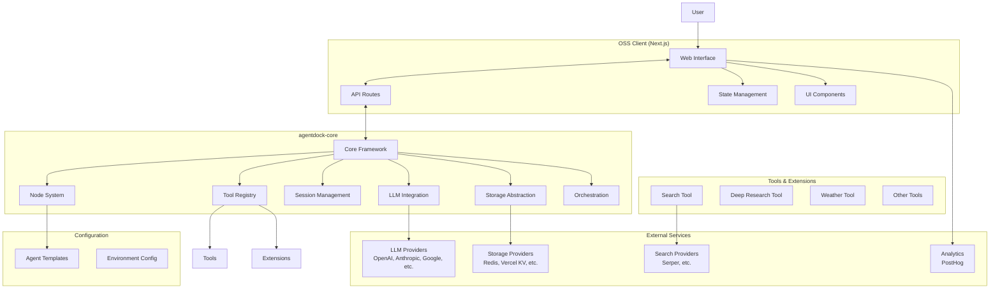
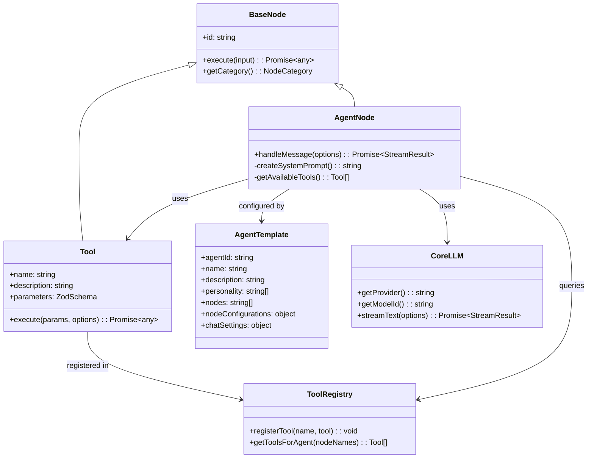
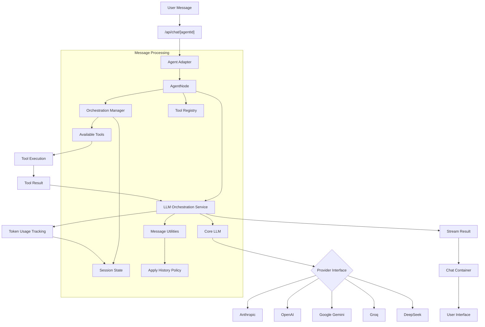
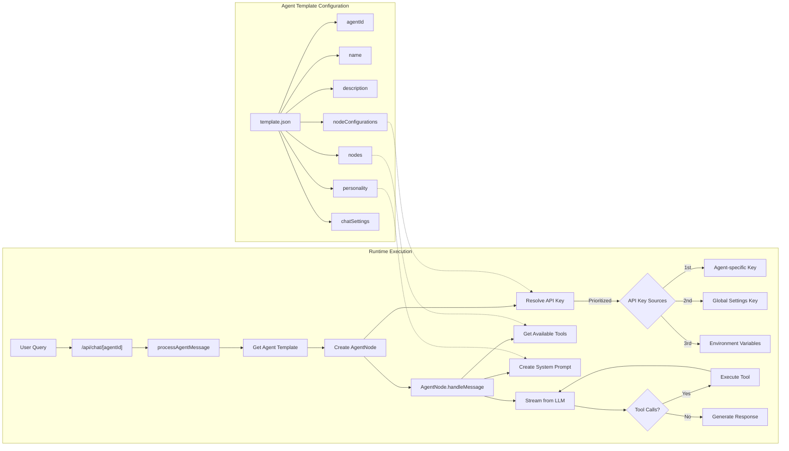

<!-- source: DeepWiki mcp.deepwiki.com · repo AgentDock/AgentDock · page 1 Overview · fetched 2026-10-26 -->

# Overview

<details>
<summary>Relevant source files</summary>

The following files were used as context for generating this wiki page:

- [.gitignore](.gitignore)
- [docs/i18n/README.md](docs/i18n/README.md)
- [docs/i18n/arabic/README.md](docs/i18n/arabic/README.md)
- [docs/i18n/chinese/README.md](docs/i18n/chinese/README.md)
- [docs/i18n/deutsch/README.md](docs/i18n/deutsch/README.md)
- [docs/i18n/dutch/README.md](docs/i18n/dutch/README.md)
- [docs/i18n/french/README.md](docs/i18n/french/README.md)
- [docs/i18n/greek/README.md](docs/i18n/greek/README.md)
- [package.json](package.json)
- [pnpm-lock.yaml](pnpm-lock.yaml)
- [scripts/generate-favicons.js](scripts/generate-favicons.js)

</details>


AgentDock is a framework for building AI agents with configurable determinism. This page provides a high-level overview of the AgentDock repository, explaining its architecture, core concepts, and key components. AgentDock consists of two main components: the **AgentDock Core** (a backend-focused framework) and an **Open Source Client** (a Next.js application serving as a reference implementation).

For detailed information about specific components, please refer to the respective sections in this wiki, such as [Node System](#2.1), [LLM Integration](#2.2), or [Agent Templates](#5.1).

## Repository Structure

The repository is organized into the following main components:

- **AgentDock Core**: Located in `agentdock-core/`, this is the core framework that provides agent functionality
- **Open Source Client**: A Next.js application that serves as a reference implementation and consumer of the core framework
- **Agent Templates**: Pre-configured agent configurations in the `agents/` directory

The repository uses TypeScript throughout and requires Node.js ≥ 20.11.0 and pnpm ≥ 9.15.0 for development.

Sources: [package.json:1-173](), [.gitignore:1-76]()

## High-Level Architecture

The following diagram illustrates the high-level architecture of AgentDock, showing how different components interact with each other:



Sources: [docs/i18n/arabic/README.md:11-127](), [docs/i18n/chinese/README.md:11-115]()

## Core Concepts

### Node-Based Architecture

AgentDock is built around a node-based architecture where all capabilities are implemented as nodes:



Sources: [docs/i18n/arabic/README.md:118-126](), [docs/i18n/chinese/README.md:119-127]()

### Configurable Determinism

A cornerstone of AgentDock's design philosophy is **configurable determinism**, which allows balancing creative AI capabilities with predictable system behavior:

- `AgentNode` components are inherently non-deterministic as LLMs can generate different responses each time
- Workflows can be made more deterministic through defined tool execution paths
- Developers can control the level of determinism by configuring which parts of the system use LLM inference
- Even with LLM components, overall system behavior remains predictable through structured tool interactions

This balanced approach enables both creativity and reliability in AI applications.

```mermaid
flowchart TD
    subgraph "Deterministic Workflows"
        DI["Input"] --> DP["Process"]
        DP --> DD["Database"]
        DP --> DO["Output"]
    end
    
    subgraph "Non-Deterministic Agent Behavior"
        NDI["User Query"] --> NDA["AgentNode"]
        NDA -->|"LLM Reasoning"| NDC["Tool Choice"]
        NDC -->|"Option A"| NDA1["Tool A"]
        NDC -->|"Option B"| NDA2["Tool B"]
        NDC -->|"Option C"| NDA3["Direct Response"]
        NDA1 --> NDR["Final Response"]
        NDA2 --> NDR
        NDA3 --> NDR
    end
    
    subgraph "Hybrid Approach"
        HI["User Query"] --> HA["AgentNode"]
        HA -->|"LLM Reasoning"| HC["Sub-Workflow Choice"]
        HC -->|"Decision A"| HF1["Deterministic Workflow 1"]
        HC -->|"Decision B"| HF2["Deterministic Workflow 2"]
        HC -->|"Decision C"| HDR["Generate Response"]
        
        HF1 -->|"Step 1→2→3→...→200"| HFR1["Workflow 1 Result"]
        HF2 -->|"Step 1→2→3→...→100"| HFR2["Workflow 2 Result"]
        
        HFR1 --> HR["Final Response"]
        HFR2 --> HR
        HDR --> HR
    end
```



Sources: [docs/i18n/arabic/README.md:29-115](), [docs/i18n/chinese/README.md:29-116]()

## Message Processing Pipeline

The following diagram illustrates how messages flow through the system, from user input to response:



Sources: [docs/i18n/arabic/README.md:238-257](), [docs/i18n/chinese/README.md:238-257]()

## Agent Configuration and Execution Flow

The following diagram shows how agent configurations drive the execution flow in AgentDock:



Sources: [docs/i18n/arabic/README.md:238-257](), [docs/i18n/chinese/README.md:238-257]()

## Key Components

### AgentDock Core

AgentDock Core is the foundation of the entire system, providing the following key components:

1. **Node System**: Base architecture where everything is a node
2. **LLM Integration**: Unified interface to different LLM providers (OpenAI, Anthropic, Google, etc.)
3. **Session Management**: Manages isolated state for conversations
4. **Tool Registry**: Centralized registry for all tools available to agents
5. **Storage Abstraction**: Flexible storage system with pluggable providers
6. **Orchestration**: Controls agent behavior and tool availability based on context

### Open Source Client

The Open Source Client is a Next.js application that serves as a reference implementation:

1. **Web Interface**: The frontend UI for interacting with agents
2. **API Routes**: Next.js API routes for handling requests to the core framework
3. **State Management**: Client-side state management using Zustand
4. **UI Components**: Reusable UI components built with Tailwind CSS and ShadCN/UI
5. **Chat Container**: Main component for managing chat interactions

### Environment Requirements

AgentDock requires:

- Node.js ≥ 20.11.0 (LTS)
- pnpm ≥ 9.15.0 for dependency management
- API keys for LLM providers (Anthropic, OpenAI, etc.)

Sources: [package.json:4-8](), [docs/i18n/arabic/README.md:134-137](), [docs/i18n/chinese/README.md:134-137]()

## API Key Resolution

AgentDock follows a priority order when resolving which API key to use:

1. **Agent-specific custom API key** (set via agent settings in the UI)
2. **Global settings API key** (set via the settings page in the UI)
3. **Environment variable** (from `.env.local` or deployment platform)

Required API keys include:

```
ANTHROPIC_API_KEY=sk-ant-xxxxxxx  # Anthropic API key
OPENAI_API_KEY=sk-xxxxxxx         # OpenAI API key
GEMINI_API_KEY=xxxxxxx            # Google Gemini API key
DEEPSEEK_API_KEY=xxxxxxx          # DeepSeek API key
GROQ_API_KEY=xxxxxxx              # Groq API key
```

Some tools also require their own API keys:

```
SERPER_API_KEY=                  # Required for search functionality
FIRECRAWL_API_KEY=               # Required for deeper web crawling
```

Sources: [docs/i18n/arabic/README.md:242-267](), [docs/i18n/chinese/README.md:242-267]()

## Further Reading

For more detailed information about specific components of AgentDock, please refer to the following sections:

- [Node System](#2.1) - Details about the node-based architecture
- [LLM Integration](#2.2) - How AgentDock integrates with various LLM providers
- [Orchestration System](#2.3) - The system that manages agent behavior and tool usage
- [Session Management](#2.4) - How sessions are managed to maintain state for conversations
- [Agent Templates](#5.1) - Details about pre-configured agent templates

---

