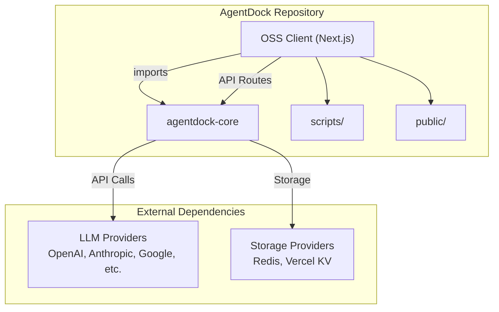
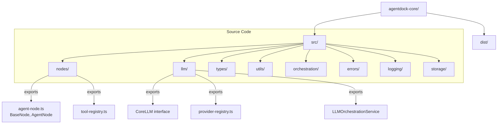
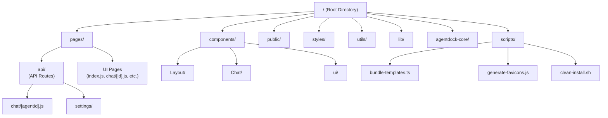
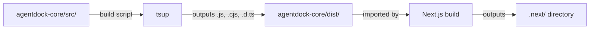
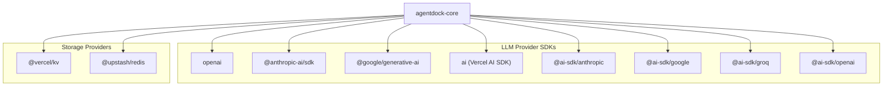
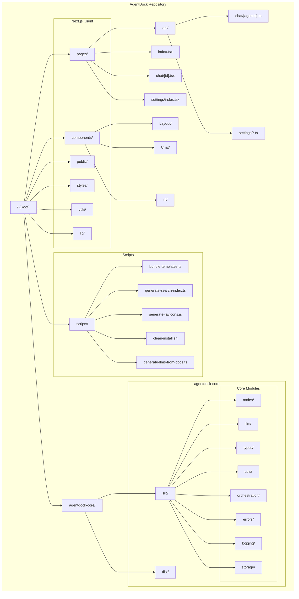

<!-- source: DeepWiki mcp.deepwiki.com · repo AgentDock/AgentDock · page 1.1 Project Structure · fetched 2026-10-26 -->

# Project Structure

Relevant source files

The following files were used as context for generating this wiki page:

- [.gitignore](.gitignore)
- [agentdock-core/package.json](agentdock-core/package.json)
- [agentdock-core/pnpm-lock.yaml](agentdock-core/pnpm-lock.yaml)
- [agentdock-core/src/nodes/agent-node.ts](agentdock-core/src/nodes/agent-node.ts)
- [agentdock-core/tsconfig.json](agentdock-core/tsconfig.json)
- [package.json](package.json)
- [pnpm-lock.yaml](pnpm-lock.yaml)
- [scripts/clean-install.sh](scripts/clean-install.sh)
- [scripts/generate-favicons.js](scripts/generate-favicons.js)

This page provides a comprehensive overview of the AgentDock repository structure, explaining the organization of its primary components and how they relate to each other. This page focuses on the physical structure of the codebase - for conceptual understanding of the architecture, see [Architecture](#2) and for key concepts, see [Key Concepts](#1.2).

## Repository Overview

AgentDock is organized as a monorepo containing two main components:

1. **AgentDock Core** (`agentdock-core/`): The core framework implemented as a TypeScript library containing the agent infrastructure, LLM integration, and orchestration systems.

2. **OSS Web Client** (root directory): A Next.js web application that provides a user interface for interacting with AgentDock agents.

Sources: [package.json:1-173](), [agentdock-core/package.json:1-36](), [.gitignore:1-75]()

## Core Framework Structure

The `agentdock-core` directory contains the central framework that powers AgentDock's agent capabilities. It is structured as a standalone TypeScript package with its own build process and dependencies.

### Directory Structure

Sources: [agentdock-core/package.json:1-36](), [agentdock-core/tsconfig.json:1-21](), [agentdock-core/src/nodes/agent-node.ts:1-455]()

### Key Modules

1. **Nodes System** (`src/nodes/`): Contains the base node implementation and specialized nodes like the AgentNode.

2. **LLM Integration** (`src/llm/`): Handles integration with various LLM providers like OpenAI, Anthropic, and Google.

3. **Types** (`src/types/`): Contains TypeScript type definitions used throughout the framework.

4. **Utils** (`src/utils/`): Utility functions for message handling, prompt generation, etc.

5. **Orchestration** (`src/orchestration/`): Manages the orchestration of agents and tools.

6. **Storage** (`src/storage/`): Abstraction layer for different storage providers.

## OSS Client Structure

The OSS Client is a Next.js application that provides the web interface for AgentDock. It imports and uses the `agentdock-core` library to power its agent functionality.

### Directory Structure

Sources: [package.json:1-173](), [scripts/generate-favicons.js:1-42](), [scripts/clean-install.sh:1-14]()

## Build System and Scripts

AgentDock uses a set of scripts to manage building, development, and deployment processes. These scripts are defined in the package.json files and some are located in the `scripts/` directory.

### Core Build Process

The `agentdock-core` library is built using `tsup`, which creates both ESM and CommonJS builds with TypeScript declarations. The build output is placed in the `agentdock-core/dist/` directory.

Sources: [agentdock-core/package.json:12-16](), [package.json:10-34]()

### Key Scripts

| Script Name | Purpose | Source File |
|-------------|---------|-------------|
| `build` | Builds both agentdock-core and Next.js client | [package.json:14]() |
| `dev` | Starts development server after building templates and core | [package.json:13]() |
| `bundle-templates` | Bundles agent templates for use by the application | [package.json:11]() |
| `generate-favicons` | Generates favicon files from SVG source | [scripts/generate-favicons.js:1-42]() |
| `generate-search-index` | Creates search index for documentation | [package.json:28]() |
| `clean-install` | Performs clean installation of dependencies | [scripts/clean-install.sh:1-14]() |
| `build:agentdock-core` | Builds only the core framework | [package.json:34]() |

## Dependency Management

AgentDock uses pnpm as its package manager as specified in the `package.json` engines field. The project has dependencies on various React components, UI libraries, and AI-related packages.

### Core Framework Dependencies

The core framework depends on several AI service providers:

Sources: [agentdock-core/package.json:18-28](), [agentdock-core/pnpm-lock.yaml:10-41]()

### Client Dependencies

The OSS Client has dependencies on UI components, routing, state management, and other front-end technologies:

- **UI Framework**: Next.js, React, and various Radix UI components
- **Styling**: Tailwind CSS and related plugins
- **State Management**: Zustand
- **API Integration**: Various utilities and helpers for API communication

## Scripts Directory

The `scripts/` directory contains utility scripts used during the build process and development workflow:

1. **bundle-templates.ts**: Bundles agent templates into a format usable by the application
2. **generate-search-index.ts**: Generates a search index for the documentation system
3. **generate-favicons.js**: Creates favicon files in various formats from an SVG source
4. **clean-install.sh**: Shell script for performing a clean installation of dependencies
5. **generate-llms-from-docs.ts**: Generates LLM configuration files from documentation

These scripts are executed as part of the build process or can be run manually as needed.

Sources: [package.json:10-34](), [scripts/generate-favicons.js:1-42](), [scripts/clean-install.sh:1-14]()

## Project Structure Visualization

The following diagram provides a comprehensive view of the AgentDock project structure, showing the relationship between different components:

Sources: [package.json:1-173](), [agentdock-core/package.json:1-36](), [agentdock-core/src/nodes/agent-node.ts:1-455](), [scripts/generate-favicons.js:1-42](), [scripts/clean-install.sh:1-14]()

---

