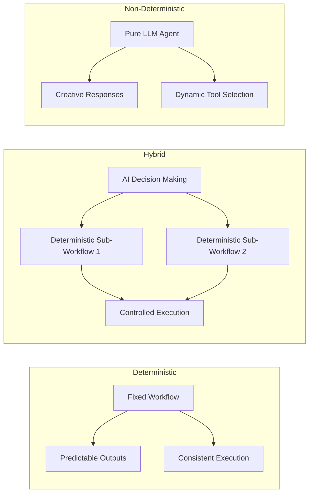
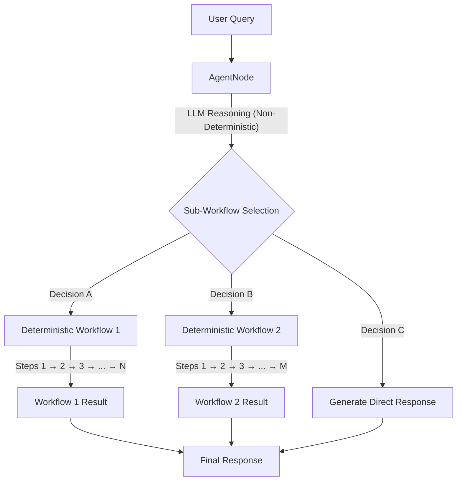
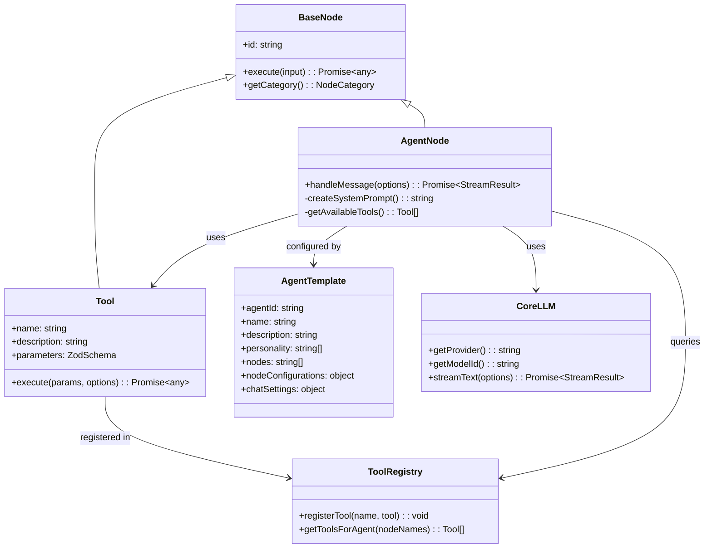
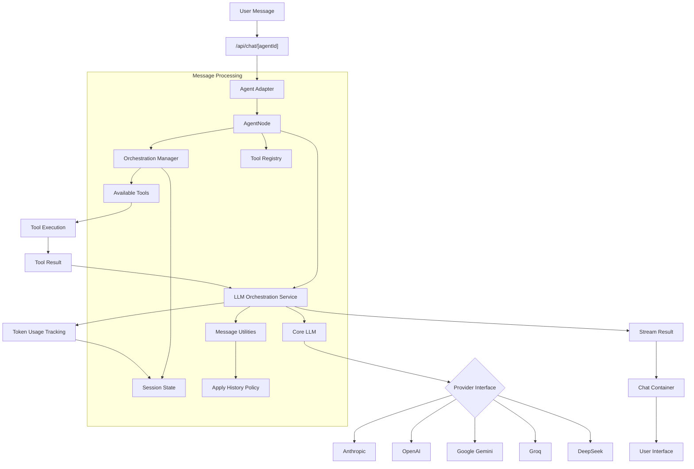
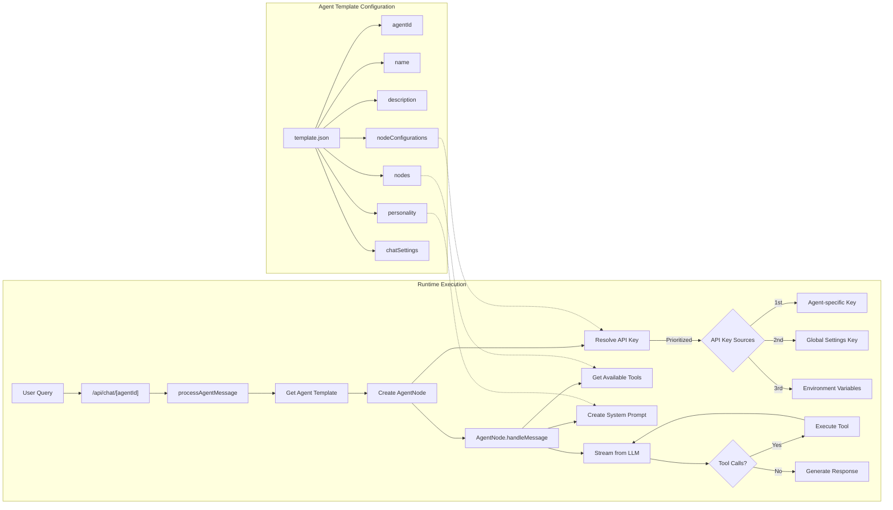
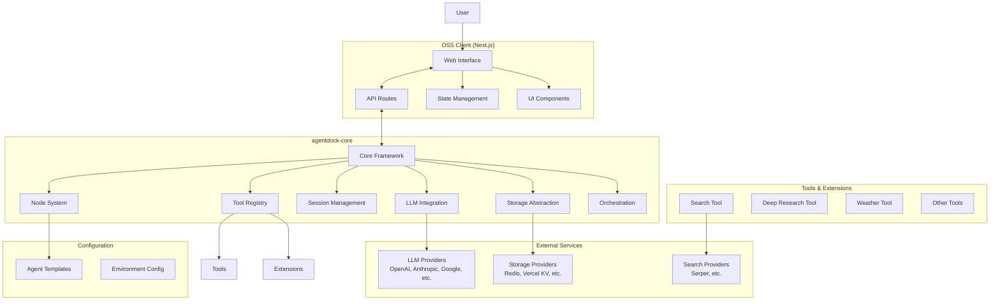

<!-- source: DeepWiki mcp.deepwiki.com · repo AgentDock/AgentDock · page 1.2 Key Concepts · fetched 2026-10-26 -->

# Key Concepts

Relevant source files

The following files were used as context for generating this wiki page:

- [docs/i18n/README.md](docs/i18n/README.md)
- [docs/i18n/arabic/README.md](docs/i18n/arabic/README.md)
- [docs/i18n/chinese/README.md](docs/i18n/chinese/README.md)
- [docs/i18n/deutsch/README.md](docs/i18n/deutsch/README.md)
- [docs/i18n/dutch/README.md](docs/i18n/dutch/README.md)
- [docs/i18n/french/README.md](docs/i18n/french/README.md)
- [docs/i18n/greek/README.md](docs/i18n/greek/README.md)
- [docs/i18n/italian/README.md](docs/i18n/italian/README.md)
- [docs/i18n/japanese/README.md](docs/i18n/japanese/README.md)
- [docs/i18n/korean/README.md](docs/i18n/korean/README.md)
- [docs/i18n/polish/README.md](docs/i18n/polish/README.md)
- [docs/i18n/russian/README.md](docs/i18n/russian/README.md)
- [docs/i18n/spanish/README.md](docs/i18n/spanish/README.md)

This document explains the foundational concepts of AgentDock, including configurable determinism, node-based architecture, and core system components. Understanding these key concepts is essential for developers who want to build and extend AI agents using the AgentDock framework. For implementation details, see [Architecture](#2).

## Configurable Determinism

AgentDock's design philosophy centers around the concept of **configurable determinism** - a balanced approach that gives developers control over the tradeoff between AI creativity and predictable behavior.

### The Determinism Spectrum

Sources: 
- docs/i18n/arabic/README.md
- docs/i18n/chinese/README.md
- docs/i18n/deutsch/README.md

AgentDock supports three main workflow paradigms:

1. **Deterministic Workflows**: Traditional workflow patterns with predictable execution paths and reliable results.

2. **Non-Deterministic Agent Behavior**: LLM-powered workflows with creative outputs that may vary, while maintaining structured interaction patterns.

3. **Hybrid Approach**: The AgentDock specialty - combining non-deterministic agent intelligence with deterministic sub-workflows for the best of both worlds.

### Hybrid Workflow Example

Sources:
- docs/i18n/arabic/README.md:79-107
- docs/i18n/chinese/README.md:84-107

This hybrid approach enables complex multi-step workflows to be invoked by intelligent agent decisions. Each workflow executes predictably despite being triggered by non-deterministic agent reasoning.

## Node-Based Architecture

AgentDock is built around a modular node-based system that serves as the foundation for all agent functionality. This architecture allows for flexibility and extensibility while maintaining structured interactions.

### Core Node Types

- **`BaseNode`**: The fundamental class that establishes the core interface and capabilities for all nodes
- **`AgentNode`**: A specialized node that orchestrates LLM interactions, tool usage, and agent logic
- **Tools**: Specialized nodes that implement specific capabilities

### Agent and Tool Relationship Model

Sources:
- High-Level System Architecture diagram from the input

The `AgentNode` stands at the center of the system, using configuration from `AgentTemplate` to determine its behavior. It interfaces with LLMs via `CoreLLM` and leverages tools registered in the `ToolRegistry` to perform specific tasks.

## LLM Integration and Message Processing

AgentDock provides a unified interface for interacting with different Large Language Model providers through its LLM orchestration system.

### LLM Integration and Message Processing Pipeline

Sources:
- LLM Integration and Message Processing Pipeline diagram from the input

The message processing pipeline shows how user messages flow through the system:
1. User message enters through the API route
2. Agent adapter processes the message and passes it to the appropriate AgentNode
3. The AgentNode uses LLM Orchestration, Tool Registry, and Orchestration Manager to handle the message
4. LLM Orchestration interacts with the appropriate LLM provider
5. Tool execution happens as needed based on the LLM's output
6. Results are streamed back to the user interface

## Agent Configuration and Execution Flow

AgentDock uses JSON templates to configure agents, providing a flexible way to define personality, available tools, and behavior.

### Agent Configuration and Execution Flow

Sources:
- Agent Configuration and Execution Flow diagram from the input

The flow shows:
1. Agent templates define the agent's identity and capabilities
2. At runtime, the API route processes the user query
3. The system fetches the appropriate template and creates an AgentNode
4. API keys are resolved from multiple possible sources
5. The AgentNode handles the message, getting available tools and creating a system prompt
6. The LLM processes the input and may call tools as needed
7. The final response is generated and sent back to the user

## Core System Components

AgentDock consists of several core components that work together to provide the framework's functionality:

### Component Overview

| Component | Description | Role |
|-----------|-------------|------|
| **Node System** | The foundation of all agent functionality | Provides the base architecture for all nodes |
| **LLM System** | Interfaces with various LLM providers | Handles LLM communication and response processing |
| **Tool Registry** | Manages available tools for agents | Registers and provides tools to agents |
| **Session Management** | Manages conversation state | Maintains isolated state for concurrent conversations |
| **Orchestration** | Controls agent behavior based on context | Manages tool availability and workflow execution |
| **Storage Abstraction** | Provides flexible storage options | Offers pluggable storage for various data types |

Sources:
- High-Level System Architecture diagram from the input

### High-Level System Architecture

Sources:
- High-Level System Architecture diagram from the input

The high-level architecture shows how all components interact:
1. The user interacts with the web interface
2. The OSS Client built with Next.js provides the user interface and API routes
3. The `agentdock-core` framework provides the foundation with node systems, LLM integration, session management, tools, storage, and orchestration
4. Tools extend the system's capabilities
5. External services provide LLM capabilities, storage, and search functionality

## Further Reading

- For more on the node system architecture, see [Node System](#2.1)
- For details on LLM integration, see [LLM Integration](#2.2)  
- For information about orchestration, see [Orchestration System](#2.3)
- For session management details, see [Session Management](#2.4)
- For storage capabilities, see [Storage Abstraction](#2.5)
- For agent templates, see [Agent Templates](#5.1)
- For creating custom tools, see [Custom Tools](#5.2)

---

