<!-- source: DeepWiki mcp.deepwiki.com · repo AgentDock/AgentDock · page 2 Architecture · fetched 2026-10-26 -->

# Architecture

Relevant source files

The following files were used as context for generating this wiki page:

- [agentdock-core/package.json](agentdock-core/package.json)
- [agentdock-core/pnpm-lock.yaml](agentdock-core/pnpm-lock.yaml)
- [agentdock-core/src/nodes/agent-node.ts](agentdock-core/src/nodes/agent-node.ts)
- [agentdock-core/tsconfig.json](agentdock-core/tsconfig.json)
- [docs/i18n/chinese/README.md](docs/i18n/chinese/README.md)
- [docs/i18n/dutch/README.md](docs/i18n/dutch/README.md)
- [docs/i18n/french/README.md](docs/i18n/french/README.md)
- [docs/i18n/greek/README.md](docs/i18n/greek/README.md)
- [scripts/clean-install.sh](scripts/clean-install.sh)

This document provides a comprehensive overview of the AgentDock system architecture, explaining the core components, their interactions, and the design principles that guide the system. For information about specific subsystems, refer to their dedicated pages: [Node System](#2.1), [LLM Integration](#2.2), [Orchestration System](#2.3), and [Session Management](#2.4).

## Core Design Philosophy

AgentDock's architecture is built around the concept of **configurable determinism**, allowing developers to balance AI creativity with predictable system behavior. The framework uses a modular, node-based design where all capabilities are implemented as nodes, with specialized nodes (tools) extending the system for agent capabilities.

Sources: [docs/i18n/chinese/README.md:28-37](), [docs/i18n/dutch/README.md:28-37]()

## High-Level System Overview

At a high level, AgentDock consists of two main components:

1. **AgentDock Core**: The backend framework that provides the foundation for building AI agents
2. **OSS Client**: A complete Next.js application that serves as a reference implementation

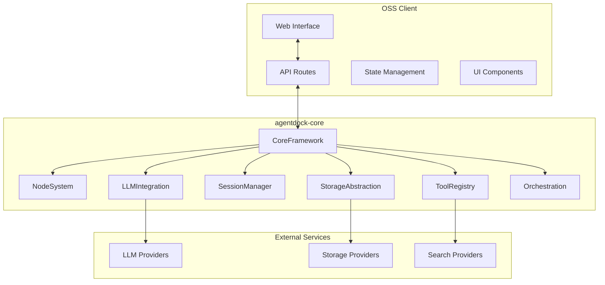

Sources: [agentdock-core/package.json:17-28](), [docs/i18n/chinese/README.md:118-126]()

## Core Framework Components

The AgentDock Core framework is built around a node-based architecture that provides the foundation for all agent functionality. The core components include:

### Node System

The Node System is the fundamental architecture of AgentDock, where all capabilities are implemented as nodes:

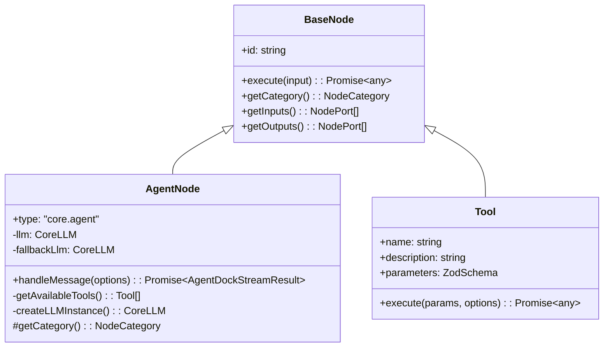

Sources: [agentdock-core/src/nodes/agent-node.ts:6-22](), [agentdock-core/src/nodes/agent-node.ts:96-127]()

### LLM Integration

The LLM Integration system manages interactions with various Large Language Model providers:

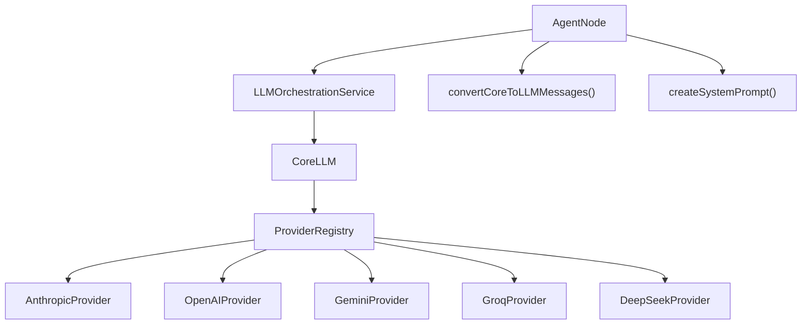

The LLM Integration system supports multiple providers through a unified interface, with automatic fallbacks and configurable settings.

Sources: [agentdock-core/src/nodes/agent-node.ts:148-224](), [agentdock-core/package.json:17-28]()

### Orchestration System

The Orchestration System controls agent behavior and tool availability based on conversation context:

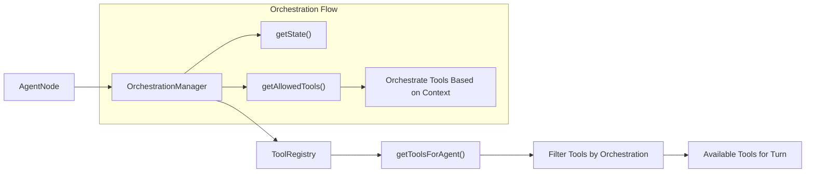

The Orchestration System ensures that agents have access to the right tools at the right time based on the conversation context and orchestration configuration.

Sources: [agentdock-core/src/nodes/agent-node.ts:230-258](), [docs/i18n/chinese/README.md:194-195]()

### Session Management

The Session Management system maintains isolated state for concurrent conversations:

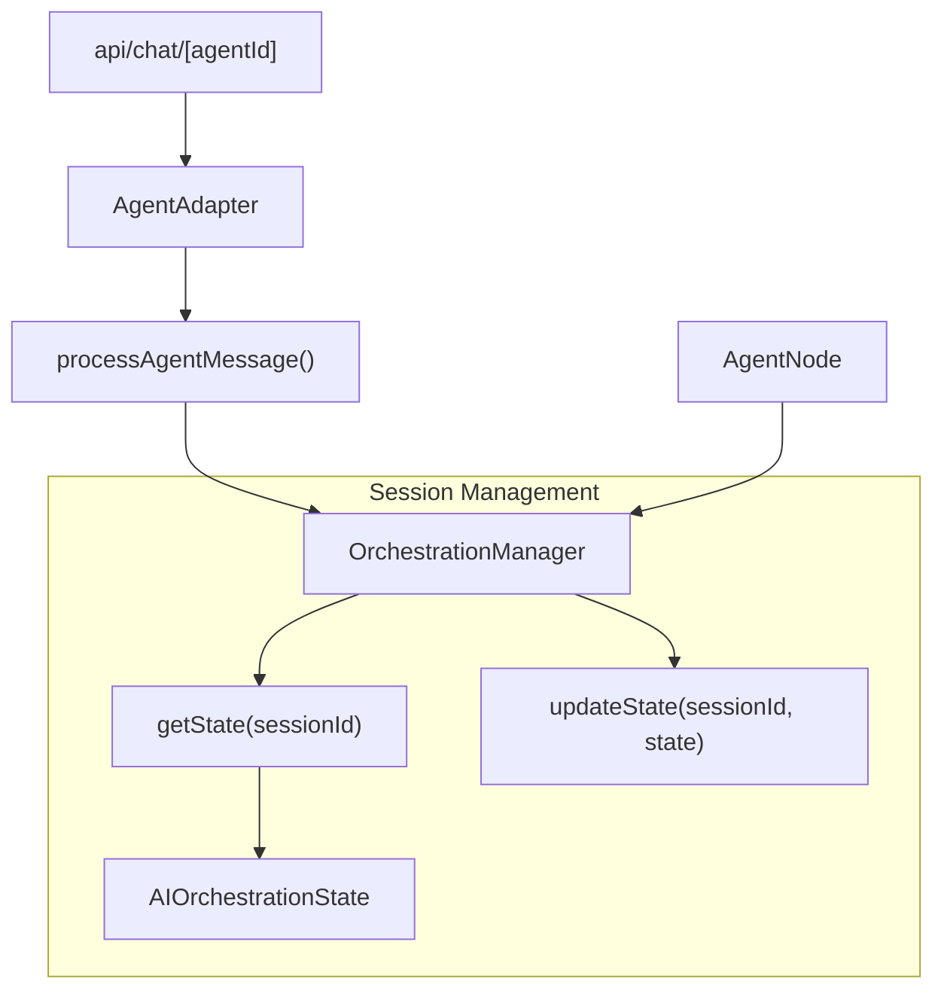

The Session Management system allows multiple concurrent conversations to maintain their own isolated state, ensuring that interactions don't interfere with each other.

Sources: [agentdock-core/src/nodes/agent-node.ts:272-326](), [docs/i18n/chinese/README.md:194-195]()

### Tool Registry

The Tool Registry manages the registration and discovery of tools for agents:

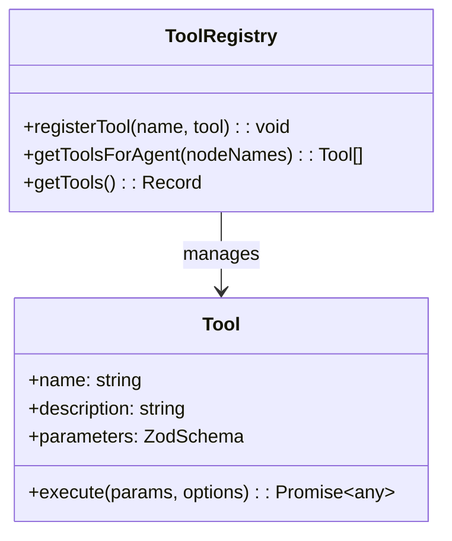

The Tool Registry is responsible for registering tools, making them available to agents, and managing tool lifecycles.

Sources: [agentdock-core/src/nodes/agent-node.ts:7-8](), [agentdock-core/src/nodes/agent-node.ts:230-258]()

### Storage Abstraction

The Storage Abstraction layer provides a unified interface for different storage providers:

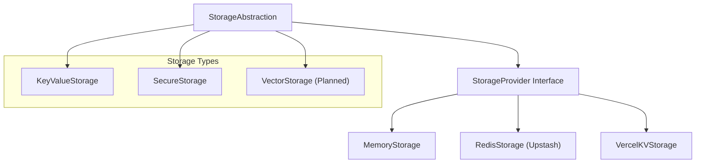

The Storage Abstraction layer supports different storage providers for various storage needs, making it easy to switch between providers without changing application code.

Sources: [agentdock-core/package.json:17-28](), [docs/i18n/chinese/README.md:196-197]()

## OSS Client Architecture

The OSS Client is a Next.js application that provides a reference implementation of a client for the AgentDock Core framework:

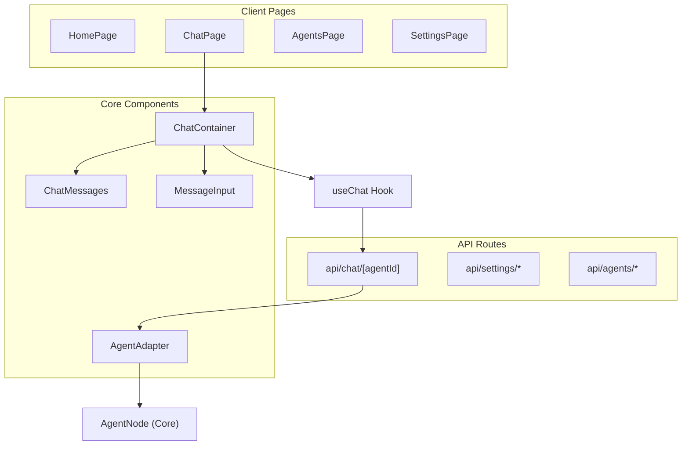

The OSS Client demonstrates how to integrate with the AgentDock Core framework, providing a complete user interface for interacting with AI agents.

Sources: [docs/i18n/chinese/README.md:212-216]()

## Message Processing Flow

The following diagram illustrates how a user message flows through the system:

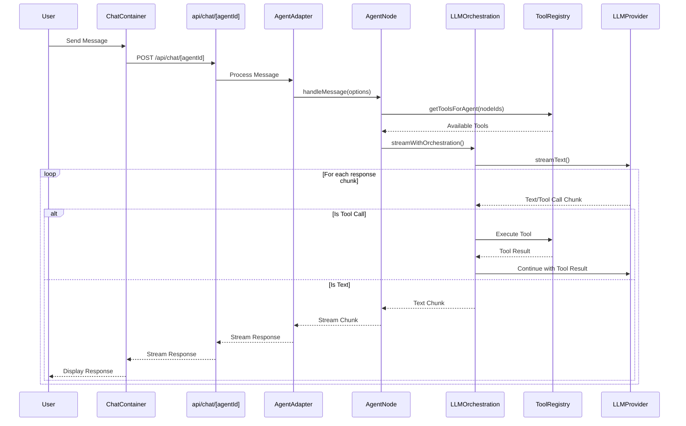

This diagram shows the complete flow of a user message through the system, from the user interface to the LLM provider and back, including tool execution.

Sources: [agentdock-core/src/nodes/agent-node.ts:272-403]()

## Agent Configuration and Execution Flow

AgentDock uses template-based configuration for agents, with the following execution flow:

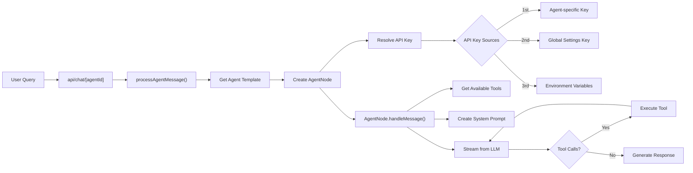

This diagram illustrates how an agent is configured and executed, from the initial user query to the final response, including API key resolution and tool execution.

Sources: [agentdock-core/src/nodes/agent-node.ts:272-403](), [docs/i18n/chinese/README.md:234-279]()

## Integration with External Services

AgentDock integrates with several external services:

| Service Type | Providers | Integration Point |
|--------------|-----------|-------------------|
| LLM Providers | Anthropic, OpenAI, Google Gemini, Groq, DeepSeek | LLM Integration System |
| Storage Providers | Upstash Redis, Vercel KV, Memory (in-process) | Storage Abstraction Layer |
| Search Providers | Serper, FireCrawl | Tool Registry (Search Tools) |
| Analytics | PostHog | OSS Client |

These integrations are managed through provider-specific adapters, allowing for easy switching between providers without changing application code.

Sources: [agentdock-core/package.json:17-28](), [docs/i18n/chinese/README.md:234-279]()

## Development Workflow

The development workflow for AgentDock uses pnpm as the package manager and follows a monorepo structure:

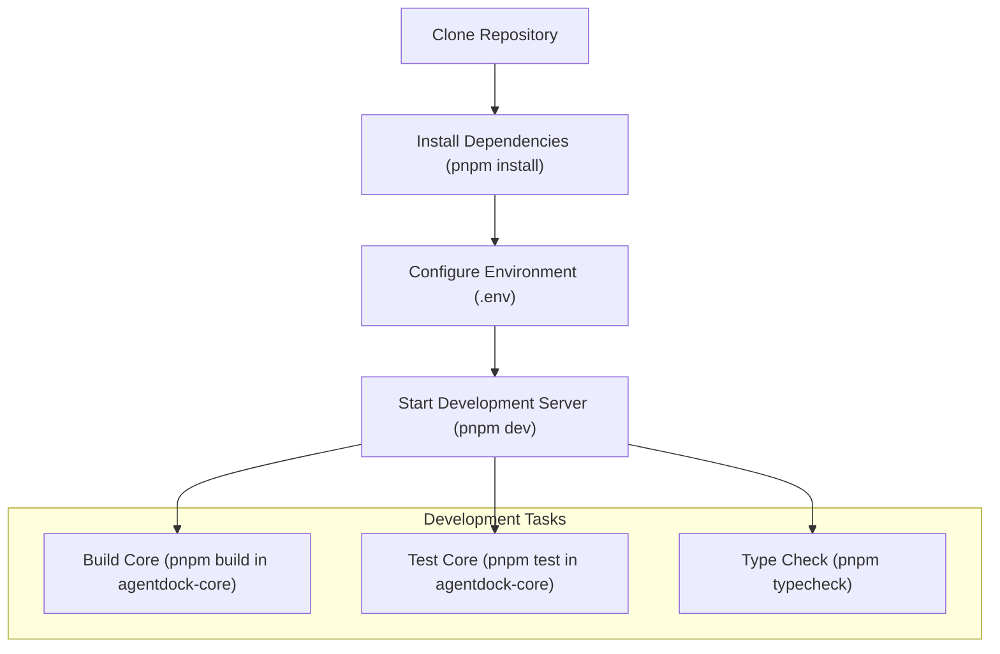

This diagram illustrates the development workflow for AgentDock, from cloning the repository to running development tasks.

Sources: [agentdock-core/package.json:12-15](), [scripts/clean-install.sh:1-14](), [agentdock-core/tsconfig.json:1-21]()

## Conclusion

The AgentDock architecture combines a powerful, node-based core framework with a flexible client implementation, allowing developers to build sophisticated AI agents with configurable determinism. The modular design, with clear separation of concerns between components, makes it easy to extend and customize the system for different use cases.

For more detailed information on specific components, refer to their dedicated wiki pages:
- [Node System](#2.1)
- [LLM Integration](#2.2)
- [Orchestration System](#2.3)
- [Session Management](#2.4)
- [Storage Abstraction](#2.5)

---

