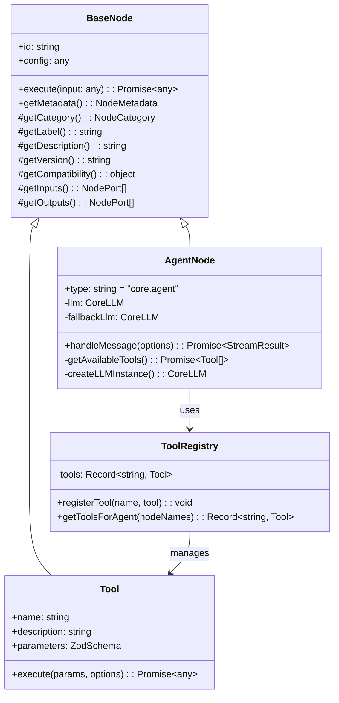
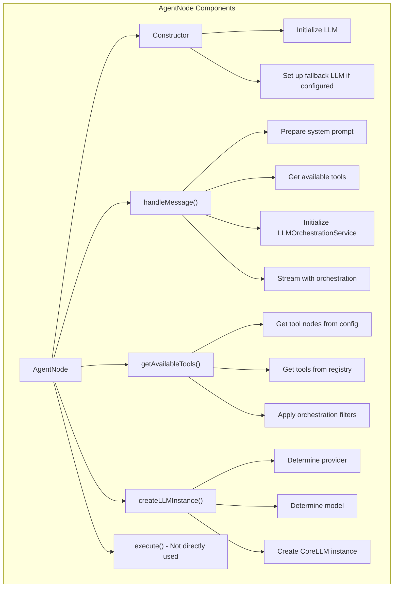
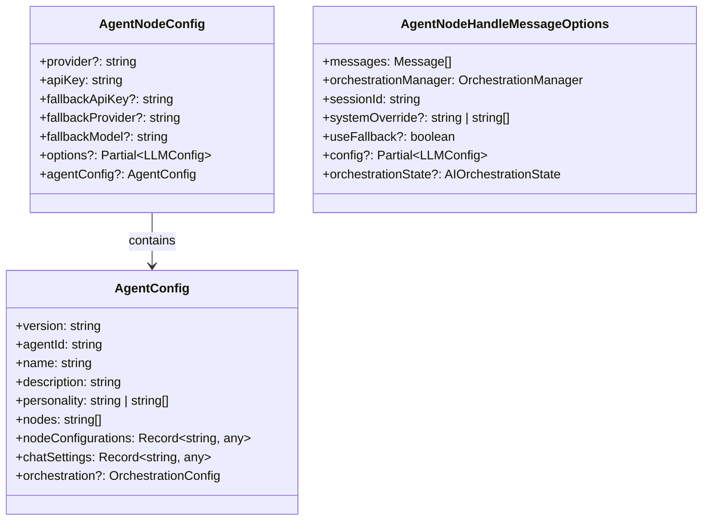
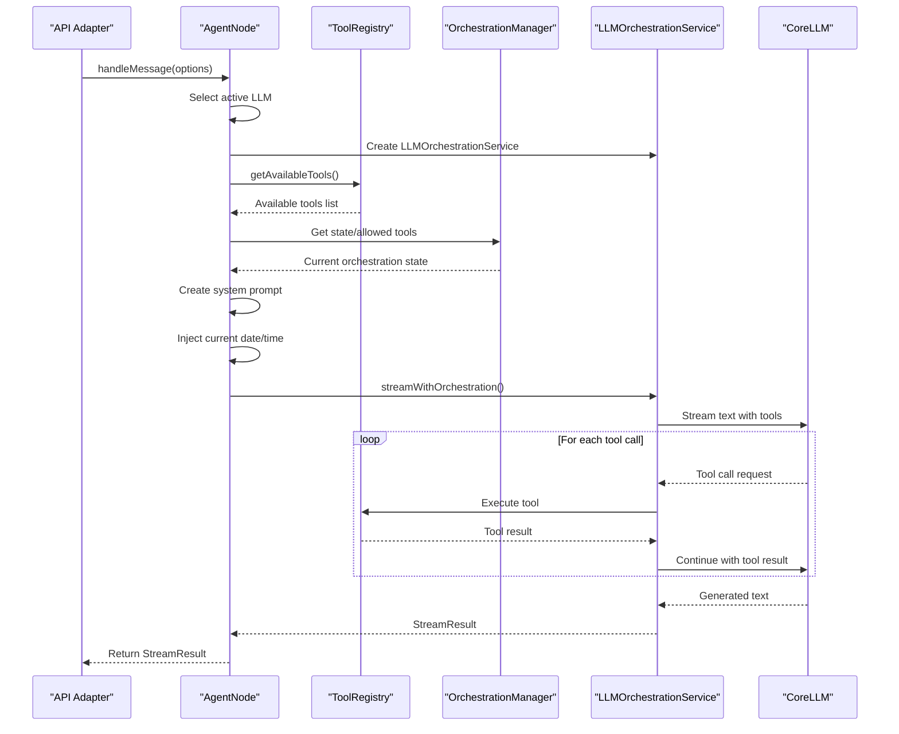
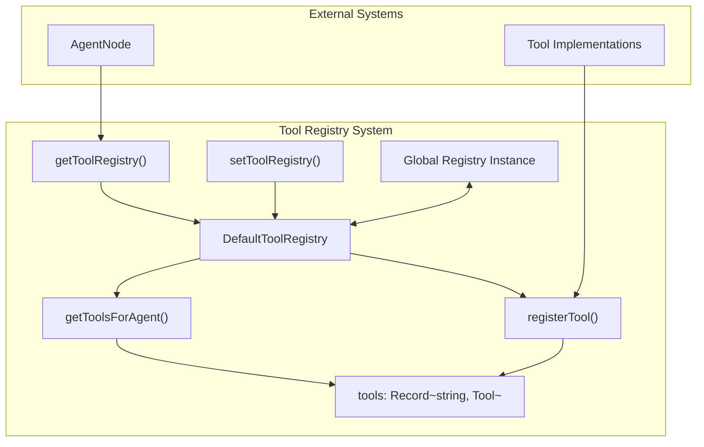
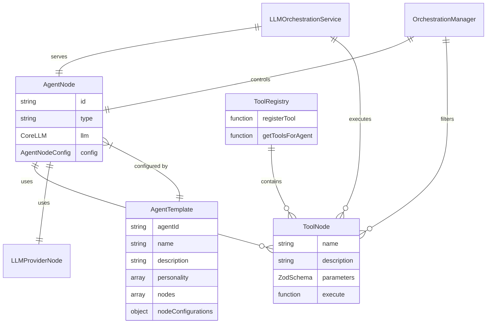

<!-- source: DeepWiki mcp.deepwiki.com · repo AgentDock/AgentDock · page 2.1 Node System · fetched 2026-10-26 -->

# Node System

<details>
<summary>Relevant source files</summary>

The following files were used as context for generating this wiki page:

- [agentdock-core/package.json](agentdock-core/package.json)
- [agentdock-core/pnpm-lock.yaml](agentdock-core/pnpm-lock.yaml)
- [agentdock-core/src/nodes/agent-node.ts](agentdock-core/src/nodes/agent-node.ts)
- [agentdock-core/src/nodes/tool-registry.ts](agentdock-core/src/nodes/tool-registry.ts)
- [agentdock-core/tsconfig.json](agentdock-core/tsconfig.json)
- [docs/analytics.md](docs/analytics.md)
- [scripts/clean-install.sh](scripts/clean-install.sh)
- [src/app/agents/all/page.tsx](src/app/agents/all/page.tsx)
- [src/app/agents/page.tsx](src/app/agents/page.tsx)
- [src/app/api/chat/[agentId]/__tests__/streaming.test.ts](src/app/api/chat/[agentId]/__tests__/streaming.test.ts)

</details>


This document explains the node-based architecture that forms the foundation of AgentDock. The Node System provides a unified abstraction for all components that can process data and perform actions within the framework, including agents and tools. For more specific information about individual agents, see [AgentNode](#3.1), and for details about the tool registry and implementation, see [Tool Registry](#3.2).

## Core Concepts

The Node System is built around a simple but powerful concept: every functional component in AgentDock is represented as a "node" with standard interfaces for configuration, execution, and metadata. This unified approach enables seamless composition of functionality and consistent patterns for extending the system.



Sources: [agentdock-core/src/nodes/agent-node.ts:96-455](), [agentdock-core/src/nodes/tool-registry.ts:11-116]()

### Node Types

Nodes in AgentDock are classified into different categories based on their functionality:

1. **Core Nodes** - Fundamental components of the system like `AgentNode`
2. **Tool Nodes** - Specialized components that provide external functionality (search, research, weather, etc.)
3. **LLM Provider Nodes** - Components that interface with language model providers (Anthropic, OpenAI, etc.)

Each node type adheres to the same base interface while providing specialized functionality for its domain.

## BaseNode Interface

All nodes in the system extend the `BaseNode` abstract class, which defines the standard interface that all nodes must implement. This ensures consistency and interoperability between different node types.

```mermaid
flowchart TD
    subgraph "BaseNode Interface"
        A["BaseNode"] --> B["execute(input: any)"]
        A --> C["getMetadata()"]
        C --> C1["getCategory()"]
        C --> C2["getLabel()"]
        C --> C3["getDescription()"]
        C --> C4["getVersion()"]
        C --> C5["getCompatibility()"]
        C --> C6["getInputs()"]
        C --> C7["getOutputs()"]
    end
    
    subgraph "Node Categories"
        D["NodeCategory"]
        D --> D1["CORE"]
        D --> D2["TOOL"]
        D --> D3["LLM_PROVIDER"]
        D --> D4["UTILITY"]
    end
    
    subgraph "Types"
        E["NodePort"] --> E1["id: string"]
        E --> E2["type: string"]
        E --> E3["label: string"]
        E --> E4["required: boolean"]
        
        F["NodeMetadata"] --> F1["category: NodeCategory"]
        F --> F2["label: string"]
        F --> F3["description: string"]
        F --> F4["version: string"]
        F --> F5["compatibility: object"]
        F --> F6["inputs: NodePort[]"]
        F --> F7["outputs: NodePort[]"]
    end
    
    A --- D
    C --- F
```



Sources: [agentdock-core/src/nodes/agent-node.ts:6-23](), [agentdock-core/src/nodes/agent-node.ts:406-454]()

The key components of the BaseNode interface include:

1. **Node Identity**:
   - `id`: A unique identifier for the node instance
   - `config`: Configuration specific to the node type

2. **Execution**:
   - `execute(input: any)`: The primary method for executing node functionality

3. **Metadata**:
   - `getMetadata()`: Returns comprehensive metadata about the node
   - Protected methods for specific metadata aspects:
     - `getCategory()`: The node's functional category
     - `getLabel()`: Display name
     - `getDescription()`: Detailed description
     - `getVersion()`: Version identifier
     - `getCompatibility()`: Environment compatibility info
     - `getInputs()`: Input port definitions
     - `getOutputs()`: Output port definitions

## AgentNode Implementation

`AgentNode` is a core implementation of the BaseNode interface that provides the main agent functionality within AgentDock. It handles message processing, tool selection, and LLM interaction.



Sources: [agentdock-core/src/nodes/agent-node.ts:96-103](), [agentdock-core/src/nodes/agent-node.ts:272-403](), [agentdock-core/src/nodes/agent-node.ts:154-224](), [agentdock-core/src/nodes/agent-node.ts:230-258]()

### AgentNode Configuration

The `AgentNode` requires specific configuration to operate properly:



Sources: [agentdock-core/src/nodes/agent-node.ts:32-50](), [agentdock-core/src/nodes/agent-node.ts:56-75]()

The configuration consists of:

1. **LLM Provider Settings**:
   - Primary and fallback provider configuration
   - API keys and model settings

2. **Agent-specific Configuration**:
   - Agent identity (ID, name, description)
   - Personality definition
   - Node references (tools, LLM providers)
   - Node-specific configurations
   - Orchestration settings

### Message Handling Flow

The primary function of `AgentNode` is to process messages and generate responses:



Sources: [agentdock-core/src/nodes/agent-node.ts:272-403]()

The flow involves:

1. **Initialization**:
   - Determining the active LLM (primary or fallback)
   - Creating an orchestration service

2. **Tool Preparation**:
   - Fetching available tools based on agent configuration
   - Filtering tools based on orchestration rules

3. **Prompt Creation**:
   - Building the system prompt from agent personality
   - Injecting dynamic state and current date/time information

4. **LLM Interaction**:
   - Streaming text from the LLM with tool calling capabilities
   - Handling tool execution and continuing the conversation

5. **Result Processing**:
   - Returning the stream result for the adapter to consume

## Tool Registry

The Tool Registry is a core component of the Node System that manages the registration and discovery of tools available to agents.



Sources: [agentdock-core/src/nodes/tool-registry.ts:11-116]()

### Key Features

1. **Singleton Pattern**:
   - Implemented as a global singleton accessible via `getToolRegistry()`
   - Can be customized via `setToolRegistry()`

2. **Registration Interface**:
   - `registerTool(name, tool)`: Registers a tool with a unique name
   - Each tool follows the BaseNode interface pattern

3. **Tool Discovery**:
   - `getToolsForAgent(nodeNames)`: Retrieves tools based on node names in agent configuration
   - Returns a filtered map of tools available to a specific agent

### Tool Registry Implementation

The DefaultToolRegistry implements the ToolRegistry interface:

```typescript
// Default implementation of tool registry
export class DefaultToolRegistry implements ToolRegistry {
  private tools: Record<string, any> = {};
  
  // Register a tool
  registerTool(name: string, tool: any): void {
    this.tools[name] = tool;
  }
  
  // Get tools for a specific agent based on node names
  getToolsForAgent(nodeNames: string[]): Record<string, any> {
    const result: Record<string, any> = {};
    nodeNames.forEach(name => {
      if (this.tools[name]) {
        // Make a copy of the tool and ensure its name matches its registry key
        const tool = { ...this.tools[name] };
        if (!tool.name || tool.name !== name) {
          tool.name = name;
        }
        result[name] = tool;
      }
    });
    return result;
  }
}
```

Sources: [agentdock-core/src/nodes/tool-registry.ts:26-83]()

## Node System Integration

The Node System is central to AgentDock's architecture, interconnecting with various other systems:

```mermaid
flowchart TD
    subgraph "Node System"
        A["BaseNode"] --> A1["AgentNode"]
        A --> A2["ToolNodes"]
        A --> A3["ProviderNodes"]
    end
    
    subgraph "LLM Integration"
        B["CoreLLM"] --> B1["ProviderRegistry"]
        B --> B2["LLMOrchestrationService"]
    end
    
    subgraph "Orchestration"
        C["OrchestrationManager"] --> C1["AIOrchestrationState"]
        C --> C2["OrchestrationConfig"]
    end
    
    subgraph "Session Management"
        D["SessionManager"] --> D1["SessionState"]
    end
    
    subgraph "External Integration"
        E["API Routes"] --> E1["/api/chat/[agentId]"]
        F["LLM Providers"] --> F1["Anthropic"]
        F --> F2["OpenAI"]
        F --> F3["Google"]
    end
    
    A1 <--> B2: "Uses for streaming"
    A1 <--> C: "Queries for state"
    A2 <--> A1: "Used by"
    E1 --> A1: "Creates/calls"
    B2 --> B: "Uses provider"
    B --> F: "Connects to"
    A1 --> D: "Uses session data"
```

Sources: [agentdock-core/src/nodes/agent-node.ts:8-23](), [agentdock-core/src/nodes/agent-node.ts:272-403]()

### Node System in the Request Flow

When a request comes in through the API, the Node System works as follows:

1. **API Route** (`/api/chat/[agentId]`):
   - Receives user message
   - Looks up agent template
   - Creates AgentNode instance

2. **AgentNode**:
   - Configures LLM based on agent settings
   - Gets available tools from ToolRegistry
   - Handles the message via LLMOrchestrationService

3. **Tool Execution**:
   - When LLM requests a tool, the corresponding Tool node executes
   - Tool results are returned to the LLM for further processing

4. **Response Generation**:
   - Final response is streamed back to the client
   - Token usage and other metrics are captured

## Node Relationships

The Node System establishes relationships between different components:



Sources: [agentdock-core/src/nodes/agent-node.ts:96-455](), [agentdock-core/src/nodes/tool-registry.ts:11-116]()

## Node Configuration

Nodes in AgentDock are configured through a combination of:

1. **Default Configuration** - Base settings provided by the node implementation
2. **Agent Template Configuration** - Settings from agent templates
3. **Runtime Configuration** - Overrides provided at execution time

This layered approach allows for flexibility while maintaining consistent behavior.

### Example Agent Template Configuration

```json
{
  "version": "1.0",
  "agentId": "example-agent",
  "name": "Example Agent",
  "description": "An example agent demonstrating node configuration",
  "personality": "I am a helpful assistant.",
  "nodes": ["llm.anthropic", "tools.search", "tools.weather"],
  "nodeConfigurations": {
    "llm.anthropic": {
      "model": "claude-3-opus-20240229",
      "temperature": 0.7,
      "maxTokens": 4096
    },
    "tools.search": {
      "provider": "serper",
      "maxResults": 5
    }
  },
  "chatSettings": {
    "historyLength": 20
  }
}
```

Sources: [src/app/api/chat/[agentId]/__tests__/streaming.test.ts:8-24]()

## Summary

The Node System provides a unified foundation for AgentDock's functionality:

1. **Abstraction** - Common interfaces for diverse components
2. **Extensibility** - Standard patterns for adding new capabilities
3. **Composition** - Ability to combine nodes into complex workflows
4. **Integration** - Seamless connection with other core systems

By implementing all functionality as nodes with standard interfaces, AgentDock achieves a flexible, maintainable, and extensible architecture that can adapt to various use cases and evolve over time.

---

