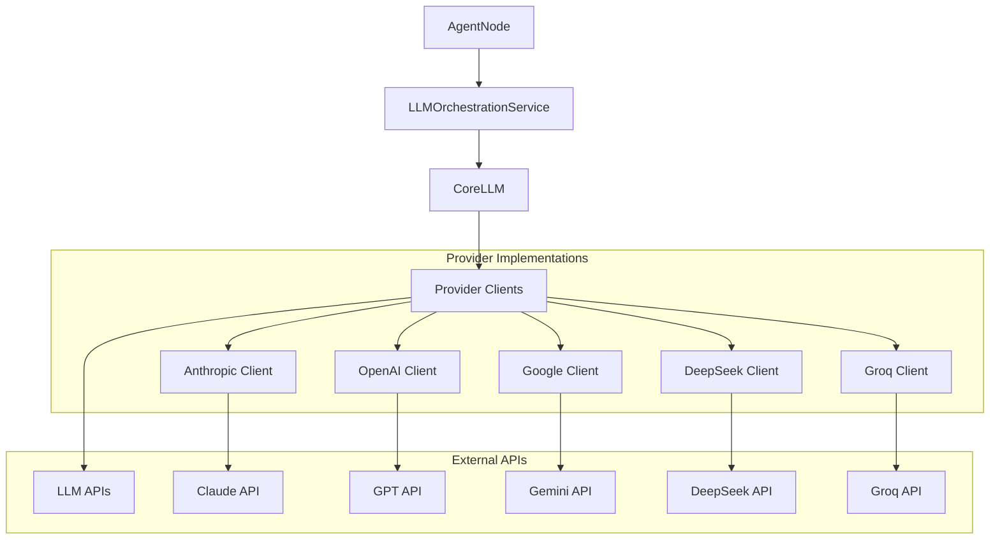
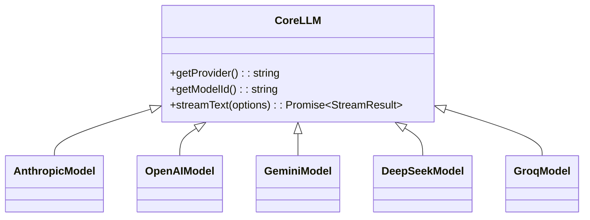
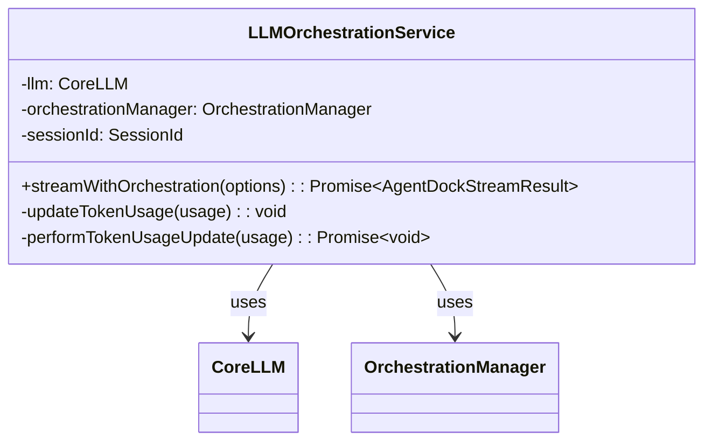
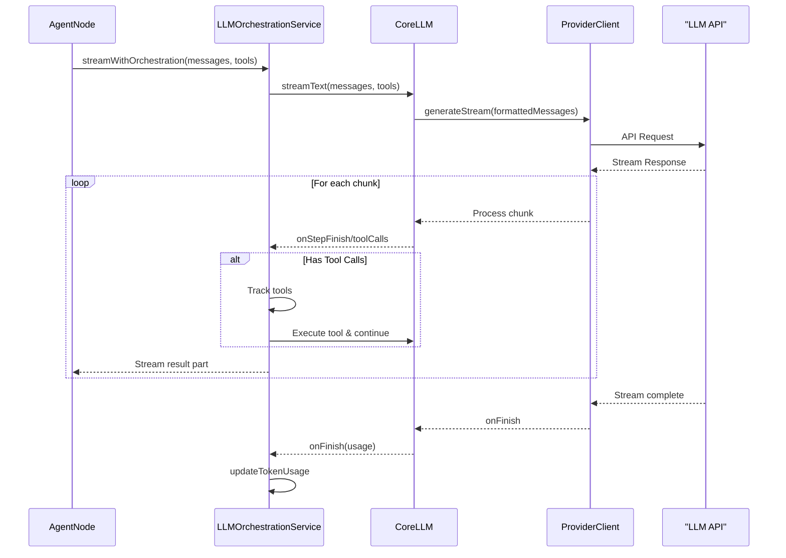
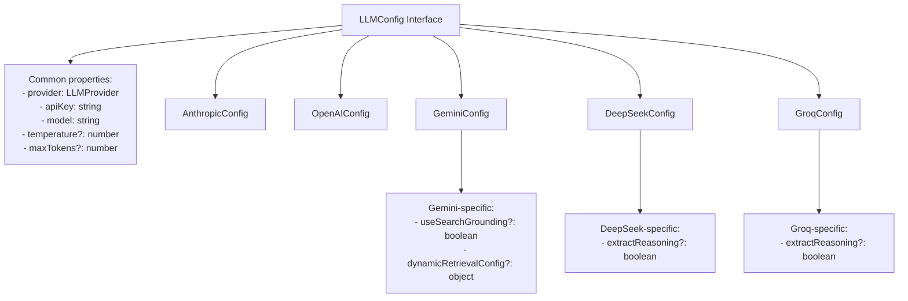
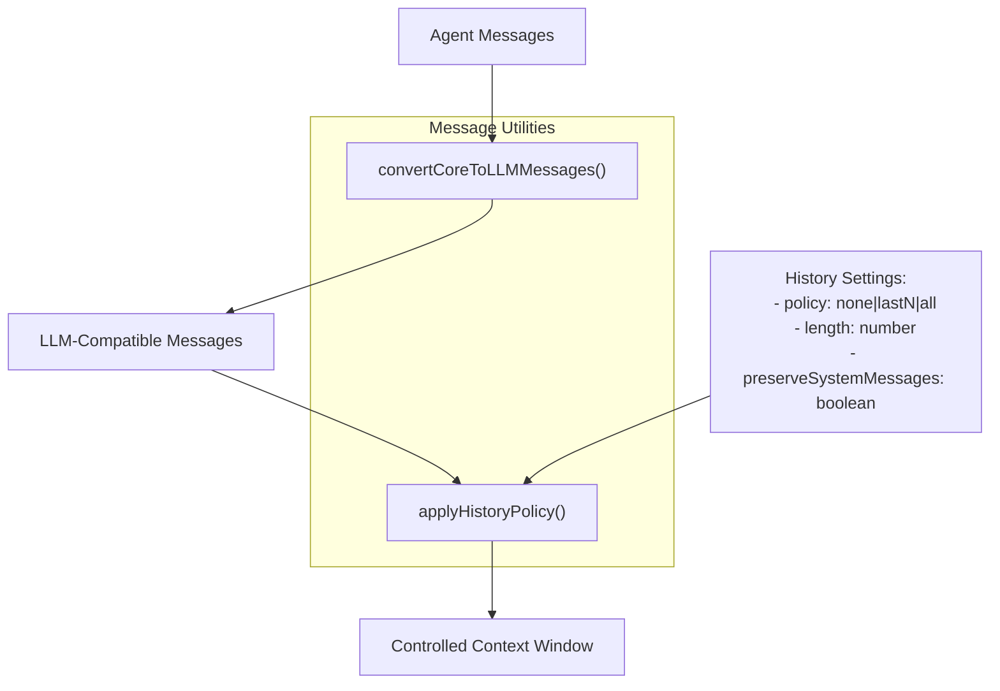
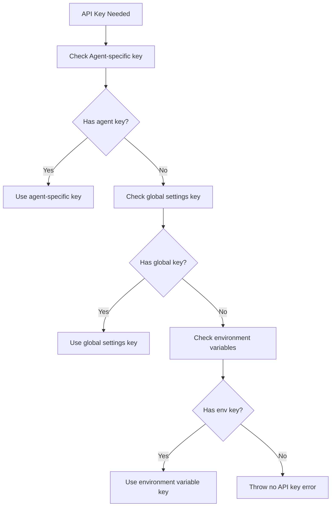
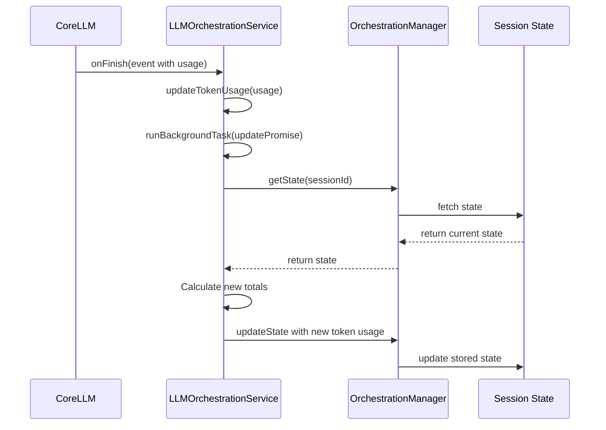
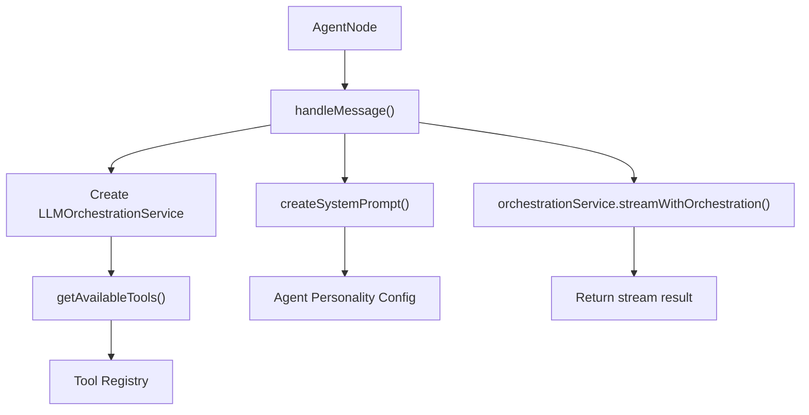
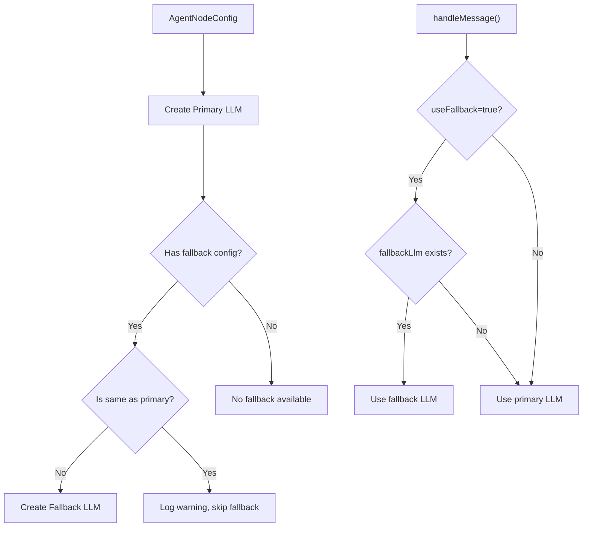

<!-- source: DeepWiki mcp.deepwiki.com · repo AgentDock/AgentDock · page 2.2 LLM Integration · fetched 2026-10-26 -->

# LLM Integration

<details>
<summary>Relevant source files</summary>

The following files were used as context for generating this wiki page:

- [.env.example](.env.example)
- [agentdock-core/package.json](agentdock-core/package.json)
- [agentdock-core/pnpm-lock.yaml](agentdock-core/pnpm-lock.yaml)
- [agentdock-core/src/llm/index.ts](agentdock-core/src/llm/index.ts)
- [agentdock-core/src/llm/llm-orchestration-service.ts](agentdock-core/src/llm/llm-orchestration-service.ts)
- [agentdock-core/src/llm/types.ts](agentdock-core/src/llm/types.ts)
- [agentdock-core/src/nodes/agent-node.ts](agentdock-core/src/nodes/agent-node.ts)
- [agentdock-core/src/types/index.ts](agentdock-core/src/types/index.ts)
- [agentdock-core/src/utils/message-utils.ts](agentdock-core/src/utils/message-utils.ts)
- [agentdock-core/tsconfig.json](agentdock-core/tsconfig.json)
- [scripts/clean-install.sh](scripts/clean-install.sh)

</details>


## Purpose and Scope

The LLM Integration module provides a unified interface for AgentDock to interact with various Large Language Model providers. It abstracts provider-specific implementations, handles API key management, streamlines message processing, and provides robust streaming response handling with tool calling capabilities.

This module is a core component that bridges agents with different LLM services including OpenAI, Anthropic Claude, Google Gemini, DeepSeek, and Groq. For information about how LLMs integrate with the overall orchestration system, see [Orchestration System](#2.3).

## Provider Architecture

The LLM integration in AgentDock follows a layered architecture pattern that abstracts provider-specific implementations behind a unified interface.



Sources: [agentdock-core/package.json:18-28](), [agentdock-core/src/llm/types.ts:18-19]()

## Core Components

### CoreLLM

The `CoreLLM` class provides the central abstraction that unifies interfaces to different LLM providers:



Sources: [agentdock-core/src/llm/index.ts:42-48]()

### LLMOrchestrationService

The `LLMOrchestrationService` manages interactions between AgentNode and the underlying LLM providers:



Key responsibilities of the `LLMOrchestrationService`:

1. **Streaming with orchestration**: Enhances CoreLLM streaming with tool tracking and token usage monitoring
2. **Tool context injection**: Provides LLM context to tools during execution
3. **Token usage tracking**: Updates session state with token consumption statistics
4. **Background tasks**: Uses Vercel's waitUntil when available for non-blocking operations

Sources: [agentdock-core/src/llm/llm-orchestration-service.ts:122-356]()

## Message Processing Flow



Sources: [agentdock-core/src/llm/llm-orchestration-service.ts:137-303](), [agentdock-core/src/nodes/agent-node.ts:272-397]()

## Provider Support

AgentDock supports multiple LLM providers through typed configurations:



Sources: [agentdock-core/src/llm/types.ts:18-127]()

The LLM provider types are defined in `agentdock-core/src/llm/types.ts`:

```typescript
export type LLMProvider = 'anthropic' | 'openai' | 'gemini' | 'deepseek' | 'groq';
```

Each provider implementation handles:
- API authentication
- Request formatting
- Response parsing
- Error handling

Sources: [agentdock-core/src/llm/types.ts:18]()

## Message Utilities

The message utilities handle conversational context and formatting:



The `applyHistoryPolicy` function manages conversation context by implementing three policies:
- `none`: Only system messages are retained
- `all`: All messages are retained
- `lastN`: System messages plus the last N user-assistant exchanges are retained

Sources: [agentdock-core/src/utils/message-utils.ts:26-158]()

## API Key Management

API keys are resolved in a prioritized order defined in the environment configuration:



Sources: [.env.example:50-57](), [agentdock-core/src/nodes/agent-node.ts:96-146]()

The environment variables for API keys are defined in `.env.example`:

```
# LLM PROVIDER API KEYS
# These will be used as fallbacks if no custom key is set in settings
# Used in priority order: 1) Agent-specific custom key, 2) Global settings key, 3) Environment variable

ANTHROPIC_API_KEY=              # Anthropic API key (starts with sk-ant-)
OPENAI_API_KEY=                 # OpenAI API key (starts with sk-)
GEMINI_API_KEY=                 # Google Gemini API key
DEEPSEEK_API_KEY=               # DeepSeek API key
GROQ_API_KEY=                   # Groq API key
```

Sources: [.env.example:48-57]()

## Token Usage Tracking

Token usage is tracked through the LLMOrchestrationService:



Sources: [agentdock-core/src/llm/llm-orchestration-service.ts:309-355]()

Token usage information is structured as:

```typescript
interface TokenUsage {
  promptTokens: number;
  completionTokens: number;
  totalTokens: number;
  provider?: string;
}
```

Sources: [agentdock-core/src/llm/types.ts:8-13]()

## Integration with AgentNode

The `AgentNode` class integrates with the LLM system through its `handleMessage` method:



Sources: [agentdock-core/src/nodes/agent-node.ts:272-397]()

The `handleMessage` method is responsible for:

1. Creating an `LLMOrchestrationService` instance
2. Fetching available tools from the Tool Registry
3. Creating a system prompt with agent personality
4. Injecting current date/time information into the system prompt
5. Calling the orchestration service and returning the stream result

A notable feature is the date/time injection, ensuring agents always have access to the current time:

```typescript
// Inject current date and time information into the system prompt
const now = new Date();
const dateTimeInfo = `
Current date: ${now.toLocaleDateString('en-US', { weekday: 'long', year: 'numeric', month: 'long', day: 'numeric' })}
Current time: ${now.toLocaleTimeString('en-US', { hour: '2-digit', minute: '2-digit', timeZoneName: 'short' })}
Current timezone: ${Intl.DateTimeFormat().resolvedOptions().timeZone}
ISO timestamp: ${now.toISOString()}`;
finalSystemPrompt = `${finalSystemPrompt}\n\n${dateTimeInfo}`;
```

Sources: [agentdock-core/src/nodes/agent-node.ts:354-361]()

## Fallback Mechanism

AgentDock supports LLM fallback mechanisms for increased reliability. When configured, the system can automatically switch to a backup provider or model:



Sources: [agentdock-core/src/nodes/agent-node.ts:128-146](), [agentdock-core/src/nodes/agent-node.ts:285-289]()

## Configuration Options

The LLM integration system can be configured through environment variables:

| Variable | Purpose | Description |
|----------|---------|-------------|
| ANTHROPIC_API_KEY | Anthropic Claude API key | Fallback API key for Anthropic models |
| OPENAI_API_KEY | OpenAI API key | Fallback API key for OpenAI models |
| GEMINI_API_KEY | Google Gemini API key | Fallback API key for Google models |
| DEEPSEEK_API_KEY | DeepSeek API key | Fallback API key for DeepSeek models |
| GROQ_API_KEY | Groq API key | Fallback API key for Groq models |
| NEXT_PUBLIC_DEFAULT_HISTORY_POLICY | Message history policy | Controls history retention (none, lastN, all) |
| NEXT_PUBLIC_DEFAULT_HISTORY_LENGTH | History length | Number of user messages to retain |

Sources: [.env.example:53-67]()

## Summary

The LLM Integration module in AgentDock provides a flexible, extensible architecture for interacting with multiple LLM providers. By abstracting provider-specific details and implementing robust fallback mechanisms, it ensures reliable agent operations across different LLM services. The integration handles token tracking, tool execution, and message history management, making it a central component in the AgentDock framework.

Sources: [agentdock-core/src/llm/llm-orchestration-service.ts](), [agentdock-core/src/nodes/agent-node.ts](), [agentdock-core/src/llm/types.ts](), [agentdock-core/src/utils/message-utils.ts]()

---

