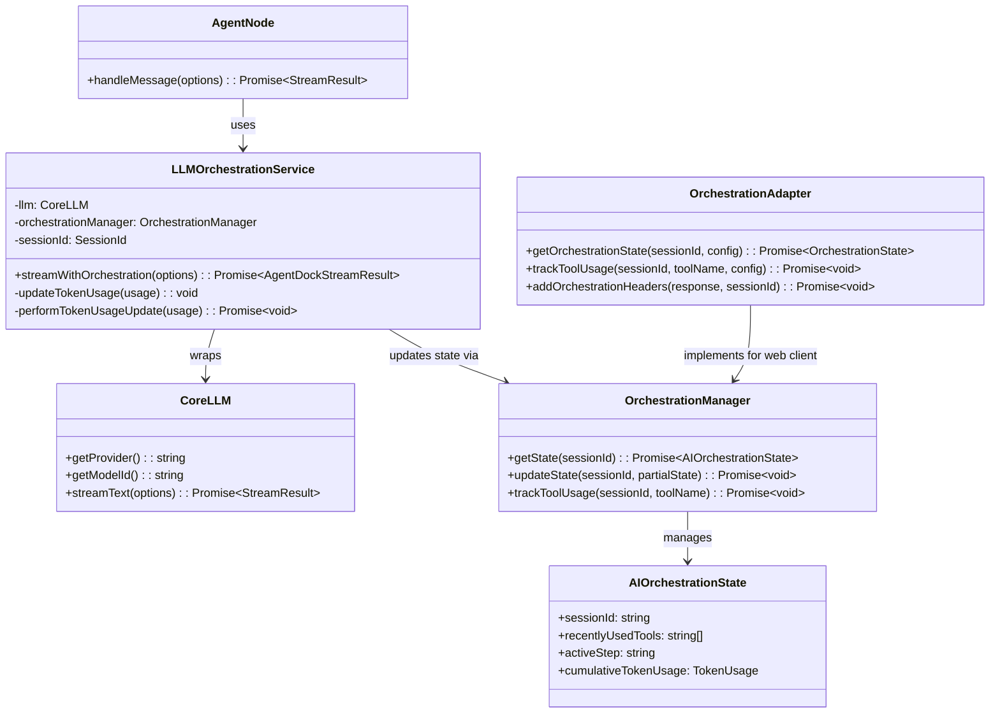
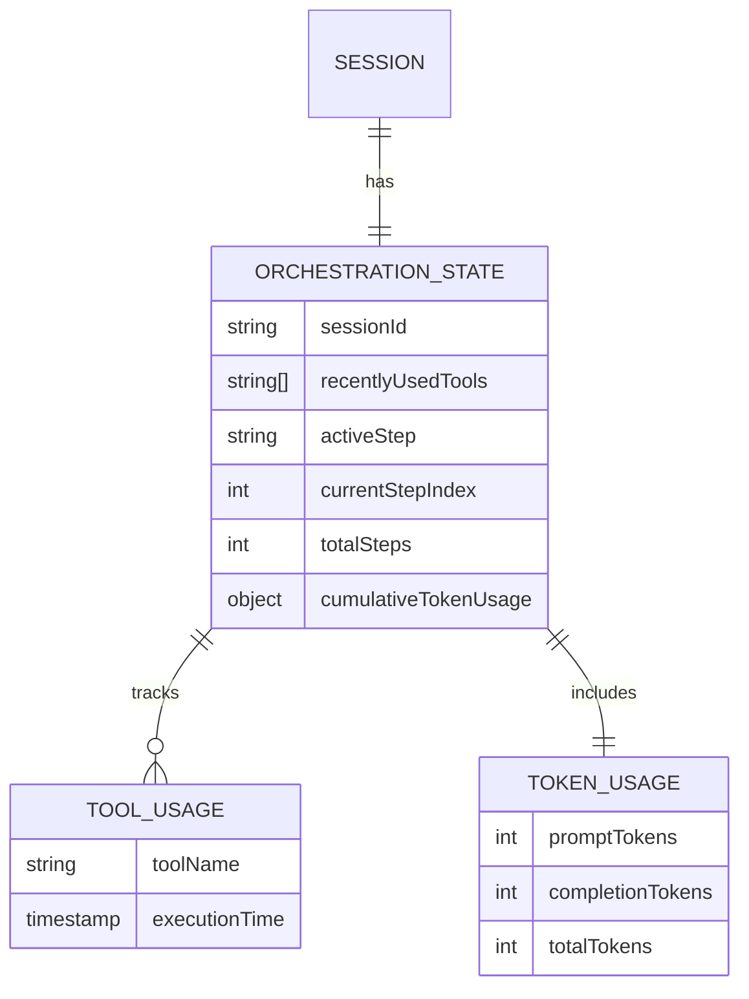
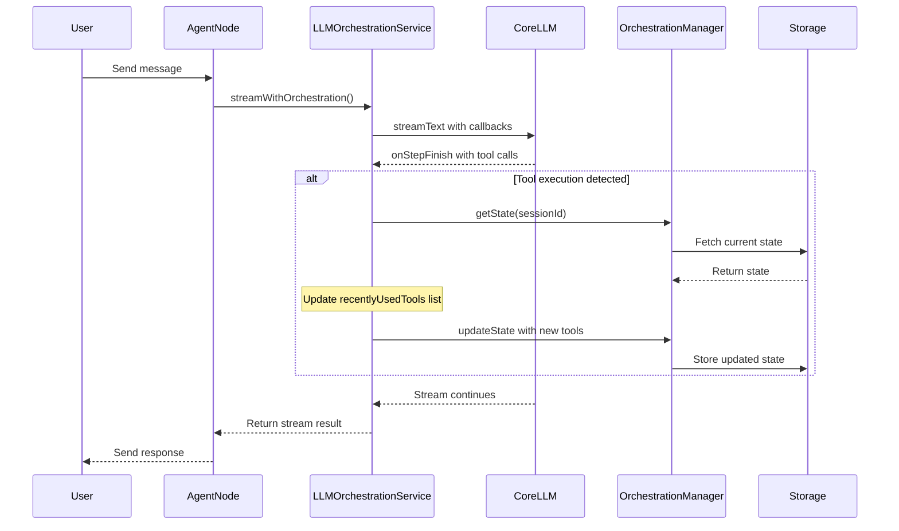
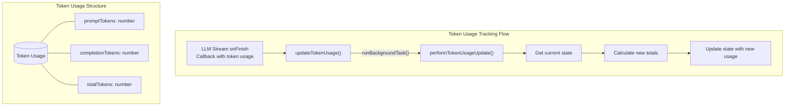
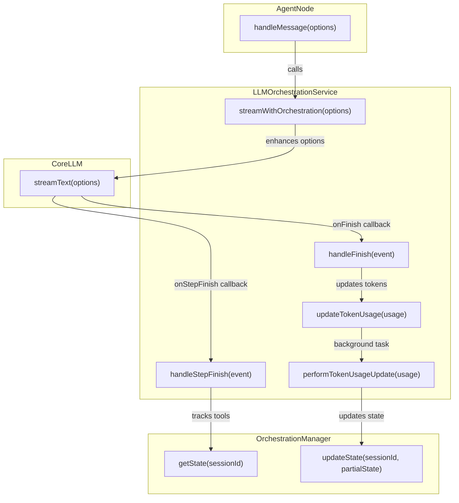
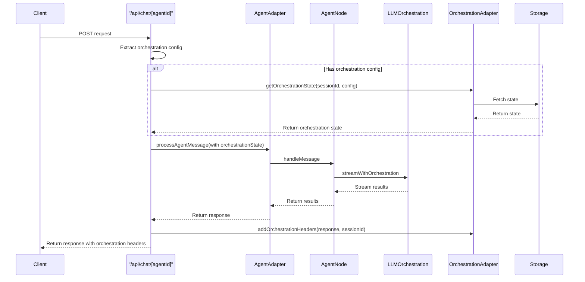
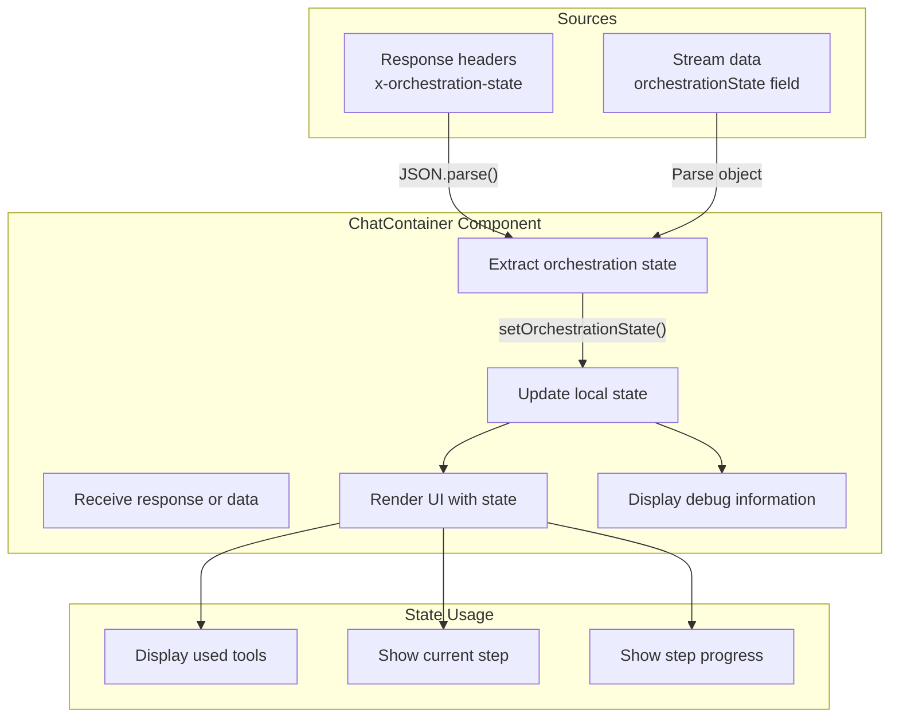
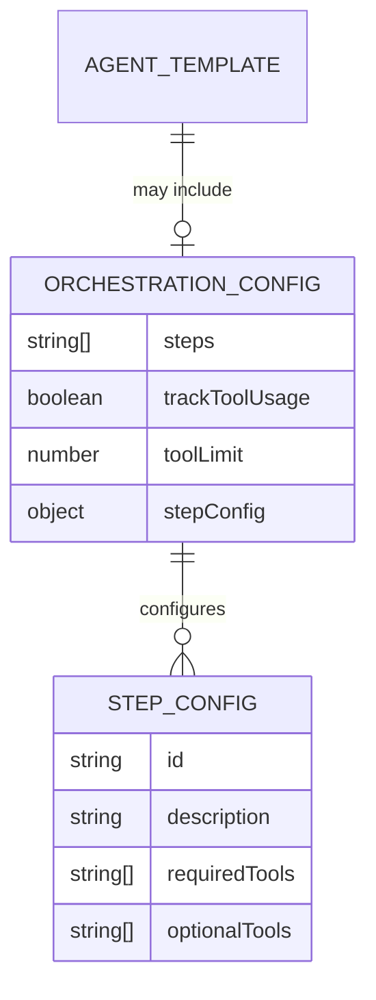

<!-- source: DeepWiki mcp.deepwiki.com · repo AgentDock/AgentDock · page 2.3 Orchestration System · fetched 2026-10-26 -->

# Orchestration System

Relevant source files

The following files were used as context for generating this wiki page:

- [.env.example](.env.example)
- [agentdock-core/src/llm/llm-orchestration-service.ts](agentdock-core/src/llm/llm-orchestration-service.ts)
- [src/app/api/chat/[agentId]/route.ts](src/app/api/chat/[agentId]/route.ts)
- [src/components/chat/chat-container.tsx](src/components/chat/chat-container.tsx)
- [src/components/chat/chat-status.tsx](src/components/chat/chat-status.tsx)
- [src/hooks/use-session-info.ts](src/hooks/use-session-info.ts)

The Orchestration System in AgentDock is a core subsystem that manages the workflow of agent interactions, tool execution, token usage tracking, and session state management. It serves as a critical bridge between the Agent Nodes, LLM integrations, and the tools ecosystem, enabling controlled and deterministic agent behavior.

For information about the Node System that forms the foundation of AgentDock's architecture, see [Node System](#2.1). For details on how sessions are managed to maintain state for conversations, see [Session Management](#2.4).

## 1. Orchestration Architecture

The Orchestration System consists of several interrelated components that work together to manage the flow of information and execution within the AgentDock framework.

The Orchestration System consists of two main components:

1. **OrchestrationManager**: Core component that maintains and updates the AI orchestration state for each session.
2. **LLMOrchestrationService**: Service that bridges AgentNode and CoreLLM, injecting orchestration logic during LLM streaming.

Sources: [agentdock-core/src/llm/llm-orchestration-service.ts:122-356](), [src/lib/orchestration-adapter.ts]()

## 2. Orchestration State

The orchestration state is a central concept in the system, tracking various aspects of an agent's execution context.

The `AIOrchestrationState` interface defines the structure of the orchestration state:

| Property | Type | Description |
|----------|------|-------------|
| sessionId | string | Unique identifier for the conversation session |
| recentlyUsedTools | string[] | Array of tool names that have been used in the session |
| activeStep | string | Current step in a multi-step orchestration workflow |
| currentStepIndex | number | Index of the current step (optional) |
| totalSteps | number | Total number of steps in the orchestration (optional) |
| cumulativeTokenUsage | object | Tracking of token usage throughout the session |

Sources: [src/components/chat/chat-container.tsx:38-45](), [agentdock-core/src/llm/llm-orchestration-service.ts:9]()

## 3. Tool Usage Tracking

One of the primary functions of the Orchestration System is to track tool usage during a conversation session. This information is used to guide agent behavior and provide context for subsequent responses.

The tool tracking process occurs in several places:

1. **During LLM Streaming**: When a tool call is detected in the `onStepFinish` callback, the orchestration service updates the `recentlyUsedTools` array in the session state.

2. **During Direct Tool Execution**: API routes track tool usage through the `trackToolUsage` function when tools are directly executed.

Sources: [agentdock-core/src/llm/llm-orchestration-service.ts:176-242](), [src/app/api/chat/[agentId]/route.ts:269-386]()

## 4. Token Usage Tracking

The Orchestration System tracks token usage throughout a conversation to monitor resource consumption and potentially enforce limits.

Token usage tracking follows this process:

1. The LLM stream's `onFinish` callback receives token usage information
2. `updateTokenUsage()` is called, which uses `runBackgroundTask()` to ensure updates complete even after streaming ends
3. `performTokenUsageUpdate()` gets the current state, calculates new totals, and updates the state

The token usage is tracked using the following structure:

| Property | Type | Description |
|----------|------|-------------|
| promptTokens | number | Tokens used in the prompt (input) |
| completionTokens | number | Tokens used in the completion (output) |
| totalTokens | number | Total tokens used (prompt + completion) |

Sources: [agentdock-core/src/llm/llm-orchestration-service.ts:147-154](), [agentdock-core/src/llm/llm-orchestration-service.ts:309-354]()

## 5. LLM Orchestration Service

The `LLMOrchestrationService` is the central component that connects the Agent Node with the underlying LLM providers, while injecting orchestration logic.

The main functionalities of the LLM Orchestration Service include:

1. **Streaming with Orchestration**: The `streamWithOrchestration` method wraps CoreLLM's `streamText` method, enhancing it with orchestration-related callbacks.

2. **Tool Tracking**: The service captures tool calls in the `handleStepFinish` callback and updates the orchestration state accordingly.

3. **Token Usage Tracking**: The service tracks token usage in the `handleFinish` callback and updates the cumulative token counts.

4. **Background Task Management**: For production environments, especially on Vercel, the service uses `waitUntil` for efficient background task execution.

Sources: [agentdock-core/src/llm/llm-orchestration-service.ts:137-302]()

## 6. Integration with API Routes

The Orchestration System integrates with API routes to provide a seamless experience for clients.

The API route handler performs several orchestration-related tasks:

1. **State Initialization**: For agents with orchestration configurations, it initializes the orchestration state.

2. **State Forwarding**: Passes the orchestration state to the agent for processing.

3. **Header Addition**: Adds orchestration state headers to the response for client consumption.

4. **Tool Usage Tracking**: For direct tool execution, tracks the tool usage in the orchestration state.

Sources: [src/app/api/chat/[agentId]/route.ts:558-608](), [src/app/api/chat/[agentId]/route.ts:269-386]()

## 7. Client-Side Integration

The client-side UI components interact with the Orchestration System through response headers and streaming data.

The `ChatContainer` component handles orchestration state in several ways:

1. **State Extraction**: Extracts orchestration state from both response headers and streaming data.

2. **State Management**: Maintains a local state representation of the orchestration information.

3. **Debugging**: When debug mode is enabled, displays orchestration information in a debug panel.

4. **State Persistence**: Saves the orchestration state (including session ID) for continuity between sessions.

Sources: [src/components/chat/chat-container.tsx:130-488](), [src/hooks/use-session-info.ts:1-101]()

## 8. Configuring Orchestration

Agent templates can include orchestration configurations that define the behavior of the orchestration system for that agent.

The orchestration configuration is part of the agent template and can include:

1. **Steps Definition**: A sequence of steps the agent should follow.
2. **Tool Usage Configuration**: Settings for tracking and limiting tool usage.
3. **Step-specific Settings**: Configurations for individual steps, including required and optional tools.

When an orchestration configuration is present in an agent template, the API route initializes the orchestration state and passes it to the agent for processing.

Sources: [src/app/api/chat/[agentId]/route.ts:558-608]()

## 9. Environment Configuration

The orchestration system can be configured through environment variables to optimize its behavior in different execution environments.

| Environment Variable | Purpose | Default |
|---------------------|---------|---------|
| AGENTDOCK_EXECUTION_ENV | Identifies the execution environment (vercel, local) | local |
| SESSION_TTL_SECONDS | Time-to-live for session data in seconds | 86400 (24 hours) |

The `AGENTDOCK_EXECUTION_ENV` variable helps the orchestration system determine whether Vercel-specific features like `waitUntil` are available for background task execution.

Sources: [.env.example:94-96](), [agentdock-core/src/llm/llm-orchestration-service.ts:25-42]()

## Conclusion

The Orchestration System is a critical component of AgentDock that enables controlled and deterministic agent behavior by managing workflow, tracking tool usage, monitoring token consumption, and maintaining session state. By bridging the gap between agent nodes, LLM providers, and tools, it ensures a coherent and predictable agent experience.

---

