<!-- source: DeepWiki mcp.deepwiki.com · repo AgentDock/AgentDock · page 2.4 Session Management · fetched 2026-10-26 -->

# Session Management

<details>
<summary>Relevant source files</summary>

The following files were used as context for generating this wiki page:

- [src/app/api/chat/[agentId]/route.ts](src/app/api/chat/[agentId]/route.ts)
- [src/components/chat/chat-container.tsx](src/components/chat/chat-container.tsx)
- [src/components/chat/chat-status.tsx](src/components/chat/chat-status.tsx)
- [src/components/layout/site-sidebar.tsx](src/components/layout/site-sidebar.tsx)
- [src/hooks/use-session-info.ts](src/hooks/use-session-info.ts)

</details>


## Introduction

Session management in AgentDock handles the persistence and state tracking of conversations between users and AI agents. It enables continuity across interactions by maintaining message history, orchestration state, and token usage metrics.

This system bridges the UI components and the agent processing backend, enabling stateful interactions with agents while supporting features like workflow orchestration and tool execution tracking.

For information about how the orchestration system uses session state to control agent behavior, see [Orchestration System](#2.3).

Sources:
- [src/app/api/chat/[agentId]/route.ts:536-538]()
- [src/components/chat/chat-container.tsx:130-133]()

## Session Lifecycle

Sessions in AgentDock follow a well-defined lifecycle from creation through usage to persistence:

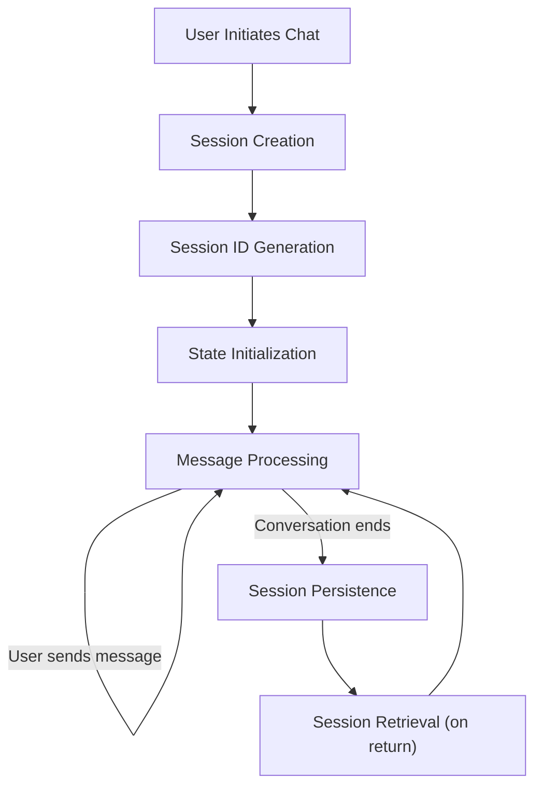

Title: Session Lifecycle Flow

Sources:
- [src/app/api/chat/[agentId]/route.ts:536-538]()
- [src/components/chat/chat-container.tsx:103-106]()
- [src/components/chat/chat-container.tsx:353-375]()

## Session Identification

### Session ID Generation

When a user starts a conversation, the system either uses a client-provided session ID or generates a new one. Session IDs follow this format:

```
session-{agentId}-{timestamp}-{random UUID}
```

The session ID generation happens in the Chat API route:

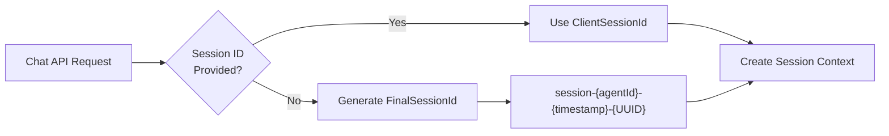

Title: Session ID Generation Process

Sources:
- [src/app/api/chat/[agentId]/route.ts:536-538]()

### Session Headers

Session information is exchanged between client and server using HTTP headers:

| Header | Description | Code Reference |
|--------|-------------|----------------|
| `x-session-id` | Contains the session ID | [chat-container.tsx:175]() |
| `x-orchestration-state` | JSON-encoded orchestration state | [route.ts:255-257]() |
| `x-token-usage` | Token usage metrics | [route.ts:209-217]() |

These headers enable stateful communication within a stateless HTTP environment.

Sources:
- [src/app/api/chat/[agentId]/route.ts:222-228]()
- [src/app/api/chat/[agentId]/route.ts:255-257]()
- [src/components/chat/chat-container.tsx:174-175]()

## Session State Components

A session in AgentDock contains several types of state information:

### Session Data Structure

```mermaid
classDiagram
    class "Session" {
        sessionId: string
        messages: Message[]
        orchestrationState: OrchestrationState
        tokenUsage: TokenUsage
    }
    
    class "OrchestrationState" {
        sessionId: string
        recentlyUsedTools: string[]
        activeStep: string
        currentStepIndex: number
        totalSteps: number
    }
    
    class "TokenUsage" {
        promptTokens: number
        completionTokens: number
        totalTokens: number
        provider: string
    }
    
    class "Message" {
        id: string
        role: string
        content: string
        createdAt: number
    }
    
    "Session" *-- "OrchestrationState"
    "Session" *-- "TokenUsage"
    "Session" o-- "Message"
```

Title: Session Data Structure

Sources:
- [src/components/chat/chat-container.tsx:38-44]()
- [src/components/chat/chat-container.tsx:142-147]()
- [src/hooks/use-session-info.ts:5-15]()

### Orchestration State

Orchestration state tracks the agent's progress through its workflow:

```typescript
interface OrchestrationState {
  sessionId: string;
  recentlyUsedTools: string[];
  activeStep?: string;
  currentStepIndex?: number;
  totalSteps?: number;
}
```

This state allows agents to follow predefined workflows and track progress through multi-step sequences.

Sources:
- [src/components/chat/chat-container.tsx:38-44]()
- [src/app/api/chat/[agentId]/route.ts:560-596]()

### Token Usage Tracking

AgentDock tracks token usage within sessions:

```typescript
interface SessionTokenUsage {
  promptTokens: number;
  completionTokens: number;
  totalTokens: number;
  provider?: string;
}
```

Token usage is recorded after each LLM interaction and passed to the client through headers or stream data.

Sources:
- [src/app/api/chat/[agentId]/route.ts:209-217]()
- [src/components/chat/chat-container.tsx:142-147]()
- [src/components/chat/chat-container.tsx:234-242]()
- [src/hooks/use-session-info.ts:5-15]()

### Message History Management

Sessions include the complete conversation history. AgentDock applies history policies to manage message length:

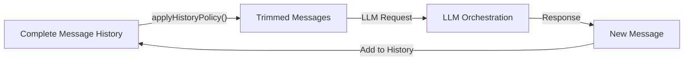

Title: Message History Trimming Process

History policies prevent conversation contexts from growing too large while preserving important interactions.

Sources:
- [src/components/chat/chat-container.tsx:149-152]()
- [src/components/chat/chat-container.tsx:186-202]()

## Session Persistence

AgentDock persists sessions to enable conversations to continue across page reloads or when users return later.

### Client-Side Storage

Session data is stored in the client's localStorage:

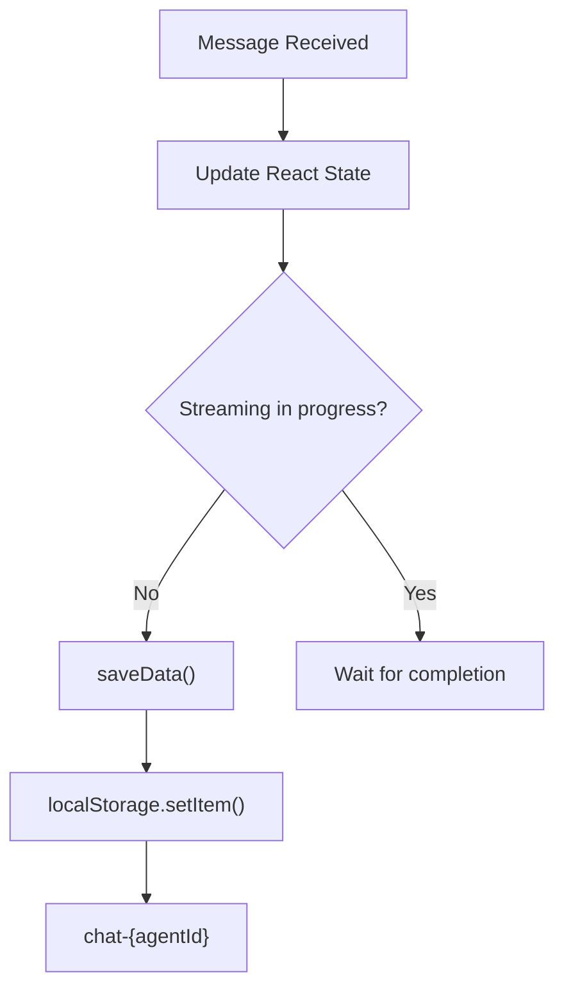

Title: Client-Side Session Persistence Flow

This approach ensures conversation state persists across page reloads without requiring server storage.

Sources:
- [src/components/chat/chat-container.tsx:353-375]()
- [src/components/chat/chat-container.tsx:231-232]()

### Session Data Loading

When the chat interface initializes, it loads any previously saved session data:

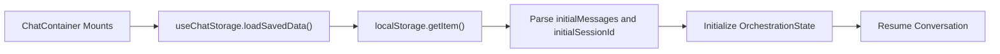

Title: Session Data Loading Process

Sources:
- [src/components/chat/chat-container.tsx:103-106]()
- [src/components/chat/chat-container.tsx:378-382]()

## Session Management API

### useSessionInfo Hook

AgentDock provides a `useSessionInfo` hook for retrieving session information from the server:

```typescript
function useSessionInfo(sessionId: string | null | undefined) {
  // Returns:
  // - sessionData (session information)
  // - isLoading (loading state)
  // - error (any errors)
  // - refresh (function to refresh data)
}
```

This hook fetches data from the `/api/session/{sessionId}` endpoint.

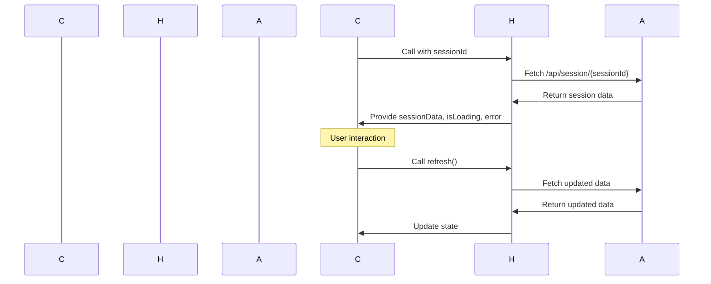

Title: useSessionInfo Hook Data Flow

Sources:
- [src/hooks/use-session-info.ts:23-101]()

### Session Reset Functionality

AgentDock allows for full session reset, clearing all history and state:

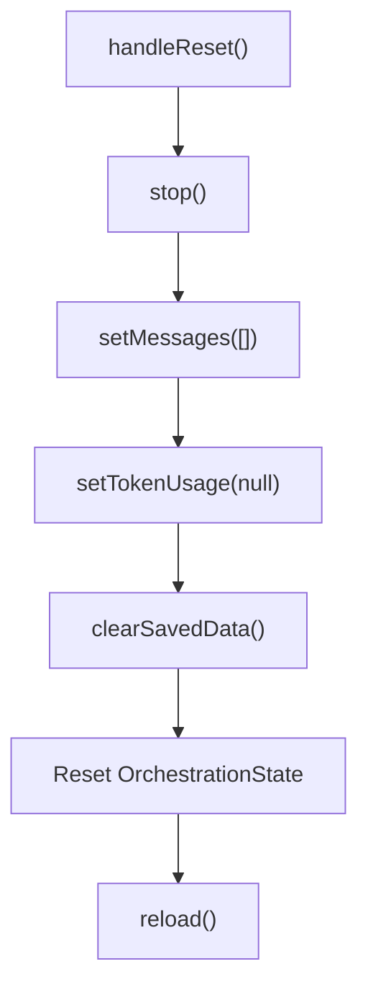

Title: Session Reset Process

Sources:
- [src/components/chat/chat-container.tsx:318-345]()

## Session State Updates

Session state is updated from two primary sources:

### Headers-Based Updates

The server includes session state in response headers:

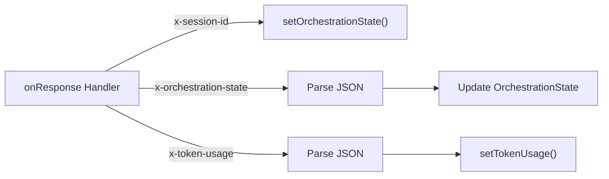

Title: Header-Based Session State Updates

Sources:
- [src/components/chat/chat-container.tsx:222-268]()

### Stream Data Updates

State updates also come through the data stream during message generation:

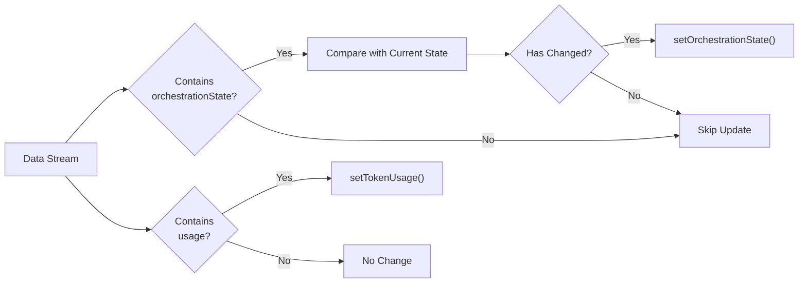

Title: Stream-Based Session State Updates

Sources:
- [src/components/chat/chat-container.tsx:392-488]()

## Error Handling

AgentDock handles session-related errors with dedicated error handling:

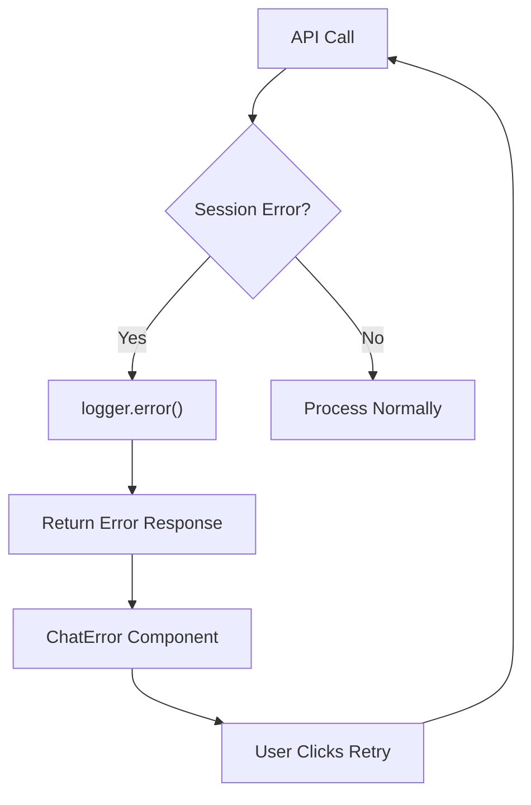

Title: Session Error Handling Flow

The system provides specific error handling for session ID issues and other session-related errors.

Sources:
- [src/app/api/chat/[agentId]/route.ts:629-641]()
- [src/components/chat/chat-container.tsx:524-543]()
- [src/components/chat/chat-status.tsx:26-199]()

## Integration with System Components

Session management integrates with other core AgentDock components:

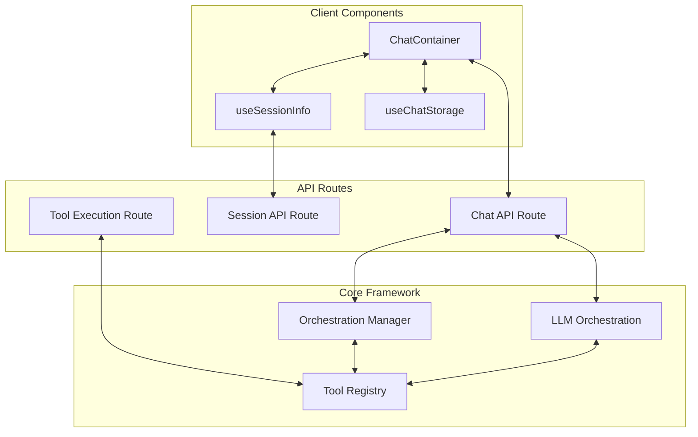

Title: Session Integration with System Components

Sources:
- [src/app/api/chat/[agentId]/route.ts]()
- [src/components/chat/chat-container.tsx]()
- [src/hooks/use-session-info.ts]()

### Integration with Chat API Route

The Chat API route uses session information to maintain conversation context:

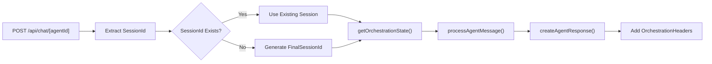

Title: Session Integration with Chat API

Sources:
- [src/app/api/chat/[agentId]/route.ts:536-538]()
- [src/app/api/chat/[agentId]/route.ts:560-596]()
- [src/app/api/chat/[agentId]/route.ts:612-623]()
- [src/app/api/chat/[agentId]/route.ts:204-264]()

### Integration with Tool Execution

Session IDs track tool usage across interactions:

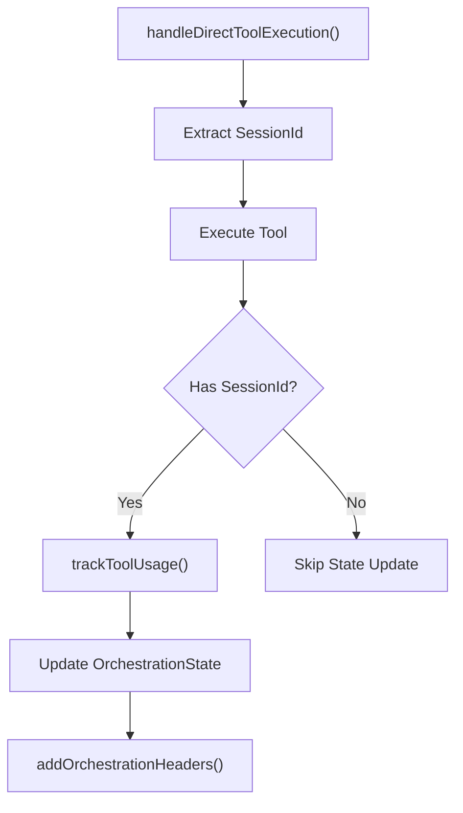

Title: Session Integration with Tool Execution

Sources:
- [src/app/api/chat/[agentId]/route.ts:318-348]()
- [src/app/api/chat/[agentId]/route.ts:365-366]()

### Integration with UI Components

The ChatContainer component manages session state in the UI:

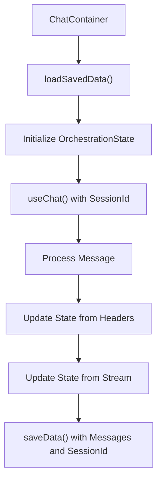

Title: Session Integration with UI Components

Sources:
- [src/components/chat/chat-container.tsx:103-106]()
- [src/components/chat/chat-container.tsx:130-133]()
- [src/components/chat/chat-container.tsx:167-182]()
- [src/components/chat/chat-container.tsx:222-268]()

## Conclusion

The session management system in AgentDock provides a robust foundation for maintaining conversation state across interactions. It enables seamless continuity for users while supporting advanced features like orchestration workflows and tool tracking. Through careful integration with other system components and client-side persistence, it creates cohesive and contextual agent experiences.

The primary interfaces for working with sessions are:
- The `x-session-id` header for API communication
- The `OrchestrationState` interface for tracking workflow state
- The `useSessionInfo` hook for retrieving session data
- The `useChatStorage` hook for client-side persistence

By leveraging these components, AgentDock creates persistent, stateful conversations in a web environment.

---

