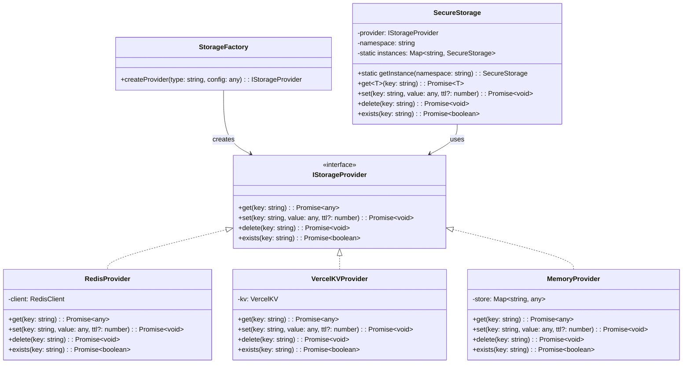
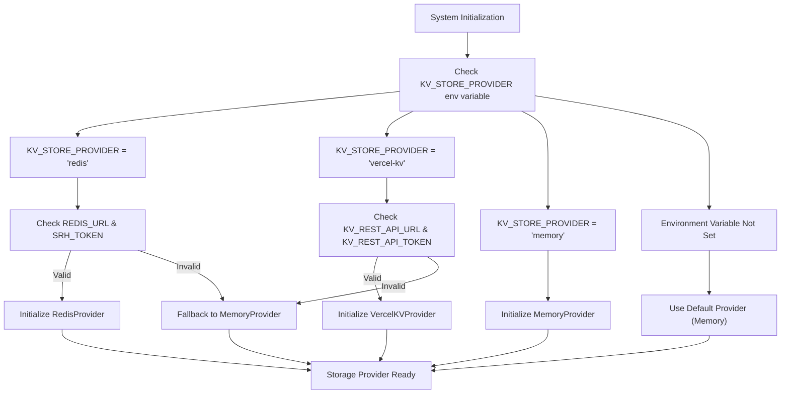
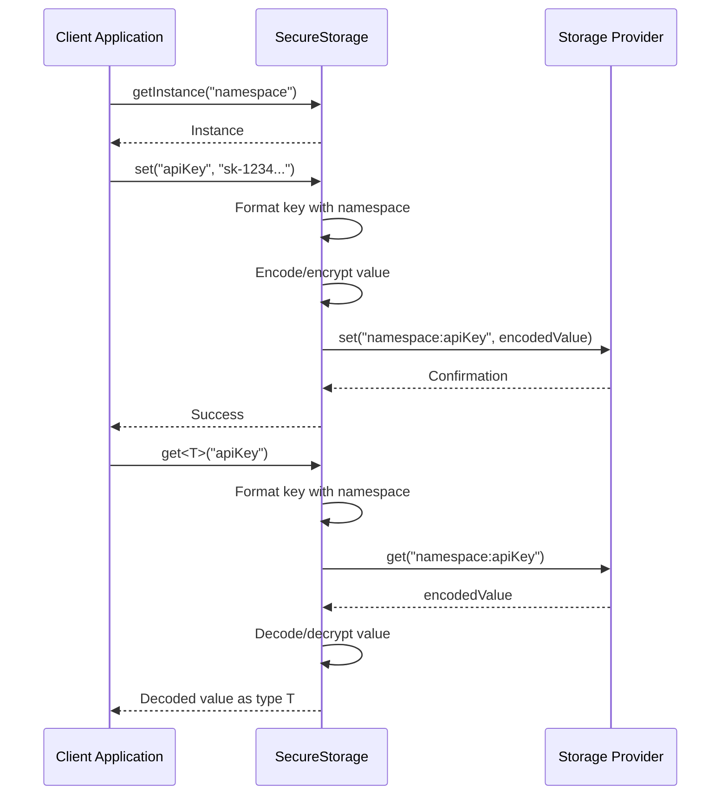
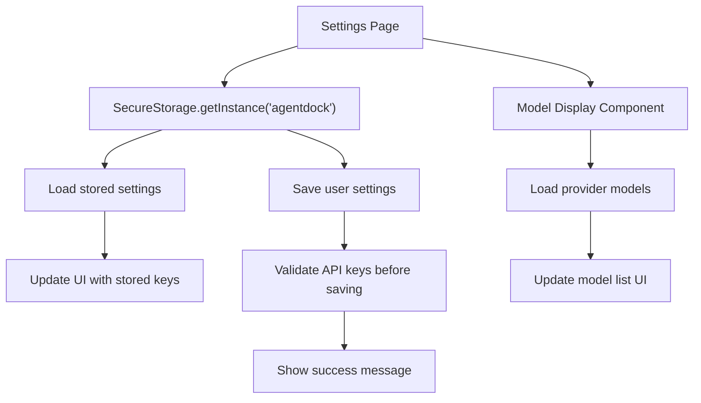
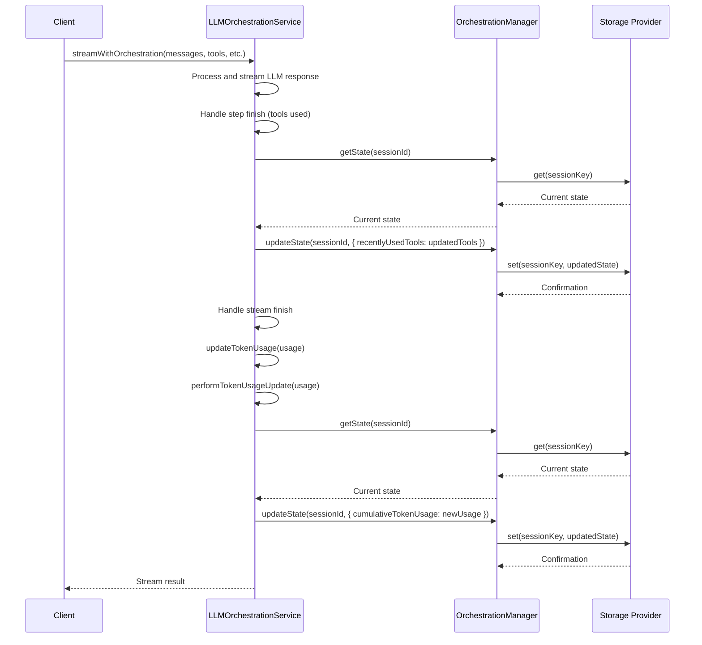
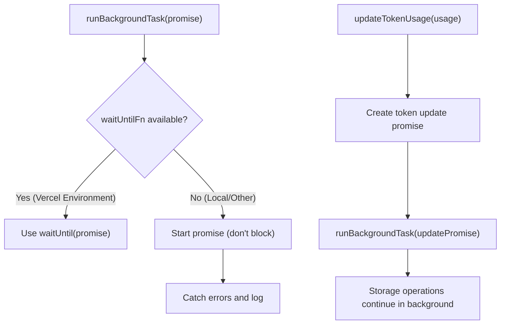
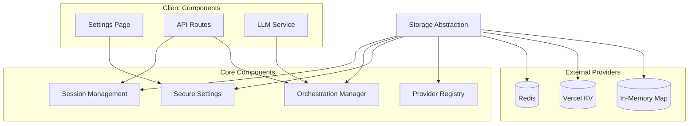

<!-- source: DeepWiki mcp.deepwiki.com · repo AgentDock/AgentDock · page 2.5 Storage Abstraction · fetched 2026-10-26 -->

# Storage Abstraction

Relevant source files

The following files were used as context for generating this wiki page:

- [.env.example](.env.example)
- [agentdock-core/src/llm/llm-orchestration-service.ts](agentdock-core/src/llm/llm-orchestration-service.ts)
- [src/app/settings/debug-panel.tsx](src/app/settings/debug-panel.tsx)
- [src/app/settings/model-display.tsx](src/app/settings/model-display.tsx)
- [src/app/settings/page.tsx](src/app/settings/page.tsx)
- [src/app/settings/types.ts](src/app/settings/types.ts)
- [src/lib/models/registry.ts](src/lib/models/registry.ts)
- [src/lib/services/model-service.ts](src/lib/services/model-service.ts)

The Storage Abstraction layer in AgentDock provides a unified interface for persistent data storage across different environments and deployment scenarios. It abstracts away the underlying storage implementation details, allowing the system to seamlessly work with various key-value storage providers without modifying application logic.

## Overview

The Storage Abstraction serves several critical functions within the AgentDock ecosystem:

1. Provides a consistent API for key-value storage operations
2. Supports multiple storage providers for different deployment scenarios
3. Handles secure storage of sensitive information (like API keys)
4. Manages persistence of session state and conversation history
5. Facilitates background operations for token usage tracking

For information about session state management built on top of this storage layer, see [Session Management](#2.4).

## Architecture

The Storage Abstraction follows a provider-based architecture with a consistent interface, allowing the core framework to interact with storage without knowing the specific implementation details.

### Storage Architecture Diagram

Sources: [.env.example:7-11](), [src/app/settings/page.tsx:9]()

### Provider Selection Flow

The system determines which storage provider to use based on environment configuration, with graceful fallbacks in case of provider unavailability.

Sources: [.env.example:7-38]()

## Storage Providers

AgentDock supports three storage providers out of the box, each designed for different use cases and deployment scenarios.

### Redis Provider

Used primarily for local development with Docker Compose. This provider connects to a Redis instance (typically through a Redis HTTP proxy for browser compatibility).

**Configuration:**
- Set `KV_STORE_PROVIDER=redis`
- Configure `REDIS_URL`, `SRH_TOKEN`, and optionally `REDIS_TOKEN`
- Docker Compose setup provides a Redis instance and HTTP proxy

**Benefits:**
- Persistent storage between server restarts
- Fast key-value operations
- Well-suited for local development

Sources: [.env.example:14-21]()

### Vercel KV Provider

Optimized for production deployments on Vercel, this provider integrates with Vercel KV (powered by Upstash).

**Configuration:**
- Set `KV_STORE_PROVIDER=vercel-kv`
- When deployed on Vercel, these environment variables are injected automatically:
  - `KV_URL`
  - `KV_REST_API_URL`
  - `KV_REST_API_TOKEN`

**Benefits:**
- Fully managed serverless Redis
- Automatic scaling
- No operational overhead
- Edge-optimized for global deployments

Sources: [.env.example:24-38]()

### Memory Provider

A simple in-memory implementation for development or ephemeral usage.

**Configuration:**
- Set `KV_STORE_PROVIDER=memory`
- No additional configuration required

**Limitations:**
- Data is lost on server restart
- Not suitable for production use
- No persistence guarantees

Sources: [.env.example:10-11]()

## Secure Storage Implementation

For sensitive data such as API keys, AgentDock implements a `SecureStorage` class that provides additional security features on top of the base storage providers. This class is singleton-based and namespace-aware to prevent key collisions.

### Secure Storage Usage Pattern

Sources: [src/app/settings/page.tsx:9, 28](), [src/app/settings/model-display.tsx:14-17]()

## Usage Patterns

### API Key Management

The storage abstraction is used extensively for securely storing and retrieving API keys. The Settings page demonstrates this pattern:

Sources: [src/app/settings/page.tsx:28-57, 97-111](), [src/app/settings/model-display.tsx:17, 129-131]()

### Session State and Token Usage

The LLM Orchestration Service uses the storage layer (via the Orchestration Manager) to track token usage and store session state:

Sources: [agentdock-core/src/llm/llm-orchestration-service.ts:125-132, 320-349]()

## Background Task Support

The Storage Abstraction layer integrates with Vercel's `waitUntil` feature for handling background tasks, ensuring that storage operations complete even after a response has been sent to the client.

Sources: [agentdock-core/src/llm/llm-orchestration-service.ts:25-59, 305-315]()

## Time-to-Live (TTL) Support

The Storage Abstraction supports configuring time-to-live (TTL) for stored values, particularly useful for session management:

**Configuration:**
- `SESSION_TTL_SECONDS`: Defines the default TTL for sessions in seconds (e.g., 86400 for 24 hours)

This ensures that inactive sessions are automatically purged after the configured period, helping with resource management and compliance requirements.

Sources: [.env.example:41-44]()

## Integration with Other Components

The Storage Abstraction interfaces with multiple components in the AgentDock architecture:

Sources: [agentdock-core/src/llm/llm-orchestration-service.ts:125-132](), [src/app/settings/page.tsx:28](), [src/app/settings/model-display.tsx:17]()

## Security Considerations

The Storage Abstraction implements several security best practices:

1. **Namespaces:** Prevents key collisions and isolates data between different components
2. **API Key Protection:** Sensitive data is handled through SecureStorage
3. **Environment-Specific Configuration:** Different storage providers for different environments
4. **Validation Before Storage:** API keys are validated before storage
5. **Appropriate TTL Settings:** Data is not stored longer than necessary

Table comparing security aspects of different providers:

| Provider    | Persistence | Encryption at Rest | TTL Support | Production Ready |
|-------------|-------------|-------------------|-------------|-----------------|
| Redis       | Yes         | No (default)      | Yes         | For development |
| Vercel KV   | Yes         | Yes               | Yes         | Yes             |
| Memory      | No          | No                | Limited     | No              |

Sources: [src/app/settings/page.tsx:97-111](), [.env.example:41-44]()

## Conclusion

The Storage Abstraction layer provides a flexible, provider-agnostic approach to data persistence in AgentDock. By abstracting the underlying storage implementation, the system can adapt to different deployment environments while maintaining consistent functionality. This abstraction is particularly important for stateful components like session management, token usage tracking, and secure settings storage.

Understanding how to configure and use the appropriate storage provider for your deployment scenario is essential for operating AgentDock efficiently and securely.

---

