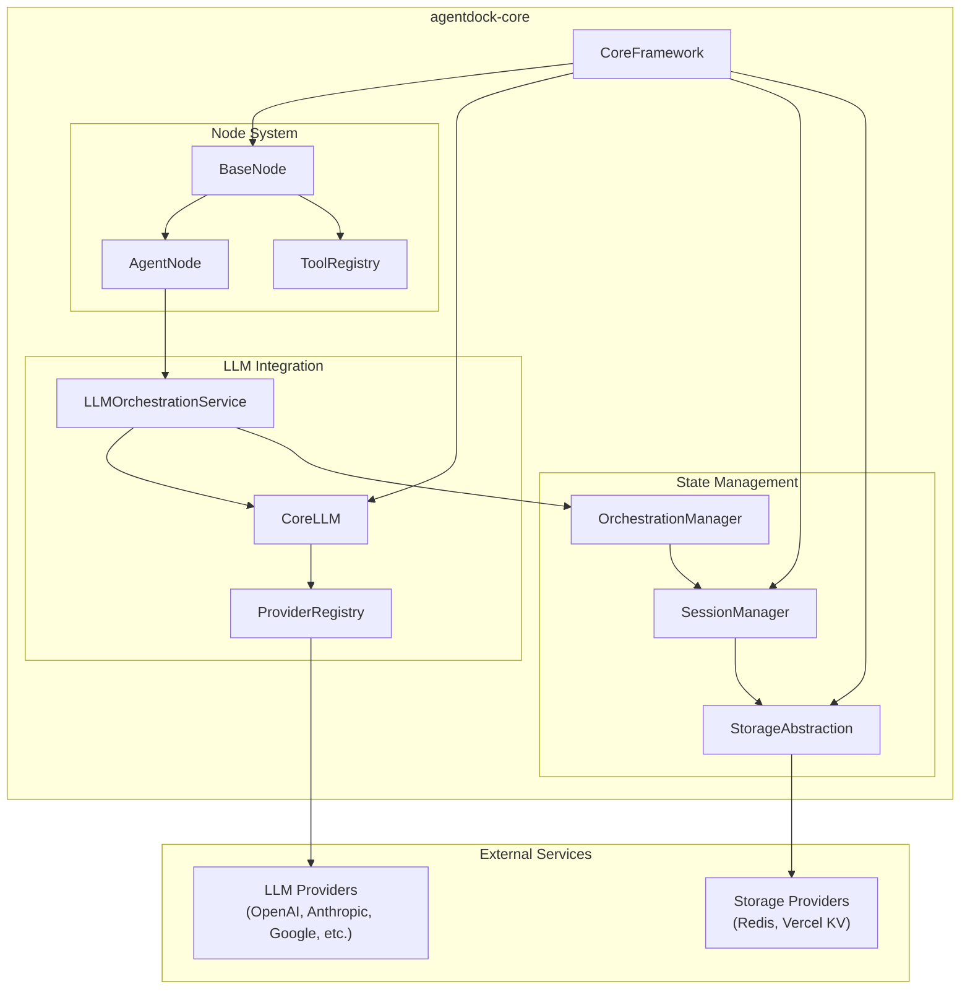
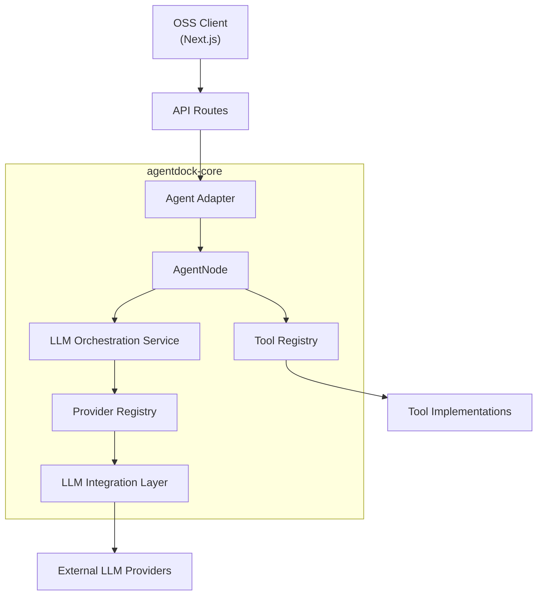
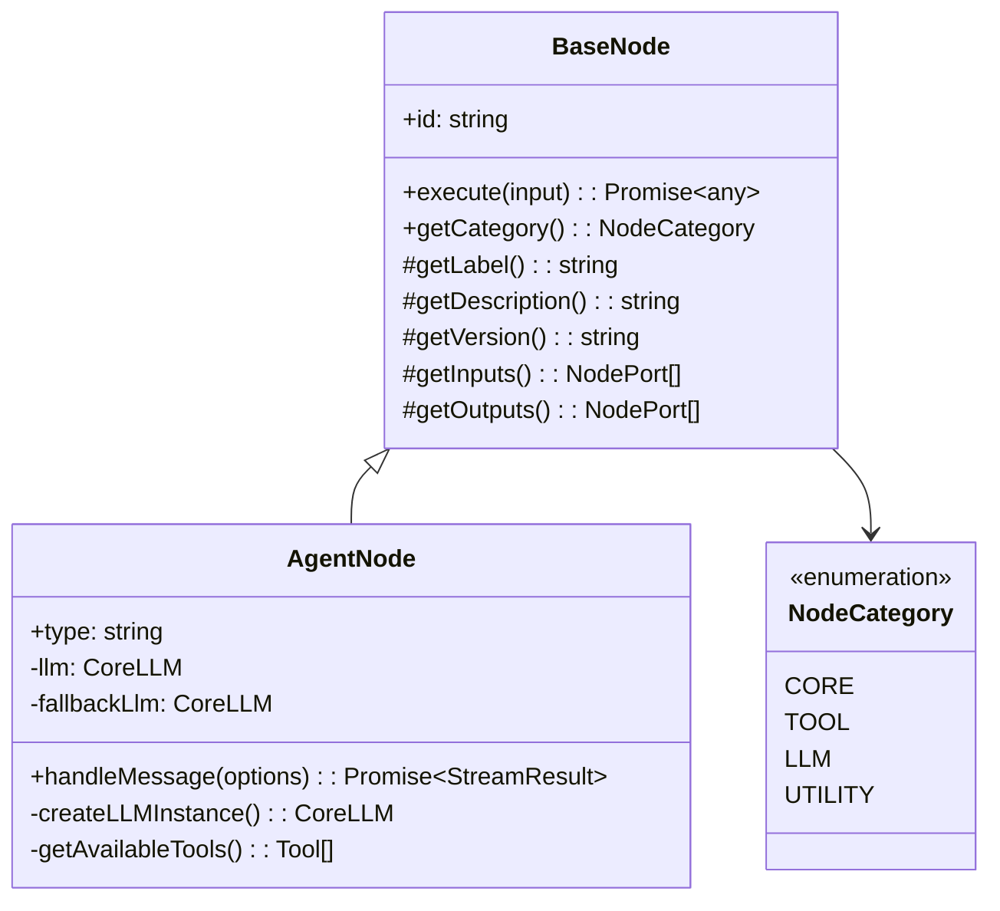
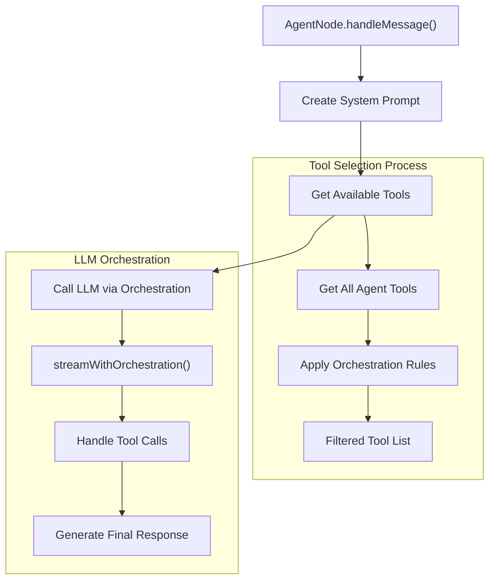
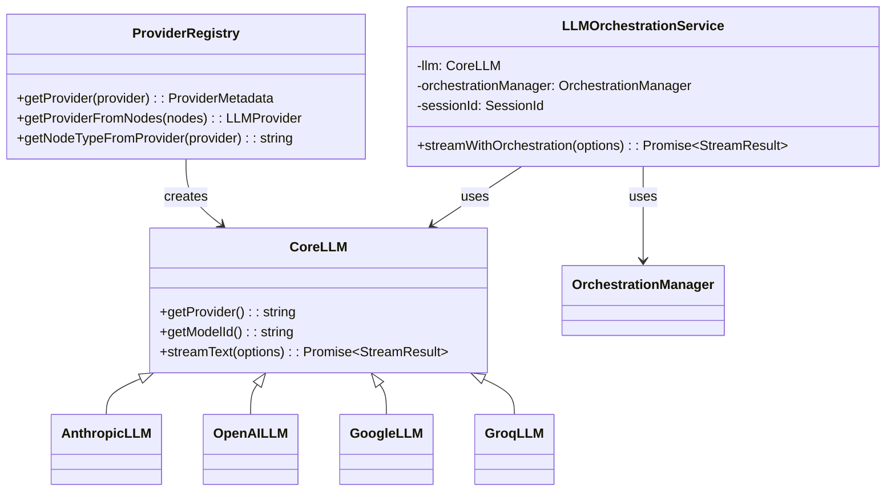
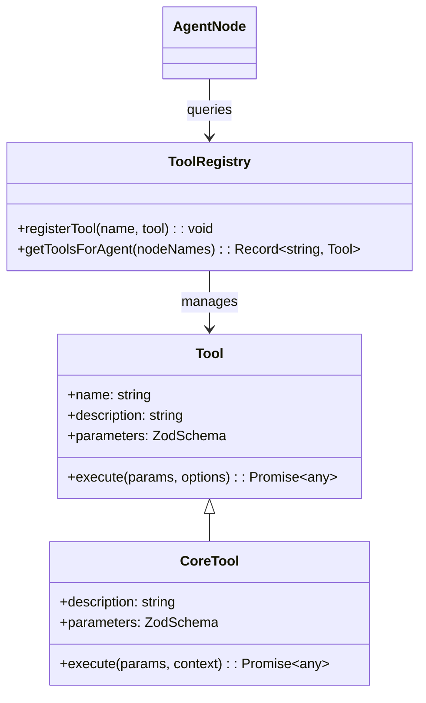
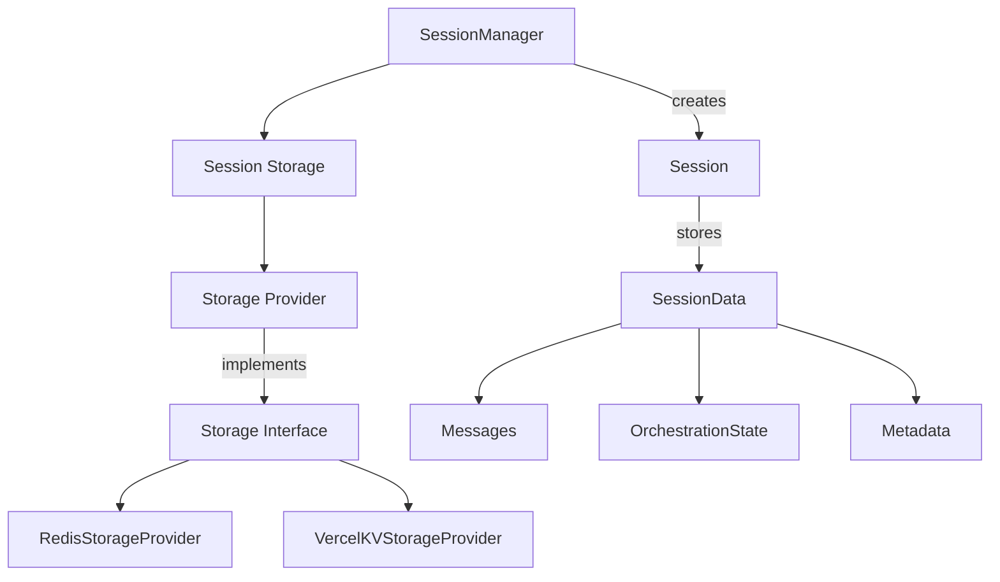
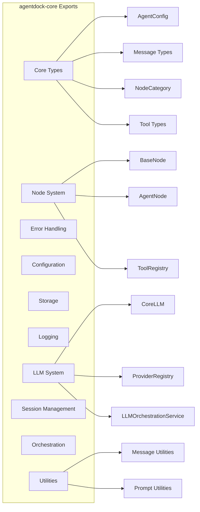
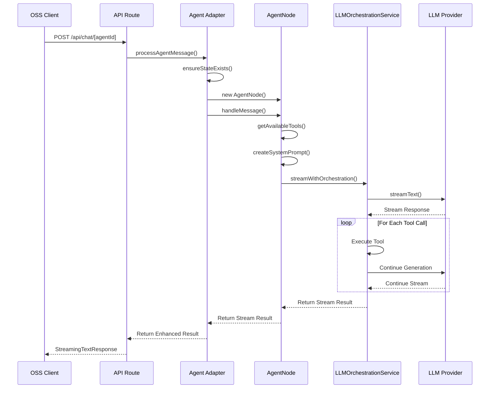

<!-- source: DeepWiki mcp.deepwiki.com · repo AgentDock/AgentDock · page 3 AgentDock Core · fetched 2026-10-26 -->

# AgentDock Core

<details>
<summary>Relevant source files</summary>

The following files were used as context for generating this wiki page:

- [agentdock-core/package.json](agentdock-core/package.json)
- [agentdock-core/pnpm-lock.yaml](agentdock-core/pnpm-lock.yaml)
- [agentdock-core/src/index.ts](agentdock-core/src/index.ts)
- [agentdock-core/src/nodes/agent-node.ts](agentdock-core/src/nodes/agent-node.ts)
- [agentdock-core/tsconfig.json](agentdock-core/tsconfig.json)
- [scripts/clean-install.sh](scripts/clean-install.sh)
- [src/lib/agent-adapter.ts](src/lib/agent-adapter.ts)
- [src/lib/core/init.ts](src/lib/core/init.ts)

</details>


AgentDock Core is the central framework that provides the foundation for building AI agents in the AgentDock ecosystem. It implements the essential infrastructure for managing Language Learning Models (LLMs), handling agent behaviors, integrating tools, and orchestrating multi-step workflows. This document explains the architecture, components, and workflows within the core framework.

For information about the client-side implementation that uses this framework, see [OSS Client](#4).

## 1. Architecture Overview

AgentDock Core is designed as a modular system with several key components that work together to provide a flexible foundation for building AI agents.

### Core Components Diagram



Sources: [agentdock-core/src/index.ts](), [agentdock-core/src/nodes/agent-node.ts]()

### Position in Overall System Architecture

AgentDock Core serves as the middleware between client applications and external services like LLM providers.



Sources: [agentdock-core/src/index.ts](), [src/lib/agent-adapter.ts]()

## 2. Key Components

### 2.1 Node System

The Node System provides the foundation for all components in AgentDock. It's built around the `BaseNode` abstract class, which defines the common interface that all nodes must implement.



Sources: [agentdock-core/src/nodes/agent-node.ts:6-21](), [agentdock-core/src/nodes/agent-node.ts:96-101]()

### 2.2 AgentNode

The `AgentNode` is the central component in AgentDock Core. It extends `BaseNode` and implements the core agent functionality, including message handling, tool selection, and LLM integration.



Sources: [agentdock-core/src/nodes/agent-node.ts:272-403](), [agentdock-core/src/nodes/agent-node.ts:230-258]()

Key features of `AgentNode`:

- Initializes with agent configuration, API keys, and provider settings
- Supports primary and fallback LLM providers
- Integrates with the tool registry to expose relevant tools to the LLM
- Injects current date and time information into system prompts
- Streams responses directly to clients via the Vercel AI SDK
- Handles orchestration of conversations based on configured rules

Sources: [agentdock-core/src/nodes/agent-node.ts:96-147](), [agentdock-core/src/nodes/agent-node.ts:272-403]()

### 2.3 LLM Integration

AgentDock Core provides a unified interface to multiple LLM providers through its `CoreLLM` and provider registry system.



Sources: [agentdock-core/src/index.ts:82-91](), [agentdock-core/src/nodes/agent-node.ts:8-9]()

Supported LLM providers:

| Provider  | Library           | Default Model            |
|-----------|-------------------|--------------------------|
| Anthropic | @ai-sdk/anthropic | claude-3-5-sonnet-20240620 |
| OpenAI    | @ai-sdk/openai    | gpt-4o                  |
| Google    | @ai-sdk/google    | gemini-pro              |
| Groq      | @ai-sdk/groq      | llama3-70b-8192         |
| DeepSeek  | OpenAI compatible | deepseek-coder          |

Sources: [agentdock-core/package.json:18-29](), [agentdock-core/package.json:30-32]()

### 2.4 Tool Registry

The Tool Registry manages the registration and discovery of tools that agents can use to interact with external systems and perform tasks.



Sources: [agentdock-core/src/nodes/agent-node.ts:17-20](), [agentdock-core/src/nodes/agent-node.ts:230-258]()

### 2.5 Orchestration System

The Orchestration System manages the conversational flow and state of agent interactions, controlling which tools are available at different stages of a conversation.

```mermaid
flowchart TD
    subgraph "Orchestration Components"
        OM["OrchestrationManager"]
        OSM["OrchestrationStateManager"]
        SS["StepSequencer"]
        
        OM --> OSM: uses
        OM --> SS: uses
    end
    
    subgraph "Orchestration Flow"
        Start["Start Conversation"] --> InitState["Initialize State"]
        InitState --> CheckStep["Check Current Step"]
        CheckStep --> FilterTools["Filter Available Tools"]
        FilterTools --> UpdateState["Update State After Response"]
        UpdateState --> CheckStep
    end
    
    OM -.-> Start
    OSM -.-> InitState
    OSM -.-> UpdateState
    SS -.-> CheckStep
    SS -.-> FilterTools
```

Sources: [agentdock-core/src/index.ts:100-123](), [agentdock-core/src/nodes/agent-node.ts:18-19]()

### 2.6 Session Management

The Session Management system maintains conversational state across user interactions, ensuring each session has its own independent state.



Sources: [agentdock-core/src/index.ts:92-99](), [agentdock-core/src/index.ts:68-70]()

## 3. Implementation Details

### 3.1 Export Structure

AgentDock Core exports a comprehensive set of utilities, types, and classes through its main entry point.



Sources: [agentdock-core/src/index.ts:1-191]()

### 3.2 Message Processing Flow



Sources: [agentdock-core/src/nodes/agent-node.ts:272-403](), [src/lib/agent-adapter.ts:90-208]()

### 3.3 Configuration and Build System

AgentDock Core is built as a TypeScript library with both ESM and CommonJS output formats using tsup:

```
tsup src/index.ts --format esm,cjs --dts --external ai --external @ai-sdk/* --external @anthropic-ai/* --external @google/* --external openai --external @upstash/* --external @vercel/*
```

The build process excludes major dependencies to prevent duplication when integrated into applications.

Sources: [agentdock-core/package.json:12-16](), [agentdock-core/tsconfig.json:1-22]()

## 4. Usage Patterns

### 4.1 Creating an Agent Node

```typescript
// From the agent adapter
const agent = new AgentNode(
  agentId, 
  {
    agentConfig: fullAgentConfig, 
    apiKey,
    provider: provider as LLMProvider,
    options: runtimeOverrides, 
    ..._fallbackApiKey ? { fallbackApiKey: _fallbackApiKey } : {}
  }
);

const result = await agent.handleMessage({
  messages,
  sessionId: finalSessionId,
  orchestrationManager: manager,
  systemOverride: system, 
  ...(runtimeOverrides ? { config: runtimeOverrides } : {}),
  ...(orchestrationState ? { orchestrationState } : {})
});
```

Sources: [src/lib/agent-adapter.ts:139-163]()

### 4.2 System Initialization

The core system is initialized through a carefully managed process to prevent issues with React Server Components:

```typescript
export function initSystem(): void {
  // Skip initialization on the server to avoid RSC serialization issues
  if (isServer) {
    return;
  }
  
  const log = setupLogger();
  
  try {
    if (typeof window !== 'undefined' && (window as any).__systemInitialized) {
      logger.debug(LogCategory.SYSTEM, 'System', 'System already initialized, skipping');
      return;
    }
    
    log.info('Initializing AgentDock system');
    
    if (typeof window !== 'undefined') {
      (window as any).__systemInitialized = true;
    }
    
    log.info('System initialized successfully');
  } catch (error) {
    log.error('Failed to initialize system', error);
  }
}
```

Sources: [src/lib/core/init.ts:34-63]()

## 5. Integration with External Systems

AgentDock Core integrates with various external systems:

1. **LLM Providers**:
   - Anthropic (Claude models)
   - OpenAI (GPT models)
   - Google (Gemini models)
   - Groq (LLaMA models)
   - DeepSeek (via OpenAI-compatible interface)

2. **Storage Providers**:
   - Redis (via @upstash/redis)
   - Vercel KV (via @vercel/kv)

3. **Client Applications**:
   - Designed to work with Next.js applications
   - Provides React hooks and components through re-exports

Sources: [agentdock-core/package.json:18-28](), [agentdock-core/src/index.ts:165-191]()

## Summary

AgentDock Core provides a comprehensive framework for building AI agents with these key capabilities:

1. A modular node-based architecture centered around the `AgentNode` class
2. Multi-provider LLM integration with unified interfaces
3. Flexible tool registration and discovery
4. State management through session and orchestration systems
5. Storage abstraction for different persistence options
6. Clean integration points for client applications

For information on using these components in specific scenarios, refer to [AgentNode](#3.1), [Tool Registry](#3.2), and [LLM Orchestration Service](#3.3).

---

