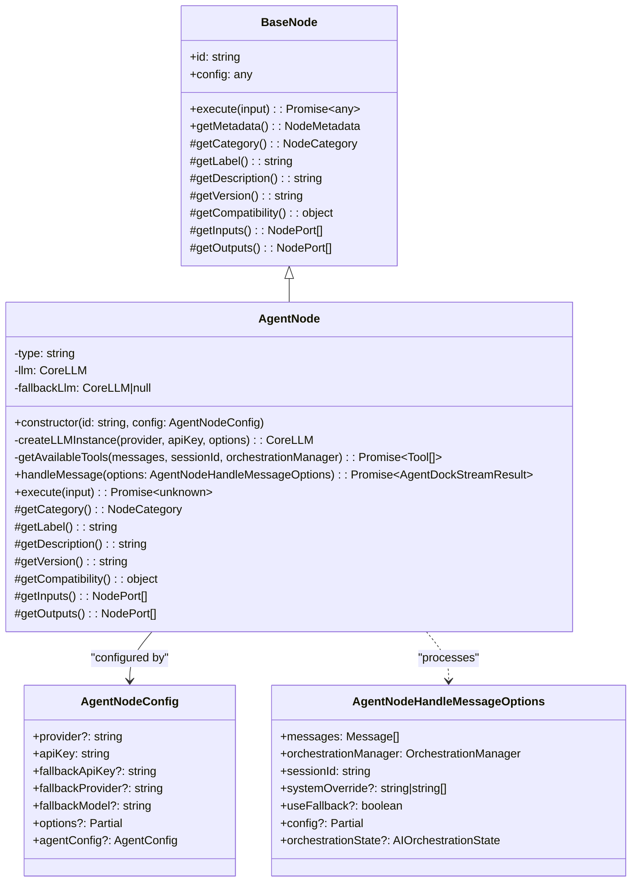
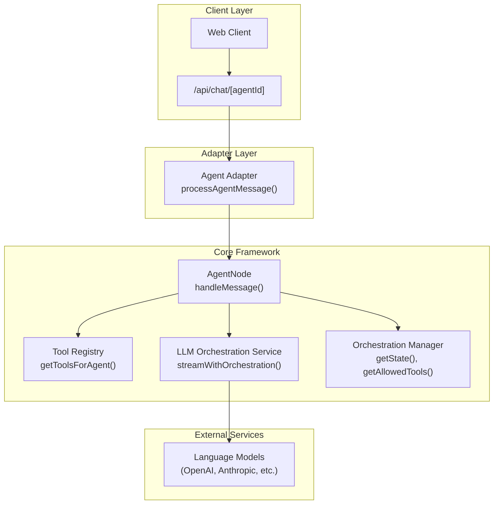
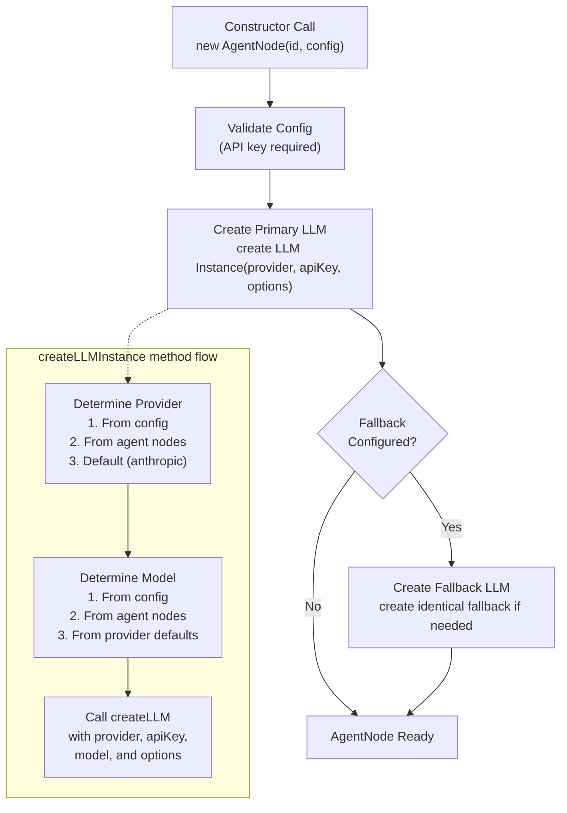
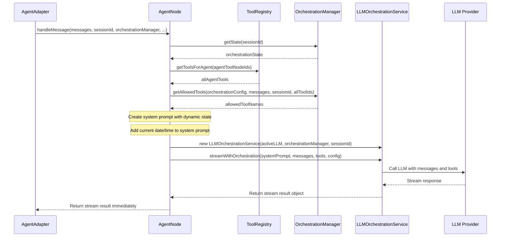
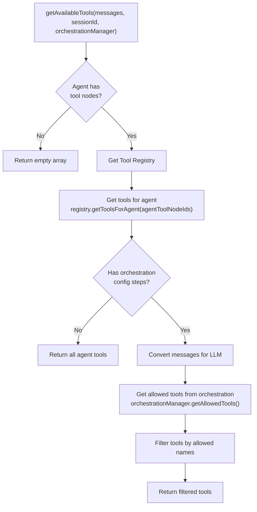
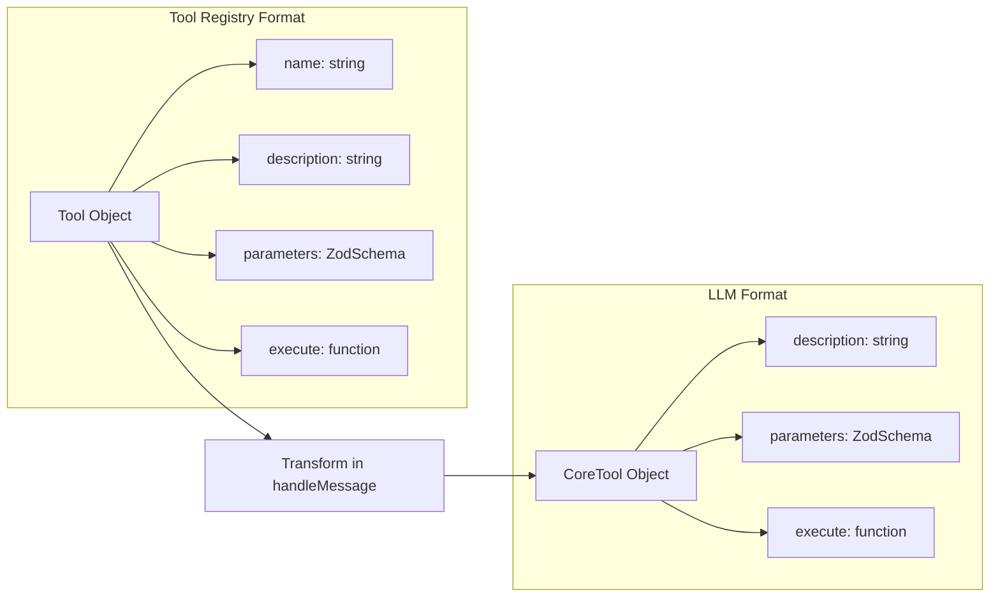
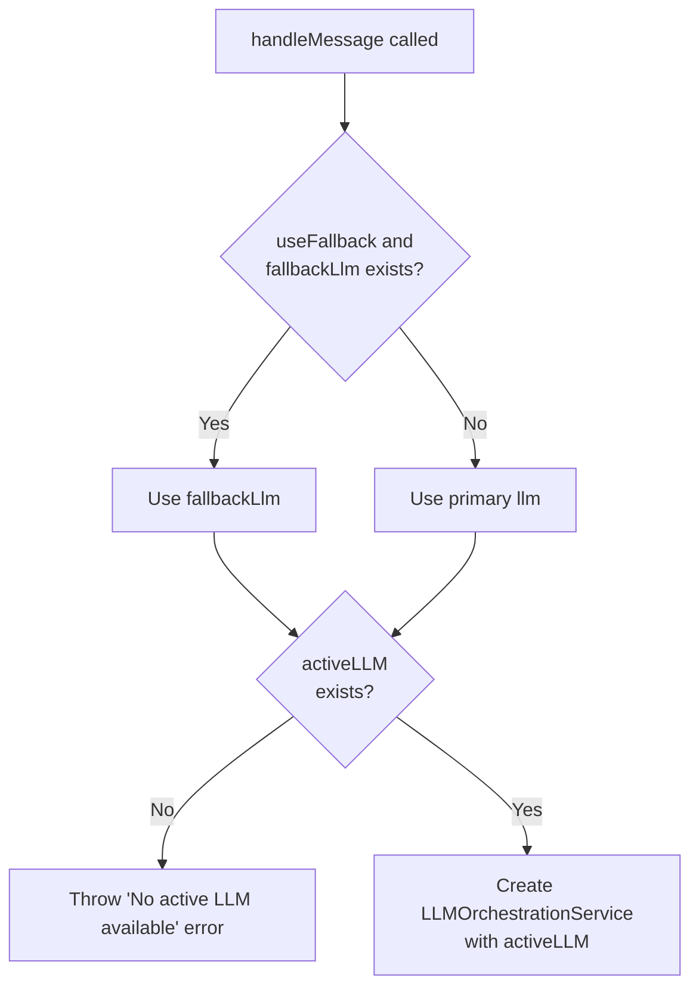
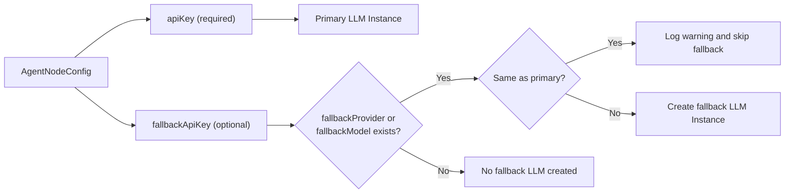
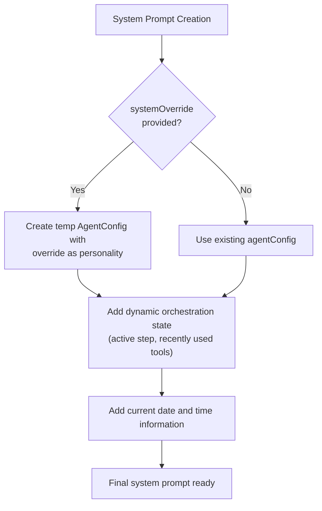
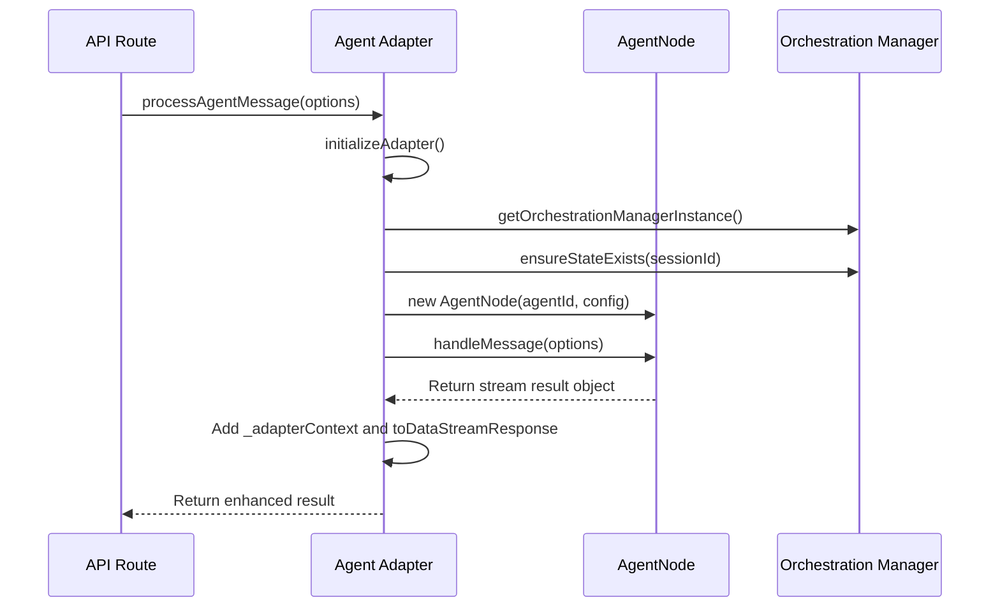

<!-- source: DeepWiki mcp.deepwiki.com · repo AgentDock/AgentDock · page 3.1 AgentNode · fetched 2026-10-26 -->

# AgentNode

<details>
<summary>Relevant source files</summary>

The following files were used as context for generating this wiki page:

- [agentdock-core/package.json](agentdock-core/package.json)
- [agentdock-core/pnpm-lock.yaml](agentdock-core/pnpm-lock.yaml)
- [agentdock-core/src/index.ts](agentdock-core/src/index.ts)
- [agentdock-core/src/nodes/agent-node.ts](agentdock-core/src/nodes/agent-node.ts)
- [agentdock-core/tsconfig.json](agentdock-core/tsconfig.json)
- [scripts/clean-install.sh](scripts/clean-install.sh)
- [src/lib/agent-adapter.ts](src/lib/agent-adapter.ts)
- [src/lib/core/init.ts](src/lib/core/init.ts)

</details>


## Overview

The AgentNode is a core component in the AgentDock framework responsible for handling conversational agent logic. It serves as the central execution engine for agents, processing user messages, interacting with language models, managing tools, and orchestrating the overall conversation flow.

This document details the AgentNode implementation, its configuration, and how it integrates with other components in the AgentDock framework. For information about the broader Node System architecture, see [Node System](#2.1).

Sources: [agentdock-core/src/nodes/agent-node.ts:96-455](), [agentdock-core/src/index.ts:36-36]()

## Class Structure and Position in System Architecture

The AgentNode extends the BaseNode class and implements core agent functionality through the Vercel AI SDK's streaming capabilities.

### Agent Node Architecture



Sources: [agentdock-core/src/nodes/agent-node.ts:32-49](), [agentdock-core/src/nodes/agent-node.ts:56-75](), [agentdock-core/src/nodes/agent-node.ts:96-455]()

### Position in System Architecture

The AgentNode sits at the core of the agent execution flow, acting as an intermediary between the API layer and the underlying LLM providers.



Sources: [agentdock-core/src/nodes/agent-node.ts:272-403](), [src/lib/agent-adapter.ts:90-208]()

## Configuration and Initialization

The AgentNode requires configuration to determine which LLM provider to use, what API keys to apply, and which agent template to load.

### Configuration Structure

The AgentNodeConfig interface defines the configuration parameters needed to initialize an AgentNode:

| Property | Type | Required | Description |
|----------|------|----------|-------------|
| provider | string | No | LLM Provider identifier (e.g., 'anthropic', 'openai'). Derived from agentConfig if not set. |
| apiKey | string | Yes | Primary API key for the LLM provider. |
| fallbackApiKey | string | No | Optional fallback API key. |
| fallbackProvider | string | No | Optional fallback provider identifier. |
| fallbackModel | string | No | Optional fallback model identifier. |
| options | Partial\<LLMConfig\> | No | Optional LLM configuration options. |
| agentConfig | AgentConfig | No | The full, validated Agent Configuration object. |

Sources: [agentdock-core/src/nodes/agent-node.ts:32-49]()

### Initialization Process

When an AgentNode is constructed, it:

1. Validates that an API key is provided
2. Creates the primary LLM instance via `createLLMInstance()`
3. Sets up a fallback LLM (if configured)

The `createLLMInstance()` method:

1. Determines the appropriate provider (from config, agent nodes, or default)
2. Determines the model to use (from config, agent nodes, or provider defaults) 
3. Creates the LLM instance using the provided credentials



Sources: [agentdock-core/src/nodes/agent-node.ts:96-147](), [agentdock-core/src/nodes/agent-node.ts:154-224]()

## Message Processing Flow

The `handleMessage` method is the primary execution method for the AgentNode and orchestrates the entire conversation flow. It:

1. Sets up the LLM orchestration service
2. Fetches available tools based on orchestration state
3. Prepares the system prompt with dynamic state and current date/time
4. Streams responses from the LLM via the AI SDK

### handleMessage Flow



Sources: [agentdock-core/src/nodes/agent-node.ts:272-403](), [src/lib/agent-adapter.ts:139-185]()

### Key Components in Message Processing

1. **OrchestrationManager**: Controls the agent's behavior flow and maintains conversation state
2. **LLMOrchestrationService**: Handles the interaction with the language model, including token tracking and tool call handling
3. **ToolRegistry**: Provides access to the available tools for the agent

Sources: [agentdock-core/src/nodes/agent-node.ts:290-296](), [agentdock-core/src/nodes/agent-node.ts:304-304]()

## Tool Integration

The AgentNode integrates with the Tool Registry to dynamically determine which tools should be available to the agent during a conversation turn.

### Tool Selection Process



Sources: [agentdock-core/src/nodes/agent-node.ts:230-258]()

### Tool Format for LLM

The AgentNode transforms the tools from the registry into the format expected by the LLM service:



Sources: [agentdock-core/src/nodes/agent-node.ts:306-319]()

## LLM Integration and Fallback Mechanism

The AgentNode integrates with various LLM providers and supports a fallback mechanism for resilience.

### LLM Selection Logic



Sources: [agentdock-core/src/nodes/agent-node.ts:285-295]()

### LLM API Key Resolution

The AgentNode's constructor accepts both primary and fallback API keys, which are used to create LLM instances:



Sources: [agentdock-core/src/nodes/agent-node.ts:127-146]()

## System Prompt Creation

The AgentNode is responsible for creating the system prompt that guides the LLM's behavior:

### System Prompt Generation



Sources: [agentdock-core/src/nodes/agent-node.ts:342-361]()

### Date and Time Injection

The AgentNode injects current date and time information into all system prompts to ensure the agent always has up-to-date temporal awareness:

```
Current date: [formatted date]
Current time: [formatted time]
Current timezone: [system timezone]
ISO timestamp: [ISO timestamp]
```

Sources: [agentdock-core/src/nodes/agent-node.ts:354-361]()

## BaseNode Implementation

As a subclass of BaseNode, AgentNode must implement several abstract methods to provide metadata and interface descriptions.

### Key Methods

| Method | Return Type | Description |
|--------|-------------|-------------|
| execute | Promise\<unknown\> | Basic execution method (not used; throws error) |
| getCategory | NodeCategory | Returns CORE as the node category |
| getLabel | string | Returns the agent's name or "Agent Node" |
| getDescription | string | Returns the agent's description or default text |
| getVersion | string | Returns "1.0.0" as the node version |
| getCompatibility | object | Returns compatibility information |
| getInputs | NodePort[] | Defines the expected inputs |
| getOutputs | NodePort[] | Defines the expected outputs |

Sources: [agentdock-core/src/nodes/agent-node.ts:410-454]()

## Integration with Agent Adapter

The AgentNode is integrated with the rest of the system via the Agent Adapter, which serves as a bridge between the API routes and the node system.



Sources: [src/lib/agent-adapter.ts:90-208]()

## Error Handling

The AgentNode implements comprehensive error handling throughout its methods:

1. **Constructor Errors**: Validates required parameters and throws descriptive errors
2. **createLLMInstance Errors**: Detailed logging and creation of standardized errors with codes
3. **getAvailableTools Errors**: Catches and logs errors but returns an empty array to allow operation to continue
4. **handleMessage Errors**: Logs errors and re-throws them for handling by the caller

Sources: [agentdock-core/src/nodes/agent-node.ts:209-223](), [agentdock-core/src/nodes/agent-node.ts:254-257](), [agentdock-core/src/nodes/agent-node.ts:398-402]()

## Performance Considerations

The AgentNode is designed to return the stream result object immediately, without waiting for the entire response to be generated. This allows for real-time streaming of responses to the user interface while the LLM continues to generate content.

The `onFinish` callback mechanism is used to handle post-stream tasks like updating token counts, without blocking the initial response.

Sources: [agentdock-core/src/nodes/agent-node.ts:385-397]()

## Conclusion

The AgentNode is a critical component in the AgentDock framework, serving as the execution engine for conversational agents. It handles:

1. Language model selection and integration
2. Tool discovery and integration
3. System prompt creation with dynamic state
4. Message streaming and error handling
5. Fallback mechanisms for resilience

Through its integration with the OrchestrationManager and ToolRegistry, it provides a flexible and extensible foundation for building powerful AI agents.

---

