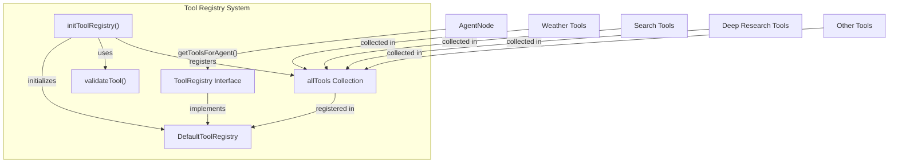
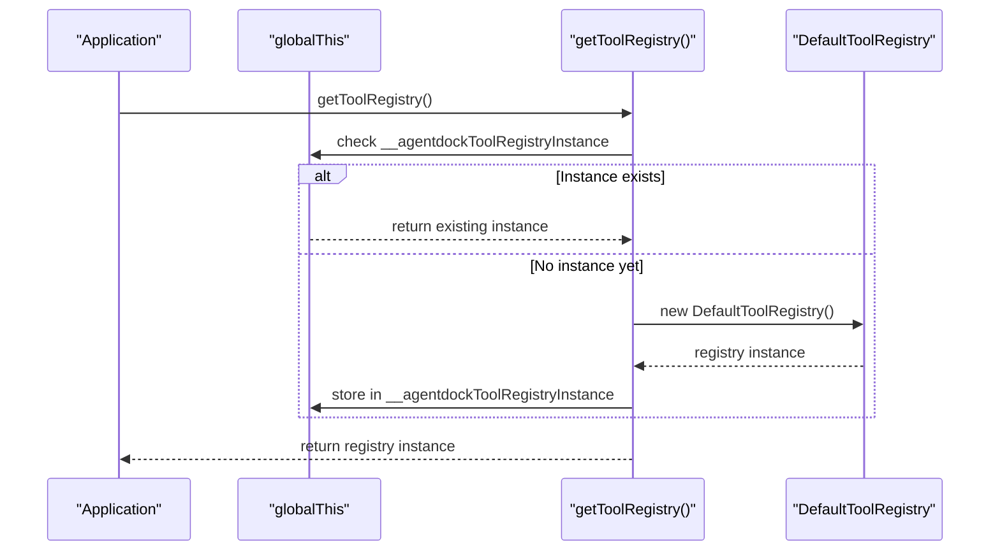
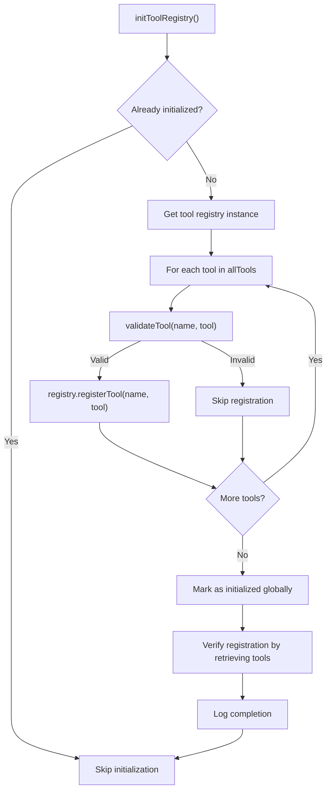
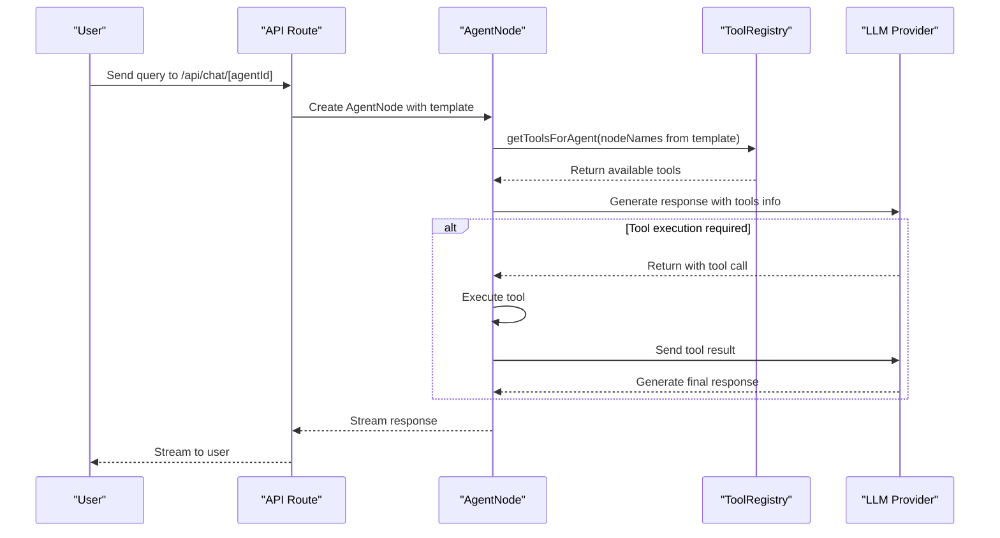

<!-- source: DeepWiki mcp.deepwiki.com · repo AgentDock/AgentDock · page 3.2 Tool Registry · fetched 2026-10-26 -->

# Tool Registry

<details>
<summary>Relevant source files</summary>

The following files were used as context for generating this wiki page:

- [agentdock-core/src/nodes/tool-registry.ts](agentdock-core/src/nodes/tool-registry.ts)
- [docs/analytics.md](docs/analytics.md)
- [src/app/agents/all/page.tsx](src/app/agents/all/page.tsx)
- [src/app/agents/page.tsx](src/app/agents/page.tsx)
- [src/app/api/chat/[agentId]/__tests__/streaming.test.ts](src/app/api/chat/[agentId]/__tests__/streaming.test.ts)
- [src/nodes/init.ts](src/nodes/init.ts)
- [src/nodes/registry.ts](src/nodes/registry.ts)
- [src/nodes/types.ts](src/nodes/types.ts)
- [src/nodes/weather/components.ts](src/nodes/weather/components.ts)

</details>


The Tool Registry is a core component of the AgentDock framework responsible for managing the registration, validation, and discovery of tools that can be used by AI agents. Tools in AgentDock are specialized nodes that provide agents with capabilities like searching the web, checking weather, researching topics, and interacting with various APIs.

This document explains the architecture and usage of the Tool Registry system. For information about specific tool implementations, see [Custom Tools](#5.2).

## Overview

The Tool Registry serves as a centralized registry for all tools available in the system. It provides mechanisms to:

1. Register tools with the system
2. Validate tools to ensure they meet required specifications
3. Retrieve tools for specific agents based on their configuration

The Tool Registry is designed as a singleton service within the AgentDock core framework, ensuring consistent access to tools throughout the application.



Sources: [agentdock-core/src/nodes/tool-registry.ts:11-104](), [src/nodes/registry.ts:1-42](), [src/nodes/init.ts:9-149]()

## Architecture

The Tool Registry system consists of several key components that work together to provide tool management capabilities.

### Core Components

```mermaid
classDiagram
    class "ToolRegistry" {
        <<interface>>
        +registerTool(name, tool)
        +getToolsForAgent(nodeNames)
    }
    
    class "DefaultToolRegistry" {
        -tools: Record~string, any~
        +registerTool(name, tool)
        +getToolsForAgent(nodeNames)
    }
    
    class "Tool" {
        <<interface>>
        +name: string
        +description: string
        +parameters: ZodSchema
        +execute(params, options)
    }
    
    class "ToolExecutionOptions" {
        +toolCallId: string
        +sessionId: string
        +messages?: any[]
        +apiKey?: string
        +llmContext?: LLMContext
        +updateUsageHandler?()
    }
    
    class "LLMContext" {
        +apiKey: string
        +provider: string
        +model: string
        +llm?: any
        +onUsageAvailable?()
    }
    
    class "ToolCollection" {
        <<type>>
        Record~string, Tool~
    }
    
    "ToolRegistry" <|.. "DefaultToolRegistry" : implements
    "DefaultToolRegistry" o-- "Tool" : contains
    "Tool" ..> "ToolExecutionOptions" : uses
    "ToolExecutionOptions" o-- "LLMContext" : contains
    "ToolCollection" o-- "Tool" : contains
```

Sources: [agentdock-core/src/nodes/tool-registry.ts:11-28](), [src/nodes/types.ts:11-58]()

### Tool Registry Interface

The `ToolRegistry` interface defines the contract for tool registration and retrieval:

```typescript
export interface ToolRegistry {
  /**
   * Register a tool with the registry
   */
  registerTool(name: string, tool: any): void;
  
  /**
   * Get tools for a specific agent based on node names
   */
  getToolsForAgent(nodeNames: string[]): Record<string, any>;
}
```

Sources: [agentdock-core/src/nodes/tool-registry.ts:11-21]()

### DefaultToolRegistry Implementation

The `DefaultToolRegistry` class implements the `ToolRegistry` interface and provides the actual functionality:

```typescript
export class DefaultToolRegistry implements ToolRegistry {
  private tools: Record<string, any> = {};
  
  // Register a tool
  registerTool(name: string, tool: any): void {
    this.tools[name] = tool;
  }
  
  // Get tools for a specific agent based on node names
  getToolsForAgent(nodeNames: string[]): Record<string, any> {
    const result: Record<string, any> = {};
    nodeNames.forEach(name => {
      if (this.tools[name]) {
        // Make a copy of the tool and ensure its name matches its registry key
        const tool = { ...this.tools[name] };
        if (!tool.name || tool.name !== name) {
          tool.name = name;
        }
        result[name] = tool;
      }
    });
    return result;
  }
}
```

Sources: [agentdock-core/src/nodes/tool-registry.ts:26-83]()

### Singleton Pattern

The Tool Registry is implemented as a singleton to ensure a single instance is available throughout the application:



Sources: [agentdock-core/src/nodes/tool-registry.ts:85-104]()

## Tool Structure

Tools in AgentDock follow a standardized interface that ensures compatibility with both the core framework and external systems like the Vercel AI SDK.

### Tool Interface

Each tool must implement the following interface:

```typescript
export interface Tool<TParams = any, TResult = any> {
  name: string;
  description: string;
  parameters: z.ZodSchema;
  execute(params: TParams, options: ToolExecutionOptions): Promise<TResult>;
}
```

Key components:
- `name`: Unique identifier for the tool
- `description`: Human-readable description of what the tool does
- `parameters`: Zod schema defining the expected input parameters
- `execute()`: Method that performs the tool's functionality

Sources: [src/nodes/types.ts:48-53]()

### Tool Execution Context

Tools receive execution options that provide context for their operation:

```typescript
export interface ToolExecutionOptions {
  toolCallId: string;
  sessionId: string;
  messages?: any[];
  apiKey?: string;
  llmContext?: LLMContext;
  updateUsageHandler?: (usage: TokenUsage) => Promise<void>;
}
```

The `llmContext` is particularly important as it gives tools access to LLM capabilities:

```typescript
export interface LLMContext {
  apiKey: string;
  provider: string;
  model: string;
  llm?: any;
  onUsageAvailable?: (usage: TokenUsage) => void;
}
```

Sources: [src/nodes/types.ts:17-43]()

## Tool Registration Process

The tool registration process is managed by the `initToolRegistry()` function, which validates and registers all available tools with the core registry.



Sources: [src/nodes/init.ts:86-149]()

### Tool Validation

Before registration, each tool is validated to ensure it meets the required specifications:

```typescript
function validateTool(name: string, tool: any): boolean {
  if (!tool) {
    logger.error(LogCategory.NODE, '[NodeRegistry]', `Tool ${name} is undefined or null`);
    return false;
  }
  
  // Check for required properties
  const requiredProps = ['description', 'parameters', 'execute'];
  const missingProps = requiredProps.filter(prop => !(prop in tool));
  
  if (missingProps.length > 0) {
    logger.error(
      LogCategory.NODE, 
      '[NodeRegistry]', 
      `Tool ${name} is missing required properties: ${missingProps.join(', ')}`
    );
    return false;
  }
  
  // Ensure tool.name matches the registry key
  if (!tool.name || tool.name !== name) {
    // Force the name to match the registry key
    tool.name = name;
  }
  
  return true;
}
```

Sources: [src/nodes/init.ts:24-80]()

## Tool Collection

All available tools are collected in a central registry defined in `registry.ts`. This provides a single point of reference for all tools in the system.

```typescript
// Combined tools registry
export const allTools: ToolCollection = {
  ...stockTools,
  ...weatherTools,
  ...searchTools,
  ...deepResearchTools,
  ...firecrawlTools,
  ...snowtracerTools,
  ...imageGenerationTools,
  ...cognitiveTools,
  ...scienceTools,
  crypto_price: cryptoPriceTool,
  trending_cryptos: trendingCryptosTool
};
```

Sources: [src/nodes/registry.ts:22-34]()

### Available Tool Categories

The registry includes tools from various categories:

| Category | Description | Source Import |
|----------|-------------|---------------|
| Stock Price | Financial market data tools | `import { tools as stockTools } from './stock-price';` |
| Weather | Weather forecast tools | `import { tools as weatherTools } from './weather';` |
| Search | Web search tools | `import { tools as searchTools } from './search';` |
| Deep Research | Advanced research tools | `import { tools as deepResearchTools } from './deep-research';` |
| Firecrawl | Web crawling tools | `import { tools as firecrawlTools } from './firecrawl';` |
| Crypto | Cryptocurrency price tools | `import { cryptoPriceTool, trendingCryptosTool } from './crypto-price';` |
| Snowtracer | Data analysis tools | `import { tools as snowtracerTools } from './snowtracer/index';` |
| Image Generation | AI image creation tools | `import { tools as imageGenerationTools } from './image-generation';` |
| Cognitive Tools | Reasoning and analysis tools | `import { tools as cognitiveTools } from './cognitive-tools';` |
| Science | Scientific computation tools | `import { tools as scienceTools } from './science';` |

Sources: [src/nodes/registry.ts:8-18]()

## Usage in Agent System

The Tool Registry plays a crucial role in the agent execution flow, providing the tools that agents need to fulfill their tasks.



Sources: [src/app/api/chat/[agentId]/__tests__/streaming.test.ts:31-78]()

### Tool Retrieval for Agents

When an agent is created, it retrieves the tools specified in its template:

```typescript
// Function to get tools for a specific agent
export function getToolsForAgent(nodeNames: string[]): ToolCollection {
  const tools: ToolCollection = {};
  nodeNames.forEach(name => {
    if (allTools[name]) {
      tools[name] = allTools[name];
    }
  });
  return tools;
}
```

Sources: [src/nodes/registry.ts:47-67]()

## Example Tool: Weather

As an example of a tool implementation, the Weather tool demonstrates the standard structure that all tools should follow:

```typescript
// Tool implementation example (simplified)
export const getWeatherTool: Tool = {
  name: 'get_weather',
  description: 'Get current weather and forecast for a location',
  parameters: z.object({
    location: z.string().describe('The city and country, e.g., "London, UK"')
  }),
  async execute(params, options) {
    const { location } = params;
    const { llmContext } = options;
    
    // Fetch weather data
    const weatherData = await fetchWeatherData(location);
    
    // Return formatted weather data
    return createWeatherCard(weatherData);
  }
};
```

Sources: [src/nodes/weather/components.ts:18-320]()

## Debugging and Utility Functions

The Tool Registry system provides utility functions for debugging and error handling.

### Error Handling

The `errorHandler` function standardizes error messages from tools:

```typescript
export function errorHandler(error: unknown) {
  if (error == null) return 'unknown error';
  if (typeof error === 'string') return error;
  if (error instanceof Error) return error.message;
  return JSON.stringify(error);
}
```

Sources: [src/nodes/registry.ts:88-93]()

### Debug Helpers

Debug utilities help troubleshoot LLM context issues in tools:

```typescript
export function debugToolWithLLMContext(toolName: string, context: any) {
  if (!context) {
    logger.warn(LogCategory.NODE, `[${toolName}]`, 'No context provided to tool');
    return;
  }
  
  // Check for llmContext and LLM availability
  // Log helpful diagnostics
}
```

Sources: [src/nodes/registry.ts:99-172]()

## Integration with Agent Templates

Agent templates specify the tools available to an agent through the `nodes` array in their configuration:

```json
{
  "version": "1.0",
  "name": "Test Agent",
  "description": "Test agent for streaming",
  "personality": "Helpful test assistant",
  "nodes": ["llm.anthropic", "get_weather", "web_search"],
  "nodeConfigurations": {
    "llm.anthropic": {
      "model": "claude-3-opus-20240229",
      "temperature": 0.7,
      "maxTokens": 4096
    }
  }
}
```

The Tool Registry retrieves only the tools specified in the agent's `nodes` array, ensuring each agent has access only to the tools it needs.

Sources: [src/app/api/chat/[agentId]/__tests__/streaming.test.ts:7-24]()

## Conclusion

The Tool Registry system is a core component of the AgentDock framework that enables flexible and extensible agent capabilities. By providing a standardized mechanism for registering, validating, and retrieving tools, it allows agents to access a wide range of functionalities while maintaining a consistent interface.

For information on creating custom tools, see [Custom Tools](#5.2) and for details on how agents use tools, see [Orchestration System](#2.3).

---

