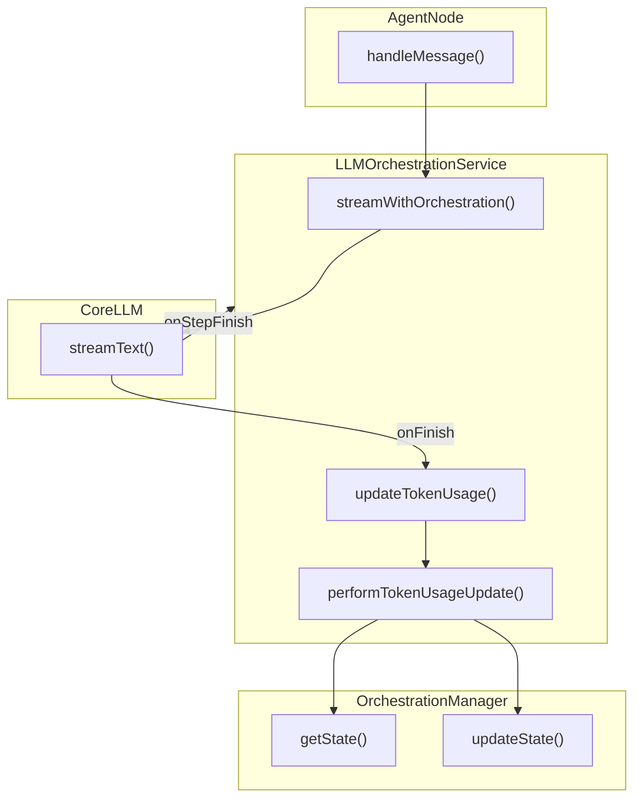
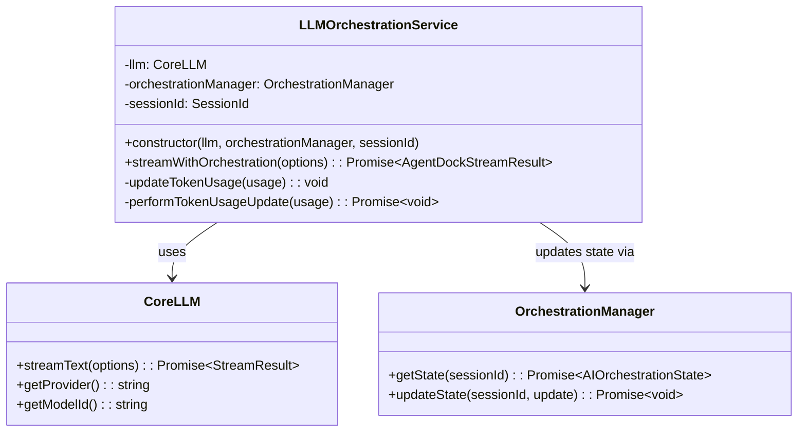
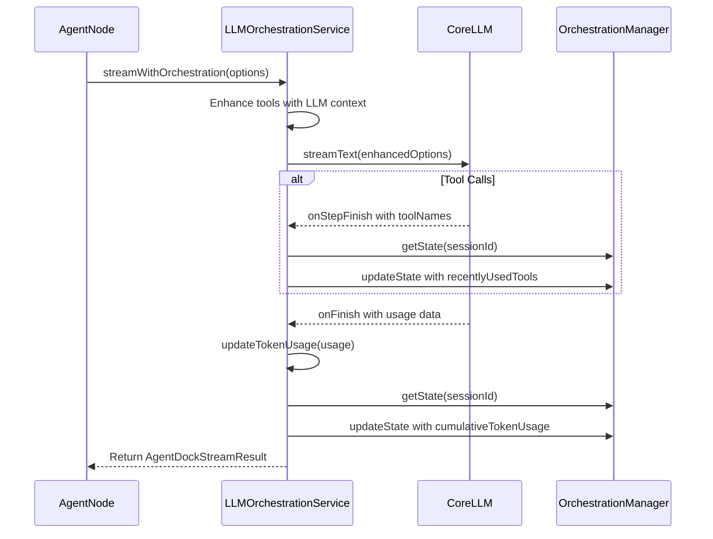
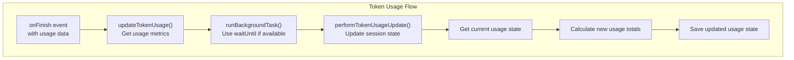
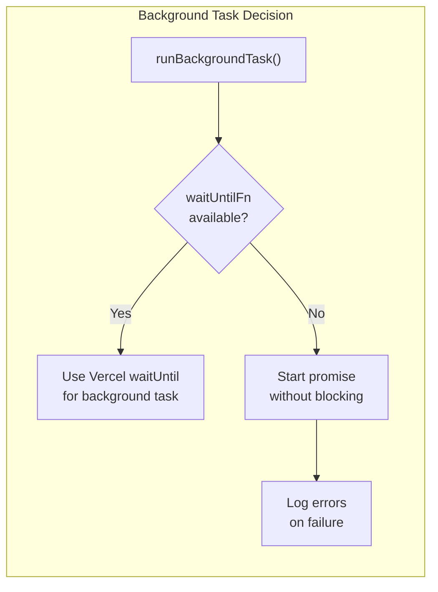
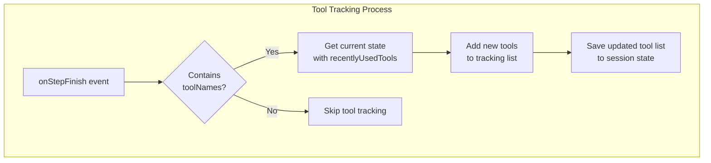
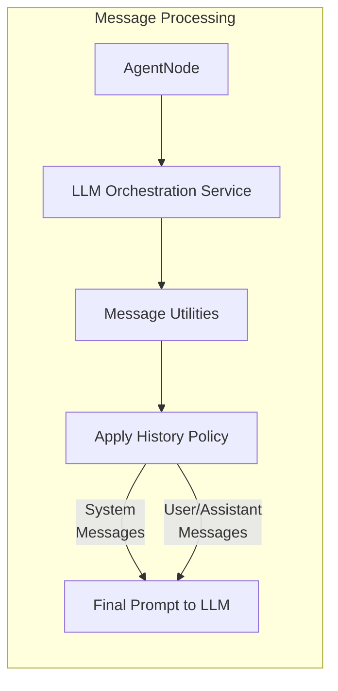

<!-- source: DeepWiki mcp.deepwiki.com · repo AgentDock/AgentDock · page 3.3 LLM Orchestration Service · fetched 2026-10-26 -->

# LLM Orchestration Service

<details>
<summary>Relevant source files</summary>

The following files were used as context for generating this wiki page:

- [.env.example](.env.example)
- [agentdock-core/src/llm/index.ts](agentdock-core/src/llm/index.ts)
- [agentdock-core/src/llm/llm-orchestration-service.ts](agentdock-core/src/llm/llm-orchestration-service.ts)
- [agentdock-core/src/llm/types.ts](agentdock-core/src/llm/types.ts)
- [agentdock-core/src/types/index.ts](agentdock-core/src/types/index.ts)
- [agentdock-core/src/utils/message-utils.ts](agentdock-core/src/utils/message-utils.ts)

</details>


## Purpose and Scope

The LLM Orchestration Service acts as a bridge between AgentNode and CoreLLM, managing the orchestration logic during LLM streaming. It provides a centralized mechanism for handling language model interactions, tracking token usage, and integrating tools with LLM contexts. This service is responsible for maintaining session state throughout the conversation flow, ensuring proper resource tracking, and facilitating the execution of AI agent tools.

For information about the broader Orchestration System, see [Orchestration System](#2.3). For information about the Provider Registry that manages LLM providers, see [Provider Registry](#3.4).

## Architecture Overview

The LLM Orchestration Service sits at a critical junction in the AgentDock system, connecting the agent logic with language model capabilities.



Sources: [agentdock-core/src/llm/llm-orchestration-service.ts:122-356]()

## Service Initialization

The LLM Orchestration Service requires three components for initialization:

1. **CoreLLM**: The language model implementation
2. **OrchestrationManager**: For managing session state
3. **SessionId**: A unique identifier for the conversation session



Sources: [agentdock-core/src/llm/llm-orchestration-service.ts:122-132]()

## Core Functionality

### Stream Orchestration

The primary method `streamWithOrchestration` orchestrates the interaction with language models by:

1. Wrapping the CoreLLM's `streamText` method
2. Injecting orchestration logic into callbacks
3. Enhancing tools with LLM context
4. Tracking tool usage
5. Managing token consumption



Sources: [agentdock-core/src/llm/llm-orchestration-service.ts:137-303]()

#### Tool Enhancement

The service automatically enhances tools with LLM context, providing them with:

- Reference to the CoreLLM instance
- Provider information (e.g., 'openai', 'anthropic')
- Model ID (e.g., 'gpt-4', 'claude-3')

This allows tools to make LLM-aware decisions during execution.

```typescript
// Tool enhancement with LLM context
wrappedTools[name] = {
  ...tool,
  execute: async (params, execOptions) => {
    const enhancedExecOptions = {
      ...execOptions,
      llmContext: {
        ...(execOptions.llmContext || {}),
        llm: this.llm,
        provider: this.llm.getProvider(),
        model: this.llm.getModelId()
      }
    };
    return tool.execute(params, enhancedExecOptions);
  }
};
```

Sources: [agentdock-core/src/llm/llm-orchestration-service.ts:251-284]()

### Token Usage Tracking

The service maintains a cumulative count of tokens used throughout a session:



The token usage tracking system:

1. Captures token metrics from LLM responses
2. Accumulates prompt, completion, and total tokens
3. Stores the data in session state via the OrchestrationManager
4. Uses Vercel's `waitUntil` function in production environments for background processing

Sources: [agentdock-core/src/llm/llm-orchestration-service.ts:309-354]()

### Background Task Handling

The service implements a smart background task system that:

1. Uses Vercel's `waitUntil` function in production environments to ensure background tasks complete
2. Falls back to a simple promise-based approach for local development
3. Handles errors gracefully without blocking the main response stream



Sources: [agentdock-core/src/llm/llm-orchestration-service.ts:22-59]()

## Tool Usage Tracking

The service automatically tracks which tools are used during a conversation by:

1. Detecting tool calls in the `onStepFinish` event
2. Extracting tool names from the event data
3. Updating the session's `recentlyUsedTools` array
4. Storing the updated list via the OrchestrationManager

This information can be used to understand agent behavior patterns and optimize tool configurations.



Sources: [agentdock-core/src/llm/llm-orchestration-service.ts:177-230]()

## Integration with Messages and History

The LLM Orchestration Service works with message utilities to manage conversation history according to configured policies.



The history policy controls how many messages are retained and sent to the LLM:

| Policy | Description | Use Case |
|--------|-------------|----------|
| `none` | Only system messages are retained | When no conversation context is needed |
| `lastN` | System messages + last N user messages | Normal conversational agents |
| `all` | All messages are retained | When full history is critical |

Sources: [agentdock-core/src/utils/message-utils.ts:81-158]()

## Token Usage Structure

The service tracks token usage with a standardized structure:

```typescript
interface TokenUsage {
  promptTokens: number;   // Tokens in the prompt/input
  completionTokens: number;  // Tokens in the completion/response
  totalTokens: number;    // Total tokens used
  provider?: string;      // Optional provider information
}
```

This information is tracked per request and cumulatively across the session.

Sources: [agentdock-core/src/llm/types.ts:8-13]()

## Environment Configuration

The service supports different execution environments through environment variables:

| Environment Variable | Purpose | Impact on Orchestration |
|---------------------|---------|-------------------------|
| `AGENTDOCK_EXECUTION_ENV` | Identifies execution environment | Determines if `waitUntil` is available |
| `NODE_ENV` | Development/production mode | Controls logging verbosity |

The service auto-detects Vercel environments to use platform-specific features like `waitUntil` for background tasks.

Sources: [.env.example:94-96](), [agentdock-core/src/llm/llm-orchestration-service.ts:25-42]()

---

