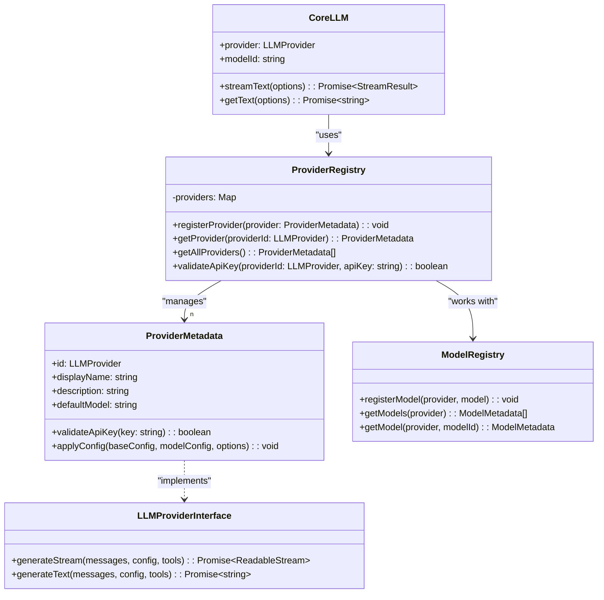
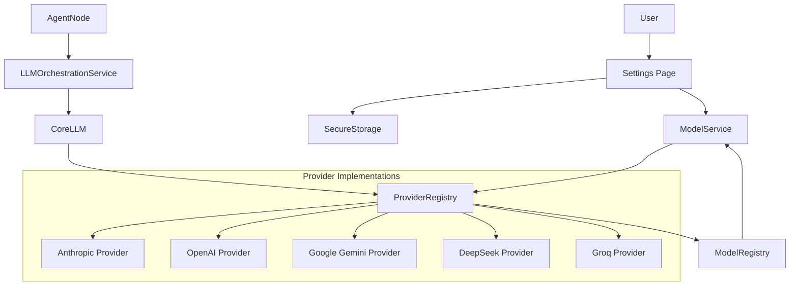
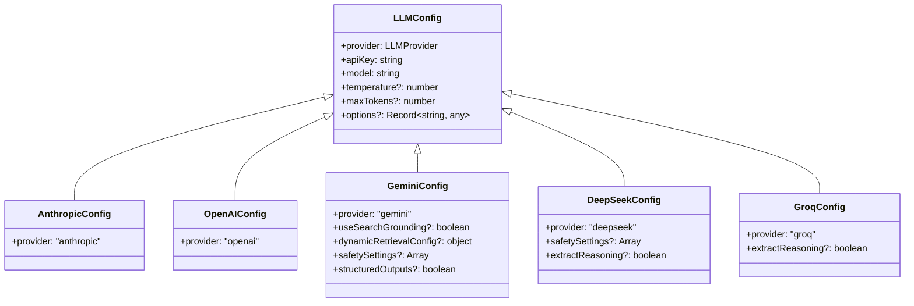
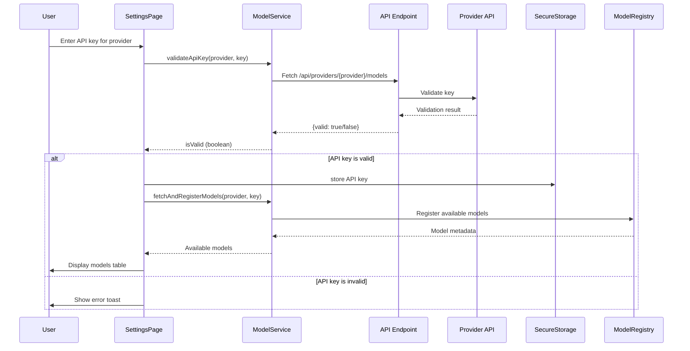
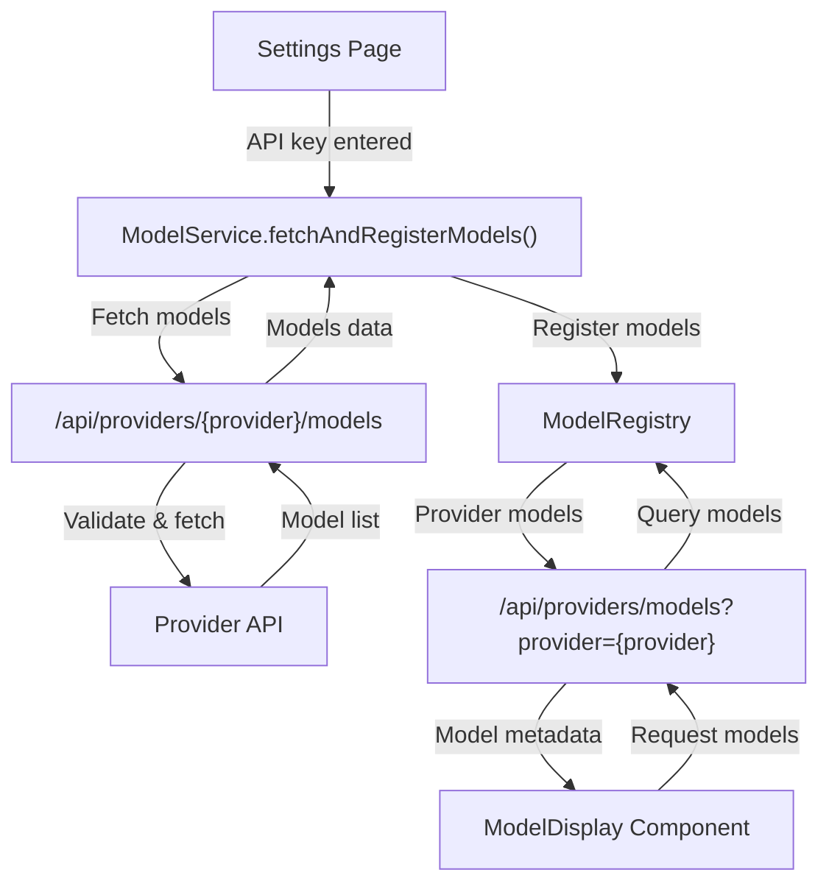
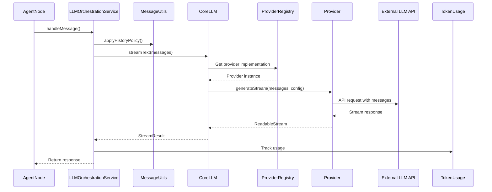

<!-- source: DeepWiki mcp.deepwiki.com · repo AgentDock/AgentDock · page 3.4 Provider Registry · fetched 2026-10-26 -->

# Provider Registry

<details>
<summary>Relevant source files</summary>

The following files were used as context for generating this wiki page:

- [agentdock-core/src/llm/index.ts](agentdock-core/src/llm/index.ts)
- [agentdock-core/src/llm/types.ts](agentdock-core/src/llm/types.ts)
- [agentdock-core/src/types/index.ts](agentdock-core/src/types/index.ts)
- [agentdock-core/src/utils/message-utils.ts](agentdock-core/src/utils/message-utils.ts)
- [src/app/settings/debug-panel.tsx](src/app/settings/debug-panel.tsx)
- [src/app/settings/model-display.tsx](src/app/settings/model-display.tsx)
- [src/app/settings/page.tsx](src/app/settings/page.tsx)
- [src/app/settings/types.ts](src/app/settings/types.ts)
- [src/lib/models/registry.ts](src/lib/models/registry.ts)
- [src/lib/services/model-service.ts](src/lib/services/model-service.ts)

</details>


The Provider Registry is a core component of the AgentDock framework responsible for managing different Large Language Model (LLM) providers. It maintains a centralized registry of LLM providers (OpenAI, Anthropic, Google Gemini, DeepSeek, Groq), handles provider-specific configurations, and facilitates API key validation. This enables a uniform interface for the rest of the system to interact with different LLM services while abstracting away provider-specific implementation details.

For information about the LLM Orchestration Service which uses the Provider Registry, see [LLM Orchestration Service](#3.3).

## Architecture Overview

The Provider Registry operates as a bridge between the AgentDock framework and external LLM provider APIs. It manages provider metadata, implements provider-specific logic, and works closely with the Model Registry to maintain available models for each provider.

### Provider Registry System Architecture



Sources:
- [agentdock-core/src/llm/index.ts:54-54]()
- [agentdock-core/src/llm/types.ts:18-18]()
- [agentdock-core/src/llm/types.ts:132-135]()
- [agentdock-core/src/llm/types.ts:160-168]()

## Integration with AgentDock Core

The Provider Registry is a key component in the LLM subsystem of AgentDock, facilitating communication between different parts of the system and external LLM services.

### LLM Integration Flow



Sources:
- [src/app/settings/page.tsx:31-37]()
- [agentdock-core/src/llm/index.ts:41-55]()
- [src/lib/services/model-service.ts:6-6]()

## Supported LLM Providers

The Provider Registry currently supports the following LLM providers:

| Provider ID | Display Name | Description |
|-------------|--------------|-------------|
| `anthropic` | Anthropic | Provider for Claude models |
| `openai` | OpenAI | Provider for GPT models |
| `gemini` | Google Gemini | Provider for Google's Gemini models |
| `deepseek` | DeepSeek | Provider for DeepSeek models including DeepSeek-V3 and DeepSeek-R1 |
| `groq` | Groq | Provider for hosted models like Llama 3 and Mixtral |

Each provider has its own specific configuration requirements and capabilities, which are encapsulated in their respective provider metadata.

Sources:
- [agentdock-core/src/llm/types.ts:18-18]()
- [src/app/settings/page.tsx:31-37]()

## Provider Metadata

Each LLM provider in the registry has associated metadata that includes:

```typescript
export interface ProviderMetadata {
  id: LLMProvider;
  displayName: string;
  description?: string;
  validateApiKey: (key: string) => boolean;
  defaultModel: string;
  applyConfig?: (baseConfig: any, modelConfig: any, options?: any) => void;
}
```

These metadata entries serve several important purposes:
1. Identify and describe the provider
2. Provide API key validation functionality
3. Specify default models
4. Apply provider-specific configurations

Sources:
- [agentdock-core/src/llm/types.ts:160-168]()

## Provider-Specific Configurations

Each provider can have unique configuration requirements:

### Configuration Types



Sources:
- [agentdock-core/src/llm/types.ts:23-31]()
- [agentdock-core/src/llm/types.ts:66-125]()

## API Key Management

The Provider Registry works together with the ModelService to handle API key validation and storage:

### API Key Validation Flow



Sources:
- [src/app/settings/page.tsx:76-157]()
- [src/lib/services/model-service.ts:49-64]()
- [src/app/settings/model-display.tsx:124-187]()

## Model Registry Integration

The Provider Registry works closely with the Model Registry to track available models for each provider:

### Model Fetching and Registration



Sources:
- [src/app/settings/model-display.tsx:118-248]()
- [src/lib/services/model-service.ts:17-43]()
- [src/lib/models/registry.ts:5-5]()

## Implementation Details

### LLM Provider Interface

All provider implementations must conform to the LLMProviderInterface:

```typescript
export interface LLMProviderInterface {
  generateStream(messages: LLMMessage[], config: LLMConfig, tools?: any): Promise<ReadableStream>;
  generateText(messages: LLMMessage[], config: LLMConfig, tools?: any): Promise<string>;
}
```

This interface ensures that all providers support both streaming and non-streaming text generation, which is essential for the unified experience across different LLM services.

Sources:
- [agentdock-core/src/llm/types.ts:132-135]()

### Message Processing Flow

When an agent needs to generate text using an LLM, it goes through the following flow:



Sources:
- [agentdock-core/src/utils/message-utils.ts:81-158]()
- [agentdock-core/src/llm/types.ts:8-13]()

## Settings UI Integration

The Provider Registry integrates with the Settings UI in the OSS client, allowing users to:

1. Enter and validate API keys for each provider
2. View available models for each provider
3. Configure provider-specific settings

### Settings Page API Key Management

The Settings page provides separate input fields for each supported provider:

```typescript
// Memoize API key providers to prevent recreation on each render
const API_KEY_PROVIDERS: ApiKeyProvider[] = [
  { key: 'openai', label: 'OpenAI API Key', icon: KeyRound, description: 'Used for OpenAI models like GPT-4 and GPT-3.5' },
  { key: 'anthropic', label: 'Anthropic API Key', icon: KeyRound, description: 'Used for Anthropic Claude models' },
  { key: 'gemini', label: 'Google Gemini API Key', icon: KeyRound, description: 'Used for Google Gemini models' },
  { key: 'deepseek', label: 'DeepSeek API Key', icon: KeyRound, description: 'Used for DeepSeek models including DeepSeek-V3 and DeepSeek-R1' },
  { key: 'groq', label: 'Groq API Key', icon: KeyRound, description: 'Used for Groq models like Llama 3 and Mixtral' }
];
```

When an API key is entered and validated, the system:
1. Stores the key securely
2. Fetches available models from the provider
3. Registers these models in the ModelRegistry
4. Displays available models to the user

Sources:
- [src/app/settings/page.tsx:31-37]()
- [src/app/settings/page.tsx:76-196]()
- [src/app/settings/model-display.tsx:118-248]()

## BYOK (Bring Your Own Key) Mode

The Provider Registry supports a "BYOK Only" mode which requires users to provide their own API keys:

```typescript
// Handle BYOK only mode toggle
const handleByokOnlyChange = useCallback((checked: boolean) => {
  // Update the state
  setSettings(prev => ({
    ...prev,
    core: {
      ...prev.core,
      byokOnly: checked
    }
  }))
  setError(null)
  
  // Store BYOK setting in localStorage ONLY
  try {
    localStorage.setItem('byokOnly', checked ? 'true' : 'false')
  } catch (error) {
    console.warn("Failed to save BYOK setting to localStorage", error)
  }
  
  // Show appropriate toast message
  if (checked) {
    toast.info("BYOK Mode enabled - Only user-provided API keys will be used")
  } else {
    toast.info("BYOK Mode disabled - System will fall back to environment variables if needed")
  }
}, [])
```

When enabled, this mode ensures that only user-provided API keys are used, and the system will not fall back to environment variables for API keys.

Sources:
- [src/app/settings/page.tsx:199-223]()
- [agentdock-core/src/types/index.ts:11-24]()

## Conclusion

The Provider Registry is a crucial component of AgentDock's LLM integration system, providing a flexible and extensible architecture for supporting multiple LLM providers. It abstracts away provider-specific details while offering a unified interface for the rest of the system, making it easier to add new providers and models as they become available.

---

