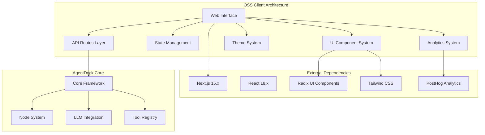
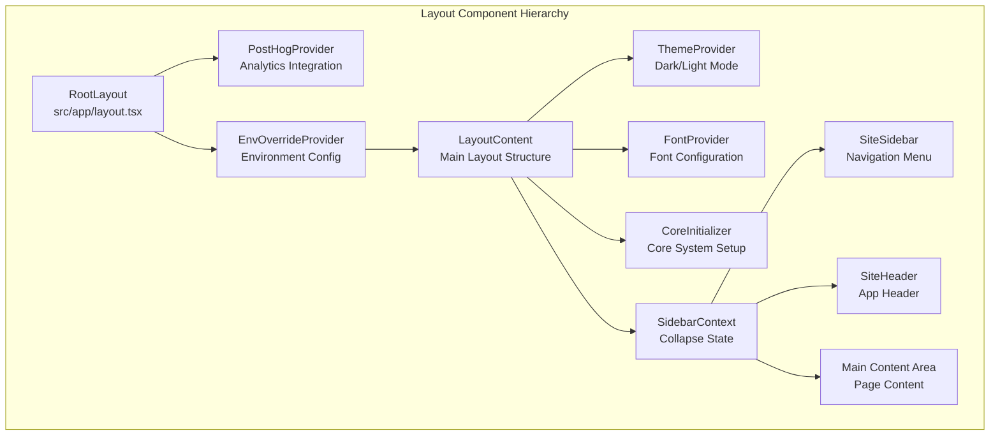
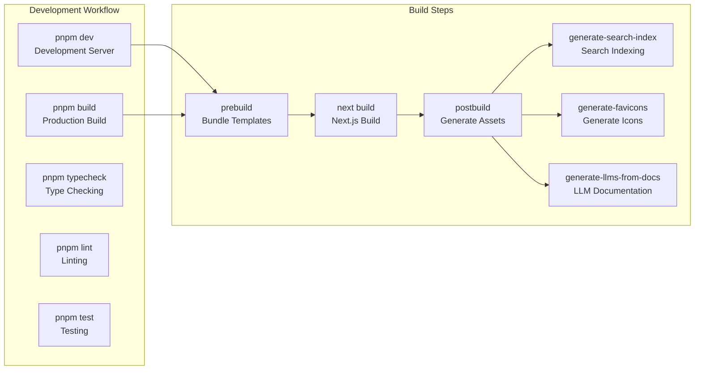

<!-- source: DeepWiki mcp.deepwiki.com · repo AgentDock/AgentDock · page 4 OSS Client · fetched 2026-10-26 -->

# OSS Client

<details>
<summary>Relevant source files</summary>

The following files were used as context for generating this wiki page:

- [package.json](package.json)
- [pnpm-lock.yaml](pnpm-lock.yaml)
- [scripts/generate-favicons.js](scripts/generate-favicons.js)
- [src/app/layout.tsx](src/app/layout.tsx)
- [src/components/layout/layout-content.tsx](src/components/layout/layout-content.tsx)
- [src/components/providers/posthog-provider.tsx](src/components/providers/posthog-provider.tsx)
- [src/lib/analytics.ts](src/lib/analytics.ts)
- [tailwind.config.ts](tailwind.config.ts)

</details>


The AgentDock OSS (Open Source Software) Client is a modern web application built with Next.js that provides the user interface for interacting with the AgentDock framework. It serves as the primary interface between users and the core functionality, offering a responsive, accessible, and feature-rich experience for working with AI agents.

## Overview

The OSS Client implements a complete web interface to access AgentDock's capabilities, with a focus on usability and developer experience. It connects to the `agentdock-core` framework and provides API routes, UI components, state management, and integration with external services.



Sources: [package.json:1-173](), [src/app/layout.tsx:1-58]()

## Technology Stack

The OSS Client is built on a modern web technology stack:

| Component | Technology | Purpose |
|-----------|------------|---------|
| Framework | Next.js 15.x | Server-side rendering, routing, API routes |
| UI Library | React 18.x | Component-based UI development |
| Component Library | Radix UI | Accessible, composable UI primitives |
| Styling | Tailwind CSS | Utility-first CSS framework |
| State Management | Zustand | Lightweight state management |
| Icons | Lucide React | SVG icon library |
| Analytics | PostHog | User analytics and tracking |
| Fonts | Geist Sans/Mono, Inter | Typography |

Sources: [package.json:36-127]()

## Client Architecture

The OSS Client follows a hierarchical architecture with clear separation of concerns:

```mermaid
classDiagram
    class RootLayout {
        +GeistSans font
        +GeistMono font
        +Inter font
        +PostHogProvider
        +EnvOverrideProvider
        +LayoutContent
    }
    
    class LayoutContent {
        +SidebarContext
        +ThemeProvider
        +FontProvider
        +CoreInitializer
        +SiteSidebar
        +SiteHeader
    }
    
    class PostHogProvider {
        +apiKey: string
        +apiHost: string
        +enabled: boolean
        +capture(event, properties)
    }
    
    class PageRoutes {
        +HomePage
        +ChatPage
        +AgentsPage
        +SettingsPage
        +DocsPage
    }
    
    class APIRoutes {
        +/api/chat/[agentId]
        +/api/agents
        +/api/settings
        +/api/tools/*
    }
    
    RootLayout --> PostHogProvider
    RootLayout --> LayoutContent
    LayoutContent --> PageRoutes
    LayoutContent --> "UI Components"
    LayoutContent --> "State Management"
    PageRoutes --> APIRoutes
    APIRoutes --> "agentdock-core"
```

Sources: [src/app/layout.tsx:1-58](), [src/components/layout/layout-content.tsx:1-81]()

## Layout System

The layout system provides the structure for the application with the following components:

- **RootLayout**: The top-level layout that sets up fonts, analytics, and global providers
- **LayoutContent**: Manages the main layout structure with responsive sidebar and content area
- **SiteSidebar**: Navigation sidebar that can be collapsed/expanded
- **SiteHeader**: Top navigation bar with theme toggle and mobile controls

The layout system is responsive and adapts to different screen sizes, with special considerations for mobile devices.



Sources: [src/components/layout/layout-content.tsx:1-81](), [src/app/layout.tsx:1-58]()

## Analytics Integration

The OSS Client integrates PostHog for analytics tracking with careful consideration for performance and privacy. It includes both client-side and server-side implementations:

### Client-Side Analytics

The client-side analytics system uses the PostHog JavaScript SDK with specific configurations to avoid interfering with tool calling functionality:

```mermaid
flowchart TD
    subgraph "Client-Side Analytics"
        PostHogProvider["PostHogProvider<br>src/components/providers/posthog-provider.tsx"]
        PostHogContext["PostHogContext<br>React Context"]
        PageViewTracker["PageViewTracker<br>Automatic Page Tracking"]
        CaptureFunc["capture()<br>Event Tracking Function"]
        
        PostHogProvider --> PostHogContext
        PostHogProvider --> PageViewTracker
        PostHogContext --> CaptureFunc
        
        CaptureFunc --> PostHogJS["PostHog JS SDK"]
        PageViewTracker --> PostHogJS
    end
    
    subgraph "Server-Side Analytics"
        ServerAnalytics["analytics.ts<br>Server-Side Module"]
        PHInstance["PostHog Node Instance"]
        CaptureEvent["captureEvent()<br>Server Event Tracking"]
        IdentifyUser["identifyUser()<br>User Identification"]
        FlushAnalytics["flushAnalytics()<br>Force Send Events"]
        
        ServerAnalytics --> PHInstance
        ServerAnalytics --> CaptureEvent
        ServerAnalytics --> IdentifyUser
        ServerAnalytics --> FlushAnalytics
        
        CaptureEvent --> PHInstance
        IdentifyUser --> PHInstance
        FlushAnalytics --> PHInstance
    end
    
    PostHogJS <--> "PostHog Cloud"
    PHInstance <--> "PostHog Cloud"
```

The analytics system is designed with the following principles:

1. Non-blocking: Analytics operations never block the main thread
2. Fail-safe: Errors in analytics never affect the application
3. Configurable: Can be disabled in development or based on user preferences
4. Privacy-focused: Only collects necessary information

Sources: [src/components/providers/posthog-provider.tsx:1-137](), [src/lib/analytics.ts:1-175]()

## UI Component System

The UI component system uses a combination of Radix UI primitives and custom components styled with Tailwind CSS. The components are organized into categories:

1. **Layout Components**: Define the structure of the application
2. **Form Components**: Input elements and form controls
3. **Display Components**: Content presentation components
4. **Interactive Components**: Dialog, dropdown, and action components
5. **Feedback Components**: Loading indicators, notifications, etc.

The UI system leverages Tailwind's utility classes for styling, with custom theme extensions for colors, spacing, and animations.

```mermaid
flowchart TD
    subgraph "UI Component Architecture"
        RadixUI["Radix UI Primitives"]
        TailwindCSS["Tailwind CSS Styling"]
        ComponentLib["Custom Component Library"]
        
        RadixUI --> ComponentLib
        TailwindCSS --> ComponentLib
        
        ComponentLib --> Layout["Layout Components"]
        ComponentLib --> Form["Form Components"]
        ComponentLib --> Display["Display Components"]
        ComponentLib --> Interactive["Interactive Components"]
        ComponentLib --> Feedback["Feedback Components"]
        
        Layout --> Pages["Page Layouts"]
        Form --> Dialogs["Dialog Forms"]
        Display --> "Content Views"
        Interactive --> "User Actions"
        Feedback --> "User Notifications"
    end
```

The theme system supports both light and dark modes, with custom color schemes defined in the Tailwind configuration.

Sources: [package.json:36-73](), [tailwind.config.ts:1-239]()

## Build and Development System

The OSS Client includes comprehensive build and development tooling:



Key build processes include:

1. **Template Bundling**: Compiles agent templates before build
2. **Asset Generation**: Creates favicons, search indices, and LLM documentation
3. **Type Checking**: Ensures type safety across the codebase
4. **Linting**: Enforces code quality and consistency

Sources: [package.json:10-34](), [scripts/generate-favicons.js:1-44]()

## Integration with AgentDock Core

The OSS Client integrates with the `agentdock-core` framework through:

1. **API Routes**: Next.js API endpoints that communicate with the core
2. **Core Initializer**: Component that initializes the core system
3. **Agent Adapters**: Adapters for specific agent types and capabilities

```mermaid
flowchart TD
    subgraph "OSS Client"
        APIRoutes["API Routes<br>/api/chat/[agentId]<br>/api/agents<br>/api/tools/*"]
        CoreInit["CoreInitializer<br>Component"]
        UILayer["UI Components"]
        StateManagement["State Management"]
    end
    
    subgraph "agentdock-core"
        CoreFramework["Core Framework"]
        AgentNode["AgentNode"]
        LLMService["LLM Orchestration"]
        ToolReg["Tool Registry"]
    end
    
    APIRoutes --> CoreFramework
    CoreInit --> CoreFramework
    UILayer --> StateManagement
    StateManagement --> APIRoutes
    
    CoreFramework --> AgentNode
    CoreFramework --> LLMService
    CoreFramework --> ToolReg
    
    AgentNode --> "Agent Templates"
    ToolReg --> "Available Tools"
    LLMService --> "LLM Providers"
```

The integration is designed to provide a seamless experience, with the OSS Client handling UI concerns while delegating core functionality to `agentdock-core`.

Sources: [src/components/layout/layout-content.tsx:57-58]()

## Summary

The OSS Client delivers a complete web interface for AgentDock, combining a modern web technology stack with the powerful capabilities of the `agentdock-core` framework. Its modular architecture, component-based UI system, and comprehensive build tooling make it both powerful for users and approachable for developers.

For more information about specific subsystems, refer to:
- [UI Components](#4.1) for details on the UI component system
- [Chat Interface](#4.2) for the chat functionality
- [API Routes](#4.3) for server-side API integration
- [Layout System](#4.4) for more on the application structure

---

