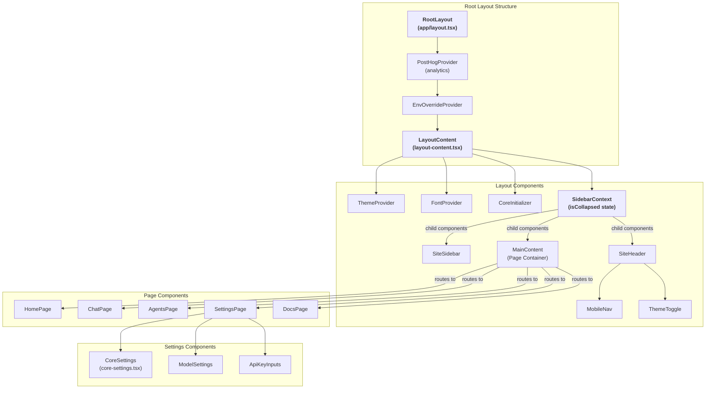
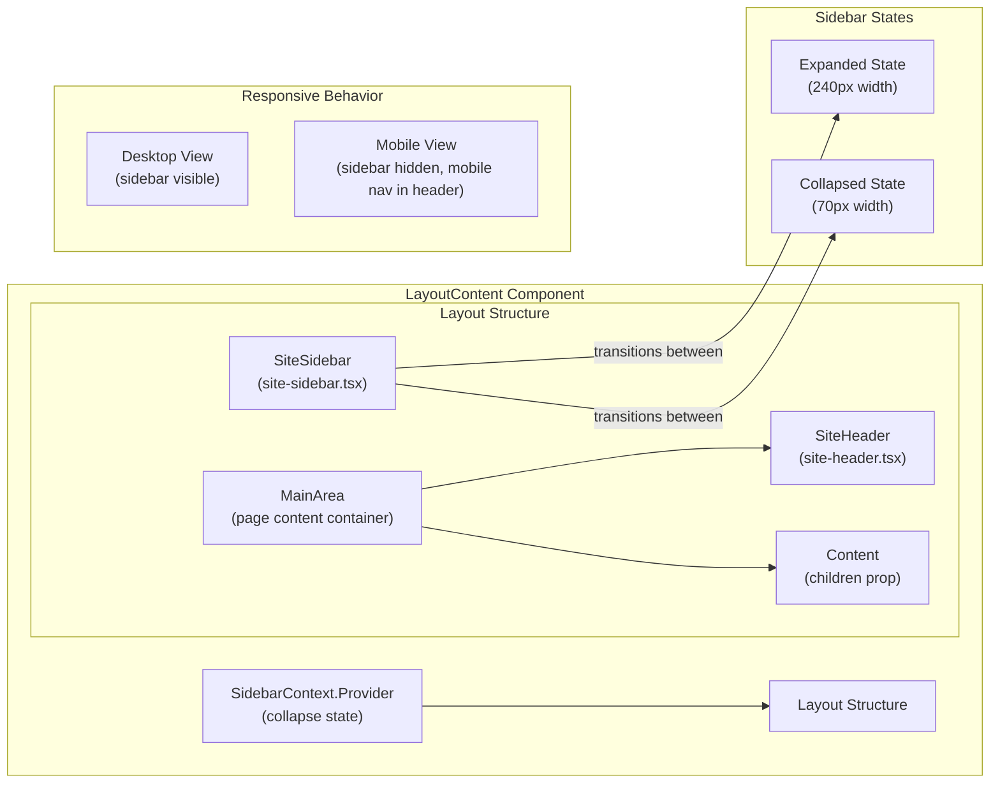
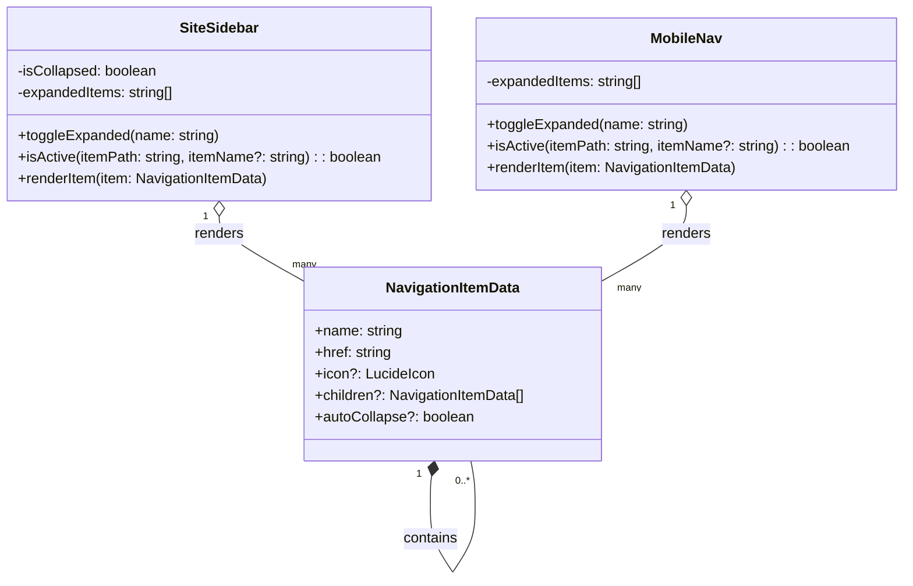
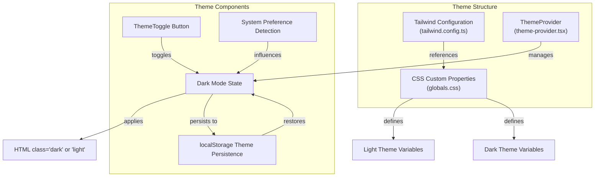
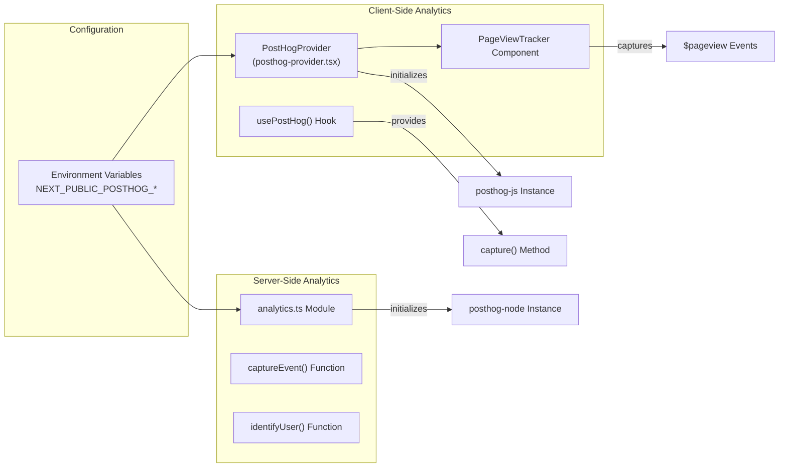
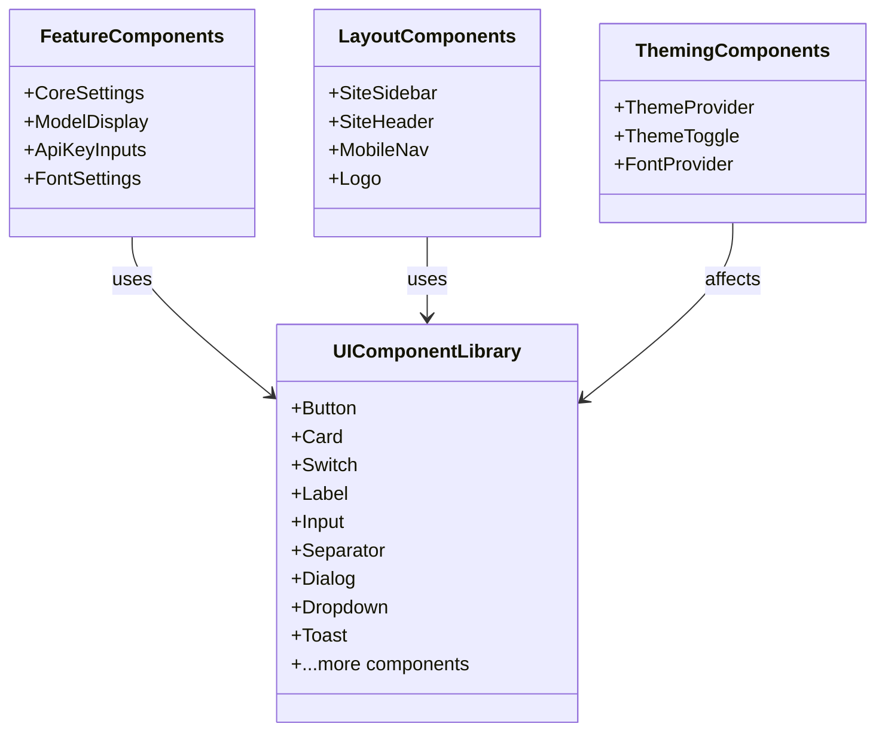
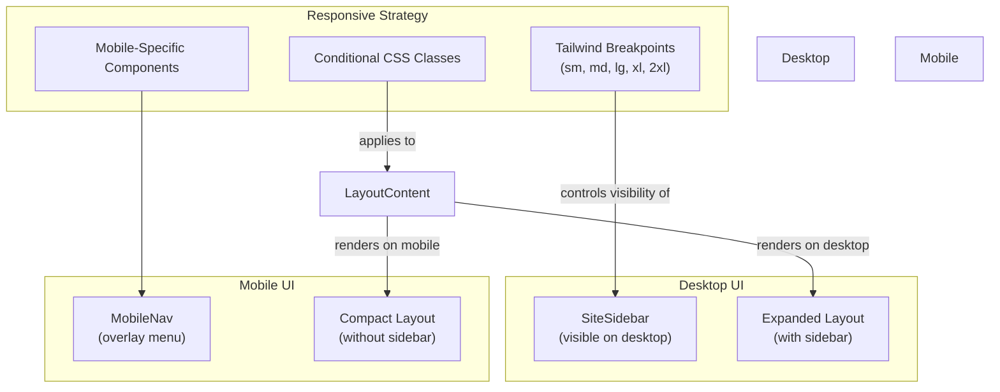

<!-- source: DeepWiki mcp.deepwiki.com · repo AgentDock/AgentDock · page 4.1 UI Components · fetched 2026-10-26 -->

# UI Components

<details>
<summary>Relevant source files</summary>

The following files were used as context for generating this wiki page:

- [src/app/globals.css](src/app/globals.css)
- [src/app/layout.tsx](src/app/layout.tsx)
- [src/app/settings/core-settings.tsx](src/app/settings/core-settings.tsx)
- [src/components/layout/layout-content.tsx](src/components/layout/layout-content.tsx)
- [src/components/layout/mobile-nav.tsx](src/components/layout/mobile-nav.tsx)
- [src/components/layout/site-sidebar.tsx](src/components/layout/site-sidebar.tsx)
- [src/components/providers/posthog-provider.tsx](src/components/providers/posthog-provider.tsx)
- [src/lib/analytics.ts](src/lib/analytics.ts)
- [tailwind.config.ts](tailwind.config.ts)

</details>


This page documents the UI component architecture within the AgentDock Open Source Client. The client is built with Next.js and uses a composable component-based approach. This documentation covers the layout structure, key components, theming system, and how these components interact to create the user interface.

For information on the Chat Interface specifically, see [Chat Interface](#4.2). For details on the Layout System, see [Layout System](#4.4).

## Component Hierarchy and Architecture

The AgentDock UI follows a structured hierarchy of components, starting from the root layout and flowing down to specific components for different functionality areas.



Sources: [src/app/layout.tsx:26-58](), [src/components/layout/layout-content.tsx:30-81]()

The UI component architecture follows a hierarchical structure where the `RootLayout` sets up the basic structure, including analytics via `PostHogProvider`. The `LayoutContent` component serves as the main structural component, providing context for sidebar state and positioning the main layout elements.

## Layout System

The layout system consists of three main components: the `SiteSidebar`, `SiteHeader`, and the main content area. These components work together to create a responsive layout that adapts to different screen sizes.



Sources: [src/components/layout/layout-content.tsx:30-81](), [src/components/layout/site-sidebar.tsx:78-272]()

The layout system uses a context-based approach to manage the sidebar's collapsed state. The `SidebarContext` provides state and handlers that allow components to check and modify the sidebar state:

```typescript
interface SidebarContextType {
  isCollapsed: boolean;
  setIsCollapsed: (value: boolean) => void;
  toggleSidebar: () => void;
  expandSidebar: () => void;
}
```

Key features of the layout system:
- Automatic sidebar collapsing on documentation pages
- Responsive transitions between collapsed (70px) and expanded (240px) states
- Mobile-specific layout handling that hides the sidebar and shows a mobile navigation
- CSS transitions for smooth state changes

## Navigation Components

AgentDock implements two main navigation components:

1. `SiteSidebar` - Desktop navigation sidebar
2. `MobileNav` - Mobile navigation overlay

Both components share a similar structure and data source but are optimized for different screen sizes.



Sources: [src/components/layout/site-sidebar.tsx:13-272](), [src/components/layout/mobile-nav.tsx:12-240]()

The navigation structure is defined using the `NavigationItemData` interface, which allows for nested navigation items. The navigation sections include:

1. Core navigation items (Agents, Settings, Docs)
2. Additional platform features (Image Generation)

Navigation items can have children, creating expandable sections, such as the Agents section which contains categories populated from `AGENT_TAGS`.

## Theming System

AgentDock implements a comprehensive theming system with light and dark mode support. The theme variables are defined in CSS and managed through a combination of Next.js and React components.



Sources: [src/app/globals.css:5-648](), [tailwind.config.ts:1-238]()

The theming system uses CSS variables (custom properties) defined in `globals.css` to control colors, spacing, and other design aspects. Key features include:

- Semantic color variables (primary, secondary, muted, etc.)
- Dark and light mode variants for all color variables
- Special sidebar-specific variables
- Animation properties
- Font family variables

Example of theme variable definition:

```css
:root {
  --background: 0 0% 100%;
  --foreground: 240 10% 3.9%;
  --primary: 217 91% 60%;
  --primary-foreground: 0 0% 98%;
  /* ... more variables ... */
}

.dark {
  --background: 240 10% 3.9%;
  --foreground: 0 0% 98%;
  --primary: 217 91% 65%;
  --primary-foreground: 0 0% 98%;
  /* ... dark mode variables ... */
}
```

## Analytics Integration

AgentDock integrates PostHog for analytics at both client-side and server-side levels.



Sources: [src/components/providers/posthog-provider.tsx:1-137](), [src/lib/analytics.ts:1-175]()

The analytics integration is carefully designed to avoid interference with core functionality:

- Client-side analytics use `posthog-js` with configuration to prevent interference with tool calling
- Server-side analytics use `posthog-node` for event tracking without affecting request processing
- Key analytics features include:
  - Page view tracking
  - Custom event capturing
  - User identification
  - Debug mode in development
  - Configurable enabling/disabling

## Core UI Components

AgentDock's UI is built using a set of reusable components that provide consistent styling and behavior across the application.



Sources: [src/app/settings/core-settings.tsx:1-105]()

The UI components follow a consistent pattern of composition, where more complex components are built from simpler ones. For example, the `CoreSettings` component combines:

- `Card` for containing the settings section
- `Label` for labeling controls
- `Switch` for toggle inputs
- `Separator` for visual separation
- Icons from the Lucide library

This composition approach allows for consistent styling and behavior across the application.

## Mobile Responsiveness

AgentDock's UI is designed to be responsive across different screen sizes. The responsive design is implemented through a combination of CSS media queries, conditional rendering, and specialized mobile components.



Sources: [src/components/layout/layout-content.tsx:30-81](), [src/components/layout/site-sidebar.tsx:230-272](), [src/components/layout/mobile-nav.tsx:72-240]()

Key features of the mobile responsive implementation:

1. **Conditional Visibility**: The sidebar is hidden on mobile (`hidden md:block` class) and replaced with a mobile navigation component.

2. **Adaptive Layout**: The main content area adjusts its margins based on the sidebar state:
   ```tsx
   className={cn(
     "flex min-h-screen flex-col transition-all duration-300 ease-in-out",
     isCollapsed ? "md:ml-[70px]" : "md:ml-[240px]"
   )}
   ```

3. **Specialized Mobile Components**: The `MobileNav` component is optimized for touch interaction and smaller screens.

4. **Responsive Adjustments**: Padding, spacing, and font sizes adjust based on screen size using Tailwind's responsive utility classes.

## Summary

The UI component architecture of AgentDock provides a flexible, modular system for building the user interface. The components are organized in a hierarchy, with layout components at the top, followed by navigation, content, and feature-specific components.

The use of context providers for state management, CSS variables for theming, and responsive design techniques ensures a consistent and adaptable user experience across different devices and screen sizes.

Sources: [src/app/layout.tsx:26-58](), [src/components/layout/layout-content.tsx:30-81](), [src/components/providers/posthog-provider.tsx:77-137]()

---

