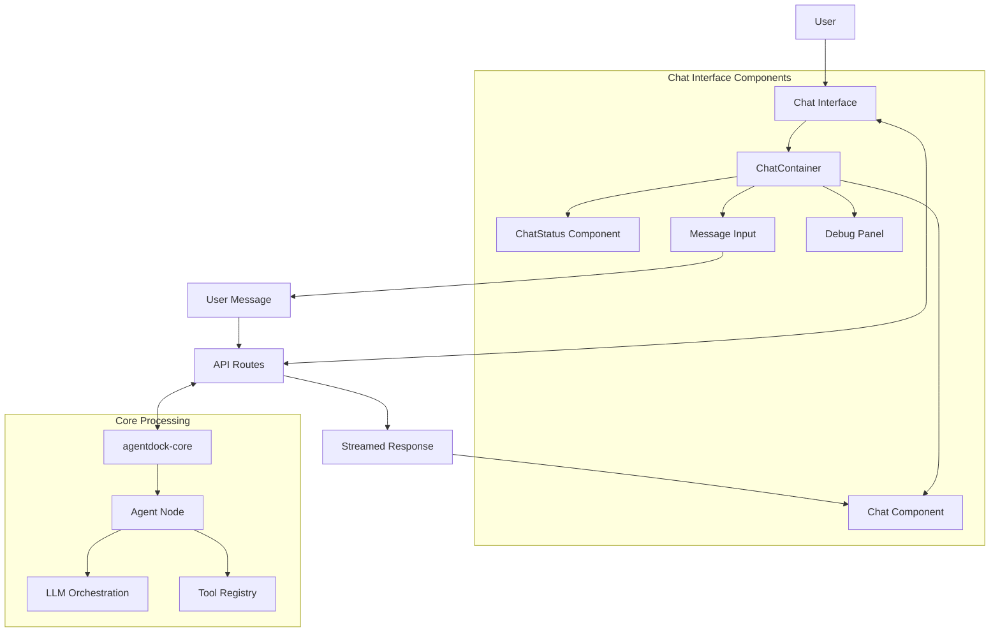
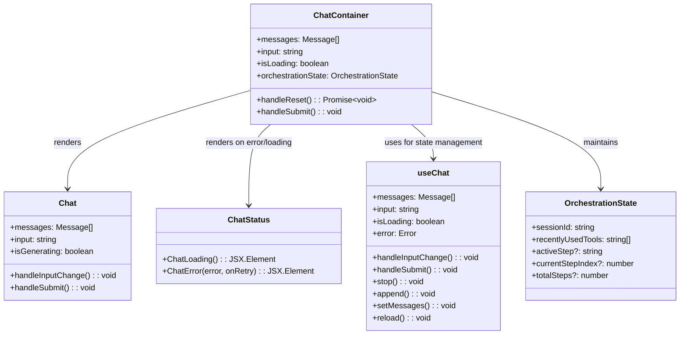
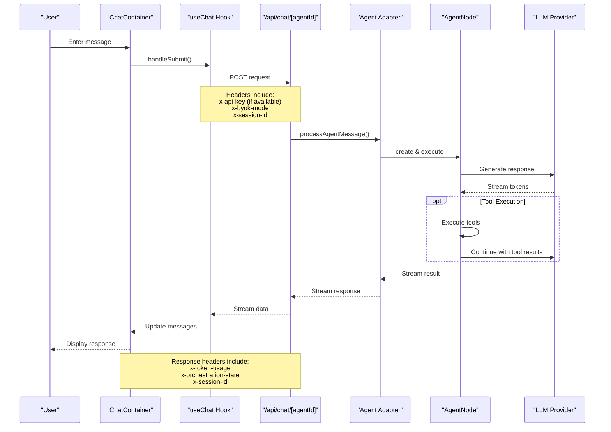
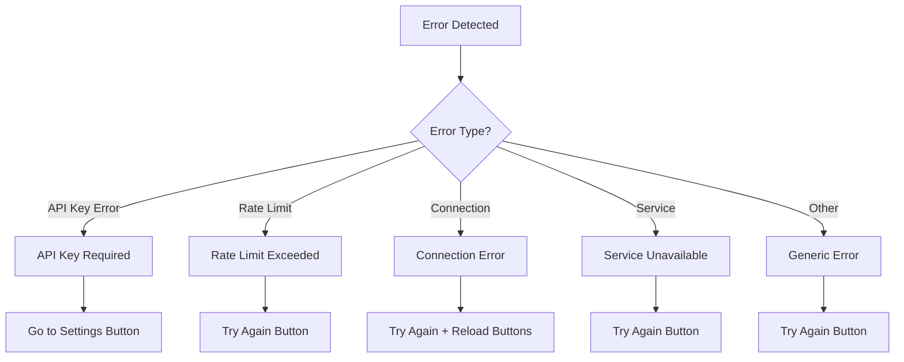
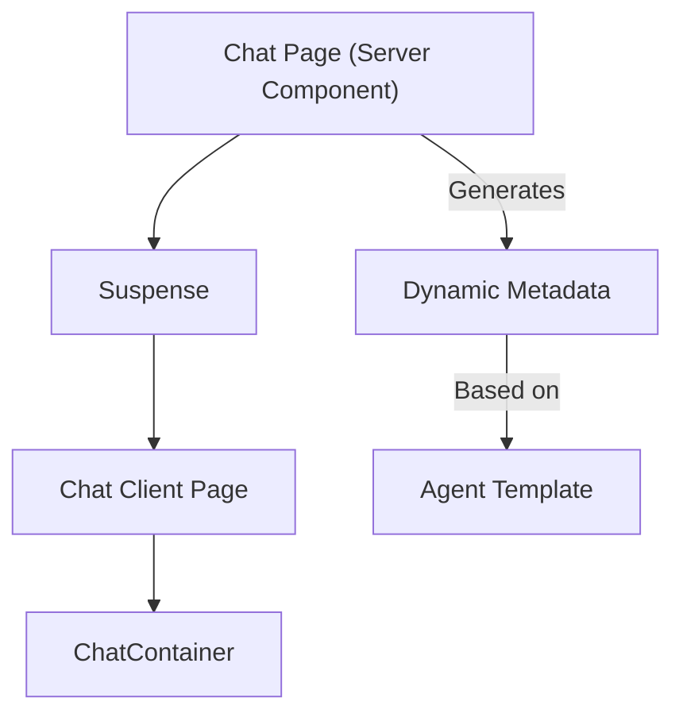

<!-- source: DeepWiki mcp.deepwiki.com · repo AgentDock/AgentDock · page 4.2 Chat Interface · fetched 2026-10-26 -->

# Chat Interface

<details>
<summary>Relevant source files</summary>

The following files were used as context for generating this wiki page:

- [src/app/api/chat/[agentId]/route.ts](src/app/api/chat/[agentId]/route.ts)
- [src/app/chat/page.tsx](src/app/chat/page.tsx)
- [src/app/page.tsx](src/app/page.tsx)
- [src/components/chat/chat-container.tsx](src/components/chat/chat-container.tsx)
- [src/components/chat/chat-status.tsx](src/components/chat/chat-status.tsx)
- [src/components/layout/site-header.tsx](src/components/layout/site-header.tsx)
- [src/components/layout/site-sidebar.tsx](src/components/layout/site-sidebar.tsx)
- [src/hooks/use-session-info.ts](src/hooks/use-session-info.ts)

</details>


This document provides a technical overview of the Chat Interface in AgentDock. The Chat Interface is the primary user interaction point for conversing with AI agents in the OSS Client application. This page covers the client-side components, message flow, and integration with the backend API.

For information about the API Routes that power the chat functionality, see [API Routes](#4.3).

## Overview

The Chat Interface provides a streamlined way for users to interact with AI agents configured in the AgentDock system. It handles message rendering, input management, error states, and orchestrates the flow of information between the user and the agent nodes in the core framework.



Sources: [src/components/chat/chat-container.tsx:83-590](), [src/app/api/chat/[agentId]/route.ts:1-683]()

## Chat Container Component

The `ChatContainer` is the main component that orchestrates the chat interface. It manages the chat state, handles message processing, and renders the chat UI components.

### Key Responsibilities

- Initializes and maintains chat sessions
- Manages message state
- Handles message submissions
- Processes streamed responses
- Manages error states
- Tracks orchestration state
- Provides debugging information



Sources: [src/components/chat/chat-container.tsx:83-590]()

### Configuration and Initialization

The `ChatContainer` component uses several custom hooks to initialize and configure the chat interface:

1. `useChatSettings` - Loads agent-specific chat settings
2. `useChatInitialization` - Handles API key initialization
3. `useChatStorage` - Manages persisting chat state to local storage

The component accepts the following props:

```typescript
export interface ChatContainerProps {
  agentId?: string;
  className?: string;
  header?: React.ReactNode;
  onStateUpdate?: (state: {
    messagesCount?: number;
    orchestration?: OrchestrationState;
  }) => void;
  onChatTurnComplete?: () => void;
}
```

Sources: [src/components/chat/chat-container.tsx:54-63](), [src/components/chat/chat-container.tsx:91-100]()

## Message Flow Process

The message flow in the Chat Interface follows a specific sequence from user input to AI response. The following diagram illustrates this process:



Sources: [src/components/chat/chat-container.tsx:167-309](), [src/app/api/chat/[agentId]/route.ts:391-682]()

### Client-Side Processing

On the client side, the `useChat` hook from agentdock-core handles the majority of the chat functionality:

1. Manages the chat state (messages, input, loading)
2. Sends requests to the API
3. Processes streamed responses
4. Handles tool calls
5. Provides error handling

The hook is configured with several options:

```typescript
const {
  messages,
  input,
  handleInputChange: setInput,
  handleSubmit,
  isLoading,
  stop,
  error: chatError,
  append,
  setMessages,
  reload,
  data
} = useChat({
  id: agentId,
  api: `/api/chat/${agentId}`,
  initialMessages: trimmedInitialMessages,
  streamProtocol: 'data',
  headers: {
    ...(apiKey ? { 'x-api-key': apiKey } : {}),
    'x-byok-mode': byokMode ? 'true' : 'false',
    ...(orchestrationState.sessionId ? { 'x-session-id': orchestrationState.sessionId } : {})
  },
  body: {
    system: chatSettings?.personality,
    temperature: chatSettings?.temperature,
    maxTokens: chatSettings?.maxTokens,
    sessionId: orchestrationState.sessionId || undefined
  },
  // Additional options...
});
```

Sources: [src/components/chat/chat-container.tsx:155-309]()

### Server-Side Processing

The server-side processing occurs in the API route at `src/app/api/chat/[agentId]/route.ts`. This route:

1. Receives the chat request from the client
2. Resolves API keys for the appropriate LLM provider
3. Loads the agent configuration
4. Processes the message using the agent adapter
5. Streams the response back to the client

The core message processing happens in the `processAgentMessage` function:

```typescript
const result = await processAgentMessage({
  agentId,
  messages: messages as Message[],
  sessionId: finalSessionId,
  apiKey,
  provider: llmInfo.provider,
  system,
  config: runtimeOverrides,
  _fallbackApiKey: fallbackApiKey,
  fullAgentConfig: config,
  orchestrationState: orchestrationState
});
```

Sources: [src/app/api/chat/[agentId]/route.ts:610-623]()

## Orchestration State Management

The Chat Interface tracks the orchestration state to manage complex agent behaviors and tool usage. This state is maintained in the `ChatContainer` component and includes:

```typescript
export interface OrchestrationState {
  sessionId: string;
  recentlyUsedTools: string[];
  activeStep?: string;
  currentStepIndex?: number;
  totalSteps?: number;
}
```

The orchestration state is updated from:

1. Response headers (`x-orchestration-state`)
2. Stream data (`data.orchestrationState`)

```mermaid
flowchart LR
    subgraph "Client"
        ChatContainer["ChatContainer"]
        OrchestrationState["Orchestration State"]
    end
    
    subgraph "Server"
        APIRoute["/api/chat/[agentId]"]
        OrchestrationAdapter["Orchestration Adapter"]
        OrchestrationManager["Orchestration Manager"]
    end
    
    ChatContainer --> APIRoute: "Request (sessionId)"
    APIRoute --> OrchestrationAdapter: "Get/Update State"
    OrchestrationAdapter --> OrchestrationManager: "Manage State"
    OrchestrationManager --> OrchestrationAdapter: "Updated State"
    OrchestrationAdapter --> APIRoute: "Add Headers"
    APIRoute --> ChatContainer: "Response (x-orchestration-state)"
    ChatContainer --> OrchestrationState: "Update State"
```

Sources: [src/components/chat/chat-container.tsx:38-44](), [src/components/chat/chat-container.tsx:245-268](), [src/components/chat/chat-container.tsx:392-488]()

## Error Handling and Loading States

The Chat Interface provides robust error handling and loading states to ensure a smooth user experience.

### Loading States

Loading states are managed using:

1. `isLoading` from the `useChat` hook
2. `isInitializing` and `isSettingsLoading` from custom hooks
3. The `ChatLoading` component for visual feedback

```typescript
if (isInitializing || isSettingsLoading) {
  return <ChatLoading />;
}
```

Sources: [src/components/chat/chat-status.tsx:17-24](), [src/components/chat/chat-container.tsx:502-504]()

### Error Handling

Errors are handled at multiple levels:

1. API errors during message processing
2. Initialization errors (API keys, settings)
3. Stream errors from the LLM response

The `ChatError` component displays user-friendly error messages with appropriate actions:



Sources: [src/components/chat/chat-status.tsx:26-199](), [src/components/chat/chat-container.tsx:525-543]()

The error component provides different actions based on the error type:

- API Key errors: Navigate to Settings
- Connection errors: Try Again + Reload Page
- Rate limit/Service errors: Try Again
- Generic errors: Try Again

## Session Management

Sessions are a critical part of the Chat Interface, ensuring conversation context is maintained between interactions. Session management includes:

1. Generating and tracking session IDs
2. Persisting messages to local storage
3. Retrieving session state from the server

The session ID is stored in the orchestration state and included in API requests:

```typescript
headers: {
  ...(apiKey ? { 'x-api-key': apiKey } : {}),
  'x-byok-mode': byokMode ? 'true' : 'false',
  ...(orchestrationState.sessionId ? { 'x-session-id': orchestrationState.sessionId } : {})
},
```

The `useSessionInfo` hook can be used to retrieve additional session information:

```typescript
export interface SessionInfoData {
  sessionId: string;
  activeStep?: string;
  recentlyUsedTools?: string[];
  cumulativeTokenUsage: {
    promptTokens: number;
    completionTokens: number;
    totalTokens: number;
  };
}
```

Sources: [src/hooks/use-session-info.ts:1-101](), [src/components/chat/chat-container.tsx:174-176]()

## Debug Panel

The Chat Interface includes a debug panel that provides additional information about the current chat session. This panel is only visible when debug mode is enabled (via URL parameter or settings).

The debug panel displays:
- Session ID
- Message count
- Model information
- Temperature
- Max tokens
- Provider
- Active orchestration step

```typescript
<ChatDebug
  visible={isDebugEnabled}
  sessionId={orchestrationState.sessionId}
  messagesCount={messagesCount}
  model={chatSettings?.model}
  temperature={chatSettings?.temperature}
  maxTokens={chatSettings?.maxTokens}
  agentId={agentId}
  provider={provider}
  activeStep={orchestrationState.activeStep}
  currentStepIndex={orchestrationState.currentStepIndex}
  totalSteps={orchestrationState.totalSteps}
/>
```

Sources: [src/components/chat/chat-container.tsx:570-586]()

## Chat Page Component

The Chat Interface is used within the Chat Page component, which provides the overall page structure and metadata.



The page determines the agent to use from URL search parameters and provides appropriate metadata:

```typescript
export async function generateMetadata({
  searchParams,
}: {
  params: Promise<PageParams>;
  searchParams: Promise<SearchParams>;
}): Promise<Metadata> {
  const resolvedSearchParams = await searchParams;
  const agentId = resolvedSearchParams?.agent as string | undefined;
  const template = agentId && templates[agentId as TemplateId] 
    ? templates[agentId as TemplateId] as unknown as AgentTemplate 
    : null;
  
  // Generate metadata based on the template
}
```

Sources: [src/app/chat/page.tsx:1-60]()

## Conclusion

The Chat Interface in AgentDock provides a flexible and powerful way for users to interact with AI agents. It handles the complexity of message processing, streaming, error handling, and session management, allowing developers to create sophisticated AI experiences with minimal effort.

The modular design makes it easy to customize and extend the interface to support additional features and agent capabilities, while the integration with the agentdock-core framework ensures consistent behavior across different LLM providers.

---

