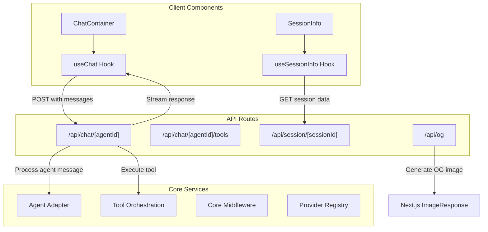
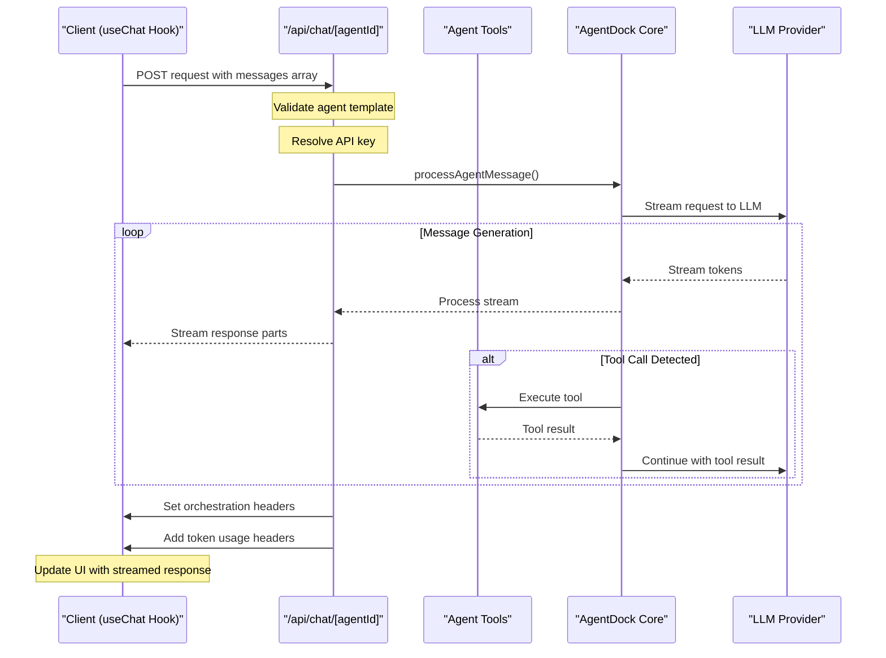
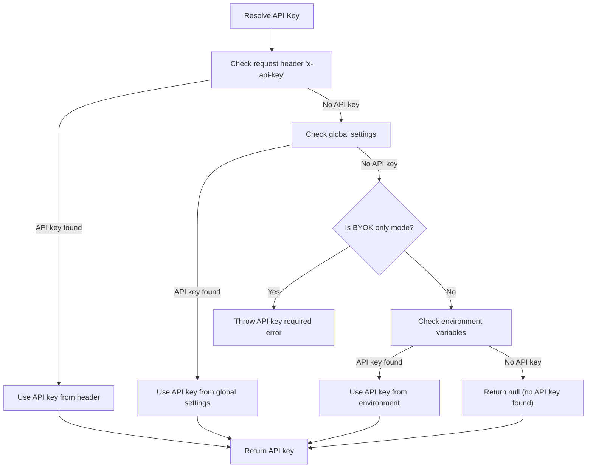
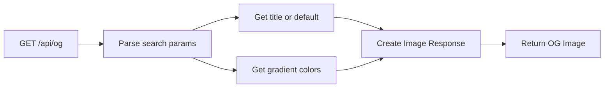
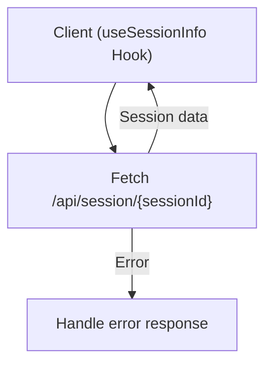

<!-- source: DeepWiki mcp.deepwiki.com · repo AgentDock/AgentDock · page 4.3 API Routes · fetched 2026-10-26 -->

# API Routes

Relevant source files

The following files were used as context for generating this wiki page:

- [src/app/api/chat/[agentId]/route.ts](src/app/api/chat/[agentId]/route.ts)
- [src/app/api/og/route.tsx](src/app/api/og/route.tsx)
- [src/components/chat/chat-container.tsx](src/components/chat/chat-container.tsx)
- [src/components/chat/chat-status.tsx](src/components/chat/chat-status.tsx)
- [src/components/ui/markdown-renderer.tsx](src/components/ui/markdown-renderer.tsx)
- [src/hooks/use-session-info.ts](src/hooks/use-session-info.ts)
- [src/lib/config.ts](src/lib/config.ts)

This document provides a comprehensive overview of API routes in the AgentDock OSS Client. API routes are server-side endpoints that handle communication between the client interface and the core framework, supporting functionalities such as agent chat, session management, and image generation. For information about UI components that use these routes, see [UI Components](#4.1).

## API Routes Architecture

API routes in AgentDock are implemented using Next.js API routes, which allow server-side code execution in a serverless environment. These routes serve as the bridge between the client-side UI components and the underlying agentdock-core framework.

Sources: [src/app/api/chat/[agentId]/route.ts:1-45](), [src/app/api/og/route.tsx:1-20](), [src/components/chat/chat-container.tsx:167-177](), [src/hooks/use-session-info.ts:22-82]()

## Chat API Routes

The primary API route for agent interaction is `/api/chat/[agentId]`, which processes messages sent to specific agents and returns streamed responses.

### Request Flow

The chat API route processes requests through a well-defined sequence of operations:

Sources: [src/app/api/chat/[agentId]/route.ts:390-682](), [src/components/chat/chat-container.tsx:165-309]()

### API Route Implementation Details

The chat API route is implemented with the following key components:

1. **Route Configuration**:
   - Uses Node.js runtime for reliable background processing
   - Configured for dynamic content generation
   - Sets appropriate maxDuration for long-running requests

2. **API Key Resolution Logic**:
   The route implements a prioritized logic for API key resolution:

Sources: [src/app/api/chat/[agentId]/route.ts:102-199]()

3. **Error Handling**:
   The route implements robust error handling, including:
   - Provider-specific error parsing
   - Normalization of errors for consistent client responses
   - Special handling for API key errors

4. **Direct Tool Execution**:
   The route supports direct tool execution through a dedicated function:

Sources: [src/app/api/chat/[agentId]/route.ts:269-386]()

### Response Handling

The API route sends responses with important metadata in headers:

| Header | Purpose |
|--------|---------|
| `x-token-usage` | JSON with prompt, completion, and total token counts |
| `x-orchestration-state` | JSON with session state, active step, and tool usage |
| `x-session-id` | Session identifier for maintaining conversation state |
| `Cache-Control: no-cache` | Prevents caching for streaming responses |
| `Connection: keep-alive` | Ensures streaming isn't terminated early |

Sources: [src/app/api/chat/[agentId]/route.ts:204-264](), [src/components/chat/chat-container.tsx:214-268]()

## OG Image API Route

The `/api/og` route generates Open Graph images dynamically for the application:

Key features:
- Uses Next.js Edge runtime for performance
- Dynamically sizes elements based on content length
- Uses SVG logo embedded as base64
- Supports custom gradient colors via URL parameters

Sources: [src/app/api/og/route.tsx:1-121](), [src/lib/config.ts:5-14]()

## Session API Route

The `/api/session/[sessionId]` route provides session information for a given session ID:

The session API returns data including:
- Session ID
- Active orchestration step
- Recently used tools
- Cumulative token usage statistics

Sources: [src/hooks/use-session-info.ts:1-101]()

## Integration with Client Components

The API routes are primarily consumed by React components and hooks:

### ChatContainer Integration

The `ChatContainer` component uses the `useChat` hook to interact with the chat API:

1. Initializes with agent configuration
2. Adds headers for API keys, BYOK mode, and session ID  
3. Includes system messages and temperature settings
4. Processes response headers for orchestration state
5. Handles errors with appropriate UI feedback

Sources: [src/components/chat/chat-container.tsx:155-309](), [src/components/chat/chat-status.tsx:26-199]()

### API Error Handling

The client provides robust error handling for API responses:

| Error Type | Client Handling |
|------------|----------------|
| Missing API Key | Direct to settings page |
| Rate Limit Error | Suggest retry after waiting |
| Service Unavailable | Display friendly message |
| Connection Error | Suggest checking connection or page reload |
| Streaming Error | Display overlay with error details |

Sources: [src/components/chat/chat-status.tsx:26-199]()

## Markdown Rendering for API Responses

The application includes a dedicated `MarkdownRenderer` component to handle rich text output from API responses:

- Renders Markdown with syntax highlighting
- Supports code blocks with language detection
- Renders diagrams from Mermaid syntax
- Provides copy buttons for code snippets

This enables API routes to return rich, structured content that can be displayed appropriately in the UI.

Sources: [src/components/ui/markdown-renderer.tsx:1-358]()

---

This document covers the key API routes in the AgentDock application. For information about the UI components that use these routes, see [Chat Interface](#4.2), and for details about the core framework that powers these routes, see [AgentDock Core](#3).

---

