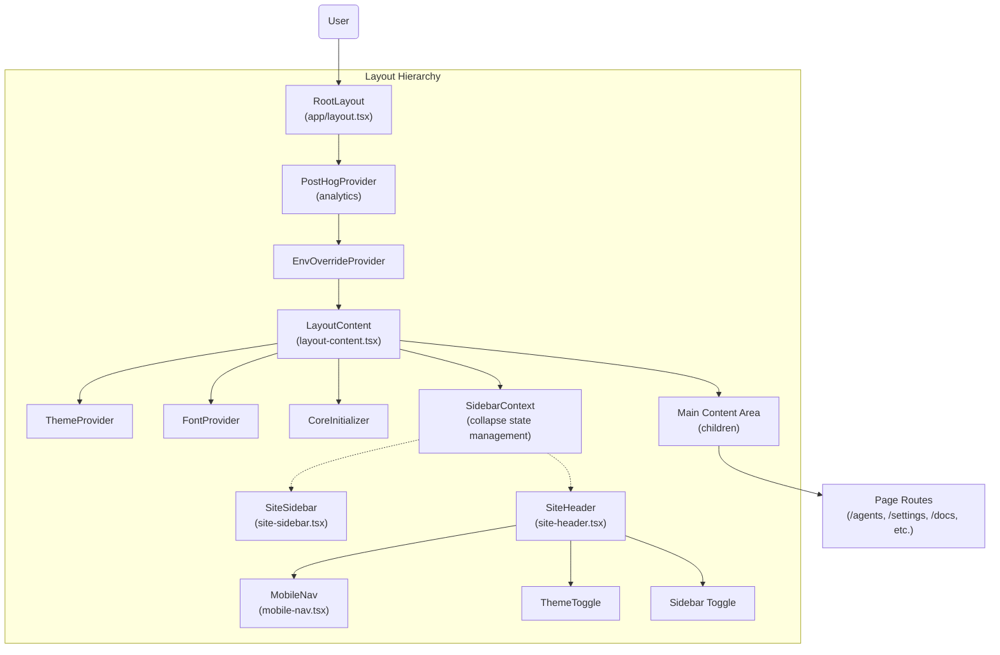
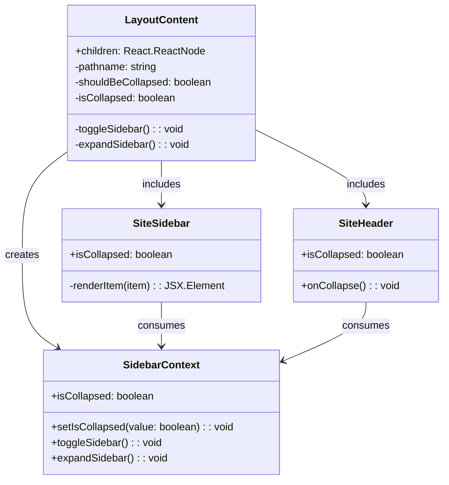
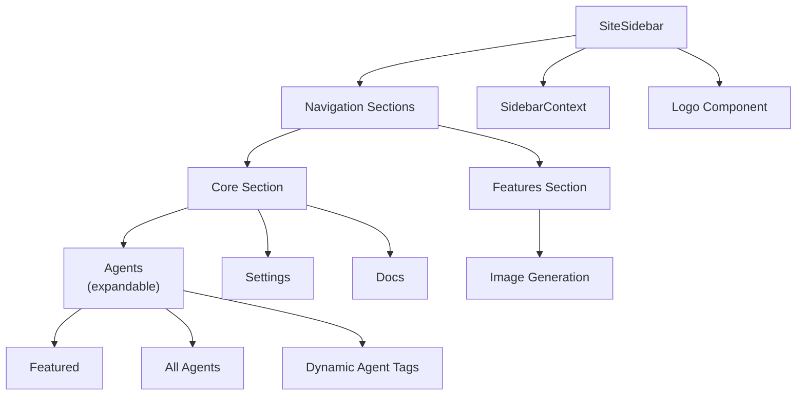
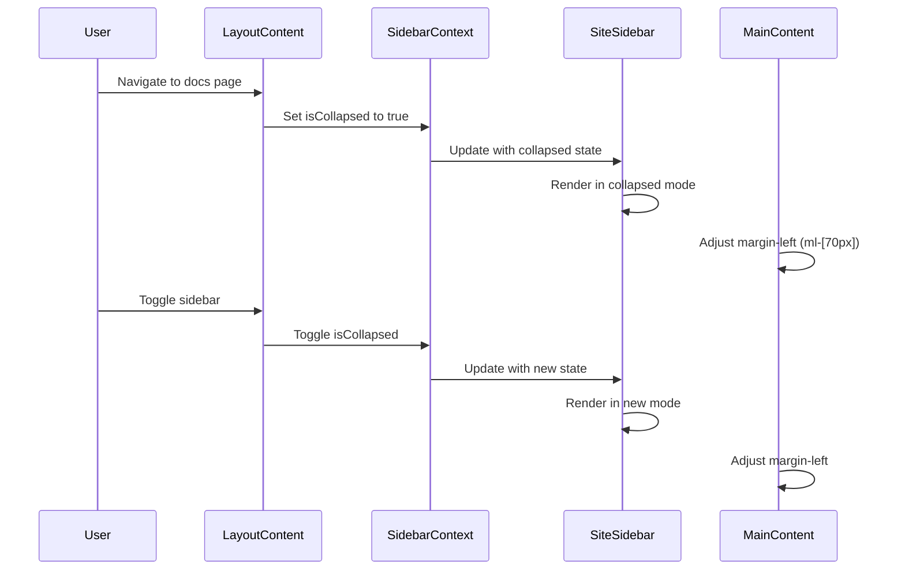
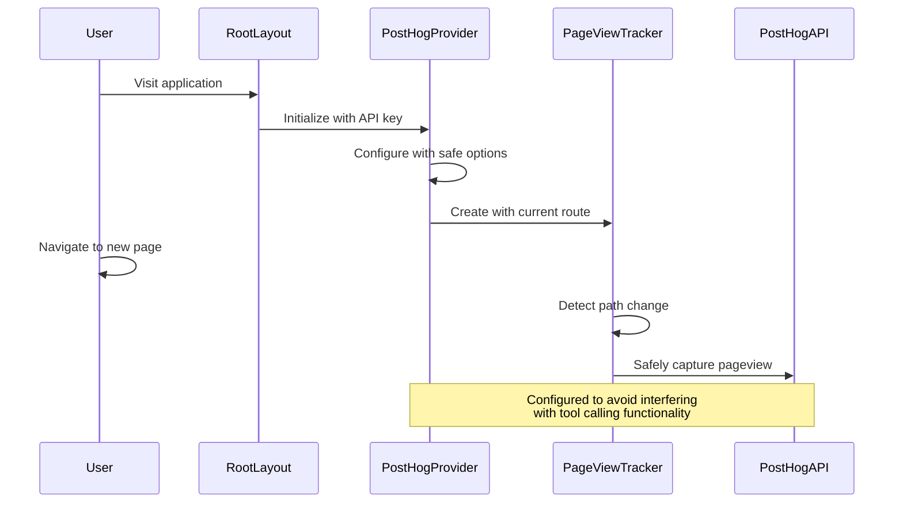
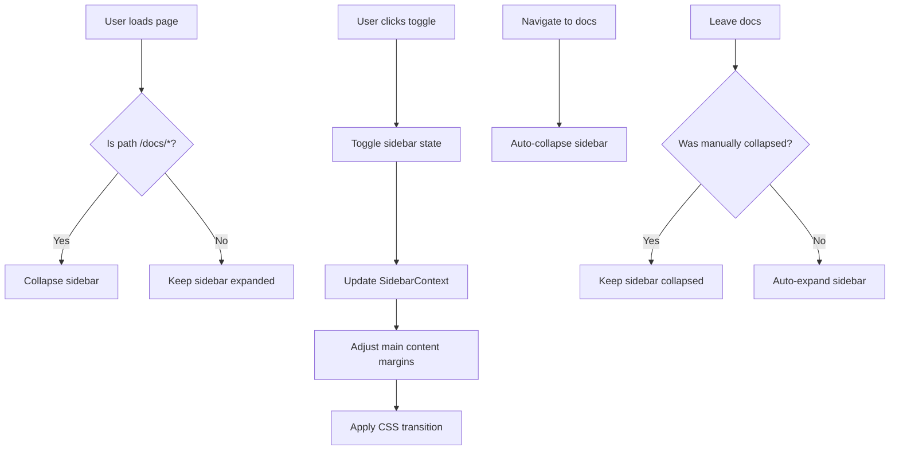
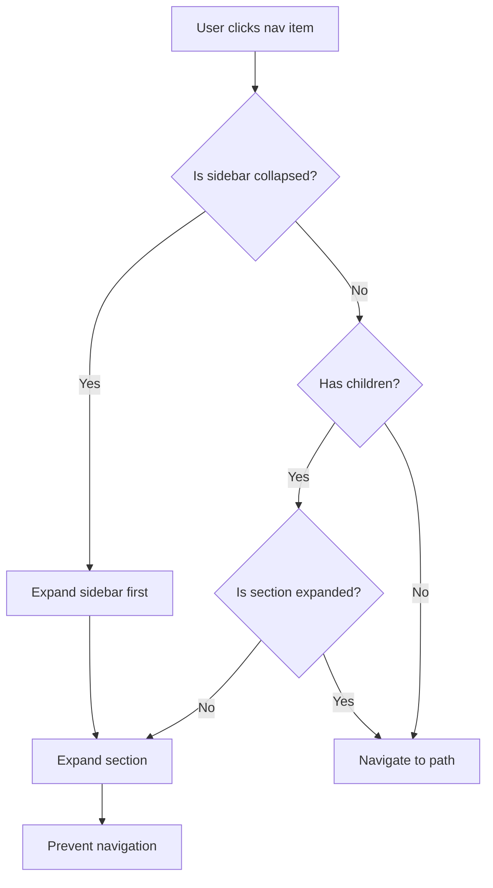

<!-- source: DeepWiki mcp.deepwiki.com · repo AgentDock/AgentDock · page 4.4 Layout System · fetched 2026-10-26 -->

# Layout System

<details>
<summary>Relevant source files</summary>

The following files were used as context for generating this wiki page:

- [src/app/globals.css](src/app/globals.css)
- [src/app/layout.tsx](src/app/layout.tsx)
- [src/app/settings/core-settings.tsx](src/app/settings/core-settings.tsx)
- [src/components/layout/layout-content.tsx](src/components/layout/layout-content.tsx)
- [src/components/layout/mobile-nav.tsx](src/components/layout/mobile-nav.tsx)
- [src/components/layout/site-sidebar.tsx](src/components/layout/site-sidebar.tsx)
- [src/components/providers/posthog-provider.tsx](src/components/providers/posthog-provider.tsx)
- [src/lib/analytics.ts](src/lib/analytics.ts)
- [tailwind.config.ts](tailwind.config.ts)

</details>


The Layout System in AgentDock provides the structural foundation for the user interface. This system manages the application's overall layout architecture, responsive behavior, navigation components, and integration with theme and analytics systems. This page documents the key components, relationships, and behaviors of the layout system.

For information about specific UI components that appear within this layout, see [UI Components](#4.1).

## Architecture Overview

The layout system follows a hierarchical structure with multiple interconnected components that create a consistent, responsive user interface.



Sources: [src/app/layout.tsx:26-58](), [src/components/layout/layout-content.tsx:30-81]()

## Core Layout Components

### RootLayout

The `RootLayout` component in `app/layout.tsx` serves as the top-level layout wrapper for the entire application:

- Loads and configures fonts (GeistSans, GeistMono, Inter)
- Imports global CSS styles
- Sets up document metadata
- Initializes PostHog analytics provider
- Configures the environment override provider
- Wraps the entire application in the main `LayoutContent` component

Sources: [src/app/layout.tsx:26-58]()

### LayoutContent

The `LayoutContent` component is the primary layout container that:

- Provides the `SidebarContext` for sidebar state management
- Creates the main application layout structure
- Handles sidebar collapse logic based on the current route
- Manages responsive behavior for different screen sizes



The `LayoutContent` component implements auto-collapsing behavior for the sidebar based on the current route. For example, it automatically collapses the sidebar when the user visits documentation pages.

Sources: [src/components/layout/layout-content.tsx:14-80]()

## Sidebar Context

The layout system uses React's Context API to manage sidebar state through the `SidebarContext`, which provides:

```typescript
interface SidebarContextType {
  isCollapsed: boolean;
  setIsCollapsed: (value: boolean) => void;
  toggleSidebar: () => void;
  expandSidebar: () => void;
}
```

This context is created in the `LayoutContent` component and consumed by both the `SiteSidebar` and `SiteHeader` components, enabling consistent sidebar state management across the application.

Sources: [src/components/layout/layout-content.tsx:14-28]()

## Navigation Components

### SiteSidebar

The `SiteSidebar` component provides the main navigation interface for the application:

- Renders the main navigation structure
- Supports collapsible display modes (full and icon-only)
- Provides hierarchical navigation with expandable sections
- Highlights the active route
- Integrates with agent categories from `AGENT_TAGS`



When the sidebar is collapsed, it displays only icons for navigation items to conserve space.

Sources: [src/components/layout/site-sidebar.tsx:14-272]()

### MobileNav

The `MobileNav` component provides a mobile-optimized navigation interface:

- Shares the same navigation structure as `SiteSidebar`
- Optimized for touch interfaces and smaller screens
- Includes callback for closing after navigation
- Fully expandable navigation sections

The component renders the same navigation items as the sidebar but with a different layout and interaction patterns optimized for mobile devices.

Sources: [src/components/layout/mobile-nav.tsx:13-239]()

## Responsive Behavior

The layout system implements responsive design through:

1. **Sidebar States**:
   - Expanded mode (240px width) - shows full navigation text and icons
   - Collapsed mode (70px width) - shows only icons
   - Hidden on mobile devices (replaced by mobile navigation)

2. **Adaptive Layout**:
   - Main content area shifts based on sidebar state
   - Transitions smoothly between states with CSS animations
   - Adapts padding and spacing based on screen size

3. **Route-based Behavior**:
   - Automatically collapses sidebar on documentation pages
   - Maintains state during navigation
   - Provides toggle controls in the header



Sources: [src/components/layout/layout-content.tsx:34-52](), [src/components/layout/layout-content.tsx:61-65]()

## Theme Integration

The layout system integrates with the application's theme system through:

1. **ThemeProvider**:
   - Wraps the layout content in the `LayoutContent` component
   - Enables light/dark mode switching
   - Persists theme preferences

2. **CSS Variables**:
   - Defined in `globals.css` for consistent theming
   - Support both light and dark modes
   - Include color schemes, typography, and UI element styles

3. **Tailwind Integration**:
   - Uses Tailwind's utility classes for styling
   - Custom theme extension in `tailwind.config.ts`
   - Consistent color and spacing system

Sources: [src/components/layout/layout-content.tsx:55](), [src/app/globals.css:5-198]()

## Analytics Integration

The layout system integrates analytics through the `PostHogProvider`:



The `PostHogProvider` component is specifically configured to work alongside AgentDock's tool calling functionality by:

- Using a package-based implementation instead of script-based
- Disabling automatic event capture that could interfere with tools
- Manually tracking page views with appropriate timing
- Providing a context for custom event tracking

Sources: [src/app/layout.tsx:45-49](), [src/components/providers/posthog-provider.tsx:8-17](), [src/components/providers/posthog-provider.tsx:42-74]()

## CSS and Styling System

The layout system's styling is powered by:

1. **TailwindCSS**:
   - Utility-first approach for consistent styling
   - Responsive breakpoints for different screen sizes
   - Extended with custom animations and transitions

2. **CSS Variables**:
   - Defined in `globals.css`
   - Support both light and dark mode
   - Control colors, spacing, animations, and transitions

3. **Animation System**:
   - Custom keyframe animations defined in `globals.css`
   - Smooth transitions between sidebar states
   - Loading and visual feedback animations

The system carefully manages theme transitions to prevent flickering, especially during initial load and theme changes.

Sources: [src/app/globals.css:99-102](), [src/app/globals.css:610-673](), [tailwind.config.ts:11-236]()

## Key Interaction Flows

### Sidebar Collapse Logic



Sources: [src/components/layout/layout-content.tsx:34-52]()

### Navigation Interaction



Sources: [src/components/layout/site-sidebar.tsx:148-162]()

## Conclusion

The Layout System provides the structural foundation for the AgentDock user interface. It manages the application's overall layout architecture, responsive behavior, navigation components, and integration with theme and analytics systems.

The system is designed to be flexible and responsive, with components that adapt to different screen sizes and user preferences. It provides consistent navigation and structural elements across the application, creating a cohesive user experience.

For information on specific UI components that appear within this layout, see [UI Components](#4.1).

---

