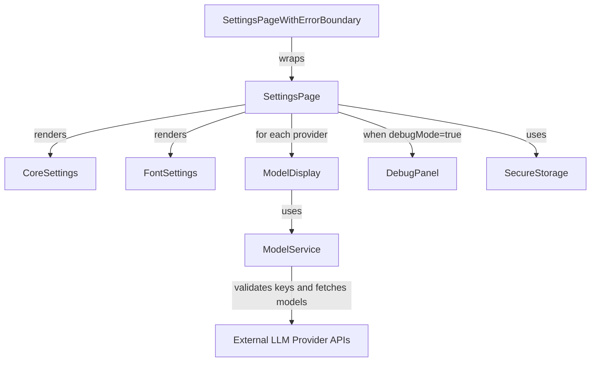
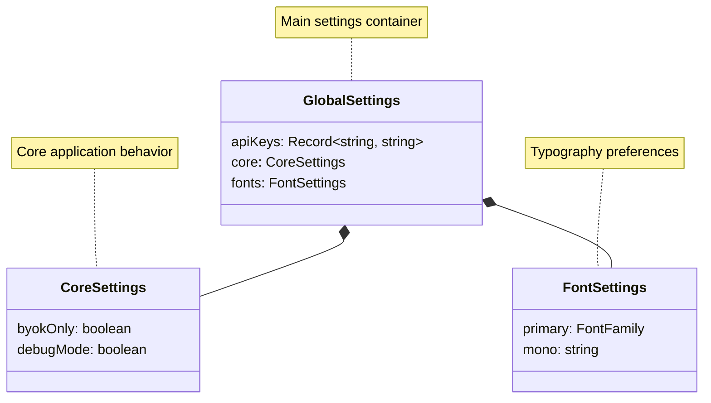
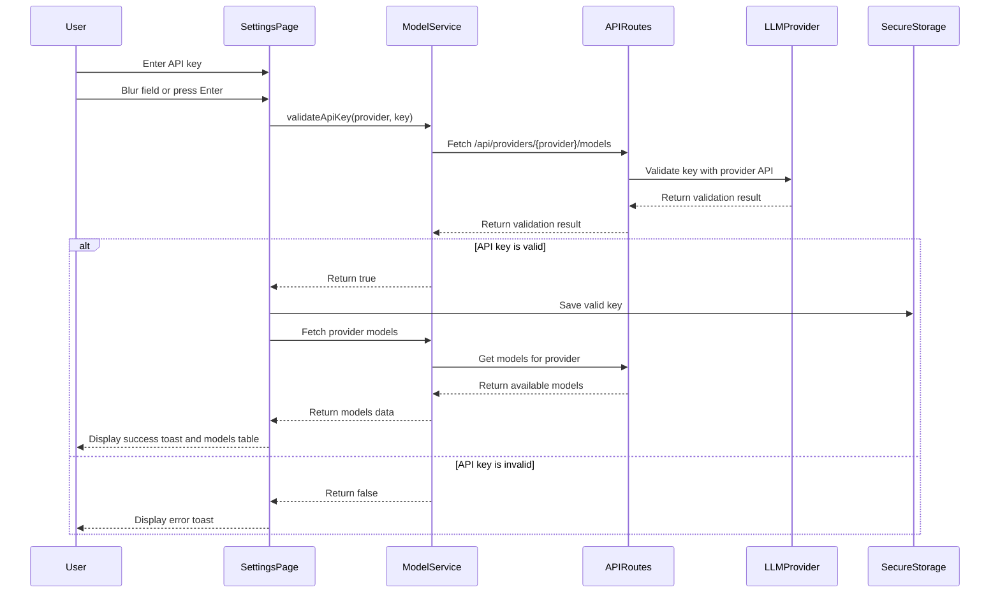
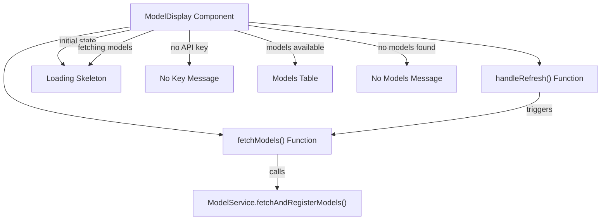
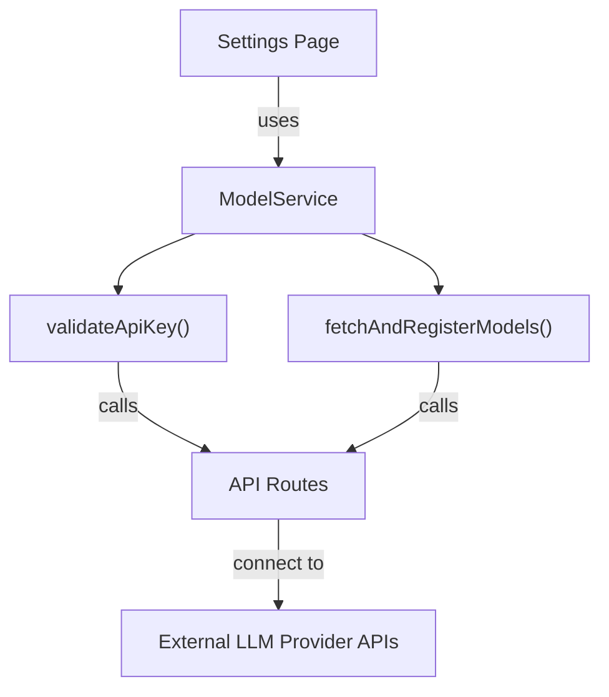
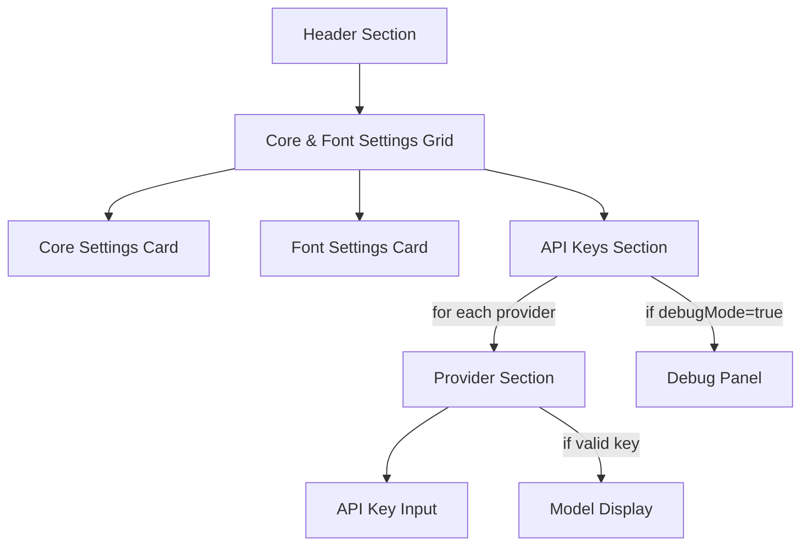

<!-- source: DeepWiki mcp.deepwiki.com · repo AgentDock/AgentDock · page 4.5 Settings Page · fetched 2026-10-26 -->

# Settings Page

<details>
<summary>Relevant source files</summary>

The following files were used as context for generating this wiki page:

- [src/app/globals.css](src/app/globals.css)
- [src/app/settings/core-settings.tsx](src/app/settings/core-settings.tsx)
- [src/app/settings/debug-panel.tsx](src/app/settings/debug-panel.tsx)
- [src/app/settings/model-display.tsx](src/app/settings/model-display.tsx)
- [src/app/settings/page.tsx](src/app/settings/page.tsx)
- [src/app/settings/types.ts](src/app/settings/types.ts)
- [src/components/layout/mobile-nav.tsx](src/components/layout/mobile-nav.tsx)
- [src/lib/models/registry.ts](src/lib/models/registry.ts)
- [src/lib/services/model-service.ts](src/lib/services/model-service.ts)

</details>


The Settings Page is a core component of the AgentDock OSS Client that enables users to configure API keys for large language model providers, customize application preferences, and manage core system behaviors. This page serves as the central control panel for personalizing the AgentDock experience and connecting to external LLM services.

For information about the general layout system, see [Layout System](#4.4). For API route integration details, see [API Routes](#4.3).

## Page Structure and Components

The Settings Page is structured as a React component with several sub-components handling different aspects of the settings functionality. The page uses SecureStorage from the agentdock-core package to persistently store configuration data.



Sources: 
- [src/app/settings/page.tsx:39-476]()
- [src/app/settings/page.tsx:28]()
- [src/app/settings/model-display.tsx:118-248]()

## Settings Data Structure

The Settings Page manages a `GlobalSettings` object that contains all user configuration preferences. This structure is defined in the types.ts file and contains sections for API keys, core settings, and font preferences.



Sources:
- [src/app/settings/types.ts:4-21]()
- [src/app/settings/types.ts:23-39]()

## Key Features

### API Key Management

The Settings Page manages API keys for multiple LLM providers:

| Provider | Purpose | Description |
|----------|---------|-------------|
| OpenAI | GPT models | Used for models like GPT-4 and GPT-3.5 |
| Anthropic | Claude models | Provides access to Claude models |
| Google Gemini | Gemini models | Access to Google's Gemini models |
| DeepSeek | DeepSeek models | For DeepSeek-V3 and DeepSeek-R1 |
| Groq | Fast inference | Used for Llama 3 and Mixtral models |

Each API key can be entered, validated, and saved independently. When a valid key is provided, the system fetches and displays available models from that provider.



Sources:
- [src/app/settings/page.tsx:31-37]()
- [src/app/settings/page.tsx:76-140]()
- [src/lib/services/model-service.ts:49-64]()

### Core Settings

The CoreSettings component provides toggles for fundamental application behaviors:

1. **BYOK (Bring Your Own Keys) Mode**:
   - When enabled: The application will only use user-provided API keys
   - When disabled: The system can fall back to environment variables for API keys
   - This setting is stored in both SecureStorage and localStorage for redundancy

2. **Debug Mode**:
   - When enabled: Shows additional debugging information
   - Enables the DebugPanel component which displays raw settings data

Sources:
- [src/app/settings/core-settings.tsx:21-102]()
- [src/app/settings/page.tsx:199-223]()

### Font Settings

The FontSettings component allows customization of typography:

1. **Primary Font**: Controls the main text font throughout the application
2. **Monospace Font**: Controls the font used for code blocks and technical content

These settings are stored in the GlobalSettings object and applied via CSS variables.

Sources:
- [src/app/settings/page.tsx:242-288]()
- [src/app/globals.css:11-14]()
- [src/app/globals.css:201-207]()

### Model Display

The ModelDisplay component fetches and displays available models for each provider with a valid API key. It includes:

- A table showing model IDs, descriptions, and context window sizes
- A refresh button to update the model list
- Loading states and empty states for better UX



Sources:
- [src/app/settings/model-display.tsx:28-110]()
- [src/app/settings/model-display.tsx:118-248]()
- [src/lib/services/model-service.ts:17-43]()

## Implementation Details

### Storage and Persistence

The Settings Page uses `SecureStorage` from the agentdock-core package to persistently store settings:

```javascript
const storage = SecureStorage.getInstance('agentdock');
```

This provides:
- Secure storage of sensitive information like API keys
- Persistent settings between sessions
- A consistent interface for reading and writing settings

Key operations include:
- Loading settings: `await storage.get<GlobalSettings>("global_settings")`
- Saving settings: `await storage.set("global_settings", updatedSettings)`

Sources:
- [src/app/settings/page.tsx:28]()
- [src/app/settings/page.tsx:47-73]()
- [src/app/settings/page.tsx:160-196]()

### Error Handling

The Settings Page implements comprehensive error handling:

1. **Error Boundary**: The entire component is wrapped in an ErrorBoundary to catch rendering errors
2. **Try-Catch blocks**: Surround all asynchronous operations to prevent crashes
3. **Toast notifications**: Provide user feedback for successes and failures
4. **Loading states**: Visual indicators during asynchronous operations

Sources:
- [src/app/settings/page.tsx:478-489]()
- [src/app/settings/page.tsx:64-66]()
- [src/app/settings/page.tsx:132-137]()

### ModelService Integration

The Settings Page integrates with the ModelService to validate API keys and fetch model information:



The ModelService provides two key methods:
- `validateApiKey(provider, key)`: Tests if an API key is valid for a specific provider
- `fetchAndRegisterModels(provider, key)`: Retrieves and registers available models for a provider

Sources:
- [src/lib/services/model-service.ts:17-64]()
- [src/app/settings/page.tsx:155-157]()
- [src/app/settings/model-display.tsx:124-187]()

## User Interface Flow

The Settings Page user interface is organized into logical sections for easy navigation:

1. **Header**: Title, description, and Save Changes button
2. **Core Settings**: BYOK mode and Debug mode toggles
3. **Font Settings**: Primary and Monospace font selection
4. **API Keys**: Input fields for various LLM provider API keys with model displays
5. **Debug Panel**: (Visible when Debug mode is enabled) Shows raw settings data



Sources:
- [src/app/settings/page.tsx:313-474]()
- [src/app/settings/page.tsx:351-363]()
- [src/app/settings/page.tsx:366-464]()
- [src/app/settings/page.tsx:467-471]()

## Conclusion

The Settings Page serves as the central configuration hub for the AgentDock application, enabling users to customize their experience and connect to external LLM providers. Through its intuitive interface and comprehensive options, it allows for fine-grained control over application behavior, API key management, and visual preferences.

---

