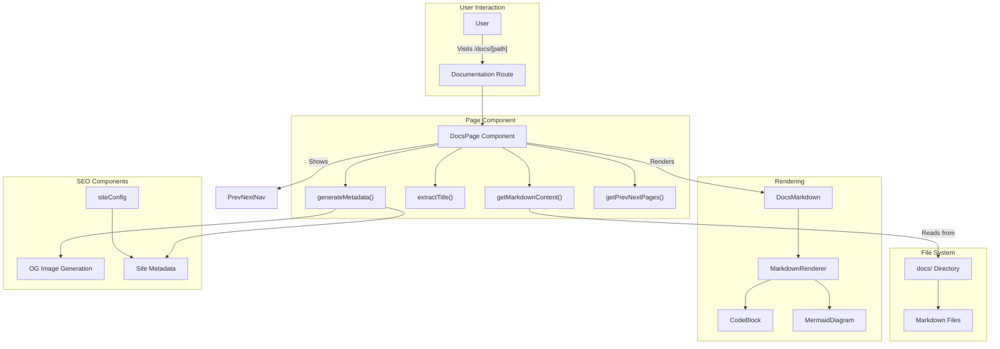
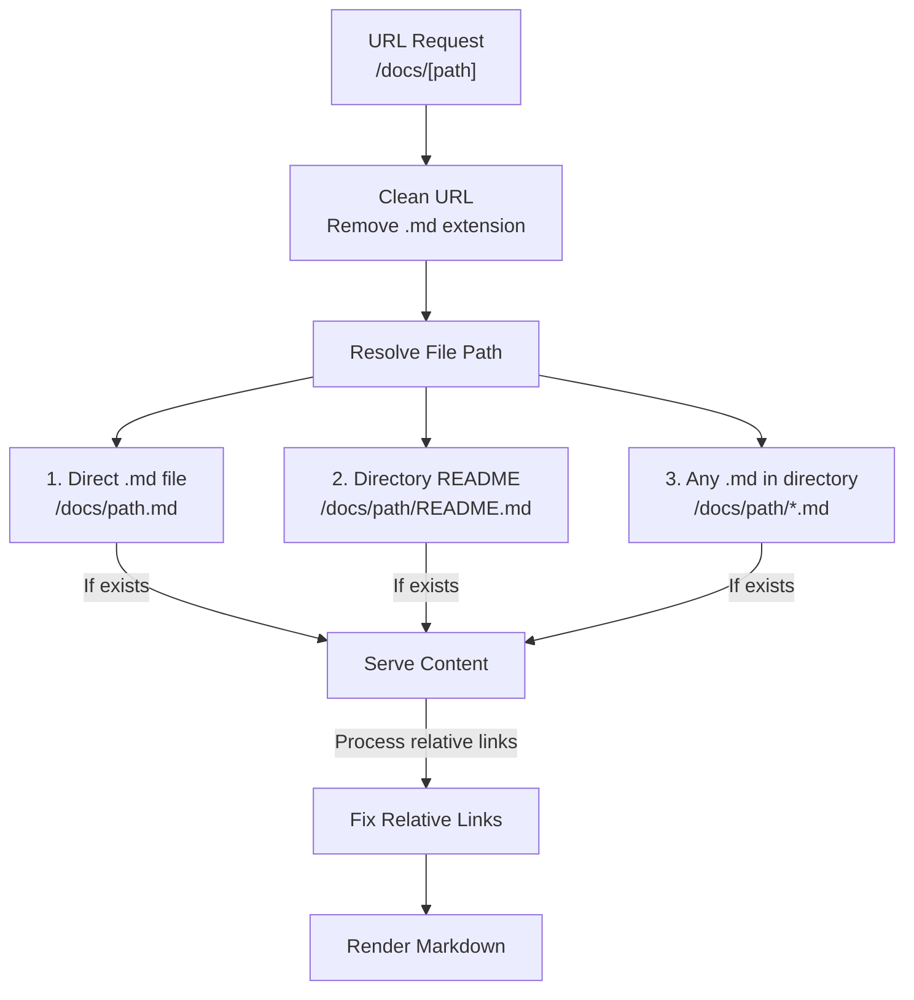
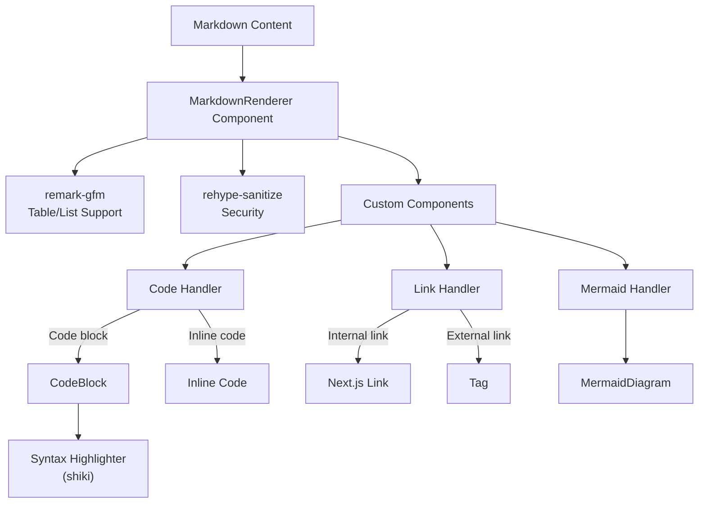
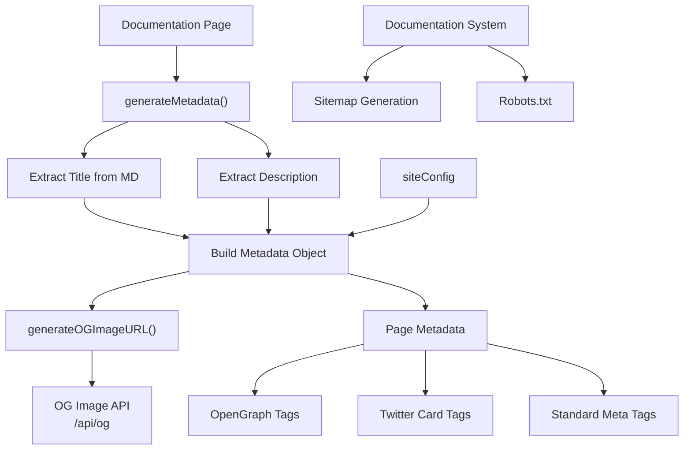
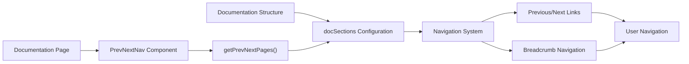
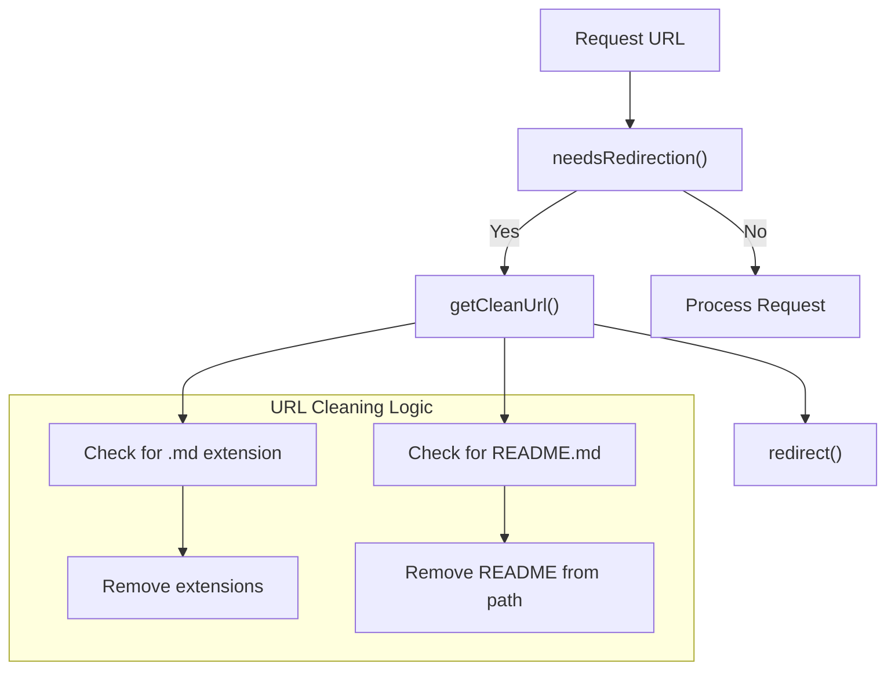
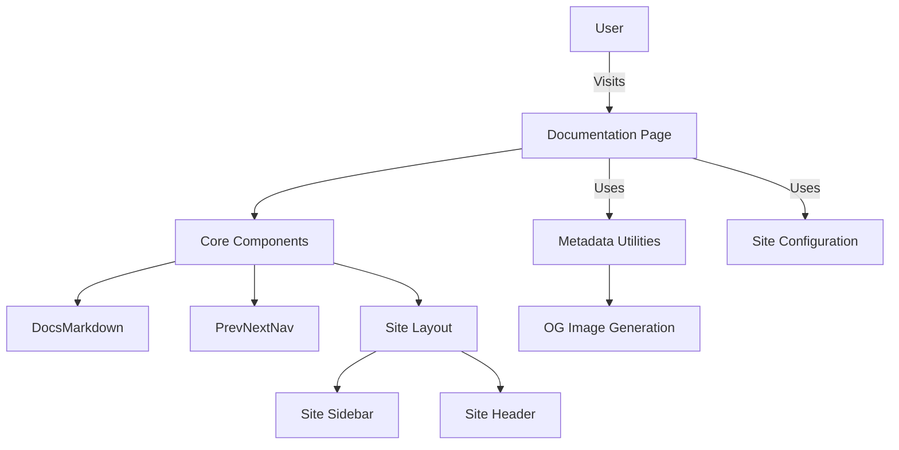
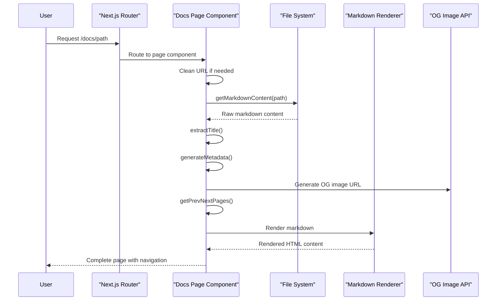
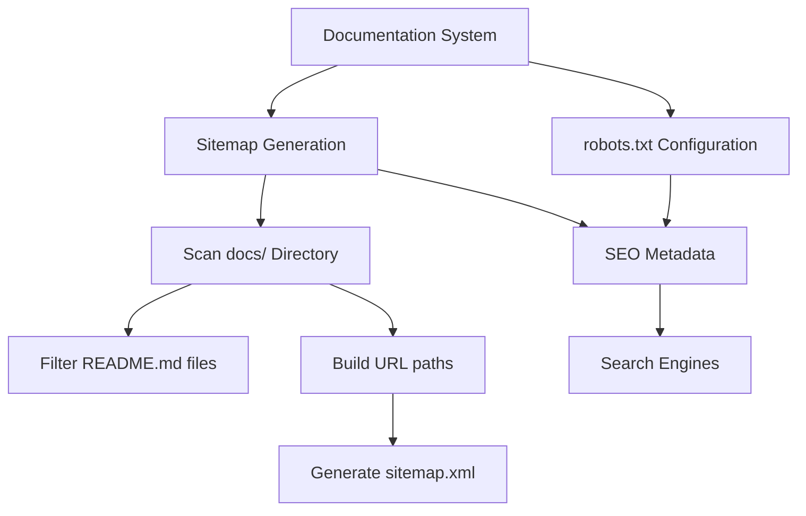

<!-- source: DeepWiki mcp.deepwiki.com · repo AgentDock/AgentDock · page 4.6 Documentation System · fetched 2026-10-26 -->

# Documentation System

Relevant source files

The following files were used as context for generating this wiki page:

- [src/app/agents/[category]/page.tsx](src/app/agents/[category]/page.tsx)
- [src/app/api/og/route.tsx](src/app/api/og/route.tsx)
- [src/app/docs/[[...slug]]/page.tsx](src/app/docs/[[...slug]]/page.tsx)
- [src/app/robots.ts](src/app/robots.ts)
- [src/app/sitemap.ts](src/app/sitemap.ts)
- [src/assets/fonts/Inter-SemiBold.ttf](src/assets/fonts/Inter-SemiBold.ttf)
- [src/components/ui/markdown-renderer.tsx](src/components/ui/markdown-renderer.tsx)
- [src/lib/config.ts](src/lib/config.ts)
- [src/lib/metadata-utils.ts](src/lib/metadata-utils.ts)

The Documentation System in AgentDock provides a way to render and serve markdown-based documentation through the web interface. This system enables users to access and navigate documentation content with enhanced features like syntax highlighting, diagrams rendering, and SEO optimization.

## Overview

The Documentation System is built on Next.js and consists of several key components that work together to provide a seamless documentation experience. It supports both static and dynamic routes, markdown rendering with extended capabilities, and SEO optimizations.

Sources: [src/app/docs/[[...slug]]/page.tsx:1-231](), [src/components/ui/markdown-renderer.tsx:1-359]()

## Documentation File Structure and Resolution

The system reads markdown files directly from the filesystem, supporting multiple file organization patterns.

The documentation file resolution process:

1. For root path `/docs`, the system displays the main README.md file
2. For specific paths like `/docs/section/page`, it looks for:
   - `docs/section/page.md` (direct match)
   - `docs/section/page/README.md` (directory README)
   - First markdown file in `docs/section/page/` directory
3. URLs with `.md` extensions are automatically redirected to clean URLs
4. README.md files in directories are mapped to the directory URL

Sources: [src/app/docs/[[...slug]]/page.tsx:12-122]()

## Markdown Rendering

The documentation system uses a customized markdown renderer that extends the capabilities of standard markdown.

Key features of the markdown renderer:

1. **Syntax highlighting**: Code blocks are highlighted using Shiki
2. **Mermaid diagrams**: Automatic rendering of mermaid syntax diagrams
3. **Link processing**: Transforms markdown links for better navigation
   - Removes `.md` extensions from links
   - Converts internal links to Next.js `Link` components
   - Formats link text for better readability
4. **Custom styling**: Enhanced styling for headings, lists, code blocks, etc.
5. **Copy button**: Code blocks include a copy-to-clipboard button

Sources: [src/components/ui/markdown-renderer.tsx:1-359]()

## SEO and Metadata

The Documentation System includes comprehensive SEO optimizations to ensure content is discoverable and shareable.

The SEO components include:

1. **Metadata generation**: Extracting titles and descriptions from markdown content
2. **OpenGraph images**: Dynamic generation of social media preview images
   - Custom title and gradient colors for visual distinction
   - Generated via the `/api/og` endpoint
3. **Site-wide metadata**: Consistent branding and descriptions
4. **Sitemap generation**: Automatic inclusion of documentation pages in sitemap.xml
5. **Robots.txt configuration**: Proper crawling directives for search engines

Sources: [src/lib/metadata-utils.ts:1-93](), [src/app/api/og/route.tsx:1-121](), [src/app/sitemap.ts:1-80](), [src/app/robots.ts:1-13]()

## Navigation and User Experience

The documentation system includes features to improve navigation and user experience.

Navigation features include:

1. **Previous/Next navigation**: Links to adjacent pages in the documentation structure
2. **Clean URLs**: Automatic redirection of `.md` extensions to clean URLs
3. **Link formatting**: Automatic processing of markdown links to maintain navigability
4. **Consistent layout**: Integration with the site's layout system

Sources: [src/app/docs/[[...slug]]/page.tsx:219-230]()

## URL Processing

The documentation system includes sophisticated URL processing to ensure a clean and user-friendly experience.

Key URL processing features:

1. **Extension removal**: Automatic removal of `.md` extensions from URLs
2. **README handling**: URLs ending with `README.md` redirect to the directory path
3. **Case insensitivity**: Support for case-insensitive file access
4. **Clean links in content**: Processing relative links within markdown content

Sources: [src/app/docs/[[...slug]]/page.tsx:137-162](), [src/app/docs/[[...slug]]/page.tsx:207-211]()

## Integration with Site Architecture

The Documentation System is integrated with the broader site architecture and components.

Integration points:

1. **Site layout**: Documentation pages use the site's common layout components
2. **Configuration**: Shared site configuration for consistent branding and metadata
3. **SEO utilities**: Common metadata generation utilities used across the site
4. **Component reuse**: Markdown rendering components that can be used in other contexts

Sources: [src/lib/config.ts:1-71](), [src/app/docs/[[...slug]]/page.tsx:5-11]()

## Document Processing Pipeline

This diagram represents the end-to-end processing pipeline for a documentation request.

Sources: [src/app/docs/[[...slug]]/page.tsx:199-231]()

## Sitemap and SEO Integration

The documentation system is fully integrated with sitemap generation and SEO configurations.

The sitemap generation process scans the documentation directory and:

1. Identifies all markdown files
2. Excludes README.md files (as they map to directory paths)
3. Converts file paths to URL paths
4. Adds them to the sitemap with appropriate priority and change frequency
5. Integrates with robots.txt to ensure proper crawling directives

Sources: [src/app/sitemap.ts:8-35](), [src/app/sitemap.ts:70-76](), [src/app/robots.ts:1-13]()

---

