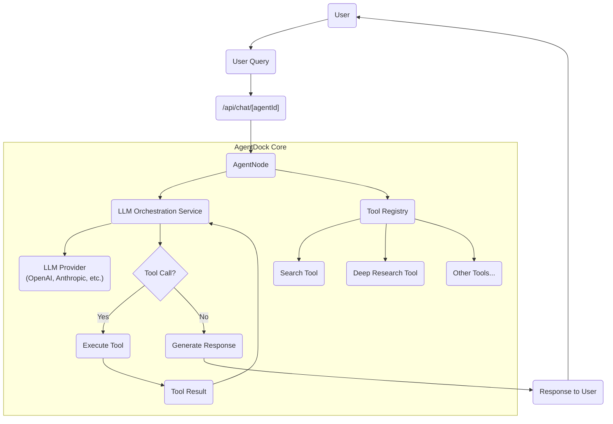
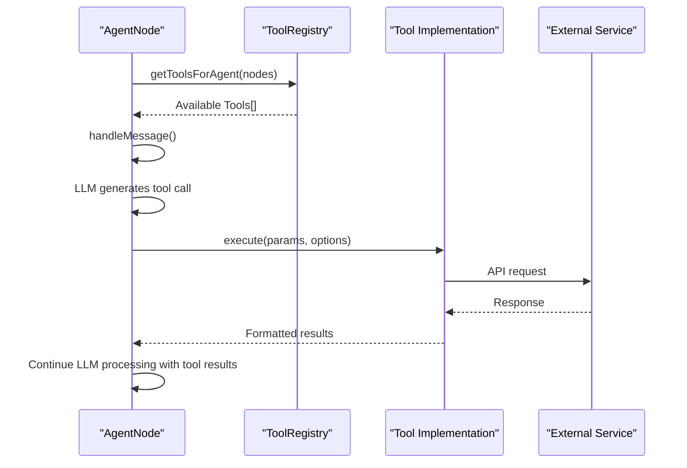
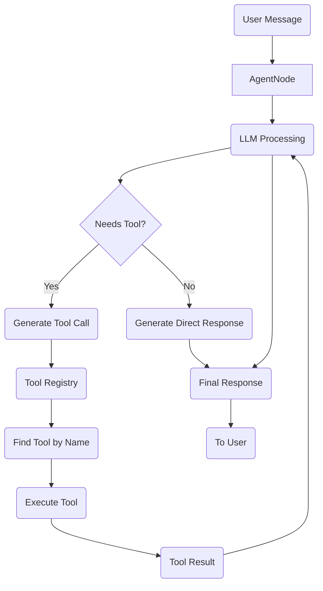

<!-- source: DeepWiki mcp.deepwiki.com · repo AgentDock/AgentDock · page 5 Agents and Tools · fetched 2026-10-26 -->

# Agents and Tools

<details>
<summary>Relevant source files</summary>

The following files were used as context for generating this wiki page:

- [agents/chandler-bing/README.md](agents/chandler-bing/README.md)
- [agents/chandler-bing/template.json](agents/chandler-bing/template.json)
- [agents/harvey-specter/template.json](agents/harvey-specter/template.json)
- [agents/marketing-prompt-library/README.md](agents/marketing-prompt-library/README.md)
- [agents/marketing-prompt-library/template.json](agents/marketing-prompt-library/template.json)
- [agents/mental-health-guide/template.json](agents/mental-health-guide/template.json)
- [agents/research-agent/template.json](agents/research-agent/template.json)
- [agents/sigmund-freud/README.md](agents/sigmund-freud/README.md)
- [agents/sigmund-freud/template.json](agents/sigmund-freud/template.json)
- [src/app/docs/layout.tsx](src/app/docs/layout.tsx)
- [src/config/agent-tags.ts](src/config/agent-tags.ts)
- [src/nodes/search/index.ts](src/nodes/search/index.ts)

</details>


This document provides an overview of agent templates and tool implementations in the AgentDock framework. It explains how agents are configured, what tools are available, and how they interact with each other. For details on creating custom agents, see [Agent Templates](#5.1), and for creating custom tools, see [Custom Tools](#5.2).

## Introduction to Agents and Tools

AgentDock's architecture is built around two core concepts:

1. **Agents**: AI personalities with specific capabilities, defined through template configurations
2. **Tools**: Functional extensions that agents can use to interact with external systems and perform tasks

Together, agents and tools form the foundation of AgentDock's flexible and extensible AI assistant framework.



Sources:
- [agents/marketing-prompt-library/template.json]()
- [agents/research-agent/template.json]()
- [src/nodes/search/index.ts]()

## Agent Templates

Agents in AgentDock are defined through structured JSON configuration files called templates. Each agent template specifies the agent's identity, capabilities, and behavior.

### Template Structure

```mermaid
classDiagram
    class "AgentTemplate" {
        +version: string
        +agentId: string
        +name: string
        +description: string
        +tags: string[]
        +priority: number
        +personality: string[]
        +nodes: string[]
        +nodeConfigurations: object
        +options: object
        +chatSettings: object
        +isEnabled: boolean
    }
    
    class "chatSettings" {
        +initialMessages: string[]
        +historyPolicy: string
        +historyLength: number
        +chatPrompts: string[]
        +placeholderText: string
    }
    
    class "nodeConfigurations" {
        +modelName: string
        +temperature: number
        +maxTokens: number
        +useCustomApiKey: boolean
        +useSearchGrounding: boolean
    }
    
    "AgentTemplate" --> "chatSettings"
    "AgentTemplate" --> "nodeConfigurations"
```

Sources:
- [agents/marketing-prompt-library/template.json]()
- [agents/chandler-bing/template.json]()
- [agents/sigmund-freud/template.json]()

### Key Template Properties

| Property | Type | Description |
|----------|------|-------------|
| `agentId` | string | Unique identifier for the agent |
| `name` | string | Display name of the agent |
| `description` | string | Brief description of the agent's purpose |
| `tags` | string[] | Categories the agent belongs to (for UI organization) |
| `priority` | number | Optional display priority (lower numbers = higher priority) |
| `personality` | string[] | Array of instructions that define the agent's behavior |
| `nodes` | string[] | List of node types the agent can use (LLMs, tools) |
| `nodeConfigurations` | object | Configuration options for specific nodes |
| `chatSettings` | object | Settings for chat interface behavior |

Sources:
- [agents/mental-health-guide/template.json]()
- [agents/harvey-specter/template.json]()
- [agents/research-agent/template.json]()

### Agent Personality

The `personality` array is central to defining an agent's behavior. Each element provides instructions that shape how the agent responds, its tone, and its capabilities. Here's how different agents define their personalities:

#### Character-Based Agents

Character-based agents like Chandler Bing and Sigmund Freud include personality traits that mimic their real or fictional counterparts:

```
"You are Chandler Bing from the TV show Friends, known for your sarcasm, self-deprecating humor, and witty one-liners."
```

#### Utility-Focused Agents

Utility agents like the Research Assistant focus on functionalities:

```
"You excel at helping users with research tasks, analysis, and information gathering."
"You have access to search and deep_research tools to help with your research."
```

Sources:
- [agents/chandler-bing/template.json:7-21]()
- [agents/sigmund-freud/template.json:8-22]()
- [agents/research-agent/template.json:8-16]()

### Agent Categories

Agents are organized by tags for easier discovery in the UI. AgentDock includes several predefined categories:

| Category | Description | Example Agents |
|----------|-------------|----------------|
| Featured | Highlighted agents | Research Assistant, Mental Health Guide |
| Health | Health and medical assistants | Mental Health Guide, Sigmund Freud |
| Legal | Legal assistants and advisors | Harvey Specter |
| Characters | Character-based assistants | Chandler Bing, Sigmund Freud |
| Research | Research assistants | Research Assistant |
| Marketing | Marketing assistants | Marketing Prompt Library Generator |

Sources:
- [src/config/agent-tags.ts:15-84]()
- [agents/chandler-bing/template.json:6]()
- [agents/sigmund-freud/template.json:6]()
- [agents/marketing-prompt-library/template.json:6]()

## Tools and Their Implementation

Tools extend agents' capabilities by allowing them to perform specific tasks, such as searching the web or conducting in-depth research.

### Tool Structure

```mermaid
classDiagram
    class "Tool" {
        +name: string
        +description: string
        +parameters: ZodSchema
        +execute(params, options): Promise~any~
    }
    
    class "SearchTool" {
        +name: "search"
        +description: "Search the web for information on any topic"
        +parameters: ZodSchema
        +execute({query, limit}, options): Promise~SearchResults~
    }
    
    class "DeepResearchTool" {
        +name: "deep_research"
        +description: "Perform comprehensive research on a topic with multiple sources"
        +parameters: ZodSchema
        +execute({topic, depth}, options): Promise~ResearchResults~
    }
    
    Tool <|-- "SearchTool"
    Tool <|-- "DeepResearchTool"
```

Sources:
- [src/nodes/search/index.ts:29-86]()
- [agents/research-agent/template.json:17-21]()

### Tool Implementation

Tools in AgentDock follow a consistent pattern:

1. Define a Zod schema for parameters
2. Implement the tool interface with name, description, parameters, and execute function
3. Register the tool in the tool registry

Here's an example from the search tool implementation:

```typescript
// Schema for parameters
const searchSchema = z.object({
  query: z.string().describe('Search query to look up'),
  limit: z.coerce.number().optional().default(8).describe('Maximum number of results to return')
});

// Tool implementation
export const searchTool: Tool = {
  name: 'search',
  description: 'Search the web for information on any topic',
  parameters: searchSchema,
  async execute({ query, limit = 5 }, options) {
    // Implementation...
  }
};
```

Sources:
- [src/nodes/search/index.ts:16-86]()

### Available Tools

AgentDock includes several built-in tools that agents can utilize:

| Tool Name | Description | Used By Agents |
|-----------|-------------|----------------|
| `search` | Web search functionality using Serper API | Research Assistant, Harvey Specter, Chandler Bing, Sigmund Freud |
| `deep_research` | In-depth research with document processing | Research Assistant |

Sources:
- [agents/research-agent/template.json:17-21]()
- [agents/harvey-specter/template.json:17-20]()
- [agents/chandler-bing/template.json:23-25]()
- [agents/sigmund-freud/template.json:23-25]()
- [src/nodes/search/index.ts:29-86]()

## Agent-Tool Interaction

Agents interact with tools through a well-defined process orchestrated by the AgentNode and Tool Registry.

### Tool Registry

The Tool Registry is responsible for registering tools and making them available to agents:



Sources:
- [src/nodes/search/index.ts:33-84]()
- [agents/research-agent/template.json:17-21]()

### Message Processing Flow with Tools

When an agent receives a message that requires tool usage:

1. The agent processes the message using its configured LLM
2. If the LLM determines a tool is needed, it generates a tool call
3. The agent executes the tool with the provided parameters
4. The tool results are passed back to the LLM for further processing
5. The final response is generated and returned to the user

This flow allows agents to dynamically use tools as needed to fulfill user requests.



Sources:
- [agents/research-agent/template.json:8-16]()
- [src/nodes/search/index.ts:33-84]()

## Example Integrations

Let's look at some example integrations of agents and tools in AgentDock.

### Research Assistant

The Research Assistant agent demonstrates the integration of multiple tools to provide comprehensive research capabilities:

```
{
    "nodes": [
        "llm.anthropic",
        "search",
        "deep_research"
    ],
    "personality": [
        "You are a helpful AI research assistant.",
        "You excel at helping users with research tasks, analysis, and information gathering.",
        "Use the search tool for quick lookups and the deep_research tool for more comprehensive analysis."
    ]
}
```

This agent can use both the search tool for quick information retrieval and the deep_research tool for more in-depth analysis.

Sources:
- [agents/research-agent/template.json:8-21]()

### Marketing Prompt Library Generator

The Marketing Prompt Library Generator agent uses the Gemini LLM with search grounding to generate comprehensive prompt libraries for marketers:

```
{
    "nodes": [
        "llm.gemini"
    ],
    "nodeConfigurations": {
        "llm.gemini": {
            "model": "gemini-2.5-pro-exp-03-25",
            "useSearchGrounding": true
        }
    },
    "personality": [
        "Act as: a Prompt Engineer, Expert Marketer, and Strategic Operator.",
        "Task: When I give you a marketing discipline (e.g. SEO, Paid Media, Lifecycle), create a Prompt Library designed by an elite marketer in that field."
    ]
}
```

This agent leverages the built-in search capabilities of the Gemini model to ground its responses in current marketing knowledge.

Sources:
- [agents/marketing-prompt-library/template.json:8-50]()
- [agents/marketing-prompt-library/README.md:1-43]()

## Conclusion

Agents and tools form the core of AgentDock's extensible AI assistant framework. Agents, defined through template JSON files, provide the personality and configuration, while tools extend their capabilities with specific functionalities like web search or deep research.

This modular architecture allows for easy creation of new agents with different personalities and purposes, as well as the development of custom tools that agents can leverage to provide more value to users.

For more details on creating custom agents, see [Agent Templates](#5.1), and for creating custom tools, see [Custom Tools](#5.2).

---

