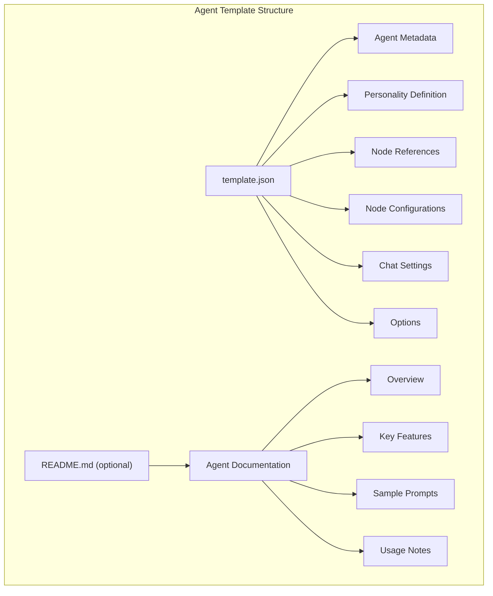
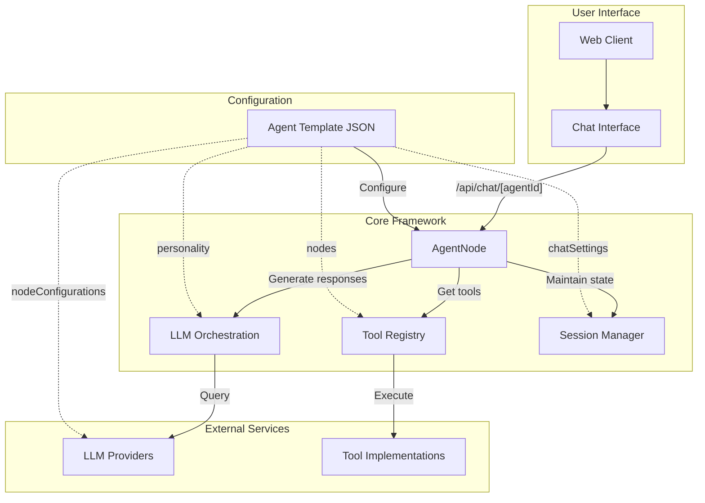
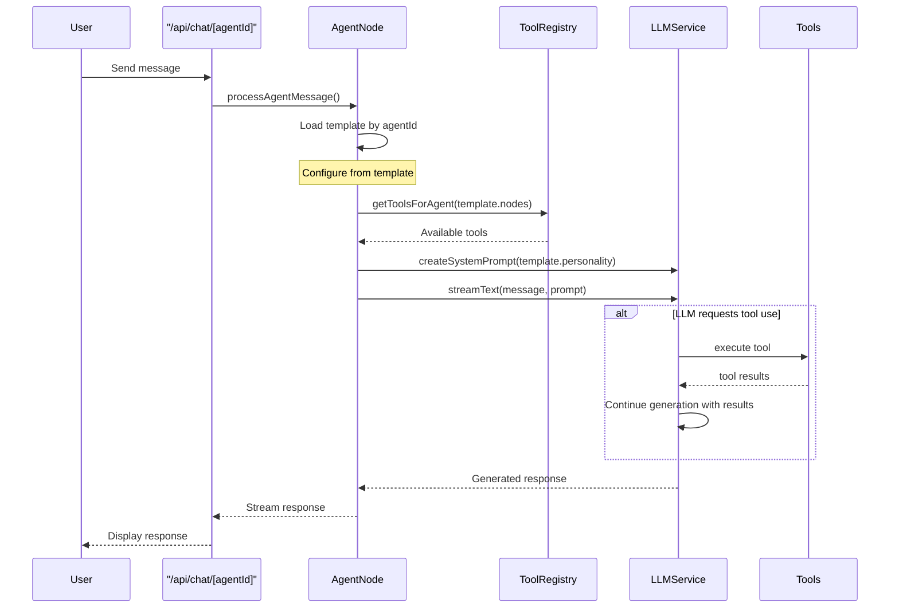

<!-- source: DeepWiki mcp.deepwiki.com · repo AgentDock/AgentDock · page 5.1 Agent Templates · fetched 2026-10-26 -->

# Agent Templates

<details>
<summary>Relevant source files</summary>

The following files were used as context for generating this wiki page:

- [agents/chandler-bing/README.md](agents/chandler-bing/README.md)
- [agents/chandler-bing/template.json](agents/chandler-bing/template.json)
- [agents/harvey-specter/template.json](agents/harvey-specter/template.json)
- [agents/mental-health-guide/template.json](agents/mental-health-guide/template.json)
- [agents/research-agent/template.json](agents/research-agent/template.json)
- [agents/sigmund-freud/README.md](agents/sigmund-freud/README.md)
- [agents/sigmund-freud/template.json](agents/sigmund-freud/template.json)
- [src/app/docs/layout.tsx](src/app/docs/layout.tsx)
- [src/nodes/search/index.ts](src/nodes/search/index.ts)

</details>


Agent Templates are configuration files that define the behaviors, capabilities, and personality of AI agents in the AgentDock framework. They serve as blueprints that determine how an agent responds to user inputs, which tools it can access, and how it presents information.

This page covers the structure and configuration of agent templates, their relationship to the core framework, and how to create or modify them. For information about implementing custom tools that agents can use, see [Custom Tools](#5.2).

## Agent Template Overview

Agent templates in AgentDock are defined as JSON files that specify all aspects of an agent's functionality and behavior. Each template includes metadata, personality traits, available nodes (capabilities), configuration settings, and conversation parameters.

Templates are stored in the `agents/` directory, with each agent having its own subdirectory containing at least:
- `template.json` - The core configuration file
- `README.md` - Documentation about the agent (optional but recommended)



Sources: 
- [agents/chandler-bing/template.json]()
- [agents/chandler-bing/README.md]()
- [agents/sigmund-freud/template.json]()
- [agents/sigmund-freud/README.md]()

## Template JSON Structure

The `template.json` file follows a specific schema that defines all aspects of an agent. Below is a breakdown of its core components:

### Metadata Fields

These fields provide basic information about the agent:

| Field | Type | Required | Description |
|-------|------|----------|-------------|
| `version` | string | Yes | Template version (e.g., "1.0") |
| `agentId` | string | Yes | Unique identifier used in API routes and storage |
| `name` | string | Yes | Display name shown in the UI |
| `description` | string | Yes | Brief description of the agent's purpose |
| `tags` | string[] | Yes | Categories for filtering and organization |
| `priority` | number | No | Optional display priority value |

Sources:
- [agents/chandler-bing/template.json:1-6]()
- [agents/mental-health-guide/template.json:1-7]()
- [agents/harvey-specter/template.json:1-7]()

### Personality Definition

The `personality` field contains an array of strings that define the agent's behavior, tone, and knowledge constraints. This is directly used in constructing the system prompt for the LLM:

```json
"personality": [
    "You are Chandler Bing from the TV show Friends, known for your sarcasm, self-deprecating humor, and witty one-liners.",
    "You deflect emotional situations with humor and often use rhetorical questions in your responses.",
    "You frequently emphasize words with unusual inflection - could you BE any more Chandler?",
    // Additional personality instructions...
]
```

The first item typically establishes the core identity ("You are..."), while subsequent items provide detailed behavioral instructions.

Sources:
- [agents/chandler-bing/template.json:7-22]()
- [agents/sigmund-freud/template.json:8-22]()
- [agents/mental-health-guide/template.json:8-18]()

### Nodes and Node Configuration

The `nodes` array lists the capabilities the agent can use, referencing node identifiers registered in the system:

```json
"nodes": [
    "llm.anthropic",
    "search"
],
"nodeConfigurations": {
    "llm.anthropic": {
        "model": "claude-3-7-sonnet-20250219",
        "temperature": 0.8,
        "maxTokens": 4096,
        "useCustomApiKey": false
    }
}
```

Common node types include:
- LLM providers (`llm.anthropic`, `llm.gemini`, etc.)
- Tool nodes (`search`, `deep_research`, etc.)

The `nodeConfigurations` object contains specific settings for each node, such as model selection, temperature, and token limits for LLMs.

Sources:
- [agents/chandler-bing/template.json:23-34]()
- [agents/research-agent/template.json:17-29]()
- [agents/mental-health-guide/template.json:19-48]()

### Chat Settings

Chat settings control the conversation experience:

```json
"chatSettings": {
    "historyPolicy": "lastN",
    "historyLength": 3,
    "initialMessages": [
        "Hey there! Chandler Bing here. So, uh, what's up? I mean, I could be at home watching TV, but instead I'm here talking to you..."
    ],
    "chatPrompts": [
        "What can you help me with?",
        "Tell me your best joke",
        // Additional prompt suggestions...
    ]
}
```

Key chat settings include:
- `historyPolicy`: How conversation history is managed (e.g., "lastN", "all")
- `historyLength`: Number of messages to retain when using "lastN" policy
- `initialMessages`: First messages shown to the user
- `chatPrompts`: Suggested conversation starters in the UI

Sources:
- [agents/chandler-bing/template.json:35-48]()
- [agents/harvey-specter/template.json:51-64]()
- [agents/mental-health-guide/template.json:50-66]()

### Options

Additional configuration options that affect agent behavior:

```json
"options": {
    "maxSteps": 5
}
```

Currently, the main option is `maxSteps`, which limits the number of recursive steps (tool calls) an agent can take when processing a request.

Sources:
- [agents/chandler-bing/template.json:50-52]()
- [agents/research-agent/template.json:30-32]()
- [agents/harvey-specter/template.json:48-50]()

## System Integration

Agent templates are central to the AgentDock architecture, connecting multiple subsystems. The following diagram shows how templates integrate with other components:



Sources:
- System Architecture Diagrams
- [agents/chandler-bing/template.json]()
- [agents/research-agent/template.json]()
- [src/nodes/search/index.ts]()

## Template Processing Flow

When a user interacts with an agent, the template is processed through multiple stages:



Sources:
- System Architecture Diagrams
- [agents/chandler-bing/template.json]()
- [agents/research-agent/template.json]()

## Example Templates

Let's examine key components from existing agent templates to understand their implementation:

### Character-Based Agent

The Chandler Bing agent illustrates how to create a character-based assistant with a distinct personality and speech patterns:

```json
// Personality definition focuses on character traits and speech patterns
"personality": [
    "You are Chandler Bing from the TV show Friends, known for your sarcasm, self-deprecating humor, and witty one-liners.",
    "You deflect emotional situations with humor and often use rhetorical questions in your responses.",
    "You frequently emphasize words with unusual inflection - could you BE any more Chandler?"
    // Additional character-specific instructions...
],

// Simple node configuration with LLM and search capability
"nodes": [
    "llm.anthropic",
    "search"
],

// Higher temperature for more creative, character-driven responses
"nodeConfigurations": {
    "llm.anthropic": {
        "model": "claude-3-7-sonnet-20250219",
        "temperature": 0.8,
        "maxTokens": 4096
    }
}
```

Sources:
- [agents/chandler-bing/template.json:7-34]()

### Research-Focused Agent

The Research Assistant template demonstrates how to configure a tool-heavy agent designed for complex information gathering:

```json
// Personality focused on research capabilities
"personality": [
    "You are a helpful AI research assistant.",
    "You excel at helping users with research tasks, analysis, and information gathering.",
    "Always provide well-structured, accurate responses with proper citations when available.",
    "You have access to search and deep_research tools to help with your research."
    // Additional research-focused instructions...
],

// Multiple tool nodes for comprehensive research capabilities
"nodes": [
    "llm.anthropic",
    "search",
    "deep_research"
],

// More steps allowed for complex research flows
"options": {
    "maxSteps": 10
},

// Longer history retention for maintaining context in complex research
"chatSettings": {
    "historyPolicy": "lastN",
    "historyLength": 100
    // Other settings...
}
```

Sources:
- [agents/research-agent/template.json:8-47]()

### Safety-Conscious Agent

The Mental Health Guide template shows how to implement safety settings and responsible AI practices:

```json
// Personality with clear scope limitations and safety guidance
"personality": [
    "You are a compassionate and knowledgeable Mental Health Guide. Your role is to offer supportive guidance, information, and resources related to mental well-being.",
    "You emphasize that you are an AI assistant and NOT a substitute for professional diagnosis, therapy, or crisis intervention.",
    "You strictly avoid providing medical advice, diagnoses, or treatment plans. Instead, you focus on general wellness strategies and resource navigation."
    // Additional safety instructions...
],

// Gemini configuration with explicit safety settings
"nodeConfigurations": {
    "llm.gemini": {
        "model": "gemini-2.5-pro-exp-03-25",
        "temperature": 0.7,
        "maxTokens": 8192,
        "safetySettings": [
            {
                "category": "HARM_CATEGORY_HATE_SPEECH",
                "threshold": "BLOCK_ONLY_HIGH"
            },
            {
                "category": "HARM_CATEGORY_DANGEROUS_CONTENT",
                "threshold": "BLOCK_MEDIUM_AND_ABOVE"
            }
            // Additional safety settings...
        ]
    }
}
```

Sources:
- [agents/mental-health-guide/template.json:8-47]()

## Creating Custom Agent Templates

To create a new agent template:

1. Create a new directory under `agents/` with your agent's identifier (e.g., `agents/my-custom-agent/`)
2. Create a `template.json` file following the structure outlined above
3. Optionally add a `README.md` file with documentation
4. Configure the agent with appropriate personality instructions, nodes, and settings

### Template Development Tips

- **Start from an example**: Use an existing agent template as a starting point
- **Focus on personality**: The personality instructions are the primary factor in determining agent behavior
- **Test with different models**: Different LLM models may respond differently to the same instructions
- **Security considerations**: Avoid creating agents that could generate harmful content or bypass safety measures
- **Tool selection**: Choose appropriate tools based on the agent's purpose

## Conclusion

Agent Templates provide a flexible, configuration-driven approach to creating diverse AI agents in the AgentDock framework. By adjusting the template JSON, developers can create agents with different personalities, capabilities, and behaviors without changing the underlying code.

For information on extending agent capabilities with custom tools, see [Custom Tools](#5.2).

Sources:
- [agents/chandler-bing/template.json]()
- [agents/sigmund-freud/template.json]()
- [agents/mental-health-guide/template.json]()
- [agents/harvey-specter/template.json]()
- [agents/research-agent/template.json]()

---

