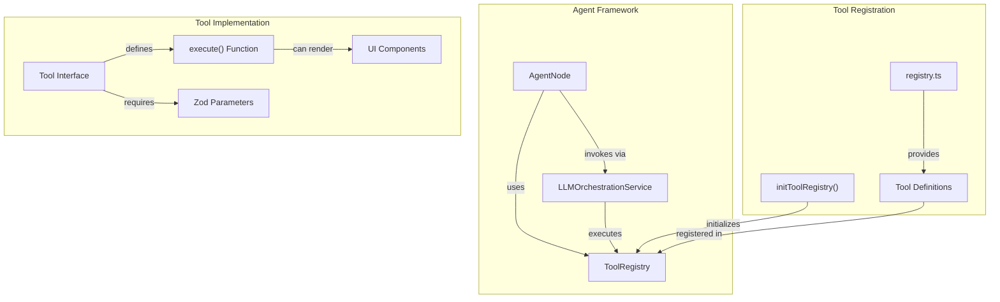
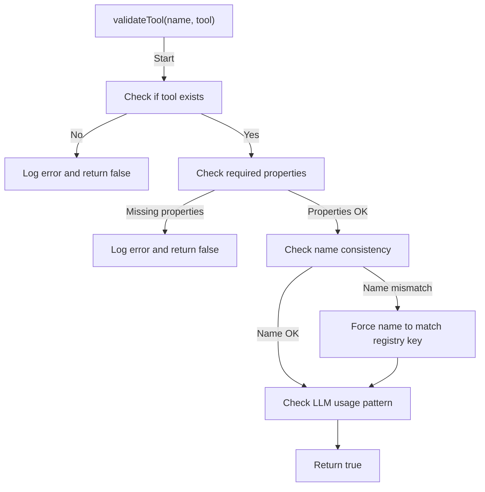
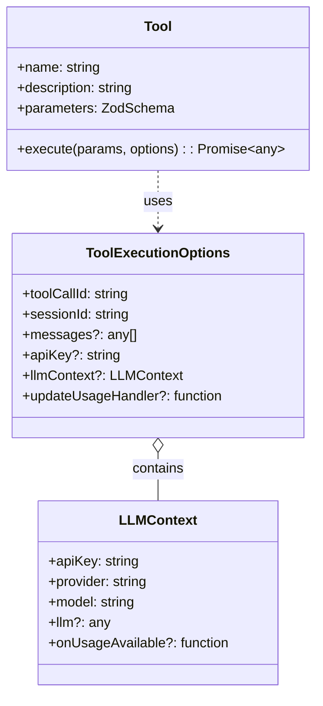
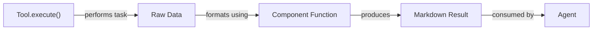
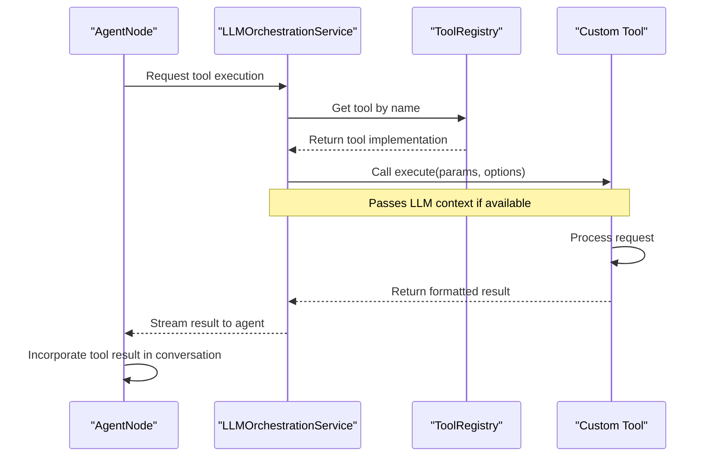
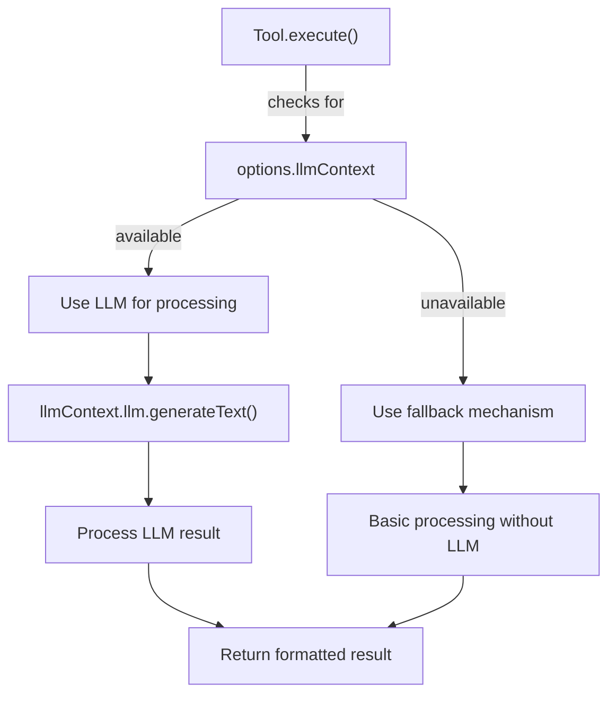
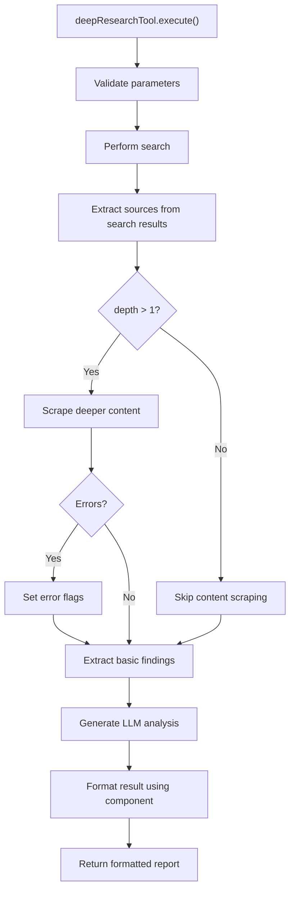

<!-- source: DeepWiki mcp.deepwiki.com · repo AgentDock/AgentDock · page 5.2 Custom Tools · fetched 2026-10-26 -->

# Custom Tools

<details>
<summary>Relevant source files</summary>

The following files were used as context for generating this wiki page:

- [src/nodes/deep-research/README.md](src/nodes/deep-research/README.md)
- [src/nodes/deep-research/components.ts](src/nodes/deep-research/components.ts)
- [src/nodes/deep-research/index.ts](src/nodes/deep-research/index.ts)
- [src/nodes/init.ts](src/nodes/init.ts)
- [src/nodes/registry.ts](src/nodes/registry.ts)
- [src/nodes/types.ts](src/nodes/types.ts)
- [src/nodes/weather/components.ts](src/nodes/weather/components.ts)

</details>


Custom Tools in AgentDock provide a flexible architecture for extending agent capabilities through specialized functions that can be invoked by AI agents. This page explains how to create, register, and use custom tools within the framework. For information about specific built-in tools, see [Deep Research Tool](#5.3) and [Search and API Tools](#5.4).

## Overview of the Tool System

Custom tools in AgentDock are specialized nodes that agents can invoke to perform specific tasks like searching the web, processing data, or accessing external APIs. The tool system consists of several key components:

1. **Tool Registry** - Manages registration and lookup of available tools
2. **Tool Interface** - Defines the contract for creating compatible tools
3. **Parameter Schemas** - Structured validation for tool inputs using Zod
4. **Tool Execution** - Process for invoking tools with appropriate context

Tools can be made available to specific agents by including them in the agent's node configuration as defined in agent templates.

Sources: [src/nodes/init.ts:1-13](), [src/nodes/registry.ts:1-7](), [src/nodes/types.ts:1-7]()

### Tool System Architecture



Sources: [src/nodes/init.ts:86-149](), [src/nodes/registry.ts:21-42]()

## Tool Registry System

The tool registry system handles the initialization and management of all custom tools. Tools are registered once at system startup to make them available throughout the application.

### Registration Process

1. The `initToolRegistry()` function initializes the registry at application startup
2. Tools are imported from various domains in `registry.ts`
3. Each tool is validated to ensure it meets the required interface
4. All validated tools are registered with the core registry
5. The registry maintains a map of tool names to tool implementations

This centralized registration approach ensures that all tools are available via a single entry point and can be discovered by agents.

Sources: [src/nodes/init.ts:86-149](), [src/nodes/registry.ts:21-42]()

### Tool Validation

Before a tool is registered, it undergoes validation to ensure it meets the required interface:



Required properties for a valid tool:
- `description` - Text describing what the tool does
- `parameters` - A Zod schema defining input parameters
- `execute` - Function that implements the tool's functionality

The system also verifies that the tool's name property matches its registry key and analyzes its LLM usage pattern for debugging purposes.

Sources: [src/nodes/init.ts:24-80]()

## Tool Interface

The core interface for all tools is defined in `src/nodes/types.ts`. This interface ensures that all tools have a consistent structure and can be used interchangeably by agents.

```typescript
interface Tool<TParams = any, TResult = any> {
  name: string;
  description: string;
  parameters: z.ZodSchema;
  execute(params: TParams, options: ToolExecutionOptions): Promise<TResult>;
}
```

The `ToolExecutionOptions` interface provides context for tool execution, including:

| Property | Type | Description |
|----------|------|-------------|
| `toolCallId` | string | Unique identifier for the tool call |
| `sessionId` | string | Identifier for the conversation session |
| `messages` | any[] | Optional array of previous messages |
| `apiKey` | string | Optional API key provided by the agent |
| `llmContext` | LLMContext | Optional context for LLM access |
| `updateUsageHandler` | function | Optional handler for updating token usage |

Sources: [src/nodes/types.ts:46-53](), [src/nodes/types.ts:33-43]()

### LLM Context for Tools

Tools can optionally access LLM capabilities through the `llmContext` property in their execution options. This enables tools to perform additional AI processing when needed.



When a tool requires AI capabilities, it should check for the presence of `llmContext` and handle cases where it might be unavailable.

Sources: [src/nodes/types.ts:17-28](), [src/nodes/registry.ts:99-172]()

## Creating Custom Tools

Creating a custom tool involves several key steps:

1. Define a Zod schema for the tool's parameters
2. Implement the tool interface with name, description, and parameters
3. Create the execute function that performs the tool's functionality
4. Register the tool in the registry

### Tool Parameter Definition

Parameters are defined using Zod schemas, providing runtime validation of inputs:

```typescript
const myToolParamsSchema = z.object({
  query: z.string().describe('The input query'),
  limit: z.number().int().min(1).max(10).default(5).describe('Number of results'),
  // Additional parameters as needed
});
```

The parameter descriptions are important as they will be used by the LLM to understand how to use the tool.

Sources: [src/nodes/deep-research/index.ts:19-23]()

### Execute Function Implementation

The execute function contains the tool's core logic:

```typescript
async execute(params, options) {
  // 1. Extract parameters
  const { param1, param2 } = params;
  
  // 2. Initialize variables and prepare resources
  
  // 3. Perform the main functionality
  
  // 4. Format and return results
  return createToolResult('result_type', formattedContent);
}
```

Best practices for the execute function:
- Validate input parameters beyond Zod schema validation
- Implement proper error handling with informative messages
- Log key steps for debugging
- Check for LLM context availability when needed
- Format results for optimal agent consumption

Sources: [src/nodes/deep-research/index.ts:380-462]()

### Result Formatting

Most tools should format their results using component functions that create consistent, readable outputs:



Components help ensure that results are:
- Well-structured for both agent understanding and user reading
- Consistently formatted across different tools
- Visually informative with appropriate headers and sections

Sources: [src/nodes/deep-research/components.ts:28-96](), [src/nodes/weather/components.ts:179-192]()

## Tool Execution Flow

When an agent invokes a tool, the execution follows a specific flow:



During execution:
1. The agent identifies a tool to use based on the LLM's tool selection
2. The orchestration service retrieves the tool from the registry
3. The tool executes with the provided parameters and options
4. The result is formatted and returned to the agent
5. The agent incorporates the result in its response

Sources: [src/nodes/registry.ts:47-67](), [src/nodes/deep-research/index.ts:380-462]()

## LLM Integration in Tools

Tools can use LLM capabilities for enhanced processing, like summarization or analysis of complex data. This is achieved through the `llmContext` provided in tool execution options.

### Using LLM Within Tools

Here's how tools can leverage LLM capabilities:



Tools should implement fallback mechanisms for cases where LLM context is unavailable, ensuring they can still provide useful results. This is especially important for tools that might be used in development environments or in situations with limited API access.

Sources: [src/nodes/deep-research/index.ts:245-374](), [src/nodes/registry.ts:99-172]()

### LLM Context Debugging

The registry provides a helper function `debugToolWithLLMContext` to assist with troubleshooting LLM context issues:

```typescript
// Example usage in a tool's execute function
debugToolWithLLMContext('my_tool_name', options);
```

This function logs detailed information about the LLM context, helping developers identify issues when tools aren't receiving the expected context.

Sources: [src/nodes/registry.ts:99-172]()

## Example: Deep Research Tool

The Deep Research tool provides a comprehensive example of a well-implemented custom tool. It performs in-depth research on a topic with search and content extraction.

### Structure and Components

The tool consists of:
1. Main implementation in `src/nodes/deep-research/index.ts`
2. UI components in `src/nodes/deep-research/components.ts`
3. Documentation in `src/nodes/deep-research/README.md`

### Parameter Schema

```typescript
const deepResearchParamsSchema = z.object({
  query: z.string().describe('The research query to investigate'),
  depth: z.number().int().min(1).max(3).default(1).describe('Depth of research (1-3)'),
  breadth: z.number().int().min(3).max(15).default(5).describe('Number of sources to search (3-15)'),
});
```

Sources: [src/nodes/deep-research/index.ts:19-23]()

### Execution Flow



The tool showcases several important patterns:
1. Structured error handling at each step
2. Fallback mechanisms when components fail
3. LLM integration for enhanced processing
4. UI component-based result formatting

Sources: [src/nodes/deep-research/index.ts:380-462](), [src/nodes/deep-research/README.md:24-37]()

### UI Component Usage

The Deep Research tool uses a dedicated component to format its results:

```typescript
// In the execute function
return DeepResearchReport(resultForComponent);

// Component function signature
function DeepResearchReport(props: DeepResearchResult) {
  // Format title, findings, sources, etc.
  // Return markdown content
}
```

The component ensures that the research results are consistently formatted with:
- A clear title based on the query
- Status information about any processing issues
- Numbered key findings
- Research statistics (depth, breadth, sources)
- Source attribution with links

Sources: [src/nodes/deep-research/components.ts:28-96]()

## Best Practices for Custom Tools

When creating custom tools, follow these guidelines for optimal integration with the AgentDock framework:

### Input Validation

- Use Zod schemas with descriptive comments
- Include reasonable min/max values and defaults
- Perform additional validation in the execute function

### Error Handling

- Catch errors at each processing step
- Provide informative error messages
- Log errors with appropriate context
- Return gracefully formatted error messages

### Performance Considerations

- Implement batch processing for resource-intensive operations
- Add rate limiting awareness for external API calls
- Include timeouts for network operations
- Cache results when appropriate

### Result Formatting

- Create dedicated component functions for result formatting
- Use consistent header hierarchy (h1, h2, h3)
- Include structured data (lists, tables) when appropriate
- Format numbers, dates, and technical values consistently

### Documentation

- Include a README.md with the tool's features and usage
- Document parameters with examples
- Explain integration patterns with agents
- Include flow diagrams for complex tools

Sources: [src/nodes/deep-research/README.md:61-70]()

## Tool Registration and Deployment

After creating a custom tool, it must be registered to make it available to agents:

1. Add your tool to the appropriate domain-specific file (e.g., `src/nodes/my-domain/index.ts`)
2. Export your tool as part of the `tools` object
3. Import your domain's tools in `src/nodes/registry.ts`
4. Add your tools to the `allTools` object in the registry

```typescript
// In src/nodes/my-domain/index.ts
export const tools = {
  'my_tool_name': myToolImplementation
};

// In src/nodes/registry.ts
import { tools as myDomainTools } from './my-domain';

export const allTools: ToolCollection = {
  ...existingTools,
  ...myDomainTools
};
```

Sources: [src/nodes/registry.ts:21-34](), [src/nodes/deep-research/index.ts:468-470]()

## Conclusion

Custom Tools provide a powerful extension mechanism for AgentDock agents. By following the patterns and practices outlined in this document, you can create tools that seamlessly integrate with the agent framework to provide specialized capabilities.

For specific implementations, refer to the existing tools in the repository, particularly the Deep Research tool which demonstrates many best practices for tool development.

Sources: [src/nodes/init.ts:1-13](), [src/nodes/registry.ts:1-7](), [src/nodes/types.ts:1-7]()

---

