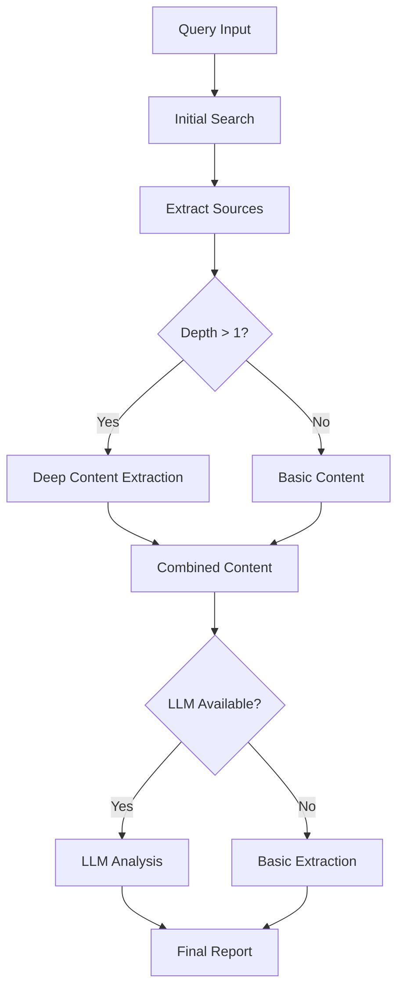
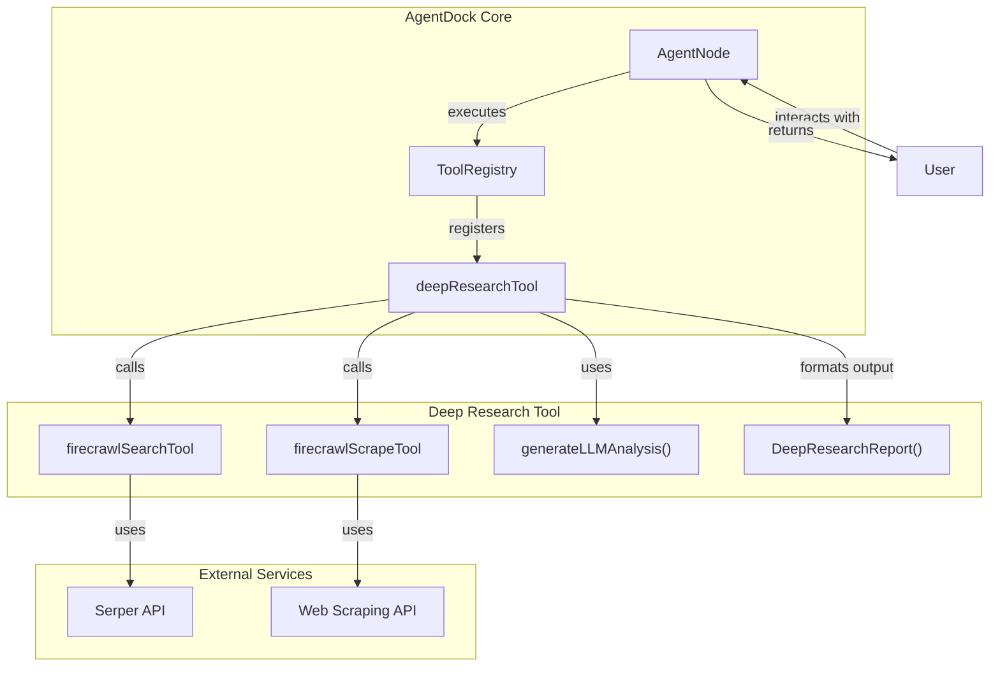
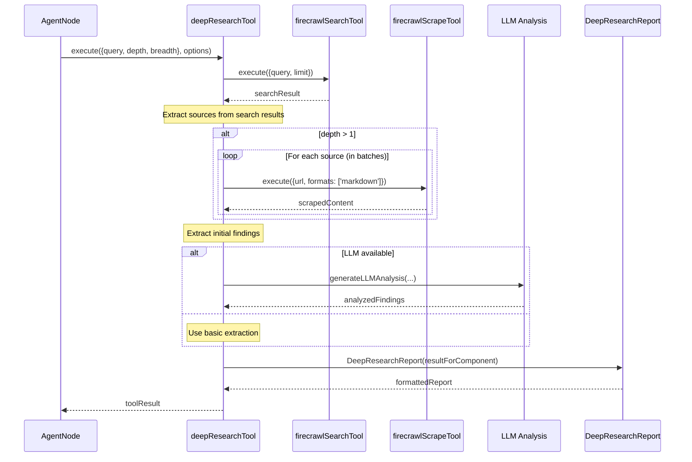
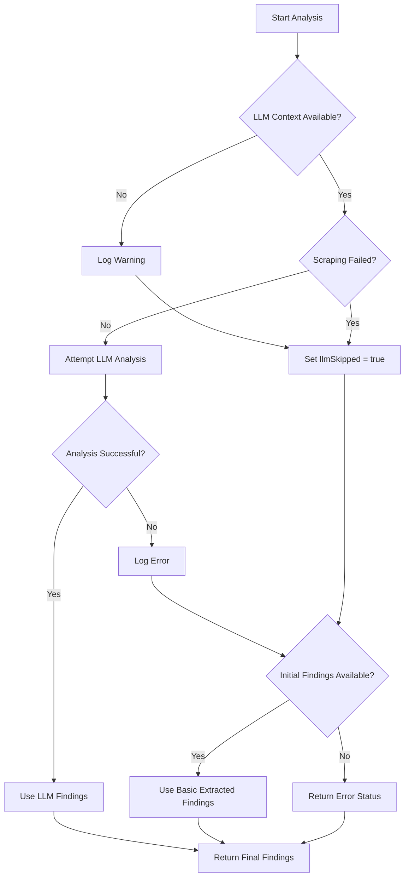

<!-- source: DeepWiki mcp.deepwiki.com · repo AgentDock/AgentDock · page 5.3 Deep Research Tool · fetched 2026-10-26 -->

# Deep Research Tool

<details>
<summary>Relevant source files</summary>

The following files were used as context for generating this wiki page:

- [agents/harvey-specter/template.json](agents/harvey-specter/template.json)
- [agents/mental-health-guide/template.json](agents/mental-health-guide/template.json)
- [agents/research-agent/template.json](agents/research-agent/template.json)
- [src/app/docs/layout.tsx](src/app/docs/layout.tsx)
- [src/nodes/deep-research/README.md](src/nodes/deep-research/README.md)
- [src/nodes/deep-research/components.ts](src/nodes/deep-research/components.ts)
- [src/nodes/deep-research/index.ts](src/nodes/deep-research/index.ts)
- [src/nodes/search/index.ts](src/nodes/search/index.ts)

</details>


The Deep Research Tool is a specialized component within the AgentDock framework that provides comprehensive research capabilities by combining web search, content extraction, and intelligent analysis. It enables agents to perform thorough investigations on topics, extracting key findings from multiple sources and presenting them in a structured format. This document explains the tool's architecture, functionality, implementation details, and integration points.

For information about simpler web search capabilities, see [Search and API Tools](#5.4).

## Overview

The Deep Research Tool extends beyond basic search by providing deeper content extraction and analysis. It follows a multi-step process that includes searching for relevant sources, extracting detailed content from those sources, analyzing the information to identify key findings, and generating a comprehensive research report.



Sources: [src/nodes/deep-research/README.md:71-87]()

## Architecture and Integration

The Deep Research Tool is a node in the AgentDock system that integrates with the Tool Registry. It leverages the Firecrawl tools for search and content scraping, while optionally using the agent's LLM for enhanced analysis.



Sources: [src/nodes/deep-research/index.ts:6-13](), [src/nodes/deep-research/index.ts:380-470]()

## Tool Parameters

The Deep Research Tool accepts the following parameters:

| Parameter | Type | Description | Default | Range |
|-----------|------|-------------|---------|-------|
| query | string | The research query to investigate | (required) | - |
| depth | number | Depth of research | 1 | 1-3 |
| breadth | number | Number of sources to search | 5 | 3-15 |

Depth levels represent:
- **1**: Basic search only
- **2**: Search + content extraction from top sources
- **3**: Comprehensive research with more extensive content extraction

Sources: [src/nodes/deep-research/index.ts:19-26](), [src/nodes/deep-research/README.md:15-22]()

## Implementation Details

### Core Components

The Deep Research Tool is implemented with the following key components:

1. **Main Tool Implementation**: `deepResearchTool` - Handles the execution flow and orchestrates the research process.
2. **UI Component**: `DeepResearchReport` - Formats the research results into a structured report.
3. **Helper Functions**:
   - `performSearch`: Executes web searches using Firecrawl
   - `getDeepContent`: Retrieves and processes content from sources
   - `extractKeyFindings`: Extracts important information from content
   - `generateLLMAnalysis`: Uses LLM to enhance findings
   - `safelyHandleError`: Provides consistent error handling

Sources: [src/nodes/deep-research/index.ts:380-463](), [src/nodes/deep-research/components.ts:28-96]()

### Research Workflow

The tool follows a carefully designed workflow:



Sources: [src/nodes/deep-research/index.ts:384-458]()

### Error Handling and Rate Limiting

The tool implements robust error handling throughout the research process:

1. **Input Validation**: Ensures query is not empty and parameters are within acceptable ranges.
2. **Search Errors**: Catches and reports errors during the search phase.
3. **Scraping Failures**: Handles failures when extracting content from sources.
4. **Rate Limiting Detection**: Detects and reports when API rate limits are reached.
5. **LLM Fallback**: Falls back to basic extraction if LLM analysis is unavailable or fails.

Sources: [src/nodes/deep-research/index.ts:31-34](), [src/nodes/deep-research/index.ts:427-435](), [src/nodes/deep-research/index.ts:268-273]()

## LLM Integration

The tool leverages the agent's LLM capabilities to enhance research quality when available:

### Analysis Process

The `generateLLMAnalysis` function is central to the LLM integration:

1. It checks if the LLM context is available in the provided options.
2. If available, it cleans the collected content and prepares a prompt for analysis.
3. It asks the LLM to extract key factual findings from the research content.
4. It processes the LLM response to remove headers and formatting.
5. If LLM analysis fails or is unavailable, it falls back to basic extraction.

Sources: [src/nodes/deep-research/index.ts:245-374]()

### LLM Prompt Design

The tool uses a specialized prompt to guide the LLM in extracting findings:

```
Analyze the following RESEARCH CONTENT regarding "${query}". 
          
Extract 10-15 key factual findings about this topic. Focus on the most significant information including:
- Important facts, statistics, and data points
- Key concepts, theories, or methodologies 
- Significant developments, trends, or innovations
- Expert opinions or consensus views
- Challenges, limitations, or controversies

IMPORTANT INSTRUCTIONS:
- Present each finding as a complete, standalone sentence with specific information
- Start each finding directly with the actual information (no titles or labels)
- DO NOT include headings like "Key Findings" or "Factual Findings" in your response
- DO NOT number your findings - I will add the numbers later
- DO NOT include introductory text like "Here are the findings" or "Based on the research"
- Each finding should be on its own line
```

Sources: [src/nodes/deep-research/index.ts:289-305]()

### Fallback Mechanism

The tool implements a robust fallback mechanism when LLM analysis is unavailable:



Sources: [src/nodes/deep-research/index.ts:254-373]()

## Report Structure

The Deep Research Report generates a structured output with the following sections:

1. **Title**: Shows the research query
2. **Status Notes**: Optional notifications about rate limits or errors
3. **Key Findings**: Numbered list of important facts and information
4. **Research Statistics**: Metadata about depth, breadth, and sources analyzed
5. **Sources**: List of all sources referenced in the research

Example report format:

```
# Deep Research Report: "Your Query"

[Optional Status Notes]

## Key Findings

1. First important finding about the topic
2. Second important finding about the topic
...

## Research Statistics

- **Depth**: 2 (Search + content extraction)
- **Breadth**: 5 sources requested
- **Sources analyzed**: 4 unique sources
- **Findings extracted**: 10 key points

## Sources

1. [Source Title 1](URL) (domain.com)
2. [Source Title 2](URL) (domain.com)
...
```

Sources: [src/nodes/deep-research/components.ts:28-96](), [src/nodes/deep-research/README.md:51-60]()

## Usage in Agent Templates

The Deep Research Tool can be integrated into any agent template by including `"deep_research"` in the template's `nodes` array. This is exemplified in the Research Assistant agent template:

```json
{
    "nodes": [
        "llm.anthropic",
        "search",
        "deep_research"
    ]
}
```

The Research Assistant agent is specifically configured to leverage the Deep Research Tool alongside basic search capabilities and uses Claude as its LLM.

Sources: [agents/research-agent/template.json:17-21]()

## Performance Considerations

### Batch Processing

To optimize performance and manage API rate limits, the tool processes sources in batches:

```typescript
// Process sources in batches to avoid overwhelming the system
const batchSize = 5;
const batches = Math.ceil(sourcesToScrape.length / batchSize);
  
for (let batchIndex = 0; batchIndex < batches; batchIndex++) {
  const batchStart = batchIndex * batchSize;
  const batchEnd = Math.min(batchStart + batchSize, sourcesToScrape.length);
  const currentBatch = sourcesToScrape.slice(batchStart, batchEnd);
  
  // Process each source in current batch with Promise.all
  const batchPromises = currentBatch.map(async (source) => {
    // Scraping logic...
  });
    
  // Wait for all promises in the batch to resolve
  const batchResults = await Promise.all(batchPromises);
}
```

This approach prevents overwhelming external APIs while still maintaining parallel processing within each batch.

Sources: [src/nodes/deep-research/index.ts:137-237]()

### Content Cleaning and Extraction

The tool employs multiple content cleaning strategies to ensure high-quality findings:

1. **Error Removal**: Strips error messages and formatting artifacts
2. **Content Extraction**: Identifies and extracts the most relevant content sections
3. **Link Cleaning**: Removes link markdown syntax while preserving text
4. **Duplicate Prevention**: Ensures each source is only listed once in the final report

Sources: [src/nodes/deep-research/index.ts:39-87](), [src/nodes/deep-research/components.ts:101-124]()

## Example Tool Execution

Here's a simplified example of using the Deep Research Tool from code:

```typescript
const result = await deepResearchTool.execute({
  query: "Latest advancements in quantum computing",
  depth: 2,
  breadth: 5
}, {
  toolCallId: "research-123",
  sessionId: "session-456",
  llmContext: { llm: myLLMInstance }
});
```

When integrated with an agent, the agent handles calling the tool and incorporating the results into its reasoning process.

Sources: [src/nodes/deep-research/README.md:41-49]()

## Integration with Agents

The Deep Research Tool is designed for iterative, agent-driven research workflows:

1. The agent calls the tool with an initial query
2. The tool returns structured findings and sources
3. The agent analyzes the findings and decides on follow-up queries
4. The agent makes additional tool calls with refined queries

This approach allows for sophisticated research patterns rather than trying to handle all research recursion internally.

Sources: [src/nodes/deep-research/README.md:97-106]()

---

