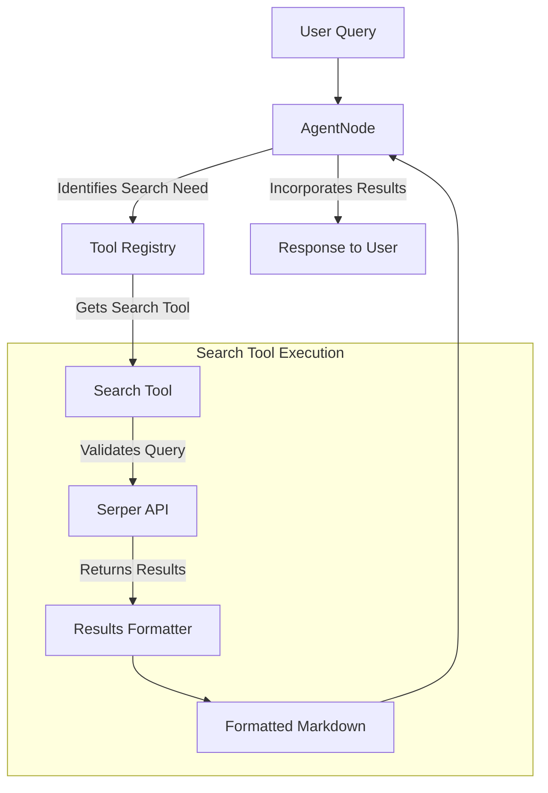
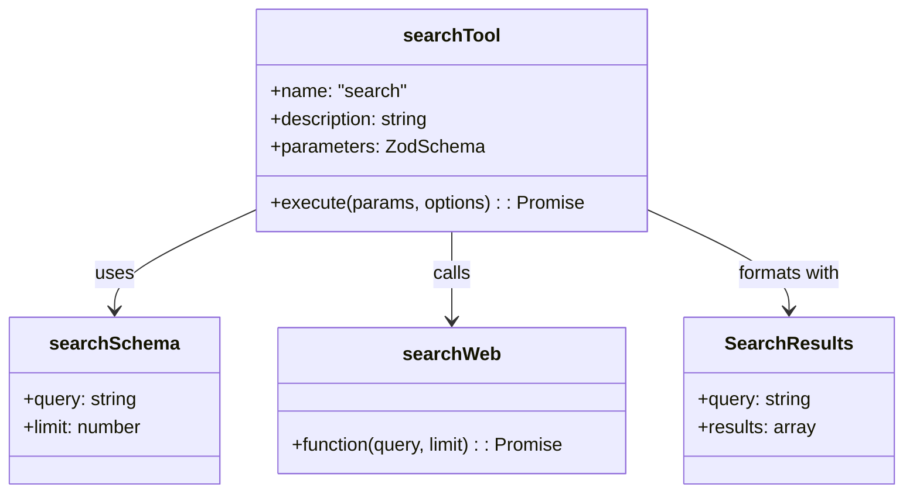
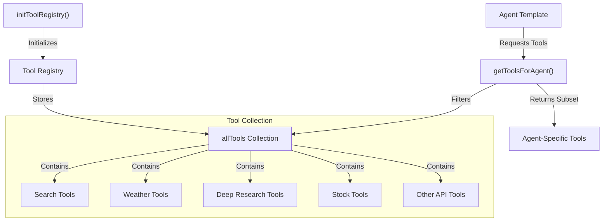
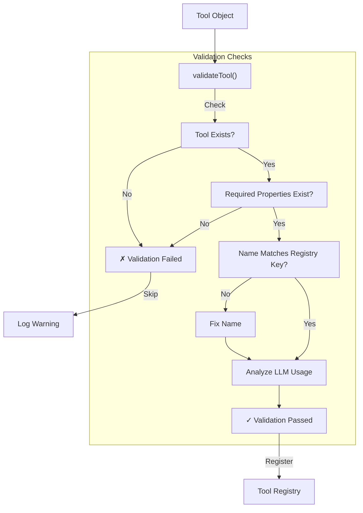
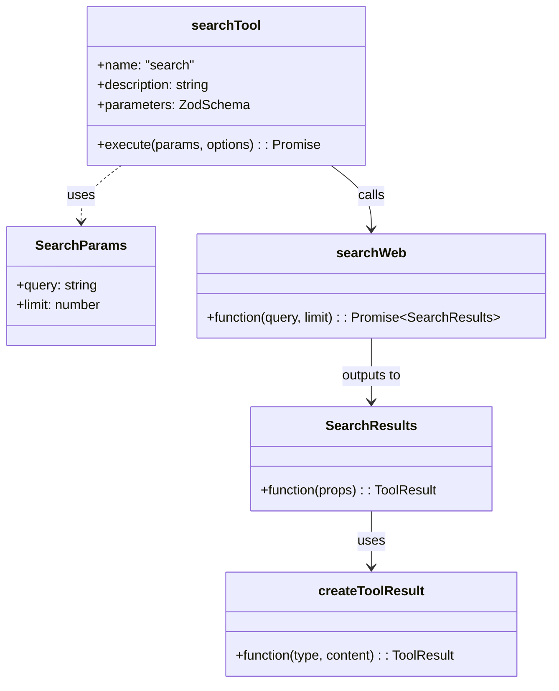
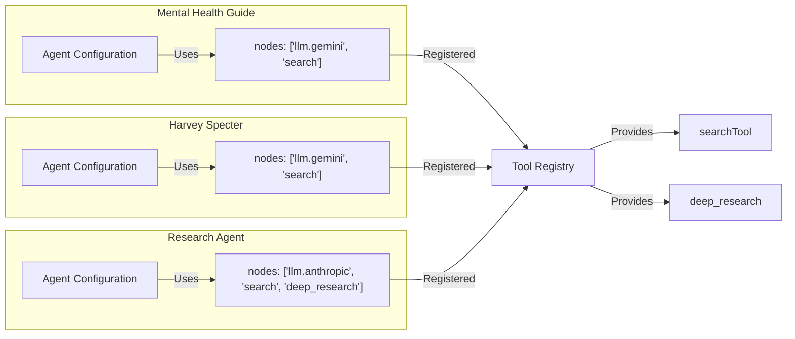
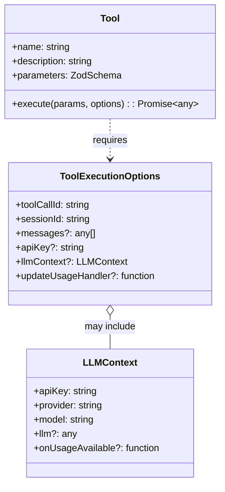
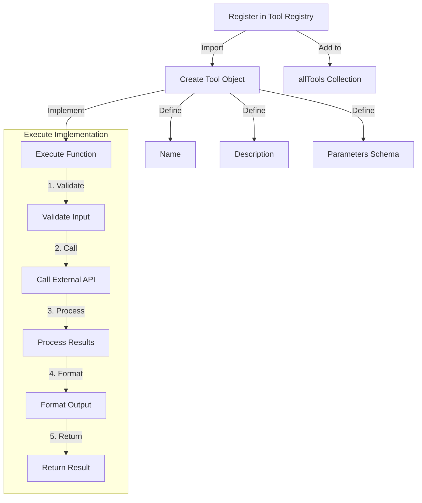

<!-- source: DeepWiki mcp.deepwiki.com · repo AgentDock/AgentDock · page 5.4 Search and API Tools · fetched 2026-10-26 -->

# Search and API Tools

<details>
<summary>Relevant source files</summary>

The following files were used as context for generating this wiki page:

- [agents/harvey-specter/template.json](agents/harvey-specter/template.json)
- [agents/mental-health-guide/template.json](agents/mental-health-guide/template.json)
- [agents/research-agent/template.json](agents/research-agent/template.json)
- [src/app/docs/layout.tsx](src/app/docs/layout.tsx)
- [src/nodes/init.ts](src/nodes/init.ts)
- [src/nodes/registry.ts](src/nodes/registry.ts)
- [src/nodes/search/index.ts](src/nodes/search/index.ts)
- [src/nodes/types.ts](src/nodes/types.ts)
- [src/nodes/weather/components.ts](src/nodes/weather/components.ts)

</details>


This document provides a detailed overview of the search tools and API-based tools in the AgentDock system. It covers the implementation of web search capabilities, the architecture of external API integration, and how these tools are registered, configured, and used by agents in the system. For information about the Deep Research tool, see [Deep Research Tool](#5.3).

## 1. Search Tool Architecture

The Search tool in AgentDock provides web search capabilities via the Serper API, allowing agents to retrieve information from the internet. This is one of the most frequently used tools in the system, enabling agents to access up-to-date information beyond their training data.

### Search Tool Components



The search tool follows these steps:
1. An agent identifies the need to search for information
2. The agent requests the search tool from the registry
3. The search tool validates the query and formats the request
4. The query is sent to the Serper API
5. Results are returned and formatted into markdown for the agent
6. The agent incorporates the search results into its response

Sources: [src/nodes/search/index.ts:1-93]()

### Search Tool Integration



The search tool architecture follows the standard tool pattern in AgentDock:
- A schema defines the required parameters (query string and optional result limit)
- The execute function handles input validation and error management
- External API calls are abstracted through utility functions
- Results are formatted in a standardized way for agent consumption

Sources: [src/nodes/search/index.ts:16-93]()

## 2. Tool Registration System

The Tool Registration system manages the lifecycle of all tools, including search and API tools, making them available to agents in a standardized way.

### Tool Registry Architecture



The Tool Registry system consists of:
1. A centralized registry that stores all available tools
2. An initialization process that registers tools only once
3. Validation to ensure tools meet the required interface
4. Functions to retrieve specific tools for agents based on their configuration

Sources: [src/nodes/init.ts:1-152](), [src/nodes/registry.ts:1-178]()

### Tool Validation Process



Each tool undergoes validation before registration:
- Checks if the tool exists and is not null
- Verifies required properties: description, parameters, execute
- Ensures the tool name matches its registry key
- Analyzes and logs LLM usage patterns for debugging

Sources: [src/nodes/init.ts:24-80]()

## 3. Search Tool Implementation

The Search tool implementation handles query execution, error management, and result formatting, providing a seamless interface for agents to retrieve information from the web.

### Core Components



The search tool consists of:
- A parameter schema defining required search parameters
- The core execution function that processes queries
- Error handling and validation logic
- Formatting utilities to present results consistently

Sources: [src/nodes/search/index.ts:16-93]()

### Error Handling

The search tool implements robust error handling to provide meaningful feedback when searches fail:

| Error Type | Description | Suggested Resolution |
|------------|-------------|----------------------|
| Empty Query | User provided an empty search query | Prompt for a non-empty query |
| Missing API Key | SERPER_API_KEY environment variable not found | Configure Serper API key in environment |
| API Error | Error from the Serper API service | Check for rate limiting, invalid key, or service outage |
| Generic Error | Any other unexpected error | Retry with a different query |

Each error type is formatted consistently and includes a descriptive message and resolution guidance.

Sources: [src/nodes/search/index.ts:54-84]()

## 4. Usage in Agent Templates

Agent templates define which tools are available to an agent and how they are configured. The search tool is commonly used across multiple agent templates.

### Example Configurations



Agent templates specify:
- Which tools the agent can access (e.g., 'search' and 'deep_research')
- Which LLM provider and model to use
- Personality guidance for how to use the tools
- Configuration settings for the agent

Sources: [agents/mental-health-guide/template.json:1-71](), [agents/harvey-specter/template.json:1-65](), [agents/research-agent/template.json:1-49]()

### Tool Configuration Examples

| Agent | Tools | LLM Provider | Primary Use |
|-------|-------|-------------|------------|
| Mental Health Guide | search | Gemini | Finding mental health resources and information |
| Harvey Specter | search | Gemini | Legal research and case building |
| Research Assistant | search, deep_research | Claude | Comprehensive research tasks |

Each agent is configured to use the search tool in ways that complement its role and personality.

Sources: [agents/mental-health-guide/template.json:17-24](), [agents/harvey-specter/template.json:14-22](), [agents/research-agent/template.json:12-21]()

## 5. Tool Interface and Types

All tools in AgentDock, including search and API tools, implement a standardized interface defined by the `Tool` type, ensuring consistency across the system.

### Tool Interface



Key components of the tool interface:
- `name`: Unique identifier for the tool
- `description`: Human-readable description for the LLM to understand
- `parameters`: Zod schema defining required and optional parameters
- `execute`: Function that performs the tool's action with the given parameters

Sources: [src/nodes/types.ts:1-80]()

## 6. Creating Custom API Tools

Developers can create custom API tools by following the standardized pattern used by existing tools like the search tool.

### Custom Tool Implementation Pattern



Steps to create a custom API tool:
1. Define a Zod schema for the tool's parameters
2. Create a tool object with name, description, and parameters
3. Implement the execute function to handle the API call
4. Format the results using utility functions
5. Register the tool in the registry

Sources: [src/nodes/search/index.ts:16-93](), [src/nodes/registry.ts:22-34]()

### Tool Result Formatting

Custom tools should format their results consistently using utility functions like `createToolResult`:

```typescript
return createToolResult(
  'search_results',   // Unique type identifier
  formattedContent    // Markdown-formatted content
);
```

This consistent formatting ensures that results are presented uniformly to agents and users.

Sources: [src/nodes/search/index.ts:50-53](), [src/nodes/weather/components.ts:271-277]()

## Summary

The Search and API Tools in AgentDock provide a standardized way for agents to interact with external data sources and services. The search tool specifically allows agents to retrieve up-to-date information from the web, while the tool registration system ensures that all tools follow a consistent pattern and can be easily used by different agents.

Key components include:
- The search tool implementation that interfaces with the Serper API
- The tool registration system that manages tool lifecycle
- Agent templates that configure which tools are available
- Standardized interfaces that ensure consistency across tools

These components work together to provide agents with the ability to access and process external information, significantly enhancing their capabilities beyond their pre-trained knowledge.

---

